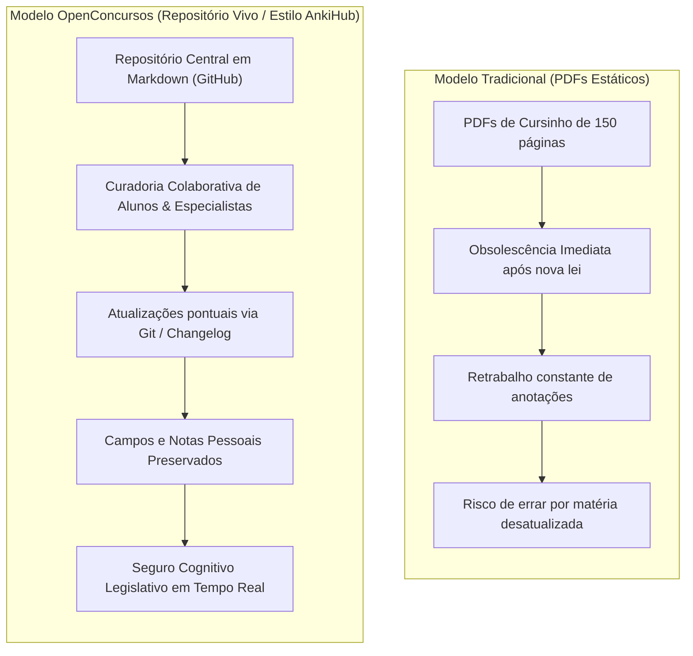

# 🏛️ OpenConcursos

> **A Base de Conhecimento Aberta e Repositório Vivo para Estudantes de Concursos Públicos.**  
> Inspirado na filosofia colaborativa e de sincronização contínua do **AnkiHub**, aplicado às carreiras de elite: **Fiscal (Receita Federal, SEFAZ, ISS)** e **Controle (TCU, CGU, TCEs)**.

---

## 🧭 Manifesto: O Fim do Material Estático

O modelo tradicional de estudo para concursos no Brasil é refém de um gargalo crônico: **a obsolescência veloz das apostilas em PDF**. 

Quando uma emenda constitucional é promulgada, uma lei complementar é publicada ou o STF fixa um tema de repercussão geral, o PDF que o estudante comprou semanas atrás torna-se perigoso. Se o cursinho lança uma "nova versão", o aluno enfrenta o pesadelo de transferir manualmente meses de anotações pessoais ou recomeçar do zero.

O **OpenConcursos** resolve esse problema importando a revolução que o **AnkiHub** operou na preparação médica internacional (USMLE): a transição de arquivos isolados para um **Repositório Vivo e Centralizado de Conhecimento**.

---

## ⚡ Princípios Fundamentais da Nossa Arquitetura

1. **Seguro Cognitivo Permanente:** O estudante revisa com a segurança de saber que o conteúdo reflete a lei e a jurisprudência vigentes no dia de hoje.
2. **BLUF (Bottom Line Up Front):** O conceito nuclear, o impacto prático e a regra de ouro são explicados nos primeiros 30 segundos de leitura, sem rodeios ou conversas informais de aula.
3. **Ancoragem Direta em Fontes Primárias:** Citação exata dos artigos da Constituição, leis (CTN, LRF, Leis 14.133, 4.320), normas técnicas (CPCs, NBASP) e súmulas dos tribunais superiores, em vez de paráfrases prolixas de professores.
4. **Diagramas Nativos em Código (Mermaid):** Fluxogramas lógicos, árvores de decisão e linhas do tempo renderizados nativamente no GitHub.
5. **Matrizes Anti-Pegadinha de Bancas:** Quadros comparativos destacando a diferença cirúrgica entre a letra da lei e as armadilhas clássicas da FGV, Cebraspe, FCC e Vunesp.
6. **IA-Ready (Source-Grounded):** Verbetes limpos e modulares, projetados para serem ingeridos por **Google NotebookLM**, **Claude** ou **Gemini** com taxa zero de alucinação jurídica.

---

## 📚 Matriz Geral de Disciplinas (20 Matérias)

Estruturada a partir da espinha dorsal do concurso de **Auditor Fiscal da Receita Federal do Brasil**, aplicável a qualquer concurso fiscal, aduaneiro ou de controle:

| # | Disciplina | Escopo Temático Principal | Status |
| :-: | :--- | :--- | :-: |
| **01** | [**Língua Portuguesa**](docs/01-lingua-portuguesa/README.md) | Sintaxe, Coesão/Coerência, Fatores de Textualidade e Redação Oficial | 🟡 Em estruturação |
| **02** | [**Língua Inglesa**](docs/02-lingua-inglesa/README.md) | Vocabulário técnico de comércio internacional, economia e tributação | 🟡 Em estruturação |
| **03** | [**Raciocínio Lógico-Matemático**](docs/03-raciocinio-logico-matematico/README.md) | Lógica de proposições, equivalências, diagramas lógicos e análise combinatória | 🟡 Em estruturação |
| **04** | [**Estatística**](docs/04-estatistica/README.md) | Estatística Descritiva, Probabilidades, Variáveis Aleatórias e Inferência | 🟡 Em estruturação |
| **05** | [**Economia e Finanças Públicas**](docs/05-economia-e-financas-publicas/README.md) | Micro, Macro, Teoria da Tributação, Bens Públicos e Falhas de Mercado | 🟡 Em estruturação |
| **06** | [**Administração Financeira e Orçamentária (AFO)**](docs/06-administracao-financeira-orcamentaria-afo/README.md) | PPA/LDO/LOA, Ciclo Orçamentário, LRF (LC 101/00), Receita e Despesa Pública | 🟡 Em estruturação |
| **07** | [**Fluência em Dados**](docs/07-fluencia-em-dados/README.md) | Bancos de Dados, SQL, Modelagem Relacional/Dimensional, Python e R | 🟡 Em estruturação |
| **08** | [**Direito Constitucional**](docs/08-direito-constitucional/README.md) | Direitos Fundamentais, Organização do Estado, Processo Legislativo e Controle | 🟡 Em estruturação |
| **09** | [**Direito Administrativo**](docs/09-direito-administrativo/README.md) | Regime Jurídico, Atos, Poderes, Licitações (Lei 14.133) e Improbidade (Lei 8.429) | 🟡 Em estruturação |
| **10** | [**Direito Tributário**](docs/10-direito-tributario/README.md) | Sistema Tributário na CF/88, CTN, Obrigação, Lançamento e Crédito Tributário | 🟡 Em estruturação |
| **11** | [**Reforma Tributária**](docs/11-reforma-tributaria/README.md) | EC 132/2023, LC 214/2025, LC 227/2026 (IBS, CBS, Imposto Seletivo e Transição) | 🟡 Em estruturação |
| **12** | [**Legislação Tributária Federal**](docs/12-legislacao-tributaria-federal/README.md) | Tributos Federais (IRPF, IRPJ, CSLL, PIS/Cofins, IPI) e PAF (Dec. 70.235/72) | 🟡 Em estruturação |
| **13** | [**Legislação Aduaneira**](docs/13-legislacao-aduaneira/README.md) | Regulamento Aduaneiro (Dec. 6.759/09), Território, Regimes Especiais e Perdimento | 🟡 Em estruturação |
| **14** | [**Comércio Internacional**](docs/14-comercio-internacional/README.md) | Incoterms 2020, OMC, Valoração Aduaneira (GATT), Barreiras e Defesa Comercial | 🟡 Em estruturação |
| **15** | [**Direito Previdenciário**](docs/15-direito-previdenciario/README.md) | Seguridade Social, Custeio Previdenciário, Contribuições Sociais e RGPS/RPPS | 🟡 Em estruturação |
| **16** | [**Contabilidade Geral e Avançada**](docs/16-contabilidade-geral-e-avancada/README.md) | Pronunciamentos Técnicos CPC (00, 01, 16, 25, 27, etc.), BP, DRE, DFC e DVA | 🟡 Em estruturação |
| **17** | [**Análise das Demonstrações Contábeis**](docs/17-analise-das-demonstracoes-contabeis/README.md) | Análise Vertical/Horizontal, Índices de Liquidez, Rentabilidade, Dupont e Capital | 🟡 Em estruturação |
| **18** | [**Contabilidade Pública (CASP)**](docs/18-contabilidade-publica/README.md) | PCASP, Variações Patrimoniais (VPA/VPD), MCASP e Balanços da Lei 4.320/64 | 🟡 Em estruturação |
| **19** | [**Auditoria Governamental e Privada**](docs/19-auditoria/README.md) | Normas NBC TA / NBASP (ISSAI), Planejamento, Matriz de Achados e Relatórios | 🟡 Em estruturação |
| **20** | [**Administração Geral e Pública**](docs/20-administracao-geral-e-publica/README.md) | Planejamento Estratégico, Governança, Gestão de Processos e Políticas Públicas | 🟡 Em estruturação |

---

## 🔍 Como Consultar e Estudar pelo Repositório

### 1. No Próprio GitHub (Navegação Instantânea)
* **Atalho `t` (Fuzzy Search):** Em qualquer tela do repositório no navegador, aperte a tecla `t` e comece a digitar o nome de qualquer assunto (ex: `credito-tributario`, `nbasp`, `balanco`, `despesa-com-pessoal`) para abrir o arquivo em milissegundos.
* **Índices de Matéria:** Cada pasta de disciplina possui seu próprio `README.md` funcionando como mapa conceitual e guia passo a passo da matéria.

### 2. Integração com Ferramentas de Estudo e IA
* **Obsidian / Logseq:** Você pode clonar ou baixar este repositório como um cofre (*vault*) local, aproveitando links bidirecionais e navegação por grafos.
* **Google NotebookLM:** O padrão de texto puro em Markdown, livre de caixas-pretas de formatação, é o formato ideal para ser adicionado como fonte em cadernos do NotebookLM. Você ganha um tutor que responde com base estrita no ordenamento atualizado.
* **Anki Desktop:** Os resumos mnemônicos e pontos de jurisprudência possuem formato atômico pré-formatado para geração rápida de cards de repetição espaçada.

---

## 📌 Padrão Visual de Alertas (GitHub Flavored Markdown)

Ao ler os verbetes, os blocos de alerta identificam imediatamente o tipo de informação:

> [!NOTE]
> **Fundamentação Conceitual:** Regra geral, definição doutrinária pacífica ou histórico do instituto.

> [!TIP]
> **Mnemônico & Resolução Rápida:** Atalhos de memória e estratégias para matar o item em menos de 30 segundos.

> [!IMPORTANT]
> **Dispositivo Legal Obrigatório:** A letra da lei que deve ser decorada de forma compulsória.

> [!WARNING]
> **Armadilha de Banca (Pegadinha):** Como os examinadores da FGV, Cebraspe e FCC alteram palavras-chave para induzir ao erro.

> [!CAUTION]
> **Alerta de Atualização Recente:** Alterações legislativas recentes (ex: regulamentações da EC 132/23) ou temas pendentes de julgamento com repercussão geral.

---

## 🤝 Filosofia de Contribuição e Curadoria

Assim como no **AnkiHub**, a base só se mantém relevante graças à inteligência coletiva dos próprios estudantes.

* Encontrou uma lei revogada?
* O STF publicou um acórdão novo que superou uma súmula antiga?
* Uma banca cobrou uma pegadinha inédita sobre o tema?

Abra uma **Issue** ou submeta um **Pull Request**. Os cur совмеadores auditam a fonte primária oficial e aprovam a atualização para toda a comunidade.

Para entender os padrões de escrita e as regras de blindagem jurídica, consulte:
* 📄 [Template Oficial de Verbete](docs/00-guia-editorial/TEMPLATE_VERBETE.md)
* 🛡️ [Método de Blindagem Antiplágio (Lei 9.610/98)](docs/00-guia-editorial/METODO_ANTIPLAGIO.md)
* 📘 [Guia de Contribuição e Boas Práticas](docs/00-guia-editorial/GUIA_CONTRIBUICAO.md)

---

## ⚖️ Licença

Este projeto é distribuído sob a licença **Creative Commons Atribuição-CompartilhaIgual 4.0 Internacional (CC BY-SA 4.0)**. O conhecimento das normas públicas é livre e compartilhado; as obras derivadas devem manter o caráter aberto e atribuir a autoria ao projeto.
