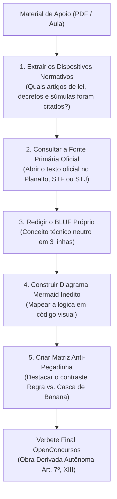

# 🛡️ Método de Blindagem Antiplágio e Segurança Jurídica

> **Fundamentação Legal:** Lei Federal nº 9.610, de 19 de fevereiro de 1998 (Lei de Direitos Autorais).

---

## 1. O Princípio da Legalidade Autoral

O mercado de concursos é farto em materiais apostilados produzidos por cursos preparatórios. Para que o **OpenConcursos** seja um repositório comunitário perene, seguro e inatacável, todo colaborador deve dominar a distinção entre **atos oficiais** e **obras intelectuais de terceiros**.

---

## 2. O que É de Domínio Público (Livre Utilização)

Conforme o **Art. 8º da Lei nº 9.610/1998**, **NÃO** são objeto de proteção como direitos autorais:

1. **Textos de Leis e Atos Oficiais (Inciso IV):**
   * Constituição Federal de 1988;
   * Leis Complementares, Leis Ordinárias e Medidas Provisórias;
   * Decretos, Portarias, Instruções Normativas e Resoluções;
   * Decisões judiciais, Acórdãos, Súmulas Vinculantes e Súmulas do STF, STJ, TST, TSE e TCU.
2. **Conceitos, Teorias e Sistemas Abstratos (Inciso I):**
   * As ideias, métodos de cálculo, doutrinas jurídicas abstratas (ex: Teoria Pentapartida dos Tributos, Princípios Orçamentários, Fatos Contábeis) não pertencem a nenhum professor ou curso.
3. **Questões de Provas Públicas:**
   * Enunciados de concursos oficiais elaborados por bancas examinadoras (FGV, Cebraspe, FCC, Vunesp) são documentos estatais de certames públicos.

---

## 3. O que É Protegido por Direitos Autorais (PROIBIDO COPIAR)

É terminantemente proibido inserir no repositório:

* **Textos Explicativos Autorais:** Parágrafos redigidos por professores explicando o conteúdo com palavras próprias.
* **Exemplos Fictícios Proprietários:** Casos criados pelo professor durante a aula (ex: *"Imagine o Joãozinho que sonegou imposto da sua padaria..."*).
* **Imagens, Tabelas Gráficas e Diagramas Diagramados pelos Cursos:** Layouts visuais produzidos pelo time de diagramação dos cursinhos.
* **Comentários de Questões Feitos por Professores:** O texto de análise de uma alternativa assinado por um autor comercial.

---

## 4. O Pipeline de Conversão: De Aula para Verbete Vivo

Ao estudar por uma aula em PDF ou vídeo de cursinho, aplique o seguinte procedimento de reengenharia:

---

## 5. Originalidade da Obra Derivada (Art. 7º, XIII)

A compilação estruturada, as matrizes de comparação, os mnemônicos inéditos e os fluxogramas criados para o **OpenConcursos** configuram **obras intelectuais autônomas**. 

Seguindo esse protocolo, o repositório é juridicamente sólido, 100% blindado e entrega valor pedagógico infinitamente superior a uma mera colcha de retalhos.
