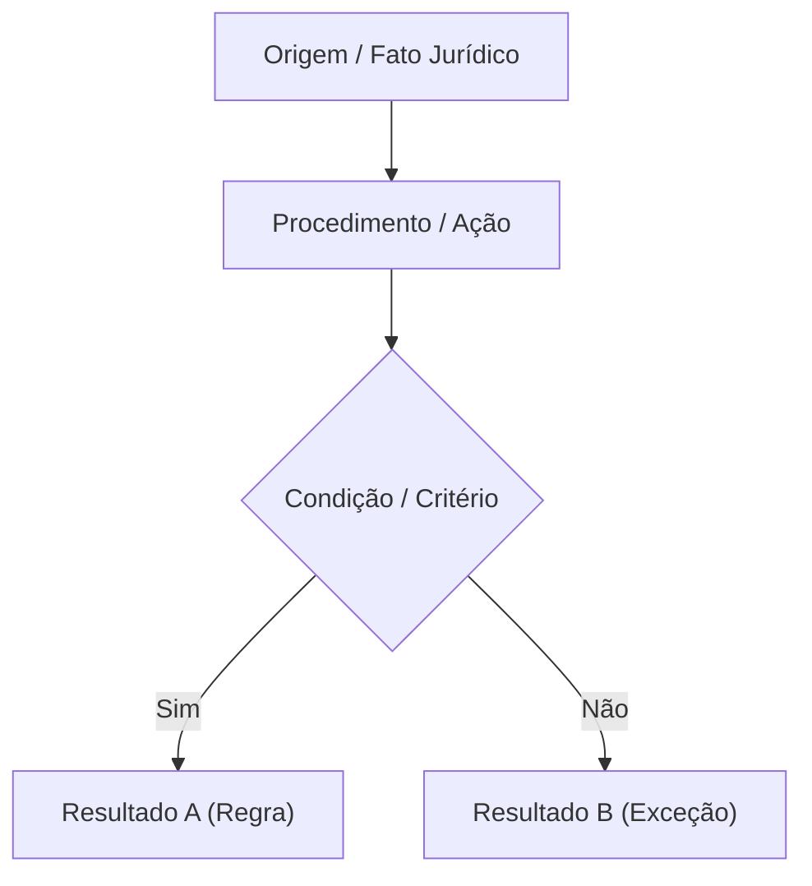

# [Título do Verbete sem Prefixo Numérico]

> Síntese de alto nível definindo o conceito nuclear, a fundamentação legal/normativa primária e a consequência prática imediata para provas. Deve estar em parágrafo único com blockquote simples.

---

## 1. Ancoragem em Fontes Primárias

- **Dispositivo Legal / Normativo Principal:** [Ex: Art. 151 do CTN / CPC 00 R2 / Art. 165 CF/88]
- **Texto Literal Relevante:**
  > *"Transcrever trecho essencial da norma legal com termos-chave em negrito."*
- **Requisitos Formais e Condições:**
  - Requisito 1: [...]
  - Requisito 2: [...]

---

## 2. Visão Sistêmica & Fluxograma (Mermaid)

---

## 3. Jurisprudência Pacificada & Súmulas

| Tribunal | Súmula / Tema Vinculante | Tese Fixada / Enunciado | Impacto em Questões |
| :--- | :--- | :--- | :--- |
| **STF** | Súmula Vinculante XX / Tema XXX | [...] | Afasta tese de [...] |
| **STJ** | Súmula XXX / Repetitivo | [...] | Exige prévia [...] |
| **TCU** | Acórdão XXXX/AAAA - Plenário | [...] | Caracteriza infração à [...] |

---

## 4. Matriz Anti-Pegadinha de Bancas

| Critério Analisado | Regra Geral da Lei | Exceção Prevista | Pegadinha Típica da Banca |
| :--- | :--- | :--- | :--- |
| **Requisito X** | [...] | [...] | Afirmar que a exceção é a regra geral. |
| **Competência** | [...] | [...] | Trocar Lei Ordinária por Lei Complementar. |
| **Efeito Prático** | [...] | [...] | Dizer que suspensão gera direito a repetição. |

> [!WARNING]
> **Casca de Banana Clássica:**  
> Explicar o raciocínio ardiloso utilizado por FGV, Cebraspe ou FCC para tentar induzir o candidato ao erro.

---

## 5. Mnemônicos & Âncoras de Memória

> [!TIP]
> **Mnemônico:** `[PALAVRA-CHAVE]`  
> - **Letra 1:** [...]  
> - **Letra 2:** [...]  
> - **Letra 3:** [...]

---

## 6. Questões Paradigmáticas Aplicadas

### [Questão 01](https://www.qconcursos.com/questoes-de-concursos/questoes/...) — [Banca — Órgão / Cargo — Ano]
**Enunciado:**  
[...]

* (A) [...]  
* (B) [...]  
* (C) [...]  
* (D) [...]  
* (E) [...]  

#### Gabarito: **X**

* **A (Errada):** Justificativa curta, direta e fundamentada no artigo de lei ou norma.
* **B (Errada):** Justificativa curta e direta.
* **C (Certa):** Dispositivo legal ou normativo que valida a alternativa.
* **D (Errada):** Justificativa curta e direta.
* **E (Errada):** Justificativa curta e direta.

> **Fique Ligado:** Ponto-chave da questão para memorização rápida.

---

## 7. Verbetes Conexos & Próximos Passos

- 🔗 [Verbete Antecessor ou Macro-tema](link.md)
- 🔗 [Verbete Subsequente ou Aplicação Prática](link.md)
