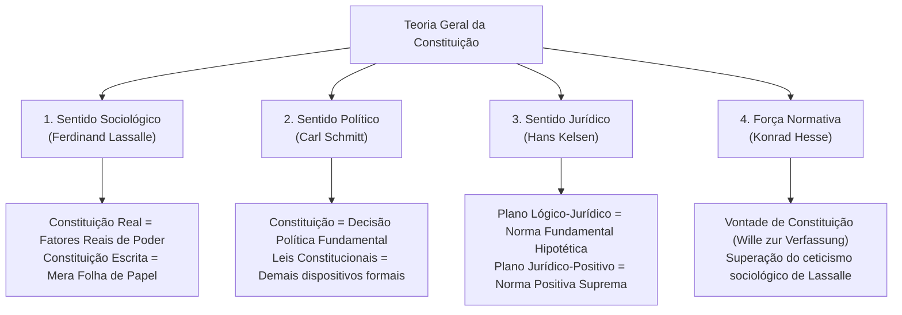
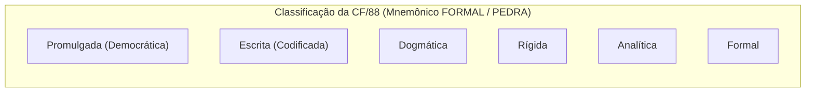
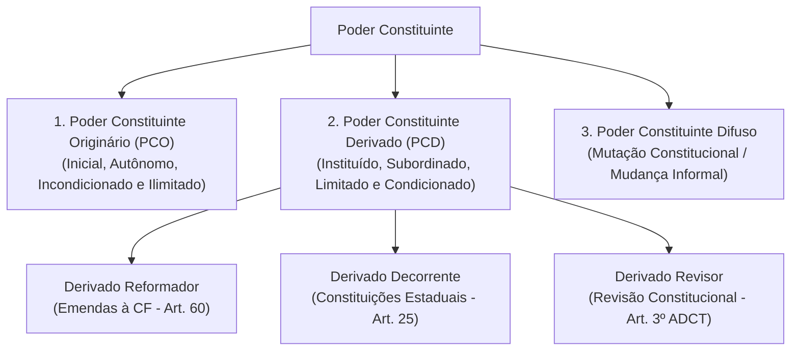

# Teoria da Constituição, Conceito, Classificações e Poder Constituinte

> A Constituição é a norma jurídica fundamental e suprema de um Estado soberano, responsável por estruturar os poderes políticos, estabelecer a forma de Estado e de governo, e resguardar o núcleo irredutível dos direitos fundamentais. Sob o prisma do **Poder Constituinte**, opera-se a distinção entre a manifestação **Originária** (inicial, autônoma, incondicionada e juridicamente ilimitada, fundadora de uma nova ordem constitucional) e a manifestação **Derivada** (instituída, subordinada e juridicamente limitada), desdobrada nas espécies **Reformadora** (emendas constitucionais sob os limites formais, circunstanciais e materiais das cláusulas pétreas do art. 60 da CF/88) e **Decorrente** (capacidade de auto-organização dos Estados-membros mediante Constituições Estaduais sob o princípio da simetria federativa e os princípios sensíveis do art. 34, VII).

---

## 1. Concepções Teóricas e Sentidos de Constituição

Para resolver com segurança qualquer prova de concurso público de alto rendimento (FGV, Cebraspe, FCC), é indispensável dominar as concepções clássicas e contemporâneas que definem o fenômeno constitucional:

### 1.1. Sentido Sociológico (Ferdinand Lassalle)
* **Obra de Referência:** *A Essência da Constituição* (*Über Verfassungswesen*, 1862).
* **Conceito:** A Constituição real e efetiva de um país consiste na soma dos **fatores reais de poder** que regem a sociedade (as forças econômicas, militares, aristocráticas e financeiras em atuação concreta).
* **Distinção Fundamental:**
  * **Constituição Real e Efetiva:** A correlação empírica de forças materiais.
  * **Constituição Jurídica (Escrita):** Se a constituição escrita não corresponder fielmente aos fatores reais de poder, constitui mera **"folha de papel"** (*ein Stück Papier*), desprovida de eficácia perene e fadada à ruptura.

### 1.2. Sentido Político (Carl Schmitt)
* **Obra de Referência:** *Teoria da Constituição* (*Verfassungslehre*, 1928).
* **Conceito:** A Constituição é o fruto de uma **decisão política fundamental** tomada pelo titular do poder constituinte sobre o modo e a forma de existência da unidade política soberana.
* **Distinção entre Constituição e Leis Constitucionais:**
  * **Constituição Propriamente Dita:** Refere-se exclusivamente às matérias decorrentes da decisão política fundamental (organização dos poderes, forma de governo, forma de Estado e direitos fundamentais).
  * **Leis Constitucionais:** Dispositivos formais inseridos no corpo do texto constitucional que não versam sobre decisões políticas fundamentais (ex.: o art. 242, § 2º, da CF/88, que mantém o Colégio Pedro II na órbita federal).

### 1.3. Sentido Jurídico (Hans Kelsen)
* **Obra de Referência:** *Teoria Pura do Direito* (*Reine Rechtslehre*, 1934).
* **Conceito:** A Constituição é norma jurídica pura, imperativa e desprovida de contaminação sociológica, política, moral ou filosófica. É o fundamento supremo de validade de todo o ordenamento jurídico estatal.
* **Bifurcação Metodológica:**
  * **Sentido Lógico-Jurídico:** Situa-se no plano transcendental/hipotético. Consiste na **Norma Fundamental Hipotética** (*Grundnorm*), pressuposto axiológico implícito que comanda a observância da Constituição positiva vigente (*"obedeça-se à Constituição histórica"*).
  * **Sentido Jurídico-Positivo:** É a norma positiva posta no ápice da pirâmide jurídica do Estado escalonado, que serve de fundamento formal e material de validade para todas as leis infraconstitucionais.

### 1.4. A Força Normativa da Constituição (Konrad Hesse)
* **Obra de Referência:** *A Força Normativa da Constituição* (*Die normative Kraft der Verfassung*, 1959).
* **Confronto com Lassalle:** Hesse refuta o fatalismo sociológico de Lassalle. Para Hesse, a Constituição não é mera refém passiva dos fatores reais de poder; ela possui **força normativa autônoma** capaz de moldar e conformar a realidade social.
* **A "Vontade de Constituição" (*Wille zur Verfassung*):** A Constituição adquire força normativa vinculante quando os cidadãos e os governantes compartilham a consciência e a vontade inabalável de fazê-la valer no cotidiano, conferindo eficácia concreta aos preceitos constitucionais.

---

## 2. Neoconstitucionalismo e o Pós-Positivismo

O Neoconstitucionalismo (ou Pós-Positivismo Constitucional) marca a refundação dogmática do Direito Público na Europa após a Segunda Guerra Mundial e no Brasil a partir da Constituição de 1988:

| Eixo Analítico | Constitucionalismo Tradicional / Positivismo Estrito | Neoconstitucionalismo / Pós-Positivismo |
| :--- | :--- | :--- |
| **Centralidade do Sistema** | Primazia do Poder Legislativo e da Lei Ordinária. | Supremacia da Constituição e força normativa dos Princípios. |
| **Distinção Normativa** | Regras jurídicas como padrão único e fechado (*tudo ou nada*). | Dualidade entre **Regras** (subsunção) e **Princípios** (ponderação / sopesamento). |
| **Relação Direito e Moral** | Separação estrita entre Direito posto e Justiça/Moralidade. | Reaproximação do Direito com a Ética via princípios fundamentais (Dignidade Humana). |
| **Papel do Judiciário** | Juiz como mero aplicador mecânico da lei (*bouche de la loi*). | Juiz como garantidor da Constituição, concretizando direitos fundamentais e políticas públicas. |
| **Dimensão Subjetiva** | Direitos fundamentais como defesas negativas contra o Estado. | Direitos fundamentais dotados de eficácia vertical, horizontal e dimensão objetiva. |

---

## 3. Matriz Canônica de Classificação das Constituições

A taxonomia constitucional é cobrada com altíssima frequência em provas de carreiras jurídicas, fiscais e de controle:

### 3.1. Quadro Sinóptico de Classificações
* **1. Quanto ao Conteúdo:**
  * **Material (Substancial):** Compreende apenas o conjunto de normas que tratam da organização política do Estado e dos direitos fundamentais, independentemente de estarem num documento solene.
  * **Formal:** É todo o conjunto de normas inserido no texto solene da Constituição, independentemente da matéria versada (adotado pelo Brasil).
* **2. Quanto à Forma:**
  * **Escrita (Instrumental / Codificada):** Formalizada em um documento solene único (ex.: Brasil, EUA).
  * **Não Escrita (Costumeira / Consuetudinária / Histórica):** Formada por costumes, convenções políticas, precedentes judiciais e esparsos atos legislativos solenes (ex.: Reino Unido, Nova Zelândia).
* **3. Quanto ao Modo de Elaboração:**
  * **Dogmática:** Elaborada por um órgão constituinte em determinado momento histórico sob a influência de dogmas e teorias políticas preexistentes (Ortodoxa = ideologia única; Eclética/Compromissória = concilia diversas correntes políticas, como a CF/88).
  * **Histórica:** Fruto de lenta e progressiva evolução sociopolítica e consuetudinária ao longo dos séculos (ex.: Constituição inglesa).
* **4. Quanto à Origem:**
  * **Promulgada (Democrática / Popular / Votada):** Originada de uma Assembleia Nacional Constituinte eleita pelo povo soberano (ex.: Brasil 1891, 1934, 1946 e 1988).
  * **Outorgada:** Imposta de maneira unilateral e autocrática pelo governante sem participação popular (ex.: Brasil 1824, 1937, 1967 e EC nº 1/69).
  * **Cesarista (Bonapartista / Plebiscitária):** Elaborada de forma autoritária pelo governante e submetida a referendo popular posterior apenas para ratificação formal (ex.: Constituições napoleônicas).
  * **Pactuada (Dualista):** Fruto de um pacto ou acordo solene entre a realeza e o parlamento (ex.: Magna Carta de 1215).
* **5. Quanto à Estabilidade / Mutabilidade:**
  * **Rígida:** Exige um procedimento legislativo solene, dificultoso e qualificado para sua alteração, substancialmente mais gravoso do que o processo legislativo das leis ordinárias (adotado pela CF/88, com quórum de 3/5 em 2 turnos nas duas Casas).
  * **Flexível:** Pode ser alterada pelo mesmo procedimento de aprovação das leis infraconstitucionais comuns (ex.: Constituição britânica).
  * **Semirrígida (Semiconstante):** Parte de suas normas exige procedimento solene qualificado e parte pode ser alterada por processo legislativo ordinário (ex.: Constituição brasileira imperial de 1824, art. 178).
  * **Imutável (Granítica):** O texto veda expressamente qualquer alteração em suas disposições durante determinado período ou perpetuamente.
  * **Super-rígida (Alexandre de Moraes):** Possui um núcleo absolutamente imutável (as cláusulas pétreas) e outra parte sujeita a processo de reforma qualificado.
* **6. Quanto à Extensão:**
  * **Analítica (Prolixa / Dirigente / Larga):** Desce a minúcias operacionais, prevendo normas administrativas, fiscais, previdenciárias e sociais (ex.: CF/88, Índia).
  * **Sintética (Concisa / Negativa / Breve):** Limita-se a estipular os princípios gerais da organização estatal e garantias básicas de liberdade (ex.: Constituição dos EUA de 1787).
* **7. Quanto à Finalidade:**
  * **Constituição-Garantia (Negativa):** Voltada a impor limites ao poder do Estado, resguardando liberdades individuais clássicas contra o arbítrio estatal.
  * **Constituição-Dirigente:** Impõe ao Estado e à sociedade um projeto de futuro, com metas, programas sociais e ordens econômicas vinculantes (ex.: CF/88).
  * **Constituição-Balanço:** Registra em intervalos periódicos a evolução da ordem econômica e o estágio de transição societária (típica dos Estados socialistas/soviéticos).
* **8. Classificação Ontológica de Karl Loewenstein:**
  * **Normativa:** Possui consonância plena entre as normas jurídicas e a dinâmica real da vida sociopolítica. A Constituição domina o processo político de fato.
  * **Nominal (Nominalista):** O texto possui valor jurídico, mas ainda não se converteu em realidade fática plena por falta de maturidade social ou institucional. O poder político tenta, mas não consegue cumprir integralmente a Constituição.
  * **Semântica:** O texto constitucional serve apenas como instrumento de formalização e legitimação da dominação dos detentores do poder político. Não há qualquer limitação efetiva do arbítrio governamental.

---

## 4. Teoria Geral do Poder Constituinte

O Poder Constituinte é a manifestação soberana por meio da qual se cria ou se modifica a Constituição de um Estado:

### 4.1. Poder Constituinte Originário (PCO)
* **Paternidade Teórica:** Abade Emmanuel-Joseph Sieyès (*O que é o Terceiro Estado?*, 1789).
* **Titularidade vs. Exercício:** O titular soberano é o **Povo** (*"Todo o poder emana do povo"*, art. 1º, parágrafo único, CF/88). O exercício do poder é atribuído a seus representantes eleitos para a Assembleia Constituinte.
* **Características Canônicas:**
  * **Inicial:** Cria a ordem jurídica inaugural e rompe com o ordenamento jurídico anterior.
  * **Autônomo:** É soberano para estipular livremente a estrutura do novo Estado.
  * **Incondicionado:** Não se subordina a qualquer rito, forma ou procedimento prefixado pelo direito positivo anterior.
  * **Permanente:** Não se esgota com a conclusão da nova Constituição; permanece em estado de latência no seio da sociedade.
  * **Ilimitado Juridicamente:** Não sofre amarras materiais impostas pelo direito positivo precedente.
* **Correntes sobre os Limites do PCO:**
  * **Corrente Juspositivista (Majoritária em provas):** O PCO não possui limites jurídicos positivos. É onipotente juridicamente; não há direito adquirido contra nova ordem constitucional originária nem inconstitucionalidade de normas originárias.
  * **Corrente Jusnaturalista (Direito Natural e Direitos Humanos):** O PCO subordina-se a imperativos éticos universais, princípios do Direito Natural e normas cogentes de direitos humanos (*jus cogens*).

### 4.2. Poder Constituinte Derivado Reformador (Emendas Constitucionais)
Encontra-se estritamente delimitado no **art. 60 da Constituição Federal de 1988**:

1. **Limitações Formais / Procedimentais:**
   * **Iniciativa Restrita (Art. 60, I a III):**
     * (I) No mínimo **1/3 dos membros da Câmara dos Deputados** ou do **Senado Federal**;
     * (II) **Presidente da República**;
     * (III) Mais da metade das **Assembleias Legislativas das unidades da Federação**, manifestando-se, cada uma delas, pela maioria relativa de seus membros.
     * *(Atenção: Não há iniciativa popular direta de PEC na CF/88).*
   * **Quórum e Procedimento de Votação (Art. 60, § 2º):**
     * Discussão e votação em **dois turnos em cada Casa** do Congresso Nacional.
     * Aprovação por **três quintos (3/5) dos votos** dos respectivos membros (308 na Câmara, 49 no Senado).
   * **Promulgação (Art. 60, § 3º):** Promulgada conjuntamente pelas **Mesas da Câmara dos Deputados e do Senado Federal** (não há sanção nem veto do Presidente da República).
   * **Princípio da Irrepetibilidade Absoluta (Art. 60, § 5º):** A matéria constante de proposta de emenda rejeitada ou havida por prejudicada **NÃO pode ser objeto de nova proposta na mesma sessão legislativa** (vedada expressamente qualquer convalidação por maioria absoluta, diferentemente de leis ordinárias).
2. **Limitações Circunstanciais (Art. 60, § 1º):**
   * A Constituição NÃO poderá ser emendada na vigência de:
     * **Estado de Defesa**;
     * **Estado de Sítio**;
     * **Intervenção Federal**.
3. **Limitações Materiais (Cláusulas Pétreas - Art. 60, § 4º):**
   * Não será objeto de deliberação a proposta de emenda tendente a abolir:
     * **I - a forma federativa de Estado**;
     * **II - o voto direto, secreto, universal e periódico** *(Atenção: o voto obrigatório NÃO é cláusula pétrea; apenas o voto direto, secreto, universal e periódico)*;
     * **III - a separação dos Poderes**;
     * **IV - os direitos e garantias individuais**.
4. **Limitações Temporais:** A CF/88 **NÃO possui limitações temporais** para sua reforma por emenda (diferente da Constituição Imperial de 1824, que proibia reformas antes de transcorridos 4 anos).
5. **Vedação à Dupla Revisão (Limitação Implícita):** A doutrina e o STF consagram a impossibilidade de o poder reformador revogar ou mitigar o art. 60, § 4º (cláusula pétrea) por meio de uma primeira emenda para, em seguida, abolir o conteúdo material petrificado por uma segunda emenda. A norma de limitação é autotutelada contra reformas fraudulentas.

### 4.3. Poder Constituinte Derivado Decorrente
* **Fundamento:** Arts. 25 e 11 do ADCT da CF/88. É a prerrogativa conferida aos **Estados-membros** para elaborarem e reformarem suas próprias Constituições Estaduais.
* **Extensão ao Distrito Federal:** O Distrito Federal exerce poder constituinte decorrente atípico ao editar sua Lei Orgânica, que possui força jurídica e conteúdo equivalente à Constituição Estadual (STF, ADI 980).
* **Inaplicabilidade aos Municípios:** Os Municípios organizam-se por Leis Orgânicas votadas pela Câmara Municipal (art. 29). Para o STF e a doutrina predominante, o município **não exerce poder constituinte decorrente**, mas sim poder legislativo municipal constituído derivado.
* **Limitações ao Poder Decorrente:**
  * **Princípios Constitucionais Sensíveis (Art. 34, VII):** Aqueles cuja inobservância enseja Intervenção Federal (forma republicana, regime democrático, direitos humanos, prestação de contas, aplicação mínima em educação e saúde).
  * **Princípios Constitucionais Estabelecidos (Organizatórios):** Normas federais de reprodução compulsória (repartição de competências, processo legislativo estadual, regime dos servidores públicos).
  * **Princípio da Simetria Federativa:** As regras estruturantes da Federação Federal devem ser replicadas nas Constituições Estaduais (ex.: limites da fiscalização parlamentar, inviolabilidade do plenário e prerrogativas executivas).

### 4.4. Poder Constituinte Difuso (Mutação Constitucional)
* **Conceito:** É o processo informal de alteração do conteúdo, sentido e alcance da norma constitucional sem que haja qualquer modificação formal no texto literal da Constituição.
* **Vias de Manifestação:** Ocorre por meio da interpretação jurisprudencial evolutiva (jurisdição constitucional do STF), de práticas e costumes políticos ou de novas leis integradoras.
* **Casos Paradigmáticos no STF:**
  * *União Estável Homoafetiva (ADI 4.277 / ADPF 132):* O STF alterou a interpretação do art. 226, § 3º, sem mudar uma única palavra do texto original.
  * *Papel do Senado Federal no Controle Difuso (Art. 52, X):* Entendimento doutrinário e manifestações jurisprudenciais sobre a mutação da suspensão da lei pelo Senado para um ato declaratório de publicidade da decisão erga omnes do STF (Reclamação 4.335/AC).

---

## 5. Matriz Anti-Pegadinhas de Bancas (FGV, Cebraspe, FCC)

| Tema Analisado | Regra Constitucional Verdadeira | Casca de Banana Típica da Banca | Justificativa do Erro |
| :--- | :--- | :--- | :--- |
| **Voto Obrigatório** | O voto direto, secreto, universal e periódico é cláusula pétrea (art. 60, § 4º, II). | Afirmar que a **obrigatoriedade do voto** é cláusula pétrea. | O voto facultativo pode ser instituído por Emenda Constitucional; a cláusula pétrea protege apenas voto direto, secreto, universal e periódico. |
| **Limitações Decorrentes** | O poder decorrente sujeita-se à simetria, princípios sensíveis e estabelecidos. | Afirmar que o poder decorrente estadual é limitado por intervenção federal em vigência. | A vigência de intervenção federal é limitação circunstancial ao poder **reformador** (art. 60, § 1º), e não ao decorrente originário estadual. |
| **Iniciativa Popular de PEC** | A CF/88 **NÃO prevê** iniciativa popular direta para propor Emenda à Constituição (art. 60). | Afirmar que cidadãos podem apresentar PEC com 1% do eleitorado nacional. | Iniciativa popular direta existe para **Leis Ordinárias e Complementares** (art. 61, § 2º), jamais para Emenda Constitucional. |
| **Irrepetibilidade de PEC** | PEC rejeitada **NÃO pode** ser reapresentada na mesma sessão legislativa (art. 60, § 5º). | Afirmar que maioria absoluta dos membros pode resgatar a PEC rejeitada na mesma sessão. | A exceção da maioria absoluta existe para **projetos de lei ordinária/complementar** (art. 67), nunca para PEC (irretroatividade absoluta). |
| **Poder Decorrente Municipal** | Município se auto-organiza por Lei Orgânica Municipal (art. 29). | Afirmar que os Municípios são titulares de Poder Constituinte Derivado Decorrente. | Posição pacificada do STF: Municípios exercem poder legislativo derivado constituído, e não poder constituinte decorrente. |
| **Inconstitucionalidade Originária** | No Brasil, não se admite controle de constitucionalidade de normas da CF originária de 1988. | Afirmar que o STF adota a tese alemã de Otto Bachof de "normas constitucionais inconstitucionais". | O STF rejeitou expressamente a tese de Otto Bachof (ADI 815/DF); normas originárias não podem ser invalidadas judicialmente. |

---

## 6. Mnemônicos & Âncoras de Memória

> **Fique Ligado:** Para memorizar os atributos e espécies constitucionais em provas de alta densidade:
> * **Atributos do Poder Constituinte Originário (PCO):** `I-A-I-P`
>   * **I**nicial (cria o novo Estado);
>   * **A**utônomo (define as próprias bases);
>   * **I**limitado juridicamente (não respeita direito adquirido precedente);
>   * **P**ermanente (permanece latente no titular soberano).
> * **Cláusulas Pétreas Expressas (Art. 60, § 4º):** `FO-VO-SE-DI`
>   * **FO**rma federativa de Estado;
>   * **VO**to direto, secreto, universal e periódico;
>   * **SE**paração dos Poderes;
>   * **DI**reitos e garantias individuais.

---

## 7. Questões Paradigmáticas Aplicadas

### [Questão 01](https://www.qconcursos.com/questoes-de-concursos/questoes/90304d66-d2) — [CESPE / CEBRASPE — AGEPAR / Especialista em Regulação — 2026]

Assinale a opção em que são corretamente citadas limitações ao poder constituinte derivado decorrente.

* **A)** simetria; mutação constitucional
* **B)** cláusula pétrea (limitação material) e sua vedação na vigência de estado de sítio; estado de defesa; intervenção federal (limitação circunstancial)
* **C)** princípio sensível e sua vedação na vigência de estado de sítio; estado de defesa; intervenção federal
* **D)** impossibilidade de alteração do texto constitucional na mesma sessão legislativa de proposta rejeitada; cláusula pétrea
* **E)** simetria; princípio sensível; princípio estabelecido

#### Gabarito: **E**

* **E (Certa):** O Poder Constituinte Derivado Decorrente (competência conferida aos Estados-membros pelo art. 25 da CF/88 e art. 11 do ADCT para elaborar e modificar suas Constituições Estaduais) sujeita-se estritamente aos princípios constitucionais sensíveis (art. 34, VII da CF/88), aos princípios constitucionais estabelecidos (normas federais de repartição e organização compulsória) e ao princípio da simetria federativa.
* **B (Errada):** Pegadinha em que incidiram 47,6% dos candidatos: cláusulas pétreas (limitação material) e vigência de sítio/defesa/intervenção (limitação circunstancial) são restrições impostas ao Poder Constituinte Derivado **Reformador** (art. 60 da CF/88), e não ao poder decorrente.
* **A (Errada):** A mutação constitucional é modalidade difusa e informal de interpretação, e não uma espécie de limitação jurídica prévia ao constituinte decorrente.
* **C e D (Erradas):** Misturam limitações do processo de reforma constitucional federal (art. 60, §§ 1º e 5º) com limitações decorrentes.

> **Fique Ligado:** Cuidado em provas: o Derivado Reformador submete-se ao art. 60 (circunstanciais, procedimentais e materiais). O Derivado Decorrente (estadual) submete-se aos Princípios Sensíveis, Estabelecidos e à Simetria!

---

### [Questão 02](https://www.qconcursos.com/questoes-de-concursos/questoes/1b97808c-bb) — [FCC — PGM - Manaus - AM / Procurador do Município de 3ª Classe — 2026]

São consideradas "cláusulas pétreas" da CF/88:

* **A)** Os direitos e garantias individuais; a forma federativa de Estado e o voto direto, secreto, universal e periódico.
* **B)** A forma federativa de Estado; a vedação à dupla revisão e a iniciativa popular para emendar a Constituição.
* **C)** Os direitos e garantias individuais; o voto direto, secreto, distrital e periódico e a separação dos Poderes.
* **D)** Os direitos e garantias individuais; a iniciativa popular para emendar a Constituição e o voto direto, secreto, universal e periódico.
* **E)** Os direitos e garantias individuais; o processo de emenda à Constituição estabelecido pelo constituinte originário e o voto direto, secreto, distrital e periódico.

#### Gabarito: **A**

* **A (Certa):** Reproduz fielmente os incisos I, II e IV do art. 60, § 4º, da CF/88: a forma federativa de Estado; o voto direto, secreto, universal e periódico; e os direitos e garantias individuais.
* **B (Errada):** A iniciativa popular de PEC inexiste na CF/88; a vedação à dupla revisão é limitação implícita, mas a assertiva traz a falsa iniciativa popular.
* **C e E (Erradas):** A Constituição não protege o voto "distrital" como cláusula pétrea, mas sim o voto direto, secreto, universal e periódico.
* **D (Errada):** A iniciativa popular de emenda não existe na Constituição Federal brasileira.

> **Fique Ligado:** O voto distrital é modelo de sistema eleitoral infraconstitucional; não integra o núcleo imutável do art. 60, § 4º, II da Carta Magna.

---

### [Questão 03](https://www.qconcursos.com/questoes-de-concursos/questoes/3142ab10-7f) — [CESPE / CEBRASPE — PC-DF / Delegado de Polícia — 2026]

Acerca das classificações das constituições, do poder constituinte, da interpretação constitucional e do controle de constitucionalidade, julgue o item a seguir.

Segundo a classificação ontológica de Karl Loewenstein, constituição semântica é aquela que não limita o poder do Estado, servindo como instrumento de legitimação do regime.

* ( ) Certo
* ( ) Errado

#### Gabarito: **Certo**

* **(Certo):** Exata correspondência com a lição clássica de Karl Loewenstein: na Constituição Semântica, o texto não impõe limites efetivos aos governantes; atua apenas como fachada formal para estabilizar, legitimar e perpetuar a dominação dos detentores fáticos do poder estatal.

> **Fique Ligado:** Na ontologia de Loewenstein: Normativa = limita de fato o poder; Nominal = pretende limitar mas a realidade fática não permite; Semântica = instrumento formal de dominação e perpetuação do poder autoritário.

---

### [Questão 04](https://www.qconcursos.com/questoes-de-concursos/questoes/314538b7-7f) — [CESPE / CEBRASPE — PC-DF / Delegado de Polícia — 2026]

Acerca das classificações das constituições, do poder constituinte, da interpretação constitucional e do controle de constitucionalidade, julgue o item a seguir.

No Brasil, entre as limitações ao poder constituinte derivado reformador há limitações materiais implícitas, a exemplo da vedação à dupla revisão das cláusulas pétreas.

* ( ) Certo
* ( ) Errado

#### Gabarito: **Certo**

* **(Certo):** A doutrina constitucionalista contemporânea e a jurisprudência do STF acolhem a tese das limitações implícitas ao poder reformador. A vedação à dupla revisão constitucional constitui o exemplo canônico: o Congresso não pode aprovar uma Emenda preliminar para suprimir o art. 60, § 4º, e, em seguida, deliberar outra Emenda para abolir os direitos individuais ou a Federação.

> **Fique Ligado:** As limitações expressas estão enumeradas no art. 60 da CF/88; as limitações implícitas tutelam a titularidade do poder constituinte, as regras de competência reformadora e a vedação à fraude da dupla revisão.

---

### [Questão 05](https://www.qconcursos.com/questoes-de-concursos/questoes/6d5d7ea9-73) — [CESPE / CEBRASPE — PGE-RN / Analista Jurídico — 2026]

De acordo com a Constituição Federal de 1988 (CF), a proposta de emenda constitucional deve ser discutida e votada em cada uma das casas do Congresso Nacional, em dois turnos, sendo considerada aprovada se obtiver, em ambas, três quintos dos votos dos respectivos membros. Essa regra caracteriza o tipo de constituição denominada:

* **A)** rígida.
* **B)** flexível.
* **C)** formal.
* **D)** material.
* **E)** promulgada.

#### Gabarito: **A**

* **A (Certa):** A exigência de um processo legislativo especial, qualificado e dificultoso para a alteração do texto magno (art. 60, § 2º: 2 turnos, 3/5 dos votos em ambas as Casas) consubstancia a essência da **Constituição Rígida**, que assegura o princípio da supremacia formal e material da Constituição sobre as normas ordinárias.
* **B (Errada):** A flexível permite alteração pelo mesmo rito simplificado das leis ordinárias.
* **C e D (Erradas):** Formal e material dizem respeito ao critério do conteúdo, e não à rigidez procedimental.
* **E (Errada):** Promulgada refere-se à origem democrática da Assembleia Constituinte.

> **Fique Ligado:** Rigidez constitucional é sinônimo de processo de alteração mais solene e qualificado do que o processo de elaboração de leis ordinárias.

---

### [Questão 06](https://www.qconcursos.com/questoes-de-concursos/questoes/25be18e3-73) — [CESPE / CEBRASPE — Prefeitura de Porto Velho - RO / Procurador do Município — 2026]

No que concerne ao poder constituinte, assinale a opção correta.

* **A)** Com base no princípio da simetria, o poder constituinte derivado decorrente pode estabelecer para o governador de estado a imunidade penal relativa, a fim de que ele somente responda pelos atos ligados ao exercício de seu mandato.
* **B)** Os municípios gozam de poder constituinte derivado decorrente, devendo observar as normas estabelecidas na Constituição Federal de 1988 e na respectiva Constituição estadual.
* **C)** Constituição estadual pode impor a prefeito municipal o dever de comparecimento perante a câmara de vereadores, haja vista as funções do poder constituinte derivado decorrente.
* **D)** No Brasil, adota-se a posição juspositivista em relação ao poder constituinte originário, de forma que não há possibilidade de declaração de inconstitucionalidade de norma oriunda dele.
* **E)** As limitações ao poder constituinte derivado reformador estão expressas no texto constitucional, não se admitindo limitações implícitas.

#### Gabarito: **D**

* **D (Certa):** O ordenamento jurídico brasileiro adota a teoria juspositivista do Poder Constituinte Originário (jurisprudência consolidada do STF, ADI 815/DF): o PCO é inicial, autônomo e juridicamente ilimitado, descabendo qualquer controle de constitucionalidade sobre normas originárias da Carta de 1988.
* **A (Errada):** O STF firmou tese vinculante (Súmula Vinculante nº 35 e precedentes) de que as Constituições Estaduais NÃO podem instituir imunidade penal temporária/relativa (irresponsabilidade penal relativa do art. 86, § 4º) para governadores, pois tal privilégio é prerrogativa exclusiva e excepcional do Presidente da República.
* **B (Errada):** Municípios não possuem poder constituinte derivado decorrente; possuem poder legislativo constituído.
* **C (Errada):** Viola a separação de poderes a imposição por Constituição estadual de obrigações coercitivas municipais sem correspondência simétrica.
* **E (Errada):** O ordenamento admite expressamente limitações materiais implícitas (ex.: vedação à alteração do titular do PCO ou do processo de emenda).

> **Fique Ligado:** Julgado histórico: na ADI 815/DF, o STF afastou expressamente a tese das "normas constitucionais inconstitucionais" de Otto Bachof, assentando a soberania absoluta do constituinte originário de 1988.

---

### [Questão 07](https://www.qconcursos.com/questoes-de-concursos/questoes/5aeb930b-76) — [FGV — TJ-SC / Oficial de Justiça e Avaliador — 2026]

A Emenda Constitucional nº X alterou o Art. Y da Constituição da República. A partir da interpretação desse preceito, obtinha-se, em sua redação original, norma de eficácia plena e aplicabilidade imediata. Após a alteração, passou-se a obter norma de eficácia contida e aplicabilidade imediata.

Maria, que tinha sua situação abrangida por ambas as normas, a anterior e a vigente, concluiu corretamente, à luz dos balizamentos da narrativa, que:

* **A)** é possível que a legislação infraconstitucional venha a restringir o alcance do Art. Y, afetando a sua situação jurídica.
* **B)** sua situação jurídica não é afetada pela Emenda Constitucional nº X, em razão da garantia do direito adquirido.
* **C)** a substituição de uma norma de eficácia plena por outra de eficácia contida configura retrocesso social, razão pela qual a alteração é inconstitucional.
* **D)** somente será alcançada por direitos e deveres referidos no Art. Y, após a sua regulamentação pela legislação infraconstitucional.
* **E)** o Art. Y carece de eficácia, mas pode ser integrado por cláusulas gerais de ordem constitucional, como a proteção da dignidade humana, para que produza efeitos imediatos.

#### Gabarito: **A**

* **A (Certa):** As normas constitucionais de **eficácia contida** possuem aplicabilidade direta, imediata e integral, mas comportam restrição posterior pelo legislador infraconstitucional. Logo, a legislação infraconstitucional superveniente pode validamente restringir o alcance do direito, atingindo situações jurídicas em curso (salvo ato jurídico perfeito e coisa julgada consolidada).
* **B (Errada):** A jurisprudência consolidada do STF é categórica: **não há direito adquirido em face de novo regime constitucional** introduzido por Emenda Constitucional legítima, desde que preservadas as cláusulas pétreas.
* **C (Errada):** A alteração da eficácia da norma por emenda não gera, por si só, presunção de inconstitucionalidade.
* **D (Errada):** Na norma contida, o direito já produz efeitos desde logo; não precisa de regulamentação para operar.
* **E (Errada):** Trata-se de descrição de norma de eficácia limitada, e não contida.

> **Fique Ligado:** Norma de Eficácia Contida = Aplicabilidade direta, imediata, mas NÃO integral (pode ser contida ou restringida pela lei ordinária).

---

### [Questão 08](https://www.qconcursos.com/questoes-de-concursos/questoes/a3e322ed-5e) — [FGV — MPE-RJ / Promotor de Justiça Substituto — 2026]

O Ministério Público do Estado do Rio de Janeiro atuou como órgão interveniente em ação civil pública ajuizada pela Associação Alfa em face do Município Beta, na qual se discutia a interpretação a ser dispensada ao Art. Y da Constituição da República.

O demandante sustentou que o ambiente sociopolítico era insuscetível de ser compartimentado e petrificado, a exemplo do que se verifica com o significado normativo. O demandado, por sua vez, afirmou que o significado normativo não pode variar ao sabor das conveniências do intérprete, que deve subsumir a situação fática *sub judice* a um significado normativo preexistente.

O membro do Ministério Público, ao analisar as linhas argumentativas apresentadas, concluiu corretamente que:

* **A)** ambas são compatíveis com a lógica do razoável.
* **B)** ambas se harmonizam com a concepção de mutação constitucional.
* **C)** a do demandante é refratária à jurisprudência dos interesses e a do demandado valoriza a atividade criativa e decisória do intérprete.
* **D)** a do demandante se ajusta à concepção de declaração de nulidade sem redução de texto e a do demandado é refratária ao realismo jurídico.
* **E)** a do demandante se ajusta ao exercício de uma atividade puramente cognoscitiva pelo intérprete e a do demandado se harmoniza com a jurisprudência dos conceitos.

#### Gabarito: **D**

* **D (Certa):** A postura do demandante acolhe a evolução dinâmica do sentido normativo adaptável às mudanças fáticas (mutação e técnicas interpretativas como a declaração de nulidade sem redução de texto), enquanto a tese do demandado (apego formal à subsunção mecânica preexistente e silogística) opõe-se frontalmente às correntes do Realismo Jurídico e da Hermenêutica Concretizadora.
* **A e B (Erradas):** A posição do demandado é estritamente formalista e positivista tradicional; rejeita peremptoriamente a mutação constitucional.
* **C e E (Erradas):** Invertem os papéis das escolas hermenêuticas e cognoscitivas.

> **Fique Ligado:** Em hermenêutica avançada pela FGV, a abertura semântica e a adaptação do sentido normativo alinham-se ao pós-positivismo e às técnicas de decisão sem redução de texto; a subsunção pura expressa o positivismo legalista estrito.

---

### [Questão 09](https://www.qconcursos.com/questoes-de-concursos/questoes/61798144-64) — [FGV — TJ-BA / Juiz Leigo — 2026]

O Estado Alfa aprovou uma Emenda à sua Constituição Estadual prevendo que qualquer projeto de lei que disponha sobre aumento da remuneração de servidores públicos estaduais dependeria de referendo popular prévio para sua eficácia.

Considerando os limites impostos ao Poder Constituinte Derivado Decorrente pela Constituição Federal de 1988, essa norma estadual é:

* **A)** constitucional, pois os Estados possuem autonomia irrestrita para ampliar as hipóteses de democracia direta em seu território.
* **B)** inconstitucional, por violação ao princípio da simetria e à iniciativa legislativa privativa do Chefe do Poder Executivo.
* **C)** constitucional, desde que aprovada por dois terços dos membros da Assembleia Legislativa.
* **D)** inconstitucional, apenas se não tiver sido antecedida de autorização prévia pelo Congresso Nacional.
* **E)** constitucional, tendo em vista que o referendo popular é cláusula pétrea imutável aplicável a todos os entes.

#### Gabarito: **B**

* **B (Certa):** O STF possui jurisprudência vinculante pacífica no sentido de que normas de Constituições Estaduais que condicionam a eficácia de leis a referendo popular prévio violam a separação de poderes, o devido processo legislativo e a iniciativa privativa do Governador (Princípio da Simetria e Princípios Constitucionais Estabelecidos).
* **A e C (Erradas):** A autonomia dos Estados-membros não é irrestrita; subordina-se compulsoriamente aos princípios estabelecidos na Constituição Federal.
* **D (Errada):** O vício decorre de usurpação de iniciativa e quebra de simetria, independendo de manifestação do Congresso.
* **E (Errada):** Fundamentação esdrúxula sem amparo na Carta Magna.

> **Fique Ligado:** Jurisprudência de Ouro do STF: Estados não podem inovar no processo legislativo criando condicionantes de referendo popular ou autorizações parlamentares estranhas ao modelo da CF/88.

---

### [Questão 10](https://www.qconcursos.com/questoes-de-concursos/questoes/602e8297-1f) — [CESPE / CEBRASPE — Câmara dos Deputados / Consultor Legislativo — 2026]

No que concerne ao processo de reforma da Constituição Federal de 1988, assinale a opção correta à luz da jurisprudência do Supremo Tribunal Federal.

* **A)** O Presidente da República pode vetar parcialmente proposta de emenda à Constituição aprovada pelo Congresso Nacional se julgar haver inconstitucionalidade manifesta.
* **B)** A promulgação da Emenda Constitucional compete conjuntamente ao Presidente da República e aos Presidentes da Câmara e do Senado.
* **C)** É admitida a iniciativa popular para apresentação de Proposta de Emenda à Constituição desde que subscrita por no mínimo 1% do eleitorado nacional.
* **D)** A deliberação de Emenda Constitucional fica sobrestada durante a vigência de Estado de Calamidade Pública decretado pelo Congresso Nacional.
* **E)** As Emendas Constitucionais estão sujeitas ao controle abstrato de constitucionalidade pelo Supremo Tribunal Federal, podendo ser declaradas nulas caso violem limitações formais, circunstanciais ou materiais.

#### Gabarito: **E**

* **E (Certa):** O Poder Constituinte Derivado Reformador é subordinado e condicionado à ordem jurídica. As Emendas Constitucionais possuem natureza de ato normativo derivado, sujeitando-se plenamente ao controle concentrado e difuso de constitucionalidade perante o STF caso firam cláusula pétrea (material), quórum/rito (formal) ou ocorram na vigência de sítio/defesa/intervenção (circunstancial).
* **A e B (Erradas):** Emenda Constitucional NÃO se submete a sanção ou veto presidencial; é promulgada exclusivamente pelas Mesas da Câmara e do Senado (art. 60, § 3º).
* **C (Errada):** A iniciativa popular de PEC é vedada na CF/88.
* **D (Errada):** Estado de Calamidade Pública NÃO é limitação circunstancial (as limitações circunstanciais do art. 60, § 1º, taxativamente são: Intervenção Federal, Estado de Defesa e Estado de Sítio).

> **Fique Ligado:** Emenda Constitucional pode ser declarada inconstitucional pelo STF (pois decorre de poder derivado limitado). Norma constitucional originária NUNCA pode ser declarada inconstitucional (pois decorre de poder originário ilimitado).

---

### [Questão 11](https://www.qconcursos.com/questoes-de-concursos/questoes/603157c6-1f) — [CESPE / CEBRASPE — Câmara dos Deputados / Consultor Legislativo — 2026]

Considere que determinado grupo parlamentar pretende apresentar proposta de Emenda à Constituição alterando a periodicidade das eleições federais de 4 para 6 anos, e instituindo o voto censitário e indireto no Brasil.

À luz da teoria do poder constituinte e do art. 60 da Constituição Federal de 1988:

* **A)** a proposta pode tramitar normalmente, pois o Congresso Nacional é soberano para decidir a periodicidade e a forma de votação.
* **B)** apenas a alteração do voto indireto é inconstitucional, sendo o voto censitário plenamente compatível com o sistema representativo.
* **C)** a alteração da periodicidade das eleições é vedada por configurar cláusula pétrea temporal expressa.
* **D)** a proposta viola cláusula pétrea quanto à abolição da forma republicana de governo.
* **E)** a proposta é manifestamente inconstitucional, pois o art. 60, § 4º, II, proíbe deliberação de emenda tendente a abolir o voto direto, secreto, universal e periódico.

#### Gabarito: **E**

* **E (Certa):** O voto direto, secreto, universal e periódico constitui cláusula pétrea expressa (art. 60, § 4º, II). Instituir voto censitário (baseado em renda) ou indireto agride frontalmente o núcleo imutável da universalidade e da diretividade do sufrágio democrático.
* **A e B (Erradas):** O Poder Reformador não é soberano; é subordinado aos limites materiais pétreos.
* **C (Errada):** A periodicidade é protegida pelo art. 60, § 4º, II (voto periódico), e não por limitação temporal estrita.
* **D (Errada):** A forma republicana é princípio sensível (art. 34, VII, "a"), mas não cláusula pétrea do art. 60, § 4º.

> **Fique Ligado:** Forma Republicana = Princípio Constitucional Sensível (gera intervenção federal). Forma Federativa = Cláusula Pétrea (art. 60, § 4º, I). Jamais confunda República com Federação!

---

### [Questão 12](https://www.qconcursos.com/questoes-de-concursos/questoes/428aeb47-38) — [CESPE / CEBRASPE — Instituto Rio Branco / Diplomata (Terceiro Secretário) — 2026]

A respeito do poder constituinte originário e de suas repercussões na ordem jurídica internacional e nacional, julgue o item seguinte.

A promulgação de uma nova Constituição opera a revogação de todo o ordenamento jurídico anterior que com ela for materialmente incompatível, operando-se o fenômeno da desconstitucionalização apenas se houver expressa manifestação em sentido contrário do novo texto fundamental.

* ( ) Certo
* ( ) Errado

#### Gabarito: **Certo**

* **(Certo):** Com o advento de uma nova Constituição (fruto do PCO), opera-se a **revogação ab-rogativa** de todo o direito infraconstitucional e constitucional anterior materialmente inconciliável. No Brasil, o fenômeno da **desconstitucionalização** (recepção da constituição anterior com status de lei ordinária) **não é admitido de forma implícita**, dependendo de autorização expressa do novo constituinte originário (que não ocorreu em 1988).

> **Fique Ligado:** Teoria da Desconstitucionalização no Brasil: EXIGE previsão expressa do Poder Constituinte Originário. Não havendo previsão na nova Carta, as normas da Constituição anterior são simplesmente REVOGADAS por não recepção.

---

## 8. Verbetes Conexos & Próximos Passos

- 🔗 [02. Aplicabilidade e Eficácia das Normas Constitucionais](02-aplicabilidade-e-eficacia-das-normas-constitucionais.md)
- 🔗 [03. Princípios Fundamentais e Hermenêutica Constitucional](03-principios-fundamentais-e-hermeneutica-constitucional.md)
- 🔗 [Eixo 02: Direitos e Deveres Individuais e Coletivos](../02-direitos-e-garantias-fundamentais/01-direitos-e-deveres-individuais-e-coletivos-art-5.md)
