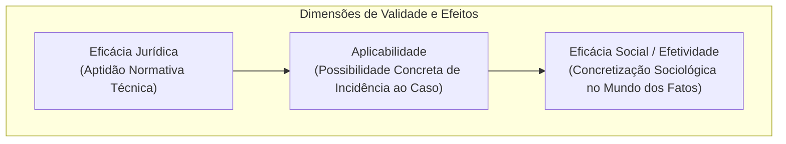
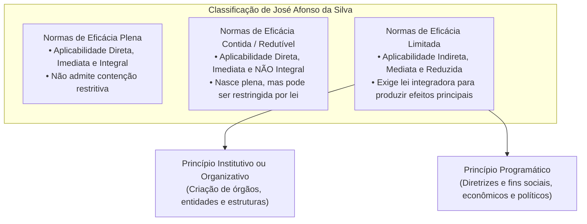
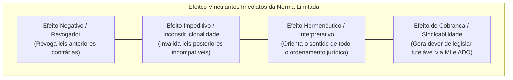

# Aplicabilidade e Eficácia das Normas Constitucionais

> A aplicabilidade e a eficácia das normas constitucionais constituem o núcleo operacional da dogmática jurídica fundamental, definindo a aptidão que cada preceito da Constituição Federal possui para produzir efeitos jurídicos concretos no ordenamento. O direito constitucional brasileiro adota predominantemente a tricotomia formulada pelo professor José Afonso da Silva — dividindo as disposições fundamentais em normas de eficácia plena (autoaplicáveis, diretas, imediatas e integrais), de eficácia contida (autoaplicáveis, diretas, imediatas, porém não integrais e sujeitas a restrições legais posteriores) e de eficácia limitada (não autoaplicáveis, de aplicabilidade mediata e indireta, dependentes de complementação infraconstitucional). Paralelamente, destacam-se a classificação quadripartite de Maria Helena Diniz e a categoria das normas de eficácia exaurida ou esgotada, delineando os parâmetros dogmáticos indispensáveis para o enfrentamento de questões de alto nível técnico em concursos de carreiras fiscais, de controle e jurídicas.

---

## 1. Conceituação Dogmática: Eficácia Jurídica vs. Eficácia Social

A compreensão precisa do tema exige a prévia distinção analítica entre **eficácia jurídica** (*aplicabilidade normativa*) e **eficácia social** (*efetividade prática*):

* **Eficácia Jurídica:** Representa a aptidão potencial ou concreta que a norma ostenta para incidir sobre as situações fáticas e produzir consequências jurídicas. Toda e qualquer norma constitucional é dotada de eficácia jurídica mínima, revogando o direito anterior incompatível (efeito negativo) e servindo de parâmetro de controle e interpretação (efeito interpretativo e impeditivo).
* **Eficácia Social (Efetividade):** É o cumprimento empírico da norma na realidade social. Uma norma possui eficácia social quando é observada espontaneamente pelos destinatários ou aplicada coativamente pelos órgãos estatais.
* **Aplicabilidade:** Constitui a capacidade de a norma ser aplicada concretamente às relações humanas. Diz respeito ao momento em que os efeitos se manifestam (imediata ou mediata) e ao modo de incidência (direta ou indireta).

---

## 2. A Classificação Canônica de José Afonso da Silva

Consagrada como a classificação oficial pelas bancas examinadoras (FGV, Cebraspe, FCC), a teoria tripartite de José Afonso da Silva apoia-se em critérios de completude técnica da norma e necessidade ou não de intervenção integrativa do legislador infraconstitucional.

### 2.1. Normas Constitucionais de Eficácia Plena

As normas de eficácia plena possuem densidade normativa absoluta desde a promulgação do texto constitucional. Não dependem de nenhuma norma infraconstitucional posterior para exercerem seus efeitos plenos e não autorizam que a lei ordinária limite o seu alcance.

* **Características Primárias:**
  1. **Aplicabilidade direta:** Não necessitam de norma interposta para incidir sobre a relação jurídica.
  2. **Aplicabilidade imediata:** Produzem a totalidade de seus efeitos desde o momento em que a Constituição entra em vigor.
  3. **Aplicabilidade integral:** O seu conteúdo não pode sofrer mitigação ou restrição por parte do legislador infraconstitucional.
* **Exemplos Típicos:**
  * Art. 2º da CF/88: *"São Poderes da União, independentes e harmônicos entre si, o Legislativo, o Executivo e o Judiciário."*
  * Art. 5º, inciso III: *"Ninguém será submetido a tortura nem a tratamento desumano ou degradante."*
  * Art. 5º, inciso LVI: *"São inadmissíveis, no processo, as provas obtidas por meios ilícitos."*

---

### 2.2. Normas Constitucionais de Eficácia Contida (ou Restringível)

As normas de eficácia contida nascem produzindo todos os seus efeitos imediatos. Contudo, o próprio constituinte conferiu margem de discricionariedade ao legislador ordinário para reduzir, restringir ou conter a amplitude do direito assegurado.

* **Características Primárias:**
  1. **Aplicabilidade direta:** Incidem imediatamente entre as partes sem depender de prévia lei regulamentadora.
  2. **Aplicabilidade imediata:** O indivíduo pode exercer o direito desde logo, no vazio normativo do legislador ordinário.
  3. **Aplicabilidade NÃO integral:** Estão sujeitas a restrições legais posteriores, à decretação de estados de exceção constitucional (Estado de Sítio e de Defesa) ou a limitações decorrentes de outros preceitos constitucionais.
* **Comportamento Temporal:** 
  * *Enquanto não editada a lei restritiva:* a norma comporta-se com eficácia plena.
  * *Editada a lei restritiva legítima:* a norma tem o seu âmbito de proteção contido nos termos estritos da lei.
* **Exemplos Típicos:**
  * Art. 5º, inciso XIII: *"É livre o exercício de qualquer trabalho, ofício ou profissão, atendidas as qualificações profissionais que a lei estabelecer."* (Enquanto não houver lei exigindo habilitação técnica para certa ocupação, qualquer pessoa pode exercê-la livremente).
  * Art. 5º, inciso LX: *"A lei só poderá restringir a publicidade dos atos processuais quando a defesa da intimidade ou o interesse social o exigirem."*
  * Art. 139 da CF/88: Possibilidade de restrição a direitos fundamentais durante a vigência do Estado de Sítio.

---

### 2.3. Normas Constitucionais de Eficácia Limitada

As normas de eficácia limitada trazem comandos incompletos, carecendo de um veículo normativo infraconstitucional integrador para que possam gerar seus efeitos constitutivos plenos. Sem a lei de complementação, o cidadão não consegue exercer a integralidade do direito subjetivo nelas contemplado.

* **Características Primárias:**
  1. **Aplicabilidade indireta:** A incidência da norma ao caso prático opera-se por intermédio da lei posterior.
  2. **Aplicabilidade mediata (ou diferida):** O direito só se torna exigível após a atuação normativa do Poder Legislativo.
  3. **Aplicabilidade reduzida (não integral):** Antes da lei integradora, produzem apenas eficácia negativa e vinculante básica.
* **Subdivisão Canônica:**
  1. **Normas de Princípio Institutivo (ou Organizativo):** Destinam-se a estruturar, organizar ou criar órgãos, pessoas jurídicas da administração ou corporações públicas (ex.: Art. 88 da CF/88: *"A lei disporá sobre a criação e extinção de Ministérios e órgãos da administração pública"*). Podem ser de imposição obrigatória (*impositivas*) ou de autorização facultativa (*facultativas*).
  2. **Normas de Princípio Programático:** Traçam programas de ação, metas sociais, econômicas e diretrizes estatais a serem perseguidas pelos Poderes Públicos na consecução dos direitos sociais de segunda dimensão (saúde, previdência, educação, pleno emprego). Exemplos: Art. 196 (direito à saúde) e Art. 205 (direito à educação).

---

## 3. A Eficácia Jurídica Mínima das Normas de Eficácia Limitada

É erro grave e recorrente supor que as normas de eficácia limitada, enquanto desprovidas de regulamentação legal, sejam meras "folhas de papel" estéreis ou destituídas de juridicidade. Pelo princípio da força normativa da Constituição (Konrad Hesse), **não existem normas constitucionais desprovidas de eficácia jurídica**.

1. **Efeito Revogador (Negativo):** Revogam de imediato qualquer norma infraconstitucional preexistente que colida com seu conteúdo axiológico ou comando formal.
2. **Efeito Impeditivo:** Impedem a produção válida de leis infraconstitucionais posteriores que disponham em sentido frontalmente contrário ao seu escopo protetivo.
3. **Efeito Hermenêutico:** Funcionam como vetores interpretativos universais, condicionando o significado atribuído às demais leis pelo Poder Judiciário e pela Administração.
4. **Dever Positivo de Legislar e Tutela Jurisdicional:** Vinculam o legislador ao dever inescusável de editar a lei complementar. A inércia legislativa abusiva autoriza o ajuizamento de **Mandado de Injunção (MI)** pelo cidadão lesado (art. 5º, LXXI, e Lei 13.300/2016) ou da **Ação Direta de Inconstitucionalidade por Omissão (ADO)** perante o STF (art. 103, § 2º).

---

## 4. Classificações Doutrinárias Complementares

Embora a teoria de José Afonso da Silva seja a base primária dos concursos, examinadores exigem a cognição das classificações propostas por Maria Helena Diniz e Celso Bastos:

### 4.1. Classificação Quadripartite de Maria Helena Diniz

1. **Normas de Eficácia Absoluta (ou Supereficazes):** Normas constitucionais insuscetíveis de emenda, modificação ou revogação. Coincidem com as **cláusulas pétreas expressas e implícitas** (art. 60, § 4º da CF/88). Não podem ser suprimidas nem mesmo pelo Poder Constituinte Derivado Reformador.
2. **Normas de Eficácia Plena:** Coincidem materialmente com a definição de José Afonso da Silva: normas autoaplicáveis que regulam integralmente os interesses tutelados, dispensando legislação complementar.
3. **Normas de Eficácia Restringível:** Equivalem às normas de eficácia contida, permitindo contenção por norma infraconstitucional.
4. **Normas de Eficácia Relativa Complementável (ou Dependentes de Complementação):** Equivalem às normas de eficácia limitada, exigindo integração normativa infraconstitucional para conferir aplicabilidade plena ao comando.

---

### 4.2. Normas Constitucionais de Eficácia Exaurida e Aplicabilidade Esgotada

Identificam-se pelas disposições cuja eficácia jurídica e aplicabilidade já produziram integralmente seus efeitos específicos no tempo e no espaço, encontrando-se hoje caducas ou esgotadas na sua força normativa original.

* **Localização Principal:** Localizam-se precipuamente no **Ato das Disposições Constitucionais Transitórias (ADCT)**.
* **Exemplo Clássico:** O art. 3º do ADCT determinava: *"A revisão constitucional será realizada após cinco anos, contados da promulgação da Constituição, pelo voto da maioria absoluta dos membros do Congresso Nacional, em sessão unicameral"*. Tendo sido realizada a revisão em 1994 (gerando as 6 Emendas Constitucionais de Revisão - ECRs 1 a 6), a norma teve sua aplicabilidade definitivamente esgotada.
* **Regime de Controle:** Tais preceitos não podem ser objeto de modificação por emenda constitucional e mantêm apenas valor histórico-documental, embora sirvam para auferir a higidez de situações pretéritas consolidadas.

---

## 5. Tabela Comparativa Analítica de Eficácia e Aplicabilidade

| Critério Dogmático | Norma de Eficácia Plena | Norma de Eficácia Contida | Norma de Eficácia Limitada |
| :--- | :--- | :--- | :--- |
| **Aplicabilidade** | Direta, imediata e integral | Direta, imediata e não integral | Indireta, mediata e reduzida |
| **Produção de Efeitos no Vazio Normativo** | Produz plenitude de efeitos | Produz plenitude de efeitos (enquanto não houver restrição) | Não produz o efeito principal; gera efeitos negativos/mínimos |
| **Papel da Lei Ordinária** | Inócua ou meramente regulamentadora (não restringe) | Redutora / Restritiva (diminui o alcance) | Integradora / Concretizadora (habilita o exercício) |
| **Cabimento de Mandado de Injunção** | Descabido (não há omissão impeditiva) | Descabido (o direito já é exercível) | **Plenamente cabível** se comprovada a omissão lesiva |
| **Exemplo Emblemático** | Art. 5º, LVI (provas ilícitas) | Art. 5º, XIII (liberdade profissional) | Art. 37, VII (direito de greve dos servidores) |

---

> **Fique Ligado:**
> 1. **Armadilha do "Salvo Disposição em Contrário":** Se o texto constitucional afirma que o direito é assegurado *"na forma da lei"* ou *"segundo a lei estabelecer"*, atente-se à semântica da restrição. Se o direito já pode ser exercido e a lei vem para impor condições de qualificação profissional, trata-se de eficácia **contida** (art. 5º, XIII). Se o direito depende da lei para nascer operacionalmente, trata-se de eficácia **limitada** (art. 37, VII).
> 2. **Direito de Greve (Art. 9º vs. Art. 37, VII):** O direito de greve dos trabalhadores privados (art. 9º) é norma de eficácia **contida** (exercem a greve, cabendo à lei definir os serviços essenciais). Em contrapartida, o direito de greve dos servidores públicos civis (art. 37, VII) é norma de eficácia **limitada** (depende de lei específica — MI 670/STF determinou aplicação temporária da Lei 7.783/1989 até mora cessar).
> 3. **Efeito Negativo:** Normas de eficácia limitada revogam normas infraconstitucionais anteriores incompatíveis desde a sua promulgação, independentemente de qualquer lei regulamentadora.

---

## 6. Questões Paradigmáticas Aplicadas

---

### [Questão 01](https://www.qconcursos.com/questoes-de-concursos/questoes/a583446e-cb) — [FGV — DATAPREV / Advocacia — 2026] • [Nível: Difícil (Acertos: 39.6%)]

Foi submetido a um advogado da DATAPREV a situação a seguir.

A Emenda Constitucional nº X (ECX) veiculou um direito fundamental de segunda dimensão em norma de natureza programática, norma esta que versa sobre a temática submetida à apreciação do referido advogado no Processo Administrativo Y, o qual envolve a aplicação da legislação infraconstitucional editada antes da promulgação da referida Emenda Constitucional. O advogado concluiu acertadamente que a norma de natureza programática veiculada pela ECX:

* **A)** carece de regulamentação pela legislação infraconstitucional para que produza algum efeito.
* **B)** tem eficácia plena e aplicabilidade imediata, na medida em que consagra direito fundamental.
* **C)** pode ser considerada no caso concreto, mas apenas em conjunto com outra norma constitucional.
* **D)** influi na interpretação das demais normas constitucionais e na recepção da legislação preexistente, independentemente de regulamentação.
* **E)** produz a plenitude dos seus efeitos, independentemente de regulamentação, pois tem por objeto direito fundamental de segunda dimensão.

#### Gabarito: **D**

* **A (Errada):** As normas programáticas (espécie de normas de eficácia limitada) possuem eficácia jurídica imediata e mínima. Não é verdade que careçam de lei para produzir "algum" efeito; produzem desde logo efeito revogador/não receptivo sobre a ordem pré-constitucional incompatível e efeito impeditivo/interpretativo.
* **B (Errada):** A norma programática ostenta eficácia limitada e aplicabilidade indireta e mediata quanto ao seu conteúdo prestacional principal, não se confundindo com normas de eficácia plena.
* **C (Errada):** A norma de natureza programática possui densidade suficiente para fundamentar o juízo de recepção ou não recepção e orientar a hermenêutica do ordenamento de forma autônoma, sem necessidade obrigatória de associação com outro preceito fundamental.
* **D (Certa):** Exata aplicação da doutrina da eficácia jurídica mínima das normas constitucionais. Mesmo na pendência de integração legislativa, as normas programáticas servem como parâmetro hermenêutico vinculante e operam a revogação (não recepção) das leis preexistentes com elas incompatíveis.
* **E (Errada):** As normas que consagram direitos fundamentais sociais prestacionais (segunda dimensão) de caráter programático não produzem a plenitude de seus efeitos de forma automática, necessitando de políticas públicas e normas conformadoras do legislador.

---

### [Questão 02](https://www.qconcursos.com/questoes-de-concursos/questoes/8c4b20c0-cc) — [Quadrix — CREF - 20ª Região (SE) / Agente de Fiscalização — 2026] • [Nível: Muito Difícil (Acertos: 29.9%)]

Quanto aos princípios fundamentais da República Federativa do Brasil, aos direitos e garantias essenciais, ao controle de constitucionalidade e às finanças públicas, julgue o item a seguir:

Os princípios fundamentais da República Federativa do Brasil constituem normas de eficácia plena que impõem deveres de atuação imediata a todos os Poderes.

* ( ) Certo
* ( ) Errado

#### Gabarito: **Errado**

* **C (Errada):** A assertiva comete generalização indevida. Embora os princípios fundamentais (arts. 1º a 4º da CF/88) possuam força normativa imediata e vinculem todos os Poderes, nem todos são dotados de eficácia plena. Os objetivos fundamentais previstos no art. 3º (construir uma sociedade livre, justa e solidária; erradicar a pobreza e a marginalização), por exemplo, são normas de eficácia **limitada de cunho programático**, que traçam metas e fins sociais a serem concretizados progressivamente por meio de políticas estatais.
* **E (Certa):** O item está incorreto ao classificar indistintamente a totalidade dos princípios fundamentais como normas de eficácia plena.

---

### [Questão 03](https://www.qconcursos.com/questoes-de-concursos/questoes/9eb38d5c-b0) — [CESPE / CEBRASPE — TJ-MT / Outorga por Provimento — 2026] • [Nível: Fácil (Acertos: 65.5%)]

O artigo da Constituição Federal de 1988 (CF) que determina que lei regulará as atividades, disciplinará a responsabilidade civil e criminal dos notários, dos oficiais de registro e de seus prepostos, e definirá a fiscalização de seus atos pelo Poder Judiciário classifica-se como norma:

* **A)** de eficácia contida.
* **B)** programática.
* **C)** de eficácia plena.
* **D)** de eficácia absoluta.
* **E)** de eficácia limitada.

#### Gabarito: **E**

* **A (Errada):** Nas normas de eficácia contida, o preceito já traz a regulação básica autoaplicável, autorizando a lei a restringir; no art. 236 da CF/88, o próprio comando remete a disciplina da responsabilidade e atividades ao advento da lei.
* **B (Errada):** Não se trata de norma programática, pois não visa a programas sociais ou metas socioeconômicas, mas sim à estruturação e regulamentação de serviços cartorários.
* **C (Errada):** A norma não possui densidade suficiente para ser exercida sem a fixação legal dos deveres, regimes sancionatórios e procedimentos de fiscalização.
* **D (Errada):** Normas de eficácia absoluta são aquelas inatingíveis por reforma (cláusulas pétreas), categoria inaplicável à regulação de serventias extrajudiciais.
* **E (Certa):** O art. 236 da CF/88 expressamente consigna que a "lei regulará as atividades, disciplinará a responsabilidade... e definirá a fiscalização". Trata-se de preceito de eficácia **limitada de princípio institutivo/organizativo**, cuja incidência plena depende de integração legislativa infraconstitucional (Lei Federal nº 8.935/1994).

---

### [Questão 04](https://www.qconcursos.com/questoes-de-concursos/questoes/26d12476-b1) — [CESPE / CEBRASPE — TJ-MT / Outorga por Remoção — 2026] • [Nível: Média (Acertos: 51.9%)]

A previsão do art. 31 do Ato das Disposições Constitucionais Transitórias (ADCT), segundo a qual “Serão estatizadas as serventias do foro judicial, assim definidas em lei, respeitados os direitos dos atuais titulares”, é exemplo de norma:

* **A)** programática.
* **B)** de eficácia plena.
* **C)** de eficácia contida.
* **D)** de eficácia limitada.
* **E)** de eficácia absoluta.

#### Gabarito: **D**

* **A (Errada):** Normas programáticas veiculam diretrizes de ação estatal para fins sociais. A determinação de estatização de serventias judiciais cuida da organização do Poder Judiciário.
* **B (Errada):** A norma não tem aplicabilidade imediata e integral, pois condiciona a estatização à definição legal específica ("assim definidas em lei").
* **C (Errada):** Não é norma contida, visto que não operou a estatização automática com posterior faculdade restritiva, mas sim subordinou a própria operação à intervenção legal futura.
* **D (Certa):** A redação explícita "assim definidas em lei" revela a necessidade indispensável de mediação legislativa para a discriminação e efetivação da estatização. Classifica-se, portanto, como norma de eficácia **limitada de princípio institutivo**, pois condiciona a estruturação estatal ao futuro diploma normativo.
* **E (Errada):** Não se enquadra na categoria de eficácia absoluta de Maria Helena Diniz, sendo passível de tratamento pelo poder constituinte derivado.

---

### [Questão 05](https://www.qconcursos.com/questoes-de-concursos/questoes/4cb2e694-b3) — [CESPE / CEBRASPE — TJ-AC / Juiz Substituto — 2026] • [Nível: Difícil (Acertos: 44.8%)]

Segundo a classificação de José Afonso da Silva quanto à aplicabilidade e eficácia das normas constitucionais, é correto afirmar que:

* **A)** as normas de eficácia plena dependem de intervenção legislativa posterior para produzir todos os seus efeitos.
* **B)** as normas de eficácia limitada não produzem nenhum efeito jurídico até que advenha a respectiva lei regulamentadora.
* **C)** as normas de eficácia contida possuem aplicabilidade direta e imediata, mas não integral, sujeitando-se à restrição por parte do legislador infraconstitucional.
* **D)** o direito de greve dos servidores públicos civis (art. 37, VII) é exemplo consolidado de norma constitucional de eficácia plena.
* **E)** as normas programáticas são desprovidas de qualquer força vinculante para a atuação dos órgãos jurisdicionais.

#### Gabarito: **C**

* **A (Errada):** As normas de eficácia plena independem de qualquer lei posterior, produzindo seus efeitos integrais de plano.
* **B (Errada):** Consoante a doutrina dominante e a jurisprudência do STF, as normas de eficácia limitada produzem ao menos eficácia jurídica mínima (efeito revogatório do direito antecedente contrário, efeito impeditivo de legislação posterior conflitante e vetor hermenêutico).
* **C (Certa):** Definição perfeita e canônica: normas de eficácia contida aplicam-se direta e imediatamente com a promulgação do texto fundamental, mas o constituinte conferiu aptidão para que lei infraconstitucional posterior restrinja ou discipline o gozo integral desse direito.
* **D (Errada):** O direito de greve dos servidores públicos civis (art. 37, VII) constitui clássico exemplo de norma de eficácia **limitada** dependente de lei específica, cuja mora parlamentar motivou a construção pretoriana do STF nos Mandados de Injunção 670, 708 e 712.
* **E (Errada):** As normas programáticas possuem força normativa indiscutível, vinculando a atuação do Poder Público e balizando o controle jurisdicional de políticas públicas (vedação ao retrocesso e mínimo existencial).

---

### [Questão 06](https://www.qconcursos.com/questoes-de-concursos/questoes/c6bc3cf8-b3) — [FGV — TRT - 13ª Região (PB) / Analista Judiciário — 2026] • [Nível: Fácil (Acertos: 72.4%)]

Considere o seguinte dispositivo constitucional: *"É livre o exercício de qualquer trabalho, ofício ou profissão, atendidas as qualificações profissionais que a lei estabelecer"* (CF/88, art. 5º, XIII). De acordo com a doutrina tradicional de Direito Constitucional, esse dispositivo classifica-se como norma de eficácia:

* **A)** plena, pois não pode ser alterado por emenda constitucional.
* **B)** contida, pois assegura o direito desde logo, permitindo que a lei posterior crie restrições ou qualificações.
* **C)** limitada, pois nenhuma profissão pode ser exercida sem que antes haja lei que a regulamente.
* **D)** programática, pois veicula princípio de estímulo ao pleno emprego sem caráter de direito subjetivo.
* **E)** absoluta, por constituir cláusula pétrea imune a qualquer regulação.

#### Gabarito: **B**

* **A (Errada):** O dispositivo é contido, não pleno, pois admite expressamente a interferência restritiva da lei infraconstitucional.
* **B (Certa):** O art. 5º, XIII, consagra o paradigma absoluto da norma de eficácia **contida**. Na ausência de lei regulamentadora, o exercício da profissão é plenamente livre. A lei posterior apenas poderá intervir se houver potencial lesivo à coletividade que justifique a exigência de habilitação técnica formal (como na Medicina, Advocacia, Engenharia).
* **C (Errada):** Se fosse de eficácia limitada, ninguém poderia trabalhar enquanto não existisse lei regulamentando cada ocupação, o que subverteria a garantia fundamental da liberdade individual.
* **D (Errada):** Trata-se de direito individual individualmente acionável (liberdade profissional), e não de meta estatal programática.
* **E (Errada):** A norma admite expressamente conformação legal infraconstitucional, sendo incompatível com o conceito de eficácia absoluta.

---

### [Questão 07](https://www.qconcursos.com/questoes-de-concursos/questoes/d1082ce0-b4) — [FCC — TRT - 22ª Região (PI) / Técnico Judiciário — 2026] • [Nível: Média (Acertos: 61.2%)]

O art. 14, § 9º, da Constituição Federal dispõe que *"lei complementar estabelecerá outros casos de inelegibilidade e os prazos de sua cessação, a fim de proteger a probidade administrativa, a moralidade para o exercício do mandato, considerada a vida pregressa do candidato, e a normalidade e legitimidade das eleições..."*. Essa norma constitucional ostenta eficácia:

* **A)** plena, porque se aplica imediatamente sem demandar complementação.
* **B)** contida, pois já esgota todos os casos de inelegibilidade, vedada ampliação.
* **C)** limitada, pois a criação de novos casos de inelegibilidade depende imperativamente da edição de lei complementar integrativa.
* **D)** exaurida, por ter sido consumada com a promulgação da Constituição de 1988.
* **E)** absoluta, porque insuscetível de qualquer alteração legislativa superveniente.

#### Gabarito: **C**

* **A (Errada):** A norma exige expressamente que lei complementar preveja as novas hipóteses de inelegibilidade; logo, os efeitos da norma constitucional nessa matéria dependem de interposição legislativa.
* **B (Errada):** A norma não esgota os casos; pelo contrário, abre espaço para que a legislação ordinária qualificada (Lei Complementar, como a LC 64/90 e LC 135/2010 - Lei da Ficha Limpa) venha a constituí-los.
* **C (Certa):** O constituinte remeteu a estipulação de novas hipóteses de inelegibilidade à futura atuação do legislador complementar. Trata-se de norma de eficácia **limitada de princípio institutivo/organizativo**, cuja eficácia integradora foi instrumentalizada pela edição da LC 64/1990.
* **D (Errada):** Normas de eficácia exaurida são aquelas transitórias cujos efeitos se esgotaram (como disposições do ADCT).
* **E (Errada):** Não é norma de eficácia absoluta, pois sua própria essência é a conformação via processo legislativo complementar.

---

### [Questão 08](https://www.qconcursos.com/questoes-de-concursos/questoes/b8994b72-b5) — [FGV — OAB / Exame de Ordem Unificado — 2026] • [Nível: Difícil (Acertos: 42.3%)]

A Constituição da República estatui, em seu art. 37, inciso VII, que *"o direito de greve será exercido nos termos e nos limites definidos em lei específica"*. Diante da persistente omissão legislativa na edição do referido diploma normativo, determinado sindicato de servidores públicos impetrou mandado de injunção perante o Supremo Tribunal Federal. Sobre a natureza da norma constitucional invocada e as consequências de sua eficácia, assinale a afirmativa correta:

* **A)** A norma é de eficácia plena, razão pela qual o mandado de injunção é via processual inadequada.
* **B)** A norma é de eficácia contida, de modo que os servidores podiam exercer a greve sem limites enquanto a lei não fosse editada.
* **C)** Trata-se de norma de eficácia limitada, que, ante a inércia legislativa inconstitucional, autorizou o STF a determinar a aplicação supletiva da Lei nº 7.783/1989 (lei de greve da iniciativa privada).
* **D)** Sendo norma de eficácia limitada de princípio institutivo, sua aplicação em juízo viola o princípio da separação dos poderes.
* **E)** A norma é dotada de eficácia exaurida, haja vista que a Emenda Constitucional nº 19/1998 extinguiu a exigência de lei regulamentadora.

#### Gabarito: **C**

* **A (Errada):** Se fosse norma de eficácia plena, o exercício não dependeria de lei e inexistiria omissão inconstitucional sindicável via Mandado de Injunção.
* **B (Errada):** O STF expressamente rejeitou a tese da eficácia contida para a greve no serviço público. O texto impõe que ela seja exercida "nos termos e limites definidos em lei específica", consubstanciando eficácia limitada.
* **C (Certa):** Conforme jurisprudência histórica do STF fixada no julgamento dos Mandados de Injunção 670, 708 e 712, o art. 37, VII, é norma de eficácia **limitada**. Diante da mora inconstitucional do Congresso, o STF adotou a postura concretista geral, determinando a incidência da lei do setor privado (Lei 7.783/89) no que couber até que o Poder Legislativo cumpra seu mister.
* **D (Errada):** A atuação do STF no mandado de injunção não viola a separação dos poderes, mas dá concretude à garantia constitucional prevista no art. 5º, LXXI, impedindo a esterilização dos direitos fundamentais pelo legislador.
* **E (Errada):** A EC 19/1998 alterou a redação original (que exigia Lei Complementar) para exigir "lei específica" (lei ordinária), mantendo hígida a natureza de norma limitada.

---

### [Questão 09](https://www.qconcursos.com/questoes-de-concursos/questoes/73f32488-b8) — [CESPE / CEBRASPE — PGE-PA / Procurador do Estado — 2026] • [Nível: Média (Acertos: 58.7%)]

No tocante à eficácia e aplicabilidade das normas constitucionais, assinale a opção correta:

* **A)** As normas de eficácia contida demandam intermediação legislativa para que passem a surtir efeitos jurídicos entre os particulares.
* **B)** As normas de eficácia limitada subdividem-se doutrinariamente em normas definidoras de princípio institutivo e normas de princípio programático.
* **C)** As cláusulas pétreas são classificadas pela doutrina de Maria Helena Diniz como normas de eficácia relativa complementável.
* **D)** Uma norma constitucional programática não pode servir de fundamento autônomo para a declaração de inconstitucionalidade de lei superveniente.
* **E)** As normas de eficácia plena são aquelas que autorizam restrições expressas no texto de leis ordinárias posteriores.

#### Gabarito: **B**

* **A (Errada):** As normas de eficácia contida produzem efeitos imediatos desde a promulgação da Constituição, dispensando qualquer ato legislativo posterior para iniciar sua incidência.
* **B (Certa):** Exata formulação da doutrina de José Afonso da Silva: as normas de eficácia limitada dividem-se em *normas de princípio institutivo* (voltadas à estruturação e fundação de órgãos e entidades) e *normas de princípio programático* (que fixam fins, metas e políticas públicas do Estado).
* **C (Errada):** Segundo Maria Helena Diniz, as cláusulas pétreas são normas de eficácia **absoluta** (ou supereficazes), por serem intocáveis até mesmo pelo constituinte reformador.
* **D (Errada):** As normas programáticas possuem eficácia jurídica impeditiva e negativa; se uma lei posterior colidir com os fins e programas constitucionais, será formal e materialmente inconstitucional.
* **E (Errada):** Normas de eficácia plena não toleram restrição por lei ordinária posterior; aquelas que admitem contenção são as normas de eficácia **contida**.

---

### [Questão 10](https://www.qconcursos.com/questoes-de-concursos/questoes/d58c194a-bd) — [FGV — TJ-PE / Juiz Substituto — 2026] • [Nível: Difícil (Acertos: 46.1%)]

João ajuizou ação em desfavor do Município de Sigma, tendo por objeto a alegada inobservância de um direito fundamental consagrado em norma de eficácia limitada e princípio programático. De acordo com a petição inicial, o Art. X da Constituição da República, que consagra esse direito, gera deveres imediatos para a Administração Pública municipal. O Município contestou a demanda sustentando que preceitos programáticos não ostentam densidade jurídica vinculante, configurando meras aspirações políticas inexigíveis em juízo.

Diante do quadro hipotético e da teoria geral das normas constitucionais, é correto afirmar que:

* **A)** as normas de princípio programático são desprovidas de eficácia jurídica, consubstanciando diretrizes morais cujo descumprimento é insindicável pelo Poder Judiciário.
* **B)** a tese do Município de Sigma colide frontalmente com a moderna dogmática constitucional, segundo a qual as normas programáticas possuem eficácia jurídica vinculante e balizam o controle de legalidade e constitucionalidade das omissões estatais.
* **C)** o Poder Judiciário jamais pode determinar a implementação de políticas públicas decorrentes de normas programáticas, sob pena de usurpação absoluta do princípio da reserva do possível.
* **D)** apenas as normas de eficácia plena podem figurar como parâmetro de controle de constitucionalidade de atos do Poder Executivo municipal.
* **E)** as normas programáticas revogam o direito infraconstitucional anterior apenas se este dispuser sobre direitos de primeira dimensão.

#### Gabarito: **B**

* **A (Errada):** A doutrina moderna e o STF superaram há décadas a concepção oitocentista de normas programáticas como meros conselhos morais; elas integram o ordenamento como preceitos jurídicos cogentes dotados de imperatividade.
* **B (Certa):** A alegação do Município de que normas programáticas são meras aspirações inexigíveis contraria a força normativa da Constituição e a jurisprudência dominante (Tema 698/STF). As normas programáticas possuem eficácia jurídica vinculante mínima e impõem limites à discricionariedade administrativa, vedando o retrocesso e justificando o controle jurisdicional nas hipóteses de inação desarrazoada do Estado.
* **C (Errada):** O Judiciário pode impor ao Estado a execução de políticas públicas previstas na Constituição quando caracterizada a omissão intolerável que ameace o núcleo essencial de direitos fundamentais (mínimo existencial), mitigando a alegação genérica de reserva do possível.
* **D (Errada):** Todas as espécies normativas da Constituição (plenas, contidas e limitadas/programáticas) qualificam-se como parâmetro de controle concentrado ou difuso.
* **E (Errada):** A revogação do direito anterior opera-se pelo critério cronológico-material de incompatibilidade, incidindo plenamente sobre quaisquer diplomas legais que afrontem direitos fundamentais de segunda dimensão.

---

### [Questão 11](https://www.qconcursos.com/questoes-de-concursos/questoes/27398976-c2) — [FEPESE — Prefeitura de Itajaí - SC / Assistente Jurídico — 2026] • [Nível: Muito Fácil (Acertos: 81.1%)]

Sobre a aplicabilidade das normas constitucionais, segundo a classificação doutrinária tradicionalmente adotada no direito brasileiro, é correto afirmar:

* **A)** As normas constitucionais de eficácia limitada produzem, desde logo, todos os efeitos que o constituinte pretendeu regular, sendo incompatível com essa categoria qualquer espécie de regulamentação posterior.
* **B)** As normas constitucionais de eficácia contida são de aplicabilidade direta e imediata desde a entrada em vigor da Constituição, podendo, contudo, ter seu alcance restringido pela legislação infraconstitucional.
* **C)** As normas constitucionais de eficácia plena dependem de integração legislativa infraconstitucional para produzir seus efeitos, não sendo aplicáveis de plano.
* **D)** As normas programáticas, espécie de norma constitucional de eficácia limitada, são desprovidas de qualquer efeito jurídico até a edição da lei integradora.
* **E)** A classificação das normas constitucionais quanto à aplicabilidade é irrelevante para fins de controle de constitucionalidade, uma vez que todas as normas têm a mesma estrutura de exigibilidade prática.

#### Gabarito: **B**

* **A (Errada):** Inverte o conceito: as normas que produzem todos os efeitos de imediato sem tolerar restrição são as normas de eficácia plena. As de eficácia limitada necessitam justamente de lei integradora posterior.
* **B (Certa):** É a precisa enunciação das normas de eficácia contida: possuem aplicabilidade direta, imediata, porém não integral, admitindo que o legislador infraconstitucional reduza o seu âmbito originário de exercício.
* **C (Errada):** As normas de eficácia plena aplicam-se por si sós, sem necessidade de integração legislativa infraconstitucional.
* **D (Errada):** As normas programáticas produzem efeitos jurídicos imediatos (como o efeito revogador e o efeito impeditivo de leis supervenientes contrárias).
* **E (Errada):** A classificação é dogmaticamente indispensável, inclusive para definição do instrumento processual adequado (por exemplo, mandado de injunção e ADO aplicam-se a omissões de normas de eficácia limitada).

---

### [Questão 12](https://www.qconcursos.com/questoes-de-concursos/questoes/197d7fb8-cb) — [FSA — FSA-SP / Consultor Jurídico — 2026] • [Nível: Média (Acertos: 64.7%)]

Suponha-se que a Constituição Federal estabelecesse que *“a lei disciplinará mecanismos de proteção contra práticas abusivas em relações digitais de consumo”*. Durante o período de inércia legislativa, uma empresa alega em juízo que não pode ser sancionada por prática abusiva em ambiente digital pelo Procon sob o argumento de que a norma constitucional não possui autoexecutoriedade.

Considere as seguintes assertivas:

I. A norma sob comento é classificada como de eficácia plena, tendo aplicabilidade direta e imediata que prescinde de qualquer diploma regulamentador.  
II. Por se tratar de norma de eficácia limitada de princípio institutivo, a referida disposição constitucional não revoga normas infraconstitucionais pretéritas que disciplinem a matéria em sentido oposto.  
III. Embora a norma dependa de lei para disciplinar os mecanismos específicos ali referidos, ostenta eficácia jurídica mínima, exercendo função de vetor interpretativo das relações de consumo e impedindo a edição de diplomas legais que permitam práticas abusivas digitais.  
IV. A ausência da lei referida no dispositivo inviabiliza que o cidadão utilize o mandado de segurança individual para a defesa de direito líquido e certo fundado na referida lacuna.  

Assinale a opção correta:

* **A)** Apenas as assertivas I e II estão corretas.
* **B)** Apenas a assertiva I está correta.
* **C)** Apenas as assertivas III e IV estão corretas.
* **D)** Todas as assertivas estão corretas.

#### Gabarito: **C**

* **Item I (Errado):** A redação "a lei disciplinará" denuncia a dependência imperativa de intermediação legislativa infraconstitucional. Cuida-se de norma de eficácia limitada, e não de eficácia plena.
* **Item II (Errado):** Todas as normas constitucionais — inclusive as de eficácia limitada — possuem eficácia jurídica mínima e efeito revogatório/não receptivo automático sobre normas anteriores incompatíveis.
* **Item III (Certo):** Exatamente: a norma tem eficácia limitada quanto ao direito prestacional novo, mas sua eficácia jurídica negativa e axiológica impede a edição de normas que tolerem abusos e condiciona a interpretação do Código de Defesa do Consumidor aos novos tempos tecnológicos.
* **Item IV (Certo):** O Mandado de Segurança exige direito líquido e certo demonstrável de plano; para combater a omissão normativa que inviabiliza o exercício de prerrogativa constitucional, a ação constitucional cabível é o **Mandado de Injunção** (CF, art. 5º, LXXI), e não o Mandado de Segurança. Logo, a ausência de lei torna inadequado o MS para suprimir a lacuna regulamentar.
