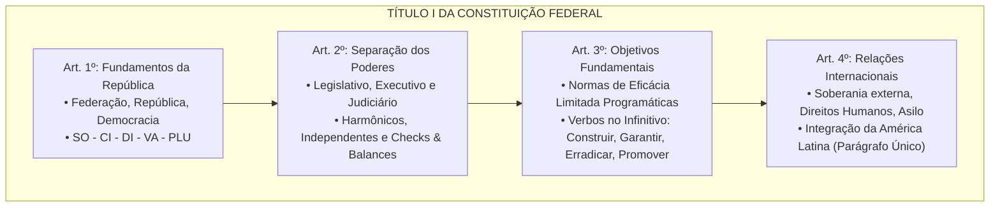
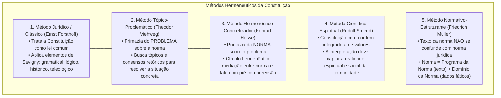
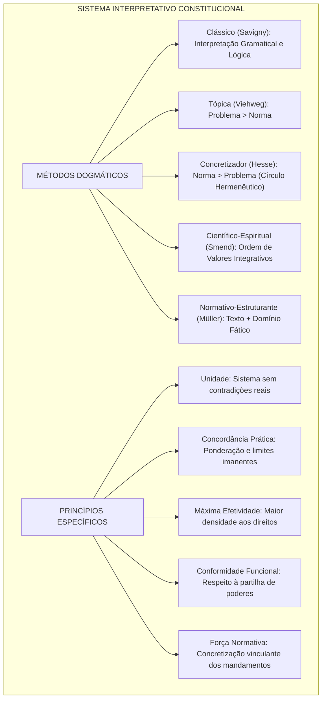

# Princípios Fundamentais e Hermenêutica Constitucional

> Os Princípios Fundamentais insculpidos nos artigos 1º a 4º da Constituição de 1988 constituem a matriz axiológica e estrutural do Estado brasileiro, condensando a forma de Estado (Federação indissolúvel), a forma de governo (República), o sistema de governo (Presidencialismo), o regime político (Estado Democrático de Direito) e os fundamentos nucleares da soberania, cidadania, dignidade da pessoa humana, valores sociais do trabalho, livre iniciativa e pluralismo político. Ao lado dos objetivos fundamentais de natureza programática (art. 3º) e dos postulados regentes das relações internacionais (art. 4º), erige-se a teoria da Hermenêutica Constitucional, cujos métodos dogmáticos (jurídico clássico, tópico-problemático, hermenêutico-concretizador, científico-espiritual e normativo-estruturante) e princípios interpretativos específicos (unidade, efeito integrador, máxima efetividade, conformidade funcional, harmonização e força normativa) asseguram a supremacia material da Carta Magna e fornecem o instrumental indispensável para a resolução de questões de excelência técnica nas carreiras fiscais e de controle.

---

## 1. Arquitetura Dogmática dos Princípios Fundamentais (Arts. 1º a 4º da CF/88)

A Carta de 1988 inaugura seu texto estabelecendo as balizas primárias da ordem jurídica e sociopolítica da República Federativa do Brasil:

---

### 1.1. O Artigo 1º e as Opções Estruturais do Estado Brasileiro

O art. 1º da CF/88 concentra as decisões políticas fundamentais do Poder Constituinte Originário:

1. **Forma de Estado:** **Federação** (*"formada pela união indissolúvel dos Estados e Municípios e do Distrito Federal"*). Caracteriza-se pela descentralização política com autonomia dos entes federados (União, Estados, DF e Municípios), dotada de vedação absoluta ao direito de secessão.
2. **Forma de Governo:** **República**. Fundada na eletividade, temporalidade e representatividade dos governantes, acompanhada do dever irrecusável de prestação de contas (*accountability*). Opõe-se à Monarquia (hereditária e vitalícia).
3. **Regime Político:** **Estado Democrático de Direito**. Síntese do império da lei com a realização concreta da justiça material e dos direitos fundamentais. Consoante o parágrafo único do art. 1º, a titularidade do poder é estritamente popular (*democracia participativa ou semidireta*):
   $$\text{Poder Popular} = \text{Representantes Eleitos} + \text{Exercício Direto (Plebiscito, Referendo e Iniciativa Popular)}$$
4. **Fundamentos da República (Art. 1º, incisos I a V):**
   * **I — Soberania:** Independência jurídica externa e supremacia política no plano interno.
   * **II — Cidadania:** Participação ativa do indivíduo nos destinos da vida pública e na formação da vontade estatal.
   * **III — Dignidade da Pessoa Humana:** Epicentro axiológico da ordem constitucional de 1988, concebida como vetor reitor de todos os direitos fundamentais.
   * **IV — Valores Sociais do Trabalho e da Livre Iniciativa:** Modelo de economia capitalista de mercado temperado pela função social, vedando a exploração desregulada da força de trabalho.
   * **V — Pluralismo Político:** Tolerância e convivência pacífica de correntes políticas, ideológicas, filosóficas e culturais divergentes. *Atenção:* não se confunde com mero "pluripartidarismo" (que é apenas a manifestação eleitoral do pluralismo).

---

### 1.2. O Artigo 2º e a Separação dos Poderes: Freios e Contrapesos

O art. 2º estipula: *"São Poderes da União, independentes e harmônicos entre si, o Legislativo, o Executivo e o Judiciário"*.

* **Independência:** Cada Poder exerce as competências que lhe foram atribuídas originariamente pela Constituição, sem subordinação hierárquica.
* **Harmonia:** Dever de colaboração institucional, respeitando os limites funcionais recíprocos.
* **Teoria dos Freios e Contrapesos (*Checks and Balances*):** Concebida por Montesquieu para obstar o arbítrio, traduz-se no exercício de competências fiscalizatórias e atípicas cruzadas. Exemplos canônicos:
  * Veto do Presidente da República a projetos de lei aprovados pelo Congresso (art. 66).
  * Julgamento de crimes de responsabilidade do Presidente pelo Senado Federal (art. 52, I).
  * Controle de constitucionalidade das leis exercido pelo Poder Judiciário (art. 102).
  * Sabatina e aprovação prévia de Ministros do STF e do Procurador-Geral da República pelo Senado Federal (art. 52, III).

---

### 1.3. O Artigo 3º: Objetivos Fundamentais da República

Ao contrário dos fundamentos (que retratam o ponto de partida axiológico), os objetivos fundamentais expressam **metas a serem alcançadas pelo Estado**. Gramaticalmente, inauguram-se sempre com **verbos no infinitivo** e qualificam-se dogmaticamente como normas constitucionais de **eficácia limitada de princípio programático**:

* **I — Construir** uma sociedade livre, justa e solidária;
* **II — Garantir** o desenvolvimento nacional;
* **III — Erradicar** a pobreza e a marginalização e reduzir as desigualdades sociais e regionais;
* **IV — Promover** o bem de todos, sem preconceitos de origem, raça, sexo, cor, idade e quaisquer outras formas de discriminação.

---

### 1.4. O Artigo 4º: Princípios Regentes das Relações Internacionais

O art. 4º rege a atuação externa do Brasil na comunidade das nações soberanas:

| Inciso | Princípio Regente | Significado Constitucional |
| :---: | :--- | :--- |
| **I** | Independência nacional | Soberania perante potências estrangeiras |
| **II** | Prevalência dos direitos humanos | Prioridade na defesa e proteção da ordem humanitária global |
| **III** | Autodeterminação dos povos | Direito soberano de cada nação definir seu destino político |
| **IV** | Não-intervenção | Proibição de ingerência em assuntos internos de outros Estados |
| **V** | Igualdade entre os Estados | Paridade jurídica internacional soberana |
| **VI** | Defesa da paz | Vocação pacificadora do Estado brasileiro |
| **VII** | Solução pacífica dos conflitos | Arbitragem, mediação e canais diplomáticos |
| **VIII** | Repúdio ao terrorismo e ao racismo | Rejeição absoluta a atos terroristas e discriminação racial |
| **IX** | Cooperação entre os povos | Solidariedade internacional e progresso da humanidade |
| **X** | Concessão de asilo político | Proteção a perseguidos políticos (ato discricionário do Presidente) |

> **Parágrafo Único do Art. 4º:** *"A República Federativa do Brasil buscará a integração econômica, política, social e cultural dos povos da América Latina, visando à formação de uma comunidade latino-americana de nações."* Trata-se de diretriz específica direcionada à América Latina (e não a blocos genéricos mundiais).

---

## 2. Métodos de Interpretação Constitucional

A interpretação da Constituição diferencia-se da exegese da lei comum devido à elevada carga política, abertura valorativa dos princípios e supremacia hierárquica das normas constitucionais. As bancas de alto nível cobram a distinção entre os métodos clássicos e modernos:

1. **Método Jurídico (Hermenêutico Clássico - Ernst Forsthoff):** Sustenta que a Constituição é dotada de natureza jurídica de lei; por conseguinte, deve ser interpretada utilizando-se os métodos tradicionais concebidos por Savigny (interpretação gramatical, histórica, sistemática e teleológica).
2. **Método Tópico-Problemático (Theodor Viehweg):** Caracteriza-se pela primazia do **problema** sobre a norma. Diante de um conflito fático real, busca-se um ponto de partida plausível (*topoi* ou catálogo de argumentos) para construir a solução consensual, tendo a norma constitucional papel de mera diretriz argumentativa.
3. **Método Hermenêutico-Concretizador (Konrad Hesse):** Parte da primazia da **norma** constitucional sobre o problema. O intérprete opera o chamado **círculo hermenêutico**: aproxima a pré-compreensão subjetiva do intérprete do sentido do texto normativo, concretizando a Constituição mediante a adequação entre o preceito abstrato e a realidade fática.
4. **Método Científico-Espiritual (Sociológico - Rudolf Smend):** Concebe a Constituição não apenas como um estatuto formal, mas como a ordem de valores vivenciada pela sociedade. A interpretação deve ter viés sociológico e integrador, renovando permanentemente o sentimento de unidade política e cultural da nação.
5. **Método Normativo-Estruturante (Friedrich Müller):** Estabelece que o texto normativo (*enunciado gramatical*) é apenas a ponta do iceberg da norma jurídica. A norma jurídica real é fruto do **programa da norma** (conteúdo linguístico do preceito) somado ao **domínio da norma** (setor da realidade social disciplinado pela norma). *Interpretar é concretizar a norma a partir do texto e do pedaço de realidade fática.*
6. **Método da Sociedade Aberta dos Intérpretes (Peter Häberle):** Rejeita o monopólio da interpretação constitucional pelas cortes de justiça. Sustenta que todos os cidadãos, associações civis e instâncias sociais participam democraticamente do processo contínuo de interpretação da Carta Política (*audiências públicas e amicus curiae no STF*).

---

## 3. Princípios Específicos de Interpretação Constitucional

A doutrina constitucional moderna consolidou princípios de hermenêutica próprios, aplicados reiteradamente pelo STF na solução de impasses constitucionais:

| Princípio Hermenêutico | Postulado Central e Operacionalidade Dogmática | Aplicação Prática no STF |
| :--- | :--- | :--- |
| **Unidade da Constituição** | A Constituição deve ser interpretada como um sistema harmônico unitário, sem contradições reais. Não há hierarquia entre normas constitucionais originárias (*inadmissibilidade de normas constitucionais inconstitucionais originárias*). | Harmonização entre imunidades tributárias e regras de responsabilidade fiscal |
| **Efeito Integrador** | Na resolução de conflitos constitucionais, deve-se prestigiar a interpretação que favoreça a integração política e social e reforce a coesão nacional. | Fortalecimento do pacto federativo em crises sanitárias ou federativas |
| **Máxima Efetividade (Eficiência)** | Deve-se atribuir à norma constitucional o sentido que lhe confira a maior eficácia prática e utilidade social, sobretudo em sede de direitos fundamentais. | Interpretação extensiva do mandado de injunção e dos remédios constitucionais |
| **Justeza ou Conformidade Funcional** | O intérprete não pode subverter a partilha de competências e o equilíbrio de poderes fixado pelo constituinte, sob pretexto de interpretar a norma. | Proibição de o Judiciário atuar como legislador positivo substituindo o Executivo |
| **Harmonização ou Concordância Prática** | Em caso de aparente colisão entre direitos fundamentais, deve-se proceder à ponderação, sacrificando o mínimo indispensável de cada bem jurídico (*vedação do sacrifício total de um direito*). | Colisão entre liberdade de imprensa (art. 220) e direito à intimidade/imagem (art. 5º, X) |
| **Força Normativa da Constituição (Hesse)** | Deve prevalecer a interpretação que assegure maior permanência, eficácia jurídica real e vinculatividade aos comandos da Constituição perante as forças sociais. | Superação do ceticismo sociológico de Ferdinand Lassalle |
| **Interpretação Conforme a Constituição** | Diante de norma infraconstitucional polissêmica, adota-se a interpretação compatível com a Carta Magna, expungindo sentidos inconstitucionais sem declarar a nulidade do texto. | Princípio basilar de preservação do trabalho legislativo no controle de constitucionalidade |

---

> **Fique Ligado:**
> 1. **Diferença Mnemônica Vital:**
>    * **Fundamentos (Art. 1º):** *SO-CI-DI-VA-PLU* (Soberania, Cidadania, Dignidade da pessoa humana, Valores sociais do trabalho/livre iniciativa, Pluralismo político).
>    * **Objetivos (Art. 3º):** *CON-GA-ERRA-PRO* (Construir, Garantir, Erradicar, Promover). Sempre iniciados com **verbo no infinitivo**.
>    * **Relações Internacionais (Art. 4º):** Princípios de atuação externa (independência, direitos humanos, autodeterminação, asilo político, integração da América Latina).
> 2. **Pegadinha da Autodeterminação:** O Brasil rege-se pela *autodeterminação dos povos* nas suas relações **internacionais** (art. 4º, III). Internamente, contudo, os Estados, Municípios e DF possuem apenas **autonomia**, inexistindo soberania ou autodeterminação interna (união indissolúvel, art. 1º).
> 3. **Tópico-Problemático vs. Hermenêutico-Concretizador:** Se a banca falar em *"primazia do problema sobre a norma"* e *"pensamento por tópicos"*, a resposta é **Theodor Viehweg**. Se falar em *"primazia da norma sobre o problema"*, *"círculo hermenêutico"* e *"pré-compreensão"*, a resposta é **Konrad Hesse**.
> 4. **Pluralismo Político vs. Pluripartidarismo:** O pluralismo político é o gênero amplo (fundamento da República, art. 1º, V). O pluripartidarismo é espécie restrita (garantia no âmbito dos direitos políticos, art. 17).

---

## 4. Síntese Visual dos Métodos e Princípios Hermenêuticos

---

## 5. Tabela Comparativa: Estrutura dos Artigos 1º a 4º da CF/88

| Artigo | Categoria Dogmática | Elementos Nucleares | Técnica Gramatical | Natureza Normativa |
| :---: | :--- | :--- | :--- | :--- |
| **Art. 1º** | Fundamentos da República | Soberania, cidadania, dignidade, trabalho/livre iniciativa, pluralismo | Substantivos conceituais abstratos | Princípios estruturantes / Eficácia plena em sua maioria |
| **Art. 2º** | Princípio da Separação de Poderes | Legislativo, Executivo e Judiciário (independentes e harmônicos) | Declaração afirmativa orgânica | Princípio organizatório / Eficácia plena |
| **Art. 3º** | Objetivos Fundamentais | Sociedade justa, desenvolvimento, erradicação da pobreza, bem de todos | **Verbos no infinitivo** | Normas programáticas / Eficácia limitada |
| **Art. 4º** | Princípios das Relações Internacionais | Independência, direitos humanos, asilo, integração da América Latina | Postulados de atuação diplomática | Diretrizes de política externa / Vinculação internacional |

---

## 6. Questões Paradigmáticas Aplicadas

---

### [Questão 01](https://www.qconcursos.com/questoes-de-concursos/questoes/728c5d39-c6) — [IGEDUC — Prefeitura de Alagoinha - PB / Médico Plantonista — 2026]

Considerando os fundamentos, objetivos e princípios que orientam a República Federativa do Brasil, assinale a afirmativa correta:

* **A)** A cidadania configura princípio das relações internacionais brasileiras destinado à solução pacífica dos conflitos.
* **B)** A dignidade da pessoa humana constitui fundamento da República e orienta a interpretação das demais normas constitucionais.
* **C)** A soberania popular representa objetivo fundamental do Estado brasileiro voltado à redução das desigualdades sociais.
* **D)** A prevalência dos direitos humanos corresponde a fundamento interno da organização política nacional.
* **E)** A erradicação da pobreza integra os fundamentos da República e expressa a autonomia política dos entes federativos.

#### Gabarito: **B**
* **A (Errada):** A cidadania constitui **fundamento** da República Federativa do Brasil (art. 1º, II), e não princípio de relações internacionais (art. 4º).
* **B (Certa):** O art. 1º, inciso III, da CF/88 elenca a **dignidade da pessoa humana** como um dos fundamentos basilares da República Federativa do Brasil. Trata-se do postulado matriz que ilumina e condiciona a interpretação de todas as normas do ordenamento jurídico brasileiro.
* **C (Errada):** A soberania popular é elemento do regime democrático (art. 1º, parágrafo único), enquanto os objetivos fundamentais estão no art. 3º (construir, garantir, erradicar, promover).
* **D (Errada):** A prevalência dos direitos humanos é princípio que rege a República nas suas **relações internacionais** (art. 4º, II), e não fundamento do art. 1º.
* **E (Errada):** A erradicação da pobreza é **objetivo fundamental** da República (art. 3º, III), e não fundamento.

---

### [Questão 02](https://www.qconcursos.com/questoes-de-concursos/questoes/7dcf7e80-c7) — [OBJETIVA — Prefeitura de Cachoeira do Sul - RS / Fiscal Fazendário e Outros — 2026]

De acordo com a Constituição Federal, quanto aos objetivos fundamentais da República Federativa do Brasil, analisar os itens:
I. Construir uma sociedade livre, justa e solidária é objetivo fundamental da República.  
II. Promover o bem de todos sem preconceitos e discriminações constitui objetivo fundamental da República.  
III. O pluralismo político consubstancia objetivo fundamental da República Federativa do Brasil.  
Está correto o que se afirma em:

* **A)** Apenas no item I.
* **B)** Apenas no item II.
* **C)** Apenas nos itens I e II.
* **D)** Apenas nos itens II e III.

#### Gabarito: **C**
* **Item I (Certo):** Encontra-se expressamente previsto no art. 3º, inciso I, da Constituição Federal.
* **Item II (Certo):** Trata-se do teor do art. 3º, inciso IV, da Constituição Federal.
* **Item III (Errado):** O pluralismo político é **fundamento** da República (art. 1º, inciso V), e não objetivo fundamental.
* **Conclusão:** Apenas as assertivas I e II estão corretas, tornando a alternativa **C** o gabarito irretocável.

---

### [Questão 03](https://www.qconcursos.com/questoes-de-concursos/questoes/62e52717-c8) — [OBJETIVA — Prefeitura de Cachoeira do Sul - RS / Técnico de Administração — 2026]

Assinalar a alternativa que apresenta um dos fundamentos da República Federativa do Brasil previstos na Constituição Federal:

* **A)** O pluralismo político.
* **B)** A separação dos Poderes.
* **C)** A erradicação da pobreza.
* **D)** A dependência nacional.

#### Gabarito: **A**
* **A (Certa):** O **pluralismo político** integra o rol exaustivo dos fundamentos da República Federativa do Brasil expressos no art. 1º, inciso V, da CF/88 (*mnemônico SO-CI-DI-VA-PLU*).
* **B (Errada):** A separação dos Poderes é princípio constitucional orgânico previsto no art. 2º da CF/88, e não fundamento do art. 1º.
* **C (Errada):** A erradicação da pobreza é **objetivo fundamental** programático expresso no art. 3º, inciso III.
* **D (Errada):** A Constituição consagra a **independência nacional** nas relações internacionais (art. 4º, I), sendo a dependência a antítese do ideal soberano.

---

### [Questão 04](https://www.qconcursos.com/questoes-de-concursos/questoes/1a2939b4-c8) — [FACAPE — Prefeitura de Petrolina - PE / Guarda Civil Municipal — 2026]

A República Federativa do Brasil rege-se em suas relações internacionais por uma série de princípios fundamentais expressamente previstos na Carta Magna de 1988. Assinale a alternativa que apresenta de forma incorreta um desses princípios:

* **A)** Solução pacífica dos conflitos.
* **B)** Repúdio ao terrorismo e ao racismo.
* **C)** Autodeterminação dos povos.
* **D)** Suspensão dos direitos humanos.

#### Gabarito: **C**
* **A (Certa na assertiva):** A prevalência dos direitos humanos é princípio expresso no art. 4º, II, da CF/88.
* **B (Certa na assertiva):** A defesa da paz (art. 4º, VI) e a solução pacífica dos conflitos (art. 4º, VII) orientam a atuação diplomática brasileira.
* **C (Incorreta no mérito / Gabarito da questão):** A Constituição consagra categoricamente o princípio da **não-intervenção** (art. 4º, IV). O Estado brasileiro é terminantemente proibido de intervir em assuntos internos de outros Estados soberanos, prevalecendo a autodeterminação dos povos (art. 4º, III).
* **D (Certa na assertiva):** A concessão de asilo político é princípio expresso no art. 4º, X.
* **E (Certa na assertiva):** Igualdade entre os Estados (art. 4º, V) e cooperação entre os povos (art. 4º, IX) são postulados expressos de relações internacionais.

---

### [Questão 05](https://www.qconcursos.com/questoes-de-concursos/questoes/00a58145-ca) — [COSEAC — UFF / Assistente em Administração — 2026]

O art. 1º, parágrafo único, da Constituição Federal estabelece que *"Todo o poder emana do povo, que o exerce por meio de representantes eleitos ou diretamente, nos termos desta Constituição"*. A respeito do modelo de democracia adotado pela ordem constitucional brasileira, assinale a opção correta:

* **A)** Brasil tem como fundamento a separação dos Poderes
* **B)** dignidade da pessoa humana é um objetivo da República
* **C)** soberania é fundamento da República Federativa do Brasil
* **D)** defesa da paz é um fundamento da República Federativa do Brasil

#### Gabarito: **B**
* **A (Errada):** A democracia representativa pura não admite instrumentos diretos de manifestação popular. O Brasil adotou a democracia mista/semidireta.
* **B (Certa):** O modelo brasileiro combina instrumentos de representação indireta (eleição de parlamentares e chefes do Poder Executivo) com instrumentos de participação direta do cidadão, consubstanciados no plebiscito, referendo, iniciativa popular (art. 14, I, II e III) e ação popular (art. 5º, LXXIII).
* **C (Errada):** Os instrumentos de consulta e exercício direto do poder dependem de estrita previsão constitucional e legal (Lei nº 9.709/1998), descabendo consultas informais vinculantes.
* **D (Errada):** A iniciativa popular de leis é admitida na União (art. 61, § 2º), nos Estados (art. 27, § 4º) e nos Municípios (art. 29, XIII).
* **E (Errada):** A soberania popular pertence ao povo, não aos partidos. Cidadãos podem exercer o poder diretamente mediante iniciativa popular ou ajuizamento de ação popular independentemente de filiação partidária.

---

### [Questão 06](https://www.qconcursos.com/questoes-de-concursos/questoes/00a58146-ca) — [COSEAC — UFF / Técnico em Assuntos Educacionais — 2026]

No âmbito da teoria da interpretação constitucional, o método de hermenêutica que preceitua que a interpretação da Constituição deve partir da primazia do problema sobre a norma, estruturando a decisão com base em um catálogo de tópicos argumentativos (*topoi*), denomina-se método:

* **A)** cidadania é fundamento da República
* **B)** saúde é fundamento da República Federativa
* **C)** educação é fundamento da República Federativa do Brasil
* **D)** defesa da paz é fundamento da República Federativa do Brasil

#### Gabarito: **C**
* **A (Errada):** O método hermenêutico-concretizador (Konrad Hesse) parte da primazia da norma sobre o problema, operando o círculo hermenêutico.
* **B (Errada):** O método normativo-estruturante (Friedrich Müller) foca na cisão entre o programa da norma (texto) e o domínio da norma (realidade social).
* **C (Certa):** O método **tópico-problemático**, formulado por **Theodor Viehweg**, parte do problema concreto (*pensamento aporético*) para então buscar a norma cabível como mero ponto de apoio (*topos* ou tópico).
* **D (Errada):** O método científico-espiritual (Rudolf Smend) concebe a Constituição como um sistema integrador de valores socioculturais.
* **E (Errada):** O método clássico (Ernst Forsthoff / Savigny) trata a Constituição com os cânones tradicionais da hermenêutica legal.

---

### [Questão 07](https://www.qconcursos.com/questoes-de-concursos/questoes/1a58147-cb) — [FGV — OAB / Exame de Ordem Unificado — 2026]

Durante o julgamento de importante controvérsia acerca da extensão de garantias fundamentais, o relator destacou que, na hermenêutica constitucional, *"não se deve interpretar preceitos constitucionais de forma isolada, cabendo ao intérprete harmonizar eventuais tensões entre normas de modo a evitar o sacrifício total de um direito fundamental em benefício de outro"*.
O princípio específico de interpretação constitucional diretamente expresso pelo relator é o princípio da:

* **A)** Constituem fundamentos da República Federativa do Brasil a cidadania, a soberania, os valores sociais do trabalho e da livre iniciativa, a dignidade da pessoa humana e o pluralismo político.
* **B)** Constituem fundamentos da República Federativa do Brasil a legalidade, a moralidade, a publicidade, a eficiência e a impessoalidade.
* **C)** Constituem fundamentos da República Federativa do Brasil a independência nacional, a defesa da paz e a cooperação entre os povos para o progresso da humanidade.
* **D)** Constituem fundamentos da República Federativa do Brasil a separação dos Poderes, o sufrágio universal e o voto direto e secreto.

#### Gabarito: **B**
* **A (Errada):** O princípio da conformidade funcional (justeza) determina que o intérprete não pode alterar a repartição de competências e funções estipulada pelo constituinte.
* **B (Certa):** O princípio da **concordância prática ou harmonização** (desenvolvido por Konrad Hesse) impõe que os bens jurídicos constitucionalmente tutelados em aparente colisão sejam coordenados e ponderados, de modo a preservar o máximo de cada um, evitando-se o aniquilamento absoluto de qualquer preceito fundamental.
* **C (Errada):** O princípio da força normativa impõe a adoção da interpretação que confira maior eficácia e permanência aos comandos constitucionais no tempo.
* **D (Errada):** Expressão atécnica inexistente no catálogo autônomo dos princípios hermenêuticos constitucionais.
* **E (Errada):** A interpretação retrospectiva não constitui princípio interpretativo de harmonização entre direitos fundamentais.

---

### [Questão 08](https://www.qconcursos.com/questoes-de-concursos/questoes/2b58148-cb) — [CESPE / CEBRASPE — PGE-RN / Procurador do Estado — 2026]

Com relação aos princípios de interpretação da Constituição e à dogmática constitucional moderna, assinale a opção correta:

* **A)** repúdio ao terrorismo e ao racismo orienta as relações internacionais do Brasil
* **B)** pluralismo político é fundamentado na prevalência dos direitos humanos internos
* **C)** dignidade da pessoa humana é um dos objetivos fundamentais expressos na Carta Magna
* **D)** soberania e a cidadania constituem poderes da União, independentes e harmônicos entre si

#### Gabarito: **B**
* **A (Errada):** No direito brasileiro, sob a égide do princípio da unidade da Constituição, o STF consagrou que **não existe norma constitucional originária inconstitucional** (ADI 815/DF); a Constituição é um sistema harmônico unitário sem contradições reais.
* **B (Certa):** O princípio da **máxima efetividade** (também chamado de princípio da eficiência ou da interpretação efetiva) orienta o aplicador a buscar o sentido que extraia a mais ampla aplicabilidade da norma, com especial relevo na concretização dos direitos e garantias fundamentais.
* **C (Errada):** O princípio da justeza (ou conformidade funcional) veda categoricamente que o Judiciário invada o campo de competência reservado aos demais Poderes.
* **D (Errada):** Rudolf Smend defende exatamente o oposto: a Constituição é a ordem de valores vivenciada pela comunidade e deve ser interpretada de modo sociológico e integrador.
* **E (Errada):** Peter Häberle prega a democratização da jurisdição constitucional, admitindo cidadãos, associações civis e entes sociais no processo interpretativo (*amicus curiae* e audiências públicas).

---

### [Questão 09](https://www.qconcursos.com/questoes-de-concursos/questoes/986b4a32-cb) — [CESPE / CEBRASPE — Câmara dos Deputados / Analista Legislativo — 2026]

A Constituição Federal estabelece objetivos fundamentais que orientam a atuação de todos os Poderes da República Federativa do Brasil. A esse respeito, assinale a afirmativa correta:

* **A)** A erradicação da pobreza e da marginalização constitui fundamento da República Federativa do Brasil, conforme dispõe o art. 1º da Constituição Federal, o que vai ao encontro da proposta do órgão público.
* **B)** A dignidade da pessoa humana foi sinalizada, na Constituição Federal, como objetivo fundamental a ser alcançado pela República. O programa concretiza esse objetivo ao propor a transferência de renda para garantir dignidade às famílias.
* **C)** A redução das desigualdades sociais e regionais figura entre os objetivos fundamentais da República Federativa do Brasil, o que caracteriza o programa descrito e concretiza finalidade expressamente inscrita no art. 3º da Constituição Federal.
* **D)** A construção de uma sociedade livre, justa e solidária é o princípio que rege a República Federativa do Brasil em suas relações internacionais, o que é harmônico à situação hipotética analisada
* **E)** O pluralismo político, previsto entre os objetivos fundamentais, autoriza o Distrito Federal a definir os critérios de acesso a benefícios sociais, razão pela qual o DF pode determinar qual valor recebido mensalmente pelas famílias representa extrema pobreza.

#### Gabarito: **A**
* **A (Certa):** Conforme o art. 3º, inciso II, da CF/88, *garantir o desenvolvimento nacional* é objetivo fundamental da República. Esse preceito possui natureza programática e vincula os Poderes Públicos na formulação de planos orçamentários (PPA, LDO e LOA) e nas diretrizes gerais da atividade econômica (art. 174).
* **B (Errada):** A erradicação do analfabetismo está prevista no art. 214, I, da CF/88 (Plano Nacional de Educação), e não no rol dos objetivos fundamentais do art. 3º (onde consta expressamente erradicar a pobreza e a marginalização).
* **C (Errada):** A concessão de asilo político é princípio regente das **relações internacionais** (art. 4º, X), e não objetivo fundamental interno.
* **D (Errada):** O pluralismo político é **fundamento** (art. 1º, V) e jamais autoriza o desrespeito à legalidade fiscal e à responsabilidade na gestão pública.
* **E (Errada):** O art. 4º, parágrafo único, prevê especificamente a busca da integração econômica, política, social e cultural dos povos da **América Latina**, e não bloco econômico mundial subordinado a organismos multilaterais.

---

### [Questão 10](https://www.qconcursos.com/questoes-de-concursos/questoes/8ee99792-b2) — [Quadrix — CREF - 21ª Região (MA) / Advogado — 2026]

Acerca da organização do Estado e da Administração Pública na Constituição Federal de 1988 (CF/1988), julgue o item a seguir:
A laicidade do Estado brasileiro está consagrada na vedação para estabelecer cultos religiosos ou igrejas, subvencioná‑los, embaraçar‑lhes o funcionamento ou manter com eles ou seus representantes relações de dependência ou aliança, ressalvada, na forma da lei, a colaboração de interesse público.
* ( ) Certo
* ( ) Errado

* **C)** Certo
* **E)** Errado

#### Gabarito: **Certo**
* **E (Errada):** O item é plenamente procedente à luz do texto constitucional expresso.

---

### [Questão 11](https://www.qconcursos.com/questoes-de-concursos/questoes/bb81ea54-b4) — [VUNESP — UNESP / Médico do Trabalho e Clínica Geral — 2026]

Tendo em vista os princípios fundamentais que regem a República Federativa do Brasil, pode-se corretamente afirmar que:

* **A)** são objetivos fundamentais da República Federativa do Brasil a soberania, a cidadania, a dignidade da pessoa humana, os valores sociais do trabalho e da livre iniciativa e o pluralismo político.
* **B)** todo o poder emana do povo, que o exerce unicamente por meio de representantes eleitos, nos termos da Constituição.
* **C)** são Poderes da União, independentes e harmônicos entre si, o Legislativo, o Executivo, o Judiciário e o Ministério Público.
* **D)** constituem fundamentos da República Federativa do Brasil, construir uma sociedade livre, justa e solidária, garantir o desenvolvimento nacional, erradicar a pobreza e a marginalização e reduzir as desigualdades sociais e regionais e promover o bem de todos, sem preconceitos de origem, raça, sexo, cor, idade e quaisquer outras formas de discriminação.
* **E)** a República Federativa do Brasil buscará a integração econômica, política, social e cultural dos povos da América Latina, visando à formação de uma comunidade latino-americana de nações.

#### Gabarito: **E**
* **A (Errada):** Soberania, cidadania, dignidade e valores sociais do trabalho são **fundamentos** (art. 1º), e não objetivos (art. 3º).
* **B (Errada):** O parágrafo único do art. 1º estipula que o povo exerce o poder por representantes eleitos **ou diretamente** (plebiscito, referendo, iniciativa popular).
* **C (Errada):** O Ministério Público é função essencial à justiça (art. 127), e não um quarto Poder da União (art. 2º: Legislativo, Executivo e Judiciário).
* **D (Errada):** Construir sociedade livre e garantir o desenvolvimento nacional são **objetivos fundamentais** (art. 3º), e não fundamentos.
* **E (Certa):** Transcrição exata e impecável do parágrafo único do art. 4º da Constituição Federal de 1988.

---

### [Questão 12](https://www.qconcursos.com/questoes-de-concursos/questoes/cc4a75a2-b7) — [FEPESE — Prefeitura de Itajaí - SC / Procurador do Município — 2026]

Assinale a alternativa correta a respeito da livre iniciativa e da função social da propriedade disciplinadas na Constituição Federal de 1988:

* **A)** A livre iniciativa constitui fundamento tanto da República Federativa do Brasil quanto da ordem econômica, sendo esta última também fundada na valorização do trabalho humano.
* **B)** A função social da propriedade rural é cumprida exclusivamente pelo aproveitamento racional e adequado do imóvel, sendo irrelevantes a observância da legislação trabalhista e a utilização adequada dos recursos naturais disponíveis.
* **C)** A livre iniciativa constitui fundamento exclusivo da ordem econômica, não contemplada entre os fundamentos da República Federativa do Brasil, os quais se limitam à soberania, à cidadania e à dignidade da pessoa humana.
* **D)** A função social da propriedade urbana é cumprida quando o imóvel atende às exigências fundamentais de ordenação da cidade expressas no plano diretor, que será aprovado, quando obrigatório, por decreto do chefe do Poder Executivo municipal.
* **E)** A propriedade privada e a função social da propriedade urbana constituem um princípio único e incindível da ordem econômica, enunciado de modo indissociável pela Constituição.

#### Gabarito: **A**
* **A (Certa):** A livre iniciativa goza de dupla consagração constitucional: figura como **fundamento da República Federativa do Brasil** no art. 1º, inciso IV (*"os valores sociais do trabalho e da livre iniciativa"*), e como **fundamento da ordem econômica** no art. 170, *caput* (*"A ordem econômica, fundada na valorização do trabalho humano e na livre iniciativa..."*).
* **B (Errada):** O art. 186 da CF/88 exige cumulativamente: aproveitamento racional, preservação do meio ambiente, observância da legislação trabalhista e exploração que favoreça o bem-estar dos proprietários e trabalhadores.
* **C (Errada):** A livre iniciativa está expressamente no art. 1º, IV, integrando os fundamentos da própria República.
* **D (Errada):** A propriedade urbana cumpre sua função social quando atende às exigências fundamentais de ordenação da cidade expressas no **plano diretor** (art. 182, § 2º).
* **E (Errada):** Propriedade privada e função social são princípios harmônicos e complementares da ordem econômica (art. 170, II e III).

---
