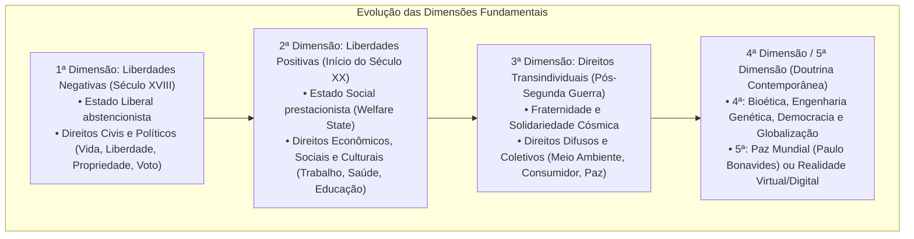
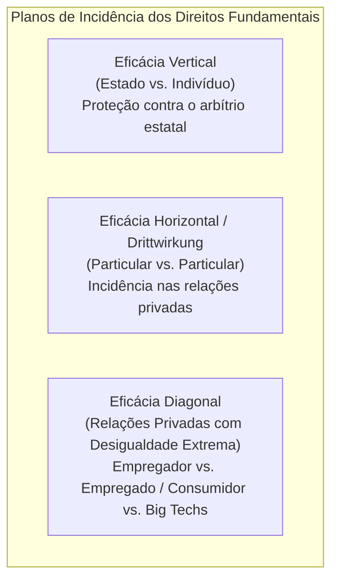
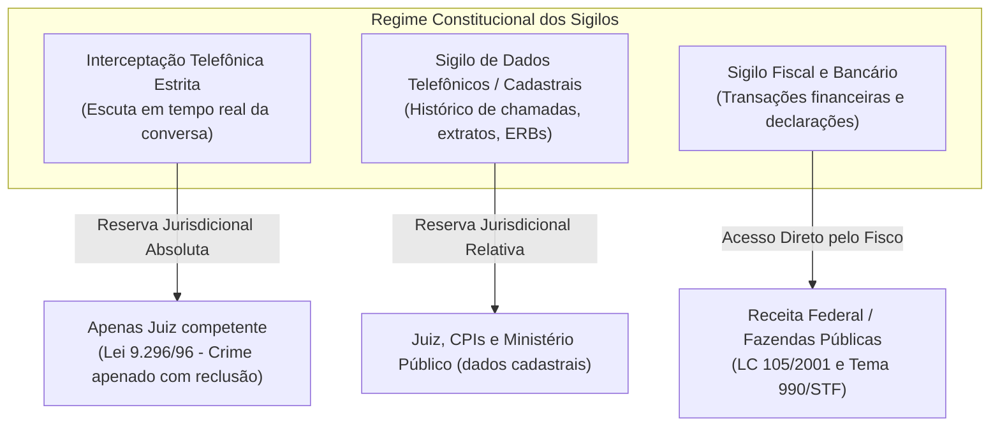
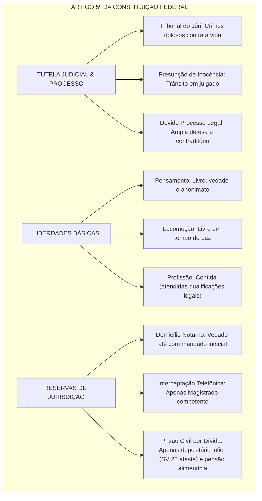

# Direitos e Deveres Individuais e Coletivos (Art. 5º da CF/88)

> O artigo 5º da Constituição de 1988 positiva o núcleo protetivo mais denso do ordenamento jurídico nacional, consagrando os direitos e garantias individuais e coletivos fundados na dignidade da pessoa humana. Compreende desde as dimensões geracionais dos direitos (liberdades negativas de primeira dimensão, prestações estatais de segunda e solidariedade coletiva de terceira), passando pela titularidade ampla que abrange brasileiros natos e naturalizados, estrangeiros residentes ou em trânsito no país e pessoas jurídicas, até a consagração da eficácia horizontal nas relações entre particulares (*Drittwirkung*). O domínio dogmático e jurisprudencial das balizas do art. 5º — mormente no tocante à inviolabilidade domiciliar (Tema 280/STF), aos limites da quebra de sigilo fiscal e bancário pelo Fisco (Tema 990/STF e LC 105/2001), à legalidade, à presunção de inocência e às garantias do devido processo legal — constitui requisito imperativo de alta pontuação nos concursos fiscais, de controle e jurídicos.

---

## 1. Teoria Geral dos Direitos Fundamentais

### 1.1. Dimensões (ou Gerações) dos Direitos Fundamentais

A doutrina constitucional contemporânea (liderada por Norberto Bobbio e Paulo Bonavides) prefere o vocábulo **dimensões** a "gerações", enfatizando que as novas conquistas protetivas não revogam as anteriores, mas a elas se somam em processo cumulativo de expansão axiológica:

---

### 1.2. Características Canônicas dos Direitos Fundamentais

1. **Universalidade:** Destinam-se à totalidade dos seres humanos pelo simples fato de ostentarem a condição existencial de pessoa.
2. **Relatividade (ou Limitabilidade):** **Não existem direitos fundamentais de caráter absoluto** no ordenamento jurídico brasileiro. Mesmo o direito à vida sofre mitigações explícitas (admissão de pena de morte na hipótese de guerra declarada, art. 5º, XLVII, "a"). Todo direito encontra limites nos direitos alheios e nos preceitos da ordem pública (*limites dos limites* ou *Schranken-Schranken*).
3. **Inalienabilidade e Indisponibilidade:** São insuscetíveis de transferência patrimonial ou renúncia definitiva voluntária. O titular pode dispor apenas do exercício temporário de certas prerrogativas (como na cessão de imagem em programas televisivos).
4. **Imprescritibilidade:** O decurso do tempo não extingue o direito fundamental em si, podendo ser exercido a qualquer momento da existência do titular (embora pretensões patrimoniais dele decorrentes possam prescrever).
5. **Indivisibilidade e Interdependência:** Integram um sistema unitário coeso, no qual a tutela da liberdade depende materialmente da garantia da igualdade e das condições mínimas de subsistência.
6. **Proibição do Retrocesso Social (*Efeito Cliquet*):** Uma vez conquistado e implementado determinado patamar normativo de proteção a direito fundamental, é vedado ao legislador ordinário suprimi-lo arbitrariamente sem instituir mecanismos compensatórios equivalentes.

---

### 1.3. Titularidade e Destinatários dos Direitos Fundamentais

O *caput* do art. 5º refere-se formalmente aos *"brasileiros e aos estrangeiros residentes no País"*. Contudo, mediante interpretação constitucional evolutiva, o **Supremo Tribunal Federal expandiu a titularidade**:

* **Estrangeiros Não Residentes (em Trânsito ou Turistas):** São titulares de todos os direitos individuais compatíveis com a sua situação fática temporária no território nacional (vida, liberdade, integridade física, propriedade, devido processo legal e remédios constitucionais como o *Habeas Corpus*).
* **Pessoas Jurídicas:** São destinatárias dos direitos fundamentais compatíveis com a sua natureza incorpórea e institucional (inviolabilidade do domicílio em relação à sede comercial, sigilo de correspondência/dados, honra objetiva e devido processo legal). *Súmula 227 do STJ:* *"A pessoa jurídica pode sofrer dano moral"*.
* **Apatridos e Entes Despersonalizados:** Gozam igualmente da proteção de direitos fundamentais básicos (massa falida e espólio, no que couber).

---

### 1.4. Eficácia Vertical, Horizontal e Diagonal dos Direitos Fundamentais

A doutrina divide a incidência dos direitos fundamentais em três planos operacionais:

1. **Eficácia Vertical:** Modelo clássico de defesa do indivíduo perante o Estado detentor do monopólio da coerção.
2. **Eficácia Horizontal (*Drittwirkung*):** Aplicação direta dos direitos fundamentais às relações entre particulares sem necessidade de intermediação legislativa infraconstitucional. O STF pacificou a tese ao julgar a exclusão de sócio de entidade privada (cooperativa ou clube) sem o respeito ao contraditório e à ampla defesa (RE 201.819/RJ).
3. **Eficácia Diagonal:** Incidência dos direitos fundamentais nas relações privadas caracterizadas por acentuada assimetria de poder econômico, fático ou informacional entre as partes (como nas relações de trabalho e contratos de consumo massificados).

---

## 2. Dissecção dos Núcleos Temáticos do Art. 5º Exigidos em Concursos

### 2.1. Inviolabilidade Domiciliar (Art. 5º, XI)

*"A casa é asilo inviolável do indivíduo, ninguém nela podendo penetrar sem consentimento do morador, salvo em caso de flagrante delito ou desastre, ou para prestar socorro, ou, durante o dia, por determinação judicial."*

* **Conceito Amplo de "Casa":** O STF interpreta "casa" como qualquer compartimento privado não aberto ao público onde alguém exerça profissão, atividade ou resida (quartos de hotel ocupados, escritórios profissionais de contabilidade/advocacia, motorhomes, boléias de caminhão quando utilizadas para pernoite).
* **Exceções Constitucionais Estruturadas:**
  * **A qualquer hora (dia ou noite):**
    1. Consentimento do morador.
    2. Flagrante delito.
    3. Desastre.
    4. Prestação de socorro.
  * **Somente durante o dia:**
    * **Determinação judicial** (mandado judicial de busca e apreensão).
* **Jurisprudência Vinculante do STF (Tema 280):** A entrada forçada em domicílio sem mandado judicial sob a alegação de flagrante delito somente é lícita se amparada em **fundadas razões (justa causa)**, devidamente justificadas pelas circunstâncias prévias ao ingresso. A simples atitude suspeita ou a mera fuga de indivíduo desacompanhada de outros elementos concretos não legitima a invasão domiciliar.

---

### 2.2. Inviolabilidade das Comunicações e Quebra de Sigilos (Art. 5º, XII)

*"É inviolável o sigilo da correspondência e das comunicações telegráficas, de dados e das comunicações telefônicas, salvo, no último caso, por ordem judicial, nas hipóteses e na forma que a lei estabelecer para fins de investigação criminal ou instrução processual penal."*

* **Interceptação Telefônica:** Sujeita à cláusula de **reserva de jurisdição absoluta**. Nem mesmo CPIs federais ou estaduais podem determinar interceptação telefônica (apenas o juiz criminal competente, em hipótese de infração penal apenada com reclusão).
* **Sigilo de Dados Telefônicos (Extratos de Ligações e ERBs):** As CPIs possuem poder instrutório para decretar a quebra do sigilo de dados telefônicos (registros pretéritos das ligações efetuadas), mas não a gravação da conversa futura.
* **Quebra de Sigilo Bancário pela Administração Tributária (Tema 990/STF e LC 105/2001):** O STF declarou constitucional o art. 6º da Lei Complementar nº 105/2001. A Receita Federal e os fiscos estaduais e municipais **podem requisitar diretamente das instituições financeiras as informações sobre operações bancárias de contribuintes sem necessidade de prévia autorização judicial**, desde que instaurado processo administrativo fiscal formal e garantido o sigilo dos dados na repartição fazendária. Não há verdadeira "quebra", mas **transferência de sigilo** do banco para o Fisco.

---

### 2.3. Liberdade de Reunião e de Associação (Art. 5º, XVI a XXI)

* **Liberdade de Reunião (Art. 5º, XVI):**
  * Requisitos cumulativos: Fins pacíficos, sem armas, em locais abertos ao público, não frustrem outra reunião convocada anteriormente.
  * **Independe de autorização do Poder Público.**
  * *Jurisprudência Vinculante (Tema 855/STF):* A exigência constitucional de "prévio aviso" à autoridade competente não condiciona a legitimidade da reunião. Se a manifestação pública tiver ampla divulgação prévia e for de conhecimento notório dos órgãos de segurança, a ausência de notificação formal não torna o ato ilícito.
* **Liberdade de Associação (Art. 5º, XVII a XXI):**
  * Plena liberdade para fins lícitos, **vedada a de caráter paramilitar**.
  * A criação de associações e cooperativas **independe de autorização estatal**, sendo vedada a interferência estatal em seu funcionamento.
  * **Dissolução e Suspensão:**
    * *Suspensão das atividades:* decisão judicial (basta decisão interlocutória).
    * *Dissolução compulsória:* exige **decisão judicial com trânsito em julgado**.
  * Representação processual: as associações só podem representar seus filiados em juízo mediante **autorização expressa** (individual ou assemblear específica — art. 5º, XXI e Tema 82/STF), salvo na hipótese de Mandado de Segurança Coletivo (onde atuam como substitutas processuais).

---

### 2.4. Tribunal do Júri e Garantias Processuais Fundamentais

* **Princípios Constitucionais do Tribunal do Júri (Art. 5º, XXXVIII):**
  1. Plenitude de defesa.
  2. Sigilo das votações.
  3. Soberania dos veredictos.
  4. Competência mínima para o julgamento dos **crimes dolosos contra a vida** (tentados ou consumados).
* **Princípio da Presunção de Inocência (Art. 5º, LVII):** *"Ninguém será considerado culpado até o trânsito em julgado de sentença penal condenatória"*. Conforme entendimento consolidado pelo STF nas ADCs 43, 44 e 54, a execução provisória da pena após condenação em segunda instância é incompatível com o texto literal da Constituição, exigindo-se o trânsito em julgado para o início do cumprimento da pena definitiva (salvo decretação fundamentada de prisão preventiva processual).

---

## 3. Tabela Comparativa de Restrições Legítimas a Direitos Fundamentais

| Direito Fundamental | Regra Geral Protetiva | Hipótese Excepcional de Restrição | Autoridade com Competência Restritiva |
| :--- | :--- | :--- | :--- |
| **Inviolabilidade Domiciliar** | Proibido ingressar sem consentimento | Flagrante delito, desastre, socorro (dia/noite) ou ordem judicial (dia) | Morador, agentes de socorro ou Juiz de Direito |
| **Sigilo das Comunicações Telefônicas** | Proibida qualquer escuta ou gravação | Investigação penal ou processo penal de crime punido com reclusão | **Exclusiva do Juiz de Direito** (reserva de jurisdição absoluta) |
| **Sigilo Bancário / Fiscal** | Proteção da intimidade patrimonial | Fiscalização de tributos instaurada com processo formal (LC 105/01) | Receita Federal e Fazendas Públicas (transferência direta de sigilo) |
| **Liberdade de Reunião** | Livre manifestação em locais públicos | Estado de Defesa ou Estado de Sítio regularmente decretados | Presidente da República com autorização parlamentar |
| **Direito de Propriedade** | Garantia do domínio individual pleno | Desapropriação por necessidade pública, utilidade pública ou interesse social | Poder Executivo (mediante justa e prévia indenização em dinheiro) |

---

> **Fique Ligado:**
> 1. **Dano Moral a Pessoa Jurídica:** É plenamente admitido na súmula 227 do STJ quanto à honra **objetiva** (reputação no mercado e credibilidade comercial). Pessoa jurídica, contudo, não tem honra subjetiva (sentimento de autoestima).
> 2. **Remuneração Noturna do Domicílio:** A expressão "durante o dia" adota critério cronológico-solar (das 6h às 18h segundo o critério tradicional, ou aurora ao crepúsculo; a Nova Lei de Abuso de Autoridade — Lei 13.869/2019 — tipifica expressamente o cumprimento de mandado de busca e apreensão entre 21h e 5h).
> 3. **CPI vs. Escuta Telefônica:** CPI pode quebrar sigilo bancário, fiscal e de dados telefônicos (registros passados), mas **NUNCA** pode decretar interceptação telefônica (escuta em tempo real).

---

## 4. Síntese Visual Canônica

---

## 5. Questões Paradigmáticas Aplicadas

---

### [Questão 01](https://www.qconcursos.com/questoes-de-concursos/questoes/5a484906-c7) — [OBJETIVA — Prefeitura de Cachoeira do Sul - RS / Contador e Advogado — 2026] • [Nível: Muito Fácil (Acertos: 93.1%)]

Acerca dos direitos e das garantias fundamentais previstos na Constituição Federal, assinalar a alternativa correta:

* **A)** É permitida a manifestação de pensamento anônima em determinadas situações reguladas por decreto executivo.
* **B)** A reunião pacífica em locais abertos ao público depende de autorização prévia da autoridade competente.
* **C)** A expressão da atividade artística e científica depende de licença estatal prévia.
* **D)** Ninguém será obrigado a fazer ou deixar de fazer alguma coisa senão em virtude de lei.

#### Gabarito: **D**

* **A (Errada):** O art. 5º, inciso IV, da CF/88 estabelece que *"é livre a manifestação do pensamento, sendo vedado o anonimato"*. Não há qualquer exceção em nível infralegal que autorize o anonimato.
* **B (Errada):** A liberdade de reunião (art. 5º, XVI) independe de autorização estatal, exigindo-se apenas que seja pacífica, sem armas, em locais abertos e precedida de prévio aviso (que, consoante o STF no Tema 855, pode ser suprido pela notoriedade do ato).
* **C (Errada):** O art. 5º, inciso IX, garante que *"é livre a expressão da atividade intelectual, artística, científica e de comunicação, independentemente de censura ou licença"*.
* **D (Certa):** Trata-se da consagração expressa do **princípio da legalidade genérica** insculpido no art. 5º, inciso II, da Carta Magna (*"ninguém será obrigado a fazer ou deixar de fazer alguma coisa senão em virtude de lei"*).

---

### [Questão 02](https://www.qconcursos.com/questoes-de-concursos/questoes/4d0f4b99-c7) — [ISET — Câmara de Seabra - BA / Técnico em Comunicação — 2026] • [Nível: Muito Fácil (Acertos: 93.4%)]

Na página oficial de uma instituição pública, um cidadão publica comentário severamente crítico à qualidade de determinado serviço, afirmando que o atendimento é “desorganizado e incapaz de resolver problemas básicos”. A manifestação não contém ameaça, conteúdo discriminatório ou divulgação de dados pessoais de servidores. Paralelamente, em outra publicação, são expostos dados privados e residenciais de uma servidora com o intuito de intimidação.

Considerando o regime constitucional da liberdade de expressão e a tutela dos direitos fundamentais, assinale a opção correta:

* **A)** Ambas as publicações devem receber o mesmo tratamento censório, pois críticas ao serviço público e divulgação de dados privados atingem igualmente a honorabilidade da Administração.
* **B)** A crítica severa ao serviço público não deve ser equiparada, apenas por seu conteúdo negativo, à exposição indevida de informações pessoais, sendo a primeira assegurada pela liberdade de manifestação e a segunda ilícita por violar a privacidade.
* **C)** A crítica ao serviço deve ser compulsoriamente excluída se gerar repercussão desfavorável para a imagem institucional do órgão público.
* **D)** Qualquer intervenção da Administração Pública em manifestações de usuários, ainda que veiculem dados pessoais sigilosos ou ameaças, configura censura estatal inconstitucional.
* **E)** Somente declarações estritamente laudatórias ou favoráveis ao Poder Público recebem proteção constitucional em canais oficiais de comunicação.

#### Gabarito: **B**

* **A (Errada):** A crítica ao serviço estatal constitui legítimo exercício da liberdade de expressão e controle social (art. 5º, IV e XIV); em contrapartida, a exposição de dados pessoais sigilosos fere o direito à intimidade e à vida privada (art. 5º, X).
* **B (Certa):** O ordenamento constitucional assegura a livre circulação de opiniões e críticas aos serviços estatais, vedando o arbítrio censório da Administração. Contudo, tal liberdade encontra limite constitucional expresso na inviolabilidade da intimidade e segurança dos agentes públicos.
* **C (Errada):** A imagem institucional da repartição não autoriza a supressão ilegítima de descontentamentos populares expressados civilizadamente.
* **D (Errada):** A vedação à censura não protege atos ilícitos flagrantes; a divulgação indevida de dados pessoais viola a Constituição e a LGPD, autorizando a remoção célere do conteúdo abusivo.
* **E (Errada):** A liberdade de manifestação alcança primordialmente as manifestações críticas e contrárias às autoridades constituídas.

---

### [Questão 03](https://www.qconcursos.com/questoes-de-concursos/questoes/62e8e736-c8) — [OBJETIVA — Prefeitura de Cachoeira do Sul - RS / Técnico em Administração — 2026] • [Nível: Muito Fácil (Acertos: 96.0%)]

Nos termos da Constituição Federal, a casa é asilo inviolável do indivíduo, ninguém nela podendo penetrar sem consentimento do morador, salvo:

I. Em caso de flagrante delito ou desastre.  
II. Para prestar socorro.  
III. Durante o dia, por determinação judicial.  

Está correto o que se afirma em:

* **A)** Apenas nos itens I e II.
* **B)** Apenas nos itens I e III.
* **C)** Apenas nos itens II e III.
* **D)** Em todos os itens.

#### Gabarito: **D**

* **Itens I e II (Certos):** Em caso de flagrante delito, desastre ou para prestar socorro, o ingresso é autorizado a qualquer hora (tanto durante o dia quanto no período noturno).
* **Item III (Certo):** A determinação judicial constitui hipótese que somente autoriza a entrada forçada **durante o dia**.
* **Conclusão:** Todos os itens reproduzem expressamente as ressalvas do art. 5º, inciso XI, da CF/88.

---

### [Questão 04](https://www.qconcursos.com/questoes-de-concursos/questoes/b5a48491-c7) — [CESPE / CEBRASPE — Polícia Civil - PE / Agente de Polícia — 2026] • [Nível: Fácil (Acertos: 71.5%)]

Policiais militares realizavam patrulhamento rotineiro em via pública quando avistaram um indivíduo que, ao notar a presença da viatura policial, demonstrou nervosismo e empreendeu fuga para o interior de sua residência. Sem mandado judicial e sem qualquer outra investigação prévia, os policiais adentraram o imóvel e localizaram drogas no interior do quarto.

À luz da jurisprudência vinculante fixada pelo Supremo Tribunal Federal (Tema 280 da Repercussão Geral), a atuação policial descrita é:

* **A)** lícita, haja vista que o crime de tráfico de drogas é de natureza permanente, autorizando a entrada a qualquer hora independentemente de fundadas razões.
* **B)** ilícita, pois a entrada forçada em domicílio sem mandado judicial exige a demonstração prévia de fundadas razões lastreadas em justa causa, não bastando a mera fuga do indivíduo.
* **C)** lícita, desde que a autoridade policial elabore auto de prisão em flagrante ratificado pelo delegado de polícia no prazo improrrogável de 24 horas.
* **D)** lícita, porque o direito à inviolabilidade do domicílio cede em face de qualquer suspeita subjetiva fundada na experiência dos policiais militares.
* **E)** ilícita unicamente se a diligência tiver ocorrido no período noturno, sendo plenamente válida se executada durante o dia.

#### Gabarito: **B**

* **A (Errada):** A natureza permanente do delito não confere salvo-conduto irrestrito para invasão arbitrária de residências sem indícios consistentes e verificáveis previamente.
* **B (Certa):** Tese vinculante fixada pelo STF no **Tema 280**: *"A entrada forçada em domicílio sem mandado judicial só é lícita, mesmo em período noturno, quando amparada em fundadas razões, devidamente justificadas a posteriori, que indiquem que dentro da casa ocorre situação de flagrante delito, sob pena de responsabilidade disciplinar, civil e penal do agente ou da autoridade e de nulidade dos atos praticados"*. A simples fuga desacompanhada de diligências anteriores não configura fundada razão.
* **C (Errada):** A ratificação administrativa por delegado de polícia não convalida a ilicitude originária da invasão constitucional domiciliar.
* **D (Errada):** Suspeitas puramente subjetivas violam a garantia fundamental do asilo inviolável.
* **E (Errada):** O mandado judicial é que se submete à restrição do período diurno; a justa causa para flagrante deve existir em qualquer horário, tornando a diligência nula independentemente do turno.

---

### [Questão 05](https://www.qconcursos.com/questoes-de-concursos/questoes/c5a48492-c7) — [FGV — SEFAZ-MT / Auditor Fiscal da Receita Estadual — 2026] • [Nível: Difícil (Acertos: 44.1%)]

Em regular procedimento de fiscalização tributária instaurado contra determinada sociedade empresária do ramo atacadista, a autoridade fazendária estadual requisitou diretamente a instituições bancárias as movimentações financeiras da empresa, com base no art. 6º da Lei Complementar nº 105/2001, dispensando autorização judicial prévia. A contribuinte impetrou mandado de segurança sustentando violação ao art. 5º, inciso XII e X, da Constituição Federal.

Considerando o entendimento pacificado pelo Supremo Tribunal Federal sobre o tema (Tema 990 da Repercussão Geral), é correto afirmar que:

* **A)** a requisição direta de dados bancários pelo Fisco é inconstitucional, uma vez que toda e qualquer quebra de sigilo submete-se à cláusula de reserva absoluta de jurisdição.
* **B)** a requisição é constitucional, pois não configura quebra de sigilo, mas sim transferência de sigilo do âmbito bancário para o âmbito fiscal, exigindo-se a instauração de processo administrativo e o dever de sigilo funcional.
* **C)** a obtenção de dados bancários pelo Fisco prescinde de processo administrativo instaurado, bastando a constatação de inadimplência tributária no sistema da fazenda pública.
* **D)** os estados e municípios não possuem legitimidade para requisitar diretamente movimentações bancárias, competência restrita com exclusividade à Receita Federal do Brasil.
* **E)** os dados fiscais obtidos diretamente não podem, em nenhuma hipótese, ser compartilhados com o Ministério Público para fins de persecução penal de crimes tributários.

#### Gabarito: **B**

* **A (Errada):** O STF afastou a necessidade de prévia intervenção judicial para que o Fisco obtenha informações sobre movimentações financeiras, julgando constitucionais os arts. 5º e 6º da LC 105/2001.
* **B (Certa):** Exata aplicação do **Tema 990/STF**: o fornecimento direto de informações financeiras ao Fisco não configura quebra indevida de sigilo, mas transferência legítima de sigilo da instituição bancária para a administração tributária, ambas vinculadas à guarda rigorosa dos dados sob pena de responsabilização funcional e penal.
* **C (Errada):** A instauração de processo administrativo fiscal prévio e formal é requisito indispensável fixado expressamente pelo STF para validar a requisição.
* **D (Errada):** O STF estendeu a prerrogativa a todos os entes da Federação (União, Estados, DF e Municípios), desde que possuam regulamentação específica em nível local.
* **E (Errada):** O STF fixou expressamente a licitude do compartilhamento de dados fiscais com o Ministério Público quando identificados indícios de crimes contra a ordem tributária ou lavagem de capitais.

---

### [Questão 06](https://www.qconcursos.com/questoes-de-concursos/questoes/d5a48493-c7) — [FCC — TRT - 1ª Região (RJ) / Analista Judiciário — 2026] • [Nível: Média (Acertos: 62.8%)]

Em relação à disciplina constitucional da liberdade de associação insculpida no art. 5º da CF/88, assinale a assertiva correta:

* **A)** A criação de associações depende de prévia autorização do Poder Executivo, sendo vedada a criação de cooperativas na forma da lei.
* **B)** A dissolução compulsória de uma associação por prática de atos ilícitos graves pode ser determinada monocraticamente por autoridade policial em sede de inquérito.
* **C)** As associações só poderão ter suas atividades suspensas por decisão judicial, exigindo-se o trânsito em julgado para a sua dissolução compulsória.
* **D)** Ninguém poderá ser compelido a associar-se ou a permanecer associado, salvo se houver previsão em convenção coletiva de trabalho autorizando a filiação compulsória.
* **E)** As entidades associativas possuem legitimidade para representar seus filiados perante o Poder Judiciário independentemente de qualquer autorização expressa em assembleia.

#### Gabarito: **C**

* **A (Errada):** Consoante o art. 5º, XVIII, a criação de associações e a de cooperativas independem de qualquer autorização estatal.
* **B (Errada):** A dissolução compulsória jamais pode emanar de autoridade administrativa ou policial; exige pronunciamento emanado privativamente do Poder Judiciário.
* **C (Certa):** Transcrição exata da regra constitucional constante do art. 5º, XIX: para a *suspensão de atividades*, basta decisão judicial (mesmo liminar ou interlocutória); todavia, para a *dissolução compulsória*, exige-se **decisão judicial transitada em julgado**.
* **D (Errada):** O princípio da liberdade negativa de associação (art. 5º, XX) é peremptório: *"ninguém poderá ser compelido a associar-se ou a permanecer associado"*, não tolerando mitigação por norma convencional privada.
* **E (Errada):** O art. 5º, XXI, exige que as associações estejam **expressamente autorizadas** (individualmente ou por assembleia específica) para atuar na representação de seus associados.

---

### [Questão 07](https://www.qconcursos.com/questoes-de-concursos/questoes/e5a48494-c7) — [CESPE / CEBRASPE — DPE-MG / Defensor Público — 2026] • [Nível: Difícil (Acertos: 38.9%)]

Acerca da teoria dos direitos fundamentais e de sua aplicabilidade às relações privadas (*eficácia horizontal ou Drittwirkung*), assinale a opção correta:

* **A)** Os direitos fundamentais foram concebidos historicamente para reger as relações interpessoais privadas, não possuindo eficácia perante o Estado.
* **B)** A teoria da eficácia horizontal indireta ou mediata preconiza que os direitos fundamentais vinculam os particulares de modo imediato, sem dependência de conformação por normas de direito privado.
* **C)** O Supremo Tribunal Federal adota no Brasil a teoria da eficácia direta e imediata dos direitos fundamentais nas relações privadas, admitindo que preceitos como o contraditório e a ampla defesa incidam em entidades associativas particulares.
* **D)** A eficácia horizontal dos direitos fundamentais não se aplica ao direito civil ou societário, em respeito absoluto e intangível à autonomia da vontade e ao princípio do *pacta sunt servanda*.
* **E)** As pessoas jurídicas de direito privado não podem ser compelidas a observar direitos fundamentais nas suas contratações de consumo.

#### Gabarito: **C**

* **A (Errada):** Historicamente, os direitos fundamentais nasceram sob a dimensão vertical (limitação do poder estatal absolutista perante os cidadãos).
* **B (Errada):** A teoria da eficácia *indireta ou mediata* (defendida por Günter Dürig na Alemanha) afirma exatamente o contrário: os direitos fundamentais só incidem nas relações privadas por meio de cláusulas gerais abertas do direito civil (boa-fé, função social).
* **C (Certa):** O STF (precedente clássico do RE 201.819/RJ) consagrou no ordenamento nacional a **teoria da eficácia direta e imediata** (*unmittelbare Drittwirkung*), segundo a qual as normas constitucionais definidoras de direitos e garantias fundamentais incidem de plano sobre os atos privados, devendo os estatutos associativos resguardar as garantias do devido processo legal antes da exclusão de qualquer membro.
* **D (Errada):** A autonomia privada foi redimensionada pela tábua axiológica da Constituição de 1988, devendo harmonizar-se com a dignidade da pessoa humana e a igualdade.
* **E (Errada):** As relações civis e de consumo subordinam-se estritamente aos mandamentos constitucionais fundamentais.

---

### [Questão 08](https://www.qconcursos.com/questoes-de-concursos/questoes/f5a48495-c7) — [FGV — OAB / Exame de Ordem Unificado — 2026] • [Nível: Fácil (Acertos: 76.8%)]

Mariana foi presa em flagrante pela suposta prática de crime de estelionato. Durante o interrogatório na delegacia de polícia, a autoridade policial advertiu a investigada de que o seu silêncio seria interpretado como presunção de veracidade das acusações formuladas pelas vítimas.

Diante do quadro hipotético e das garantias fundamentais insculpidas no art. 5º da CF/88, assinale a afirmativa correta:

* **A)** A conduta da autoridade policial é lícita, pois o princípio da ampla defesa não alcança a fase pré-processual do inquérito policial.
* **B)** A Constituição Federal assegura ao preso o direito de permanecer calado, sendo vedada a valoração de seu silêncio em prejuízo da defesa (*nemo tenetur se detegere*).
* **C)** O investigado tem o dever legal de responder a todas as perguntas formuladas pelo delegado de polícia, respondendo por desobediência se permanecer em silêncio.
* **D)** A prerrogativa contra a autoincriminação alcança apenas as pessoas investigadas que comprovem documentalmente insuficiência de recursos financeiros.
* **E)** O direito ao silêncio só pode ser exercido se o investigado estiver assistido por advogado constituído no momento da lavratura do flagrante.

#### Gabarito: **B**

* **A (Errada):** O direito fundamental ao silêncio incide tanto no processo judicial quanto na esfera investigativa policial e administrativa.
* **B (Certa):** O art. 5º, inciso LXIII, da CF/88 estabelece categoricamente que *"o preso será informado de seus direitos, entre os quais o de permanecer calado, sendo-lhe assegurada a assistência da família e de advogado"*. Trata-se do corolário do princípio universal da não autoincriminação (*nemo tenetur se detegere*), sendo absolutamente vedado ao Estado presumir a culpa com esteio no silêncio do réu.
* **C (Errada):** Não existe dever jurídico de responder sobre os fatos imputados, descabendo qualquer cominação por desobediência.
* **D (Errada):** É garantia universal e indistinta atribuída a qualquer pessoa sob custódia estatal, rica ou pobre.
* **E (Errada):** O direito de calar-se é subjetivo e autoaplicável pelo próprio custodiado, operando de pleno direito mesmo antes da chegada da assistência jurídica.

---

### [Questão 09](https://www.qconcursos.com/questoes-de-concursos/questoes/f8e447e3-cb) — [ISET — Câmara de Seabra - BA / Vigilante — 2026] • [Nível: Muito Fácil (Acertos: 87.6%)]

Em uma repartição pública, um cidadão, insatisfeito com a excessiva demora do atendimento, passa a reclamar em voz alta, sem ameaçar pessoas, proferir agressões físicas ou danificar bens públicos. Um servidor solicita ao vigilante que retire o usuário imediatamente do prédio “para servir de exemplo”.

Considerando os direitos e deveres individuais e as garantias processuais fundamentais, avalie os seguintes itens:

I. O usuário do serviço público possui o direito de petição e o direito de reclamar contra abusos de autoridade e defeitos na prestação de serviços.  
II. O princípio da legalidade impede que agentes públicos imponham sanções ou medidas restritivas de liberdade a cidadãos sem respaldo estrito em lei.  
III. O servidor público possui prerrogativa de determinar a prisão arbitrária de qualquer usuário que manifeste desagrado nas dependências do órgão.  
IV. A intervenção física da segurança patrimonial exige a constatação de conduta ilícita, ameaça iminente ou quebra ostensiva da ordem indispensável ao funcionamento regular do serviço.  

Estão corretos os itens:

* **A)** I e III, apenas.
* **B)** II e IV, apenas.
* **C)** I, II e III, apenas.
* **D)** II, III e IV, apenas.
* **E)** I, II e IV, apenas.

#### Gabarito: **E**

* **Itens I, II e IV (Certos):** O direito de representação contra a má prestação do serviço é assegurado pelo art. 5º, XXXIV, e pela Lei nº 13.460/2017; a legalidade (art. 5º, II) veda arbitrariedades de agentes públicos; o uso proporcional da força patrimonial requer perturbação real da ordem ou ameaça.
* **Item III (Errado):** Inexiste prerrogativa funcional que legitime prisões arbitrárias no regime constitucional democrático. A prisão só cabe em flagrante delito ou por ordem judicial escrita e fundamentada (art. 5º, LXI).
* **Conclusão:** Os itens corretos são **I, II e IV**, consolidando a alternativa **E**.

---

### [Questão 10](https://www.qconcursos.com/questoes-de-concursos/questoes/f92db085-cb) — [ISET — Câmara de Seabra - BA / Vigilante — 2026] • [Nível: Muito Fácil (Acertos: 87.3%)]

Em uma área comum de atendimento de uma repartição pública, sem qualquer restrição formal à captação de imagens e sem exposição de documentos sob sigilo legal, um cidadão insatisfeito passa a gravar com o próprio telefone a conversa que mantém com os servidores públicos responsáveis pelo setor. A chefia da repartição ordena que a equipe de vigilância apreenda imediatamente o aparelho celular do cidadão e apague o vídeo gravado.

À luz da Constituição Federal e do entendimento pretoriano dominante, a ordem expedida:

* **A)** deve ser integralmente cumprida, pois o domínio patrimonial do edifício confere à Administração o poder de apreender bens móveis de terceiros.
* **B)** é legítima sempre que a gravação alcançar a voz de servidor público em serviço, haja vista o sigilo intrínseco aos atos estatais.
* **C)** somente poderia ser legitimamente recusada se o usuário comprovasse perante o setor registro profissional de jornalista.
* **D)** não confere poder legítimo aos agentes de segurança para apreender o telefone ou coagir o cidadão a deletar a mídia, ressalvada a atuação em caso de ilícito penal flagrante.
* **E)** deve ser cumprida compulsoriamente porque a gravação de atendimento administrativo viola, por si só, o núcleo essencial da intimidade do agente estatal.

#### Gabarito: **D**

* **A (Errada):** A Administração Pública não possui poder de autoexecutoriedade para desapossar cidadãos de seus bens particulares sem respaldo legal ou mandado judicial.
* **B e E (Erradas):** A atuação dos agentes estatais na prestação de serviços públicos submete-se ao **princípio da publicidade** (CF, art. 37, *caput*). Conforme jurisprudência do STF e do STJ, a gravação de conversa própria mantida com agente público em repartição aberta não constitui violação de sigilo nem ato ilícito per se.
* **C (Errada):** A liberdade de documentação e informação de fatos públicos pertence a qualquer cidadão, não sendo monopólio restrito da imprensa formal.
* **D (Certa):** Apreender o telefone ou forçar a eliminação de gravações caracteriza arbitrariedade e confisco sumário que atenta contra a garantia do direito de propriedade (art. 5º, XXII) e o devido processo legal (art. 5º, LIV), configurando potencial crime de abuso de autoridade (Lei nº 13.869/2019).

---

### [Questão 11](https://www.qconcursos.com/questoes-de-concursos/questoes/f9834352-cb) — [ISET — Câmara de Seabra - BA / Vigilante — 2026] • [Nível: Muito Fácil (Acertos: 90.8%)]

Durante o controle de acesso a um edifício do Poder Legislativo, um visitante recusa-se a apresentar o documento de identificação exigido pelas normas regulamentares do órgão, argumentando que o art. 5º da Constituição assegura a liberdade de locomoção e a igualdade de todos perante a lei, razão pela qual nenhuma pessoa poderia ser impedida de ingressar em prédio público.

Sobre a controvérsia instaurada sob o prisma dos limites aos direitos fundamentais, assinale a opção correta:

* **A)** O argumento do visitante procede integralmente, pois repartições públicas devem manter portas abertas de modo irrestrito a qualquer pessoa sem controles de identificação.
* **B)** O controle de identificação é válido apenas se a segurança demonstrar documentalmente e com antecedência que aquele cidadão específico planeja praticar atos hostis.
* **C)** O princípio da isonomia impede a instituição de barreiras de acesso entre áreas parlamentares de livre circulação e setores restritos onde tramitam matérias reservadas.
* **D)** A liberdade de locomoção afasta medidas preventivas de triagem, restando à Administração atuar unicamente após a ocorrência de crimes consumados.
* **E)** O princípio da igualdade não veda a fixação de controles de acesso gerais, impessoais, objetivos e razoáveis voltados à segurança das instalações e das pessoas, devendo ser exigidos indistintamente de todos.

#### Gabarito: **E**

* **A (Errada):** Os direitos fundamentais não são absolutos. A liberdade de locomoção em prédios públicos submete-se aos regulamentos internos de ordem e segurança institucional.
* **B (Errada):** O controle de acesso é preventivo e abstrato; a exigência de identificação independe de suspeita prévia individualizada.
* **C (Errada):** A isonomia consiste em tratar igualmente os iguais e desigualmente os desiguais; a separação entre setores de circulação pública e setores administrativos reservados é plenamente compatível com a Constituição.
* **D (Errada):** A prevenção de ilícitos integra o poder de polícia administrativa conferido ao Estado.
* **E (Certa):** A exigência de identificação pessoal para ingresso em repartições estatais é medida impessoal, legítima e proporcional, necessária à salvaguarda da integridade das instalações, dos servidores e dos próprios usuários.

---

### [Questão 12](https://www.qconcursos.com/questoes-de-concursos/questoes/a5a48496-c7) — [CESPE / CEBRASPE — PGE-PA / Procurador do Estado — 2026] • [Nível: Média (Acertos: 57.4%)]

Considere que determinada lei complementar estadual estabeleça a possibilidade de o Ministério Público requisitar, diretamente e sem autorização judicial, a quebra de sigilo de correspondência física epistolar de cidadãos investigados por crimes funcionais.

À luz da jurisprudência do Supremo Tribunal Federal e do regime constitucional das inviolabilidades do art. 5º da CF/88, a referida previsão legislativa é:

* **A)** constitucional, tendo em vista que o Ministério Público é titular privativo da ação penal pública e goza de poderes instrutórios ilimitados.
* **B)** inconstitucional, uma vez que a inviolabilidade do sigilo da correspondência é garantia fundamental que apenas pode ser mitigada em situações excepcionais de estado de defesa, estado de sítio ou por decisão judicial fundamentada.
* **C)** constitucional, desde que a requisição seja assinada conjuntamente pelo Procurador-Geral de Justiça e pelo Presidente do Tribunal de Justiça.
* **D)** constitucional unicamente se os investigados forem servidores públicos ocupantes de cargos de provimento efetivo.
* **E)** inconstitucional apenas se a correspondência versar sobre matéria eminentemente tributária.

#### Gabarito: **B**

* **A (Errada):** O Ministério Público, conquanto titular da ação penal, não possui poderes jurisdicionais para afastar unilateralmente cláusulas de reserva de jurisdição.
* **B (Certa):** Conforme jurisprudência histórica do STF, a quebra do sigilo de correspondência (art. 5º, XII) submete-se à cláusula de **reserva de jurisdição** (salvo no âmbito prisional, onde a administração penitenciária pode interceptar cartas de detentos excepcionalmente por razões estritas de segurança penitenciária). Logo, a lei que autoriza o Ministério Público a requisitar quebra de correspondência diretamente sem autorização judicial é manifestamente **inconstitucional**.
* **C (Errada):** A intervenção do Presidente do TJ em ato administrativo conjunto com o PGJ não substitui a necessária ordem judicial proferida no bojo de processo ou inquérito por juízo competente.
* **D (Errada):** A condição de servidor público não retira a proteção constitucional à intimidade e à correspondência pessoal.
* **E (Errada):** A inconstitucionalidade atinge qualquer modalidade de crime investigado.
