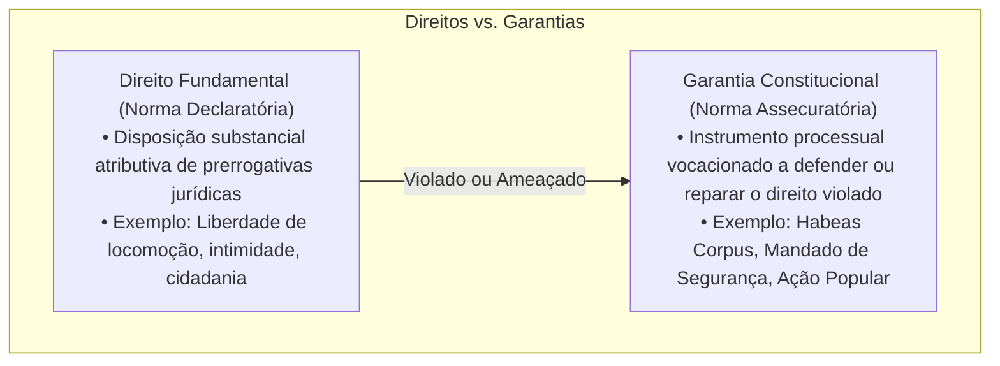
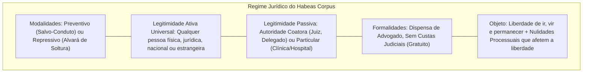
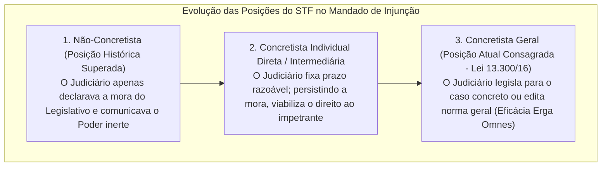
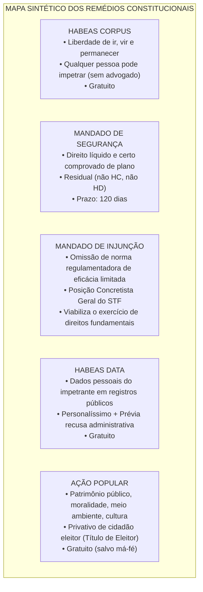

# Remédios Constitucionais e Garantias Processuais

> Os Remédios Constitucionais são garantias fundamentais assecuratórias consagradas pela Carta Magna de 1988 para tutelar, restaurar ou viabilizar a fruição de direitos subjetivos violados ou ameaçados por ilegalidade ou abuso de poder estatal ou de particulares no exercício de funções públicas. A ordem jurídica brasileira estrutura cinco ações constitucionais canônicas: o *Habeas Corpus* (tutela desprovida de formalismos da liberdade física de locomoção perante coação ilegal ou incompetência de juízo); o *Mandado de Segurança* individual e coletivo (Lei nº 12.016/2009, de natureza residual, vocacionado à proteção de direito líquido e certo comprovável de plano documental, sob prazo decadencial improrrogável de 120 dias e regido pela teoria da encampação); o *Mandado de Injunção* (Lei nº 13.300/2016, instrumento de combate à inércia do legislador na regulamentação de normas de eficácia limitada sob a ótica concretista do STF); o *Habeas Data* (Lei nº 9.507/1997, ação personalíssima e gratuita de acesso e retificação de registros públicos, condicionada à prévia recusa administrativa — Súmula 2 do STJ); e a *Ação Popular* (Lei nº 4.717/1965, prerrogativa privativa do cidadão eleitor em defesa do patrimônio público, moralidade administrativa, meio ambiente e patrimônio histórico-cultural).

---

## 1. Teoria Geral das Ações Constitucionais Assecuratórias

A doutrina constitucional (Rui Barbosa e José Afonso da Silva) distingue analiticamente os **direitos fundamentais** das **garantias constitucionais**:

* **Direitos:** Declaram a existência de vantagens e prerrogativas materiais conferidas ao indivíduo pelo ordenamento (ex.: direito à liberdade, à propriedade, à intimidade).
* **Garantias:** São os instrumentos assecuratórios criados pelo constituinte para impor a observância e a reparação daqueles direitos quando forem violados, obstados ou ameaçados por abuso de autoridade pública ou particular no exercício de delegação estatal.

---

## 2. Habeas Corpus (Art. 5º, LXVIII da CF/88 e Arts. 647 a 667 do CPP)

*"Conceder-se-á habeas corpus sempre que alguém sofrer ou se achar ameaçado de sofrer violência ou coação em sua liberdade de locomoção, por ilegalidade ou abuso de poder."*

* **Modalidades:**
  1. **Preventivo:** Quando há ameaça iminente de violência ou coação ilegal à locomoção (expedição de *salvo-conduto*).
  2. **Repressivo (ou Liberatório):** Quando a coação ilegal ou prisão já se consumou (expedição de *alvará de soltura*).
* **Legitimidade Ativa Ampla e Desprovida de Capacidade Postulatória:** Pode ser impetrado por qualquer pessoa (nacional ou estrangeira, maior ou menor, capaz ou incapaz, alfabetizada ou não), pelo Ministério Público ou até de ofício pelo próprio magistrado. Não exige capacidade postulatória (dispensa advogado). Pessoa jurídica pode impetrar HC, mas apenas em benefício de pessoa física (pois pessoa jurídica não sofre privação física de locomoção).
* **Alcance e Trancamento de Ação Penal:** O HC não se restringe a soltar o preso; é a via idônea para corrigir nulidades processuais manifestas que gerem constrangimento ilegal ao investigado ou réu, tais como **incompetência absoluta do juízo**, falta de justa causa para a persecução penal ou atipicidade evidente da conduta (ensejando o trancamento do inquérito ou da ação penal).
* **Punições Disciplinares Militares (Art. 142, § 2º):** Não cabe HC em relação ao mérito administrativo de punições disciplinares militares; contudo, o STF pacificou que o Judiciário pode apreciar a **legalidade formal** do ato (competência da autoridade, existência de previsão legal e observância do devido processo legal).

---

## 3. Mandado de Segurança Individual e Coletivo (Art. 5º, LXIX e LXX e Lei nº 12.016/2009)

*"Conceder-se-á mandado de segurança para proteger direito líquido e certo, não amparado por habeas corpus ou habeas data, quando o responsável pela ilegalidade ou abuso de poder for autoridade pública ou agente de pessoa jurídica no exercício de atribuições do Poder Público."*

### 3.1. Pressupostos Constitucionais e Processuais

1. **Direito Líquido e Certo:** É aquele cuja existência e extensão são demonstráveis de plano por meio de **prova documental pré-constituída**, juntada no momento da petição inicial. No Mandado de Segurança, é terminantemente **vedada a dilação probatória** (perícias, oitiva de testemunhas). Se houver necessidade de produção probatória suplementar, a via do MS é inadequada, devendo a pretensão ser deduzida em ação ordinária.
2. **Natureza Residual:** O MS só é cabível para tutelar direitos fundamentais que **não sejam amparados por Habeas Corpus** (liberdade de locomoção) **nem por Habeas Data** (dados pessoais em registros públicos).
3. **Prazo Decadencial de 120 Dias (Art. 23 da Lei 12.016/2009):** O direito de requerer mandado de segurança extingue-se decorridos 120 dias, contados da ciência, pelo interessado, do ato impugnado.
   * *Súmula 632 do STF:* É constitucional o prazo decadencial de 120 dias para impetração de mandado de segurança.
   * *Súmula 430 do STF:* O pedido de reconsideração na via administrativa **não interrompe nem suspende** o prazo para o mandado de segurança.
4. **Teoria da Encampação no STJ:** Permite relevar o erro na indicação da autoridade coatora se forem preenchidos, cumulativamente, três requisitos:
   * Existência de subordinação hierárquica entre a autoridade que prestou informações e a autoridade correta;
   * A autoridade que prestou as informações defendeu o mérito do ato atacado; e
   * Não houver modificação da competência constitucional fixada para o julgamento da ação.

---

### 3.2. Mandado de Segurança Coletivo (Art. 5º, LXX da CF/88)

Podem impetrar mandado de segurança coletivo:
* **a) Partido Político com representação no Congresso Nacional:** Basta possuir um único parlamentar (Deputado Federal ou Senador) para legitimar a impetração em âmbito nacional. A perda superveniente da representação não extingue a ação.
* **b) Organização Sindical, Entidade de Classe ou Associação legalmente constituída e em funcionamento há pelo menos um ano:**
  * Para sindicatos e entidades de classe, não há exigência de 1 ano de constituição.
  * O requisito de **1 ano de pré-constituição** aplica-se exclusivamente às **associações**.
  * **Substituição Processual Plena (Súmula 629 do STF):** *"A impetração de mandado de segurança coletivo por entidade de classe em favor dos associados independe da autorização destes"*. Dispensa autorização assemblear específica ou juntada de relação nominal dos filiados.

---

## 4. Mandado de Injunção (Art. 5º, LXXI e Lei nº 13.300/2016)

*"Conceder-se-á mandado de injunção sempre que a falta de norma regulamentadora torne inviável o exercício dos direitos e liberdades constitucionais e das prerrogativas inerentes à nacionalidade, à soberania e à cidadania."*

* **Objeto:** Combate à omissão inconstitucional que inviabiliza o exercício de direitos previstos em **normas constitucionais de eficácia limitada**. Se não houver previsão constitucional do direito, ou se a norma for de eficácia plena ou contida, o MI é incabível.
* **Evolução da Postura do STF:** O STF superou a postura não-concretista no julgamento dos MIs 670, 708 e 712 (direito de greve dos servidores públicos civis), adotando a **teoria concretista geral**, ao aplicar supletivamente a Lei nº 7.783/1989 até que o Congresso edite a lei específica.
* **Eficácia da Decisão (Lei 13.300/2016, Art. 8º):** A decisão terá eficácia subjetiva limitada às partes (*inter partes*); contudo, poderá ser conferida eficácia *erga omnes* (ou ultra partes) quando for inerente ou indispensável ao exercício do direito ou quando a extensão for determinada pela autoridade judiciária competente.

---

## 5. Habeas Data (Art. 5º, LXXII da CF/88 e Lei nº 9.507/1997)

Conceder-se-á *Habeas Data*:
* **a)** para assegurar o conhecimento de informações relativas à pessoa do impetrante, constantes de registros ou bancos de dados de entidades governamentais ou de caráter público;
* **b)** para a retificação de dados, quando não se prefira fazê-lo por processo sigiloso, judicial ou administrativo;
* **c)** para a anotação nos assentamentos do interessado de contestação ou explicação sobre dado verdadeiro, mas justificável (acrescentado pelo art. 7º, III da Lei 9.507/1997).

* **Caráter Personalíssimo:** Tutela exclusivamente dados relativos à própria pessoa do impetrante. Não cabe HD para obter dados ou certidões sobre terceiros, nem para obter cópia de processos administrativos fiscais (para isso, a ação cabível é o Mandado de Segurança).
* **Condição de Procedibilidade (Súmula 2 do STJ):** *"Não cabe o habeas data se não houve recusa de informações por parte da autoridade administrativa"*. O art. 8º da Lei 9.507/97 estipula a necessidade de prova da recusa ou da expiração do prazo legal (10 dias para fornecimento de informações ou 15 dias para retificação).
* **Gratuidade:** É processo **gratuito** por expressa determinação do art. 5º, inciso LXXVII da CF/88.

---

## 6. Ação Popular (Art. 5º, LXXIII da CF/88 e Lei nº 4.717/1965)

*"Qualquer cidadão é parte legítima para propor ação popular que vise a anular ato lesivo ao patrimônio público ou de entidade de que o Estado participe, à moralidade administrativa, ao meio ambiente e ao patrimônio histórico e cultural, ficando o autor, salvo comprovada má-fé, isento de custas judiciais e do ônus da sucumbência."*

* **Legitimidade Ativa Privativa do Cidadão:** Somente a pessoa física no pleno gozo dos seus direitos políticos pode propor ação popular, o que se comprova pela apresentação do **título de eleitor** ou certidão da Justiça Eleitoral.
  * O menor com idade entre 16 e 18 anos, tendo título de eleitor, pode ajuizar ação popular independentemente de assistência de seus pais.
  * **Pessoa Jurídica NÃO tem legitimidade ativa** para ajuizar ação popular (*Súmula 365 do STF:* *"Pessoa jurídica não tem legitimidade para propor ação popular"*).
  * Estrangeiro não alistável e partidos políticos (enquanto pessoas jurídicas) não podem propor ação popular.
* **Objeto de Tutela:** Anulação de ato lesivo ao:
  1. Patrimônio público e de entidades estatais;
  2. Moralidade administrativa (prescinde de dano material financeiro concreto);
  3. Meio ambiente;
  4. Patrimônio histórico e cultural.
* **Inadequação para Direitos Individuais:** A ação popular é instrumento de tutela exclusivamente difusa/coletiva. É **absolutamente incabível** para a defesa de interesses particulares, corporativos ou patrimoniais individuais homogêneos.
* **Regime de Custas e Ministério Público:** O autor popular é isento de custas judiciais e de honorários sucumbenciais, salvo comprovada má-fé. O Ministério Público atua como fiscal da ordem jurídica (*custos iuris*) e, na hipótese de desistência ou abandono imotivado pelo autor original, assume o polo ativo para dar continuidade à ação.

---

## 7. Tabela Comparativa Analítica dos Remédios Constitucionais

| Ação Constitucional | Direito Tutelado | Legitimidade Ativa | Exige Advogado? | É Gratuito? | Prazo Decadencial | Exige Recusa Prévia? |
| :--- | :--- | :--- | :---: | :---: | :---: | :---: |
| **Habeas Corpus** | Liberdade de locomoção (ir e vir) | Universal (qualquer pessoa física ou jurídica) | **Não** | **Sim** | Não há | Não |
| **Mandado de Segurança** | Direito líquido e certo (residual) | Qualquer titular de direito violado (PF ou PJ) | **Sim** | Não | **120 dias** | Não |
| **Mandado de Injunção** | Viabilização de direito obstado por omissão legal | Titular do direito prejudicado pela falta da lei | **Sim** | Não | Não há | Não (mora evidente) |
| **Habeas Data** | Conhecimento/retificação de dados próprios | Pessoa titular dos dados (personalíssimo) | **Sim** | **Sim** | Não há | **Sim (Súmula 2/STJ)** |
| **Ação Popular** | Patrimônio público, moralidade, meio ambiente | **Apenas cidadão eleitor** (PF com título) | **Sim** | **Sim (salvo má-fé)** | **5 anos (prescrição)** | Não |

---

> **Fique Ligado:**
> 1. **Mnemônico das Ações Gratuitas na CF/88:** *"HC e HD são 0800"* (art. 5º, LXXVII: são gratuitas as ações de *Habeas Corpus* e *Habeas Data*, e, na forma da lei, os atos necessários ao exercício da cidadania). Ação Popular é gratuita em regra, salvo má-fé comprovada. Mandado de Segurança e Mandado de Injunção **têm custas processuais normais**.
> 2. **Súmula 365 do STF:** Pessoa jurídica pode impetrar MS, MI, HD e HC (em favor de terceiros), mas **JAMAIS pode propor Ação Popular**.
> 3. **Teoria da Encampação:** Para salvar a indicação errada de autoridade coatora no MS, a autoridade que prestou as informações deve ter vínculo de hierarquia superior, ter respondido o mérito e não alterar a competência jurisdicional fixada na Constituição (Súmula 628 do STJ).

---

## 8. Síntese Visual Canônica

---

## 9. Questões Paradigmáticas Aplicadas

---

### [Questão 01](https://www.qconcursos.com/questoes-de-concursos/questoes/728e9e51-c6) — [IGEDUC — Prefeitura de Alagoinha - PB / Médico Plantonista — 2026]

Em relação aos remédios constitucionais previstos na Constituição Federal, assinale a afirmativa correta:

* **A)** O mandado de segurança destina-se à proteção de direito líquido e certo não amparado por habeas corpus ou habeas data.
* **B)** O habeas corpus possui aplicação voltada à proteção de informações pessoais mantidas em bancos de dados públicos.
* **C)** O mandado de injunção busca revisar decisões judiciais quando houver divergência na interpretação constitucional.
* **D)** O habeas data permite a tutela de qualquer interesse individual relacionado à atuação administrativa estatal.
* **E)** A ação popular pode ser proposta para proteger direito privado disponível contra ato praticado por particular.

#### Gabarito: **A**
* **A (Certa):** Transcrição literal do art. 5º, inciso LXIX, da Constituição Federal. O mandado de segurança é instrumento residual destinado à proteção de direito líquido e certo lesado ou ameaçado por autoridade pública, desde que não seja amparável por *habeas corpus* (liberdade de locomoção) ou *habeas data* (dados e registros pessoais).
* **B (Errada):** A proteção e conhecimento de dados pessoais em bancos de dados públicos é objeto privativo do **Habeas Data** (art. 5º, LXXII). O *habeas corpus* protege a liberdade de locomoção.
* **C (Errada):** O mandado de injunção visa a suprir a falta de norma regulamentadora que inviabilize direitos constitucionais (art. 5º, LXXI). A revisão de decisões judiciais por divergência opera-se mediante recursos processuais ou reclamação constitucional.
* **D (Errada):** O habeas data é ação personalíssima limitada a assegurar o conhecimento ou retificação de informações relativas à pessoa do impetrante.
* **E (Errada):** A ação popular (art. 5º, LXXIII) destina-se à anulação de atos lesivos ao patrimônio público, moralidade, meio ambiente e patrimônio histórico, sendo incabível para direitos privados individuais.

---

### [Questão 02](https://www.qconcursos.com/questoes-de-concursos/questoes/318d4b5a-c8) — [FGV — PC-PR / Delegado de Polícia — 2026]

Um servidor da Polícia Civil do Estado Alfa teve denegado requerimento administrativo no qual almejava a fruição de benefício estatutário de natureza pecuniária. Ao seu ver, o indeferimento teria colidido com o referencial de juridicidade, mais especificamente com a Constituição da República. Por tal razão, impetrou mandado de segurança.
A competência jurisdicional para processar e julgar o referido mandado de segurança impetrado contra autoridade estadual:

* **A)** deve ser verificada na Constituição Estadual.
* **B)** deve ser verificada na Lei de Organização e Divisão judiciária.
* **C)** deve ser verificada no Regimento Interno do Tribunal de Justiça.
* **D)** não é admitida, considerando que o mandado de segurança consubstancia ação de natureza cível.
* **E)** deve ser verificada na Constituição da República, considerando a simetria constitucional.

#### Gabarito: **A**
* **A (Certa):** Consoante o art. 125, § 1º, da Constituição da República, a competência dos tribunais estaduais e a fixação de foro privativo para o julgamento de autoridades locais em mandado de segurança é matéria de competência reservada da **Constituição do respectivo Estado-membro**. A competência originária de tribunal ou de primeiro grau para julgar secretários de estado ou delegados-gerais define-se na Carta Estadual.
* **B (Errada):** A fixação de competências constitucionais originárias de órgãos judiciais de cúpula decorre da Constituição Estadual, cabendo à lei de organização apenas detalhar matérias residuais infraconstitucionais.
* **C (Errada):** Regimentos internos disciplinam procedimentos e funcionamento interno dos tribunais, não podendo criar competências originárias em usurpação ao poder constituinte decorrente.
* **D (Errada):** O mandado de segurança é plenamente cabível na esfera cível-administrativa para impugnar indeferimento de vantagens estatutárias a servidores públicos.
* **E (Errada):** A Constituição da República define a competência dos tribunais federais e tribunais superiores (STF, STJ, TRFs), remetendo a justiça estadual à disciplina dos Estados-membros (art. 125).

---

### [Questão 03](https://www.qconcursos.com/questoes-de-concursos/questoes/a588a035-cb) — [FGV — DATAPREV / Advocacia — 2026]

Em determinado Mandado de Segurança, processado e julgado originariamente pela 2ª Turma do Tribunal Regional Federal da Região X, a ordem foi denegada sob o argumento de que a lei federal questionada foi recepcionada pela Constituição de 1988 e que uma interpretação conforme a Carta Magna não amparava a tese do impetrante.
Considerando a sistemática recursal constitucional, contra o referido acórdão denegatório proferido em competência originária de Tribunal Regional Federal, cabe:

* **A)** Reclamação, a ser julgada pelo Supremo Tribunal Federal.
* **B)** Recurso Especial, a ser julgado pelo Superior Tribunal de Justiça.
* **C)** Recurso Ordinário, a ser julgado pelo Superior Tribunal de Justiça.
* **D)** Mandado de Segurança, a ser julgado pelo Supremo Tribunal Federal.
* **E)** Recurso de Fundamentação Vinculada, a ser julgado pelo Supremo Tribunal Federal.

#### Gabarito: **C**
* **A (Errada):** A reclamação constitucional destina-se a preservar a competência do tribunal ou a autoridade de suas decisões/súmulas vinculantes, não funcionando como sucedâneo de recurso ordinário denegatório.
* **B (Errada):** O Recurso Especial é cabível contra decisões proferidas em última ou única instância que contrariem lei federal, mas para MS denegado em única instância perante TRF há previsão de recurso ordinário específico.
* **C (Certa):** Nos termos do art. 105, inciso II, alínea "b", da Constituição da República de 1988, compete ao Superior Tribunal de Justiça julgar, em **Recurso Ordinário**, *"os mandados de segurança decididos em única ou última instância pelos Tribunais Regionais Federais ou pelos tribunais dos Estados, do Distrito Federal e Territórios, quando denegatória a decisão"*.
* **D (Errada):** Não cabe mandado de segurança contra acórdão que denegou mandado de segurança originário, sob pena de usurpação das instâncias recursais ordinárias.
* **E (Errada):** Denominação genérica e atécnica; o recurso cabível e garantido pelo constituinte é o Recurso Ordinário Constitucional (ROC).

---

### [Questão 04](https://www.qconcursos.com/questoes-de-concursos/questoes/72105b08-cc) — [VUNESP — TJ-SP / Programa de Residência Jurídica — 2026]

José impetrou mandado de segurança perante um Juiz de Direito de primeira instância, indicando como autoridade coatora um Auditor Fiscal de Tributos, com o objetivo de obter a declaração de isenção do pagamento de determinado tributo estadual. O magistrado extinguiu o processo sem resolução do mérito por ilegitimidade passiva, pois a autoridade competente para apreciar isenções seria o Secretário de Estado da Fazenda. José interpôs recurso de apelação alegando a aplicação da Teoria da Encampação, sustentando que o Auditor Fiscal prestou informações defendendo a legalidade da exigência tributária.
Considerando a jurisprudência sumulada do Superior Tribunal de Justiça (Súmula 628 do STJ), a alegação de José:

* **A)** A teoria da encampação é aplicável ao caso, bastando que a autoridade impetrada tenha se manifestado sobre o mérito do ato nas informações prestadas, sendo irrelevantes os aspectos de hierarquia.
* **B)** A defesa do mérito promovida pelo Auditor Fiscal de Tributos é suficiente para suprir o vício de indicação da autoridade coatora, ainda que haja alteração na regra de competência.
* **C)** A teoria da encampação só se aplica no mandado de segurança se estiverem presentes, de forma cumulativa: a existência de vínculo hierárquico entre a autoridade que prestou informações e a que ordenou o ato; a manifestação sobre o mérito nas informações; e a ausência de modificação de competência estabelecida na Constituição Federal.
* **D)** A inexistência de vínculo hierárquico entre a autoridade apontada e a que praticou o ato impugnado não impede a encampação, desde que haja manifestação sobre a matéria de fundo nas informações prestadas e intimação da pessoa jurídica de direito público à qual se vincula a autoridade coatora.
* **E)** A teoria da encampação é de aplicação irrestrita nas ações mandamentais, permitindo a correção do polo passivo pelo juízo de origem a qualquer tempo, sem a necessidade de preenchimento cumulativo de requisitos específicos.

#### Gabarito: **C**
* **C (Certa):** Conforme a **Súmula 628 do STJ**: *"A teoria da encampação é aplicada no mandado de segurança tão somente se estiverem presentes, cumulativamente, os seguintes requisitos: a) existência de vínculo hierárquico entre a autoridade que prestou informações e a que ordenou a prática do ato; b) manifestação a respeito do mérito nas informações prestadas; e c) ausência de modificação de competência estabelecida pela Constituição"*. Se a autoridade correta fosse o Secretário de Estado, o foro originário passaria a ser o Tribunal de Justiça (segunda instância), e não o juiz de primeiro grau, inviabilizando a aplicação da encampação.
* **D (Errada):** A teoria é amplamente aceita e aplicada pelos tribunais superiores dentro dos seus balizamentos sumulares estritos.
* **E (Errada):** O mandado de segurança não comporta dilação probatória nem serve para subverter as regras do juiz natural.

---

### [Questão 05](https://www.qconcursos.com/questoes-de-concursos/questoes/7212005a-cc) — [CESPE / CEBRASPE — PGE-PA / Procurador do Estado — 2026]

A respeito do Mandado de Injunção (art. 5º, LXXI da CF/88 e Lei nº 13.300/2016), assinale a opção correta:

* **A)** corretamente, uma vez que o texto constitucional exige a comprovação concomitante de lesão ao patrimônio financeiro e ao patrimônio imaterial para o processamento da ação popular.
* **B)** incorretamente, pois a demonstração ou prova de prejuízo material aos cofres públicos não constitui requisito de cabimento da ação popular ajuizada para combater ato lesivo à moralidade administrativa.
* **C)** incorretamente quanto à exigência de dano ao erário, mas agiu corretamente ao condenar João ao pagamento de custas e honorários, haja vista que a isenção constitucional beneficia apenas pretensões julgadas procedentes.
* **D)** corretamente, visto que o controle do princípio da moralidade administrativa por meio de ação popular possui natureza estritamente subsidiária, dependendo do prévio ajuizamento de ação civil pública por improbidade administrativa.
* **E)** incorretamente no tocante ao mérito, contudo a ação popular deve ser julgada improcedente por possuir a moralidade administrativa, caráter puramente ético, carecendo de densidade jurídica para, isoladamente, invalidar atos administrativos.

#### Gabarito: **D**
* **A (Errada):** A sistemática do mandado de injunção volta-se a sanar a mora legislativa, exigindo cognição plena sobre a inconstitucionalidade por omissão; medidas liminares satisfativas são estranhas ao rito injuncional clássico.
* **B (Errada):** O art. 12 da Lei nº 13.300/2016 prevê expressamente o **mandado de injunção coletivo**, com rol de legitimados análogo ao do mandado de segurança coletivo (Ministério Público, partidos, sindicatos e associações).
* **C (Errada):** O mandado de injunção **não é gratuito**. A gratuidade constitucional expressa no art. 5º, LXXVII, abrange exclusivamente o *Habeas Corpus* e o *Habeas Data*.
* **D (Certa):** Transcrição do procedimento e dos efeitos fixados pelo art. 8º da Lei nº 13.300/2016, consagrando a posição concretista do STF: reconhecida a mora, o órgão judicante assinará prazo razoável ao legislador e, persistindo a inércia, disporá sobre as condições em que o impetrante exercerá o seu direito.
* **E (Errada):** O mandado de injunção pressupõe ausência de norma regulamentadora de **eficácia limitada**; normas de eficácia plena são autoaplicáveis e dispensam integração.

---

### [Questão 06](https://www.qconcursos.com/questoes-de-concursos/questoes/83141f20-cd) — [VUNESP — Prefeitura de Campinas - SP / Auditor Fiscal Tributário — 2026]

Determinado contribuinte protocolou perante a Secretaria da Fazenda Municipal requerimento pleiteando o fornecimento de certidão contendo dados funcionais e fiscais relativos a processo tributário de terceira empresa concorrente, com o intuito de fundamentar ação judicial indenizatória. Diante do indeferimento expresso do Fisco amparado no sigilo fiscal legal, o requerente impetrou imediatamente *Habeas Data*.
A impetração do *Habeas Data* no caso em tela revela-se:

* **A)** O mandado de segurança é incabível contra ato administrativo, pois sua utilização se restringe a atos judiciais que produzam lesão atual a direito líquido e certo.
* **B)** O mandado de segurança somente pode ser impetrado depois de esgotados todos os recursos administrativos dotados ou não de efeito suspensivo contra o ato questionado.
* **C)** O mandado de segurança é, em tese, cabível, e o prazo decadencial para impetração é de 120 dias contados da ciência, pelo interessado, do ato impugnado.
* **D)** O mandado de segurança é cabível, mas admite ampla produção pericial e testemunhal para constituir no curso do processo a prova necessária do direito alegado.
* **E)** O mandado de segurança pode ser impetrado em até cinco anos da ciência do ato, prazo prescricional que se interrompe com a apresentação de requerimento administrativo.

#### Gabarito: **B**
* **A (Errada):** O Habeas Data não funciona como instrumento universal de devassa em registros de terceiros; subordina-se à estrita tutela de informações da esfera subjetiva do próprio autor.
* **B (Certa):** O *Habeas Data* (art. 5º, LXXII da CF/88 e art. 7º da Lei 9.507/97) tem **caráter personalíssimo**, vocacionado a assegurar o conhecimento ou retificação de dados atinentes à **pessoa do próprio impetrante**. Informações sobre terceiros protegidas por sigilo fiscal não podem ser deduzidas via HD; e, caso se pretendesse obter certidão para defesa de direitos nos termos do art. 5º, XXXIV, "b", o instrumento processual adequado seria o Mandado de Segurança.
* **C (Errada):** A recusa administrativa é requisito necessário, mas insuficiente isoladamente quando a ação for manifestamente imprópria pelo objeto de tutela alheia.
* **D (Errada):** O *Habeas Data* é sempre gratuito por expressa garantia constitucional (art. 5º, LXXVII).
* **E (Errada):** Tribunais de Contas são órgãos de auxílio do Legislativo sem jurisdição para apreciar mandados ou remédios constitucionais jurisdicionais.

---

### [Questão 07](https://www.qconcursos.com/questoes-de-concursos/questoes/83151f21-cd) — [CESPE / CEBRASPE — TCE-PR / Auditor de Controle Externo — 2026]

Acerca dos remédios constitucionais e da jurisprudência consolidada do Supremo Tribunal Federal e do Superior Tribunal de Justiça, assinale a opção correta:

* **A)** Mandado de injunção.
* **B)** Habeas data.
* **C)** Ação direta de inconstitucionalidade.
* **D)** Mandado de segurança.
* **E)** Arguição de descumprimento de preceito fundamental.

#### Gabarito: **C**
* **A (Errada):** O princípio do livre acesso à jurisdição (art. 5º, XXXV) afasta a necessidade de exaurimento da via administrativa; apenas se houver recurso administrativo *com efeito suspensivo automático sem caução* a lei veda temporariamente o MS (art. 5º, I da Lei 12.016/2009).
* **B (Errada):** Conforme a **Súmula 365 do STF**, *"Pessoa jurídica não tem legitimidade para propor ação popular"*; trata-se de ação privativa do cidadão pessoa física eleitor.
* **C (Certa):** Conforme a **Súmula 629 do STF**, *"A impetração de mandado de segurança coletivo por entidade de classe em favor dos associados independe da autorização destes"*. No MS coletivo, opera-se a substituição processual autônoma (art. 5º, LXX da CF).
* **D (Errada):** O prazo para a propositura da Ação Popular é de natureza **prescricional de 5 anos** (art. 21 da Lei nº 4.717/1965), e não decadencial de 120 dias.
* **E (Errada):** O *Habeas Corpus* tutela exclusivamente a liberdade de locomoção. Demissão de servidor atinge relação funcional/patrimonial, sendo o MS ou a ação ordinária as vias adequadas.

---

### [Questão 08](https://www.qconcursos.com/questoes-de-concursos/questoes/90a37b67-d2) — [CESPE / CEBRASPE — AGEPAR / Especialista em Regulação — 2026]

Determinada associação de defesa de usuários de serviços públicos concedidos, legalmente constituída há seis meses, impetrou mandado de segurança coletivo questionando reajuste tarifário homologado pela agência reguladora estadual. A autoridade coatora suscitou a carência da ação por ilegitimidade ativa ad causam da entidade impetrante.
Considerando o texto da Constituição Federal de 1988 e a jurisprudência dos Tribunais Superiores, a alegação de carência da ação formulada pela autoridade:

* **A)** Assim como as associações, as entidades de classe devem estar legalmente constituídas e em funcionamento há pelo menos um ano para a impetração do mandado de segurança coletivo.
* **B)** As entidades e pessoas jurídicas legitimadas para o mandado de segurança coletivo atuam, em nome próprio, na defesa de interesses que se irradiam, encontrando-se no patrimônio de pessoas diversas, razão por que descabe a exigência de demonstração do credenciamento.
* **C)** A exigência de constituição há pelo menos um ano da associação legalmente constituída para a impetração de mandado de segurança coletivo pode ser flexibilizada.
* **D)** Especificamente para a cobrança de valores de título judicial decorrente de mandado de segurança coletivo impetrado por entidade associativa, são necessárias a autorização expressa dos associados, a relação nominal destes, bem como a comprovação de filiação prévia.
* **E)** As associações genéricas (que não representam categoria econômica ou profissional específica) constituídas há mais de um ano podem impetrar mandado de segurança coletivo.

#### Gabarito: **B**
* **A (Errada):** O requisito de 1 ano pode ser dispensado por lei para outros instrumentos (como na Ação Civil Pública pelo art. 5º, § 4º da LACP), mas no **Mandado de Segurança Coletivo** a exigência de 1 ano está positivada diretamente no texto da Constituição Federal (art. 5º, LXX, "b"), não podendo ser dispensada pelo intérprete.
* **B (Certa):** O art. 5º, inciso LXX, alínea "b", da CF/88 impõe taxativamente que a associação esteja *"legalmente constituída e em funcionamento há pelo menos um ano"*. Tendo sido constituída há apenas seis meses, a associação não atende ao requisito constitucional de procedibilidade da via coletiva mandamental.
* **C (Errada):** O critério constitucional é eminentemente temporal (1 ano), sendo irrelevante o número absoluto de associados filiados.
* **D (Errada):** A legitimidade da associação é autônoma; o Ministério Público atua como fiscal e sua anuência não supre a carência temporal da entidade privada.
* **E (Errada):** A autorização assemblear não tem o condão de afastar exigência constitucional expressa de pré-constituição por um ano.

---

### [Questão 09](https://www.qconcursos.com/questoes-de-concursos/questoes/90a37b68-d2) — [CESPE / CEBRASPE — AGEPAR / Especialista em Regulação — 2026]

Conforme o disposto na Constituição Federal de 1988, na Lei n.º 4.717/1965 e de acordo com o entendimento pacificado pelo Superior Tribunal de Justiça, a ação popular:

* **A)** alcança os integrantes da categoria substituída que tenham autorizado expressamente a entidade impetrante a representá-lo no mandado de segurança coletivo.
* **B)** restringe-se aos associados que constavam da relação nominal apresentada pela entidade impetrante no momento do ajuizamento do mandado de segurança coletivo.
* **C)** alcança todos aqueles que se encontrem em situação jurídica semelhante à discutida no mandado de segurança coletivo, ainda que não integrem a categoria substituída.
* **D)** restringe-se aos integrantes da categoria substituída que comprovem sua filiação à entidade impetrante em momento anterior ao ajuizamento do mandado de segurança coletivo.
* **E)** restringe-se aos integrantes da categoria efetivamente substituída.

#### Gabarito: **A**
* **A (Certa):** O objeto material da Ação Popular (CF, art. 5º, LXXIII) restringe-se à anulação de atos lesivos ao patrimônio público, à moralidade administrativa, ao meio ambiente e ao patrimônio histórico e cultural. Conforme jurisprudência remansosa do STJ, a ação popular consubstancia instrumento de tutela da coletividade em sentido difuso, sendo **absolutamente incabível para a proteção de direitos ou interesses particulares, individuais ou patrimoniais de grupos específicos**, ainda que qualificados como individuais homogêneos (para os quais o instrumento correto é a Ação Civil Pública).
* **B (Errada):** A ação popular protege expressamente o meio ambiente e o patrimônio histórico e cultural, além da moralidade e do patrimônio público.
* **C (Errada):** A ação popular não tem natureza de ação reparatória individual coletiva; visa anular o ato lesivo à comunidade e recompor o erário do Estado.
* **D (Errada):** Conforme jurisprudência histórica do STF e STJ, **é desnecessária a ocorrência de dano material-econômico** para a propositura de ação popular; a mera ofensa à moralidade administrativa e à probidade basta para justificar a anulação do ato lesivo.
* **E (Errada):** O art. 16 da Lei nº 4.717/65 dispõe expressamente que, se o autor da ação popular não promover a execução da sentença condenatória no prazo legal, o Ministério Público **tem o dever funcional de promovê-la**, revertendo os recursos aos cofres do ente lesado.

---

### [Questão 10](https://www.qconcursos.com/questoes-de-concursos/questoes/9f1469d2-b0) — [CESPE / CEBRASPE — TJ-MT / Outorga por Provimento — 2026]

Assinale a opção correta a respeito do mandado de segurança e de suas garantias processuais:

* **A)** é incabível para a defesa de interesses particulares ou de interesses patrimoniais individuais, ainda que homogêneos.
* **B)** destina-se à proteção do patrimônio público e da moralidade administrativa, ficando a tutela do meio ambiente e do patrimônio histórico e cultural reservada à ação civil pública.
* **C)** admite a tutela de interesses patrimoniais individuais homogêneos quando a conduta questionada decorrer de ato praticado por agente público ou por entidade da qual o Estado participe.
* **D)** requer a comprovação de efetivo prejuízo econômico ao patrimônio público, sendo inviável sua utilização para a proteção de bens jurídicos de natureza imaterial.
* **E)** atribui ao Ministério Público atuação como fiscal da ordem jurídica, sem lhe conferir legitimidade para promover a execução do título judicial em caso de omissão do autor popular.

#### Gabarito: **C**
* **A (Errada):** A concessão de liminar para compensação de créditos tributários é obstada pelo art. 7º, § 2º da Lei 12.016/09 e Súmula 212 do STJ, mas não se confunde com vedação a qualquer medida mandamental em matéria fiscal (como suspensão de exigibilidade de crédito inconstitucional).
* **B (Errada):** A **Súmula 430 do STF** consolidou: *"Pedido de reconsideração na via administrativa não interrompe o prazo para o mandado de segurança"*. O prazo decadencial de 120 dias corre inexoravelmente.
* **C (Certa):** É a expressa previsão do art. 23 da Lei nº 12.016/2009: *"O direito de requerer mandado de segurança extinguir-se-á decorridos 120 (cento e vinte) dias, contados da ciência, pelo interessado, do ato impugnado"*.
* **D (Errada):** Pelo contrário: não cabe MS contra decisão judicial se contra ela couber recurso com efeito suspensivo (art. 5º, II da Lei 12.016/09); o MS contra ato judicial é admitido justamente quando o recurso cabível for desprovido de efeito suspensivo e houver risco de dano irreparável flagrante.
* **E (Errada):** O rito mandamental exige prova pré-constituída documental, sendo terminantemente incompatível com perícia judicial.

---

### [Questão 11](https://www.qconcursos.com/questoes-de-concursos/questoes/bc3fe366-b1) — [Avança SP — Câmara de Três Corações - MG / Advogado — 2026]

No que tange ao regime jurídico, à sistemática recursal e aos pressupostos processuais do *habeas corpus*, do *habeas data* e do *mandado de segurança*, assinale a alternativa correta:

* **A)** É vedada a concessão de medida liminar em mandado de segurança que verse sobre matéria tributária.
* **B)** O prazo decadencial para impetração do mandado de segurança se interrompe pelo pedido de reconsideração formulado à autoridade coatora.
* **C)** É cabível reclamação para garantir a observância de acórdão proferido em julgamento de incidente de resolução de demandas repetitivas ou de incidente de assunção de competência.
* **D)** Só se admite mandado de segurança contra decisão judicial se contra ela couber recurso com efeito suspensivo automático.
* **E)** A reclamação admite dilação probatória ampla, admitindo-se até mesmo prova testemunhal a fim de demonstrar o descumprimento de ordem judicial pela autoridade reclamada.

#### Gabarito: **D**
* **A (Errada):** Conforme o art. 15 da Lei nº 9.507/1997, da sentença que conceder ou negar o *habeas data* caberá apelação, mas a concessão da ordem não se submete à paralisação suspensiva automática prejudicial ao direito assegurado.
* **B (Errada):** O HC é de legitimidade universal e dispensa capacidade postulatória e civil plena.
* **C (Errada):** O remédio constitucional específico para informações pessoais é o *Habeas Data* (art. 5º, LXXII). O MS é residual e incabível quando a matéria comportar HD.
* **D (Certa):** Conforme jurisprudência consolidada do STF e STJ, o *Habeas Corpus* é via processual idônea para obstar a persecução penal injusta (*trancamento de ação penal ou inquérito*), quando evidenciada de plano a incompetência do juízo processante, a atipicidade manifesta do fato imputado ou a extinção da punibilidade.
* **E (Errada):** O interesse processual no *Habeas Data* exige categoricamente a comprovação de **recusa administrativa prévia** ou mora injustificada do órgão público (Súmula 2 do STJ).

---

### [Questão 12](https://www.qconcursos.com/questoes-de-concursos/questoes/dc3fe367-b1) — [FGV — OAB / Exame de Ordem Unificado — 2026]

Determinado cidadão, eleitor no Município Beta, constatou que o Prefeito Municipal celebrou contrato milionário de publicidade sem prévia licitação com empresa pertencente a seu próprio irmão, ato que causou lesão direta ao erário municipal e ofensa aos princípios da moralidade e impessoalidade.
Para anular o referido ato e buscar o ressarcimento do erário municipal, o cidadão poderá utilizar-se diretamente de:

* **A)** O recurso de apelação interposto contra a sentença que concede a ordem de habeas data é recebido em seu duplo efeito, devolutivo e suspensivo.
* **B)** A legitimidade ativa para a impetração de habeas corpus é condicionada à demonstração de capacidade civil e capacidade postulatória do impetrante, devendo este ser representado por advogado quando atuar em favor de terceiros.
* **C)** O mandado de segurança se configura como a via processual subsidiária e adequada para assegurar o conhecimento de informações relativas à pessoa do impetrante quando houver necessidade de dilação probatória complexa sobre a natureza do registro.
* **D)** A viabilidade do habeas corpus para a correção de nulidades processuais, como a incompetência do juízo, permite que a ordem seja concedida para a anulação de atos decisórios, ainda que a finalidade imediata não seja a soltura do réu.
* **E)** O interesse de agir no habeas data é presumido pela existência de dados em registros de entidades governamentais, sendo a demonstração de resistência administrativa um requisito aplicável exclusivamente às ações de natureza civil comum.

#### Gabarito: **C**
* **A (Errada):** ADI interventiva é ação de controle abstrato privativa do Procurador-Geral de Justiça (no âmbito estadual) ou do PGR (no federal), não podendo ser ajuizada por cidadão.
* **B (Errada):** Mandado de injunção pressupõe omissão legislativa impeditiva de direito fundamental, hipótese completamente distinta de contratação ilegal.
* **C (Certa):** O art. 5º, inciso LXXIII, da CF/88 estabelece que *"qualquer cidadão é parte legítima para propor ação popular que vise a anular ato lesivo ao patrimônio público ou de entidade de que o Estado participe, à moralidade administrativa..."*. O cidadão, munido de seu título eleitoral, ajuíza a Ação Popular no juízo de primeira instância competente.
* **D (Errada):** *Habeas Data* volta-se a informações pessoais, descabendo para questionamento de contratos públicos.
* **E (Errada):** O mandado de segurança individual destina-se a tutelar direito próprio líquido e certo do impetrante, e não interesses patrimoniais da municipalidade.

---
