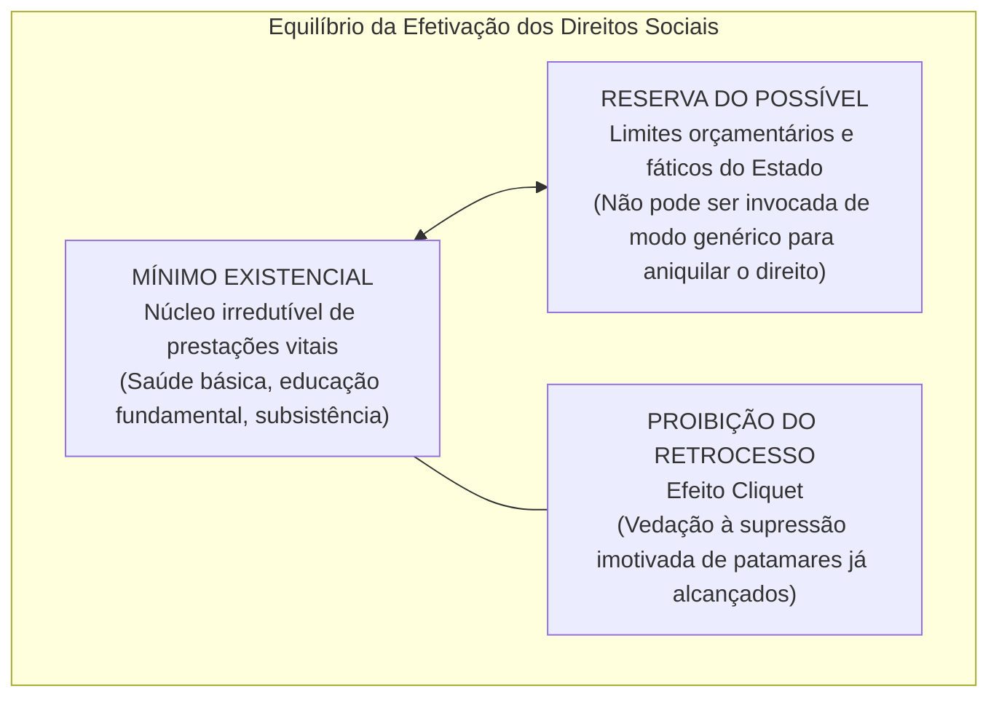
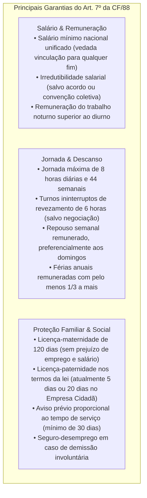
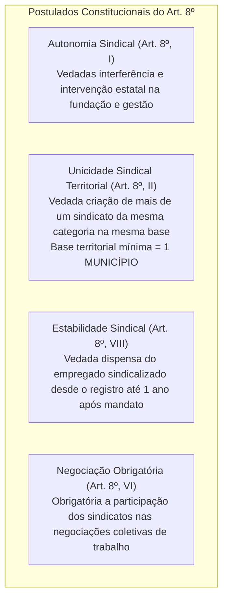
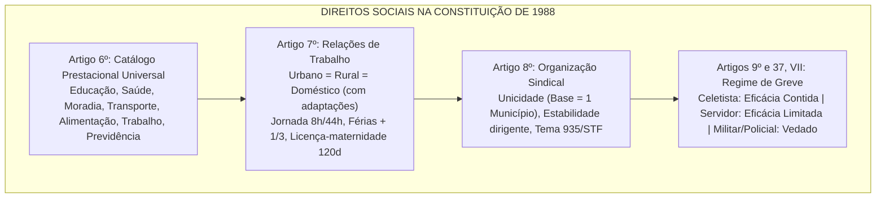

# Direitos Sociais, Trabalhistas e Coletivos (Arts. 6º a 11 da CF/88)

> Os Direitos Sociais consagram a dimensão positiva e prestacional do Estado Constitucional Democrático (segunda dimensão de direitos fundamentais), impondo ao Poder Público o dever jurídico de realizar prestações materiais positivas voltadas à redução das desigualdades e à garantia da dignidade da pessoa humana. O Título II, Capítulo II da Carta de 1988 articula essa matriz a partir do catálogo do art. 6º (educação, saúde, alimentação, trabalho, moradia, transporte, lazer, segurança, previdência social, proteção à maternidade e à infância, e assistência aos desamparados), ramificando-se no estatuto protetivo dos trabalhadores urbanos, rurais e domésticos (art. 7º), na liberdade e autonomia de organização sindical (art. 8º e a guinada jurisprudencial do Tema 935/STF quanto à contribuição assistencial), no direito de greve (arts. 9º e 37, VII) e no direito de participação e representação nos locais de trabalho (arts. 10 e 11).

---

## 1. Dogmática Geral dos Direitos Sociais

Os direitos sociais caracterizam-se por demandar uma postura ativa (*facere*) do Estado, traduzida em políticas públicas, serviços essenciais e regulação das relações econômico-sociais:

1. **Mínimo Existencial:** Conjunto de bens e utilidades materiais indispensáveis a uma vida digna. Prevalece categoricamente sobre alegações financeiras abstratas do Estado, autorizando o controle e a intervenção jurisdicional quando violado.
2. **Reserva do Possível (Doutrina Alemã):** O Estado vincula a entrega de prestações sociais à disponibilidade orçamentária e financeira real. Contudo, consoante o STF, a alegação de "reserva do possível" não é um escudo genérico para a inércia administrativa, devendo o Poder Público comprovar a absoluta escassez de recursos públicos.
3. **Proibição do Retrocesso Social (*Efeito Cliquet*):** Os direitos sociais, uma vez positivados e concretizados por leis e políticas públicas, integram o patrimônio jurídico da cidadania, sendo inconstitucional sua revogação pura e simples sem a implementação de medidas protetivas compensatórias equivalentes.

---

## 2. O Catálogo Constitucional do Artigo 6º

O art. 6º da CF/88 consagra o rol dos direitos sociais fundamentais, expandido periodicamente pelo legislador constituinte reformador:

$$\text{Direitos Sociais (Art. 6º)} = \{\text{Educação, Saúde, Alimentação, Trabalho, Moradia, Transporte, Lazer, Segurança, Previdência, Maternidade/Infância, Assistência aos Desamparados}\}$$

* **Evolução Histórica das Emendas Constitucionais:**
  * **Redação Originária (1988):** Educação, saúde, trabalho, lazer, segurança, previdência social, proteção à maternidade e à infância, e assistência aos desamparados.
  * **EC nº 26/2000:** Inclusão formal da **moradia**.
  * **EC nº 64/2010:** Inclusão formal da **alimentação**.
  * **EC nº 90/2015:** Inclusão formal do **transporte**.
* **Natureza de Cláusula Pétrea:** Conforme pacificado pelo STF, embora o art. 60, § 4º, IV, mencione expressamente os *"direitos e garantias individuais"*, o regime protetivo das cláusulas pétreas abrange **todos os direitos fundamentais**, incluindo os direitos sociais, sendo vedada qualquer emenda tendente a suprimi-los.

---

## 3. Direitos dos Trabalhadores Urbanos e Rurais (Art. 7º da CF/88)

O art. 7º consagra o princípio da **isonomia absoluta entre trabalhadores urbanos e rurais**, assegurando um extenso rol de garantias jusfundamentais trabalhistas:

### 3.1. Detalhamento de Garantias Cruciais

1. **Salário Mínimo e Súmula Vinculante 4:** O salário mínimo é fixado em lei, nacionalmente unificado e reajustado periodicamente para preservar o poder aquisitivo. *Súmula Vinculante 4 do STF:* *"Salvo nos casos previstos na Constituição, o salário mínimo não pode ser usado como indexador de base de cálculo de vantagem de servidor público ou de empregado, nem ser substituído por decisão judicial"*.
2. **Turnos Ininterruptos de Revezamento:** A jornada é reduzida para **6 horas diárias** em razão do desgaste psicofisiológico decorrente da alternância constante de turnos diurnos e noturnos. A redução pode ser elastecida para 8 horas unicamente por meio de **acordo ou convenção coletiva de trabalho** (art. 7º, XIV e Súmula 423 do TST).
3. **Proteção à Infância e Idades Limites (Art. 7º, XXXIII):**
   * **Regra Geral:** Proibição de qualquer trabalho a menores de **16 anos**, salvo na condição de **aprendiz, a partir de 14 anos**.
   * **Proibição Absoluta a Menores de 18 Anos:** Vedado o trabalho **noturno** (entre 22h e 5h na área urbana), **perigoso ou insalubre**.

---

### 3.2. A Extensão aos Empregados Domésticos (EC nº 72/2013)

Historicamente marginalizados, os empregados domésticos conquistaram a paridade de direitos mediante a promulgação da Emenda Constitucional nº 72/2013 e a respectiva regulamentação pela Lei Complementar nº 150/2015. 

* **Direitos Plenamente Estendidos:** Salário mínimo, irredutibilidade salarial, 13º salário, repouso semanal remunerado, férias anuais acrescidas de 1/3, licença à gestante de 120 dias, licença-paternidade, aviso prévio proporcional, aposentadoria, FGTS obrigatório, seguro-desemprego e limitação da jornada a 8 horas diárias e 44 horas semanais com pagamento de horas extras.
* **Exceções (Direitos NÃO Aplicáveis ao Doméstico):** Em face da natureza não lucrativa da residência familiar, não se aplicam aos domésticos: piso salarial fixado por lei ou convenção proporcional à complexidade, participação nos lucros ou resultados (PLR), e adicional de remuneração para atividades noturnas em percentual diferenciado salvo o padrão da LC 150.

---

## 4. Liberdade Sindical e Custeio da Organização Sindical (Art. 8º da CF/88)

O art. 8º da CF/88 consagra a **liberdade de associação profissional ou sindical**, delimitada por balizas expressas:

### 4.1. Unicidade Sindical vs. Pluralidade Sindical

A Constituição de 1988 fez uma opção híbrida: consagrou a liberdade interna de organização dos sindicatos, mas manteve o modelo de **unicidade sindical territorial** herdado da Carta de 1937, sendo vedada a criação de mais de uma organização sindical representativa da mesma categoria profissional ou econômica na mesma base territorial, a qual não pode ser inferior à área de um **Município** (art. 8º, II).

---

### 4.2. A Virada Jurisprudencial no Custeio Sindical: Tema 935 do STF

O custeio do sistema sindical divide-se em quatro modalidades financeiras:
1. **Contribuição Sindical Legal (Imposto Sindical):** Era obrigatória a todos os trabalhadores; com a Reforma Trabalhista (Lei nº 13.467/2017), passou a ser **facultativa**, exigindo prévia e expressa autorização do empregado.
2. **Contribuição Confederativa (Art. 8º, IV):** Fixada pela assembleia geral para custeio da confederação; é exigível **apenas dos trabalhadores filiados ao sindicato** (*Súmula Vinculante 40 do STF*).
3. **Mensalidade Sindical:** Valor pago espontaneamente apenas pelos associados.
4. **Contribuição Assistencial Negociada (Tema 935/STF):** Historicamente vedada para não associados. Em **setembro de 2023**, o STF alterou radicalmente seu entendimento e fixou a seguinte tese com repercussão geral:
   > *"É constitucional a instituição, por acordo ou convenção coletivos, de contribuições assistenciais a serem impostas a todos os empregados da categoria, ainda que não sindicalizados, desde que assegurado o direito de oposição."*

---

## 5. O Direito de Greve (Art. 9º da CF/88)

*"É assegurado o direito de greve, competindo aos trabalhadores decidir sobre a oportunidade de exercê-lo e sobre os interesses que devam por meio dele defender."*

* **Titularidade do Direito:** É um direito fundamental coletivo de titularidade dos **trabalhadores**, cabendo a eles (e não aos sindicatos ou aos empregadores) a decisão discricionária de deflagrar o movimento paredista.
* **Limitações e Serviços Essenciais (Art. 9º, § 1º):** A lei definirá os serviços ou atividades essenciais e disporá sobre o atendimento das necessidades inadiáveis da comunidade. O abuso do direito de greve sujeita os responsáveis às penas da lei.
* **Distinção Dogmática Primordial:**
  * **Trabalhadores da Iniciativa Privada (Art. 9º):** Norma de **eficácia contida** (autoaplicável imediatamente; a Lei 7.783/1989 veio para conter e regular os serviços essenciais).
  * **Servidores Públicos Civis (Art. 37, VII):** Norma de **eficácia limitada** (*"o direito de greve será exercido nos termos e nos limites definidos em lei específica"*). Ante a omissão do Congresso, o STF aplicou temporariamente a Lei 7.783/89 por meio de Mandados de Injunção.
  * **Militares das Forças Armadas e Policiais Militares (Arts. 42, § 1º e 142, § 3º, IV):** **Proibição absoluta de greve e de sindicalização**.
  * **Carreiras de Segurança Pública Civil (Polícia Federal, PRF, Polícia Civil, Penal e Guardas Municipais):** O STF firmou tese vinculante vedando terminantemente o direito de greve a todos os servidores públicos que atuem diretamente na área de segurança pública (ARE 654.432/GO).

---

## 6. Tabela Comparativa de Direitos Sociais e Trabalhistas

| Categoria de Trabalhador | Regime Constitucional | Possui FGTS Obrigatório? | Direito de Greve Permitido? | Sindicalização Permitida? |
| :--- | :--- | :---: | :---: | :---: |
| **Trabalhador Celetista Urbano/Rural** | CLT / Art. 7º da CF | **Sim** | **Sim (Eficácia Contida - Lei 7.783/89)** | **Sim** |
| **Empregado Doméstico** | LC 150/2015 / Art. 7º, p. único | **Sim** | **Sim (Regra geral)** | **Sim** |
| **Servidor Público Estatutário Civil** | Regime Próprio / Arts. 37 a 41 | Não (salvo se celetista público) | **Sim (Eficácia Limitada - Lei 7.783/89 por MI)** | **Sim** |
| **Militar (Forças Armadas, PM e CBM)** | Regime Militar / Arts. 42 e 142 | Não | **VEDADO ABSOLUTAMENTE** | **VEDADO ABSOLUTAMENTE** |
| **Policial Civil / Federal / PRF / Penal** | Estatutário de Segurança Pública | Não | **VEDADO (Tese do STF no ARE 654.432)** | **Sim** |

---

> **Fique Ligado:**
> 1. **Mnemônico dos Direitos Sociais do Art. 6º:** *"EDU MOLA TRABALHA, TRANSPORTE ALIMENTA SAÚDE, SEGURA PREVIDÊNCIA, MATERNA ASSISTE"*. Fique atento: *transporte* entrou em 2015 (EC 90), *alimentação* em 2010 (EC 64) e *moradia* em 2000 (EC 26).
> 2. **Base Territorial Mínima Sindical:** É o **Município**, e nunca o Estado ou região administrativa, sob pena de violação à unicidade sindical (art. 8º, II).
> 3. **Contribuição Assistencial (Tema 935/STF):** O STF agora admite cobrança de empregados **não sindicalizados**, mas exige impreterivelmente que seja garantido o **direito de oposição** formal sem embaraços.
> 4. **Militares vs. Policiais Civis:** Militares não podem fazer greve nem se sindicalizar (proibição textual na CF). Policiais civis podem se sindicalizar, mas **NÃO podem fazer greve** (jurisprudência vinculante do STF).

---

## 7. Síntese Visual Canônica

---

## 8. Questões Paradigmáticas Aplicadas

---

### [Questão 01](https://www.qconcursos.com/questoes-de-concursos/questoes/62be6a4f-c6) — [IGEDUC — Prefeitura de Alagoinha - PB / Assistente Social — 2026]

Sobre a disciplina constitucional dos direitos sociais positivada na Carta Magna de 1988, assinale a afirmativa correta:

* **A)** O transporte foi incorporado aos direitos sociais por interpretação judicial desvinculada do texto constitucional.
* **B)** A assistência aos desamparados possui natureza administrativa e não integra o catálogo constitucional de garantias.
* **C)** A previdência social integra os direitos individuais e recebe proteção constitucional distinta das prestações sociais.
* **D)** A moradia constitui direito relacionado à política urbana, sem previsão expressa entre os direitos sociais.
* **E)** A educação, a saúde, a alimentação e o trabalho integram o rol de direitos sociais reconhecidos pela Constituição Federal.

#### Gabarito: **E**
* **A (Errada):** O transporte foi expressamente inserido no texto da Carta Magna por meio da **Emenda Constitucional nº 90/2015**, constando literalmente do art. 6º.
* **B (Errada):** A assistência aos desamparados integra formalmente o art. 6º da CF/88 como direito social fundamental expresso.
* **C (Errada):** A previdência social é direito social típico de segunda dimensão prestacional, integrando o tripé da Seguridade Social (arts. 194 a 204).
* **D (Errada):** A moradia foi formalmente incorporada ao catálogo do art. 6º por meio da **Emenda Constitucional nº 26/2000**.
* **E (Certa):** Transcrição exata do art. 6º da CF/88: *"São direitos sociais a educação, a saúde, a alimentação, o trabalho, a moradia, o transporte, o lazer, a segurança, a previdência social, a proteção à maternidade e à infância, a assistência aos desamparados, na forma desta Constituição"*.

---

### [Questão 02](https://www.qconcursos.com/questoes-de-concursos/questoes/5a443e58-c7) — [OBJETIVA — Prefeitura de Cachoeira do Sul - RS / Contador e Advogado — 2026]

A Constituição Federal garante aos trabalhadores urbanos e rurais o direito de gozo de férias anuais. Conforme o ordenamento constitucional brasileiro, quanto às férias anuais, assinalar a alternativa correta:

* **A)** O período de férias não será remunerado.
* **B)** As férias devem ser concedidas sem remuneração e quando o trabalhador preferir.
* **C)** O período de férias deve ser remunerado e, a critério do empregador, pode ser concedido adicional.
* **D)** As férias devem ser remuneradas com, pelo menos, um terço a mais do que o salário normal.

#### Gabarito: **D**
* **C (Errada):** O terço constitucional de férias é direito subjetivo obrigatório e irrecusável, não constituindo mera liberalidade discricionária do empregador.
* **D (Certa):** Trata-se da reprodução literal do art. 7º, inciso XVII, da Carta da República: *"gozo de férias anuais remuneradas com, pelo menos, um terço a mais do que o salário normal"*.

---

### [Questão 03](https://www.qconcursos.com/questoes-de-concursos/questoes/6a5e2f28-c8) — [OBJETIVA — Prefeitura de Cachoeira do Sul - RS / Técnico em Contabilidade — 2026]

O ordenamento constitucional brasileiro garante licença à gestante às trabalhadoras urbanas e rurais. Conforme a Constituição Federal de 1988, a referida licença será:

* **A)** Sem garantia do emprego e do salário, com a duração de 90 dias.
* **B)** Sem prejuízo do emprego e do salário, com a duração de 120 dias.
* **C)** Sem remuneração, devendo o período ser negociado entre gestante e empregador.
* **D)** Sem prejuízo do emprego e do salário, com a duração de 180 dias, e com, pelo menos, um terço a mais de remuneração do que o salário normal.

#### Gabarito: **B**
* **B (Certa):** O art. 7º, inciso XVIII, da Constituição Federal dispõe literalmente: *"licença à gestante, sem prejuízo do emprego e do salário, com a duração de cento e vinte dias"*. (Nota: A prorrogação para 180 dias decorre de lei infraconstitucional voluntária no âmbito do Programa Empresa Cidadã — Lei 11.770/2008 —, mas a garantia constitucional expressa do piso é de 120 dias).
* **D (Errada):** Confunde a regra geral de 120 dias com a ampliação infraconstitucional e adiciona indevidamente o terço de férias.

---

### [Questão 04](https://www.qconcursos.com/questoes-de-concursos/questoes/6a5f2f29-c8) — [CESPE / CEBRASPE — Polícia Civil - PE / Agente de Polícia — 2026]

Acerca dos direitos sociais e das normas protetivas do trabalho na Constituição Federal de 1988, assinale a opção correta:

* **A)** Apenas no item I.
* **B)** Apenas no item II.
* **C)** Apenas nos itens I e III.
* **D)** Apenas nos itens II e III.

#### Gabarito: **B**
* **A (Errada):** O art. 7º, XXXIII, impõe vedação absoluta e inafastável ao trabalho noturno, perigoso ou insalubre para menores de 18 anos.
* **B (Certa):** Conforme o art. 7º, inciso XIV, da CF/88 e a Súmula 423 do TST, a jornada máxima para turnos ininterruptos de revezamento é de 6 horas diárias, sendo constitucionalmente válida a sua fixação em 8 horas mediante acordo ou convenção coletiva de trabalho.
* **C (Errada):** A irredutibilidade do salário comporta a ressalva explícita: *"salvo o disposto em convenção ou acordo coletivo"* (art. 7º, VI).
* **D (Errada):** O art. 7º, XXX, veda categoricamente a discriminação por motivo de sexo, idade, cor ou estado civil.
* **E (Errada):** A Emenda Constitucional nº 28/2000 unificou a prescrição dos trabalhadores urbanos e rurais (art. 7º, XXIX: cinco anos até o limite de dois anos após a extinção do contrato de trabalho).

---

### [Questão 05](https://www.qconcursos.com/questoes-de-concursos/questoes/6a602f30-c8) — [FGV — OAB / Exame de Ordem Unificado — 2026]

Determinado empregado celetista de uma indústria química registrou sua candidatura ao cargo de diretor do respectivo sindicato de trabalhadores no dia 10 de março. No dia 15 de março, a empresa tomou ciência formal da candidatura e demitiu o empregado sem justa causa.
Considerando o estatuto constitucional da liberdade sindical (art. 8º da CF/88), a demissão operada pelo empregador é:

* **A)** É constitucional lei estadual que considera como despesa de manutenção e desenvolvimento do ensino os gastos com inativos do setor de educação.
* **B)** A Constituição Federal assegura o direito à creche para as crianças de zero a cinco anos, condicionado o gozo à existência de disponibilidade orçamentária e financeira.
* **C)** É constitucional regra da Constituição Estadual que concede autonomia financeira e orçamentária para Universidade Estadual.
* **D)** Os municípios devem destinar, pelo menos, 30% (trinta por cento) de sua receita corrente líquida para os gastos com a manutenção e desenvolvimento do ensino.
* **E)** É constitucional lei estadual que determina a reserva de vagas para que irmãos que cursem a mesma etapa ou mesmo ciclo escolar frequentem a mesma escola.

#### Gabarito: **B**
* **A (Errada):** O termo inicial da garantia é o registro da candidatura, e não a posse.
* **B (Certa):** Transcrição exata do art. 8º, inciso VIII, da CF/88 e Súmula 369 do TST: *"é vedada a dispensa do empregado sindicalizado a partir do registro da candidatura a cargo de direção ou representação sindical e, se eleito, ainda que suplente, até um ano após o final do mandato, salvo se cometer falta grave nos termos da lei"*. A dispensa imotivada do candidato é nula de pleno direito, gerando direito à reintegração.
* **C (Errada):** A indenização rescisória não supre a estabilidade constitucional; o empregado detém direito subjetivo à manutenção do posto de trabalho para resguardar a representatividade da categoria.
* **D (Errada):** A estabilidade estende-se a qualquer trabalhador que registre candidatura a cargo de direção ou representação sindical.
* **E (Errada):** A criação e funcionamento sindical independem de intervenção estatal (art. 8º, I).

---

### [Questão 06](https://www.qconcursos.com/questoes-de-concursos/questoes/6a612f31-c8) — [FCC — TRT - 1ª Região (RJ) / Analista Judiciário — 2026]

No tocante ao custeio das organizações sindicais e à recente evolução da jurisprudência do Supremo Tribunal Federal fixada no Tema 935 da Repercussão Geral, assinale a afirmativa correta:

* **A)** é compatível com a Constituição Federal de 1988 (CF/1988), desde que preserve a gratuidade do ensino público e assegure vaga aos estudantes em alguma unidade da rede.
* **B)** é admissível, pois a Constituição assegura a liberdade de organização dos sistemas de ensino para estabelecer critérios próprios de distribuição das vagas.
* **C)** é legítima quando for destinada a melhorar os indicadores de desempenho da rede, desde que os critérios sejam previamente divulgados à comunidade escolar.
* **D)** contraria o princípio constitucional da igualdade de condições para o acesso e para a permanência na escola, ao estabelecer tratamento diferenciado entre estudantes com base em seu desempenho acadêmico para acesso a determinadas unidades.
* **E)** é legítima, pois a violação só ocorre quando há exclusão absoluta para o aluno e, no caso em questão, a escola adotou critérios de restrição com base apenas no desempenho acadêmico.

#### Gabarito: **B**
* **A (Errada):** Tese superada pelo STF no julgamento do Tema 935 em setembro de 2023.
* **B (Certa):** Trata-se da literalidade da tese vinculante do **Tema 935 do STF**: *"É constitucional a instituição, por acordo ou convenção coletivos, de contribuições assistenciais a serem impostas a todos os empregados da categoria, ainda que não sindicalizados, desde que assegurado o direito de oposição"*. O STF compreendeu que os acordos coletivos beneficiam a integralidade da categoria, justificando a cobrança proporcional desde que haja possibilidade formal de o trabalhador opor-se ao desconto.
* **C (Errada):** A contribuição confederativa (art. 8º, IV) só é exigível de filiados (*Súmula Vinculante 40 do STF*).
* **D (Errada):** A contribuição sindical legal permanece de caráter voluntário/facultativo conforme a Lei 13.467/2017.
* **E (Errada):** O exercício do direito de oposição faz-se perante o próprio sindicato profissional ou empregador, prescindindo de intervenção jurisdicional.

---

### [Questão 07](https://www.qconcursos.com/questoes-de-concursos/questoes/6a622f32-c8) — [CESPE / CEBRASPE — PGE-RN / Procurador do Estado — 2026]

Acerca da disciplina constitucional do direito de greve no ordenamento jurídico brasileiro, assinale a opção correta:

* **A)** Estão corretos apenas os itens I, III e IV.
* **B)** Estão corretos apenas os itens III, IV e V.
* **C)** Estão corretos apenas os itens I, II e III.
* **D)** Estão corretos apenas os itens II, III e IV.
* **E)** Está correto apenas o item V.

#### Gabarito: **C**
* **A (Errada):** O art. 9º é norma de eficácia contida na iniciativa privada, aplicando-se de plano com os parâmetros da Lei 7.783/1989.
* **B (Errada):** Militares têm vedação expressa (arts. 42 e 142). Os policiais civis e demais agentes de segurança pública têm o direito de greve expressamente vedado por jurisprudência vinculante do STF (ARE 654.432/GO).
* **C (Certa):** Transcrição exata das normas dos arts. 42, § 1º, e 142, § 3º, IV, da Constituição Federal: aos militares são proibidas a sindicalização e a greve.
* **D (Errada):** Nos MIs 670, 708 e 712, o STF supriu a mora legislativa autorizando a aplicação supletiva da Lei nº 7.783/1989 aos servidores civis estatutários.
* **E (Errada):** A greve em serviços essenciais deve garantir a continuidade do atendimento básico inadiável (art. 9º, § 1º).

---

### [Questão 08](https://www.qconcursos.com/questoes-de-concursos/questoes/671c6dc0-d2) — [IBAM — Prefeitura de Santos - SP / Operador Social — 2026]

A Constituição Federal estabelece que a assistência social será prestada a quem dela necessitar, independentemente de contribuição à seguridade social. A esse respeito, o benefício de prestação continuada (BPC), que assegura a garantia de um salário mínimo mensal, destina-se:

* **A)** Programa de Proteção Social Básica (PSB).
* **B)** Beneficio de Acompanhamento Especializado (BAE).
* **C)** Auxílio de Reabilitação Profissional (ARP).
* **D)** Benefício de Prestação Continuada (BPС).
* **E)** Programa de Garantia de Renda Mínima (PGRM).

#### Gabarito: **B**
* **A (Errada):** A assistência social independe de qualquer contribuição prévia à previdência social. O BPC alcança idosos a partir de 65 anos (art. 20 da LOAS).
* **B (Certa):** Transcrição literal do art. 203, inciso V, da Carta Magna: *"a garantia de um salário mínimo de benefício mensal à pessoa com deficiência e ao idoso que comprovem não possuir meios de prover à própria manutenção ou de tê-la provida por sua família, conforme dispuser a lei"*.
* **C (Errada):** O desemprego involuntário é amparado pelo seguro-desemprego e previdência social, e não pelo BPC.

---

### [Questão 09](https://www.qconcursos.com/questoes-de-concursos/questoes/671f083c-d2) — [IBAM — Prefeitura de Santos - SP / Operador Social — 2026]

Analise as assertivas quanto à Seguridade Social na Constituição de 1988, classificando-as em (V) para verdadeiras e (F) para falsas:
(__) A seguridade social compreende um conjunto integrado de ações de iniciativa dos Poderes Públicos e da sociedade, destinadas a assegurar os direitos relativos à saúde, à previdência e à assistência social.  
(__) O acesso às ações e serviços de saúde pública no Brasil é condicionado ao prévio recolhimento de contribuições previdenciárias mensais.  
(__) A previdência social tem caráter contributivo e de filiação obrigatória, preservando o equilíbrio financeiro e atuarial.  
A sequência correta de preenchimento dos parênteses é:

* **A)** F, F, V.
* **B)** V, F, V.
* **C)** V, V, F.
* **D)** F, V, V.

#### Gabarito: **B**
* **1ª Assertiva (Verdadeira):** Reproduz fielmente o conceito do *caput* do art. 194 da CF/88 (*tripé da Seguridade Social: Saúde, Previdência e Assistência Social*).
* **2ª Assertiva (Falsa):** A saúde é direito de todos e dever do Estado (art. 196), tendo **acesso universal e gratuito, independente de qualquer contribuição**. Quem exige contribuição é a previdência.
* **3ª Assertiva (Verdadeira):** É o texto do art. 201 da CF/88: a previdência social é contributiva e de filiação compulsória.
* **Sequência:** **V, F, V**, correspondente à alternativa **B**.

---

### [Questão 10](https://www.qconcursos.com/questoes-de-concursos/questoes/67222974-d2) — [IBAM — Prefeitura de Santos - SP / Operador Social — 2026]

Ao registrar que a assistência social será prestada *"independentemente de contribuição à seguridade social"* (art. 203 da CF/88), o texto constitucional estabelece uma distinção essencial em relação aos outros ramos da Seguridade.
Essa ressalva exprime corretamente que:

* **A)** A ressalva supõe que a necessidade do beneficiário seja aferida pela sua contribuição pretérita, critério que o dispositivo constitucional presume.
* **B)** A ressalva indica que a assistência social prescinde da garantia estatal, sustentando-se na iniciativa e na procura de quem dela necessita.
* **C)** A ressalva ganha sentido pleno diante de proteções da seguridade cujo acesso pressupõe contribuição do beneficiário, situação em que se encontra a previdência.
* **D)** A ressalva estende a dispensa de contribuição à saúde e à previdência, componentes submetidos, na seguridade, a idêntico regime de acesso.

#### Gabarito: **C**
* **A (Errada):** A assistência não aufere contribuição pretérita, mas sim a vulnerabilidade socioeconômica fática presente.
* **B (Errada):** A assistência integra o orçamento público da Seguridade Social (art. 195 da CF).
* **C (Certa):** A ressalva ganha relevância dogmática quando confrontada com o ramo da **Previdência Social**, cujo regime é estritamente **contributivo e de filiação obrigatória** (art. 201). Enquanto a saúde é universal e a assistência atende a quem dela necessitar sem contribuição, a previdência exige contraprestação financeira direta do segurado.
* **D (Errada):** Os benefícios previdenciários dependem imperativamente de recolhimento de contribuições.

---

### [Questão 11](https://www.qconcursos.com/questoes-de-concursos/questoes/6725194a-d2) — [IBAM — Prefeitura de Santos - SP / Operador Social — 2026]

Avalie as asserções a seguir e a relação proposta entre elas:
I. A Constituição Federal de 1988 dissocia a assistência social da seguridade social, determinando que ela seja prestada como ato de caridade civil e discricionariedade governamental.  
PORQUE  
II. O texto constitucional de 1988 erigiu a assistência social à condição de direito subjetivo da cidadania e componente estrutural e indissociável da Seguridade Social.  
A respeito dessas asserções, assinale a opção correta:

* **A)** A asserção I é falsa, e a II é verdadeira.
* **B)** As duas asserções são verdadeiras, mas a II não justifica a I.
* **C)** As duas asserções são verdadeiras, e a II justifica a I.
* **D)** A asserção I é verdadeira, e a II é falsa.

#### Gabarito: **A**
* **Asserção I (Falsa):** A Constituição de 1988 não dissociou a assistência da Seguridade nem a tratou como caridade ou favor; pelo contrário, integrou a assistência social ao tripé da Seguridade Social (art. 194) como política pública estatal imperativa.
* **Asserção II (Verdadeira):** A Carta Magna superou a ótica do favor e transformou a assistência em direito fundamental subjetivo da cidadania voltado à dignidade da pessoa humana e amparo aos vulneráveis.
* **Conclusão:** A asserção **I é falsa e a II é verdadeira**, conferindo acerto à alternativa **A**.

---

### [Questão 12](https://www.qconcursos.com/questoes-de-concursos/questoes/67275912-d2) — [IBAM — Prefeitura de Santos - SP / Operador Social — 2026]

No sistema de proteção constitucional inaugurado pela Carta de 1988, a estruturação da Assistência Social como ramo autônomo da Seguridade Social produziu como efeito primordial:

* **A)** desfazer a compreensão da assistência social como favor estatal, opondo-lhe o estatuto de direito que a Constituição lhe confere no âmbito da seguridade.
* **B)** expor a arquitetura da seguridade social brasileira, de que a assistência é apresentada como o componente de maior alcance protetivo entre os três.
* **C)** demonstrar que a gratuidade da assistência social a distingue das demais políticas públicas, condicionadas a alguma contraprestação do usuário.
* **D)** historiar a inovação trazida pela Constituição de 1988, cujo texto teria superado a associação entre assistência social e vulnerabilidade.

#### Gabarito: **A**
* **A (Certa):** O marco histórico da Constituição Cidadã de 1988 foi desvincular a assistência social da noção de assistencialismo caritativo ou clientelismo político, positivando-a como **direito fundamental prestacional do cidadão** e **dever inescusável do Estado**, garantidor do mínimo existencial e da dignidade humana.
* **B (Errada):** A assistência social é gratuita e repudia taxas cartorárias que obstem o acesso do necessitado.
* **C (Errada):** O art. 199 e o art. 204 da CF autorizam e estimulam a participação complementar da sociedade civil e entidades beneficentes.
* **D (Errada):** O princípio da universalidade da seguridade social (art. 194, I) e a igualdade (art. 5º) resguardam qualquer residente no território nacional em situação de miserabilidade comprovada.

---
