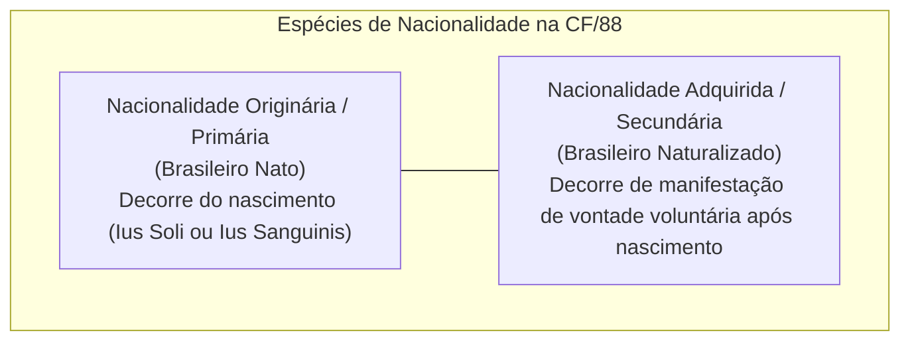
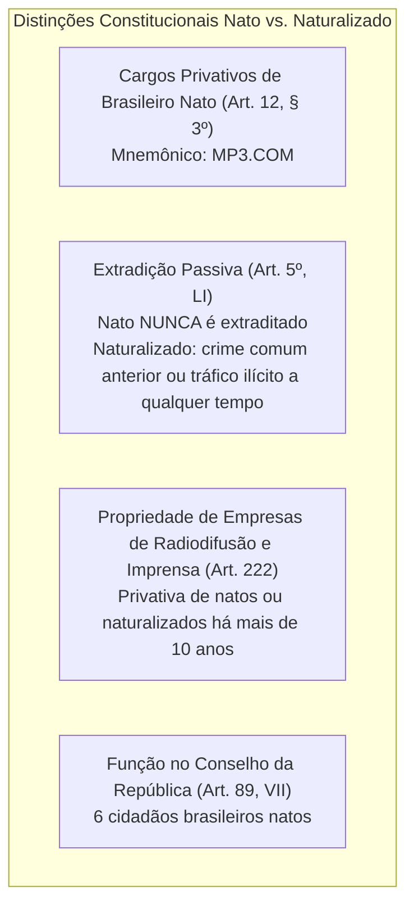
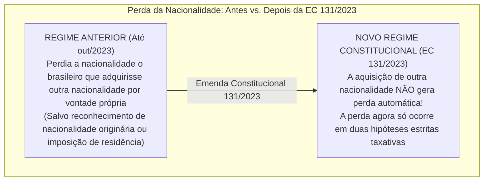
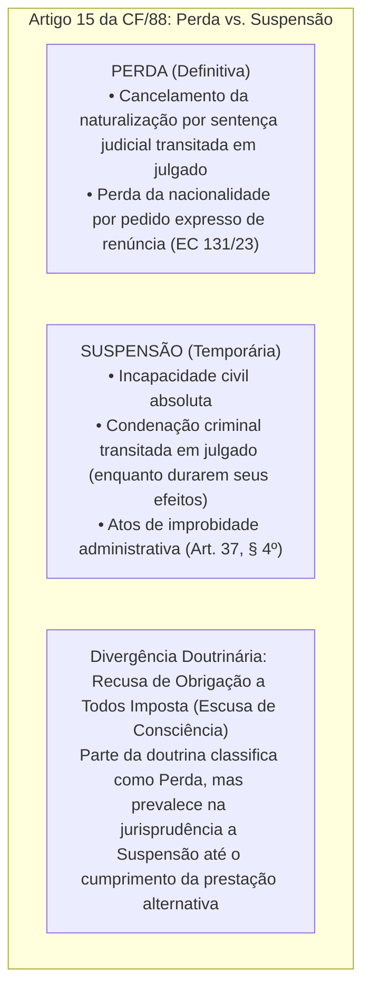

# Nacionalidade, Cidadania e Direitos Políticos (Arts. 12 a 17 da CF/88)

> A Nacionalidade, a Cidadania e os Direitos Políticos integram o núcleo dogmático da soberania popular e da vinculação político-jurídica fundamental do indivíduo com o Estado soberano brasileiro. Os preceitos dos artigos 12 a 17 da Constituição de 1988 estabelecem o estatuto da nacionalidade originária (*ius soli* e *ius sanguinis*) e derivada (naturalização ordinária e extraordinária), a proteção aos portugueses equiparados e a vedação à distinção entre natos e naturalizados, ressalvados os cargos privativos de brasileiro nato (*mnemônico MP3.COM*). O tema sofreu profunda e paradigmática reformulação pela **Emenda Constitucional nº 131/2023**, que extinguiu a perda automática da nacionalidade pela aquisição voluntária de cidadania estrangeira. No campo dos Direitos Políticos, analisam-se a soberania popular, a alistabilidade, as condições de elegibilidade, as inelegibilidades absolutas e relativas (com destaque para a inelegibilidade reflexa e a Súmula Vinculante 18 do STF), as hipóteses taxativas de perda e suspensão de direitos políticos do art. 15 e a regulação constitucional dos partidos políticos.

---

## 1. Teoria Geral da Nacionalidade

A nacionalidade é o vínculo jurídico-político que une um indivíduo a determinado Estado soberano, tornando-o membro de sua comunidade política e outorgando-lhe direitos subjetivos fundamentais e deveres perante a ordem estatal:

* **Nacionalidade Originária (Primária):** Atribuída involuntariamente no momento do fato biológico do nascimento. O Brasil adota primordialmente o critério do **ius soli** (*solo do nascimento*), temperado em hipóteses taxativas pelo critério do **ius sanguinis** (*filiação sanguínea*).
* **Nacionalidade Adquirida (Secundária):** Resulta de ato volitivo de naturalização, deferido pelo Poder Executivo Federal após o cumprimento de requisitos constitucionais e infraconstitucionais.

---

## 2. Hipóteses Constitucionais de Nacionalidade Originária (Art. 12, I)

São brasileiros natos:

1. **Critério Territorial (*Ius Soli* Puro - Art. 12, I, "a"):**
   * *"Os nascidos na República Federativa do Brasil, ainda que de pais estrangeiros, desde que estes não estejam a serviço de seu país."*
   * *Atenção Crítica:* Se apenas **um** dos pais for estrangeiro e o outro for brasileiro, a criança já nasce brasileira nata; se ambos forem estrangeiros, a criança só **NÃO** será brasileira nata se **ao menos um dos genitores estiver a serviço oficial do país de sua nacionalidade** (ex.: diplomata ou embaixador de seu Estado). Estrangeiros a turismo, a trabalho privado ou a serviço de empresas multinacionais que tenham filhos no Brasil geram **brasileiros natos**.
2. **Critério Funcional (*Ius Sanguinis* Funcional - Art. 12, I, "b"):**
   * *"Os nascidos no estrangeiro, de pai brasileiro ou mãe brasileira, desde que qualquer deles esteja a serviço da República Federativa do Brasil."*
   * Abrange serviço da administração pública direta, autarquias, fundações públicas e missões diplomáticas da União, dos Estados, do DF ou dos Municípios.
3. **Critério Potestativo / Registro Consular (*Ius Sanguinis* Subsidiário - Art. 12, I, "c"):**
   * *"Os nascidos no estrangeiro de pai brasileiro ou de mãe brasileira, desde que sejam registrados em repartição brasileira competente ou venham a residir na República Federativa do Brasil e optem, em qualquer tempo, depois de atingida a maioridade, pela nacionalidade brasileira."*
   * Duas vias autônomas:
     * **Via do Registro Consular:** O registro no consulado brasileiro no exterior confere imediatamente a condição de brasileiro nato definitivo.
     * **Via da Opção Confirmativa:** Caso não tenha havido registro consular, o indivíduo deve vir a residir no Brasil e formular **opção confirmativa** em processo de jurisdição voluntária na Justiça Federal, a qualquer tempo, após completar 18 anos.

---

## 3. Hipóteses de Naturalização (Art. 12, II)

São brasileiros naturalizados:

* **a) Naturalização Ordinária (Art. 12, II, "a"):** Os que, na forma da lei, adquiram a nacionalidade brasileira, exigidas aos originários de **países de língua portuguesa** apenas residência por **um ano ininterrupto** e **idoneidade moral**. (Trata-se de ato discricionário da autoridade executiva, ressalvada a hipótese privilegiada de lusófonos).
* **b) Naturalização Extraordinária ou Quinzenária (Art. 12, II, "b"):** Os estrangeiros de qualquer nacionalidade, residentes na República Federativa do Brasil há **mais de quinze anos ininterruptos e sem condenação penal**, desde que requeiram a nacionalidade brasileira.
  * *Natureza Jurídica:* É **direito público subjetivo** do estrangeiro; preenchidos os requisitos objetivos (15 anos de residência ininterrupta + inexistência de condenação penal + requerimento), o Poder Executivo não pode indeferir discricionariamente o pedido de naturalização extraordinária.

---

### 3.1. O Estatuto da Quase-Nacionalidade dos Portugueses (Art. 12, § 1º)

*"Aos portugueses com residência permanente no País, se houver reciprocidade em favor de brasileiros, serão atribuídos os direitos inerentes ao brasileiro, salvo os casos previstos nesta Constituição."*

* O cidadão português equiparado **NÃO se torna brasileiro nato nem naturalizado**; ele continua sendo cidadão exclusivamente português, mas goza da extensão e fruição de quase todos os direitos atribuídos aos brasileiros naturalizados no território nacional (inclusive alistabilidade eleitoral e acesso a cargos públicos comuns), desde que comprovada residência permanente e deferido o reconhecimento formal do estatuto pelo Ministério da Justiça.

---

## 4. Diferenças Constitucionais Entre Brasileiro Nato e Naturalizado

O art. 12, § 2º da CF/88 veda terminantemente que a lei ordinária estabeleça distinção entre brasileiros natos e naturalizados, **salvo os casos expressamente previstos na própria Constituição**:

### 4.1. O Rol Taxativo dos Cargos Privativos (*MP3.COM*)

São privativos de **brasileiro nato** exclusivamente os seguintes cargos (art. 12, § 3º):
* **M** — **Ministro de Estado da Defesa** (único Ministro do Poder Executivo privativo de nato; os demais ministérios podem ser chefiados por naturalizados).
* **P** — **Presidente e Vice-Presidente da República**.
* **P** — **Presidente da Câmara dos Deputados** (o deputado comum pode ser naturalizado; apenas o Presidente da Mesa da Câmara deve ser nato).
* **P** — **Presidente do Senado Federal** (o senador comum pode ser naturalizado; apenas o Presidente do Senado deve ser nato).
* **C** — **Carreira Diplomática**.
* **O** — **Oficial das Forças Armadas** (Exército, Marinha e Aeronáutica; militares praças ou soldados podem ser naturalizados; oficiais da PM e CBM são estaduais).
* **M** — **Ministro do Supremo Tribunal Federal** (a totalidade dos 11 Ministros do STF deve ser composta por brasileiros natos; em contrapartida, no STJ, TST, TSE e STM é admitido brasileiro naturalizado).

---

## 5. A Revolução da Emenda Constitucional nº 131/2023: Perda da Nacionalidade

A **Emenda Constitucional nº 131, promulgada em 03 de outubro de 2023**, promoveu uma alteração estrutural no art. 12, § 4º da Constituição Federal, eliminando do ordenamento brasileiro a perda automática da nacionalidade pela mera aquisição voluntária de outra cidadania estrangeira:

### 5.1. As Únicas Hipóteses de Perda da Nacionalidade (Art. 12, § 4º Atual)

Será declarada a perda da nacionalidade do brasileiro que:

1. **Cancelamento Judicial da Naturalização (Inciso I):**
   * *"Tiver cancelada sua naturalização, por sentença judicial, em virtude de fraude relacionada ao processo de naturalização ou de atentado contra a ordem constitucional e o Estado Democrático."*
   * *Atenção:* Exige **sentença judicial transitada em julgado** (não cabe por processo puramente administrativo). A EC 131/23 substituiu a antiga expressão genérica "atividade nociva ao interesse nacional" pelas hipóteses objetivas de fraude documental ou atentado contra o Estado Democrático.
2. **Pedido Expresso e Voluntário de Renúncia (Inciso II):**
   * *"Fizer pedido expresso de perda da nacionalidade brasileira perante autoridade competente, ressalvadas situações que acarretem apatridia."*
   * **Reversibilidade Facilitada (§ 5º):** O brasileiro que renunciou à nacionalidade mediante pedido expresso poderá readquiri-la perante autoridade administrativa nos termos da lei ordinária, sem necessidade de passar por novo processo complexo de naturalização.

---

## 6. Direitos Políticos e Soberania Popular (Arts. 14 a 16)

A soberania popular é exercida pelo sufrágio universal e pelo voto direto e secreto, com valor igual para todos, e, nos termos da lei, mediante:
1. **Plebiscito:** Consulta popular prévia à edição do ato legislativo ou governamental.
2. **Referendo:** Consulta popular posterior para ratificar ou rejeitar lei já aprovada pelo Congresso.
3. **Iniciativa Popular de Leis:** Exercício direto do poder legislativo (art. 61, § 2º: subscrição de pelo menos 1% do eleitorado nacional, distribuído por pelo menos 5 Estados, com não menos de 0,3% dos eleitores de cada um deles).

---

### 6.1. Alistabilidade e Voto (Art. 14, § 1º)

* **Voto Obrigatório:** Para os brasileiros maiores de **18 anos** e menores de **70 anos**.
* **Voto Facultativo:**
  * Para os **analfabetos**;
  * Para os maiores de **70 anos**;
  * Para os jovens entre **16 e 18 anos**.
* **Inalistáveis (Não Podem Votar):**
  * Os **estrangeiros**;
  * Os **conscritos**, durante o período do serviço militar obrigatório.

---

### 6.2. Condições Constitucionais de Elegibilidade (Art. 14, § 3º)

Para que o cidadão possa candidatar-se a cargo eletivo, deve preencher cumulativamente:
1. Nacionalidade brasileira (nata ou naturalizada, respeitados os cargos privativos de nato);
2. Pleno exercício dos direitos políticos;
3. Alistamento eleitoral regular;
4. Domicílio eleitoral na circunscrição do pleito;
5. Filiação partidária formal (o Brasil veda candidaturas avulsas);
6. **Idade Mínima Constitucional (aferida na data da posse, salvo para 18 anos que se aufere no registro):**
   * **35 anos:** Presidente, Vice-Presidente da República e Senador;
   * **30 anos:** Governador e Vice-Governador de Estado e do Distrito Federal;
   * **21 anos:** Deputado Federal, Deputado Estadual/Distrital, Prefeito, Vice-Prefeito e Juiz de Paz;
   * **18 anos:** Vereador.

---

### 6.3. Inelegibilidades: Absolutas, Relativas e Reflexas

1. **Inelegibilidades Absolutas (Art. 14, § 4º):** São absolutamente inelegíveis para qualquer cargo político os **inalistáveis** (estrangeiros e conscritos) e os **analfabetos**. *(Lembrete: analfabeto pode votar — voto facultativo —, mas NÃO pode ser votado).*
2. **Inelegibilidade Funcional por Reeleição (Art. 14, § 5º):** O Presidente, Governadores e Prefeitos podem ser reeleitos para um único período subsequente. Se pretenderem concorrer a **outros cargos**, devem renunciar aos respectivos mandatos até **6 meses antes do pleito** (*desincompatibilização*, art. 14, § 6º).
3. **Inelegibilidade Reflexa ou por Parentesco (Art. 14, § 7º e Súmula Vinculante 18):**
   * São inelegíveis, no território de jurisdição do titular, o cônjuge e os parentes consanguíneos ou afins, até o **segundo grau** ou por adoção, do Presidente da República, de Governador ou de Prefeito (ou de quem os haja substituído nos 6 meses anteriores ao pleito), salvo se já titular de mandato eletivo e candidato à reeleição.
   * *Súmula Vinculante 18 do STF:* *"A dissolução da sociedade ou do vínculo conjugal, no curso do mandato, não afasta a inelegibilidade reflexa"* (evita o divórcio fraudulento para burlar a Constituição).

---

## 7. Perda e Suspensão de Direitos Políticos (Art. 15 da CF/88)

É **vedada expressamente a cassação de direitos políticos**. A perda ou suspensão só se dará nos casos taxativos:

* **Condenação Criminal e Súmula Vinculante:** A suspensão dos direitos políticos decorrente de condenação criminal transitada em julgado opera-se de forma automática, independe de motivação na sentença e alcança inclusive os apenados com penas restritivas de direitos ou sursis (Tema 370 do STF).

---

## 8. Tabela Comparativa Analítica: Alistabilidade vs. Elegibilidade

| Categoria | Alistável? (Pode Votar) | Elegível? (Pode Ser Votado) | Condição Específica |
| :--- | :---: | :---: | :--- |
| **Brasileiro Nato Alfabetizado (18 a 70 anos)** | **Sim (Obrigatório)** | **Sim** | Plenitude de capacidade política |
| **Brasileiro Nato Analfabeto** | **Sim (Facultativo)** | **NÃO (Inelegível Absoluto)** | Pode votar, vedado ser votado |
| **Jovem de 16 e 17 Anos** | **Sim (Facultativo)** | **NÃO** | Salvo ao completar 18 anos até a posse para vereador |
| **Estrangeiro** | **NÃO (Inalistável)** | **NÃO (Inelegível Absoluto)** | Salvo português sob estatuto de igualdade |
| **Conscrito (Serviço Militar Obrigatório)** | **NÃO (Inalistável)** | **NÃO (Inelegível Absoluto)** | Durante o período do serviço militar inicial |
| **Brasileiro Naturalizado** | **Sim** | **Sim** | Salvo os 7 cargos privativos de nato (*MP3.COM*) |

---

> **Fique Ligado:**
> 1. **EC 131/2023 em Concurso:** Se a questão cobrar: *"Brasileiro nato que se naturaliza voluntariamente como cidadão italiano ou americano perde a nacionalidade brasileira?"* A resposta atualizada é **NÃO**. Não há mais perda automática.
> 2. **Súmula Vinculante 18:** O divórcio durante o mandato do prefeito **não permite** que a ex-esposa concorra ao cargo de prefeita ou vereadora no mesmo município.
> 3. **Cassação de Direitos Políticos:** É **terminantemente proibida** no Brasil republicano pós-1988. As únicas medidas legítimas são a perda ou a suspensão do art. 15.

---

## 9. Questões Paradigmáticas Aplicadas

---

### [Questão 01](https://www.qconcursos.com/questoes-de-concursos/questoes/72879ab5-c6) — [IGEDUC — Prefeitura de Alagoinha - PB / Médico Plantonista — 2026]

A respeito das regras constitucionais sobre nacionalidade e exercício da cidadania, assinale a afirmativa correta:

* **A)** A naturalização ordinária confere ao estrangeiro condição idêntica à do brasileiro nato em todas as situações constitucionais.
* **B)** Os portugueses com residência permanente no Brasil recebem nacionalidade brasileira originária em razão do vínculo histórico entre os países.
* **C)** São brasileiros natos os nascidos no território nacional, ainda que de pais estrangeiros, desde que estes não estejam a serviço de seu país.
* **D)** A perda da nacionalidade brasileira ocorre mediante decisão administrativa definitiva, sem necessidade de previsão constitucional.
* **E)** O alistamento eleitoral representa faculdade atribuída aos brasileiros maiores de idade em qualquer circunstância jurídica.

#### Gabarito: **C**
* **A (Errada):** A Constituição Federal estabelece distinções expressas no art. 12, § 3º, vedando o acesso de naturalizados aos cargos privativos de brasileiro nato (como a Presidência da República).
* **B (Errada):** Os portugueses equiparados (art. 12, § 1º) continuam ostentando nacionalidade originária portuguesa; eles apenas recebem os direitos inerentes aos brasileiros naturalizados sob condição de reciprocidade, sem se tornarem brasileiros natos.
* **C (Certa):** Trata-se da reprodução literal do critério originário do *ius soli* consagrado no art. 12, inciso I, alínea "a", da Carta Magna: *"os nascidos na República Federativa do Brasil, ainda que de pais estrangeiros, desde que estes não estejam a serviço de seu país"*.
* **D (Errada):** A perda da nacionalidade do naturalizado depende imperativamente de **sentença judicial transitada em julgado** (art. 12, § 4º, I), sendo nula a perda por mero ato administrativo sumário.
* **E (Errada):** Para os brasileiros maiores de 18 anos alfabetizados, o alistamento eleitoral e o voto são **obrigatórios** (art. 14, § 1º, I).

---

### [Questão 02](https://www.qconcursos.com/questoes-de-concursos/questoes/31811b59-c8) — [FGV — PC-PR / Delegado de Polícia — 2026]

João tem 21 anos de idade e pretende prestar concurso público para a carreira de Delegado de Polícia do Estado do Paraná. No entanto, tem dúvidas quanto ao preenchimento da condição de nacionalidade brasileira. Affinal, nasceu no território brasileiro quando seus pais, ambos de nacionalidade canadense, residiam no Brasil trabalhando para uma empresa privada de exploração de minérios.
Diante do quadro hipotético e da ordem constitucional vigente, João é considerado:

* **A)** brasileiro nato.
* **B)** brasileiro naturalizado.
* **C)** estrangeiro, mas pode optar pela nacionalidade brasileira.
* **D)** estrangeiro, tendo perdido a nacionalidade brasileira nata que possuía.
* **E)** estrangeiro, mas pode adquirir a nacionalidade brasileira caso preencha os requisitos exigidos na legislação infraconstitucional e se naturalize.

#### Gabarito: **A**
* **A (Certa):** Aplica-se com perfeição o art. 12, I, "a", da CF/88. João nasceu em território brasileiro (*ius soli*). Embora ambos os genitores fossem estrangeiros (canadenses), eles **não estavam a serviço oficial do Estado canadense**, mas sim prestando serviços a uma empresa privada de mineração. Por conseguinte, João é **brasileiro nato** de pleno direito desde o momento de seu nascimento.
* **B (Errada):** A naturalização decorre de ato posterior para estrangeiros; quem nasce em solo brasileiro sob essas condições é brasileiro nato originário.
* **E (Errada):** Não necessita de processo de naturalização, gozando do estatuto pleno de nacional originário.

---

### [Questão 03](https://www.qconcursos.com/questoes-de-concursos/questoes/eb8060c9-cc) — [IASPE — UNIFAI / Analista Jurídico — 2026]

Manuel, cidadão de nacionalidade originária exclusivamente portuguesa, reside de forma contínua no Brasil há 3 anos, com visto de permanência regular, e nunca sofreu condenação penal. Recentemente, foi aprovado em concurso público de provas e títulos para o cargo de docente de nível superior em universidade pública municipal.
À luz do art. 12, § 1º, da Constituição Federal de 1988, a investidura de Manuel no cargo público:

* **A)** Manuel possui direito subjetivo automático à investidura no cargo independentemente de manifestação formal, porquanto o gozo dos direitos inerentes ao brasileiro decorre diretamente do texto constitucional aos originários de países de língua portuguesa com mais de 1 (um) ano de residência ininterrupta.
* **B)** A investidura de Manuel é condicionada à aquisição da nacionalidade brasileira pela via da naturalização extraordinária (quinzenária), única modalidade que supre a vedação constitucional de acesso de estrangeiros a cargos públicos de provimento efetivo.
* **C)** Caso haja reciprocidade em favor de brasileiros e tenha havido o reconhecimento formal do estatuto de igualdade, serão atribuídos a Manuel os direitos inerentes ao brasileiro, sendo vedado à lei municipal criar distinções de acesso ao cargo público não previstas expressamente na Constituição Federal.
* **D)** A investidura é constitucionalmente inviável enquanto Manuel não for naturalizado, pois o regime de reciprocidade assegurado aos portugueses limita-se ao gozo de direitos fundamentais individuais e civis, não alcançando o acesso a cargos e funções públicas remuneradas pela Fazenda Pública.
* **E)** O provimento do cargo por Manuel exige autorização expressa do Ministério da Justiça e Segurança Pública com base em juízo de conveniência e oportunidade, ressalvado que, por se tratar de cargo de natureza técnico-científica, incide a reserva constitucional privativa de brasileiro nato.

#### Gabarito: **C**
* **A (Errada):** A fruição dos direitos exige o preenchimento de requisitos formais: residência permanente, requerimento do interessado e deferimento do estatuto pelo Ministério da Justiça, sob cláusula de reciprocidade.
* **B (Errada):** A naturalização extraordinária exige 15 anos de residência ininterrupta; os portugueses residentes têm acesso facilitado pelo estatuto de reciprocidade do art. 12, § 1º.
* **C (Certa):** O art. 12, § 1º, da CF/88 estabelece que aos portugueses com residência permanente no País, se houver reciprocidade em favor de brasileiros, serão atribuídos os direitos inerentes ao brasileiro (salvo cargos privativos de nato). Reconhecido o estatuto de igualdade pelo ato formal competente, Manuel pode ser empossado no cargo público de docente.
* **D (Errada):** O art. 37, I, da CF/88 expressamente assegura o acesso de estrangeiros a cargos públicos na forma da lei, somado ao estatuto benéfico da quase-nacionalidade.
* **E (Errada):** O estatuto de igualdade não exige renúncia à cidadania portuguesa originária.

---

### [Questão 04](https://www.qconcursos.com/questoes-de-concursos/questoes/4895e005-ce) — [Instituto Fênix — Prefeitura de Coronel Martins - SC / Professor — 2026]

Em relação à aquisição e à perda da nacionalidade brasileira segundo a disciplina estabelecida pela Constituição Federal e com as alterações introduzidas pela Emenda Constitucional nº 131/2023, assinale a opção correta:

* **A)** I, II e III
* **B)** I, II e IV
* **C)** II, III e IV
* **D)** I, III e IV

#### Gabarito: **B**
* **A (Errada):** Essa era a regra anterior a outubro de 2023. A **EC nº 131/2023 revogou expressamente a perda automática** da nacionalidade pela mera aquisição voluntária de outra cidadania estrangeira.
* **B (Certa):** O art. 12, § 4º, inciso II, com a redação dada pela EC nº 131/2023, estipula taxativamente que a perda da nacionalidade será declarada quando o brasileiro *"fizer pedido expresso de perda da nacionalidade brasileira perante autoridade competente, **ressalvadas situações que acarretem apatridia**"*. O Brasil adota a Convenção para a Redução dos Casos de Apatridia, vedando que a renúncia gere uma pessoa sem pátria.
* **C (Errada):** O cancelamento judicial por fraude ou atentado ao Estado Democrático opera a perda definitiva com trânsito em julgado, impedindo reaquisição administrativa simplificada.

---

### [Questão 05](https://www.qconcursos.com/questoes-de-concursos/questoes/8b58551c-b2) — [IV - UFG — Câmara de Ipameri - GO / Assistente Parlamentar — 2026]

No tocante às condições constitucionais de elegibilidade insculpidas no art. 14 da Constituição Federal de 1988, a idade mínima de trinta anos é exigida para a candidatura ao cargo de:

* **A)** Obter, nas eleições para a Câmara dos Deputados, no mínimo, 3% dos votos válidos, distribuídos em pelo menos um terço das unidades da Federação, com um mínimo de 2% dos votos válidos em cada uma delas; ou eleger pelo menos 15 Deputados Federais, distribuídos em pelo menos um terço das unidades da Federação.
* **B)** Obter, nas eleições para a Câmara dos Deputados, no mínimo, 3% dos votos válidos, distribuídos em pelo menos metade das unidades da Federação, ou eleger pelo menos 20 Deputados Federais, distribuídos em pelo menos um terço das unidades da Federação.
* **C)** Obter, nas eleições para a Câmara dos Deputados, no mínimo, 5% dos votos válidos, distribuídos em pelo menos um terço das unidades da Federação, com um mínimo de 3% dos votos válidos em cada uma delas; ou eleger pelo menos 15 Deputados Federais, distribuídos em pelo menos metade das unidades da Federação.
* **D)** Obter, nas eleições para a Câmara dos Deputados, no mínimo, 5% dos votos válidos, distribuídos em pelo menos um terço das unidades da Federação; ou eleger pelo menos 25 Deputados Federais, distribuídos em pelo menos um terço das unidades da Federação.
* **E)** Obter, nas eleições para a Câmara dos Deputados, no mínimo, 10% dos votos válidos, distribuídos em pelo menos um terço das unidades da Federação, com um mínimo de 5% dos votos válidos em cada uma delas; ou eleger pelo menos 20 Deputados Federais, distribuídos em pelo menos metade das unidades da Federação.

#### Gabarito: **C**
* **C (Certa):** O art. 14, § 3º, inciso VI, alínea "b", da Carta Magna estipula expressamente a idade mínima de **30 anos** para os cargos de Governador e Vice-Governador de Estado e do Distrito Federal.
* **D (Errada):** Para Prefeito, Vice-Prefeito, Deputados e Juiz de Paz, a idade mínima é de **21 anos** (art. 14, § 3º, VI, "c").

---

### [Questão 06](https://www.qconcursos.com/questoes-de-concursos/questoes/8b58551d-b2) — [IV - UFG — Câmara de Ipameri - GO / Assistente Parlamentar — 2026]

A Constituição Federal veda a cassação de direitos políticos, cuja perda ou suspensão só se dará nos casos taxativamente previstos no art. 15. Assinale a opção que apresenta hipótese expressa de privação dos direitos políticos:

* **A)** Lei de maio de 2026 que altere o processo eleitoral não poderá ser aplicada nas eleições de outubro desse mesmo ano.
* **B)** O aposentado filiado tem direito a votar nas organizações sindicais, apesar de não poder ser votado.
* **C)** Para a organização sindical impetrar mandado de segurança coletivo, é necessária a autorização de seus filiados.
* **D)** O brasileiro que adquirir outra nacionalidade, salvo nos casos de reconhecimento de nacionalidade originária pela lei estrangeira ou imposição de naturalização, perderá a nacionalidade brasileira.
* **E)** O brasileiro nato poderá ser extraditado por crime cometido antes do reconhecimento da nacionalidade originária.

#### Gabarito: **B**
* **B (Certa):** O art. 15, inciso III, da Constituição Federal estabelece expressamente a **suspensão dos direitos políticos** em caso de *"condenação criminal transitada em julgado, enquanto durarem seus efeitos"*.
* **D (Errada):** Não configura causa de suspensão ou perda de direitos políticos.

---

### [Questão 07](https://www.qconcursos.com/questoes-de-concursos/questoes/8b58551e-b2) — [IV - UFG — Câmara de Ipameri - GO / Assistente Parlamentar — 2026]

Os atos de improbidade administrativa importarão a suspensão dos direitos políticos, a perda da função pública, a indisponibilidade dos bens e o ressarcimento ao erário, na forma e gradação previstas em lei:

* **A)** Ao menos uma.
* **B)** Ao menos duas.
* **C)** Ao menos três.
* **D)** Terça parte.
* **E)** Quinta parte.

#### Gabarito: **D**
* **D (Certa):** Transcrição exata do art. 37, § 4º, da Constituição Federal: *"Os atos de improbidade administrativa importarão a suspensão dos direitos políticos, a perda da função pública, a indisponibilidade dos bens e o ressarcimento ao erário, na forma e gradação previstas em lei, **sem prejuízo da ação penal cabível**"*.

---

### [Questão 08](https://www.qconcursos.com/questoes-de-concursos/questoes/8b5a77e2-b2) — [IV - UFG — Câmara de Ipameri - GO / Assistente Parlamentar — 2026]

De acordo com a Constituição Federal de 1988, a eleição do prefeito, do vice-prefeito e dos vereadores, para mandato de quatro anos, deverá ser realizada mediante pleito:

* **A)** naturalizados, na forma de decreto regulamentar.
* **B)** estrangeiros, na forma da lei.
* **C)** estrangeiros, na forma de decreto regulamentar.
* **D)** naturalizados, na forma de convenções internacionais de direitos humanos.

#### Gabarito: **A**
* **A (Certa):** O art. 29, incisos I e II, da Constituição da República determina que as eleições municipais (Prefeito, Vice-Prefeito e Vereadores) realizam-se mediante **pleito direto e simultâneo** em todo o território nacional, no primeiro domingo de outubro do último ano do mandato dos que devam suceder.

---

### [Questão 09](https://www.qconcursos.com/questoes-de-concursos/questoes/a43f7b6e-b2) — [Quadrix — CREF - 15ª Região (PI - MA) / Advogado — 2026]

Acerca dos direitos políticos e do regime constitucional da Administração Pública, julgue o item a seguir:
A condenação por atos de improbidade administrativa transitada em julgado importará a perda definitiva dos direitos políticos do condenado.
* ( ) Certo
* ( ) Errado

* **A)** ressalvada qualquer ação penal que culmine em reclusão.
* **B)** exceto ações que envolvam penas privativas de liberdade.
* **C)** ressalvada qualquer ação penal.
* **D)** sem prejuízo da ação penal cabível.

#### Gabarito: **Errado**
* **C (Errada):** A assertiva erra ao afirmar que acarreta a "perda definitiva". O art. 15, V, e o art. 37, § 4º da Constituição Federal estabelecem que os atos de improbidade administrativa importarão a **suspensão** dos direitos políticos, com duração temporária graduada em lei (Lei nº 8.429/1992 com redação da Lei nº 14.230/2021).
* **E (Certa):** O gabarito é Errado devido à confusão técnica entre perda e suspensão.

---

### [Questão 10](https://www.qconcursos.com/questoes-de-concursos/questoes/a443d012-b2) — [Quadrix — CREF - 15ª Região (PI - MA) / Advogado — 2026]

No tocante ao mandato parlamentar na Constituição Federal de 1988, julgue o item a seguir:
Perderá o mandato o deputado ou o senador que perder ou tiver suspensos os seus direitos políticos, sendo que a perda será declarada pela mesa da Casa respectiva.
* ( ) Certo
* ( ) Errado

* **A)** direto e simultâneo.
* **B)** direto e assíncrono.
* **C)** indireto e simultâneo.
* **D)** indireto e assíncrono.

#### Gabarito: **Certo**
* **E (Errada):** A assertiva descreve perfeitamente o procedimento constitucional do art. 55, § 3º.

---

### [Questão 11](https://www.qconcursos.com/questoes-de-concursos/questoes/c443d013-b2) — [CESPE / CEBRASPE — PGE-PA / Procurador do Estado — 2026]

A respeito da inelegibilidade reflexa e da jurisprudência consolidada do Supremo Tribunal Federal, assinale a opção correta:

* **C)** Certo
* **E)** Errado

#### Gabarito: **C**
* **A (Errada):** A **Súmula Vinculante 18 do STF** preconiza exatamente o oposto: a dissolução da sociedade conjugal pelo divórcio no curso do mandato **não afasta** a inelegibilidade reflexa para o pleito subsequente na mesma jurisdição.
* **B (Errada):** A jurisdição do prefeito é o município; contudo, a formação de municípios limítrofes gerados por desmembramento mantém o impedimento se pertencerem à mesma base de influência política.
* **C (Certa):** O art. 14, § 7º, da CF/88 contém expressa ressalva à inelegibilidade reflexa: *"salvo se já titular de mandato eletivo e candidato à reeleição"*. Se o cônjuge já exercia o mandato parlamentar de deputado estadual antes ou durante o governo, ele tem direito subjetivo de disputar a reeleição.
* **D (Errada):** A inelegibilidade reflexa alcança parentes consanguíneos ou afins até o **segundo grau** (pais, filhos, irmãos, avós, netos). Sobrinho é parente de terceiro grau na linha colateral, não sendo atingido pela vedação.
* **E (Errada):** A jurisprudência do STF e do TSE reconhece que a morte do titular do Executivo no primeiro mandato extingue o vínculo reflexo para as eleições subsequentes.

---

### [Questão 12](https://www.qconcursos.com/questoes-de-concursos/questoes/d443d014-b2) — [FGV — OAB / Exame de Ordem Unificado — 2026]

Carlos, cidadão brasileiro nato de 32 anos de idade, preenche todas as condições de elegibilidade e pretende candidatar-se ao cargo de Senador da República no pleito geral subsequente. Paralelamente, seu irmão mais velho, de 34 anos de idade, pretende disputar a reeleição ao cargo de Governador do mesmo Estado.
À luz das normas constitucionais sobre direitos políticos, Carlos:

* **C)** Certo
* **E)** Errado

#### Gabarito: **A**
* **A (Certa):** O art. 14, § 3º, inciso VI, alínea "a", da Constituição Federal exige a idade mínima de **trinta e cinco anos** para o cargo de Senador da República (aferida na data da posse). Tendo Carlos 32 anos, ele carece de condição essencial de elegibilidade, sendo inviável sua postulação ao Senado.
* **C (Errada):** A inelegibilidade reflexa do art. 14, § 7º, ressalva a reeleição do titular, mas para o parente disputar cargo federal na mesma base a idade mínima já obsta de plano a pretensão.
* **D (Errada):** A coligação partidária não supre requisitos constitucionais objetivos de idade mínima.

---
