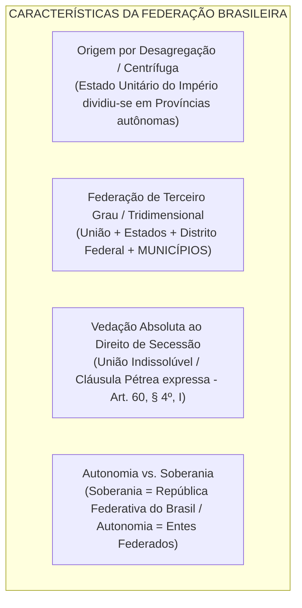
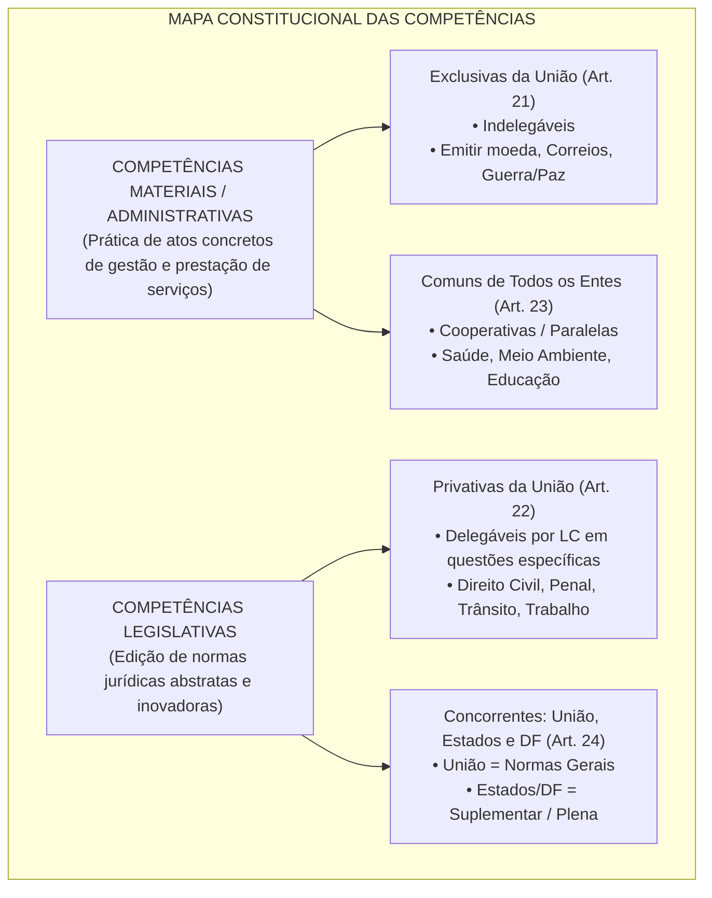
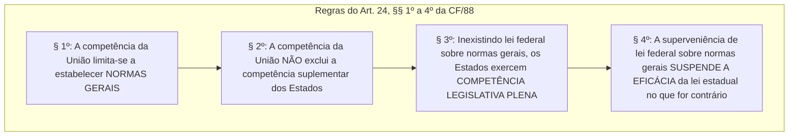
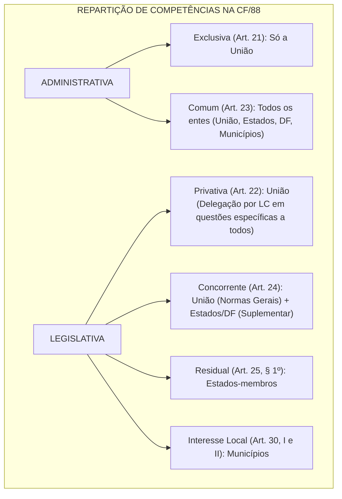

# Organização Político-Administrativa e Repartição de Competências (Arts. 18 a 24 da CF/88)

> A Organização Político-Administrativa do Estado brasileiro e a Repartição Constitucional de Competências consagram a arquitetura federativa inaugurada pela Carta Magna de 1988, fundada no princípio da predominância do interesse e na autonomia política, administrativa, legislativa e financeira outorgada à União, aos Estados, ao Distrito Federal e aos Municípios. Sob a égide da federação de terceiro grau (que inclui os municípios como entes federativos dotados de auto-organização e autogoverno), o texto constitucional opera a rigorosa distinção entre competências administrativas ou materiais (exclusivas da União no art. 21 e comuns cooperativas no art. 23) e competências legislativas (privativas da União no art. 22 e concorrentes entre União, Estados e DF no art. 24). O enfrentamento de certames de alta densidade técnica exige domínio da dinâmica da competência concorrente — onde a União edita normas gerais e a superveniência de lei federal suspende a eficácia da lei estadual prévia no que for conflitante —, bem como da jurisprudência consolidada do STF sobre loterias, trânsito, proteção ao consumidor e transporte intermunicipal.

---

## 1. O Federalismo Brasileiro: Características Estruturais

O Estado brasileiro adota a forma federativa de Estado desde a Proclamação da República (Decreto nº 1/1889 e Constituição de 1891), mantida pelo art. 1º e pelo art. 18 da Constituição Federal de 1988:

1. **Formação Centrífuga (por Desagregação):** Ao contrário dos Estados Unidos (formação centrípeta, por aglutinação de colônias independentes que cederam soberania), o Brasil partiu de um Estado unitário centralizado no Império, que se descentralizou para criar os entes federados.
2. **Federação Tridimensional (de Terceiro Grau):** A Carta de 1988 inovou na dogmática comparada ao erigir os **Municípios** à categoria de entes federativos autônomos (art. 18, *caput*), dotados de poder constituinte decorrente derivado na feitura de suas Leis Orgânicas municipais (art. 29).
3. **Autonomia Federativa:** Traduz-se no quadrilátero de capacidades dos entes federados:
   * **Auto-organização:** Elaboração de Constituições Estaduais e Leis Orgânicas (DF e Municípios);
   * **Autogoverno:** Eleição direta de seus chefes do Executivo e membros do Legislativo;
   * **Autoadministração:** Gestão de seus serviços públicos, patrimônio e servidores;
   * **Autolegislação:** Edição de leis próprias no âmbito de suas competências constitucionais.

---

## 2. Bens Públicos Constitucionais (Arts. 20 e 26 da CF/88)

A Constituição discriminou expressamente o patrimônio público originário pertencente à União e aos Estados-membros:

| Ente Federado | Principais Bens Constitucionais | Dispositivo |
| :--- | :--- | :---: |
| **União** | • Recursos minerais, inclusive os do subsolo e potenciais de energia hidráulica • Mar territorial (12 milhas marítimas) e terrenos de marinha e seus acrescidos • Terras tradicionalmente ocupadas pelos índios • Terras devolutas indispensáveis à defesa das fronteiras e fortificações militares • Ilhas oceânicas e costeiras (salvo as que contenham sede de Município) | **Art. 20** |
| **Estados-Membros** | • Águas superficiais ou subterrâneas que nasçam e deságuem no seu território • Ilhas fluviais e lacustres não pertencentes à União • Terras devolutas **não compreendidas entre as da União** (residuais) • Gás canalizado local (art. 25, § 2º) | **Art. 26** |

> **Nota Jurisprudencial:** Conforme o art. 20, § 1º, é assegurada aos Estados, ao DF e aos Municípios a participação no resultado da exploração de petróleo ou gás natural, recursos hídricos para fins de energia elétrica e outros recursos minerais no respectivo território (*royalties*), sem que isso lhes transfira a propriedade originária dos bens minerais.

---

## 3. Matriz Dogmática da Repartição de Competências

A partilha de competências fundamenta-se no **Princípio da Predominância do Interesse**:
* **Interesse Geral (Nacional):** Competência atribuída à **União** (arts. 21 e 22);
* **Interesse Regional:** Competência remanescente/residual atribuída aos **Estados** (art. 25, § 1º);
* **Interesse Local:** Competência atribuída aos **Municípios** (art. 30);
* **Interesse Híbrido:** Competência do **Distrito Federal**, que acumula as competências estaduais e municipais (art. 32, § 1º).

---

## 4. Competências Legislativas: Privativa vs. Concorrente

A diferenciação entre as matérias dos artigos 22 e 24 da CF/88 é a temática mais incidente em provas de concursos jurídicos e fiscais:

### 4.1. Competência Legislativa Privativa da União (Art. 22)

Compreende matérias que demandam regulação nacional absolutamente uniforme em todo o território da República:

* **Ramos do Direito:** Direito Civil, Comercial, Penal, Processual, Eleitoral, Agrário, Marítimo, Aeronáutico, Espacial e do Trabalho (art. 22, I).
* **Outras Matérias Nucleares:** Desapropriação; águas, energia, informática, telecomunicações e radiodifusão; comércio exterior e interestadual; diretrizes da educação nacional; **trânsito e transporte**; sistemas de consórcios e sorteios; normas gerais de licitação e contratação (art. 22, XXVII).
* **Delegação Legislativa aos Estados (Art. 22, Parágrafo Único):**
  * Requisitos cumulativos e indispensáveis:
    1. Veículo normativo: **Lei Complementar Federal** (não pode ser lei ordinária ou medida provisória);
    2. Objeto: Apenas **questões específicas** das matérias relacionadas no art. 22 (não pode delegar o ramo do direito como um todo);
    3. Princípio da Isonomia Federativa: A autorização deve ser conferida abstratamente a **todos os Estados-membros**, vedada a delegação casuística a apenas um Estado.

---

### 4.2. Competência Legislativa Concorrente (Art. 24)

Compreende matérias cuja regulamentação é exercida conjuntamente pela **União, pelos Estados e pelo Distrito Federal** (*Atenção: os Municípios não constam do art. 24, mas legislam suplementarmente pelo art. 30, II*):

* **Ramos do Direito Concorrentes (Mnemônico *PUTTO*):**
  * **P** — Direito **Penitenciário**;
  * **U** — Direito **Urbanístico**;
  * **T** — Direito **Tributário**;
  * **F** — Direito **Financeiro**;
  * **E** — Direito **Econômico**;
  * **O** — Direito **Orçamentário**.
* **Outras Matérias Concorrentes:** Custas dos serviços forenses; produção e consumo; proteção ao patrimônio histórico e cultural; meio ambiente e controle da poluição; previdência social, proteção e defesa da saúde; assistência jurídica e defensoria pública.

---

### 4.3. Dinâmica Operacional da Competência Concorrente (Art. 24, §§ 1º a 4º)

A repartição vertical obedece a quatro regras constitucionais rígidas:

1. **Normas Gerais da União (§ 1º):** À União cabe fixar balizas, diretrizes e princípios gerais uniformes, sem descer a minudências procedimentais.
2. **Competência Suplementar dos Estados (§ 2º):** Os Estados preenchem as lacunas e adaptam as diretrizes gerais federais às particularidades regionais.
3. **Competência Supletiva Plena dos Estados (§ 3º):** Se a União omitir-se e não editar a lei federal de normas gerais, os Estados e o DF adquirem competência legislativa plena para dispor amplamente sobre a matéria.
4. **Superveniência de Lei Federal de Normas Gerais (§ 4º):**
   * A edição superveniente de lei federal **NÃO REVOGA** a lei estadual anterior;
   * O texto constitucional é categórico: **SUSPENDE A EFICÁCIA** da lei estadual no que lhe for contrário (*bloqueio de eficácia*). Caso a lei federal venha a ser revogada no futuro, a lei estadual volta a produzir efeitos plenamente (*efeito repristinatório tácito da eficácia*).

---

## 5. Jurisprudência Vinculante do STF em Conflitos Federativos

Examinadores frequentemente utilizam a jurisprudência consolidada do STF para formular questões de alto nível:

1. **Serviços Lotéricos e Apostas de Quota Fixa (ADPFs 492 e 493):** O art. 22, XX, confere à União a competência privativa para **legislar sobre sistemas de sorteios e loterias** (Súmula Vinculante 2). Contudo, essa competência legislativa privativa federal **NÃO impede a competência material dos Estados-membros para explorar o serviço público de loterias** no âmbito de seus respectivos territórios. Lei federal que proíba Estados de operar loterias é manifestamente inconstitucional.
2. **Regulamentação de Despachantes e Trânsito:** Leis estaduais que criem requisitos, vedações ou regulem a profissão de despachante perante órgãos de trânsito (Detran) são **inconstitucionais**, pois violam a competência privativa da União para legislar sobre condições para o exercício de profissões (art. 22, XVI) e sobre trânsito e transporte (art. 22, XI).
3. **Transporte Coletivo Intermunicipal:** O transporte que liga municípios distintos dentro do mesmo Estado é serviço público de **interesse regional**, de titularidade e competência regulatória privativa do **Estado-membro** (art. 25, § 1º). A União cuida do interestadual/internacional (art. 21, XII, "e") e os Municípios cuidam do intramunicipal (art. 30, V).

---

## 6. Tabela Comparativa de Alta Densidade: Art. 22 vs. Art. 24

| Parâmetro Dogmático | Competência Privativa da União (Art. 22) | Competência Concorrente (Art. 24) |
| :--- | :--- | :--- |
| **Entes com Competência** | **Apenas a União** (União legisla sozinha) | **União, Estados e Distrito Federal** |
| **Papel da União** | Regula a matéria por completo (normas gerais e específicas) | Limita-se a editar **Normas Gerais** |
| **Papel dos Estados** | Não legislam, salvo expressa delegação por LC | Legislam **suplementarmente** ou com **competência plena** (na omissão federal) |
| **Instrumento de Delegação** | **Lei Complementar Federal** (para questões específicas) | Desnecessário (a competência estadual é originária) |
| **Ramos Jurídicos Típicos** | Civil, Penal, Processual, Trabalho, Eleitoral, Trânsito | Tributário, Financeiro, Penitenciário, Urbanístico, Econômico, Orçamentário |
| **Superveniência de Lei Federal** | Inaplicável (a competência é unicamente da União) | **Suspende a eficácia** da lei estadual no que lhe for contrário |

---

> **Fique Ligado:**
> 1. **Município não está no Art. 24:** O Município não integra a competência concorrente do art. 24. Contudo, pelo art. 30, II, da CF/88, o Município pode *"suplementar a legislação federal e a estadual no que couber"* (desde que amparado em manifesto interesse local).
> 2. **Direito Processual vs. Procedimento:** Legislar sobre **Direito Processual** é competência privativa da União (art. 22, I); legislar sobre **Procedimentos em matéria processual** é competência concorrente da União, Estados e DF (art. 24, XI).
> 3. **Suspensão vs. Revogação (§ 4º):** A banca tentará afirmar que a lei federal superveniente "revoga" a lei estadual anterior. Está **ERRADO**. A lei federal superveniente apenas **suspende a eficácia** da norma estadual conflitante.

---

## 7. Síntese Visual Canônica

---

## 8. Questões Paradigmáticas Aplicadas

---

### [Questão 01](https://www.qconcursos.com/questoes-de-concursos/questoes/642d6a13-c7) — [IGEDUC — Prefeitura de São Bento do Una - PE / Professor — 2026]

Durante a elaboração de um acordo de cooperação educacional, Estado e Município discutem a distribuição constitucional das responsabilidades sobre a educação básica. Um dos técnicos sustenta que a definição das áreas prioritárias de atuação impede a atuação colaborativa entre os entes federados.
À luz do art. 211 da Constituição Federal de 1988, a repartição de prioridades no ensino estabelece que:

* **A)** Os Municípios atuam prioritariamente no ensino fundamental, enquanto Estados e Distrito Federal priorizam a educação infantil e o ensino médio, conforme a demanda educacional identificada em cada território.
* **B)** Os Municípios atuam prioritariamente na educação infantil, enquanto Estados e Distrito Federal assumem prioridade no ensino fundamental e médio, admitida cooperação financeira entre suas respectivas redes.
* **C)** Os Municípios atuam prioritariamente no ensino fundamental e na educação infantil, enquanto Estados e Distrito Federal atuam prioritariamente nos ensinos fundamental e médio, preservado o regime de colaboração.
* **D)** Os Municípios atuam prioritariamente na educação infantil e no ensino fundamental, enquanto Estados e Distrito Federal priorizam o ensino médio, cabendo à União organizar as demais etapas da educação básica.
* **E)** Os Municípios atuam prioritariamente na educação infantil e no ensino fundamental, enquanto os Estados concentram sua atuação prioritária no ensino médio, compartilhando o ensino fundamental por delegação municipal.

#### Gabarito: **C**
* **C (Certa):** Exata conjugação do art. 211, §§ 2º e 3º, da Carta Magna:

---

### [Questão 02](https://www.qconcursos.com/questoes-de-concursos/questoes/5d9184a4-c7) — [FGV — PC-PR / Agente de Polícia Judiciária — 2026]

Lei editada pela União vedou expressamente ao Estado Alfa a exploração de apostas de quota fixa, modalidade lotérica prevista e autorizada pelas Leis federais nº 13.756/2018 e nº 14.790/2023.
À luz da repartição constitucional de competências entre os entes federativos e da jurisprudência do Supremo Tribunal Federal, assinale a afirmativa correta:

* **A)** Conforme o disposto no Art. 22, inciso XX, CRFB/88, o legislador constituinte reservou exclusivamente à União a exploração do serviço de loterias.
* **B)** A competência privativa da União para legislar sobre sistemas de sorteios, prevista no Art. 22, inciso XX, CRFB/88, não impede aos Estados-membros a exploração do serviço público lotérico em seus territórios nas modalidades já previamente definidas em lei editada pela União.
* **C)** Nos termos do Art. 25, § 1º da CRFB, os Estados-membros possuem competência para instituir novas modalidades de serviços lotéricos, ainda que não estejam previamente autorizadas em leis oriundas da União.
* **D)** É constitucional lei estadual que disponha sobre sistemas de sorteios, inclusive bingos e loterias.
* **E)** A Constituição da República expressamente proibiu aos Estados-membros o exercício de competência material para prestação de serviço público de loterias.

#### Gabarito: **B**
* **A (Errada):** A Constituição reservou à União a competência para *legislar* sobre sistemas de sorteios e loterias, mas não outorgou monopólio exclusivo material de sua prestação estatal.
* **B (Certa):** Tese pacificada pelo STF no julgamento conjunto das **ADPFs 492 e 493**: a competência privativa da União para legislar sobre sistemas de consórcios e sorteios (art. 22, XX e Súmula Vinculante 2) não exclui a competência material dos Estados e do DF para explorar as atividades lotéricas regulamentadas em âmbito federal. Logo, a União não pode alijar os Estados da exploração dos serviços públicos de loteria.
* **E (Errada):** Os Estados possuem ampla competência material para prestar serviços públicos estaduais de relevância econômica.

---

### [Questão 03](https://www.qconcursos.com/questoes-de-concursos/questoes/318ad3f7-c8) — [FGV — PC-PR / Delegado de Polícia — 2026]

Foi editada a Lei nº X, no âmbito do Estado Alfa, dispondo sobre as regras a serem observadas para que despachantes documentalistas pudessem atuar perante os órgãos de trânsito do respectivo ente federativo (Detran local), estatuindo requisitos mínimos de escolaridade, causas de impedimento e cominando penalidades disciplinares de suspensão e cassação de credenciamento.
À luz da ordem constitucional brasileira, a referida lei estadual é:

* **A)** inconstitucional, por afrontar competência legislativa privativa e delegável da União.
* **B)** inconstitucional, por afrontar competência legislativa privativa e indelegável da União.
* **C)** constitucional, por versar sobre matéria de competência legislativa residual do Estado Alfa.
* **D)** constitucional, por versar sobre matéria de competência legislativa comum entre os entes federativos.
* **E)** constitucional, por versar sobre matéria de competência legislativa concorrente com a União, desde que observadas eventuais normas gerais.

#### Gabarito: **A**
* **A (Certa):** Conforme jurisprudência firme e pacificada do STF (precedentes diretos nas ADIs 4.387, 6.744 e 7.218), é **inconstitucional** lei estadual que discipline o exercício da atividade de despachante perante órgãos de trânsito, por violar a competência legislativa privativa da União para legislar sobre **trânsito e transporte** (art. 22, XI) e sobre **condições para o exercício de profissões** (art. 22, XVI).
* **B (Errada):** Municípios não possuem competência para regulamentar profissões ou sistemas de habilitação de trânsito.

---

### [Questão 04](https://www.qconcursos.com/questoes-de-concursos/questoes/a58bcc79-cb) — [FGV — DATAPREV / Advocacia — 2026]

Foi apresentada proposta no âmbito do governo federal para o encaminhamento de projeto de lei visando à consolidação das ações governamentais na área de assistência social. A proposta continha três diretrizes estruturais:
I. Centralização político-administrativa das ações assistenciais na esfera federal, subordinando as secretarias municipais e estaduais à supervisão hierárquica direta do Ministério do Desenvolvimento Social.  
II. Participação da população, por meio de organizações representativas, na formulação das políticas e no controle das ações em todos os níveis federativos.  
III. Financiamento exclusivo das ações assistenciais pelo orçamento da União, vedada a alocação de receitas tributárias próprias dos Estados e Municípios para tais finalidades.  
Considerando a ordem constitucional da seguridade e assistência social (art. 204 da CF/88), está correto concluir que:

* **A)** apenas a diretriz I é constitucional.
* **B)** apenas as diretrizes I e II são constitucionais.
* **C)** apenas as diretrizes I e III são constitucionais.
* **D)** apenas as diretrizes II e III são constitucionais.
* **E)** todas são constitucionais.

#### Gabarito: **A**
* **Diretriz I (Inconstitucional):** O art. 204, inciso I, da Carta Magna estabelece categoricamente a **descentralização político-administrativa**, cabendo a coordenação geral à esfera federal, mas a execução dos programas às esferas estadual e municipal, sendo vedada a subordinação hierárquica que viole a autonomia dos entes federados.
* **Diretriz II (Constitucional):** Transcreve com perfeição o art. 204, inciso II, da CF/88: *"participação da população, por meio de organizações representativas, na formulação das políticas e no controle das ações em todos os níveis"*.
* **Diretriz III (Inconstitucional):** A assistência social é financiada por recursos de todos os entes da Federação (orçamento da seguridade social da União, dos Estados, DF e Municípios — arts. 195 e 204, parágrafo único), sendo vedada a exclusão dos aportes locais.
* **Conclusão:** Apenas a **diretriz II** é constitucional, correspondendo à alternativa **A**.

---

### [Questão 05](https://www.qconcursos.com/questoes-de-concursos/questoes/cc74faf4-d2) — [CESPE / CEBRASPE — AGEPAR / Especialista em Regulação — 2026]

No que diz respeito à repartição constitucional de competências entre União, estados, Distrito Federal e municípios, assinale a opção correta:

* **A)** Válida, pois o Município detém competência constitucional privativa para instituir e manter sistemas autônomos de educação superior, cabendo-lhe definir discricionariamente as prioridades de investimento público dentro de seus limites territoriais.
* **B)** Inválida, pois a atuação dos Municípios no ensino superior é meramente residual, subordinada ao atendimento pleno e prioritário da educação infantil e do ensino fundamental, cabendo precipuamente à União o papel redistributivo e a coordenação do sistema federal e do ensino superior.
* **C)** Válida, desde que a instituição de ensino superior municipal seja fiscalizada e regulada diretamente pelo Ministério da Educação (MEC), dada a competência legislativa exclusiva da União para fiscalizar e autorizar cursos em todas as esferas federativas.
* **D)** Inválida, na medida em que a Constituição Federal veda expressamente a criação e manutenção de instituições públicas de ensino superior pelo Poder Público municipal em qualquer hipótese fática.
* **E)** Válida, por força do princípio da colaboração federativa, segundo o qual Estados e Municípios exercem competência material concorrente e linear em todos os níveis educacionais sem vinculação de prioridade funcional.

#### Gabarito: **D**
* **A (Errada):** Na competência concorrente, a competência para fixar normas gerais pertence privativamente à União (art. 24, § 1º).
* **B (Errada):** O parágrafo único do art. 22 admite que Lei Complementar da União autorize os Estados a legislar sobre questões específicas de matérias privativas.
* **C (Errada):** Direito penal e processual são de competência privativa (art. 22, I); direito tributário e financeiro são de competência **concorrente** (art. 24, I).
* **D (Certa):** Transcrição exata do art. 24, § 4º, da Constituição Federal: *"A superveniência de lei federal sobre normas gerais suspende a eficácia da lei estadual, no que lhe for contrário"*.
* **E (Errada):** Inexistindo lei federal de normas gerais, os Estados exercem a competência legislativa plena (art. 24, § 3º).

---

### [Questão 06](https://www.qconcursos.com/questoes-de-concursos/questoes/71ccdacd-d2) — [CESPE / CEBRASPE — AGEPAR / Especialista em Regulação — 2026]

O transporte coletivo intermunicipal rodoviário de passageiros que se realiza no âmbito de um mesmo Estado-membro caracteriza-se como um serviço público cuja competência de exploração e regulação, nos termos da Constituição Federal de 1988, cabe:

* **A)** O Município poderá legislar sobre assuntos de interesse local e suplementar a legislação federal e estadual, desde que a matéria não tenha recebido regulamentação específica de outro ente.
* **B)** O Município poderá legislar sobre assuntos de interesse local e suplementar a legislação federal e estadual, afastando normas gerais quando identificar peculiaridades administrativas na regulamentação municipal.
* **C)** O Município poderá legislar sobre assuntos de interesse local e suplementar a legislação federal e estadual no que couber, respeitados os limites constitucionais de sua competência.
* **D)** O Município poderá legislar sobre assuntos de interesse local e complementar normas estaduais, ficando a suplementação da legislação federal condicionada à autorização legislativa expressa da União.
* **E)** O Município poderá legislar sobre assuntos de interesse local e suplementar a legislação estadual, cabendo à União autorizar previamente a regulamentação municipal de matérias disciplinadas por normas federais.

#### Gabarito: **C**
* **C (Certa):** O transporte intermunicipal rodoviário opera dentro dos limites de um mesmo Estado, mas conectando municípios diferentes. Trata-se de matéria de **interesse regional**, inserida na competência residual dos **Estados-membros** (art. 25, § 1º da CF/88), cabendo às agências reguladoras estaduais (como AGEPAR, ARTESP, ARCE) a sua outorga e fiscalização tarifária.

---

### [Questão 07](https://www.qconcursos.com/questoes-de-concursos/questoes/76b36f38-d2) — [CESPE / CEBRASPE — AGEPAR / Especialista em Regulação — 2026]

No tocante à repartição vertical de competências legislativas na Constituição Federal de 1988, é correto afirmar:

* **A)** A existência de lei federal sobre a matéria impede sempre qualquer atuação legislativa estadual, pois a competência concorrente somente permite aos Estados editar normas enquanto inexistir legislação federal.
* **B)** A lei estadual, embora possa suplementar a legislação federal para atender às peculiaridades regionais, não pode estabelecer disciplina incompatível com norma geral federal válida, inclusive para afastar autorização nela prevista.
* **C)** O Estado pode estabelecer disciplina contrária à lei federal, desde que demonstre que sua norma atende a peculiaridades regionais, pois a competência concorrente assegura autonomia legislativa plena aos Estados.
* **D)** A repercussão da matéria no comércio interestadual é suficiente para convertê-la em competência privativa da União, ainda que a Constituição a tenha expressamente incluído na competência concorrente.

#### Gabarito: **E**
* **A (Errada):** As normas gerais da União fixadas nos termos do art. 24, § 1º, subordinam a legislação suplementar dos Estados.
* **B (Errada):** A tutela ambiental é de competência concorrente (art. 24, VI) e comum material (art. 23, VI), podendo os Estados suplementar as normas federais com padrões mais protetivos.
* **C (Errada):** Os Estados adquirem competência legislativa plena perante a inércia federal (art. 24, § 3º).
* **D (Errada):** Tributário e financeiro/orçamentário são matérias concorrentes (art. 24, I e II).
* **E (Certa):** Exata inteligência do art. 24, § 4º da Constituição de 1988.

---

### [Questão 08](https://www.qconcursos.com/questoes-de-concursos/questoes/bc959347-b1) — [Avança SP — Câmara de Três Corações - MG / Advogado — 2026]

O art. 20 da Lei Orgânica do Município dispõe sobre as competências outorgadas pela Constituição Federal para tornar ampla e efetiva a sua autonomia no plano local.
À luz da repartição constitucional de competências estabelecida nos artigos 23 e 30 da Constituição Federal de 1988, assinale a alternativa que descreve uma competência privativa municipal de interesse local:

* **A)** elaborar planos nacionais e regionais de ordenação do território e de desenvolvimento econômico e social.
* **B)** organizar a inspeção do trabalho.
* **C)** explorar, diretamente ou mediante autorização, concessão ou permissão dos serviços e instalações de energia elétrica e o aproveitamento energético dos cursos de água.
* **D)** promover a melhoria das condições habitacionais e de saneamento básico.
* **E)** promover a defesa permanente contra as calamidades públicas, especialmente as secas e as inundações.

#### Gabarito: **E**
* **B (Errada):** Celebrar tratados internacionais é atribuição privativa do Presidente da República perante a União soberana (art. 84, VIII).
* **C (Errada):** Estabelecer preferências entre entes ou brasileiros é conduta expressamente vedada a todos os entes pelo art. 19, III da CF/88.
* **E (Certa):** Conforme jurisprudência pacificada do STF (Súmula Vinculante 38 e precedentes), compete ao Município legislar sobre assuntos de **interesse local** e disciplinar o tráfego urbano e as regras de carga e descarga nas vias públicas municipais (art. 30, I e V).

---

### [Questão 09](https://www.qconcursos.com/questoes-de-concursos/questoes/cc74faf5-d2) — [CESPE / CEBRASPE — PGE-PA / Procurador do Estado — 2026]

Determinado Estado-membro da Federação editou lei instituindo cadastro estadual obrigatório de consumidores devedores de serviços de telefonia móvel e impondo aos fornecedores de telefonia o dever de prestar informações cadastrais sob pena de multa.
À luz da repartição constitucional de competências e da jurisprudência do Supremo Tribunal Federal, a referida lei estadual é:

* **A)** A lei estadual que fixar normas gerais sobre direito urbanístico terá preferência sobre a lei federal, em razão do princípio da predominância do interesse local.
* **B)** As competências legislativas privativas da União são indelegáveis, não havendo hipótese de autorização constitucional para que os estados legislem sobre matérias originalmente atribuídas à União.
* **C)** Direito penal, direito processual, direito tributário e orçamento são matérias de competência legislativa privativa da União.
* **D)** A superveniência de lei federal sobre normas gerais suspende a eficácia de lei estadual no que lhe for contrário.
* **E)** Diante da inexistência de lei federal sobre normas gerais, os estados não poderão exercer a competência legislativa sobre a matéria até a manifestação do Congresso Nacional.

#### Gabarito: **B**
* **A (Errada):** Embora os Estados tenham competência concorrente para legislar sobre defesa do consumidor, o STF consagrou que o legislador estadual não pode, a pretexto de proteger o consumidor, interferir na prestação, regulação técnica ou contratos de serviços públicos de telecomunicações.
* **B (Certa):** Conforme jurisprudência vinculante reiterada do STF (Súmula Vinculante 46 e precedentes das ADIs 3.322, 3.845 e 4.407), compete privativamente à União legislar sobre **telecomunicações** (art. 22, IV) e explorar esses serviços (art. 21, XI). Leis estaduais que interfiram nas operadoras de telefonia e em seus cadastros e serviços são formalmente **inconstitucionais**.

---

### [Questão 10](https://www.qconcursos.com/questoes-de-concursos/questoes/cc74faf6-d2) — [FGV — OAB / Exame de Ordem Unificado — 2026]

O Governador do Estado Alfa sancionou lei estadual que dispõe sobre a proibição do uso de animais em testes para o desenvolvimento de produtos cosméticos, de higiene pessoal e perfumes no território do respectivo Estado, cominando multas elevadas em caso de descumprimento. Determinada associação nacional de fabricantes questionou a validade da norma sustentando que apenas a União poderia legislar sobre a matéria.
À luz da ordem constitucional brasileira e do entendimento do Supremo Tribunal Federal, a lei estadual é:

* **A)** ao consórcio público intermunicipal, por exigir obrigatoriamente a gestão compartilhada das rotas locais.
* **B)** ao ente federal, por demandar a unificação das tarifas de transporte público do país.
* **C)** o estado-membro, por configurar interesse regional que ultrapassa os limites de uma só municipalidade.
* **D)** ao município de origem, por envolver o ponto de partida do fluxo de passageiros.
* **E)** à agência reguladora federal de transportes terrestres, sob a coordenação do Ministério das Cidades.

#### Gabarito: **B**
* **B (Certa):** O art. 24, inciso VI, da CF/88 estabelece a competência legislativa concorrente entre União, Estados e DF sobre florestas, caça, pesca, fauna, conservação da natureza, defesa do solo e dos recursos naturais, proteção do meio ambiente e controle da poluição. O STF pacificou (ADI 5.996/AM e ADI 4.616/SP) que os Estados-membros podem editar legislação suplementar protetiva proibindo testes em animais para cosméticos, ampliando o patamar de salvaguarda da fauna sem colidir com as normas gerais federais.

---

### [Questão 11](https://www.qconcursos.com/questoes-de-concursos/questoes/cc74faf7-d2) — [CESPE / CEBRASPE — TCE-PR / Auditor de Controle Externo — 2026]

Acerca dos bens constitucionais dos entes federados e da repartição de competências na Carta de 1988, assinale a opção correta:

* **A)** A lei estadual que fixar normas gerais sobre direito urbanístico terá preferência sobre a lei federal, em razão do princípio da predominância do interesse local.
* **B)** As competências legislativas privativas da União são indelegáveis, não havendo hipótese de autorização constitucional para que os estados legislem sobre matérias originalmente atribuídas à União.
* **C)** Diante da inexistência de lei federal sobre normas gerais, os estados não poderão exercer a competência legislativa sobre a matéria até a manifestação do Congresso Nacional.
* **D)** Direito penal, direito processual, direito tributário e orçamento são matérias de competência legislativa privativa da União.
* **E)** A superveniência de lei federal sobre normas gerais suspende a eficácia de lei estadual no que lhe for contrário.

#### Gabarito: **B**
* **A (Errada):** As ilhas situadas em zonas limítrofes com outros países integram os bens da União (art. 20, IV).
* **B (Certa):** É a regra residual expressa do art. 26, inciso IV, da Constituição Federal: incluem-se entre os bens dos Estados *"as terras devolutas não compreendidas entre as da União"*.
* **C (Errada):** Os serviços locais de gás canalizado competem aos **Estados-membros** (art. 25, § 2º), sendo vedada a edição de medida provisória para a sua regulamentação.
* **D (Errada):** Os potenciais de energia hidráulica pertencem sempre à **União** (art. 20, VIII), ainda que o curso d'água corra em território estadual.
* **E (Errada):** As praias marítimas são bens de domínio exclusivo da **União** (art. 20, IV).

---

### [Questão 12](https://www.qconcursos.com/questoes-de-concursos/questoes/cc74faf8-d2) — [FCC — TRT - 1ª Região (RJ) / Analista Judiciário — 2026]

Suponha que determinado Estado da Federação tenha exercido competência legislativa plena sobre direito financeiro e controle de gastos na ausência de lei federal sobre normas gerais, editando a Lei Estadual nº 1.000. Dois anos depois, o Congresso Nacional promulgou a Lei Federal nº 5.000, estatuindo normas gerais uniformes sobre a matéria, cujo conteúdo colide frontalmente com três artigos da lei estadual anteriormente em vigor.
Diante do advento da referida lei federal de normas gerais, os dispositivos conflitantes da lei estadual anterior:

* **A)** Proporcionar os meios de acesso à cultura, à educação e à ciência.
* **B)** Participar da criação de entidade intermunicipal para a realização de obra, exercício de atividade ou execução de serviço específico de interesse comum;
* **C)** Estabelecer preferências em relação aos demais Municípios e entidades do Estado.
* **D)** Promover programas de construção de moradias populares e a melhoria das condições habitacionais e de saneamento básico.
* **E)** Disciplinar os serviços de carga e descarga e fixar a tonelagem máxima permitida a veículos que circulem em vias públicas municipais.

#### Gabarito: **C**
* **C (Certa):** Aplicação literal do art. 24, § 4º, da Constituição Federal de 1988: *"A superveniência de lei federal sobre normas gerais **suspende a eficácia** da lei estadual, no que lhe for contrário"*. Os dispositivos da Lei Estadual nº 1.000 incompatíveis com a Lei Federal nº 5.000 têm apenas sua eficácia suspensa.

---
