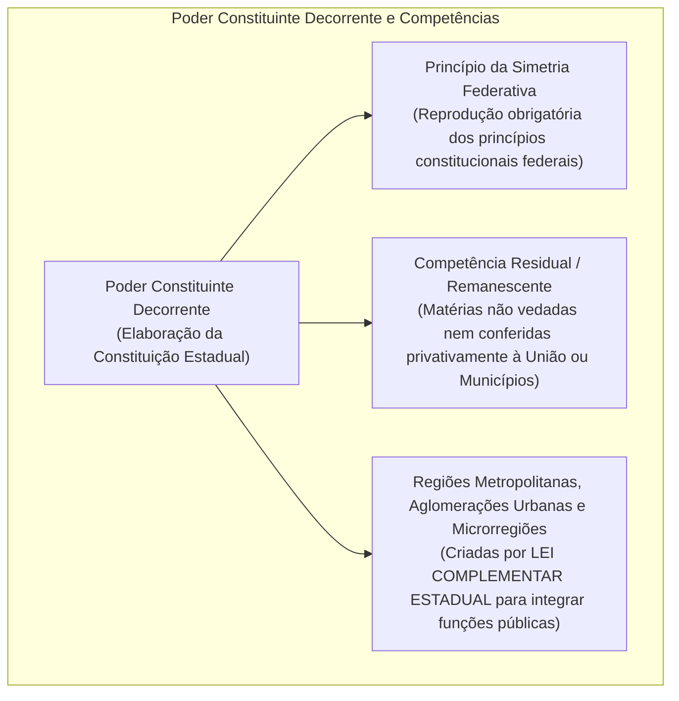
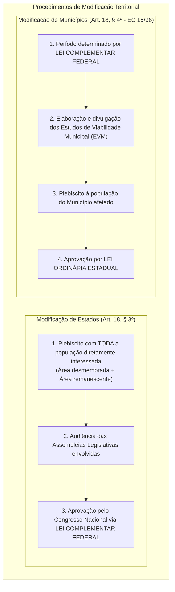
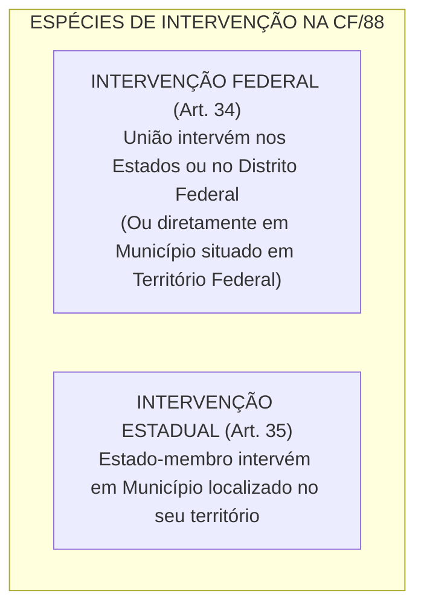
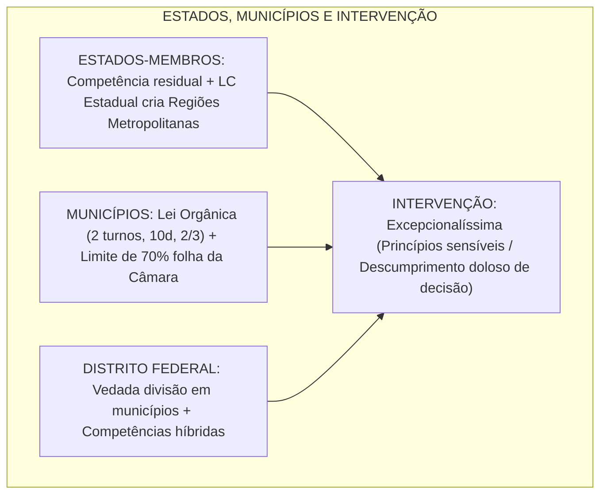

# Estados, Municípios, Distrito Federal, Territórios e Intervenção (Arts. 25 a 36 da CF/88)

> A organização interna dos entes federados e a preservação do pacto federativo representam o equilíbrio dinâmico entre a autonomia política local e a integridade da República soberana. Os artigos 25 a 36 da Constituição de 1988 disciplinam as competências residuais dos Estados-membros, o poder constituinte derivado decorrente e os limites das regiões metropolitanas; a auto-organização dos Municípios mediante Leis Orgânicas aprovadas por quórum qualificado de dois terços; o regime híbrido do Distrito Federal, que cumula competências estaduais e municipais sob a vedação absoluta de fracionamento em municípios; o regime descentralizado dos Territórios Federais; as vedações federativas expressas do art. 19; e os mecanismos de crise consubstanciados na Intervenção Federal e na Intervenção Estadual nos Municípios. O domínio das hipóteses taxativas de intervenção, dos princípios sensíveis tuteláveis via ação direta interventiva perante o STF, dos limites orçamentários do Poder Legislativo municipal e da jurisprudência sobre o inadimplemento de precatórios é indispensável para o sucesso nas carreiras fiscais e de controle.

---

## 1. Estados-Membros: Auto-organização e Competência Residual (Art. 25)

Os Estados-membros organizam-se e regem-se pelas Constituições e leis que adotarem, observados os princípios da Constituição Federal:

* **Poder Constituinte Decorrente:** Manifesta-se na capacidade de auto-organização conferida aos Estados para promulgar suas próprias Cartas Constitucionais. É derivado, subordinado e juridicamente limitado, devendo estrita obediência aos:
  1. *Princípios Constitucionais Sensíveis* (art. 34, VII — cuja violação enseja intervenção federal);
  2. *Princípios Constitucionais Estabelecidos* (repartição de competências, processo legislativo, direitos fundamentais);
  3. *Princípios Constitucionais Extensíveis* (normas de organização dos Poderes reproduzidas compulsoriamente pelo princípio da simetria).
* **Competência Residual:** Conforme o art. 25, § 1º, *"são reservadas aos Estados as competências que não lhes sejam vedadas por esta Constituição"*.
* **Gás Canalizado (Art. 25, § 2º):** Cabe aos Estados explorar diretamente, ou mediante concessão, os **serviços locais de gás canalizado**, na forma da lei, sendo **vedada a edição de medida provisória para a sua regulamentação**.
* **Regiões Metropolitanas (Art. 25, § 3º):** Os Estados podem, mediante **Lei Complementar Estadual**, instituir regiões metropolitanas, aglomerações urbanas e microrregiões, constituídas por agrupamentos de municípios limítrofes, para integrar a organização, o planejamento e a execução de funções públicas de interesse comum.

---

## 2. Municípios na Ordem Constitucional (Arts. 29 a 31)

Os Municípios possuem autonomia política, administrativa, financeira e legislativa, regendo-se por **Lei Orgânica**:

### 2.1. O Rito Constitucional da Lei Orgânica (Art. 29, *caput*)

$$\text{Aprovação da Lei Orgânica} = \text{Votação em 2 Turnos} + \text{Interstício Mínimo de 10 Dias} + \text{Quórum de 2/3 da Câmara Municipal}$$

* **Promulgação:** A Lei Orgânica é promulgada privativamente pela **Mesa da Câmara Municipal** (não há sanção ou veto do Prefeito Municipal).
* **Natureza Jurídica:** Embora a doutrina majoritária reconheça a Lei Orgânica como ato de poder constituinte derivado decorrente municipal de segundo grau, o STF estabelece que a Lei Orgânica municipal deve subordinação direta à **Constituição Federal e à Constituição do respectivo Estado-membro**.

---

### 2.2. Limites de Gastos do Poder Legislativo Municipal (Art. 29-A)

O total da despesa do Poder Legislativo Municipal, incluídos os subsídios dos Vereadores e excluídos os gastos com inativos, não poderá ultrapassar percentuais das receitas tributárias e transferências do município no exercício anterior:

* De **7%** para municípios com população de até 100.000 habitantes;
* De **6%** para municípios entre 100.001 e 300.000 habitantes;
* De **5%** para municípios entre 300.001 e 500.000 habitantes;
* De **4,5%** para municípios entre 500.001 e 3.000.000 de habitantes;
* De **4%** para municípios entre 3.000.001 e 8.000.000 de habitantes;
* De **3,5%** para municípios com população superior a 8.000.000 de habitantes.
* **Folha de Pagamento da Câmara (Art. 29-A, § 1º):** A Câmara Municipal **não gastará mais de 70%** de sua receita com folha de pagamento, incluído o gasto com o subsídio de seus Vereadores. O descumprimento constitui crime de responsabilidade do Presidente da Câmara.

---

### 2.3. Fiscalização das Contas Municipais (Art. 31)

A fiscalização do Município será exercida pelo Poder Legislativo Municipal, mediante controle externo, e pelos sistemas de controle interno do Poder Executivo Municipal:
* **Parecer Prévio do Tribunal de Contas:** O parecer prévio emitido pelo Tribunal de Contas competente sobre as contas anuais do Prefeito só deixará de prevalecer por decisão de **dois terços dos membros da Câmara Municipal** (art. 31, § 2º).
* **Vedação a Novos Tribunais de Contas Municipais (Art. 31, § 4º):** É **vedada a criação de Tribunais, Conselhos ou órgãos de Contas Municipais**. Apenas os órgãos preexistentes à CF/88 foram mantidos (TCMRJ e TCM-SP). Nos demais municípios, o controle é exercido pelo Tribunal de Contas do Estado (TCE) ou pelo Tribunal de Contas dos Municípios do Estado (órgão estadual, como na Bahia, Goiás e Pará).

---

## 3. Criação e Modificação Territorial de Entes Federados (Art. 18, §§ 3º e 4º)

A Constituição disciplina com extremo rigor os procedimentos para criação, fusão, incorporação e desmembramento de Estados e Municípios:

### 3.1. Diferenças Críticas Exigidas em Concursos

| Etapa Procedimental | Estados-Membros (Art. 18, § 3º) | Municípios (Art. 18, § 4º) |
| :--- | :--- | :--- |
| **Consulta Popular** | **Plebiscito a toda a população interessada** (Lei 9.709/98 e STF: abrange o Estado todo) | **Plebiscito à população do município afetado** |
| **Estudo de Viabilidade** | Não exigido formalmente pela CF | **Obrigatório e previamente divulgado** (EVM) |
| **Período de Criação** | Inexiste restrição temporal de período | **Dentro do período fixado por Lei Complementar Federal** |
| **Veículo de Criação** | **Lei Complementar Federal** (Congresso Nacional) | **Lei Ordinária Estadual** (Assembleia Legislativa) |

---

## 4. O Distrito Federal e os Territórios Federais

### 4.1. Distrito Federal (Art. 32 da CF/88)

O Distrito Federal é um ente federativo de natureza anômala e singular:
1. **Vedação de Divisão em Municípios (Art. 32, *caput*):** Ao Distrito Federal é **expressamente vedada sua divisão em Municípios**. O DF subdivide-se administrativamente em Regiões Administrativas administradas por Administradores Regionais de confiança do Governador.
2. **Competências Cumuladas (Art. 32, § 1º):** Ao Distrito Federal são atribuídas as **competências legislativas reservadas aos Estados e aos Municípios** (competência híbrida).
3. **Manutenção pela União (Art. 21, XIII e XIV):** Compete privativamente à União organizar e manter o **Poder Judiciário, o Ministério Público (MPDFT), a Defensoria Pública do DF, a Polícia Civil, a Polícia Penal, a Polícia Militar e o Corpo de Bombeiros Militar do Distrito Federal**, além de prestar assistência financeira por meio do Fundo Constitucional do Distrito Federal (FCDF).

---

### 4.2. Territórios Federais (Art. 18, § 2º e Art. 33)

Os Territórios Federais integram a União e sua criação, transformação em Estado ou reintegração ao Estado de origem serão reguladas em **Lei Complementar Federal**:
* **Natureza Jurídica:** Não são entes federativos autônomos; constituem meras **autarquias territoriais descentralizadas pertencentes à União**.
* **Divisão Interna:** Os Territórios Federais **podem ser divididos em Municípios** aos quais se aplicará, no que couber, o disposto sobre os municípios comuns.
* **Governança dos Territórios (Art. 33):**
  * O Governador do Território é nomeado pelo Presidente da República após aprovação prévia pelo Senado Federal.
  * Nos Territórios Federais com **mais de cem mil habitantes**, haverá órgãos judiciários de primeira e segunda instância, membros do Ministério Público e defensores públicos federais.
  * As contas do governo do território são submetidas ao **Congresso Nacional**, com parecer prévio do **Tribunal de Contas da União (TCU)**.

---

## 5. Vedações Constitucionais Federativas (Art. 19 da CF/88)

É vedado à União, aos Estados, ao Distrito Federal e aos Municípios:
* **I — Religião e Laicidade:** Estabelecer cultos religiosos ou igrejas, subvencioná-los, embaraçar-lhes o funcionamento ou manter com eles ou seus representantes relações de dependência ou aliança, ressalvada, na forma da lei, a **colaboração de interesse público** (como na área de assistência social e patrimônio histórico).
* **II — Fé Pública aos Documentos:** Recusar fé aos documentos públicos. (Documento público emitido por órgão de um Estado tem plena validade e eficácia jurídica em qualquer outro ente da Federação).
* **III — Isonomia Federativa:** Criar distinções entre brasileiros ou preferências entre si. (É inconstitucional lei estadual ou municipal que confira preferência em concursos públicos, licitações ou benefícios tributários a residentes locais em detrimento de nacionais de outros Estados).

---

## 6. Regime da Intervenção Federal e Intervenção Estadual (Arts. 34 a 36)

A intervenção constitui a medida excepcionalíssima e drástica de supressão temporária da autonomia de um ente federado para resguardar a soberania e a unidade da República. A regra inviolável é a **não-intervenção**; a intervenção só se justifica nas hipóteses taxativas e exaustivas da Constituição (*numerus clausus*):

### 6.1. Hipóteses de Intervenção Federal (Art. 34, I a VII)

A União não intervirá nos Estados nem no Distrito Federal, exceto para:
* **I — Integridade nacional:** Manter a integridade nacional (combater tentativas de secessão);
* **II — Invasão:** Repelir invasão estrangeira ou de uma unidade da Federação em outra;
* **III — Ordem pública:** Pôr termo a grave comprometimento da ordem pública;
* **IV — Livre exercício dos Poderes:** Garantir o livre exercício de qualquer dos Poderes nas unidades da Federação;
* **V — Finanças Públicas:** Reorganizar as finanças da unidade da Federação que:
  * a) suspender o pagamento da dívida fundada por mais de dois anos consecutivos, salvo motivo de força maior;
  * b) deixar de entregar aos Municípios as receitas tributárias fixadas na Constituição, dentro dos prazos legais;
* **VI — Ordens Judiciais:** Prover à execução de lei federal, ordem ou decisão judicial;
* **VII — Princípios Constitucionais Sensíveis:** Assegurar a observância dos seguintes princípios:
  * a) forma republicana, sistema representativo e regime democrático;
  * b) direitos da pessoa humana;
  * c) autonomia municipal;
  * d) prestação de contas da administração pública, direta e indireta;
  * e) aplicação do mínimo exigido da receita resultante de impostos estaduais na manutenção e desenvolvimento do ensino e nas ações e serviços públicos de saúde.

---

### 6.2. Procedimento e Iniciativa da Intervenção Federal (Art. 36)

A decretação da intervenção dependerá:
1. **Intervenção Espontânea (de ofício pelo Presidente da República):** Nas hipóteses dos incisos I, II, III e V do art. 34 (integridade, invasão, ordem pública e desordem financeira). O Presidente ouve previamente o Conselho da República e o Conselho de Defesa Nacional (opiniões opinativas) e decreta a intervenção.
2. **Intervenção Provocada por Solicitação:** No caso de coação ao Poder Legislativo ou Executivo local (art. 34, IV), dependerá de solicitação do Poder coagido.
3. **Intervenção Provocada por Requisição Judicial:**
   * Se a coação for exercida contra o **Poder Judiciário local** (art. 34, IV), dependerá de requisição do **Supremo Tribunal Federal**.
   * No caso de desobediência a ordem ou decisão judiciária (art. 34, VI), dependerá de requisição do **STF, do STJ ou do TSE**, conforme a matéria.
4. **Intervenção Provocada por Representação Interventiva (ADI Interventiva):**
   * No caso de recusa à execução de **lei federal** (art. 34, VI) ou violação aos **princípios sensíveis** (art. 34, VII), dependerá de representação do **Procurador-Geral da República (PGR)** acolhida pelo **Supremo Tribunal Federal**.

---

### 6.3. Precatórios e o Tema da Intervenção Federal

A jurisprudência histórica e pacífica do Supremo Tribunal Federal consagrou que **o não pagamento pontual de precatórios judiciais não autoriza a intervenção federal de forma automática**. Para que se justifique a medida drástica de intervenção por desobediência a decisão judicial (art. 34, VI), exige-se o **descumprimento voluntário, intencional e doloso** da ordem judicial. A demonstração de severa insuficiência financeira, queda imprevisível de receitas ou necessidade de priorizar serviços essenciais inadiáveis (saúde e educação) afasta a intervenção.

---

### 6.4. O Controle Político Parlamentar (Art. 36, §§ 1º a 3º)

* **Regra Geral:** O decreto de intervenção é submetido à apreciação do **Congresso Nacional** no prazo improrrogável de **vinte e quatro horas**. Se o Congresso estiver em recesso, far-se-á convocação extraordinária no mesmo prazo de 24 horas. Se o Congresso rejeitar o decreto, a intervenção cessa imediatamente.
* **Exceção ao Controle Político (Art. 36, § 3º):** Nos casos de requisição judicial para cumprimento de decisão ou provimento de representação pelo STF para suspender ato normativo estadual inconstitucional, **dispensa-se a apreciação pelo Congresso Nacional**, limitando-se o decreto presidencial a suspender a execução do ato impugnado se essa medida bastar ao restabelecimento da normalidade.

---

## 7. Tabela Comparativa: Intervenção Federal vs. Intervenção Estadual

| Parâmetro Dogmático | Intervenção Federal (Art. 34) | Intervenção Estadual nos Municípios (Art. 35) |
| :--- | :--- | :--- |
| **Quem Decreta** | **Presidente da República** | **Governador do Estado** |
| **Ente Intervindo** | **Estados ou Distrito Federal** (ou Municípios em Território Federal) | **Municípios** localizados em seu território |
| **Ação Perante o Tribunal** | Representação Interventiva proposta pelo **PGR perante o STF** | Representação Interventiva proposta pelo **PGJ perante o TJ local** |
| **Órgão de Controle Político** | **Congresso Nacional** (Senado + Câmara) em 24 horas | **Assembleia Legislativa** do Estado em 24 horas |
| **Precatórios Municipais** | Não cabe intervenção federal direta em município de Estado | Cabe intervenção estadual se não pagar dívida fundada por 2 anos ou não prestar contas |

---

> **Fique Ligado:**
> 1. **Município em Estado:** A União **NÃO pode intervir diretamente em Município localizado em Estado-membro**. Se o município descumprir ordem judicial, quem intervém é o **Estado-membro** (Governador). A União só intervém diretamente em Município se este for situado em **Território Federal** (art. 34, *caput*).
> 2. **Plebiscito de Desmembramento de Estados:** A consulta plebiscitária alcança **toda a população do Estado** (tanto a parte que quer se emancipar quanto a parte remanescente). O STF confirmou isso no plebiscito do Pará (Carajás e Tapajós).
> 3. **Intervenção Suspensa:** Durante a vigência de Intervenção Federal, Estado de Defesa ou Estado de Sítio, a Constituição Federal **não pode ser emendada** (limitação circunstancial expressa, art. 60, § 1º).

---

## 8. Síntese Visual Canônica

---

## 9. Questões Paradigmáticas Aplicadas

---

### [Questão 01](https://www.qconcursos.com/questoes-de-concursos/questoes/30a9ba18-c7) — [Instituto Fênix — Prefeitura de União do Oeste - SC / Professor — 2026]

A Lei Orgânica do Município, como norma fundamental local, deve observar o princípio constitucional da autonomia municipal. Essa autonomia manifesta-se, entre outros aspectos, pela capacidade de o Município:

* **A)** Elaborar sua própria Constituição e organizar os três Poderes.
* **B)** Auto-organizar-se por meio de sua Lei Orgânica, eleger seus governantes e administrar seus serviços.
* **C)** Legislar sobre qualquer matéria, inclusive aquelas de competência exclusiva da União.
* **D)** Criar tribunais de justiça próprios para julgar causas locais.

#### Gabarito: **B**
* **B (Certa):** A autonomia municipal manifesta-se pelo tripé clássico: auto-organização (Lei Orgânica votada em 2 turnos pela Câmara, art. 29), autogoverno (eleição direta de Prefeito, Vice e Vereadores) e autoadministração/autolegislação (gestão de serviços públicos locais e tributos municipais, art. 30).
* **C (Errada):** Municípios legislam apenas sobre assuntos de interesse local e suplementam a legislação federal e estadual no que couber (art. 30, I e II).

---

### [Questão 02](https://www.qconcursos.com/questoes-de-concursos/questoes/361e9591-c9) — [ISET — Câmara de Seabra - BA / Advogado — 2026]

Ao elaborar parecer sobre proposta de alteração da Lei Orgânica, a assessoria jurídica da Câmara Municipal discutiu a natureza da autonomia municipal e os limites impostos ao legislador local. Um dos pareceristas afirmou que a elaboração da Lei Orgânica municipal desempenha idêntica função à de uma Constituição Estadual.
Sobre a disciplina constitucional da Lei Orgânica e dos limites federativos municipais, assinale a opção INCORRETA:

* **A)** A Lei Orgânica deve observar os princípios estabelecidos na Constituição Federal e na Constituição do respectivo Estado, não dispondo o Município de autonomia normativa soberana.
* **B)** A Constituição exige que a Lei Orgânica municipal seja votada em dois turnos, observado interstício mínimo de dez dias, e aprovada por dois terços dos membros da Câmara Municipal, à qual compete promulgá-la.
* **C)** A autonomia municipal possui dimensão política, administrativa, financeira e normativa, dentro dos limites traçados pela ordem constitucional.
* **D)** A competência do Município para legislar sobre assuntos de interesse local e suplementar a legislação federal e estadual, no que couber, decorre diretamente da Constituição Federal.
* **E)** A elaboração da Lei Orgânica constitui exercício de poder constituinte derivado decorrente em sentido próprio, equivalente àquele conferido constitucionalmente aos Estados para elaboração de suas Constituições, razão pela qual a Lei Orgânica ocupa posição hierárquica imediatamente inferior à Constituição Federal e superior à Constituição Estadual.

#### Gabarito: **E**
* **A, B, C e D (Corretas no mérito):** Reproduzem com precisão os artigos 29 e 30 da Constituição Federal de 1988.
* **E (Incorreta no mérito / Gabarito da questão):** Municípios **não possuem soberania** (a soberania é atributo exclusivo da República Federativa do Brasil como um todo) e a Lei Orgânica municipal submete-se a rígidas limitações subordinadas à Constituição Federal e à Constituição Estadual, não possuindo a densidade soberana originária conferida à Carta Política federal.

---

### [Questão 03](https://www.qconcursos.com/questoes-de-concursos/questoes/d8d52859-cc) — [AMEOSC — Prefeitura de Barra Bonita - SC / Professor — 2026]

Moradores de uma localidade rural procuraram a Prefeitura propondo que a área fosse transformada em distrito administrativo municipal. A assessoria jurídica esclareceu que a criação, organização e supressão de distritos em âmbito municipal depende de:

* **A)** Decreto legislativo, independentemente de consulta prévia à população.
* **B)** Decreto do Prefeito, depois de ouvida a Câmara Municipal de Vereadores.
* **C)** Lei, precedida de consulta plebiscitária às populações interessadas.
* **D)** Resolução da Câmara, aprovada pela maioria simples de seus membros.

#### Gabarito: **C**
* **C (Certa):** O art. 30, inciso IV, da Constituição Federal estabelece expressamente a competência dos Municípios para *"criar, organizar e suprimir distritos, observada a legislação estadual"*. A formalização faz-se por lei municipal ordinária precedida da manifestação popular comunitária nos termos das leis de divisão administrativa do respectivo Estado.

---

### [Questão 04](https://www.qconcursos.com/questoes-de-concursos/questoes/71d23d3c-cc) — [VUNESP — TJ-SP / Programa de Residência Jurídica — 2026]

O Estado da Federação X deixou de adimplir integralmente o montante anual fixado para pagamento de precatórios judiciais nos últimos dois exercícios, alegando severa frustração na arrecadação tributária decorrente de calamidade pública climática. O credor de um precatório alimentar inadimplido requereu perante o Supremo Tribunal Federal a decretação de Intervenção Federal no referido Estado por descumprimento de ordem judicial (art. 34, VI da CF/88).
À luz da jurisprudência consolidada do Supremo Tribunal Federal, o pedido de intervenção federal deve ser considerado:

* **A)** procedente, visto que a Constituição Federal estabelece responsabilidade objetiva do ente federado pelo descumprimento de decisões judiciais, sendo irrelevante a alegação de insuficiência financeira.
* **B)** improcedente, pois a decretação de intervenção federal por inadimplemento de precatório exige descumprimento voluntário e intencional (doloso), premissa afastada quando a mora decorre de insuficiência transitória de recursos e da necessidade de resguardar serviços públicos essenciais.
* **C)** inadmissível, em razão da ilegitimidade ativa do credor particular para provocar a intervenção federal, ato que é de iniciativa exclusiva e privativa do Procurador-Geral da República.
* **D)** procedente, tendo em vista que a ordem de pagamento de precatórios possui caráter prioritário absoluto sobre as despesas correntes em saúde e educação, sob pena de violação à inafastabilidade da jurisdição.
* **E)** extinto sem resolução do mérito, cabendo unicamente ao Presidente do Tribunal de origem determinar o sequestro de verbas públicas nas contas do Estado devedor, sendo o STF incompetente para analisar o pedido interventivo.

#### Gabarito: **B**
* **B (Certa):** Entendimento pacífico e histórico do STF (precedentes nas IFs 5.105, 5.179 e 126): a intervenção federal fundada no art. 34, VI (inobservância de ordem judicial), **pressupõe o descumprimento voluntário e intencional (doloso)** da decisão pelo ente público. A frustração comprovada de receitas, crises sanitárias ou climáticas e a alocação de recursos em serviços essenciais básicos afastam o dolo, desautorizando a medida excepcionalíssima da intervenção federal.
* **C (Errada):** O credor prejudicado pode provocar o Presidente do Tribunal de origem para que este encaminhe o pedido de requisição ao STF.
* **E (Errada):** A intervenção não fecha assembleias legislativas e seu procedimento submete-se ao estrito controle de legalidade constitucional.

---

### [Questão 05](https://www.qconcursos.com/questoes-de-concursos/questoes/9eb7ea69-b0) — [CESPE / CEBRASPE — TJ-MT / Outorga por Provimento — 2026]

Assinale a opção correta acerca da incorporação, da subdivisão ou do desmembramento de Estados-membros do Estado federal brasileiro:

* **A)** 25 Vereadores.
* **B)** 27 Vereadores.
* **C)** 29 Vereadores.
* **D)** 31 Vereadores.
* **E)** 33 Vereadores.

#### Gabarito: **A**
* **A (Certa):** Conforme o art. 18, § 3º, da CF/88, regulamentado pela Lei nº 9.709/1998 e confirmado pelo STF (ADI 2.650/DF), a expressão "população diretamente interessada" abrange o **eleitorado de todo o Estado-membro original**, e não apenas a população da porção territorial que pretende a separação ou emancipação.

---

### [Questão 06](https://www.qconcursos.com/questoes-de-concursos/questoes/26d54060-b1) — [CESPE / CEBRASPE — TJ-MT / Outorga por Remoção — 2026]

Considerando o disposto na Constituição Federal de 1988 sobre os Territórios Federais, assinale a opção correta:

* **A)** Plenamente adequado, visto que observa a legislação municipal vigente.
* **B)** Plenamente inadequado, visto que em nada observa a legislação municipal vigente.
* **C)** Parcialmente adequado, visto que a competência citada é do Poder Legislativo Municipal.
* **D)** Parcialmente adequado, visto que a competência citada e do Poder Executivo Estadual.
* **E)** Parcialmente adequado, visto que preparação de mão de obra não pode ser incluído no zelo pela promoção social.

#### Gabarito: **E**
* **A (Errada):** A organização dos territórios compete privativamente à União por meio de lei federal ordinária ou complementar da União (art. 33).
* **B (Errada):** O art. 33, § 1º, da CF/88 estabelece expressamente que *"os Territórios poderão ser divididos em Municípios"*.
* **C (Errada):** As contas do governo do território são submetidas ao **Congresso Nacional**, com parecer prévio do **Tribunal de Contas da União (TCU)** (art. 33, § 2º).
* **D (Errada):** A criação de territórios requer **Lei Complementar Federal** (art. 18, § 2º), e não lei ordinária.
* **E (Certa):** Transcrição literal do art. 33, § 3º, da Carta Magna: *"Nos Territórios Federais com mais de cem mil habitantes, além do Governador nomeado na forma desta Constituição, haverá órgãos judiciários de primeira e segunda instância, membros do Ministério Público e defensores públicos federais"*.

---

### [Questão 07](https://www.qconcursos.com/questoes-de-concursos/questoes/1deb5d17-b1) — [VUNESP — PREVCOM / Analista Jurídico — 2026]

De acordo com a previsão constitucional, é correto afirmar, sobre a organização político-administrativa do Estado brasileiro, que:

* **A)** Competências do Município, no exercício de sua autonomia.
* **B)** Competências da Câmara Municipal, no exercício de seu Poder Executivo.
* **C)** Competências da Prefeitura Municipal, no exercício de seu Poder Legislativo.
* **D)** Competências do Estado, no exercício de sua autonomia.
* **E)** Competências dos cidadãos, em suas manifestações de agrupamentos populares.

#### Gabarito: **B**
* **A (Errada):** Os territórios federais integram a União e sua criação requer Lei Complementar Federal (art. 18, § 2º).
* **B (Certa):** Transcrição literal do art. 18, § 3º, da Constituição da República de 1988: *"Os Estados podem incorporar-se entre si, subdividir-se ou desmembrar-se para se anexarem a outros, ou formarem novos Estados ou Territórios Federais, mediante aprovação da população diretamente interessada, através de plebiscito, e do Congresso Nacional, por lei complementar"*.
* **C (Errada):** A incorporação de municípios requer Lei Ordinária Estadual dentro do período fixado por Lei Complementar Federal (art. 18, § 4º).
* **D (Errada):** Trata-se de vedação absoluta do art. 19, I da CF/88 (laicidade estatal).
* **E (Errada):** A CF/88 não fixa patamar populacional numérico rígido de 100 mil habitantes para municípios, remetendo o tema aos Estudos de Viabilidade Municipal.

---

### [Questão 08](https://www.qconcursos.com/questoes-de-concursos/questoes/88eb64c2-b3) — [Instituto Consulplan — Prefeitura de Potirendaba - SP / Professor — 2026]

Em determinada comarca, debatia-se a criação de guardas municipais destinadas à proteção de bens, serviços e instalações da municipalidade (art. 144, § 8º da CF/88), bem como a estruturação do plano de carreira de seus integrantes.
Nos termos do ordenamento constitucional brasileiro, a criação de cargos na administração direta municipal e a disciplina das funções públicas exigem a edição de:

* **A)** a iniciativa privada.
* **B)** os partidos políticos.
* **C)** os sindicatos.
* **D)** outros Municípios.
* **E)** entidades religiosas.

#### Gabarito: **B**
* **B (Certa):** Conforme os preceitos dos arts. 30, I e 61, § 1º, da Carta Magna, a criação de cargos, funções públicas e a estruturação de guardas municipais exigem a edição de **lei em sentido formal**, cuja iniciativa é privativa do Chefe do Poder Executivo (Prefeito), com posterior deliberação e aprovação pela Câmara Municipal.

---

### [Questão 09](https://www.qconcursos.com/questoes-de-concursos/questoes/1deb5d18-b1) — [CESPE / CEBRASPE — PGE-PA / Procurador do Estado — 2026]

Acerca dos princípios constitucionais sensíveis e da disciplina da Intervenção Federal na Constituição de 1988, assinale a opção correta:

* **A)** A consulta à população interessada no desmembramento de estados deve englobar toda a área afetada (desmembrada e remanescente).
* **B)** Para incorporação, subdivisão ou desmembramento de estados, há necessidade de oitiva da população interessada por intermédio de plebiscito ou referendo.
* **C)** É competência exclusiva do Congresso Nacional a aprovação do desmembramento, da subdivisão ou da incorporação de estados, por intermédio de decreto legislativo.
* **D)** A criação, a incorporação e o desmembramento de estados far-se-ão por lei estadual, dentro do período determinado por lei complementar federal, e dependerão de consulta prévia, mediante plebiscito ou referendo, à população dos estados envolvidos.
* **E)** Há necessidade de divulgação dos estudos de viabilidade estadual para a criação, a incorporação e o desmembramento de estados.

#### Gabarito: **A**
* **A (Certa):** A autonomia municipal figura expressamente no rol taxativo dos **princípios constitucionais sensíveis** insculpidos no art. 34, inciso VII, alínea "c", da Constituição Federal. Caso um Estado-membro afronte a autonomia municipal, compete com exclusividade ao Procurador-Geral da República instaurar a Representação Interventiva (ADI Interventiva) perante o Supremo Tribunal Federal (art. 36, III).
* **B (Errada):** A forma de governo é republicana, não monárquica (art. 34, VII, "a").
* **C (Errada):** Nos termos do art. 36, § 3º, a intervenção decorrente de representação por descumprimento de princípio sensível acolhida pelo STF **dispensa a apreciação pelo Congresso Nacional**.
* **D (Errada):** A legitimidade para propor a representação interventiva federal perante o STF é **monopólio exclusivo do Procurador-Geral da República** (art. 36, III).
* **E (Errada):** A intervenção atinge apenas o âmbito de anormalidade política e governança fixado no decreto, mantendo hígida a legislação estadual ordinária compatível.

---

### [Questão 10](https://www.qconcursos.com/questoes-de-concursos/questoes/1deb5d19-b1) — [FGV — OAB / Exame de Ordem Unificado — 2026]

O Governador do Estado Alfa publicou decreto executivo estabelecendo que todos os diplomas de nível superior expedidos por universidades públicas situadas no Estado Beta dependeriam de prévia homologação e revalidação pela Secretaria de Educação do Estado Alfa para terem validade jurídica em território alfa, sob alegação de defesa da qualidade educacional regional.
À luz das vedações federativas expressas no art. 19 da Constituição Federal de 1988, o referido decreto estadual é:

* **A)** Lei complementar disporá sobre a organização administrativa e judiciária dos territórios.
* **B)** Os territórios não poderão ser divididos em municípios, pois pertencem à União.
* **C)** As contas do governo do território serão submetidas ao tribunal de contas do respectivo território federal, que as analisará, após parecer da área técnica.
* **D)** Os territórios federais integram a União, e sua criação, transformação em estado ou reintegração ao estado de origem serão reguladas por lei ordinária, após aprovação da população diretamente interessada.
* **E)** Nos territórios federais com mais de 100.000 habitantes, haverá órgãos judiciários de primeira e segunda instância, membros do Ministério Público e defensores públicos federais.

#### Gabarito: **B**
* **B (Certa):** O art. 19, inciso II, da Constituição da República veda terminantemente à União, aos Estados, ao DF e aos Municípios *"recusar fé aos documentos públicos"*, complementado pelo inciso III, que veda *"criar distinções entre brasileiros ou preferências entre si"*. Diplomas regularmente expedidos por instituições oficiais de um Estado-membro ostentam fé pública nacional, sendo manifestamente **inconstitucional** ato estadual que recuse sua validade ou crie embaraços discriminatórios.

---

### [Questão 11](https://www.qconcursos.com/questoes-de-concursos/questoes/1deb5d20-b1) — [CESPE / CEBRASPE — PGE-PA / Procurador do Estado — 2026]

Acerca da intervenção do Estado-membro nos Municípios localizados em seu território (art. 35 da CF/88), é correto afirmar:

* **A)** os territórios federais integram a União, e sua criação, transformação em Estado ou reintegração ao Estado de origem serão reguladas em lei ordinária.
* **B)** os estados podem incorporar-se entre si, mediante aprovação da população diretamente interessada, por meio de plebiscito, e do Congresso Nacional, por lei complementar.
* **C)** a incorporação de municípios far-se-á por lei municipal, dentro do período determinado por Lei Complementar estadual, e dependerá de consulta prévia, mediante plebiscito, às populações dos municípios envolvidos, após divulgação dos Estudos de Viabilidade Municipal, apresentados e publicados na forma da lei.
* **D)** é vedado à União, aos estados, ao Distrito Federal e aos municípios estabelecer cultos religiosos ou igrejas, subvencioná-los, embaraçar-lhes o funcionamento ou manter com eles ou seus representantes relações de dependência ou aliança, inclusive de colaboração de interesse público.
* **E)** o desmembramento de municípios será admitido se, além de outros requisitos constitucionais, o ente federativo possuir mais de 50 mil habitantes, de modo a justificar a necessidade de sua reorganização.

#### Gabarito: **A**
* **A (Certa):** Transcrição exata do art. 35, inciso I, da Constituição Federal: o Estado não intervirá em seus Municípios, exceto quando *"deixar de ser paga, sem motivo de força maior, por dois anos consecutivos, a dívida fundada"*.
* **C (Errada):** As hipóteses de intervenção são estritamente taxativas e de direito estrito (*numerus clausus*), configurando crime de responsabilidade o uso para perseguição política.
* **E (Errada):** Cabe privativamente ao Tribunal de Justiça local processar e julgar a representação interventiva estadual proposta pelo Procurador-Geral de Justiça (art. 35, IV).

---

### [Questão 12](https://www.qconcursos.com/questoes-de-concursos/questoes/1deb5d21-b1) — [FCC — TRT - 1ª Região (RJ) / Analista Judiciário — 2026]

No tocante às regras orçamentárias e limites remuneratórios da Câmara Municipal previstos no art. 29-A da Constituição Federal de 1988, é correto afirmar:

* **A)** Lei Ordinária e Lei Ordinária.
* **B)** Lei Complementar e Lei Ordinária.
* **C)** Lei Ordinária e Lei Complementar.
* **D)** Lei Complementar e Lei Complementar.

#### Gabarito: **A**
* **A (Certa):** Reproduz fielmente a matriz do art. 29-A, *caput*, da CF/88, com os percentuais escalonados em faixas populacionais de 7% (até 100 mil hab.) a 3,5% (mais de 8 milhões de hab.).
* **D (Errada):** Os limites aplicam-se indistintamente a todos os municípios brasileiros.
* **E (Errada):** A retenção ou o não repasse dos duodécimos até o dia 20 de cada mês constitui crime de responsabilidade do Prefeito Municipal (art. 29-A, § 2º, II da CF/88).

---
