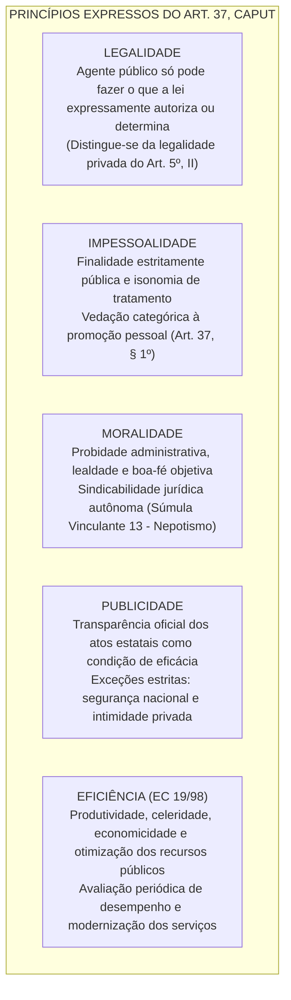
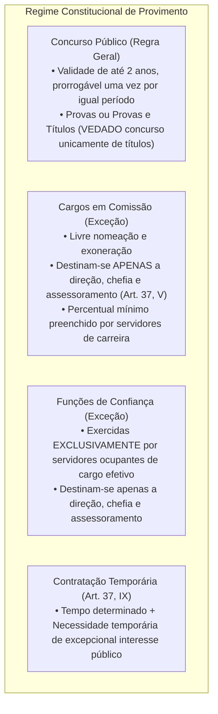
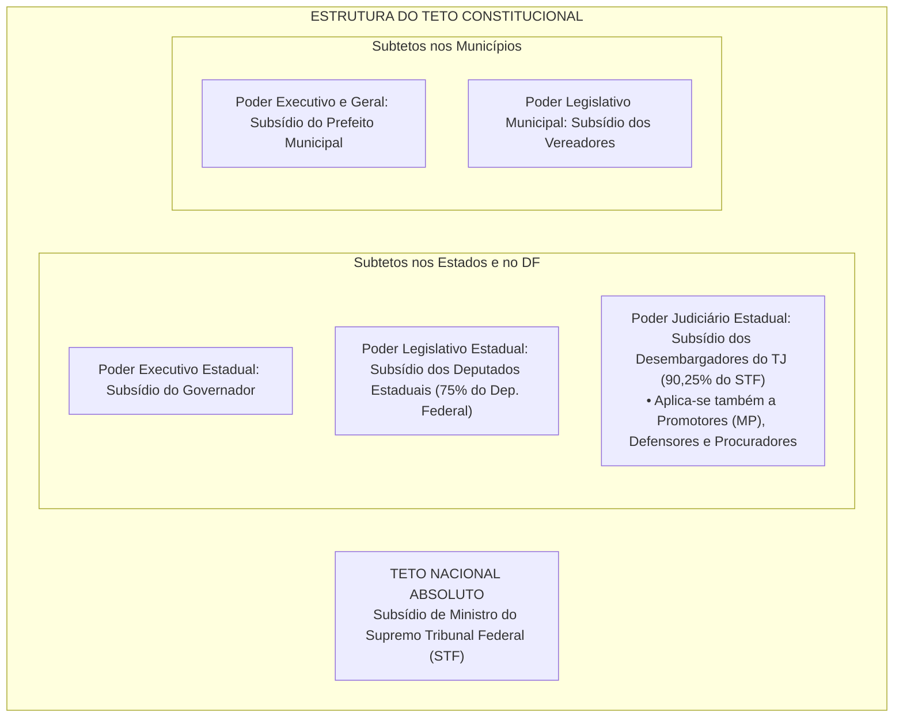
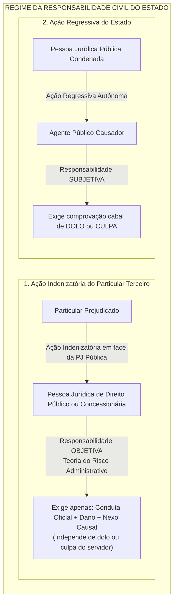
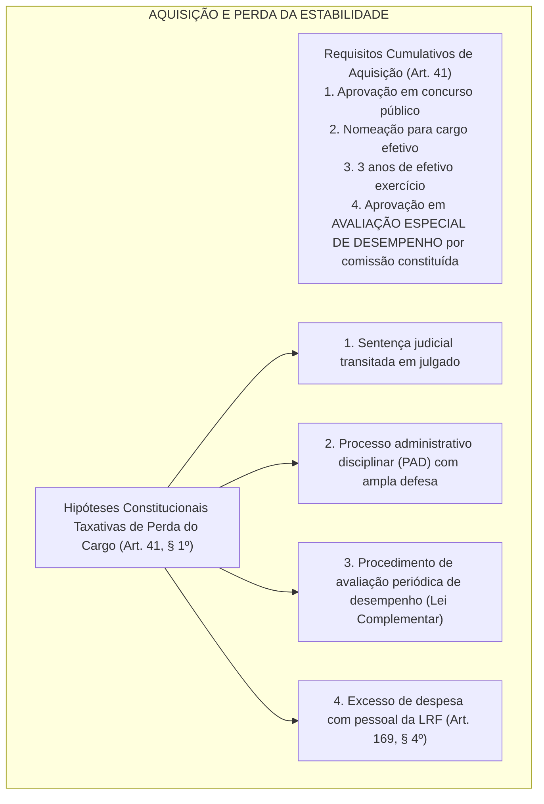
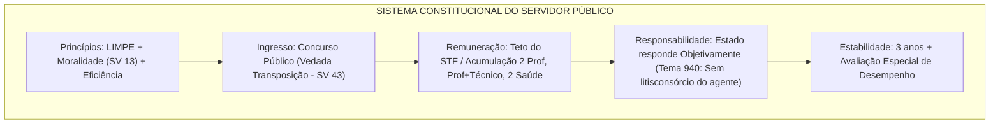

# Administração Pública e Servidores Públicos na CF/88 (Arts. 37 a 41)

> O regime jurídico da Administração Pública e dos Servidores Públicos insculpido nos artigos 37 a 41 da Constituição de 1988 estabelece o estatuto fundamental de funcionamento da máquina estatal republicana. Fundado nos princípios vetores expressos da Legalidade, Impessoalidade, Moralidade, Publicidade e Eficiência (LIMPE), o texto constitucional delineia as exigências indeclináveis para a investidura em cargos e empregos públicos via concurso público (e a peremptória vedação ao provimento derivado fixada na Súmula Vinculante 43), as balizas dos cargos em comissão e o combate ao nepotismo (Súmula Vinculante 13), o sistema de teto remuneratório e subtetos constitucionais (art. 37, XI), as restritas exceções à acumulação de cargos remunerados (art. 37, XVI), o regime da responsabilidade civil objetiva do Estado fundada na teoria do risco administrativo e na tese da dupla garantia (Tema 940/STF), a aquisição da estabilidade após três anos de efetivo exercício condicionada à avaliação especial de desempenho (art. 41) e o Regime Próprio de Previdência Social dos servidores (art. 40 e EC 103/2019).

---

## 1. Princípios Constitucionais Expressos da Administração Pública (Art. 37, *caput*)

*"A administração pública direta e indireta de qualquer dos Poderes da União, dos Estados, do Distrito Federal e dos Municípios obedecerá aos princípios de legalidade, impessoalidade, moralidade, publicidade e eficiência..."*

### 1.1. Detalhamento dos Princípios Vetores

1. **Legalidade Administrativa:** O particular pode praticar tudo o que a lei não proíbe (art. 5º, II); o administrador público, contudo, subordina-se à legalidade estrita, só podendo atuar quando e como a lei autorizar ou determinar.
2. **Impessoalidade e Vedação à Promoção Pessoal (Art. 37, § 1º):**
   * A atuação estatal imputa-se ao órgão ou entidade pública, jamais à pessoa física do governante (*teoria do órgão*).
   * *"A publicidade dos atos, programas, obras, serviços e campanhas dos órgãos públicos deverá ter caráter educativo, informativo ou de orientação social, **dela não podendo constar nomes, símbolos ou imagens que caracterizem promoção pessoal** de autoridades ou servidores públicos"*. A violação enseja ação de improbidade e ressarcimento ao erário.
3. **Moralidade Administrativa e Súmula Vinculante 13 (Nepotismo):**
   * A moralidade jurídica não se confunde com mera moral social subjetiva; tem densidade normativa própria para anular atos estatais viciados.
   * *Súmula Vinculante 13 do STF:* A nomeação de cônjuge, companheiro ou parente em linha reta, colateral ou por afinidade, até o **terceiro grau**, inclusive, da autoridade nomeante ou de servidor da mesma pessoa jurídica investido em cargo de direção, chefia ou assessoramento, para o exercício de cargo em comissão ou de confiança, ou de função gratificada, **viola a Constituição Federal**.
   * *Ressalva dos Cargos Políticos:* O STF consolidou que a vedação da SV 13 não se aplica, em regra, a cargos puramente políticos (como Secretários de Estado e Ministros de Estado), salvo se houver manifesta ausência de qualificação técnica ou fraude comprovada à lei.
4. **Eficiência:** Inserido pela Emenda Constitucional nº 19/1998, visa a superar a burocracia disfuncional e assegurar a entrega de serviços céleres, de qualidade e com custo-benefício positivo.

---

## 2. Acesso aos Cargos Públicos e o Concurso Público (Art. 37, II a V)

A investidura em cargo ou emprego público depende de aprovação prévia em **concurso público de provas ou de provas e títulos**, de acordo com a natureza e a complexidade do cargo ou emprego, na forma prevista em lei, ressalvadas as nomeações para cargo em comissão declarado em lei de livre nomeação e exoneração:

### 2.1. A Súmula Vinculante 43 do STF: Fim do Provimento Derivado

> **Súmula Vinculante 43 do STF:** *"É inconstitucional toda modalidade de provimento que propicie ao servidor investir-se, sem prévia aprovação em concurso público destinado ao seu provimento, em cargo que não integra a carreira na qual anteriormente investido."*

* São terminantemente inconstitucionais institutos pretéritos como **ascensão funcional, transposição, transferência e efetivação de empregados celetistas de empresas estatais privatizadas em quadros da administração pública direta**.

---

## 3. Remuneração, Teto Constitucional e Acumulação de Cargos

### 3.1. O Sistema de Teto Remuneratório e Subtetos (Art. 37, XI)

A remuneração e o subsídio dos ocupantes de cargos, funções e empregos públicos não poderão exceder o subsídio mensal, em espécie, dos **Ministros do Supremo Tribunal Federal**:

* **Opção por Subteto Único Estadual (Art. 37, § 12):** Os Estados e o DF podem fixar, mediante emenda à Constituição Estadual, como limite único em seu âmbito o **subsídio mensal dos Desembargadores do respectivo Tribunal de Justiça** (limitado a 90,25% do subsídio do STF), não se aplicando esse limite único aos subsídios dos Deputados Estaduais.
* **Empresas Públicas e Sociedades de Economia Mista (Art. 37, § 9º):** O teto remuneratório só se aplica às empresas estatais que **receberem recursos da Fazenda Pública para pagamento de despesas de pessoal ou de custeio em geral** (*empresas estatais dependentes*). Se a empresa pública atuar em regime concorrencial de mercado e não receber recursos públicos para custeio, não se sujeita ao teto.

---

### 3.2. Acumulação Remunerada de Cargos Públicos (Art. 37, XVI e XVII)

A regra geral constitucional é a **vedação absoluta à acumulação remunerada de cargos públicos**. A proibição estende-se a empregos e funções e abrange autarquias, fundações, empresas públicas, sociedades de economia mista, suas subsidiárias e sociedades controladas.

* **Exceções Constitucionais Taxativas (Art. 37, XVI):**
  1. A de **dois cargos de professor**;
  2. A de **um cargo de professor com outro técnico ou científico**;
  3. A de **dois cargos ou empregos privativos de profissionais de saúde**, com profissões regulamentadas.
* **Requisitos Inafastáveis da Acumulação Lícita:**
  * **Compatibilidade de horários:** Deve ser comprovada faticamente pelo servidor perante a Administração.
  * **Aplicação do Teto em Cada Vínculo Isoladamente (Tema 377 do STF):** *"Nos casos autorizados constitucionalmente de acumulação de cargos, o teto remuneratório deve ser aplicado a cada um dos vínculos isoladamente, e não sobre a soma das remunerações"*.

---

## 4. Responsabilidade Civil Objetiva do Estado (Art. 37, § 6º)

*"As pessoas jurídicas de direito público e as de direito privado prestadoras de serviços públicos responderão pelos danos que seus agentes, nessa qualidade, causarem a terceiros, assegurado o direito de regresso contra o responsável nos casos de dolo ou culpa."*

### 4.1. Fundamentos e Requisitos Dogmáticos

1. **Teoria do Risco Administrativo:** Adotada como regra geral no direito brasileiro. Dispensa a demonstração de culpa da Administração; basta ao particular lesado demonstrar a **conduta comissiva estatal**, o **dano** suportado e o **nexo de causalidade**.
2. **Causas Excludentes ou Atenuantes do Nexo Causal:** O dever estatal de indenizar é afastado ou atenuado nos casos de:
   * Culpa exclusiva da vítima (exclui) ou culpa concorrente da vítima (atenua);
   * Caso fortuito ou força maior imprevisível;
   * Fato exclusivo de terceiro.
3. **Pessoas Jurídicas Vinculadas:** Abrange os entes federados (União, Estados, DF, Municípios), autarquias, fundações públicas e as **pessoas jurídicas de direito privado prestadoras de serviços públicos** (concessionárias e permissionárias de transporte, energia, saneamento). Conforme o STF (Tema 130), a concessionária responde objetivamente pelos danos causados tanto a usuários quanto a **terceiros não usuários** do serviço público.
4. **Tese da Dupla Garantia (Tema 940 do STF):**
   > *"A teor do disposto no art. 37, § 6º, da Constituição Federal, a ação por danos causados por agente público deve ser ajuizada contra o Estado ou a pessoa jurídica de direito privado prestadora de serviço público, **sendo parte ilegítima para figurar no polo passivo o autor do ato**, assegurado o direito de regresso contra o responsável nos casos de dolo ou culpa."*
   > O cidadão prejudicado **NÃO PODE demandar diretamente contra o servidor**, nem incluir o servidor em litisconsórcio passivo com o Estado; a demanda inicial é exclusivamente contra a pessoa jurídica.

---

## 5. Estabilidade dos Servidores e Perda do Cargo (Art. 41 da CF/88)

*"São estáveis após três anos de efetivo exercício os servidores nomeados para cargo de provimento efetivo em virtude de concurso público."*

* **Reintegração (Art. 41, § 2º):** Invalidada por sentença judicial a demissão do servidor estável, ele será **reintegrado**, e o eventual ocupante da vaga, se estável, será **reconduzido ao cargo de origem**, sem direito a indenização, aproveitado em outro cargo ou posto em disponibilidade com remuneração proporcional ao tempo de serviço.
* **Extinção do Cargo (Art. 41, § 3º):** Extinto o cargo ou declarada a sua desnecessidade, o servidor estável ficará em **disponibilidade**, com remuneração proporcional ao tempo de serviço, até seu adequado aproveitamento em outro cargo.

---

## 6. Tabela Comparativa: Cargo em Comissão vs. Função de Confiança

| Parâmetro Dogmático | Cargo em Comissão (Art. 37, V) | Função de Confiança (Art. 37, V) |
| :--- | :--- | :--- |
| **Quem Pode Ocupar** | Servidor de carreira **OU** particular sem vínculo | **Exclusivamente** servidor titular de cargo efetivo |
| **Forma de Provimento** | Nomeação em comissão (livre nomeação e exoneração) | Designação para a função (livre destituição) |
| **Atribuições Permitidas** | Apenas direção, chefia e assessoramento | Apenas direção, chefia e assessoramento |
| **Regime Previdenciário** | RGPS (INSS) se não for servidor efetivo | RPPS (Regime Próprio) de seu cargo de origem |
| **Exigência de Concurso** | **Dispensa** concurso público | Pressupõe concurso prévio para o cargo de base |

---

> **Fique Ligado:**
> 1. **Prazo de Validade do Concurso:** É de **até dois anos** (pode ser de 6 meses, 1 ano ou 2 anos), prorrogável **uma única vez, por igual período** (se o edital fixar 1 ano, a prorrogação será de mais 1 ano, nunca de 2 anos).
> 2. **Tema 940 do STF (Garantia do Agente):** A ação indenizatória deve ser proposta unicamente contra a pessoa jurídica pública. A inclusão do agente público no polo passivo inicial configura ilegitimidade passiva manifesta.
> 3. **Nepotismo em Cargo Político:** A nomeação de parente para cargo puramente político (Secretário Municipal ou Ministro) não viola a Súmula Vinculante 13 em regra, salvo evidente inaptidão técnica ou desvio de finalidade.
> 4. **Iniciativa Privativa de Lei sobre Servidores:** Projetos de lei que disponham sobre regime jurídico, jornada, plano de carreira ou remuneração de servidores públicos são de **iniciativa privativa e exclusiva do Chefe do Poder Executivo** (art. 61, § 1º, II, "c"). Emenda parlamentar sobre a matéria é inconstitucional por vício insanável de iniciativa.

---

## 7. Síntese Visual Canônica

---

## 8. Questões Paradigmáticas Aplicadas

---

### [Questão 01](https://www.qconcursos.com/questoes-de-concursos/questoes/791bcec1-c6) — [IGEDUC — Prefeitura de Alagoinha - PB / Agente Administrativo — 2026] • [Nível: Muito Fácil (Acertos: 81.8%)]

Considerando as disposições constitucionais relativas aos agentes públicos, especialmente o art. 37, II, da Constituição Federal, acerca do provimento de cargos públicos, assinale a afirmativa correta:

* **A)** O provimento de cargos públicos efetivos pode ocorrer mediante processo seletivo interno quando houver necessidade administrativa devidamente justificada.
* **B)** A contratação temporária de agentes públicos depende de aprovação prévia em concurso público de provas e títulos com exigência de experiência profissional anterior.
* **C)** A investidura em cargo ou emprego público depende de aprovação prévia em concurso público de provas ou de provas e títulos, de acordo com a natureza e a complexidade do cargo ou emprego, na forma prevista em lei, ressalvadas as nomeações para cargo em comissão declarado em lei de livre nomeação e exoneração.
* **D)** A exigência constitucional de concurso público alcança indistintamente os cargos efetivos e as funções de confiança exercidas por cidadãos sem vínculo anterior.
* **E)** A nomeação para cargos em comissão exige aprovação prévia em concurso público simplificado quando as atribuições envolverem atividades administrativas permanentes.

#### Gabarito: **C**

* **A (Errada):** Processos seletivos internos para acesso a carreiras diversas configuram provimento derivado, repudiado categoricamente pela Súmula Vinculante 43 do STF.
* **B (Errada):** A contratação temporária (art. 37, IX) opera-se mediante processo seletivo simplificado (PSS), dispensando o rito formal do concurso público comum.
* **C (Certa):** Transcrição integral e perfeita do art. 37, inciso II, da Constituição da República de 1988.
* **D e E (Erradas):** Funções de confiança destinam-se exclusivamente a servidores efetivos (art. 37, V); cargos em comissão são declarados em lei de livre nomeação e exoneração, dispensando concurso público.

---

### [Questão 02](https://www.qconcursos.com/questoes-de-concursos/questoes/79240ad2-c6) — [IGEDUC — Prefeitura de Alagoinha - PB / Agente Administrativo — 2026] • [Nível: Muito Fácil (Acertos: 89.3%)]

Considerando o disposto no art. 37, *caput*, da Constituição Federal, que estabelece os princípios expressos aplicáveis à Administração Pública, assinale a afirmativa correta:

* **A)** O princípio da legalidade administrativa assegura ao agente público liberdade de atuação discricionária irrestrita, desde que não exista vedação literal expressa.
* **B)** O princípio da moralidade administrativa possui conteúdo exclusivamente ético-social, sem qualquer repercussão na validade jurídica dos atos praticados pela Administração.
* **C)** O princípio da eficiência permite que a Administração deixe de observar os procedimentos legais quando buscar resultados administrativos economicamente mais vantajosos.
* **D)** O princípio da impessoalidade impede o uso da atuação administrativa para promoção pessoal de agentes públicos, exigindo atos voltados estritamente ao interesse da coletividade.
* **E)** O princípio da publicidade autoriza a divulgação irrestrita de qualquer documento estatal, inclusive aqueles cobertos por sigilo imprescindível à segurança da sociedade e do Estado.

#### Gabarito: **D**

* **A (Errada):** A legalidade administrativa impõe que o agente público somente atue quando e na conformidade autorizada pela lei.
* **B (Errada):** A moralidade possui densidade jurídica e sua inobservância contamina o ato administrativo de nulidade insanável.
* **C (Errada):** A busca por eficiência jamais autoriza a violação do princípio da legalidade estrita.
* **D (Certa):** Exata acepção do princípio da impessoalidade consagrado no art. 37, *caput*, e desdobrado no § 1º: veda que a atividade estatal seja instrumentalizada para o benefício individual, favoritismo de apaniguados ou promoção pessoal de autoridades públicas.
* **E (Errada):** A publicidade sofre ressalvas constitucionais expressas relativas à segurança do Estado e à intimidade das pessoas (art. 5º, XXXIII e LX).

---

### [Questão 03](https://www.qconcursos.com/questoes-de-concursos/questoes/5d93b513-c7) — [FGV — PC-PR / Agente de Polícia Judiciária — 2026] • [Nível: Fácil (Acertos: 78.8%)]

Deputado estadual propôs projeto de lei dispondo acerca da carga horária de trabalho e do regime de plantão dos Agentes de Polícia Judiciária estadual. No curso do processo legislativo, o projeto foi aprovado pela Assembleia Legislativa e o Governador do Estado o sancionou, resultando na edição de lei estadual sobre o tema.

A respeito da (in)constitucionalidade do diploma legal estadual, assinale a afirmativa correta:

* **A)** A lei é formalmente constitucional, já que a sanção expressa pelo Governador sana retroativamente qualquer vício de iniciativa parlamentar.
* **B)** A propositura parlamentar é plenamente legítima, pois a iniciativa legislativa sobre servidores públicos é de competência concorrente no âmbito estadual.
* **C)** A lei é formalmente inconstitucional porque dispõe sobre o regime jurídico de servidores públicos estaduais, matéria reservada à iniciativa privativa do Chefe do Poder Executivo.
* **D)** Não houve usurpação de competência, haja vista que a disciplina de jornada de trabalho não acarreta aumento direto de despesa pública.
* **E)** O princípio da simetria federativa desobriga o legislador estadual de observar as regras de iniciativa privativa do art. 61 da Constituição Federal.

#### Gabarito: **C**

* **A (Errada):** A sanção do Chefe do Executivo **NÃO sana o vício de iniciativa** parlamentar reservada (Súmula 5 do STF superada pela jurisprudência consolidada que afirma a inconstitucionalidade formal insanável).
* **B, D e E (Erradas):** As regras básicas do processo legislativo federal sobre reserva de iniciativa são de reprodução obrigatória pelos Estados-membros em virtude do princípio da simetria federativa.
* **C (Certa):** O art. 61, § 1º, inciso II, alínea "c", da Constituição Federal estabelece que são de iniciativa **privativa do Presidente da República** (e do Governador de Estado, por simetria) as leis que disponham sobre servidores públicos, seu regime jurídico, provimento de cargos e estabilidade. Projeto de iniciativa parlamentar que discipline carga horária de policiais padece de **vício formal de iniciativa subjetiva insuprível**, sendo formalmente inconstitucional.

---

### [Questão 04](https://www.qconcursos.com/questoes-de-concursos/questoes/1473673d-c7) — [Instituto IDEAP — Câmara de Santa Margarida - MG / Secretário do Legislativo — 2026] • [Nível: Muito Fácil (Acertos: 98.9%)]

Um Presidente de Câmara Municipal determina que uma contratação administrativa de reforma predial seja direcionada à empresa pertencente a pessoa de suas relações íntimas, sem prévia licitação ou justificativa técnica e afastando critérios objetivos de seleção.

À luz do art. 37 da Constituição Federal de 1988, essa conduta afronta especialmente os princípios constitucionais expressos da:

* **A)** Impessoalidade e Moralidade.
* **B)** Soberania e Cidadania exclusivamente.
* **C)** Unicidade partidária e tipicidade penal.
* **D)** Isonomia tributária e anterioridade nonagesimal.

#### Gabarito: **A**

* **A (Certa):** O direcionamento indevido de contratos públicos a particulares favorecidos viola frontalmente a **Impessoalidade** (dever de tratamento isonômico sem favoritismos) e a **Moralidade Administrativa** (dever de probidade, lealdade institucional e boa-fé na gestão dos recursos públicos).
* **B, C e D (Erradas):** Princípios dissociados da temática de contratações públicas e probidade administrativa no art. 37.

---

### [Questão 05](https://www.qconcursos.com/questoes-de-concursos/questoes/319fb51a-c8) — [FGV — PC-PR / Delegado de Polícia — 2026] • [Nível: Muito Fácil (Acertos: 92.0%)]

Durante regular operação policial, uma viatura oficial desgovernada atinge o muro de uma residência particular, causando severo dano material ao proprietário do imóvel. Posteriormente, apura-se em sindicância que o policial condutor atuou com manifesta imprudência ao trafegar em velocidade excessiva sem estar em perseguição de flagrante. O particular pretende obter a reparação integral do prejuízo.

À luz do regime constitucional da responsabilidade civil do Estado (art. 37, § 6º da CF/88) e da jurisprudência do STF, é correto afirmar que:

* **A)** o particular somente poderá ser indenizado se comprovar judicialmente dolo específico do agente público condutor da viatura.
* **B)** a responsabilidade do Estado é subjetiva, exigindo a prova de culpa anônima do serviço (*faute du service*).
* **C)** a responsabilidade civil do Estado exclui qualquer possibilidade de cobrança regressiva perante o policial que causou o dano.
* **D)** o proprietário prejudicado deverá necessariamente demandar em litisconsórcio passivo obrigatório o Estado e o policial condutor.
* **E)** a pessoa jurídica de direito público responderá objetivamente pelos danos causados pelo agente nessa qualidade, assegurado o direito de regresso contra o responsável em caso de culpa comprovada.

#### Gabarito: **E**

* **A e B (Erradas):** A responsabilidade da pessoa jurídica estatal é **objetiva** (teoria do risco administrativo), exigindo apenas a conduta oficial, o dano e o nexo causal, sem necessidade de provar dolo ou culpa do servidor.
* **C (Errada):** A Constituição assegura expressamente o **direito de regresso** da Fazenda Pública contra o agente público nos casos de dolo ou culpa.
* **D (Errada):** Conforme a tese da dupla garantia fixada pelo STF no **Tema 940**, o particular **não pode** incluir o servidor público no polo passivo da demanda indenizatória originária.
* **E (Certa):** Transcrição exata da regra do art. 37, § 6º, da Constituição Federal.

---

### [Questão 06](https://www.qconcursos.com/questoes-de-concursos/questoes/e4a20084-c8) — [VUNESP — TCE-SP / Auditor de Controle Externo — 2026] • [Nível: Média (Acertos: 61.1%)]

O Município X pretende promover a desestatização de sociedade de economia mista municipal responsável pela prestação de saneamento básico, mediante alienação de seu controle acionário a consórcio privado. Com o objetivo de atenuar resistências sindicais, projeto de lei municipal estabeleceu que os empregados públicos celetistas da estatal desestatizada seriam automaticamente aproveitados e transpostos para cargos públicos estatutários de provimento efetivo no quadro da administração direta municipal.

A referida disposição legislativa é:

* **A)** constitucional, pois respeita a autonomia federativa municipal e resguarda a estabilidade social dos trabalhadores.
* **B)** inconstitucional, devendo a dispensa dos empregados da sociedade de economia mista ser precedida obrigatoriamente de processo judicial civil.
* **C)** válida, desde que os empregados públicos tenham ingressado na estatal por concurso público simplificado de títulos.
* **D)** inconstitucional, pois configura modalidade de provimento derivado vedada pelo postulado do concurso público (Súmula Vinculante 43 do STF).
* **E)** válida, caso a transposição tenha sido ratificada previamente pelo Tribunal de Contas do Estado.

#### Gabarito: **D**

* **A, C e E (Erradas):** A transposição de empregados de estatais privatizadas para a administração direta é frontalmente inconstitucional, não sendo convalidada por lei local nem por aval de corte de contas.
* **B (Errada):** A dispensa em estatais independe de processo judicial prévio, exigindo-se apenas motivação do ato de demissão (Tema 1.022/STF).
* **D (Certa):** Aplicação estrita da **Súmula Vinculante 43 do STF**: *"É inconstitucional toda modalidade de provimento que propicie ao servidor investir-se, sem prévia aprovação em concurso público destinado ao seu provimento, em cargo que não integra a carreira na qual anteriormente investido"*. Empregados públicos celetistas de entidades da administração indireta não podem ser transpostos ou absorvidos em cargos efetivos estatutários da administração direta sem prestar novo concurso público.

---

### [Questão 07](https://www.qconcursos.com/questoes-de-concursos/questoes/d1e38622-c9) — [VUNESP — TCE-SP / Auditor de Controle Externo — 2026] • [Nível: Difícil (Acertos: 39.3%)]

Durante auditoria realizada em autarquia estadual, verificou-se controvérsia acerca da disciplina constitucional das contribuições previdenciárias destinadas ao custeio do Regime Próprio de Previdência Social (RPPS) dos servidores públicos estatutários.

Considerando a Constituição Federal com as alterações introduzidas pela Emenda Constitucional nº 103/2019 (Reforma da Previdência), é correto afirmar que:

* **A)** os Estados poderão instituir livremente contribuições sobre benefícios pagos aos segurados do Regime Geral de Previdência Social (RGPS).
* **B)** a contribuição previdenciária dos aposentados e pensionistas do regime próprio incide compulsoriamente sobre a totalidade dos proventos, desde o primeiro real recebido.
* **C)** os Municípios não podem fixar alíquotas de contribuição ordinária inferiores às alíquotas praticadas pelo regime próprio dos servidores da União, salvo se demonstrada a inexistência de déficit atuarial.
* **D)** a contribuição previdenciária ordinária dos servidores titulares de cargos efetivos dos Estados poderá ter alíquotas progressivas fixadas em razão do valor da base de cálculo ou do rendimento.
* **E)** a instituição de contribuição previdenciária extraordinária pelos Estados e Municípios depende de autorização prévia por lei complementar federal aprovada pelo Congresso.

#### Gabarito: **D**

* **A (Errada):** Os Estados não têm competência sobre as contribuições previdenciárias do RGPS (competência exclusiva da União).
* **B (Errada):** A contribuição de inativos e pensionistas incide apenas sobre a parcela que supere o **limite máximo estabelecido para os benefícios do RGPS** (teto do INSS), podendo alcançar o salário mínimo apenas na hipótese excepcional de déficit atuarial comprovado (art. 40, §§ 18 e 1º-A).
* **C (Errada):** É vedada alíquota inferior à da União, mas a exigência é vinculante sem dependência de déficit se houver desequilíbrio atuarial.
* **D (Certa):** O art. 40, § 1º, inciso II, da Constituição Federal (com redação dada pela EC nº 103/2019) estipula expressamente que as contribuições previdenciárias ordinárias dos servidores titulares de cargos efetivos *"poderão ter alíquotas progressivas de acordo com o valor da base de contribuição ou dos proventos de aposentadoria e das pensões"*.
* **E (Errada):** A instituição de contribuição extraordinária para equacionar déficit atuarial independe de lei complementar federal, competindo a cada ente federativo por lei própria (art. 40, § 1º-B).

---

### [Questão 08](https://www.qconcursos.com/questoes-de-concursos/questoes/d1e38623-c9) — [CESPE / CEBRASPE — Câmara dos Deputados / Analista Legislativo — 2026] • [Nível: Média (Acertos: 64.7%)]

Em matéria de acumulação de cargos públicos e limites remuneratórios constitucionais, assinale a opção correta à luz da jurisprudência do Supremo Tribunal Federal:

* **A)** O limite remuneratório constitucional (teto salarial) deve ser aplicado sobre a soma final das remunerações auferidas pelo servidor em caso de acumulação constitucionalmente legítima de dois cargos públicos.
* **B)** É constitucional a acumulação de um cargo público de médico com outro cargo privativo de enfermeiro, desde que haja compatibilidade de horários.
* **C)** A acumulação de dois cargos públicos privativos de professor independe de compatibilidade de horários quando a jornada semanal total não ultrapassar sessenta horas.
* **D)** Nos casos autorizados constitucionalmente de acumulação de cargos, o teto remuneratório constitucional deve incidir sobre a remuneração de cada um dos cargos isoladamente.
* **E)** A proibição constitucional de acumular cargos públicos remunerados não alcança os empregados de empresas públicas e sociedades de economia mista.

#### Gabarito: **D**

* **A (Errada):** Entendimento superado; o STF firmou tese vinculante em sentido oposto no Tema 377.
* **B (Errada):** A Constituição autoriza a acumulação de *"dois cargos ou empregos privativos de profissionais de saúde, com profissões regulamentadas"* (art. 37, XVI, "c"), mas cada cargo deve ter qualificação própria preenchida pelo mesmo indivíduo.
* **C (Errada):** A compatibilidade de horários é requisito inafastável em qualquer hipótese de acumulação lícita.
* **D (Certa):** Tese vinculante fixada pelo STF no **Tema 377 da Repercussão Geral**: *"Nos casos autorizados constitucionalmente de acumulação de cargos, empregos e funções, a incidência do art. 37, inciso XI, da Constituição Federal deve operar-se em relação à remuneração de cada um deles isoladamente considerada, não cabendo a aplicação do teto sobre a quantia resultante da soma dos vencimentos percebidos"*.
* **E (Errada):** A vedação estende-se expressamente a empregos em estatais (art. 37, XVII).

---

### [Questão 09](https://www.qconcursos.com/questoes-de-concursos/questoes/d1e38624-c9) — [FGV — OAB / Exame de Ordem Unificado — 2026] • [Nível: Fácil (Acertos: 75.3%)]

Prefeito Municipal nomeou sua sobrinha carnal para ocupar o cargo de provimento em comissão de Assessora Especial de Comunicação Social de seu gabinete. O Ministério Público ajuizou ação civil pública por improbidade administrativa sustentando violação aos princípios da impessoalidade e moralidade.

Considerando o teor da Súmula Vinculante 13 do Supremo Tribunal Federal sobre o nepotismo, a referida nomeação é:

* **A)** lícita, pois a vedação ao nepotismo alcança apenas os parentes em linha reta e colateral até o segundo grau.
* **B)** ilícita, pois a vedação abrange os parentes em linha reta, colateral ou por afinidade até o terceiro grau da autoridade nomeante.
* **C)** lícita, desde que a nomeada comprove possuir diploma universitário de graduação em jornalismo.
* **D)** ilícita unicamente se a nomeação tiver sido precedida de consulta desfavorável da Câmara Municipal.
* **E)** lícita, haja vista que a Assessoria de Gabinete é classificada pela doutrina como cargo eminentemente político.

#### Gabarito: **B**

* **A (Errada):** O parentesco na Súmula Vinculante 13 alcança o **terceiro grau** (a sobrinha é parente colateral de terceiro grau: tio -> avô -> irmão/pai -> sobrinha).
* **B (Certa):** Conforme a **Súmula Vinculante 13 do STF**, a proibição do nepotismo na Administração Pública direta e indireta alcança o cônjuge, companheiro ou parente em linha reta, colateral ou por afinidade, até o **terceiro grau**, inclusive. A nomeação da sobrinha para cargo em comissão administrativo de assessoria configura hipótese típica de nepotismo inconstitucional.
* **C (Errada):** A qualificação técnica não afasta o nepotismo em cargos em comissão comuns da administração direta.
* **D (Errada):** O nepotismo constitui vício objetivo que independe de manifestação parlamentar.
* **E (Errada):** Assessoria especial de comunicação é cargo comissionado comum, não se qualificando como cargo de agente político (como Secretário Municipal).

---

### [Questão 10](https://www.qconcursos.com/questoes-de-concursos/questoes/d1e38625-c9) — [CESPE / CEBRASPE — PGE-PA / Procurador do Estado — 2026] • [Nível: Média (Acertos: 62.5%)]

No que se refere à estabilidade do servidor público e às hipóteses constitucionais de perda do cargo, assinale a opção correta:

* **A)** O servidor público adquire estabilidade após dois anos de efetivo exercício, desde que não tenha sofrido penalidade de advertência.
* **B)** A aquisição da estabilidade no serviço público prescinde de avaliação formal de desempenho, operando-se de forma automática pelo simples decurso do tempo.
* **C)** É obrigatória, como condição para a aquisição da estabilidade, a avaliação especial de desempenho por comissão instituída para essa finalidade.
* **D)** O servidor público estável não pode perder o cargo em razão de insuficiência de desempenho, garantia reservada apenas aos empregados celetistas.
* **E)** A reintegração judicial do servidor demitido ilegalmente enseja a demissão sumária do eventual ocupante da vaga, ainda que este seja servidor estável.

#### Gabarito: **C**

* **A e B (Erradas):** A Emenda Constitucional nº 19/1998 elevou o prazo para **três anos de efetivo exercício** e vedou a estabilidade automática pelo mero decurso do tempo.
* **C (Certa):** Transcrição exata do art. 41, § 4º, da Constituição Federal: *"Como condição para a aquisição da estabilidade, é **obrigatória a avaliação especial de desempenho por comissão instituída para essa finalidade**"*.
* **D (Errada):** A avaliação periódica de desempenho (na forma de lei complementar) é uma das causas expressas de perda do cargo do servidor estável (art. 41, § 1º, III).
* **E (Errada):** O ocupante estável da vaga é **reconduzido ao cargo de origem**, sem direito a indenização, aproveitado em outro cargo ou posto em disponibilidade (art. 41, § 2º).

---

### [Questão 11](https://www.qconcursos.com/questoes-de-concursos/questoes/d1e38626-c9) — [FCC — TRT - 1ª Região (RJ) / Analista Judiciário — 2026] • [Nível: Fácil (Acertos: 77.8%)]

Em relação às regras constitucionais aplicáveis ao concurso público e aos cargos em comissão (art. 37 da CF/88), assinale a assertiva correta:

* **A)** O prazo de validade do concurso público será de dois anos, improrrogável sob qualquer hipótese.
* **B)** As funções de confiança destinam-se exclusivamente aos servidores ocupantes de cargo efetivo, para atribuições de direção, chefia e assessoramento.
* **C)** Os cargos em comissão podem ser atribuídos para a realização de atividades burocráticas ordinárias e permanentes de atendimento ao público.
* **D)** É vedada a criação de reservas de vagas para pessoas com deficiência em editais de concursos públicos para cargos da administração direta.
* **E)** A aprovação em concurso público dentro do número de vagas previsto no edital gera mera expectativa de direito à nomeação.

#### Gabarito: **B**

* **A (Errada):** O prazo de validade é de **até dois anos**, prorrogável uma vez, por igual período (art. 37, III).
* **B (Certa):** Transcrição literal do art. 37, inciso V, da Carta Magna: *"as funções de confiança, exercidas exclusivamente por servidores ocupantes de cargo efetivo, e os cargos em comissão, a serem preenchidos por servidores de carreira nos casos, condições e percentuais mínimos previstos em lei, destinam-se apenas às atribuições de direção, chefia e assessoramento"*.
* **C (Errada):** Atividades operacionais, técnicas e rotineiras exigem provimento efetivo via concurso público.
* **D (Errada):** A lei reservará percentual de cargos e empregos públicos para as pessoas com deficiência (art. 37, VIII).
* **E (Errada):** Conforme jurisprudência vinculante do STF (Tema 161), a aprovação dentro do número de vagas do edital confere **direito público subjetivo à nomeação** durante o prazo de validade.

---

### [Questão 12](https://www.qconcursos.com/questoes-de-concursos/questoes/d1e38627-c9) — [CESPE / CEBRASPE — TCE-PR / Auditor de Controle Externo — 2026] • [Nível: Difícil (Acertos: 44.9%)]

Acerca da responsabilidade civil das concessionárias de serviço público e da jurisprudência consolidada do Supremo Tribunal Federal, assinale a opção correta:

* **A)** As pessoas jurídicas de direito privado prestadoras de serviço público respondem objetivamente pelos danos causados a terceiros usuários, mas sua responsabilidade perante terceiros não usuários é de natureza estritamente subjetiva.
* **B)** A responsabilidade civil objetiva das concessionárias de serviço público abrange indistintamente os danos causados tanto a usuários quanto a terceiros não usuários do serviço público prestado.
* **C)** A demonstração de culpa concorrente da vítima afasta de modo absoluto o dever de indenizar do Estado e de suas concessionárias.
* **D)** O particular lesado pode optar livremente por ajuizar a ação indenizatória diretamente contra o empregado da concessionária causador do dano, em litisconsórcio passivo facultativo.
* **E)** As concessionárias de serviço público submetem-se à responsabilidade civil subjetiva fundada na culpa presumida em qualquer hipótese de acidente de trânsito.

#### Gabarito: **B**

* **A (Errada):** Tese superada; o STF equiparou expressamente os usuários e não usuários.
* **B (Certa):** Tese vinculante fixada pelo STF no **Tema 130 da Repercussão Geral** (RE 591.874): *"A responsabilidade civil das pessoas jurídicas de direito privado prestadoras de serviço público é objetiva relativamente a terceiros usuários e não usuários do serviço, com base no art. 37, § 6º, da Constituição Federal"*.
* **C (Errada):** A culpa concorrente da vítima não exclui o dever de indenizar, mas gera a repartição proporcional e atenuação da indenização devida.
* **D (Errada):** Conforme o Tema 940 do STF (tese da dupla garantia), a ação deve ser movida contra a pessoa jurídica, sendo o agente público parte ilegítima no polo passivo originário.
* **E (Errada):** O regime constitucional é de responsabilidade civil **objetiva** fundada no risco administrativo.
