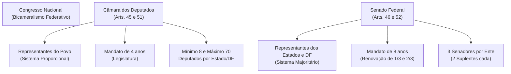
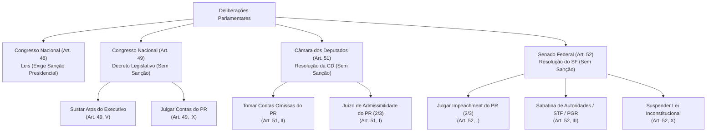
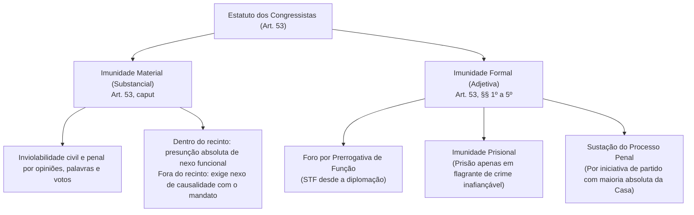
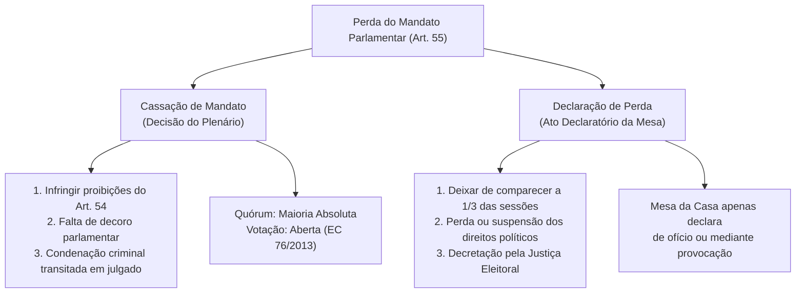
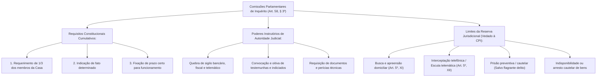

# Poder Legislativo: Estrutura, Competências, Estatuto dos Congressistas e Comissões Parlamentares de Inquérito

> O Poder Legislativo na ordem constitucional brasileira estrutura-se sob o modelo do bicameralismo federal igualitário atenuado, repartindo atribuições entre a Câmara dos Deputados (representante do povo) e o Senado Federal (representante dos Estados e do Distrito Federal), sob a cúpula do Congresso Nacional. O exercício da função legiferante e fiscalizatória é blindado pelo Estatuto dos Congressistas — que consagra prerrogativas materiais (inviolabilidade da palavra e voto) e processuais (garantias contra prisões arbitrárias e foro especial) — e instrumentalizado por Comissões Parlamentares de Inquérito (CPIs), cujos poderes instrutórios judiciais encontram limites intransponíveis no postulado da reserva de jurisdição.

---

## 1. Estrutura Orgânica e o Bicameralismo Federativo

O Brasil adota a forma republicana e federativa de Estado, o que impõe a coexistência de dois princípios de representação no Parlamento da União: o princípio democrático-populacional e o princípio federativo de paridade entre os entes federados autônomos.

### 1.1. Câmara dos Deputados
* **Composição e Representação:** Representa o **povo brasileiro**. Os Deputados Federais são eleitos pelo sistema eleitoral proporcional em cada Estado, Território e no Distrito Federal (art. 45, caput).
* **Quantitativo de Cadeiras:** O número total de Deputados (atualmente fixado em 513 pela LC 78/1993) e a representação de cada Estado e do DF são proporcionais à respectiva população, assegurado o patamar **mínimo de 8** e o **máximo de 70** parlamentares por unidade federada (art. 45, § 1º). Cada Território Federal elege 4 Deputados (art. 45, § 2º).
* **Duração do Mandato:** Mandato de **4 anos**, correspondente à duração de uma **Legislatura** (art. 44, parágrafo único).

### 1.2. Senado Federal
* **Composição e Representação:** Representa os **Estados federados e o Distrito Federal**, consubstanciando a garantia de igualdade política entre os entes periféricos da Federação (art. 46, caput).
* **Sistema de Escolha e Vagas:** Eleitos pelo princípio **majoritário**. Cada Estado e o DF elegem **3 Senadores**, acompanhados de dois suplentes (art. 46, § 1º).
* **Duração do Mandato e Renovação Periódica:** Mandato de **8 anos** (duas Legislaturas consecutivas). A representação é renovada de 4 em 4 anos, alternadamente, por **um terço** (uma vaga) e **dois terços** (duas vagas) da Casa (art. 46, § 2º).

### 1.3. Sessões e Funcionamento Parlamentar
* **Legislatura:** Período de 4 anos de funcionamento do Congresso Nacional.
* **Sessão Legislativa Ordinária (SLO):** Corresponde ao ano de trabalho parlamentar, estendendo-se de **2 de fevereiro a 17 de julho** e de **1º de agosto a 22 de dezembro** (art. 57, caput). A sessão legislativa não é interrompida sem a aprovação do projeto de Lei de Diretrizes Orçamentárias (LDO - art. 57, § 2º).
* **Sessão Legislativa Extraordinária (SLE):** Convocada em períodos de recesso parlamentar pelo Presidente do Senado (em caso de decretação de estado de defesa, intervenção federal, estado de sítio ou posse do Presidente) ou pelo Presidente da República / Presidentes das Casas / requerimento da maioria dos membros de ambas as Casas, em caso de urgência ou relevante interesse público, com aprovação da maioria absoluta de cada Casa (art. 57, § 6º).

---

## 2. Repartição das Competências Legislativas e Deliberativas

A Carta de 1988 segmentou rigidamente as atribuições do Parlamento em três categorias essenciais: atos conjuntos do Congresso Nacional, competências exclusivas do Congresso (sem sanção), e competências privativas de cada Casa isolada.

| Categoria Normativa | Órgão Titular | Instrumento Normativo | Necessita Sanção Executiva? | Exemplos Nucleares na CF/88 |
| :--- | :--- | :--- | :---: | :--- |
| **Competência com Sanção** (Art. 48) | Congresso Nacional | Lei Ordinária ou Lei Complementar | **SIM** (art. 48) | Sistema tributário, orçamento (PPA, LDO, LOA), fixação de efetivo das Forças Armadas, criação e extinção de cargos públicos federais. |
| **Competência Exclusiva** (Art. 49) | Congresso Nacional | **Decreto Legislativo** | **NÃO** | Resolver sobre tratados internacionais (I); autorizar o Presidente a declarar guerra ou celebrar paz (II); sustar atos normativos do Executivo que exorbitem o regulamento (V); mudar temporariamente sua sede (VI); julgar anualmente as contas presidenciais (IX); fiscalizar atos do Executivo (X); autorizar exploração hídrica/mineral em terras indígenas (XVI). |
| **Competência Privativa** (Art. 51) | Câmara dos Deputados | **Resolução** | **NÃO** | Autorizar por 2/3 instauração de processo contra Presidente/Vice (I); proceder à **tomada de contas do Presidente** quando não apresentadas em 60 dias (II); elaborar seu regimento interno (III); dispor sobre sua organização e quadro de pessoal (IV). |
| **Competência Privativa** (Art. 52) | Senado Federal | **Resolução** | **NÃO** | Processar e julgar Presidente/Vice e Ministros em crimes de responsabilidade (I e II); aprovar magistrados do STF, TCU, PGR, Diretores do BACEN e chefes de missão diplomática (III e IV); autorizar operações externas de crédito e fixar limites da dívida pública consolidada (VII e VIII); **suspender a execução de lei declarada inconstitucional** pelo STF em controle difuso (X). |

> **Fique Ligado:** Não confunda a fiscalização de contas do Presidente da República:
> 1. A **Câmara dos Deputados toma as contas** quando o Presidente não as encaminha no prazo de 60 dias após a abertura da sessão legislativa (art. 51, II).
> 2. O **Tribunal de Contas da União emite parecer prévio** conclusivo em até 60 dias (art. 71, I).
> 3. O **Congresso Nacional julga definitivamente** as contas do Chefe do Executivo mediante Decreto Legislativo (art. 49, IX).

---

## 3. Estatuto dos Congressistas: Imunidades e Incompatibilidades

O Estatuto dos Congressistas (arts. 53 a 56 da CF/88) constitui um feixe de garantias funcionais outorgadas aos parlamentares para assegurar a independência do Parlamento contra pressões externas dos demais Poderes. Não se trata de privilégio pessoal, mas de prerrogativa corporativa e institucional irrenunciável.

### 3.1. Imunidade Material (Inviolabilidade)
* **Conteúdo e Abrangência:** Os Deputados e Senadores são invioláveis, civil e penalmente, por quaisquer de suas opiniões, palavras e votos (art. 53, caput). Exclui o próprio crime (atipicidade da conduta) e afasta o dever de indenizar civilmente eventuais danos morais.
* **Critério Espacial e Nexo Funcional:**
  * *Intra muros (no recinto parlamentar):* Há presunção absoluta de conexão entre as declarações do parlamentar e o exercício da função pública legislativa, descabendo perquirir a presença do nexo causal.
  * *Extra muros (fora do recinto parlamentar / redes sociais):* A imunidade material exige comprovação do liame funcional indispensável entre as manifestações proferidas e a atividade legislativa do mandato (STF, Inq 4.781 e RE 635.138).
* **Extensão aos Demais Níveis Federativos:**
  * *Deputados Estaduais/Distritais:* Gozam de imunidade material e formal idêntica à dos parlamentares federais (art. 27, § 1º).
  * *Vereadores:* Possuem **apenas imunidade material** restrita à **circunscrição do Município** e sempre vinculada ao exercício do mandato (art. 29, VIII). Vereador **não possui imunidade formal** (processual/prisional) de nível constitucional federal.

### 3.2. Imunidade Formal (Processual e Prisional)
* **Foro por Prerrogativa de Função (Art. 53, § 1º):** Desde a expedição do diploma, membros do Congresso Nacional serão submetidos a julgamento perante o Supremo Tribunal Federal.
  * *Jurisprudência STF (QO na AP 937 e teses reafirmadas):* O foro especial aplica-se apenas aos crimes cometidos durante o exercício do mandato parlamentar e relacionados às funções desempenhadas. Com a evolução jurisprudencial contemporânea, uma vez iniciado validamente no STF e vinculada a conduta ao cargo, a competência se perpetua mesmo após o término do mandato se os fatos decorreram das funções institucionais exercidas.
* **Prisão Cautelar e Flagrante Delito (Art. 53, § 2º):**
  * Desde a expedição do diploma, os congressistas **não poderão ser presos**, salvo em **flagrante de crime inafiançável**.
  * Ocorrendo a prisão em flagrante inafiançável, os autos judiciais devem ser remetidos no prazo peremptório de **24 horas** à Casa respectiva para que, pelo voto da **maioria absoluta** de seus membros, resolva sobre a prisão (relaxando-a ou mantendo-a).
* **Sustação da Ação Penal (Art. 53, §§ 3º a 5º):** Recebida a denúncia-crime contra congressista por crime cometido **após a diplomação**, o STF cientificará a Casa respectiva, a qual, por provocação de partido político nela representado e pelo voto da **maioria absoluta**, poderá sustar o andamento da ação criminal até a deliberação final. A sustação do processo penal suspende a contagem do prazo prescricional enquanto durar o mandato.

### 3.3. Incompatibilidades e Perda do Mandato Parlamentar
A Constituição prevê impedimentos funcionais graduados a partir da diplomação e da posse (art. 54):

| Marco Temporal | Vedações Constitucionais Estritas (Art. 54) | Sanção Constitucional |
| :--- | :--- | :---: |
| **Desde a Diplomação** (Art. 54, I) | **a)** Firmar ou manter contrato com pessoa jurídica de direito público, autarquia, fundação, empresa pública ou sociedade de economia mista, **salvo quando o contrato obedecer a cláusulas uniformes**; **b)** Aceitar ou exercer cargo, função ou emprego remunerado nas entidades mencionadas, inclusive as que sejam demissíveis *ad nutum*. | **Perda do Mandato** (Art. 55, I) |
| **Desde a Posse** (Art. 54, II) | **a)** Ser proprietário, controlador ou diretor de empresa que goze de favor decorrente de contrato com pessoa jurídica de direito público, ou nela exercer função remunerada; **b)** Ocupar cargo ou função que seja demissível *ad nutum* nas entidades públicas referidas; **c)** Patrocinar causa em que seja interessada qualquer das entidades públicas; **d)** Ser titular de mais de um cargo ou mandato público eletivo. | **Perda do Mandato** (Art. 55, I e II) |

---

## 4. Comissões Parlamentares de Inquérito (CPIs)

As Comissões Parlamentares de Inquérito consagram o direito de investigação conferido às minorias políticas como decorrência direta do sistema republicano de freios e contrapesos (art. 58, § 3º).

### 4.1. Requisitos Constitucionais de Criação
1. **Requerimento de 1/3:** Subscrito por um terço dos membros da Câmara dos Deputados, do Senado Federal ou de ambas as Casas em conjunto (Comissão Parlamentar Mista de Inquérito - CPMI). Preenchido o quórum, **a instalação é um direito subjetivo da minoria**, não podendo o Presidente da Casa recusar a sua criação nem submetê-la a deliberação plenária (STF, MS 26.441 e MS 24.831).
2. **Fato Determinado:** Deve haver a especificação precisa do acontecimento de relevante interesse público a ser investigado, sendo vedada a criação de CPI para apuração genérica ou indeterminada de condutas. Fatos novos e conexos podem ser apurados desde que haja aditamento formal.
3. **Prazo Certo:** A CPI deve operar por prazo pré-fixado, admitidas sucessivas prorrogações dentro da mesma legislatura, vedada a perpetuação indefinida dos trabalhos.

### 4.2. Poderes Próprios de Autoridades Judiciais
As CPIs detêm poderes de investigação equiparados aos dos magistrados penais instrutórios, atuando com base na fundamentação jurídica exigida pelo art. 93, IX, da CF/88:
* **Determinar quebra de sigilo:** Bancário, fiscal, de registros telefônicos e telemáticos (dados cadastrais e faturas detalhadas). A medida exige deliberação colegiada e motivada da maioria absoluta da comissão.
* **Convocar testemunhas:** Com obrigação legal de comparecimento e dever de dizer a verdade.
* **Convocar e interrogar investigados:** Assegurado o direito ao silêncio, a garantia contra a autoincriminação (*nemo tenetur se detegere*) e o auxílio técnico de advogado.
* **Ouvir autoridades:** Inclusive Ministros de Estado.
* **Requisitar perícias, exames e documentos oficiais:** Acesso amplo a dados em posse da administração pública.

### 4.3. Reserva Constitucional de Jurisdição (Atos Vedados às CPIs)
A equiparação funcional da CPI ao Judiciário é estritamente instrutória e probatória, submetendo-se ao postulado da reserva de jurisdição. É expressamente **proibido** à CPI determinar:
1. **Interceptação telefônica e escuta ambiental (gravação de conversas):** Exclusividade absoluta do Poder Judiciário (art. 5º, XII da CF e Lei 9.296/1996).
2. **Busca e apreensão domiciliar:** A inviolabilidade do domicílio durante o período noturno ou sem consentimento no período diurno exige expressa ordem de autoridade judiciária (art. 5º, XI). A CPI só pode realizar buscas *não domiciliares* (ex: repartições públicas).
3. **Decretar prisões cautelares:** Não cabe à CPI decretar prisão preventiva ou temporária. Apenas a prisão em flagrante delito é admitida (art. 5º, LXI).
4. **Decretar indisponibilidade, sequestro ou arresto de bens:** Medidas de natureza expropriatória ou assecuratória patrimonial demandam provimento jurisdicional.
5. **Julgar ou condenar:** A CPI não julga e não aplica penas. Suas conclusões são consubstanciadas em relatório conclusivo remetido ao Ministério Público para promoção da responsabilidade civil ou criminal dos infratores (art. 58, § 3º).

---

## 5. Questões Paradigmáticas Aplicadas

### [Questão 01](https://www.qconcursos.com/questoes-de-concursos/questoes/4375163) — [FGV — PC-PR / Delegado de Polícia — 2026] • [Nível: Média (Acertos: 60,1%)]

Determinado projeto de lei de significativo impacto na seara da Segurança Pública do país foi aprovado na Câmara dos Deputados e no Senado Federal, sendo integralmente sancionado pelo Presidente da República, o qual, na sequência, editou ato normativo infralegal visando à regulamentação da legislação.

Contudo, a Câmara dos Deputados, por intermédio da maioria absoluta de seus membros, sustou a regulamentação infralegal, sob o fundamento de que o Poder Executivo exorbitou o poder regulamentar a que faz jus.

Nesse cenário, considerando as disposições da Constituição Federal, é correto afirmar que a Câmara dos Deputados agiu em

* **A (Errada):** conformidade com a ordem jurídica, pois sustar atos normativos do Poder Executivo que exorbitem do poder regulamentar é uma competência concorrente entre a Câmara dos Deputados, o Senado Federal e o Supremo Tribunal Federal. O controle da legalidade regulamentar pelo Parlamento não é concorrente com o Judiciário nem pode ser praticado fracionadamente; trata-se de competência exclusiva do Congresso Nacional como órgão unificado.
* **B (Errada):** conformidade com a ordem jurídica, pois sustar atos normativos do Poder Executivo que exorbitem do poder regulamentar é uma competência concorrente entre a Câmara dos Deputados e o Senado Federal. Não há atuação paralela ou isolada de uma das Casas, exigindo-se a manifestação colegiada do Congresso Nacional mediante Decreto Legislativo.
* **C (Errada):** contrariedade à ordem jurídica, pois sustar atos normativos do Poder Executivo que exorbitem do poder regulamentar é uma competência exclusiva do Supremo Tribunal Federal. O STF realiza o controle repressivo jurisdicional de constitucionalidade, enquanto o art. 49, V, da CF outorga expressamente ao Congresso Nacional o controle político-normativo repressivo para sustar regulamentos exorbitantes.
* **D (Certa):** contrariedade à ordem jurídica, pois sustar atos normativos do Poder Executivo que exorbitem do poder regulamentar é uma competência exclusiva do Congresso Nacional. Nos exatos termos do art. 49, V, da CF/88, compete exclusivamente ao Congresso Nacional (mediante Decreto Legislativo aprovado por ambas as Casas) sustar os atos normativos do Poder Executivo que exorbitem do poder regulamentar ou dos limites de delegação legislativa. A deliberação isolada da Câmara dos Deputados padece de nulidade formal e usurpação de competência congressionista.
* **E (Errada):** contrariedade à ordem jurídica, pois sustar atos normativos do Poder Executivo que exorbitem do poder regulamentar é uma competência exclusiva do Senado Federal. A competência não pertence isoladamente ao Senado nem à Câmara, mas à comunhão representativa do Congresso Nacional.

#### Gabarito: **D**

---

### [Questão 02](https://www.qconcursos.com/questoes-de-concursos/questoes/4376773) — [OBJETIVA — Prefeitura de Cachoeira do Sul - RS / Agente — 2026] • [Nível: Muito Fácil (Acertos: 90,2%)]

Conforme a Lei Orgânica Municipal, sobre a inviolabilidade assegurada aos Vereadores no exercício do mandato, assinalar a alternativa CORRETA.

* **A (Errada):** Aplica-se apenas às manifestações proferidas no recinto do Plenário da Câmara. A inviolabilidade material protege opiniões no recinto e fora dele, desde que guardem pertinência temática com as funções do mandato edilício e ocorram nos limites territoriais do Município.
* **B (Errada):** Estende-se a todo território nacional, independentemente de relação com o exercício do mandato. A imunidade material dos vereadores possui barreira espacial restrita à circunscrição do respectivo município (art. 29, VIII da CF/88).
* **C (Errada):** Limita-se às manifestações feitas durante as sessões legislativas ordinárias. Não há limitação temporal atrelada a sessões ordinárias, incidindo a proteção durante toda a legislatura e atividade parlamentar.
* **D (Certa):** Abrange as opiniões, palavras e votos proferidos no exercício do mandato, dentro dos limites da jurisdição do Município. Trata-se da reprodução direta do comando do art. 29, VIII, da CF/88: os vereadores gozam de inviolabilidade por suas opiniões, palavras e votos no exercício do mandato e na circunscrição do Município.

#### Gabarito: **D**

---

### [Questão 03](https://www.qconcursos.com/questoes-de-concursos/questoes/4378371) — [OBJETIVA — Prefeitura de Cachoeira do Sul - RS / Agente — 2026] • [Nível: Média (Acertos: 61,0%)]

A Lei Orgânica Municipal estabelece vedações aos Vereadores, que podem ser desde a diplomação ou desde a posse. Sobre essas vedações, analisar os itens.

I. Exercer outro mandato público eletivo.  
II. Ser proprietário de empresa beneficiada com isenção, em virtude de contrato com a administração pública municipal.  
III. Ausentar-se das sessões da Câmara, por qualquer motivo.

Está CORRETO o que se afirma:

* **A (Errada):** Apenas no item I. O item II também traduz vedação expressa aplicável a partir da posse (art. 54, II, "a", c/c art. 29, IX da CF/88).
* **B (Errada):** Apenas no item II. O item I também consagra vedação explícita incidente desde a posse (art. 54, II, "d" da CF/88).
* **C (Certa):** Apenas nos itens I e II. O modelo federal do art. 54 da CF/88, de reprodução obrigatória pelos entes municipais, veda desde a posse ser titular de mais de um cargo ou mandato eletivo (item I) e ser proprietário ou controlador de empresa favorecida por contrato administrativo (item II). Por sua vez, a ausência justificada ou motivada em sessões parlamentares não se confunde com vedação ao mandato (item III incorreto).
* **D (Errada):** Apenas nos itens II e III. O item III não configura hipótese de incompatibilidade vedada, mas sim regulação de frequência sujeita a justificativa legal ou perda por infrequência habitual injustificada a 1/3 das sessões ordinárias.

#### Gabarito: **C**

---

### [Questão 04](https://www.qconcursos.com/questoes-de-concursos/questoes/4382723) — [ISET — Câmara de Seabra - BA / Procurador Jurídico — 2026] • [Nível: Muito Fácil (Acertos: 89,8%)]

Durante sessão plenária da Câmara Municipal, um Vereador, ao discutir contrato firmado pela Prefeitura, afirmou que determinado empresário havia sido beneficiado por “um esquema montado para direcionar a contratação”. O empresário ajuizou ação indenizatória diretamente contra o parlamentar, alegando ofensa à honra. Ficou demonstrado que a manifestação ocorreu da tribuna, durante debate sobre fiscalização do contrato, sem divulgação posterior pelo Vereador em contexto estranho à atividade parlamentar. A defesa invocou a inviolabilidade material prevista na Constituição. Nesse cenário, a conclusão juridicamente mais adequada é a de que:

* **A (Errada):** A imunidade material dos Vereadores somente abrange responsabilidade penal, permanecendo íntegra a responsabilidade civil pelas opiniões proferidas durante o mandato. A inviolabilidade material do art. 29, VIII da CF/88 exclui tanto o ilícito penal quanto a responsabilidade civil reparatória.
* **B (Certa):** Estando a manifestação vinculada ao exercício do mandato e tendo ocorrido na circunscrição do Município, incide, em princípio, a inviolabilidade material assegurada pelo art. 29, VIII, da Constituição, que alcança opiniões, palavras e votos do Vereador nos limites constitucionalmente estabelecidos. A jurisprudência consolidada do STF (RE 600.063, Tema 289 de Repercussão Geral) assenta que as palavras do vereador proferidas na tribuna da Câmara no exercício da função fiscalizatória estão amparadas pela imunidade material absoluta, afastando o cabimento de indenização civil por danos morais.
* **C (Errada):** A inviolabilidade parlamentar municipal depende de prévia autorização da Câmara para produzir efeitos nas relações civis, pois se trata de garantia institucional disponível pela Casa Legislativa. A imunidade material decorre diretamente do texto constitucional e opera de pleno direito, inexistindo autorização prévia da Mesa ou Plenário.
* **D (Errada):** A proteção somente alcançaria a manifestação caso o Vereador comprovasse posteriormente a veracidade integral da acusação, pois a imunidade constitucional não incide sobre afirmações potencialmente ofensivas. A finalidade ontológica da imunidade material é precisamente viabilizar a livre manifestação crítica e investigativa do parlamentar sem que paira o risco do dever de indenizar pela contundência dos debates.
* **E (Errada):** Os Vereadores desfrutam da mesma extensão territorial da imunidade material conferida aos Deputados Federais e Senadores, sendo irrelevante que a manifestação tenha ou não relação com a circunscrição municipal. A imunidade dos vereadores é espacialmente circunscrita ao território municipal respectivo.

#### Gabarito: **B**

---

### [Questão 05](https://www.qconcursos.com/questoes-de-concursos/questoes/4384061) — [FUNDATEC — Prefeitura de Tapera - RS / Oficial Administrativo — 2026] • [Nível: Muito Fácil (Acertos: 93,9%)]

No sistema político brasileiro, qual é o cargo exercido por um representante eleito de um estado ou do Distrito Federal, em Brasília, com mandato de oito anos?

* **A (Errada):** Deputado Federal. Deputados Federais representam o povo e possuem mandato de 4 anos.
* **B (Errada):** Deputado Estadual. Atua na Assembleia Legislativa do Estado com mandato de 4 anos.
* **C (Certa):** Senador. O Senado Federal compõe-se de representantes dos Estados e do Distrito Federal, eleitos segundo o princípio majoritário para mandato de 8 anos (art. 46, caput e § 1º da CF/88).
* **D (Errada):** Vereador. Atua na Câmara Municipal com mandato de 4 anos.

#### Gabarito: **C**

---

### [Questão 06](https://www.qconcursos.com/questoes-de-concursos/questoes/4384112) — [FUNDATEC — Prefeitura de Tapera - RS / Oficial Administrativo — 2026] • [Nível: Fácil (Acertos: 72,5%)]

Em uma eleição geral no Brasil, os representantes de uma unidade da Federação são escolhidos para integrar uma das casas do Congresso Nacional. O número de cadeiras dessa unidade considera sua população e o mandato dos eleitos é de quatro anos. Qual cargo esses representantes exercem?

* **A (Errada):** Senador. Senadores representam o Estado/DF em número fixo e igualitário (3 por ente) com mandato de 8 anos.
* **B (Errada):** Deputado Estadual. Integra a Assembleia Legislativa estadual, não integrando casa do Congresso Nacional.
* **C (Certa):** Deputado Federal. A Câmara dos Deputados compõe-se de representantes do povo, eleitos pelo sistema proporcional em cada unidade da Federação com base na população (art. 45 da CF/88), para um mandato de 4 anos.
* **D (Errada):** Vereador. Atua na esfera do Poder Legislativo municipal.

#### Gabarito: **C**

---

### [Questão 07](https://www.qconcursos.com/questoes-de-concursos/questoes/4393644) — [Gama Consult — Câmara de São Miguel do Guaporé - RO / Advogado — 2026] • [Nível: Fácil (Acertos: 76,8%)]

Conforme o art. 29 da Constituição Federal, a Lei Orgânica municipal diferencia-se do Regimento Interno da Câmara porque:

* **A (Errada):** disciplina apenas comissões legislativas. A Lei Orgânica é o diploma fundamental estruturante de todo o ente municipal, indo muito além da dinâmica interna de comissões.
* **B (Errada):** depende de sanção executiva. A Lei Orgânica é votada em dois turnos com interstício mínimo de dez dias, e aprovada por dois terços dos membros da Câmara, sendo **promulgada pela Mesa da Câmara Municipal**, sem qualquer participação ou sanção do Prefeito (art. 29, caput da CF/88).
* **C (Errada):** exige maioria absoluta simples. A Lei Orgânica requer quórum qualificado agravado de dois terços (2/3) dos membros da Casa.
* **D (Certa):** estrutura o governo municipal. Enquanto o Regimento Interno limita-se a disciplinar os procedimentos e a ordem interna dos trabalhos da Casa Legislativa, a Lei Orgânica opera como a verdadeira "constituição local", fixando a organização político-administrativa dos Poderes municipais e as regras fundamentais da administração e dos serviços públicos locais (art. 29 da CF/88).

#### Gabarito: **D**

---

### [Questão 08](https://www.qconcursos.com/questoes-de-concursos/questoes/4395141) — [Gama Consult — Câmara de São Miguel do Guaporé - RO / Controlador Geral — 2026] • [Nível: Média (Acertos: 63,5%)]

Em conformidade com as regras gerais sobre o processo legislativo e a competência da Câmara Municipal expressas na Lei Orgânica do Município de São Miguel do Guaporé/RO, as emendas à referida Lei Orgânica serão promulgadas pela(o):

* **A (Errada):** Prefeito Municipal, no prazo de 15 (quinze) dias úteis. Não há sanção, veto ou promulgação pelo Chefe do Poder Executivo em matéria de emenda constitucional ou emenda à Lei Orgânica.
* **B (Errada):** Comissão Permanente de Constituição, Justiça e Redação. A competência é privativa do órgão diretor da Casa (Mesa Diretora).
* **C (Errada):** Procurador-Geral do Município, após homologação judicial. Não existe homologação jurisdicional prévia para a eficácia das emendas à legislação orgânica municipal.
* **D (Certa):** Mesa Diretora da Câmara Municipal, com o respectivo número de ordem. Em perfeita simetria com o modelo do art. 60, § 3º, da CF/88 (em que as Emendas Constitucionais são promulgadas pelas Mesas da Câmara e do Senado), as emendas à Lei Orgânica Municipal são formalmente promulgadas pela Mesa da Câmara dos Vereadores, com o respectivo número de ordem.

#### Gabarito: **D**

---

### [Questão 09](https://www.qconcursos.com/questoes-de-concursos/questoes/4395174) — [Gama Consult — Câmara de São Miguel do Guaporé - RO / Controlador Geral — 2026] • [Nível: Difícil (Acertos: 37,8%)]

Nos termos dos arts. 51, II, e 84, XXIV, da Constituição Federal, não apresentadas pelo Presidente da República as contas anuais em até sessenta dias da abertura da sessão legislativa, competirá tomá-las:

* **A (Errada):** à Comissão Mista de Orçamento. A CMO desempenha papel consultivo e de exame dos orçamentos e do parecer do TCU (art. 166, § 1º), mas não detém a competência privativa expressa para tomar as contas presidenciais.
* **B (Errada):** ao Tribunal de Contas da União. O TCU aprecia as contas mediante emissão de parecer prévio conclusivo no prazo de 60 dias do seu recebimento (art. 71, I), prestando auxílio técnico ao Parlamento, mas o ato institucional de "tomada" das contas omissas recai sobre órgão legislativo.
* **C (Certa):** à Câmara dos Deputados. O art. 51, II, da CF/88 é categórico ao dispor que compete privativamente à Câmara dos Deputados "proceder à tomada de contas do Presidente da República, quando não apresentadas ao Congresso Nacional dentro de sessenta dias após a abertura da sessão legislativa". Trata-se de competência privativa da Casa do Povo.
* **D (Errada):** ao Congresso Nacional. O Congresso Nacional julga anualmente as contas presidenciais (art. 49, IX), mas o ato de *tomá-las* quando o Presidente se mantém inerte e não as apresenta compete privativamente à Câmara dos Deputados (art. 51, II).

#### Gabarito: **C**

---

### [Questão 10](https://www.qconcursos.com/questoes-de-concursos/questoes/4395469) — [Gama Consult — Câmara de São Miguel do Guaporé - RO / Advogado — 2026] • [Nível: Média (Acertos: 57,3%)]

Em relação aos limites constitucionais dos poderes de investigação das Comissões Parlamentares de Inquérito (CPIs) e à jurisprudência pacificada do Supremo Tribunal Federal, assinale a opção correta:

* **A (Errada):** A CPI detém poderes instrutórios judiciais amplos, sendo-lhe constitucionalmente legítimo decretar, por deliberação fundamentada de sua maioria, a quebra de sigilo bancário e a indisponibilidade cautelar de bens dos investigados. A determinação de indisponibilidade cautelar ou arresto de bens submete-se à cláusula de estrita reserva de jurisdição, sendo incabível por deliberação de CPI.
* **B (Errada):** As CPIs municipais instauradas no âmbito da Câmara de Vereadores possuem prerrogativa implícita para determinar diretamente a quebra de sigilo telefônico de autoridades municipais sem prévia intervenção jurisdicional. A jurisprudência consolidada do STF veda às CPIs municipais a decretação direta de quebra de sigilo bancário, fiscal ou telefônico, exigindo a prévia intervenção do Poder Judiciário em razão da ausência de correspondência funcional com magistratura na esfera local.
* **C (Certa):** É lícito à CPI estadual determinar a quebra do sigilo fiscal e de dados telemáticos de investigado, desde que mediante decisão colegiada devidamente motivada, restando-lhe vedada, contudo, a determinação de busca e apreensão domiciliar. O STF reconhece às CPIs federais e estaduais a faculdade de decretar a quebra do sigilo fiscal, bancário e de dados cadastrais/telefônicos (registros pretéritos), desde que mediante fundamentação idônea e quórum deliberativo; todavia, a busca e apreensão domiciliar submete-se à cláusula intransponível de reserva de jurisdição (art. 5º, XI da CF).
* **D (Errada):** O investigado convocado para prestar depoimento perante CPI na condição de testemunha ostenta o dever legal irrestrito de depor, não podendo invocar o privilégio contra a autoincriminação (*nemo tenetur se detegere*). O direito fundamental à não autoincriminação e a faculdade de permanecer em silêncio são plenamente oponíveis às CPIs por qualquer pessoa que figure materialmente como investigada, ainda que formalmente convocada como testemunha (STF, HC 89.269 e jurisprudência constante).

#### Gabarito: **C**

---

### [Questão 11](https://www.qconcursos.com/questoes-de-concursos/questoes/4400919) — [Instituto Fênix — Prefeitura de Tangará - SC / Agente Administrativo — 2026] • [Nível: Muito Fácil (Acertos: 96,8%)]

Em uma democracia, o exercício do poder público deve observar regras institucionais que possibilitem a elaboração das leis, a administração dos recursos e serviços públicos e a solução de conflitos conforme o ordenamento jurídico. Para evitar a concentração das funções estatais, a Constituição brasileira estabelece a existência de Poderes independentes e harmônicos entre si.

A partir dessa organização, analise as alternativas e assinale aquela que apresenta corretamente uma função relacionada aos Poderes da República.

* **A (Errada):** Cabe ao Poder Executivo exercer somente funções simbólicas, sem responsabilidade pela administração dos serviços e políticas públicas. O Executivo desempenha primordialmente as tarefas estruturantes de chefia de governo, administração pública e prestação de serviços.
* **B (Errada):** Cabe exclusivamente ao Poder Judiciário elaborar as leis que disciplinam o funcionamento dos Estados e Municípios. A função legiferante típica pertence ao Poder Legislativo em suas respectivas esferas federativas.
* **C (Certa):** Cabe ao Poder Legislativo, entre outras atribuições, elaborar leis e exercer a fiscalização dos atos do Poder Executivo, conforme as competências estabelecidas constitucionalmente. O Poder Legislativo ostenta duas funções primárias e indeclináveis: a função legiferante (inovação da ordem jurídica) e a função fiscalizatória/controladora (fiscalização contábil, financeira e política dos atos do Executivo - art. 49, X e arts. 70 a 75 da CF/88).
* **D (Errada):** Os Poderes Executivo, Legislativo e Judiciário possuem exatamente as mesmas atribuições, diferenciando-se apenas pelos nomes e pelos prédios onde funcionam. A teoria da separação de poderes assenta na especialização das funções estatais primárias com o escopo de coibir o arbítrio e propiciar freios e contrapesos.

#### Gabarito: **C**

---

### [Questão 12](https://www.qconcursos.com/questoes-de-concursos/questoes/4408486) — [Avança SP — Autarquia Municipal de Saúde / Agente Administrativo — 2026] • [Nível: Muito Difícil (Acertos: 33.7%)]

No último censo realizado no Município de Alfa, apurou-se uma população de 793.000 (setecentos e noventa e três mil) habitantes. Nos termos da Constituição Federal, assinale a alternativa correta quanto ao limite máximo de Vereadores para a composição da Câmara Municipal de Alfa.

* **A (Errada):** 25 Vereadores. O teto de 25 vereadores aplica-se a municípios com mais de 600.000 e até 750.000 habitantes (art. 29, IV, "n" da CF/88).
* **B (Errada):** 27 Vereadores. O teto de 27 vereadores aplica-se a municípios com mais de 750.000 e até 900.000 habitantes na redação original antes dos desdobramentos atuais ou nas faixas superiores.
* **C (Certa):** 29 Vereadores. O art. 29, IV, alínea "p", da CF/88 (com a redação introduzida pela EC 58/2009) estabelece que para a composição das Câmaras Municipais será observado o limite máximo de: "p) 29 vereadores, nos Municípios de mais de 750.000 (setecentos e cinquenta mil) habitantes e de até 900.000 (novecentos mil) habitantes". Com 793.000 habitantes, o Município de Alfa enquadra-se precisamente nessa faixa censitária.
* **D (Errada):** 31 Vereadores. Aplica-se a municípios de mais de 900.000 até 1.050.000 habitantes (art. 29, IV, "q").
* **E (Errada):** 33 Vereadores. Aplica-se a municípios de mais de 1.050.000 até 1.200.000 habitantes (art. 29, IV, "r").

#### Gabarito: **C**
