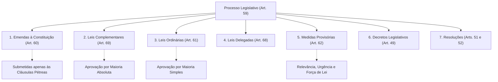
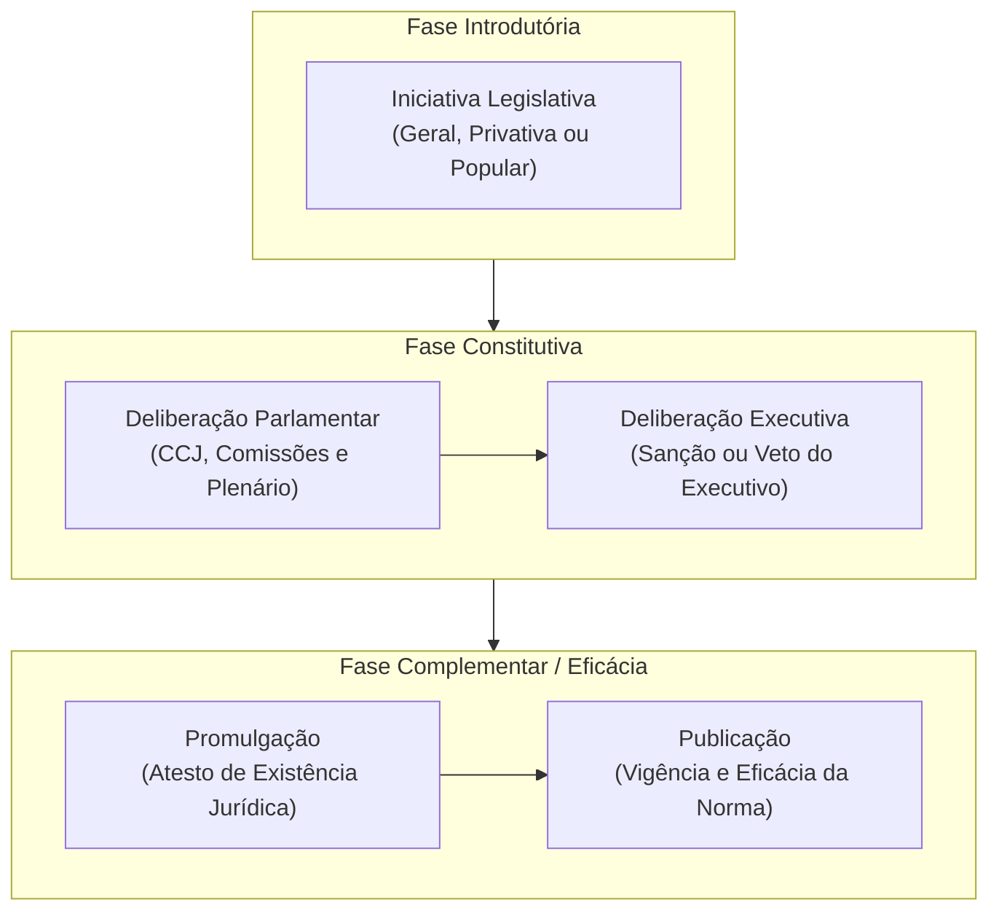
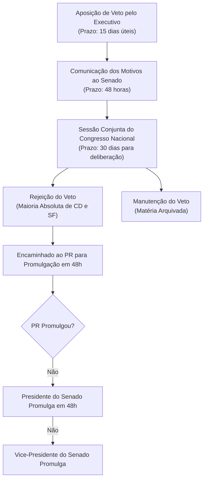
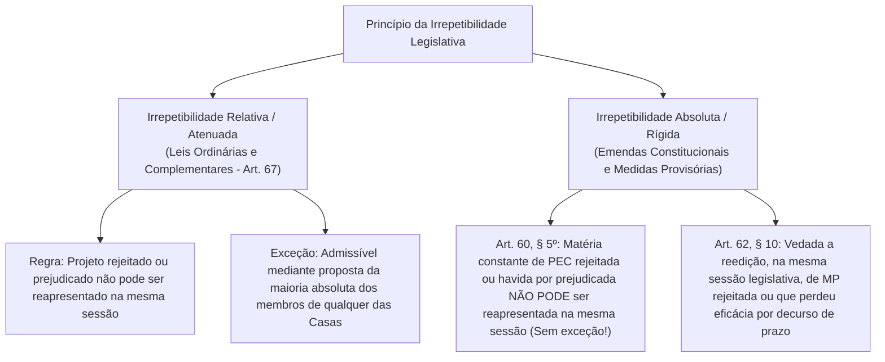
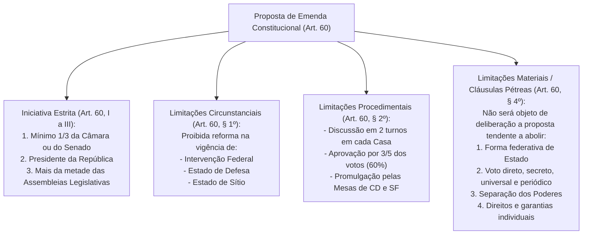

# Processo Legislativo: Fases, Espécies Normativas, Iniciativa Reservada e Limitações ao Poder Reformador

> O processo legislativo constitucional compreende o encadeamento ordenado de atos estatais preordenados à edição de atos normativos primários com força de lei. Estrutura-se em fases rigorosamente delimitadas (iniciativa, deliberação parlamentar, deliberação executiva e fase integrativa de eficácia), cuja inobservância redunda em inconstitucionalidade formal. O regime jurídico das espécies normativas consagra a rigidez constitucional por meio de limites intransponíveis ao poder de reforma (cláusulas pétreas e quóruns qualificados), resguardando o equilíbrio federativo e a separação dos Poderes contra usurpações de iniciativa privativa.

---

## 1. Espécies Normativas e o Art. 59 da CF/88

O art. 59 da Constituição Federal estabelece o rol taxativo das espécies normativas primárias que integram o processo legislativo formal da República:

### 1.1. Atos Normativos Primários vs. Atos Infralegais
* **Atos Primários (Art. 59):** Derivam diretamente do texto constitucional e possuem aptidão originária para inovar na ordem jurídica (*ius novum*), criando deveres, direitos e obrigações para os administrados (art. 5º, II).
* **Atos Infralegais Secundários:** Decretos regulamentares (art. 84, IV), portarias, circulares e instruções normativas destinam-se exclusivamente à fiel execução da lei. **Não integram o processo legislativo formal** e não podem criar obrigações originárias sob pena de exorbitância regulamentar e inconstitucionalidade direta ou indireta (reflexa).

### 1.2. Inexistência de Hierarquia entre Lei Complementar e Lei Ordinária
A jurisprudência pacífica do Supremo Tribunal Federal estabelece que **não há hierarquia formal ou axiológica entre Leis Complementares e Leis Ordinárias**. Ambas possuem idêntica estatura no ápice do ordenamento infraconstitucional. O traço diferenciador reside em dois critérios cumulativos:
1. **Critério Material:** A Lei Complementar só pode veicular matérias expressamente taxadas pela CF/88 como reservadas a essa espécie normativa.
2. **Critério Formal:** A aprovação de Lei Complementar exige a **maioria absoluta** dos membros de cada Casa do Congresso (art. 69), ao passo que a Lei Ordinária demanda **maioria simples** dos presentes, presente a maioria absoluta (art. 47). Se uma Lei Complementar tratar de matéria própria de Lei Ordinária, ela será materialmente ordinária, podendo ser revogada ou alterada por lei ordinária superveniente (princípio da fungibilidade formal/material).

---

## 2. Fases do Procedimento Legislativo Ordinário

O rito ordinário decompõe-se em três macrofases sequenciais: introdutória (iniciativa), constitutiva (deliberação parlamentar e executiva) e integrativa/complementar (promulgação e publicação).

### 2.1. Fase de Iniciativa e a Reserva Privativa do Executivo
* **Iniciativa Geral (Concorrente):** Cabe a qualquer membro ou comissão da Câmara dos Deputados, do Senado Federal ou do Congresso Nacional, ao Presidente da República, ao STF, aos Tribunais Superiores, ao Procurador-Geral da República e aos cidadãos (art. 61, caput).
* **Iniciativa Privativa (Reservada) do Presidente da República (Art. 61, § 1º):** Matérias de competência indelegável do Chefe do Executivo:
  * Criação de cargos, funções ou empregos públicos na administração direta e autárquica ou aumento de sua remuneração (alínea "a");
  * Organização administrativa e judiciária, matéria tributária e orçamentária dos Territórios (alínea "b");
  * **Servidores públicos da União e Territórios, seu regime jurídico, provimento de cargos, estabilidade e aposentadoria** (alínea "c");
  * Organização do Ministério Público e da Defensoria Pública da União (alínea "d");
  * Criação e extinção de Ministérios e órgãos da administração pública (alínea "e");
  * Fixação ou modificação do efetivo das Forças Armadas (inciso I).
* **Simetria Obrigatória nos Estados e Municípios:** As regras constitucionais de iniciativa reservada do art. 61, § 1º, constituem normas de reprodução obrigatória para Governadores e Prefeitos.
* **Superação da Antiga Súmula 5 do STF:** A sanção pelo Chefe do Poder Executivo **NÃO convalida** o vício de iniciativa formal decorrente de usurpação parlamentar em matéria de competência privativa do Executivo. A lei sancionada permanece irremediavelmente eivada de inconstitucionalidade formal orgânica.
* **Tema 917 do STF (Geração de Despesa vs. Vício de Iniciativa):** A criação de despesas para o Poder Executivo decorrente de projeto de lei de autoria parlamentar **não consubstancia vício de iniciativa**, desde que o diploma legal não trate de matéria estritamente reservada à iniciativa privativa do Chefe do Executivo (ex: regime jurídico de servidores, atribuição de órgãos públicos ou estrutura administrativa). Leis parlamentares que instituem programas de transparência pública, totens de alerta ou regras de atendimento não padecem de inconstitucionalidade formal pelo só fato de gerarem despesa orçamentária.
* **Iniciativa Popular (Art. 61, § 2º):** Exercida pela subscrição de, no mínimo, **1% do eleitorado nacional**, distribuído por pelo menos **5 Estados**, com não menos de **0,3% dos eleitores** de cada um deles. O projeto de iniciativa popular é protocolado perante a Câmara dos Deputados.

### 2.2. Fase Constitutiva: Deliberação Parlamentar
1. **Casa Iniciadora vs. Casa Revisora:** A iniciativa de projetos de parlamentares, do Presidente, do STF, PGR e iniciativa popular inicia-se na **Câmara dos Deputados** (art. 64, caput). Projetos de autoria de Senadores iniciam-se no Senado Federal.
2. **Exame pelas Comissões de Constituição e Justiça (CCJ):** Realiza o **controle preventivo político** de constitucionalidade, verificando a adequação formal e material da proposta antes do encaminhamento ao plenário.
3. **Emendas da Casa Revisora:** Se a Casa Revisora emendar o projeto, este retorna à Casa Iniciadora para deliberação exclusiva sobre as emendas (art. 65, parágrafo único). Se rejeitar o projeto, este é sumariamente arquivado.

### 2.3. Deliberação Executiva: Sanção e Veto (Art. 66)
Aprovado o projeto de lei no Parlamento, este é enviado ao Chefe do Executivo para aquiescência ou recusa.

| Instituto | Modalidades e Prazos | Consequências Jurídicas |
| :--- | :--- | :--- |
| **Sanção** | **Expressa:** Decretada formalmente pelo Executivo. **Tácita:** Decorre do silêncio no prazo de **15 dias úteis** contados do recebimento do projeto. | Conclui a elaboração da lei e a encaminha para promulgação pelo Executivo em 48h. |
| **Veto** | **Jurídico:** Entendimento de inconstitucionalidade. **Político:** Entendimento de contrariedade ao interesse público. Prazo de oposição: **15 dias úteis**. | **a) Irretratabilidade:** Uma vez aposto, o Executivo não pode revogar o veto. **b) Formal e Motivado:** Deve comunicar os motivos ao Presidente do Senado em **48 horas**. **c) Vedação ao Veto de Palavras:** O veto parcial só pode abranger texto integral de artigo, de parágrafo, de inciso ou de alínea (vedado vetar palavras ou expressões isoladas). |

* **Derrubada do Veto (Art. 66, § 4º):** O veto é apreciado em sessão conjunta do Congresso Nacional dentro de 30 dias a contar do seu recebimento, só podendo ser rejeitado pelo voto da **maioria absoluta dos Deputados e Senadores**. Rejeitado o veto, o projeto é enviado ao Presidente da República para promulgação em 48 horas.

---

## 3. O Princípio da Irrepetibilidade (Art. 67)

O princípio da irrepetibilidade proíbe que proposições rejeitadas na mesma sessão legislativa ordinária sejam reapresentadas para nova discussão no Parlamento, preservando a estabilidade legislativa e a economia procedimental.

---

## 4. O Poder Reformador: Emendas à Constituição (Art. 60)

O processo de alteração formal do texto constitucional submete-se ao mais rígido procedimento deliberativo do direito brasileiro, subordinando-se a limitações formais, circunstanciais e materiais.

### 4.1. Características Marcantes da Reforma Constitucional
* **Inexistência de Sanção ou Veto:** O Chefe do Poder Executivo não sanciona nem veta propostas de emenda à Constituição. A promulgação é ato privativo conjunto das Mesas da Câmara dos Deputados e do Senado Federal (art. 60, § 3º).
* **Quórum Qualificado de 3/5:** Exige aprovação por 3/5 dos membros da Câmara (308 deputados) e do Senado Federal (49 senadores), em **dois turnos** de votação em cada Casa.
* **Cláusulas Pétreas Implícitas:** Além do rol taxativo do art. 60, § 4º (federação, voto, separação dos poderes e direitos individuais), a doutrina e o STF reconhecem como cláusula pétrea implícita o próprio artigo 60 e seu procedimento qualificado de reforma, repelindo a teoria da "dupla revisão constitucional".

---

## 5. Medidas Provisórias (Art. 62)

Atos normativos primários unipessoais expedidos privativamente pelo Presidente da República com força de lei formal:
* **Requisitos Constitucionais Cumulativos:** Relevância e urgência. O STF exerce controle jurisdicional excepcional sobre esses pressupostos apenas em situações de patente ausência ou abuso de poder.
* **Vedações Materiais Absolutas (Art. 62, § 1º, I):** É vedada a edição de MP sobre:
  * Nacionalidade, cidadania, direitos políticos, partidos políticos e direito eleitoral;
  * Direito penal, processual penal e processual civil;
  * Organização do Judiciário e do Ministério Público, a carreira e a garantia de seus membros;
  * Planos plurianuais, diretrizes orçamentárias, orçamento e créditos adicionais e suplementares (salvo créditos extraordinários para despesas imprevisíveis e urgentes, como guerra ou comoção interna - art. 62, § 1º, I, "d" c/c art. 167, § 3º);
  * Matéria reservada a Lei Complementar;
  * Matéria já disciplinada em projeto de lei aprovado pelo Congresso e pendente de sanção/veto.
* **Vigência e Trancamento de Pauta:** Vigora pelo prazo de **60 dias**, prorrogável uma única vez por igual período (máximo de 120 dias). Se não apreciada em até **45 dias** de sua publicação, a MP entra em regime de urgência, sobrestando (trancando) todas as demais deliberações legislativas da Casa em que estiver tramitando, com exceção daquelas que possuam prazo constitucional determinado (art. 62, § 6º).

---

## 6. Questões Paradigmáticas Aplicadas

### [Questão 01](https://www.qconcursos.com/questoes-de-concursos/questoes/4375160) — [FGV — PC-PR / Delegado de Polícia — 2026]

Deputado estadual propôs projeto de lei dispondo acerca da carga horária de trabalho dos Agentes de Polícia Judiciária. No curso do processo legislativo, o Governador sancionou, resultando na edição de lei estadual sobre o tema.
A respeito da (in)constitucionalidade do diploma legal estadual, assinale a afirmativa correta.

* **A)** A lei é constitucional, já que, em regra, a iniciativa legislativa é concorrente, cabendo aos parlamentares a propositura do projeto de lei no caso.
* **B)** A sanção pelo Chefe do Poder Executivo acaba por sanar eventual vício de iniciativa da lei estadual em comento.
* **C)** A lei é inconstitucional porque dispõe sobre o regime jurídico de servidores públicos estaduais, matéria reservada à iniciativa privativa do Governador do Estado, a Constituição da República.
* **D)** Não houve usurpação da iniciativa privativa do Chefe do Poder Executivo considerando que a lei estadual não cria despesa para a Administração Pública.
* **E)** O legislador estadual não está obrigado a observar as regras de iniciativa reservada instituídas pelo constituinte originário no Art. 61, § 1º, inciso II, alínea "c", da Constituição da República.

#### Gabarito: **C**
* **A (Errada):** A lei é constitucional, já que, em regra, a iniciativa legislativa é concorrente, cabendo aos parlamentares a propositura do projeto de lei no caso. Em tema de regime jurídico dos servidores públicos, a iniciativa é expressamente privativa do Chefe do Poder Executivo, sendo a iniciativa concorrente inaplicável ao caso.
* **B (Errada):** A sanção pelo Chefe do Poder Executivo acaba por sanar eventual vício de iniciativa da lei estadual em comento. A antiga orientação da Súmula 5 do STF restou há muito superada; a jurisprudência pacífica e vinculante do Pretório Excelso assevera que a sanção do Executivo não possui o condão de convalidar o vício de iniciativa, persistindo a inconstitucionalidade formal subjetiva.
* **C (Certa):** A lei é inconstitucional porque dispõe sobre o regime jurídico de servidores públicos estaduais, matéria reservada à iniciativa privativa do Governador do Estado, a Constituição da República. Por força do princípio da simetria federativa (art. 25 c/c art. 61, § 1º, II, "c", da CF/88), a disciplina da jornada de trabalho, vencimentos e regime funcional dos servidores públicos civis e policiais é matéria reservada à iniciativa privativa do Chefe do Executivo local. A usurpação parlamentar macula o diploma de inconstitucionalidade formal insanável.
* **D (Errada):** Não houve usurpação da iniciativa privativa do Chefe do Poder Executivo considerando que a lei estadual não cria despesa para a Administração Pública. A reserva de iniciativa em relação a servidores independe da criação imediata de despesas, decorrendo expressamente do conteúdo material do regime jurídico funcional (art. 61, § 1º, II, "c").
* **E (Errada):** O legislador estadual não está obrigado a observar as regras de iniciativa reservada instituídas pelo constituinte originário no Art. 61, § 1º, inciso II, alínea "c", da Constituição da República. Trata-se de preceito estruturante de observância e reprodução obrigatória por Estados e Municípios em decorrência do princípio da separação dos poderes.

---

### [Questão 02](https://www.qconcursos.com/questoes-de-concursos/questoes/4376190) — [Instituto IDEAP — Câmara de Santa Margarida - MG / Procurador — 2026]

De acordo com a Lei Orgânica de Santa Margarida, integram expressamente o processo legislativo:

* **A)** emendas à Lei Orgânica, leis complementares, leis ordinárias, decretos legislativos e resoluções.
* **B)** emendas à Lei Orgânica, medidas provisórias municipais, leis delegadas e decretos autônomos.
* **C)** apenas leis complementares, leis ordinárias e decretos do Prefeito.
* **D)** portarias, ordens de serviço, circulares e instruções normativas.

#### Gabarito: **A**
* **A (Certa):** emendas à Lei Orgânica, leis complementares, leis ordinárias, decretos legislativos e resoluções. Em perfeita consonância e simetria com o modelo do art. 59 da Constituição Federal, as espécies normativas primárias que integram o processo legislativo municipal são: emendas à Lei Orgânica, leis complementares, leis ordinárias, decretos legislativos e resoluções da Câmara (excluindo-se medidas provisórias e leis delegadas quando não admitidas pela ordem constitucional local).
* **B (Errada):** emendas à Lei Orgânica, medidas provisórias municipais, leis delegadas e decretos autônomos. Decretos autônomos e regulamentares constituem atos do Poder Executivo, não integrando a elaboração do processo legislativo da Casa Parlamentar.
* **C (Errada):** apenas leis complementares, leis ordinárias e decretos do Prefeito. Decretos do Chefe do Executivo são atos administrativos regulamentares, não espécies do processo legislativo formal.
* **D (Errada):** portarias, ordens de serviço, circulares e instruções normativas. Constituem atos administrativos secundários de natureza interna e infralegal.

---

### [Questão 03](https://www.qconcursos.com/questoes-de-concursos/questoes/4378304) — [FGV — PC-PR / Delegado de Polícia — 2026]

Em razão de ampla mobilização dos policiais civis do Estado Alfa, um grupo de parlamentares apresentou projeto de lei promovendo o reajuste da remuneração dos policiais civis, considerando a inflação acumulada desde o último reajuste, observados os índices oficiais.
Após o trâmite regular, o projeto foi aprovado pela maioria simples dos integrantes da Casa Legislativa, sendo sancionado e promulgado pelo Governador do Estado Alfa, o que resultou na publicação da Lei nº X. Por entender que esse diploma normativo destoava da Constituição da República, um legitimado deflagrou o controle concentrado de constitucionalidade.
Na situação descrita, é correto afirmar que a Lei nº X

* **A)** não apresenta vício de inconstitucionalidade.
* **B)** apresenta apenas vício de inconstitucionalidade formal, em razão dos autores da proposição legislativa.
* **C)** apresenta apenas vício de inconstitucionalidade por omissão, por não ter abrangido as demais categorias do funcionalismo público.
* **D)** apresenta apenas vício de inconstitucionalidade material, considerando que a só reposição das perdas inflacionárias não consubstancia reajuste.
* **E)** não pode ser cotejada com a Constituição da República, para fins de controle concentrado de constitucionalidade, apenas com a Constituição do Estado Alfa.

#### Gabarito: **B**
* **A (Errada):** não apresenta vício de inconstitucionalidade. O projeto nasceu de iniciativa parlamentar sobre remuneração de servidores, matéria privativa do Chefe do Poder Executivo.
* **B (Certa):** apresenta apenas vício de inconstitucionalidade formal, em razão dos autores da proposição legislativa. A fixação ou majoração remuneratória de servidores públicos — seja reajuste setorial, seja revisão geral anual — consubstancia matéria de iniciativa legislativa privativa e irrenunciável do Chefe do Poder Executivo (art. 37, X, c/c art. 61, § 1º, II, "a", da CF/88 e ADI 5.562/RS do STF). A deflagração por parlamentares configura vício de inconstitucionalidade formal subjetiva.
* **C (Errada):** apresenta apenas vício de inconstitucionalidade por omissão, por não ter abrangido as demais categorias do funcionalismo público. O vício é comissivo formal positivo (usurpação de iniciativa), e não mera omissão legislativa.
* **D (Errada):** apresenta apenas vício de inconstitucionalidade material, considerando que a só reposição das perdas inflacionárias não consubstancia reajuste. A reposição de perdas afeta diretamente o montante pecuniário e exige iniciativa privativa do Governador, caracterizando vício formal orgânico.
* **E (Errada):** não pode ser cotejada com a Constituição da República, para fins de controle concentrado de constitucionalidade, apenas com a Constituição do Estado Alfa. Normas de reprodução obrigatória da CF/88 vinculam o controle concentrado abstrato perante o STF mediante Ação Direta de Inconstitucionalidade.

---

### [Questão 04](https://www.qconcursos.com/questoes-de-concursos/questoes/4380277) — [VUNESP — TCE-SP / Auditor de Controle Externo — 2026]

A respeito do processo legislativo, assinale a alternativa correta.

* **A)** Não é possível o controle judicial sobre os pressupostos de relevância e urgência para a edição de medidas provisórias.
* **B)** É constitucional lei, de iniciativa parlamentar, que estabelece regras para a vedação à prática de nepotismo em cargos integrantes da estrutura do Poder Executivo.
* **C)** É constitucional projeto de lei, de iniciativa do Tribunal de Contas, que concede gratificação aos servidores militares locados na assessoria militar do órgão.
* **D)** A irrepetibilidade diz respeito à impossibilidade de reapresentação de determinada proposição legislativa no curso da mesma sessão legislativa, e ela é absoluta em relação aos projetos de lei ordinária e complementar.
* **E)** A sanção ao projeto de lei será expressa quando há anuência expressa do chefe do Poder Executivo à proposição legislativa, e tácita se este permanecer silente por quinze dias corridos.

#### Gabarito: **B**
* **A (Errada):** Não é possível o controle judicial sobre os pressupostos de relevância e urgência para a edição de medidas provisórias. O STF admite expressamente o controle jurisdicional repressivo dos pressupostos constitucionais de relevância e urgência em caráter excepcional, quando restar caracterizado o manifesto desvio ou evidente abuso de poder do Chefe do Executivo.
* **B (Certa):** É constitucional lei, de iniciativa parlamentar, que estabelece regras para a vedação à prática de nepotismo em cargos integrantes da estrutura do Poder Executivo. Conforme jurisprudência pacificada do Supremo Tribunal Federal (RE 570.392, Tema 191 de Repercussão Geral), leis de iniciativa parlamentar que vedam o nepotismo no âmbito dos Poderes Executivo e Legislativo são plenamente constitucionais, pois não dispõem sobre o provimento de cargos ou regime jurídico específico, mas apenas concretizam os princípios republicanos da moralidade e impessoalidade (art. 37, caput).
* **C (Errada):** É constitucional projeto de lei, de iniciativa do Tribunal de Contas, que concede gratificação aos servidores militares locados na assessoria militar do órgão. A disciplina de vencimentos e vantagens pecuniárias de policiais militares e bombeiros é de iniciativa privativa do Governador do Estado (art. 61, § 1º, II, "c" e "f").
* **D (Errada):** A irrepetibilidade diz respeito à impossibilidade de reapresentação de determinada proposição legislativa no curso da mesma sessão legislativa, e ela é absoluta em relação aos projetos de lei ordinária e complementar. A irrepetibilidade é relativa para leis ordinárias e complementares (art. 67), que podem ser reapresentadas por proposta da maioria absoluta dos membros da Casa; ela só é absoluta para Emendas Constitucionais (art. 60, § 5º) e Medidas Provisórias (art. 62, § 10).
* **E (Errada):** A sanção ao projeto de lei será expressa quando há anuência expressa do chefe do Poder Executivo à proposição legislativa, e tácita se este permanecer silente por quinze dias corridos. O prazo de manifestação do Executivo para sanção tácita ou aposição de veto é de **quinze dias úteis**, e não dias corridos (art. 66, § 3º da CF/88).

---

### [Questão 05](https://www.qconcursos.com/questoes-de-concursos/questoes/4382719) — [ISET — Câmara de Seabra - BA / Procurador Jurídico — 2026]

A Câmara Municipal de Alfa aprovou projeto de lei, de autoria parlamentar, determinando que o Poder Executivo disponibilize, em seu portal eletrônico, informações atualizadas sobre a fila de espera para consultas, exames e procedimentos da rede municipal de saúde. A proposição não cria cargos, não altera a estrutura dos órgãos municipais nem modifica o regime jurídico dos servidores, embora sua implementação demande providências administrativas e gere custos operacionais. O Prefeito vetou integralmente o projeto, sob fundamento de vício formal de iniciativa, argumentando que qualquer proposição parlamentar capaz de criar despesa ou impor obrigações ao Executivo invadiria matéria reservada ao Chefe desse Poder. Solicitado a examinar juridicamente o veto, o advogado da Câmara deverá concluir que:

* **A)** O veto possui fundamento constitucional, porque a criação de qualquer obrigação administrativa ao Executivo, ainda que não envolva servidores ou órgãos, caracteriza interferência parlamentar na gestão administrativa.
* **B)** A iniciativa parlamentar somente seria constitucional se a proposição tivesse natureza autorizativa, deixando ao Prefeito a faculdade de implementar ou não as medidas previstas.
* **C)** A geração de despesa decorrente de lei parlamentar não configura, isoladamente, vício de iniciativa, desde que a norma não trate de matérias constitucionalmente reservadas ao Chefe do Executivo, como estrutura ou atribuições dos órgãos da Administração e regime jurídico de servidores.
* **D)** A constitucionalidade dependeria da existência, no momento da apresentação do projeto, de dotação orçamentária específica e suficiente para custear integralmente todas as despesas decorrentes da futura lei.
* **E)** Embora inexista vício de iniciativa, a proposição seria materialmente inconstitucional porque o Legislativo não pode disciplinar mecanismos de publicidade administrativa relacionados a serviços executados pelo Poder Executivo.

#### Gabarito: **C**
* **A (Errada):** O veto possui fundamento constitucional, porque a criação de qualquer obrigação administrativa ao Executivo, ainda que não envolva servidores ou órgãos, caracteriza interferência parlamentar na gestão administrativa. O argumento do veto restringe indevidamente a função legislativa primária, colidindo com a jurisprudência da Suprema Corte.
* **B (Errada):** A iniciativa parlamentar somente seria constitucional se a proposição tivesse natureza autorizativa, deixando ao Prefeito a faculdade de implementar ou não as medidas previstas. Leis autorizativas são desprovidas de comando vinculante, e a matéria examinada ostenta plena constitucionalidade impositiva.
* **C (Certa):** A geração de despesa decorrente de lei parlamentar não configura, isoladamente, vício de iniciativa, desde que a norma não trate de matérias constitucionalmente reservadas ao Chefe do Executivo, como estrutura ou atribuições dos órgãos da Administração e regime jurídico de servidores. Esse é o enunciado exato firmado pelo Supremo Tribunal Federal no **Tema 917 de Repercussão Geral (ARE 878.911)**: "Não usurpa a competência privativa do chefe do Poder Executivo lei que, embora crie despesa para a Administração Pública, não trata da sua estrutura ou da atribuição de seus órgãos nem do regime jurídico de servidores públicos". A imposição de deveres de transparência pública em serviços de saúde decorre do direito fundamental à informação e publicidade.
* **D (Errada):** A constitucionalidade dependeria da existência, no momento da apresentação do projeto, de dotação orçamentária específica e suficiente para custear integralmente todas as despesas decorrentes da futura lei. A ausência de dotação orçamentária prévia acarreta apenas a inexequibilidade da despesa no exercício financeiro, não operando vício de inconstitucionalidade formal da lei (art. 169 da CF).
* **E (Errada):** Embora inexista vício de iniciativa, a proposição seria materialmente inconstitucional porque o Legislativo não pode disciplinar mecanismos de publicidade administrativa relacionados a serviços executados pelo Poder Executivo. A publicidade administrativa decorre diretamente do art. 37, caput, da CF/88, sendo legítima a intervenção parlamentar para densificar o acesso aos serviços de saúde.

---

### [Questão 06](https://www.qconcursos.com/questoes-de-concursos/questoes/4392308) — [Quadrix — CREF - 20ª Região (SE) / Agente de Orientação — 2026]

Quanto aos princípios fundamentais da República Federativa do Brasil, aos direitos e garantias essenciais, ao controle de constitucionalidade e às finanças públicas, julgue o item a seguir.
O controle de constitucionalidade preventivo caracteriza‑se politicamente quando é exercido pelas comissões parlamentares de constituição e de justiça, durante a tramitação do projeto de lei.
* **C (Certo):** O controle de constitucionalidade preventivo político é aquele exercido pelos órgãos estatais não jurisdicionais durante o processo de elaboração normativa, com o escopo de expurgar previamente proposições inconstitucionais antes de sua conversão em lei. O exame procedido pelas Comissões de Constituição e Justiça (CCJ) do Parlamento e o veto jurídico aposto pelo Chefe do Poder Executivo constituem os dois exemplos clássicos e paradigmáticos de controle preventivo político de constitucionalidade.
* **E (Errado):** A assertiva descreve perfeitamente o conceito técnico do controle preventivo político exercido no âmbito das comissões temáticas do Poder Legislativo.

* **C)** Certo
* **E)** Errado

#### Gabarito: **Certo**

---

### [Questão 07](https://www.qconcursos.com/questoes-de-concursos/questoes/4392902) — [AMEOSC — Prefeitura de Barra Bonita - SC / Auxiliar — 2026]

Aprovado um projeto de lei na Câmara Municipal de Barra Bonita, a assessoria jurídica precisou montar o fluxo dos atos seguintes para orientar o controle de prazos, considerando a hipótese em que o Prefeito decide vetar o texto. O roteiro deve refletir a ordem em que os atos se sucedem, e não a ordem em que os prazos aparecem no texto legal.
Ordene os atos a seguir conforme a sequência em que ocorrem, segundo a Lei Orgânica do Município.
I. Envio do projeto aprovado ao Prefeito, no prazo de dez dias úteis.  
II. Comunicação dos motivos do veto ao Presidente da Câmara, dentro de quarenta e oito horas.  
III. Aposição de veto total ou parcial pelo Prefeito, no prazo de quinze dias úteis contados do recebimento.
A sequência correta é:

* **A)** I, III, II.
* **B)** III, I, II.
* **C)** I, II, III.
* **D)** II, III, I.

#### Gabarito: **A**
* **A (Certa):** I, III, II. A dinâmica lógica e temporal do processo de veto constitucional segue estritamente três etapas: 1º) envio do projeto aprovado da Câmara ao Chefe do Executivo (Ato I); 2º) exame e aposição formal de veto total ou parcial pelo Prefeito dentro do prazo decadencial de 15 dias úteis (Ato III); 3º) comunicação formal e fundamentada dos motivos que embasaram o veto ao Presidente do Legislativo dentro de 48 horas após a aposição do veto (Ato II).
* **B (Errada):** III, I, II. O Chefe do Executivo não pode apor veto antes de receber formalmente o projeto enviado pela Casa Legislativa.
* **C (Errada):** I, II, III. A comunicação dos motivos ao Legislativo decorre da prévia decisão de vetar o texto, não podendo antecedê-la.
* **D (Errada):** II, III, I. Inverte frontalmente as fases procedimentais do processo legislativo.

---

### [Questão 08](https://www.qconcursos.com/questoes-de-concursos/questoes/4395141) — [Gama Consult — Câmara de São Miguel do Guaporé - RO / Controlador Geral — 2026]

Em conformidade com as regras gerais sobre o processo legislativo e a competência da Câmara Municipal expressas na Lei Orgânica do Município de São Miguel do Guaporé/RO, as emendas à referida Lei Orgânica serão promulgadas pela(o):

* **A)** Prefeito Municipal, no prazo de 15 (quinze) dias úteis.
* **B)** Comissão Permanente de Constituição, Justiça e Redação.
* **C)** Procurador-Geral do Município, após homologação judicial.
* **D)** Mesa Diretora da Câmara Municipal, com o respectivo número de ordem.

#### Gabarito: **D**
* **A (Errada):** Prefeito Municipal, no prazo de 15 (quinze) dias úteis. Emendas à Lei Orgânica não se submetem à sanção, veto ou promulgação do Prefeito.
* **B (Errada):** Comissão Permanente de Constituição, Justiça e Redação. A comissão temática opina em parecer técnico, mas não detém poderes executivos de promulgação.
* **C (Errada):** Procurador-Geral do Município, após homologação judicial. Não existe participação da procuradoria ou do Poder Judiciário na fase complementar de eficácia da emenda legislativa.
* **D (Certa):** Mesa Diretora da Câmara Municipal, com o respectivo número de ordem. Por expressa simetria com o art. 60, § 3º, da Constituição Federal, as emendas à Lei Orgânica Municipal são promulgadas privativamente pela Mesa Diretora da Câmara Municipal, acompanhadas do respectivo número sequencial de ordem, inexistindo sanção ou veto do Chefe do Executivo local.

---

### [Questão 09](https://www.qconcursos.com/questoes-de-concursos/questoes/4396158) — [Instituto Fucap — Prefeitura de São Joaquim - SC / Advogado — 2026]

A Prefeitura de São Joaquim encaminhou à Câmara Municipal projeto de lei destinado à reorganização de determinados setores da Administração Pública, contemplando a criação e transformação de cargos vinculados ao Poder Executivo e a definição dos respectivos vencimentos. Durante a tramitação, discutiu-se a competência da Câmara para apreciar a matéria, a iniciativa legislativa reservada ao prefeito e a necessidade de observância das etapas do processo legislativo municipal.
Considerando a Lei Orgânica do Município de São Joaquim e as normas constitucionais aplicáveis, assinale a alternativa CORRETA.

* **A)** A Câmara poderá autorizar a criação e transformação de cargos do Executivo por ato administrativo do prefeito, desde que a autorização legislativa estabeleça limites financeiros e funcionais.
* **B)** A Câmara poderá apreciar e alterar o projeto de criação e transformação de cargos do Executivo, inclusive ampliando despesas com pessoal, desde que preserve a finalidade administrativa proposta.
* **C)** A Câmara poderá deliberar sobre a criação e transformação de cargos do Executivo mediante projeto de iniciativa parlamentar, desde que a proposta seja posteriormente submetida à sanção do prefeito.
* **D)** A Câmara poderá disciplinar a criação e transformação de cargos do Executivo por resolução legislativa, desde que a medida tenha sido previamente solicitada pela Administração Municipal.
* **E)** A Câmara poderá apreciar e deliberar sobre o projeto de criação e transformação de cargos do Executivo, respeitada a iniciativa reservada e a participação do prefeito no processo legislativo.

#### Gabarito: **E**
* **A (Errada):** A Câmara poderá autorizar a criação e transformação de cargos do Executivo por ato administrativo do prefeito, desde que a autorização legislativa estabeleça limites financeiros e funcionais. A criação de cargos públicos na administração direta e autárquica submete-se à estrita reserva de lei em sentido formal (art. 48, X e art. 61, § 1º, II, "a"), vedada a delegação genérica por mero ato administrativo regulamentar.
* **B (Errada):** A Câmara poderá apreciar e alterar o projeto de criação e transformação de cargos do Executivo, inclusive ampliando despesas com pessoal, desde que preserve a finalidade administrativa proposta. O art. 63, I, da CF/88 veda terminantemente aos parlamentares apresentar emendas que impliquem aumento da despesa prevista nos projetos de iniciativa exclusiva do Chefe do Executivo.
* **C (Errada):** A Câmara poderá deliberar sobre a criação e transformação de cargos do Executivo mediante projeto de iniciativa parlamentar, desde que a proposta seja posteriormente submetida à sanção do prefeito. Trata-se de usurpação de competência privativa insanável, não suscetível de convalidação posterior pela sanção.
* **D (Errada):** A Câmara poderá disciplinar a criação e transformação de cargos do Executivo por resolução legislativa, desde que a medida tenha sido previamente solicitada pela Administração Municipal. Resoluções destinam-se a matérias de economia interna da Câmara, sendo incabíveis para criar cargos no Executivo.
* **E (Certa):** A Câmara poderá apreciar e deliberar sobre o projeto de criação e transformação de cargos do Executivo, respeitada a iniciativa reservada e a participação do prefeito no processo legislativo. O Poder Legislativo detém plena competência institucional para analisar, debater e votar os projetos encaminhados pelo Chefe do Executivo, inclusive rejeitando-os ou apresentando emendas que guardem pertinência temática e não acarretem aumento de despesa, integrando o regular ciclo de freios e contrapesos.

---

### [Questão 10](https://www.qconcursos.com/questoes-de-concursos/questoes/4410944) — [Instituto Legalle — Prefeitura de Toropi - RS / Agente — 2026]

A iniciativa das leis complementares e ordinárias cabe a qualquer Vereador ou comissão da Câmara, ao Prefeito Municipal e aos cidadãos, na forma e nos casos previstos na Lei Orgânica. A iniciativa popular será exercida pela apresentação, à Câmara Municipal, de projeto de lei subscrito por, no mínimo, cinco por cento dos eleitores inscritos no Município, ou por quantas entidades legalmente constituídas, contendo assunto de interesse especificamente municipal?

* **A)** Cinco.
* **B)** Três.
* **C)** Sete.
* **D)** Dez.

#### Gabarito: **D**
* **A (Errada):** Cinco. Quantitativo incorreto frente ao dispositivo regulador local.
* **B (Errada):** Três. Hipótese desprovida de lastro normativo orgânico.
* **C (Errada):** Sete. Número divergente da exigência legal.
* **D (Certa):** Dez. O texto legal municipal em exame prevê, de modo alternativo à subscrição individual de 5% do eleitorado municipal (padrão federal do art. 29, XIII da CF/88), a faculdade de apresentação do projeto de lei de iniciativa popular mediante o endosso coletivo de no mínimo **dez entidades** legalmente constituídas com sede no Município.

---

### [Questão 11](https://www.qconcursos.com/questoes-de-concursos/questoes/4301811) — [CPCON — Câmara de Mãe d'Água - PB / Técnico Legislativo — 2026]

Considerando as fases do processo legislativo, assinale a alternativa que se refere CORRETAMENTE ao ato em que o projeto de lei segue para o Chefe do Poder Executivo, que pode aprovar integralmente ou rejeitar, total ou parcialmente.

* **A)** Sanção ou veto.
* **B)** Aprovação e revisão.
* **C)** Discussão e votação.
* **D)** Iniciativa.
* **E)** Protocolo da proposição.

#### Gabarito: **A**
* **A (Certa):** Sanção ou veto. Concluída a deliberação parlamentar, o autógrafo do projeto de lei é enviado ao Chefe do Poder Executivo para o exercício do controle político-jurídico privativo (fase constitutiva executiva): aquiescer mediante sanção (expressa ou tácita) ou discordar fundamentadamente mediante aposição de veto total ou parcial (art. 66 da CF/88).
* **B (Errada):** Aprovação e revisão. Constitui fase interna estritamente parlamentar no âmbito da Casa Iniciadora e Casa Revisora.
* **C (Errada):** Discussão e votação. Etapas procedimentais prévias da deliberação parlamentar em comissões temáticas e plenário.
* **D (Errada):** Iniciativa. Fase introdutória de deflagração do processo legislativo.
* **E (Errada):** Protocolo da proposição. Ato administrativo preparatório de recebimento da proposição legislativa.

---

### [Questão 12](https://www.qconcursos.com/questoes-de-concursos/questoes/4302670) — [Grupo TALENT — Prefeitura de Getulina - SP / Assessor — 2026]

Durante a organização dos atos normativos municipais, um servidor elaborou uma relação dos instrumentos que integram o processo legislativo de Getulina. Considerando o art. 37 da Lei Orgânica Municipal, assinale a alternativa INCORRETA:

* **A)** As portarias administrativas integram o processo legislativo municipal e ocupam a mesma categoria normativa das resoluções.
* **B)** As emendas à Lei Orgânica estão compreendidas entre as espécies elaboradas no processo legislativo municipal.
* **C)** As leis complementares e as leis ordinárias integram o processo legislativo do Município.
* **D)** As resoluções e os decretos legislativos estão incluídos entre os instrumentos do processo legislativo municipal.

#### Gabarito: **A**

---
