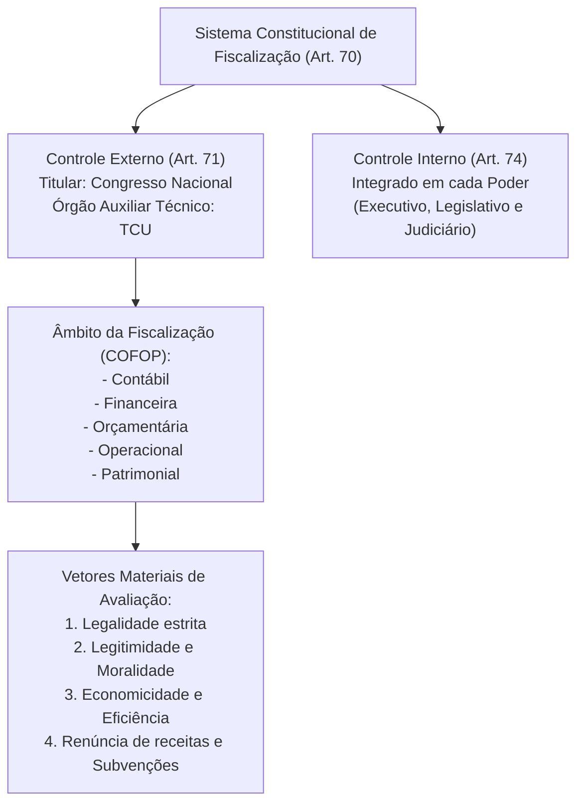
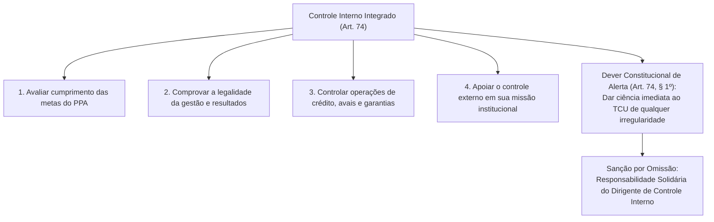
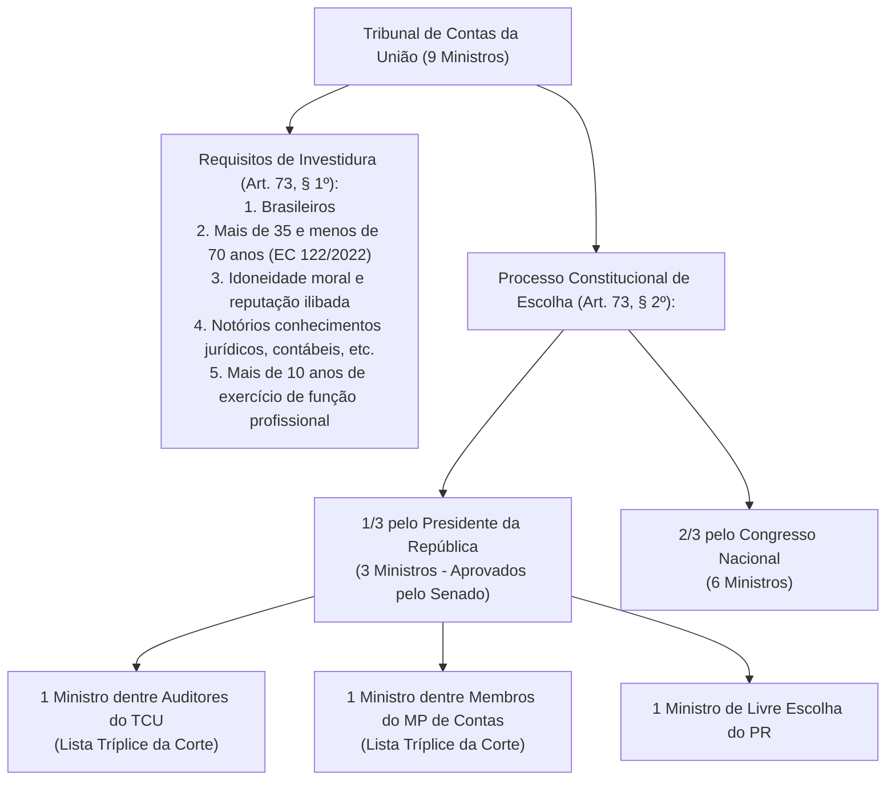
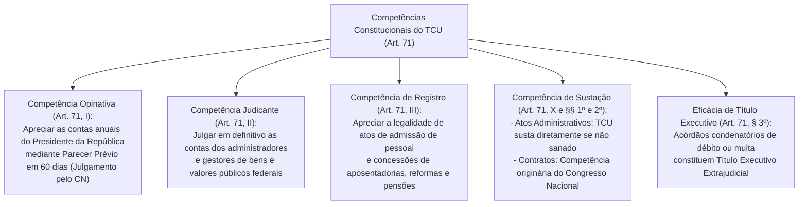

# Fiscalização Contábil, Financeira, Orçamentária e o Tribunal de Contas da União

> O modelo republicano de responsabilidade e integridade fiscal assenta na fiscalização contábil, financeira, orçamentária, operacional e patrimonial (COFOP) da Administração Pública e de qualquer gestor de recursos coletivos. O controle externo é titularizado pelo Poder Legislativo com o auxílio técnico e indeclinável dos Tribunais de Contas — órgãos dotados de autonomia orgânica e funcional —, operando em sinergia integrada com os sistemas de controle interno dos Poderes. As deliberações das Cortes de Contas ostentam natureza judicante administrativa com eficácia executiva direta de seus títulos condenatórios, sujeitando-se aos parâmetros estritos de separação dos poderes delineados pelo Supremo Tribunal Federal.

---

## 1. O Sistema Constitucional de Fiscalização (Arts. 70 e 71)

A fiscalização dos recursos públicos no ordenamento brasileiro é estruturada de forma dual e complementar: o **controle externo** (exercido pelo Congresso Nacional com o auxílio do Tribunal de Contas da União) e o **controle interno** (mantido de forma integrada por cada um dos Poderes).

### 1.1. Âmbito Material (Fiscalização COFOP) e Critérios de Controle
A fiscalização vai além do mero exame formal de conformidade da despesa (legalidade estrita), abrangendo:
* **Legalidade:** Conformidade com as leis orçamentárias, licitatórias e fiscais.
* **Legitimidade:** Avaliação do atendimento ao interesse público, impessoalidade e moralidade republicana.
* **Economicidade:** Relação custo-benefício, aferindo se os recursos foram geridos sem desperdício ou sobrepreço.
* **Operacional:** Desempenho e eficácia na execução dos programas de governo e metas finalísticas.
* **Patrimonial e Renúncia de Receitas:** Fiscalização da guarda de bens públicos e da concessão de incentivos fiscais e renúncias tributárias.

### 1.2. Sujeito Passivo do Dever de Prestar Contas (Art. 70, Parágrafo Único)
Prestará contas **qualquer pessoa física ou jurídica, pública ou privada**, que:
1. Utilize, arrecade, guarde, gerencie ou administre dinheiros, bens e valores públicos federais;
2. Pelos quais a União responda; ou
3. Que, em nome desta, assuma obrigações de natureza pecuniária.

O dever de prestar contas incide inclusive sobre entidades do terceiro setor (OSs, OSCIPs e ONGs) que recebam repasses públicos (termo de colaboração ou fomento), bem como sobre os conselhos de fiscalização profissional (autarquias corporativas).

---

## 2. O Sistema Integrado de Controle Interno (Art. 74)

Os Poderes Legislativo, Executivo e Judiciário manterão, de forma integrada, sistema de controle interno com finalidades expressamente consagradas na Carta Magna:

### 2.1. Relação Institucional entre Controle Interno e Controle Externo
* **Inexistência de Subordinação Hierárquica:** Os órgãos de controle interno integram as estruturas administrativas de seus respectivos Poderes (ex: CGU no Executivo Federal). **O Tribunal de Contas não é superior hierárquico do controle interno**, sendo inconstitucional qualquer tentativa de subordinação ou determinação compulsória de auditorias como se houvesse comando vertical (STF).
* **Responsabilidade Solidária do Art. 74, § 1º:** Os responsáveis pelo controle interno, ao tomarem conhecimento de qualquer irregularidade ou ilegalidade, **deverão dar ciência ao Tribunal de Contas da União, sob pena de responsabilidade solidária**. A inércia dolosa ou culposa do controlador interno acarreta sua corresponsabilização pelos danos causados ao erário.
* **Denúncia por Cidadãos e Entidades (Art. 74, § 2º):** Qualquer cidadão, partido político, associação ou sindicato é parte legítima para, na forma da lei, **denunciar irregularidades ou ilegalidades** perante o Tribunal de Contas da União. Para o cidadão, trata-se de um **direito/faculdade republicana**, e não de um dever legal coercitivo punível com sanção pecuniária.

---

## 3. Estrutura, Composição e Garantias do TCU (Art. 73)

O Tribunal de Contas da União é composto por **nove Ministros**, sediado em Brasília, com jurisdição em todo o território nacional (art. 73, caput).

### 3.1. Garantias e Prerrogativas dos Ministros do TCU (Art. 73, § 3º)
Os Ministros do TCU terão as **mesmas garantias, prerrogativas, impedimentos, vencimentos e vantagens dos Ministros do Superior Tribunal de Justiça (STJ)**. Gozam de vitaliciedade (após posse), inamovibilidade e irredutibilidade de subsídios, e aplicam-se-lhes as normas da LOMAN sobre aposentadoria e pensão.

### 3.2. O Ministério Público de Contas e a Tese de Repercussão Geral (Tema 642 do STF)
* **Estrutura Especial (Art. 130):** O Ministério Público junto ao Tribunal de Contas (MP de Contas) é um órgão especial que oficia exclusivamente perante a Corte de Contas. Seus membros gozam de direitos, vedações e prerrogativas equivalentes aos membros do Ministério Público comum.
* **Ilegitimidade para Execução Judicial (Tema 642 do STF):** O STF fixou a tese vinculante de que **o Ministério Público de Contas NÃO possui legitimidade para ajuizar ação de execução fiscal de título executivo decorrente de acórdão do Tribunal de Contas** (condenação em débito ou multa). A legitimidade extraordinária para a cobrança executiva pertence exclusivamente ao **ente federativo titular do crédito financeiro lesado**, atuando por intermédio de sua respectiva Procuradoria judicial (Advocacia-Geral da União, Procuradoria-Geral do Estado ou Procuradoria do Município).

### 3.3. O Princípio da Simetria nos Tribunais de Contas Estaduais (Art. 75)
As normas federais sobre fiscalização e tribunais de contas aplicam-se, no que couber, à organização, composição e fiscalização dos Tribunais de Contas dos Estados e do Distrito Federal, bem como dos Tribunais e Conselhos de Contas dos Municípios (onde houver):
* Os Tribunais de Contas dos Estados (TCEs) são compostos por **sete Conselheiros** (art. 75, parágrafo único).
* O modelo de repartição das vagas estaduais é proporcional: **3 Conselheiros escolhidos pelo Governador** (com aprovação da Assembleia Legislativa, sendo 1 auditor, 1 do MP de Contas e 1 de livre escolha) e **4 Conselheiros escolhidos pela Assembleia Legislativa**.

---

## 4. Competências Constitucionais do TCU (Art. 71)

O art. 71 da CF/88 consagra o vasto catálogo de atribuições do Tribunal de Contas da União:

### 4.1. Contas de Governo (Presidente) vs. Contas de Gestão (Administradores)
* **Contas Prestadas pelo Presidente da República (Art. 71, I):** O TCU emite **parecer prévio conclusivo no prazo improrrogável de 60 dias** contados de seu recebimento. O parecer prévio tem caráter técnico-consultivo; a competência indelegável para **julgar definitivamente** as contas presidenciais é do **Congresso Nacional** (art. 49, IX).
* **Contas dos Demais Administradores Públicos (Art. 71, II):** O TCU tem competência judicante expressa para **julgar** com força de definitividade administrativa as contas de diretores, secretários, ordenadores de despesas e gestores da administração direta e indireta.

### 4.2. Registro de Atos de Admissão e Aposentadorias (Art. 71, III)
* **Natureza de Ato Complexo:** O ato de concessão de aposentadoria, reforma ou pensão só se aperfeiçoa e se torna definitivo após a homologação e registro pelo Tribunal de Contas (STF, Súmula Vinculante 3).
* **Prazo Decadencial Quinquenal (Tema 445 do STF):** O STF pacificou que os Tribunais de Contas estão sujeitos ao **prazo de 5 anos** para o julgamento da legalidade do ato de concessão inicial de aposentadoria/pensão, contados da chegada do processo à Corte de Contas. Decorrido o quinquênio sem decisão, opera-se a estabilização e a necessidade de contraditório e ampla defesa prévia.

### 4.3. Sustação de Atos vs. Sustação de Contratos Administrativos
As bancas examinadoras cobram intensamente a distinção procedimental do art. 71:

| Espécie de Ato Irregular | Quem Determina a Sustação? | Procedimento Constitucional (Art. 71, X e §§ 1º e 2º) |
| :--- | :--- | :--- |
| **Ato Administrativo** (Regulamento, Portaria, Edital, Nomeação) | **O próprio Tribunal de Contas** | Se verificado vício de legalidade, o TCU assina prazo para que o órgão adote providências. Desatendida a ordem, **o TCU susta diretamente a execução do ato impugnado** e comunica a decisão à Câmara e ao Senado (art. 71, X e § 1º). |
| **Contrato Administrativo** (Obras, Serviços, Fornecimento) | **O Congresso Nacional** *(Regra)* **O TCU em caráter subsidiário** *(Exceção)* | O ato de sustação de contrato administrativo é de **competência primária do Congresso Nacional**, que solicitará, de imediato, ao Poder Executivo as medidas cabíveis (art. 71, § 1º). Se o Congresso ou o Executivo não efetivarem a medida no prazo de **90 dias**, o **Tribunal de Contas decidirá a respeito da sustação** (art. 71, § 2º). |

> **Fique Ligado:** O Tribunal de Contas **NÃO pode sustar contratos administrativos diretamente de imediato**. A sustação direta imediata pelo TCU só é admitida para **atos administrativos**. Em contratos, a primazia pertence ao Congresso Nacional; o TCU só assume competência decisória supletiva se o Parlamento permanecer inerte após o decurso do prazo de 90 dias.

### 4.4. Decisões Condenatórias e Título Executivo Extrajudicial (Art. 71, § 3º)
As decisões do Tribunal de Contas de que resulte imputação de débito (ressarcimento de dano ao erário) ou cominação de multa pecuniária **terão eficácia de título executivo extrajudicial**.
* Não necessitam de ação judicial prévia de conhecimento para acertamento do direito.
* Ajuíza-se diretamente a competente Ação de Execução de Título Extrajudicial pela Fazenda Pública lesada perante a vara judicial competente.
* O acórdão condenatório não constitui título executivo judicial, mas sim extrajudicial, decorrente de deliberação de órgão administrativo de controle.

---

## 5. Questões Paradigmáticas Aplicadas

### [Questão 01](https://www.qconcursos.com/questoes-de-concursos/questoes/4245612) — [FCC — TJ-CE / Técnico Judiciário — 2026]

De acordo com a Constituição Federal de 1988, os Poderes Legislativo, Executivo e Judiciário devem manter, de forma integrada, sistema de controle interno. É uma das finalidades e/ou requisitos constitucionais do controle interno

* **A)** comprovar a legalidade da aplicação de recursos públicos por entidades de direito privado e determinar a devolução dos valores irregularmente utilizados.
* **B)** apreciar as contas prestadas anualmente pelo Chefe do Poder Executivo e emitir parecer prévio para encaminhamento ao Poder Legislativo.
* **C)** exercer o controle das operações de crédito, avais e garantias, bem como dos direitos e haveres, podendo sustar a execução de atos que impliquem comprometimento irregular do crédito público.
* **D)** apoiar o controle externo, sendo os responsáveis pelo controle interno obrigados a dar ciência ao Tribunal de Contas de qualquer irregularidade ou ilegalidade de que tomarem conhecimento, sob pena de responsabilidade solidária.
* **E)** aplicar aos responsáveis, em caso de ilegalidade de despesa ou irregularidade de contas, as sanções previstas em lei.

#### Gabarito: **D**
* **A (Errada):** comprovar a legalidade da aplicação de recursos públicos por entidades de direito privado e determinar a devolução dos valores irregularmente utilizados. A imputação de débito e a determinação de ressarcimento cogente cabem primordialmente à jurisdição de contas do controle externo (art. 71, II e VIII), e não ao sistema de controle interno.
* **B (Errada):** apreciar as contas prestadas anualmente pelo Chefe do Poder Executivo e emitir parecer prévio para encaminhamento ao Poder Legislativo. Essa é competência privativa expressa do Tribunal de Contas (art. 71, I), exercida na seara do controle externo.
* **C (Errada):** exercer o controle das operações de crédito, avais e garantias, bem como dos direitos e haveres, podendo sustar a execução de atos que impliquem comprometimento irregular do crédito público. O controle interno examina as operações de crédito (art. 74, III), mas a competência para sustar atos ou contratos submete-se ao regramento do controle externo (art. 71, X e § 1º).
* **D (Certa):** apoiar o controle externo, sendo os responsáveis pelo controle interno obrigados a dar ciência ao Tribunal de Contas de qualquer irregularidade ou ilegalidade de que tomarem conhecimento, sob pena de responsabilidade solidária. A alternativa sintetiza os dois núcleos fundamentais do art. 74 da CF/88: apoiar o controle externo no exercício de sua missão institucional (inciso IV) e o dever inafastável imposto aos responsáveis pelo controle interno de comunicar as ilegalidades ao Tribunal de Contas, sob cominação expressa de responsabilidade solidária (§ 1º).
* **E (Errada):** aplicar aos responsáveis, em caso de ilegalidade de despesa ou irregularidade de contas, as sanções previstas em lei. A aplicação sancionatória de multas e imputação de débito no processo de controle é atribuição outorgada ao Tribunal de Contas (art. 71, VIII).

---

### [Questão 02](https://www.qconcursos.com/questoes-de-concursos/questoes/4278490) — [FUNDATEC — Câmara de Palhoça - SC / Técnico Legislativo — 2026]

Acerca da fiscalização contábil, financeira e orçamentária e suas disposições constitucionais, assinale a alternativa correta.

* **A)** O Tribunal de Contas da União encaminhará ao Congresso Nacional, mensal e anualmente, relatório de suas atividades.
* **B)** Os Ministros do Tribunal de Contas da União terão as mesmas garantias, prerrogativas, impedimentos, vencimentos e vantagens dos Ministros do Superior Tribunal de Justiça.
* **C)** As Constituições estaduais disporão sobre os Tribunais de Contas respectivos, que serão integrados por onze Conselheiros.
* **D)** As decisões do Tribunal de que resulte imputação de débito ou multa terão eficácia de título executivo judicial.
* **E)** O controle externo, a cargo do Congresso Nacional, será exercido com o auxílio do Tribunal de Contas da União, ao qual compete, dentre outras atribuições, apreciar as contas prestadas anualmente pelo Presidente da República, mediante parecer prévio que deverá ser elaborado em cento e oitenta dias a contar de seu recebimento.

#### Gabarito: **B**
* **A (Errada):** O Tribunal de Contas da União encaminhará ao Congresso Nacional, mensal e anualmente, relatório de suas atividades. O art. 71, § 4º, da CF/88 prevê que o TCU encaminhará ao Congresso relatório de suas atividades **trimestral e anualmente**, e não mensalmente.
* **B (Certa):** Os Ministros do Tribunal de Contas da União terão as mesmas garantias, prerrogativas, impedimentos, vencimentos e vantagens dos Ministros do Superior Tribunal de Justiça. Trata-se da reprodução literal do art. 73, § 3º, da Carta Magna, equiparando plenamente o estatuto funcional e remuneratório dos Ministros do TCU aos membros do Superior Tribunal de Justiça (STJ).
* **C (Errada):** As Constituições estaduais disporão sobre os Tribunais de Contas respectivos, que serão integrados por onze Conselheiros. Os Tribunais de Contas dos Estados são compostos por **sete Conselheiros** (art. 75, parágrafo único da CF/88).
* **D (Errada):** As decisões do Tribunal de que resulte imputação de débito ou multa terão eficácia de título executivo judicial. O art. 71, § 3º, prescreve eficácia de título executivo (de natureza **extrajudicial**, por emanar de autoridade administrativa independente).
* **E (Errada):** O controle externo, a cargo do Congresso Nacional, será exercido com o auxílio do Tribunal de Contas da União, ao qual compete, dentre outras atribuições, apreciar as contas prestadas anualmente pelo Presidente da República, mediante parecer prévio que deverá ser elaborado em cento e oitenta dias a contar de seu recebimento. O prazo constitucional para a emissão do parecer prévio pelo TCU é de **sessenta dias** a contar do recebimento das contas (art. 71, I).

---

### [Questão 03](https://www.qconcursos.com/questoes-de-concursos/questoes/4293548) — [VUNESP — Prefeitura de Jardinópolis - SP / Procurador Jurídico — 2026]

Em relação ao auxílio que o Tribunal de Contas presta ao Congresso Nacional no exercício do controle externo, assinale a alternativa correta.

* **A)** Compete ao Tribunal julgar as contas dos administradores e demais responsáveis por dinheiros, bens e valores públicos da administração direta e indireta, incluindo as fundações e sociedades instituídas e mantidas pelo Poder Público federal.
* **B)** O Tribunal possui a atribuição de julgar as contas prestadas anualmente pelo presidente da República, devendo elaborar um parecer prévio em até trinta dias a contar de seu recebimento.
* **C)** No caso de ilegalidade em contrato administrativo, o ato de sustação deve ser adotado diretamente pelo Tribunal de Contas, que solicitará ao Poder Judiciário as medidas cabíveis.
* **D)** O Tribunal deve apreciar, para fins de registro, a legalidade dos atos de admissão de pessoal na administração direta e indireta, abrangendo inclusive as nomeações para cargos de provimento em comissão.
* **E)** As decisões do Tribunal de que resulte imputação de débito ou multa possuem natureza de recomendação, dependendo de confirmação pelo Poder Executivo para possuírem eficácia de título executivo.

#### Gabarito: **A**
* **A (Certa):** Compete ao Tribunal julgar as contas dos administradores e demais responsáveis por dinheiros, bens e valores públicos da administração direta e indireta, incluindo as fundações e sociedades instituídas e mantidas pelo Poder Público federal. Representa a clássica competência judicante administrativa outorgada ao TCU no art. 71, II, da CF/88, com força definitiva e imutável no âmbito gracioso.
* **B (Errada):** O Tribunal possui a atribuição de julgar as contas prestadas anualmente pelo presidente da República, devendo elaborar um parecer prévio em até trinta dias a contar de seu recebimento. O TCU apenas **aprecia** as contas do Presidente mediante parecer prévio no prazo de **sessenta dias** (art. 71, I); o julgamento definitivo cabe privativamente ao Congresso Nacional (art. 49, IX).
* **C (Errada):** No caso de ilegalidade em contrato administrativo, o ato de sustação deve ser adotado diretamente pelo Tribunal de Contas, que solicitará ao Poder Judiciário as medidas cabíveis. A competência originária para sustar a execução de contrato administrativo é do **Congresso Nacional**, que solicitará medidas ao Executivo (art. 71, § 1º).
* **D (Errada):** O Tribunal deve apreciar, para fins de registro, a legalidade dos atos de admissão de pessoal na administração direta e indireta, inclusive as nomeações para cargo de provimento em comissão. O art. 71, III, **ressalva expressamente as nomeações para cargo em comissão**, as quais não dependem de registro pelo Tribunal de Contas.

---

### [Questão 04](https://www.qconcursos.com/questoes-de-concursos/questoes/4156559) — [FCC — AL-RR / Consultor Legislativo — 2026]

Herman é brasileiro, tem 65 anos de idade, idoneidade moral e reputação ilibada e também possui notórios conhecimentos jurídicos, contábeis, econômicos e financeiros, comprováveis através de quinze anos de exercício de função que exigem esses conhecimentos mencionados. De acordo com a Constituição Federal de 1988, com base apenas nas informações fornecidas, nessa situação, os requisitos para a nomeação de Herman como Ministro do Tribunal de Contas da União

* **A)** não estão presentes, sendo que os Ministros do referido Tribunal serão escolhidos: dois terços pelo Presidente da República, na forma estabelecida na Constituição Federal; e um terço pelo Congresso Nacional.
* **B)** estão presentes, sendo que os Ministros do referido Tribunal somente podem ser escolhidos pelo Senado Federal, com aprovação do Presidente da República.
* **C)** não estão presentes, sendo que os Ministros do referido Tribunal serão escolhidos: um terço pelo Presidente da República, na forma estabelecida na Constituição Federal; e dois terços pela Câmara dos Deputados.
* **D)** não estão presentes, sendo que os Ministros do referido Tribunal somente podem ser escolhidos pelo Presidente República, dentre auditores e membros do Ministério Público junto ao Tribunal.
* **E)** estão presentes, sendo que os Ministros do referido Tribunal serão escolhidos: um terço pelo Presidente da República, forma estabelecida na Constituição Federal; e dois terços pelo Congresso Nacional.

#### Gabarito: **E**
* **A (Errada):** não estão presentes, sendo que os Ministros do referido Tribunal serão escolhidos: dois terços pelo Presidente da República, na forma estabelecida na Constituição Federal; e um terço pelo Congresso Nacional. A proporção está invertida.
* **B (Errada):** estão presentes, sendo que os Ministros do referido Tribunal somente podem ser escolhidos pelo Senado Federal, com aprovação do Presidente da República. A indicação majoritária é do Congresso Nacional e a aprovação do Senado incide apenas sobre a parcela indicada pelo Presidente.
* **C (Errada):** não estão presentes, sendo que os Ministros do referido Tribunal serão escolhidos: um terço pelo Presidente da República, na forma estabelecida na Constituição Federal; e dois terços pela Câmara dos Deputados. A escolha dos 2/3 cabe ao Congresso Nacional (reunião conjunta), e não isoladamente à Câmara dos Deputados.
* **D (Errada):** não estão presentes, sendo que os Ministros do referido Tribunal somente podem ser escolhidos pelo Presidente República, dentre auditores e membros do Ministério Público junto ao Tribunal. Apenas duas vagas do terço presidencial são reservadas obrigatoriamente a auditores e membros do MP de Contas (art. 73, § 2º, I).
* **E (Certa):** estão presentes, sendo que os Ministros do referido Tribunal serão escolhidos: um terço pelo Presidente da República, na forma estabelecida na Constituição Federal; e dois terços pelo Congresso Nacional. Herman cumpre todos os requisitos do art. 73, § 1º: brasileiro, idade entre 35 e 70 anos (com a EC 122/2022 o teto etário foi elevado de 65 para menos de 70 anos), idoneidade moral e mais de 10 anos de notórios conhecimentos e prática profissional. Por sua vez, a repartição das 9 vagas obedece estritamente ao art. 73, § 2º: **um terço pelo Presidente da República** (com aprovação do Senado) e **dois terços pelo Congresso Nacional**.

---

### [Questão 05](https://www.qconcursos.com/questoes-de-concursos/questoes/4073891) — [VUNESP — Câmara de São Roque - SP / Procurador Jurídico — 2026]

Relativamente ao sistema de fiscalização contábil, financeira, orçamentária, operacional e patrimonial exercido pelo Poder Legislativo, com o auxílio do Tribunal de Contas, à luz da Constituição Federal e da jurisprudência do STF, assinale a alternativa correta.

* **A)** Os Tribunais de Contas, na qualidade de órgãos auxiliares do Poder Legislativo, possuem competência constitucional para sustar, diretamente e por ato próprio, a execução de contratos administrativos que apresentarem irregularidades graves, independentemente de comunicação prévia ou autorização do Poder Legislativo.
* **B)** O controle externo, a cargo do Poder Legislativo, será exercido pelo Tribunal de Contas vinculado, ao qual compete julgar as contas prestadas anualmente pelo Chefe do Poder Executivo.
* **C)** O Ministério Público de Contas, que atua junto aos Tribunais de Contas, possui quadro de pessoal próprio, estrutura e garantias funcionais equivalentes às do Ministério Público comum, sendo o seu chefe nomeado pelo Governador, a partir de lista tríplice enviada pelo Tribunal de Contas.
* **D)** Observada a regra da simetria constitucional, a com posição dos Tribunais de Contas dos Estados e dos Municípios, onde houver, deve observar a mesma composição do Tribunal de Contas da União, que é integrado por nove Ministros, dentre brasileiros n atos, com mais de vinte e um e menos de sessenta e cinco anos de idade, idoneidade moral e reputação ilibada, além de notórios conhecimentos jurídicos, contábeis, econômicos ou financeiros ou de administração pública.
* **E)** Compete ao Tribunal de Contas da União julgar as contas dos administradores e demais responsáveis por dinheiros, bens e valores públicos da administração direta e indireta, incluídas as fundações e sociedades instituídas e mantidas pelo Poder Público federal, sendo certo que as decisões do Tribunal de que resulte imputação de débito ou multa terão eficácia de título executivo.

#### Gabarito: **E**
* **A (Errada):** Os Tribunais de Contas, na qualidade de órgãos auxiliares do Poder Legislativo, possuem competência constitucional para sustar, diretamente e por ato próprio, a execução de contratos administrativos que apresentarem irregularidades graves, independentemente de comunicação prévia ou autorização do Poder Legislativo. A sustação de contrato administrativo é de competência privativa do Poder Legislativo (art. 71, § 1º).
* **B (Errada):** O controle externo, a cargo do Poder Legislativo, será exercido pelo Tribunal de Contas vinculado, ao qual compete julgar as contas prestadas anualmente pelo Chefe do Poder Executivo. As contas anuais do Chefe do Executivo são julgadas pelo Legislativo, cabendo ao Tribunal de Contas apenas a emissão de parecer prévio opinativo.
* **C (Errada):** O Ministério Público de Contas, que atua junto aos Tribunais de Contas, possui quadro de pessoal próprio, estrutura e garantias funcionais equivalentes às do Ministério Público comum, sendo o seu chefe nomeado pelo Governador, a partir de lista tríplice enviada pelo Tribunal de Contas. O MPC não possui orçamento ou personalidade jurídica autônoma em relação ao respectivo Tribunal de Contas, integrando a estrutura orgânica da própria Corte de Contas.
* **D (Errada):** Observada a regra da simetria constitucional, a composição dos Tribunais de Contas dos Estados e dos Municípios, onde houver, deve observar a mesma composição do Tribunal de Contas da União, que é integrado por nove Ministros... Os Tribunais de Contas dos Estados são compostos por **sete Conselheiros** (art. 75, parágrafo único), e a idade de ingresso é de mais de 35 e menos de 70 anos.
* **E (Certa):** Compete ao Tribunal de Contas da União julgar as contas dos administradores e demais responsáveis por dinheiros, bens e valores públicos da administração direta e indireta, incluídas as fundações e sociedades instituídas e mantidas pelo Poder Público federal, sendo certo que as decisões do Tribunal de que resulte imputação de débito ou multa terão eficácia de título executivo. A assertiva expressa a exata dicção do art. 71, II c/c § 3º, da Carta Constitucional de 1988.

---

### [Questão 06](https://www.qconcursos.com/questoes-de-concursos/questoes/4014854) — [Quadrix — CRBM 6ª Região / Contador — 2026]

Um contador, responsável pela área contábil de um conselho profissional, deve observar a legislação constitucional, financeira e administrativa aplicável à gestão pública. Com base nessa informação, julgue o item a seguir.
A fiscalização contábil, a financeira, a orçamentária, a operacional e a patrimonial da Administração Pública federal é exercida exclusivamente pelo Tribunal de Contas da União.
* **C (Errado):** A fiscalização não é exclusiva do TCU. O art. 70 da CF estabelece que a fiscalização será exercida pelo **Congresso Nacional, mediante controle externo**, e pelo **sistema de controle interno de cada Poder**. O TCU é o órgão técnico auxiliar no controle externo, mas não o titular exclusivo.
* **E (Certo):** O item está incorreto ao asseverar a exclusividade do Tribunal de Contas da União, ignorando o papel titular do Congresso Nacional no controle externo e a atuação compartilhada do sistema integrado de controle interno.

* **C)** Certo
* **E)** Errado

#### Gabarito: **Errado**

---

### [Questão 07](https://www.qconcursos.com/questoes-de-concursos/questoes/4014862) — [Quadrix — CRBM 6ª Região / Contador — 2026]

Um contador, responsável pela área contábil de um conselho profissional, deve observar a legislação constitucional, financeira e administrativa aplicável à gestão pública. Com base nessa informação, julgue o item a seguir.
Nos termos da Constituição Federal de 1988, o sistema de controle interno da Administração Pública tem como finalidade exclusiva substituir o controle externo exercido pelo tribunal de contas.
* **C (Errado):** O controle interno não substitui nem possui vocação excludente sobre o controle externo; sua missão constitucional precípua é **apoiar o controle externo** no exercício de sua missão institucional (art. 74, IV), atuando de forma integrada e concomitante.
* **E (Certo):** A assertiva é manifestamente errônea ao afirmar a finalidade de substituição do controle externo pelo controle interno.

* **C)** Certo
* **E)** Errado

#### Gabarito: **Errado**

---

### [Questão 08](https://www.qconcursos.com/questoes-de-concursos/questoes/4019675) — [CESPE / CEBRASPE — TCE-RN / Auditor de Controle Externo — 2026]

A respeito das normas de fiscalização contábil, financeira e orçamentária do Poder Legislativo previstas no texto constitucional, julgue o seguinte item.
Ao tomarem conhecimento de qualquer irregularidade ou ilegalidade, os responsáveis pelo controle interno deverão dar ciência ao Tribunal de Contas da União, sob pena de responsabilidade solidária.
* **C (Certo):** Trata-se da reprodução textual do art. 74, § 1º, da Constituição Federal: "Os responsáveis pelo controle interno, ao tomarem conhecimento de qualquer irregularidade ou ilegalidade, dela darão ciência ao Tribunal de Contas da União, sob pena de responsabilidade solidária". O preceito impõe uma obrigação de comunicação imediata sob pena de responsabilização civil, administrativa e funcional do agente de controle.
* **E (Errado):** A afirmação está em perfeita consonância com a norma constitucional cogente.

* **C)** Certo
* **E)** Errado

#### Gabarito: **Certo**

---

### [Questão 09](https://www.qconcursos.com/questoes-de-concursos/questoes/4019676) — [CESPE / CEBRASPE — TCE-RN / Auditor de Controle Externo — 2026]

No que se refere ao controle da administração pública e à atuação dos tribunais de contas, julgue o item a seguir, à luz da Constituição Federal de 1988 e da jurisprudência do STF.
Os tribunais de contas, no exercício do controle externo, podem determinar aos órgãos de controle interno a realização de auditorias, em razão da subordinação deste sistema de controle àquele.
* **C (Errado):** Os órgãos de controle interno não mantêm qualquer vínculo de subordinação hierárquica perante o Tribunal de Contas. Conforme pacífica orientação do Supremo Tribunal Federal, os sistemas de controle operam de modo autônomo e colaborativo, sendo inconstitucional qualquer tentativa de ingerência mandatória do Tribunal de Contas sobre o planejamento e a realização de auditorias do controle interno.
* **E (Certo):** O item é incorreto em razão de afirmar falsamente a existência de subordinação hierárquica entre o controle interno e a Corte de Contas.

* **C)** Certo
* **E)** Errado

#### Gabarito: **Errado**

---

### [Questão 10](https://www.qconcursos.com/questoes-de-concursos/questoes/4019677) — [CESPE / CEBRASPE — TCE-RN / Auditor de Controle Externo — 2026]

No que se refere ao controle da administração pública e à atuação dos tribunais de contas, julgue o item a seguir, à luz da Constituição Federal de 1988 e da jurisprudência do STF.
O Ministério Público de Contas não tem legitimidade para a execução de crédito decorrente de multa aplicada por tribunal de contas estadual a agente público municipal em razão de danos causados ao erário municipal.
* **C (Certo):** Conforme tese fixada pelo Supremo Tribunal Federal em regime de Repercussão Geral (**Tema 642, RE 789.474**): "O Ministério Público perante o Tribunal de Contas não tem legitimidade para propor a execução de créditos decorrentes de suas decisões". A titularidade do direito de crédito e a legitimidade para sua execução judicial pertencem ao ente federativo lesado que suportou o prejuízo financeiro (Município), por meio de seus procuradores judiciais.
* **E (Errado):** A assertiva reproduz integralmente a tese jurisprudencial vinculante firmada pela Suprema Corte.

* **C)** Certo
* **E)** Errado

#### Gabarito: **Certo**

---

### [Questão 11](https://www.qconcursos.com/questoes-de-concursos/questoes/4019689) — [CESPE / CEBRASPE — TCE-RN / Auditor de Controle Externo — 2026]

A respeito das normas de fiscalização contábil, financeira e orçamentária do Poder Legislativo previstas no texto constitucional, julgue o seguinte item.
Ao tomar conhecimento de ilegalidades, qualquer cidadão tem o dever legal de denunciá-las perante o Tribunal de Contas da União.
* **C (Errado):** A Constituição não estabelece um dever coercitivo punível ao cidadão. O art. 74, § 2º, estabelece uma **legitimidade ativa facultativa**: "Qualquer cidadão, partido político, associação ou sindicato é parte legítima para, na forma da lei, denunciar irregularidades ou ilegalidades perante o Tribunal de Contas da União". Trata-se de direito cívico de controle social, e não de obrigação jurídica cominatória.
* **E (Certo):** O item é falso ao transformar uma faculdade cívica de legitimidade em um suposto "dever legal".

* **C)** Certo
* **E)** Errado

#### Gabarito: **Errado**

---

### [Questão 12](https://www.qconcursos.com/questoes-de-concursos/questoes/4215599) — [IDECAN — UNILAB / Assistente em Administração — 2026]

Assinale a alternativa que apresenta corretamente o órgão competente para o controle externo.

* **A)** Ministérios da Fazenda e Planejamento, via auditorias internas.
* **B)** Tribunais de Contas, com auxílio do Poder Legislativo correspondente.
* **C)** Secretaria da Receita Federal com poder de veto contábil.
* **D)** Poder Judiciário mediante pedido do Ministério Público Federal.

#### Gabarito: **B**
* **A (Errada):** Ministérios da Fazenda e Planejamento, via auditorias internas. Integram a estrutura de controle interno e gestão orçamentária do Poder Executivo.
* **B (Certa):** Tribunais de Contas, com auxílio do Poder Legislativo correspondente. No contexto das opções formuladas pela banca, identifica a atuação integrada do controle externo outorgada constitucionalmente aos Tribunais de Contas no exercício do mister fiscalizatório em conjunto e sob o comando titular do Poder Legislativo (art. 71 da CF/88).
* **C (Errada):** Secretaria da Receita Federal com poder de veto contábil. A Receita Federal atua na administração aduaneira e tributária, sem competência para controle externo ou veto contábil.
* **D (Errada):** Poder Judiciário mediante pedido do Ministério Público Federal. O Judiciário atua no controle jurisdicional, e não no controle externo contábil-financeiro permanente do art. 70 da CF.

---
