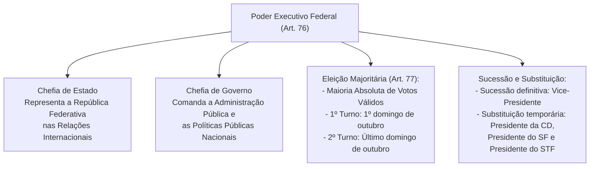
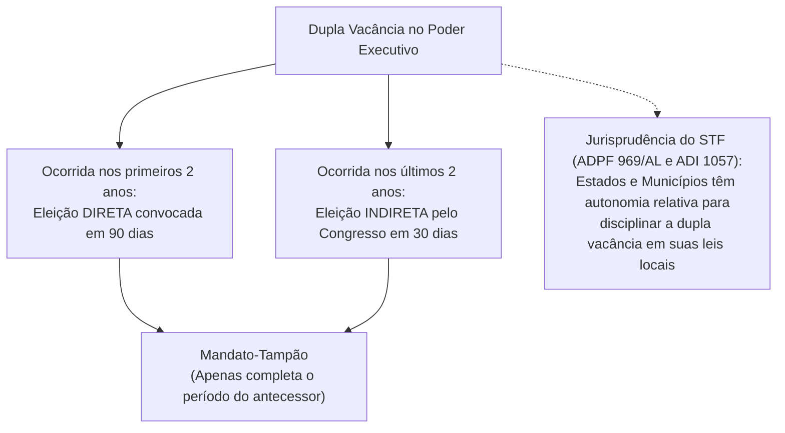
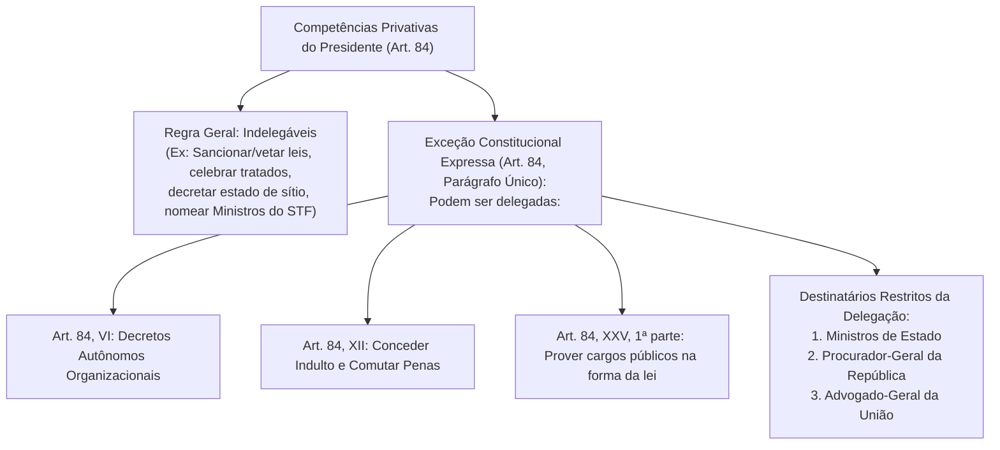
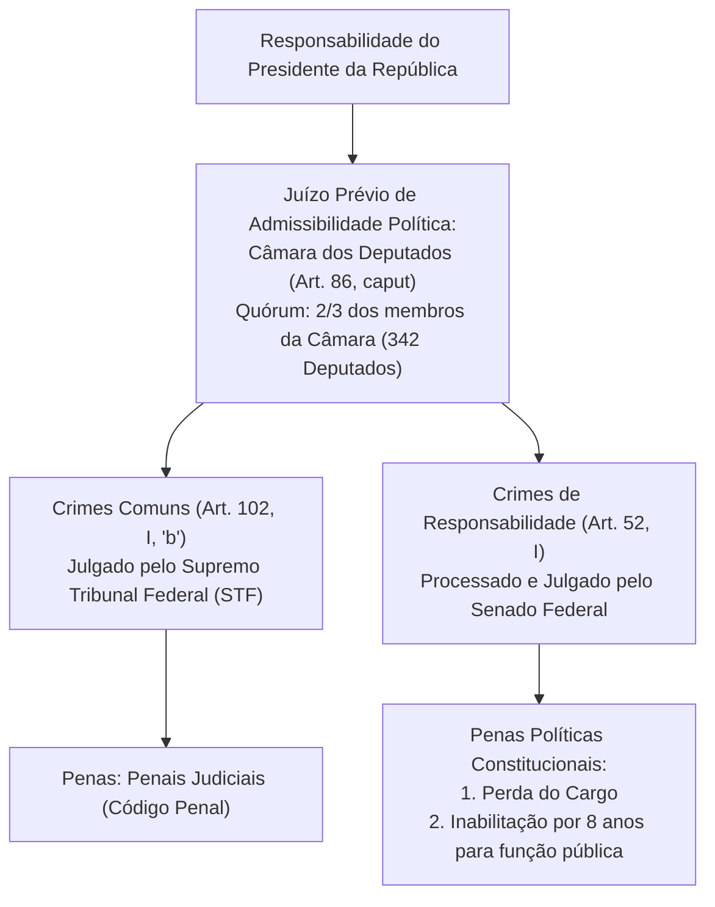
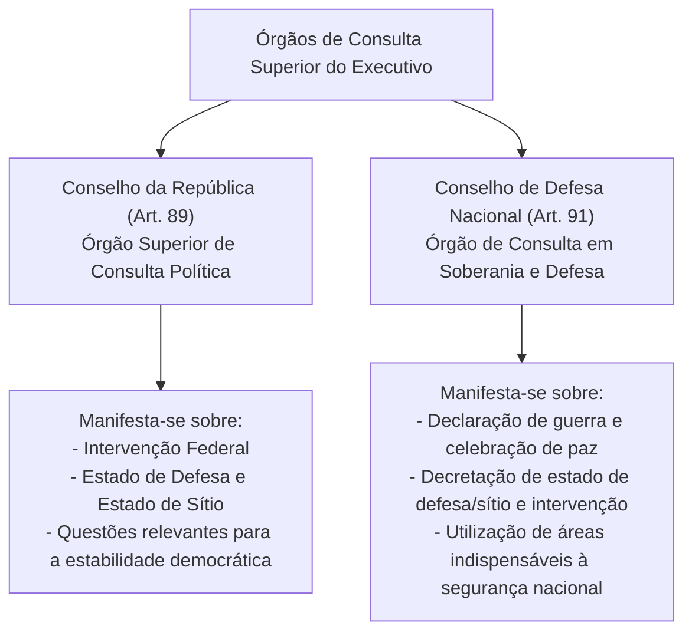

# Poder Executivo: Presidencialismo, Atribuições do Presidente, Decreto Autônomo e Crimes de Responsabilidade

> O Poder Executivo no constitucionalismo brasileiro consagra o sistema presidencialista de governo, unificando na figura do Presidente da República as funções de Chefe de Estado (representação soberana da Federação) e Chefe de Governo (direção superior da administração federal). O exercício das competências regulamentares executivas desdobra-se entre a expedição de decretos para fiel execução das leis e a edição restrita de decretos autônomos organizacionais, sem incremento de despesas. A tutela da integridade institucional é regida pelo sistema de responsabilização política (*impeachment*) e penal, assegurando-se garantias procedimentais com juízo prévio qualificado de admissibilidade perante a Câmara dos Deputados e a imunidade processual temporária por atos estranhos ao mandato.

---

## 1. Sistema Presidencialista, Eleição e Dinâmica Sucessória

No sistema de governo presidencialista, a chefia do Poder Executivo é monocrática e personalíssima, exercida pelo Presidente da República com o auxílio dos Ministros de Estado (art. 76 da CF/88).

### 1.1. Eleição e Mandato Presidencial (Art. 77)
* **Sistema Eleitoral:** Majoritário de dois turnos (maioria absoluta de votos, desconsiderados os brancos e nulos). Se nenhum candidato alcançar a maioria absoluta na primeira votação, realiza-se o segundo turno entre os dois mais votados.
* **Duração do Mandato:** Mandato de **4 anos**, permitida a reeleição para um único período subsequente (art. 14, § 5º).
* **Posse:** Prestada perante o Congresso Nacional em sessão conjunta (art. 78). Se, decorridos **10 dias** da data fixada para a posse, o Presidente ou o Vice-Presidente não tiver assumido o cargo (salvo motivo de força maior), este será declarado vago.

### 1.2. Linha Sucessória e Substituição Temporária (Arts. 79 e 80)
* **Substituição (Temporária) e Sucessão (Definitiva):** O Vice-Presidente da República substitui o Presidente em caso de impedimento e sucede-lhe no de vaga (art. 79).
* **Ordem Legal de Substituição Temporária (Art. 80):** Em caso de impedimento do Presidente e do Vice-Presidente, ou vacância de ambos os cargos, serão sucessivamente chamados ao exercício da Presidência:
  1. O **Presidente da Câmara dos Deputados**;
  2. O **Presidente do Senado Federal**;
  3. O **Presidente do Supremo Tribunal Federal**.

### 1.3. A Dupla Vacância da Chefia do Executivo (Art. 81)
Vagando os cargos de Presidente e Vice-Presidente da República, a solução constitucional é pautada pelo momento cronológico da ocorrência da última vaga:

| Período da Dupla Vacância | Modalidade de Eleição | Prazo de Realização | Quem Elegerá? | Duração do Mandato |
| :--- | :--- | :--- | :--- | :--- |
| **Nos primeiros 2 anos** do mandato (1º biênio) | **Eleição Direta** (art. 81, caput) | Em **90 dias** após aberta a última vaga | Pelo **povo brasileiro** por sufrágio universal | Mandato-tampão (restante do período) |
| **Nos últimos 2 anos** do mandato (2º biênio) | **Eleição Indireta** (art. 81, § 1º) | Em **30 dias** após aberta a última vaga | Pelo **Congresso Nacional**, na forma da lei | Mandato-tampão (restante do período) |

> **Fique Ligado:** Na jurisprudência fixada pelo STF (ADPF 969/AL e ADI 1057), **os Estados-membros possuem autonomia relativa para disciplinar a eleição indireta em caso de dupla vacância no último biênio**, não estando rigidamente vinculados ao modelo procedimental federal, desde que respeitados princípios republicanos fundantes, tais como filiação partidária, condições constitucionais de elegibilidade e votação pública nominal.

---

## 2. Atribuições do Presidente da República e Decreto Autônomo (Art. 84)

O art. 84 consagra o extenso rol de competências privativas do Presidente da República. A maior parte das atribuições é indelegável por consubstanciar atos de império e chefia política.

### 2.1. O Decreto Regulamentar vs. O Decreto Autônomo (Art. 84, VI)
* **Decreto Regulamentar ou de Execução (Art. 84, IV):** Expedido com base em lei formal prévia para viabilizar sua fiel aplicação. Jamais pode inovar na ordem jurídica originária, criar obrigações ou restringir direitos não previstos em lei.
* **Decreto Autônomo (Art. 84, VI — redação da EC 32/2001):** Constitui ato normativo primário excepcional expedido pelo Chefe do Executivo sem suporte em lei ordinária prévia, limitado estritamente a duas hipóteses:
  1. **Alínea "a":** Organização e funcionamento da administração federal, **quando não implicar aumento de despesa nem criação ou extinção de órgãos públicos**.
  2. **Alínea "b":** Extinção de funções ou cargos públicos, **quando vagos**.
* **Impossibilidade de Alteração Remuneratória por Decreto:** Conforme a **Súmula Vinculante 37 do STF**, não cabe ao Executivo majorar ou instituir vantagens remuneratórias por decreto sob pretexto de reorganização administrativa ou isonomia. A fixação e aumento de remuneração exigem expressa e indispensável **reserva de lei em sentido estrito** (art. 37, X).

---

## 3. Responsabilidade do Presidente: Crimes Comuns e de Responsabilidade

O Presidente da República sujeita-se a regime jurídico dúplice de responsabilização, diferenciando-se os crimes comuns dos crimes de responsabilidade (*impeachment*).

### 3.1. Crimes de Responsabilidade e o Rito do Impeachment
* **Conceito Constitucional (Art. 85):** São atos do Presidente que atentem contra a Constituição Federal e, especialmente, contra:
  1. A existência da União;
  2. O livre exercício do Poder Legislativo, do Poder Judiciário, do Ministério Público e dos Poderes constitucionais das unidades da Federação;
  3. O exercício dos direitos políticos, individuais e sociais;
  4. A segurança interna do País;
  5. A probidade na administração;
  6. A lei orçamentária;
  7. O cumprimento das leis e das decisões judiciais.
* **Regulamentação Legal:** Definidos em lei especial federal (Lei 1.079/1950), que estabelece as normas de processo e julgamento (Súmula Vinculante 46 do STF: competência privativa da União).
* **Fases do Impeachment:**
  1. *Fase Preliminar (Câmara dos Deputados):* Autorização política formal pelo voto qualificado de **dois terços** de seus membros (art. 86, caput). A Câmara realiza mero juízo de admissibilidade; não julga o mérito.
  2. *Instauração e Julgamento (Senado Federal):* O Senado Federal delibera por maioria simples sobre a instauração formal do processo. Uma vez instaurado, o Presidente é **suspenso de suas funções por até 180 dias** (art. 86, § 1º, II e § 2º).
  3. *Julgamento Final:* Sessão presidida pelo **Presidente do Supremo Tribunal Federal** (art. 52, parágrafo único). A condenação exige o voto favorável de **dois terços dos membros do Senado Federal** (54 senadores), operando a perda imediata do cargo e a inabilitação por 8 anos para o exercício de função pública.

### 3.2. Imunidades e Prerrogativas Processuais do Presidente
1. **Prisão Processual:** O Presidente da República **não pode ser preso**, sob qualquer pretexto cautelar (nem preventiva, nem temporária), antes de eventual sentença condenatória penal definitiva transitada em julgado nos crimes comuns (art. 86, § 3º). Não cabe prisão em flagrante delito para o Chefe de Estado.
2. **Cláusula de Irresponsabilidade Penal Relativa (Art. 86, § 4º):** O Presidente da República, na vigência de seu mandato, **não pode ser responsabilizado por atos estranhos ao exercício de suas funções**.
   * Durante o quadriênio presidencial, a persecução penal por fatos ocorridos antes da posse ou sem liame funcional com o cargo fica completamente sobrestada.
   * Concomitantemente, **o prazo prescricional do crime comum resta suspenso** durante todo o período do mandato.
   * **Inaplicabilidade aos Chefes do Executivo Local:** O STF pacificou que o art. 86, § 4º, **NÃO é norma de reprodução obrigatória**, sendo inconstitucional qualquer dispositivo de Constituição Estadual ou Lei Orgânica Municipal que estenda a imunidade temporária a Governadores de Estado ou Prefeitos (ADI 1.022 e jurisprudência constante).

### 3.3. Tese do Regime Sancionatório Único na Improbidade Administrativa
Conforme consolidado pelo Supremo Tribunal Federal (Pet 3.240, Rcl 2.138 e jurisprudência pacificada):
* O **Presidente da República sujeita-se exclusivamente ao regime sancionatório especial dos crimes de responsabilidade** (art. 85 da CF c/c Lei 1.079/1950), perante o Senado Federal, **sendo inadmissível sua submissão simultânea ou cumulativa às sanções civis da Lei de Improbidade Administrativa (Lei 8.429/1992)**.
* Os **demais agentes políticos** (como Deputados Federais, Senadores, Ministros de Estado, Governadores e Prefeitos) submetem-se ao **duplo regime**: respondem civilmente por ato de improbidade administrativa perante o juízo comum de primeira instância e, no plano político/funcional, aos crimes de responsabilidade perante seus órgãos de julgamento próprios.

---

## 4. Órgãos Consultivos da Presidência da República

A Carta Política estabelece dois conselhos superiores como instâncias de consulta deliberativa prévia do Chefe do Poder Executivo:

---

## 5. Questões Paradigmáticas Aplicadas

### [Questão 01](https://www.qconcursos.com/questoes-de-concursos/questoes/4380276) — [VUNESP — TCE-SP / Auditor de Controle Externo — 2026]

Considere que, no Estado X, houve a dupla vacância da chefia do Poder Executivo, no último biênio, por causas não relacionadas à aplicação da legislação eleitoral. O vice-governador, no primeiro ano do exercício do mandato, foi indicado e passou a ocupar o cargo de conselheiro do Tribunal de Contas do Estado e o governador se afastou do cargo, para descompatibilizar e, portanto, poder concorrer a vaga em cargo eletivo no Poder Legislativo.
A respeito da situação hipotética e com base na jurisprudência do Plenário do Supremo Tribunal, é correto afirmar:

* **A)** não é exigida a filiação partidária ou o registro de candidatura de governador e vice-governador, dadas as especificidades do processo de escolha.
* **B)** por força do princípio constitucional da simetria, a solução do problema da dupla vacância, nas Constituições Estaduais, deve seguir o mesmo modelo previsto na Constituição Federal.
* **C)** caberá ao presidente do Tribunal de Justiça do respectivo Estado, em respeito à simetria, exercer o mandato pelo período remanescente.
* **D)** cabe à Constituição Estadual dar a solução normativa ao problema, não estando o Estado vinculado ao modelo e ao procedimento federal, desde que observadas determinadas condições.
* **E)** somente pode ser candidato à eleição indireta membro do Poder Legislativo Estadual.

#### Gabarito: **D**
* **A (Errada):** não é exigida a filiação partidária ou o registro de candidatura de governador e vice-governador, dadas as especificidades do processo de escolha. O STF assentou que as condições constitucionais de elegibilidade, inclusive a filiação partidária tempestiva e o registro em chapa única, aplicam-se indelevelmente a eleições indiretas (ADPF 969/AL).
* **B (Errada):** por força do princípio constitucional da simetria, a solução do problema da dupla vacância, nas Constituições Estaduais, deve seguir o mesmo modelo previsto na Constituição Federal. O modelo federal do art. 81 não é de reprodução cogente obrigatória aos Estados em seus aspectos estritamente procedimentais.
* **C (Errada):** caberá ao presidente do Tribunal de Justiça do respectivo Estado, em respeito à simetria, exercer o mandato pelo período remanescente. O Presidente do Tribunal de Justiça atua como mero substituto precário temporário até a posse dos eleitos, não exercendo o mandato-tampão em caráter definitivo.
* **D (Certa):** cabe à Constituição Estadual dar a solução normativa ao problema, não estando o Estado vinculado ao modelo e ao procedimento federal, desde que observadas determinadas condições. Conforme tese fixada pelo Plenário do STF no julgamento da **ADPF 969/AL** (Informativo 1104): "Os Estados possuem autonomia relativa na solução normativa do problema da vacância dos cargos de chefe do Poder Executivo e seu vice, não estando vinculados ao modelo federal, desde que observadas as balizas constitucionais da República, da soberania popular e do sistema representativo".
* **E (Errada):** somente pode ser candidato à eleição indireta membro do Poder Legislativo Estadual. O universo de candidatos não pode ser restrito aos parlamentares da Assembleia Legislativa, assegurando-se a concorrência a qualquer cidadão que preencha as condições de elegibilidade e filiação partidária.

---

### [Questão 02](https://www.qconcursos.com/questoes-de-concursos/questoes/4385926) — [VUNESP — UENP / Advogado — 2026]

O Governador do Estado do Paraná editou decreto autônomo para reorganizar órgãos estaduais e criar uma nova parcela remuneratória para determinadas carreiras. Servidores não contemplados pediram a extensão judicial da vantagem por isonomia.
Considerando essa situação hipotética, assinale a alternativa correta.

* **A)** O decreto é válido, pois o governador pode reorganizar a Administração Pública Estadual e instituir vantagens remuneratórias por decreto, desde que haja, em contrapartida, o cancelamento de despesas. Por outro lado, uma vez que a extensão judicial da parcela contraria a Súmula Vinculante 37, a ordem de encaminhamento do projeto de lei é válida, porque preserva a competência do Poder Legislativo.
* **B)** A reorganização administrativa descrita é inconstitucional, pois a criação de parcelas remuneratórias depende de lei específica e qualquer alteração na estrutura organizacional do Poder Executivo exige lei formal.
* **C)** Decreto autônomo pode instituir vantagem remuneratória, mas a extensão judicial da parcela com fundamento exclusivo na isonomia viola a Súmula Vinculante 37. O Judiciário pode, nesses casos, obrigar o governador a apresentar projeto de lei, desde que não fixe o valor da vantagem.
* **D)** O governador pode, por decreto, reorganizar a Administração Pública, desde que o ato não provoque aumento de despesa nem implique criação ou extinção de órgãos públicos. Não é possível, contudo, instituir ou majorar, por ato do Poder Executivo, parcela remuneratória de carreira do funcionalismo sem fundamento em lei formal.
* **E)** De acordo com a Súmula Vinculante 37, o governador pode criar vantagens remuneratórias por decreto, mas o Poder Judiciário não pode equiparar vencimentos entre carreiras distintas, caso verifique violação da isonomia entre carreiras, matéria que deve ser veiculada por lei formal, de iniciativa do chefe do Executivo.

#### Gabarito: **D**
* **A (Errada):** O decreto é válido, pois o governador pode reorganizar a Administração Pública Estadual e instituir vantagens remuneratórias por decreto, desde que haja, em contrapartida, o cancelamento de despesas... A instituição de qualquer parcela remuneratória submete-se à estrita reserva de lei em sentido formal (art. 37, X da CF).
* **B (Errada):** A reorganização administrativa descrita é inconstitucional, pois a criação de parcelas remuneratórias depende de lei específica e qualquer alteração na estrutura organizacional do Poder Executivo exige lei formal. A reorganização que não implique criação ou extinção de órgãos nem aumento de despesa prescinde de lei formal, podendo ser editada via decreto autônomo (art. 84, VI, "a").
* **C (Errada):** Decreto autônomo pode instituir vantagem remuneratória, mas a extensão judicial da parcela com fundamento exclusivo na isonomia viola a Súmula Vinculante 37... Decreto autônomo não pode criar vantagem remuneratória.
* **D (Certa):** O governador pode, por decreto, reorganizar a Administração Pública, desde que o ato não provoque aumento de despesa nem implique criação ou extinção de órgãos públicos. Não é possível, contudo, instituir ou majorar, por ato do Poder Executivo, parcela remuneratória de carreira do funcionalismo sem fundamento em lei formal. O art. 84, VI, "a", da CF/88 outorga ao Executivo poder regulamentar autônomo restrito para dispor sobre organização e funcionamento da administração federal desde que não haja aumento de despesa nem criação/extinção de órgãos. Por outro lado, a criação de parcelas remuneratórias sujeita-se ao postulado da reserva legal estrita (art. 37, X c/c Súmula Vinculante 37 do STF).
* **E (Errada):** De acordo com a Súmula Vinculante 37, o governador pode criar vantagens remuneratórias por decreto... A SV 37 veda ao Judiciário aumentar vencimentos com base na isonomia, e a criação de vantagens por decreto é constitucionalmente nula.

---

### [Questão 03](https://www.qconcursos.com/questoes-de-concursos/questoes/4391240) — [IASPE — UNIFAI / Procurador — 2026]

No que tange às competências privativas do Presidente da República e à possibilidade de delegação de atribuições expressamente prevista na Constituição Federal de 1988, assinale a alternativa correta:

* **A)** O Presidente da República pode delegar aos Ministros de Estado a competência para conceder indulto e comutar penas, com audiência, se necessário, dos órgãos instituídos em lei.
* **B)** A competência privativa para dispor, mediante decreto regulamentar autônomo, sobre a criação ou extinção de Ministérios e órgãos da administração pública pode ser integralmente delegada ao AdvogadoGeral da União.
* **C)** A iniciativa privativa para sancionar, promulgar e fazer publicar as leis, bem como expedir decretos e regulamentos para a sua fiel execução, é passível de delegação ao Procurador-Geral da República.
* **D)** É indelegável a edição de decreto para dispor sobre a organização e funcionamento da administração federal, ainda que a medida não implique aumento de despesa nem criação ou extinção de órgãos públicos.
* **E)** O Presidente da República pode delegar ao Vice-Presidente da República a competência privativa para declarar guerra e celebrar a paz, independentemente de autorização do Congresso Nacional.

#### Gabarito: **A**
* **A (Certa):** O Presidente da República pode delegar aos Ministros de Estado a competência para conceder indulto e comutar penas, com audiência, se necessário, dos órgãos instituídos em lei. Trata-se da aplicação exata do art. 84, parágrafo único, da CF/88, o qual permite expressamente a delegação da competência outorgada no inciso XII (conceder indulto e comutar penas) aos Ministros de Estado, ao Procurador-Geral da República ou ao Advogado-Geral da União.
* **B (Errada):** A competência privativa para dispor, mediante decreto regulamentar autônomo, sobre a criação ou extinção de Ministérios e órgãos da administração pública pode ser integralmente delegada ao Advogado-Geral da União. A criação e extinção de Ministérios exige lei formal (art. 88), e o decreto autônomo do art. 84, VI, "a", veda a criação ou extinção de órgãos públicos.
* **C (Errada):** A iniciativa privativa para sancionar, promulgar e fazer publicar as leis, bem como expedir decretos e regulamentos para a sua fiel execução, é passível de delegação ao Procurador-Geral da República. O poder de sancionar, vetar leis e expedir decretos regulamentares (incisos IV e V) é categoricamente indelegável.
* **D (Errada):** É indelegável a edição de decreto para dispor sobre a organização e funcionamento da administração federal, ainda que a medida não implique aumento de despesa nem criação ou extinção de órgãos públicos. A competência do art. 84, VI, "a", é expressamente delegável por força do parágrafo único do art. 84.
* **E (Errada):** O Presidente da República pode delegar ao Vice-Presidente da República a competência privativa para declarar guerra e celebrar a paz, independentemente de autorização do Congresso Nacional. Declarar guerra e celebrar paz (incisos XIX e XX) são competências indelegáveis e dependem obrigatoriamente de autorização ou referendo do Congresso Nacional.

---

### [Questão 04](https://www.qconcursos.com/questoes-de-concursos/questoes/4393809) — [VUNESP — TJ-SP / Juiz Substituto — 2026]

O Ministério Público Federal ajuizou, perante o Supremo Tribunal Federal (STF), ação imputando ao Presidente da República e a um Deputado Federal a prática de determinado ato, enquadrando-o simultaneamente como crime de responsabilidade e como ato de improbidade administrativa.
Tendo em vista o entendimento consolidado do Supremo Tribunal Federal sobre o duplo regime sancionatório e a competência para o julgamento de ações de improbidade administrativa praticadas por agentes políticos, a cumulação da tipificação do mesmo fato como crime de responsabilidade e ato de improbidade administrativa é:

* **A)** admissível para ambos os acusados, visto que a jurisprudência do STF reconhece a incidência do duplo regime sancionatório a todos os agentes políticos, sem exceção, devendo a ação de improbidade ser processada no STF por atração do foro por prerrogativa de função do crime de responsabilidade.
* **B)** inadmissível para ambos os acusados, uma vez que a responsabilização por crime de responsabilidade absorve integralmente as sanções da Lei de Improbidade Administrativa em relação a todas as autoridades federais com prerrogativa de foro.
* **C)** inadmissível para o Presidente da República, que está submetido a regime sancionatório único por crimes de responsabilidade, mas admissível para o Deputado Federal, que se sujeita ao duplo regime, ressalvando-se que a ação de improbidade em relação a este deve tramitar no primeiro grau de jurisdição.
* **D)** admissível para o Presidente da República perante o Senado Federal, mas inadmissível para o Deputado Federal, haja vista a imunidade parlamentar cobrir ilícitos de natureza cível e administrativa cometidos durante o exercício do mandato.
* **E)** inadmissível para o Presidente da República e admissível para o Deputado Federal, hipótese em que ambas as demandas (crime de responsabilidade e ação de improbidade) deverão ser reunidas e julgadas originariamente pelo Supremo Tribunal Federal por conexão.

#### Gabarito: **C**
* **A (Errada):** admissível para ambos os acusados, visto que a jurisprudência do STF reconhece a incidência do duplo regime sancionatório a todos os agentes políticos, sem exceção... O Presidente da República é a única autoridade submetida com exclusividade à disciplina dos crimes de responsabilidade, não respondendo por improbidade cível.
* **B (Errada):** inadmissível para ambos os acusados, uma vez que a responsabilização por crime de responsabilidade absorve integralmente as sanções da Lei de Improbidade Administrativa em relação a todas as autoridades federais com prerrogativa de foro. Os parlamentares e ministros respondem sim por improbidade administrativa.
* **C (Certa):** inadmissível para o Presidente da República, que está submetido a regime sancionatório único por crimes de responsabilidade, mas admissível para o Deputado Federal, que se sujeita ao duplo regime, ressalvando-se que a ação de improbidade em relação a este deve tramitar no primeiro grau de jurisdição. Conforme jurisprudência plenária e vinculante do STF (Pet 3.240 e Rcl 2.138): o Presidente da República possui regime de responsabilidade político-administrativa exclusivo e concentrado na Lei 1.079/50 (regime sancionatório único), sendo incabível submetê-lo à Lei de Improbidade Administrativa. Por outro lado, parlamentares federais e demais agentes políticos sujeitam-se ao duplo regime, devendo a ação civil de improbidade administrativa tramitar perante o juízo monocrático de primeira instância, porquanto não há foro por prerrogativa de função em ação civil de improbidade.
* **D (Errada):** admissível para o Presidente da República perante o Senado Federal, mas inadmissível para o Deputado Federal... Inverte as conclusões jurisprudenciais da Suprema Corte.
* **E (Errada):** inadmissível para o Presidente da República e admissível para o Deputado Federal, hipótese em que ambas as demandas (crime de responsabilidade e ação de improbidade) deverão ser reunidas e julgadas originariamente pelo Supremo Tribunal Federal por conexão. Não há atração ou conexão perante o STF para ação de improbidade administrativa contra parlamentar.

---

### [Questão 05](https://www.qconcursos.com/questoes-de-concursos/questoes/4410545) — [Instituto Legalle — Prefeitura de Toropi - RS / Agente — 2026]

Analise as assertivas que seguem, de acordo com a Lei Orgânica.
I. No ato da posse e ao término do mandato, o Prefeito e o Vice-Prefeito farão declaração pública de seus bens, as quais serão transcritas em livro próprio, resumidas em ata e divulgadas para o conhecimento público.  
II. Enquanto não ocorrer a posse do Prefeito, assumirá o cargo o Vice-Prefeito, e, na falta ou impedimento deste, o Presidente da Câmara Municipal.
Acerca das assertivas, pode-se afirmar que:

* **A)** Apenas I está correta.
* **B)** I e II estão corretas.
* **C)** Apenas I está incorreta.
* **D)** I e II estão incorretas.

#### Gabarito: **B**
* **A (Errada):** Apenas I está correta. O item II também traduz regra essencial da linha de substituição e interinidade governamental.
* **B (Certa):** I e II estão corretas. A exigência de declaração pública e transparente de patrimônio na posse e no término do mandato (Item I) concretiza o princípio constitucional da moralidade e probidade (art. 37, § 4º da CF e Lei 8.429/92). A ordem sucessória provisória de investidura até a posse formal (Item II) reproduz a lógica republicana dos arts. 79 e 80 da Carta Maior.
* **C (Errada):** Apenas I está incorreta.
* **D (Errada):** I e II estão incorretas.

---

### [Questão 06](https://www.qconcursos.com/questoes-de-concursos/questoes/4410547) — [Instituto Legalle — Prefeitura de Toropi - RS / Agente — 2026]

Quantos dos seguintes itens, conforme a Lei Orgânica, apresentam competências que NÃO são consideradas como sendo privativas do Prefeito?
I. Enviar à Câmara Municipal o Plano Plurianual, as Diretrizes Orçamentárias e o Orçamento Anual do Município;  
II. Dispor sobre a organização e o funcionamento da Administração Pública Municipal;  
III. Decretar estado de emergência ou calamidade pública quando ocorrerem fatos que a justifiquem.

* **A)** Nenhum deles.
* **B)** Apenas 1 deles.
* **C)** Apenas 2 deles.
* **D)** Todos os 3.

#### Gabarito: **A**
* **A (Certa):** Nenhum deles. Todas as três atribuições listadas consubstanciam competências tipicamente privativas do Chefe do Poder Executivo em estrita simetria com as competências do Presidente da República insculpidas no art. 84, incisos XXIII (orçamento), VI (organização da administração) e atribuições de polícia administrativa e defesa civil. Portanto, zero itens apresentam matérias que não sejam privativas do Prefeito.
* **B (Errada):** Apenas 1 deles.
* **C (Errada):** Apenas 2 deles.
* **D (Errada):** Todos os 3.

---

### [Questão 07](https://www.qconcursos.com/questoes-de-concursos/questoes/4290433) — [Instituto Legalle — Prefeitura de Forquetinha - RS / Fiscal — 2026]

Tem-se que representar o Município em juízo e fora dele é uma das competências privativas do Prefeito Municipal, de acordo com a Lei Orgânica, assim como o previsto em quantos dos seguintes itens?
I. Expedir decretos e regulamentos para a fiel execução das leis;  
II. Nomear e exonerar os Secretários do Município;  
III. Vetar, total ou parcialmente, projetos de lei;  
IV. Permitir ou autorizar o uso de bens municipais por terceiros.

* **A)** Nenhum deles.
* **B)** Apenas 1 deles.
* **C)** Apenas 2 deles.
* **D)** Apenas 3 deles.
* **E)** Todos os 4.

#### Gabarito: **E**
* **A (Errada):** Nenhum deles.
* **B (Errada):** Apenas 1 deles.
* **C (Errada):** Apenas 2 deles.
* **D (Errada):** Apenas 3 deles.
* **E (Certa):** Todos os 4. Em perfeita simetria com as atribuições outorgadas ao Chefe do Poder Executivo federal no art. 84 da CF/88 (incisos IV, I e V), são competências privativas indiscutíveis do Prefeito: expedir decretos e regulamentos (I), nomear e exonerar secretários municipais auxiliares (II), exercer o veto legislativo motivado (III) e administrar o patrimônio público local outorgando uso a terceiros (IV).

---

### [Questão 08](https://www.qconcursos.com/questoes-de-concursos/questoes/4290436) — [Instituto Legalle — Prefeitura de Forquetinha - RS / Fiscal — 2026]

Analise o texto a seguir, conforme a Lei Orgânica:
É de competência do Poder Executivo Municipal zelar pela promoção social, compreendendo preparação de mão de obra, treinamento de atividades cooperativas e comunitárias, educação sanitária, assistência médica e dentária dos mais necessitados, implantação de loteamentos populares e construção de moradias para pessoas carentes.
Acerca do texto, pode se afirmar que ele está:

* **A)** Plenamente adequado, visto que observa a legislação municipal vigente.
* **B)** Plenamente inadequado, visto que em nada observa a legislação municipal vigente.
* **C)** Parcialmente adequado, visto que a competência citada é do Poder Legislativo Municipal.
* **D)** Parcialmente adequado, visto que a competência citada e do Poder Executivo Estadual.
* **E)** Parcialmente adequado, visto que preparação de mão de obra não pode ser incluído no zelo pela promoção social.

#### Gabarito: **A**
* **A (Certa):** Plenamente adequado, visto que observa a legislação municipal vigente. O conteúdo traduz fielmente o rol das tarefas estruturais materiais de assistência social, saúde pública e habitação popular de competência executiva local, em cumprimento aos arts. 23 (competência material comum) e 30 da CF/88.
* **B (Errada):** Plenamente inadequado, visto que em nada observa a legislação municipal vigente.
* **C (Errada):** Parcialmente adequado, visto que a competência citada é do Poder Legislativo Municipal. Trata-se de atividade material típica da função administrativa do Executivo.
* **D (Errada):** Parcialmente adequado, visto que a competência citada e do Poder Executivo Estadual. O Município possui competência concorrente material no âmbito local.
* **E (Errada):** Parcialmente adequado, visto que preparação de mão de obra não pode ser incluído no zelo pela promoção social.

---

### [Questão 09](https://www.qconcursos.com/questoes-de-concursos/questoes/4290441) — [Instituto Legalle — Prefeitura de Forquetinha - RS / Fiscal — 2026]

De acordo com o que é determinado através da Lei Orgânica, pode-se afirmar que o Prefeito não pode afastar-se do Município por mais de quinze dias, ou do Estado, por mais de quantos dias, sem licença da Câmara, sob pena de extinção do mandato?

* **A)** Onze dias.
* **B)** Três dias.
* **C)** Cinco dias.
* **D)** Sete dias.
* **E)** Nove dias.

#### Gabarito: **D**
* **A (Errada):** Onze dias.
* **B (Errada):** Três dias.
* **C (Errada):** Cinco dias.
* **D (Certa):** Sete dias. A legislação municipal em apreço, densificando o modelo do art. 83 da CF/88 (que veda afastamento superior a 15 dias sem autorização do Legislativo sob pena de perda do cargo), estabelece a restrição procedimental complementar de limite de **sete dias** em caso de ausência para fora do Estado sem autorização expressa da Câmara de Vereadores.
* **E (Errada):** Nove dias.

---

### [Questão 10](https://www.qconcursos.com/questoes-de-concursos/questoes/4297004) — [FUNDATEC — Prefeitura de Carlos Barbosa - RS / Agente — 2026]

De acordo com o disposto no Capítulo I – Dos Direitos e Deveres Individuais e Coletivos da Constituição Federal vigente, aos brasileiros e aos estrangeiros residentes no país é livre:
I. A manifestação do pensamento, sendo vedado o anonimato.  
II. A expressão da atividade intelectual, artística, científica e de comunicação, independentemente de censura ou licença.  
III. O exercício de qualquer trabalho, ofício ou profissão, atendidas as qualificações profissionais que a lei estabelecer.  
IV. A locomoção no território nacional em tempo de paz, podendo qualquer pessoa, nos termos da lei, nele entrar, permanecer ou dele sair com seus bens.
Quais estão corretas?

* **A)** Apenas I e II.
* **B)** Apenas III e IV.
* **C)** Apenas I, II e III.
* **D)** I, II, III e IV.

#### Gabarito: **D**
* **A (Errada):** Apenas I e II.
* **B (Errada):** Apenas III e IV.
* **C (Errada):** Apenas I, II e III.
* **D (Certa):** I, II, III e IV. Todos os itens consagram direitos e garantias fundamentais individuais pétreos que conformam e limitam a atuação do Poder Executivo em sua atividade regulatória e administrativa ordinária: liberdade de manifestação com vedação de anonimato (art. 5º, IV), livre expressão cultural e científica (art. 5º, IX), livre exercício profissional de eficácia contida (art. 5º, XIII) e direito de locomoção em tempo de paz (art. 5º, XV).

---

### [Questão 11](https://www.qconcursos.com/questoes-de-concursos/questoes/4302408) — [CESPE / CEBRASPE — TJ-MT / Juiz Substituto — 2026]

Assinale a opção correta em relação ao Poder Executivo.

* **A)** O presidente da República pode delegar aos ministros de Estado a atribuição de conferir condecorações e distinções honoríficas.
* **B)** Em razão do princípio da simetria, a previsão de que o presidente da República, na vigência de seu mandato, não pode ser responsabilizado por atos estranhos ao exercício de suas funções estende-se aos governadores de estado.
* **C)** O presidente da República pode dispor, mediante decreto, sobre a organização e o funcionamento da administração federal, mesmo implicando aumento de despesa, incluindo-se a criação ou extinção de ministérios.
* **D)** Compete privativamente ao presidente da República decretar estado de calamidade pública de âmbito nacional.
* **E)** Após denúncia ou queixa-crime contra o presidente da República por crime comum, ele somente será julgado após a admissão da acusação por dois terços da Câmara dos Deputados.

#### Gabarito: **E**
* **A (Errada):** O presidente da República pode delegar aos ministros de Estado a atribuição de conferir condecorações e distinções honoríficas. O art. 84, XXI (conferir condecorações) é privativo e não consta do rol taxativo de matérias delegáveis do art. 84, parágrafo único (que abrange apenas os incisos VI, XII e XXV, primeira parte).
* **B (Errada):** Em razão do princípio da simetria, a previsão de que o presidente da República, na vigência de seu mandato, não pode ser responsabilizado por atos estranhos ao exercício de suas funções estende-se aos governadores de estado. O STF possui jurisprudência consolidada no sentido de que a cláusula de irresponsabilidade penal relativa do Presidente (art. 86, § 4º) constitui prerrogativa excepcional inerente à condição de Chefe de Estado da Federação, sendo **inaplicável por simetria a Governadores de Estado e Prefeitos** (ADI 1.022 e ADI 978).
* **C (Errada):** O presidente da República pode dispor, mediante decreto, sobre a organização e o funcionamento da administração federal, mesmo implicando aumento de despesa, incluindo-se a criação ou extinção de ministérios. O art. 84, VI, "a", proíbe taxativamente que o decreto autônomo resulte em aumento de despesa ou criação/extinção de órgãos públicos.
* **D (Errada):** Compete privativamente ao presidente da República decretar estado de calamidade pública de âmbito nacional. Não há previsão constitucional de competência privativa presidencial para decretação de "estado de calamidade pública" no rol do art. 84; o texto constitucional prevê a decretação de estado de defesa (art. 136) e estado de sítio (art. 137).
* **E (Certa):** Após denúncia ou queixa-crime contra o presidente da República por crime comum, ele somente será julgado após a admissão da acusação por dois terços da Câmara dos Deputados. Dispõe expressamente o art. 86, caput, da CF/88 que o Presidente da República, admitida a acusação pela fração qualificada de **dois terços dos membros da Câmara dos Deputados**, será submetido a julgamento perante o Supremo Tribunal Federal (nas infrações penais comuns) ou perante o Senado Federal (nos crimes de responsabilidade). O juízo político de admissibilidade é pressuposto processual indeclinável.

---

### [Questão 12](https://www.qconcursos.com/questoes-de-concursos/questoes/4303505) — [Avança SP — Câmara de Três Corações - MG / Assistente — 2026]

A doutrina constitucional contemporânea identifica a coexistência de funções típicas e atípicas como um reforço à independência dos poderes. Neste sentido, e considerando a Constituição Federal, assinale a alternativa correta:

* **A)** A edição de medidas provisórias pelo Poder Executivo, em situações de relevância e urgência, representa o exercício atípico de uma função normativa com fundamento no artigo 62, da Constituição Federal.
* **B)** O julgamento de agentes públicos por crimes de responsabilidade, previsto nos artigos 52 e 86, da Constituição Federal, constitui a função típica do Poder Judiciário.
* **C)** A realização de licitações para a aquisição de bens pelo Poder Judiciário caracteriza o exercício de sua função típica jurisdicional, conforme estabelece o artigo 37, XXI, da Constituição Federal.
* **D)** A promulgação de leis delegadas pelo Congresso Nacional exemplifica o exercício da função legislativa típica em colaboração com o Executivo, nos termos do artigo 68, da Constituição Federal.
* **E)** O provimento de cargos por meio de concurso público no âmbito do Poder Legislativo é classificado como uma função política de governo, fundamentada no artigo 37, II, da Constituição Federal.

#### Gabarito: **A**
* **A (Certa):** A edição de medidas provisórias pelo Poder Executivo, em situações de relevância e urgência, representa o exercício atípico de uma função normativa com fundamento no artigo 62, da Constituição Federal. A função típica primária do Poder Executivo consiste em administrar e governar (executar a lei). Quando edita atos com força cogente primária de lei (Medidas Provisórias do art. 62 ou Leis Delegadas do art. 68), o Executivo desempenha função atípica de natureza legislativa/normativa expressamente outorgada pelo texto constitucional.
* **B (Errada):** O julgamento de agentes públicos por crimes de responsabilidade, previsto nos artigos 52 e 86, da Constituição Federal, constitui a função típica do Poder Judiciário. O julgamento por crime de responsabilidade é exercido pelo Senado Federal no desempenho de função jurisdicional atípica do Poder Legislativo.
* **C (Errada):** A realização de licitações para a aquisição de bens pelo Poder Judiciário caracteriza o exercício de sua função típica jurisdicional, conforme estabelece o artigo 37, XXI, da Constituição Federal. Licitar e adquirir bens constitui função administrativa atípica do Poder Judiciário.
* **D (Errada):** A promulgação de leis delegadas pelo Congresso Nacional exemplifica o exercício da função legislativa típica em colaboração com o Executivo, nos termos do artigo 68, da Constituição Federal. A elaboração de lei delegada é realizada pelo Presidente da República após autorização do Congresso Nacional.
* **E (Errada):** O provimento de cargos por meio de concurso público no âmbito do Poder Legislativo é classificado como uma função política de governo... Trata-se de função meramente administrativa atípica de autogestão do Poder Legislativo.

---
