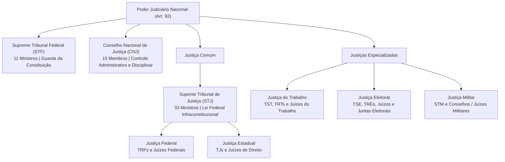
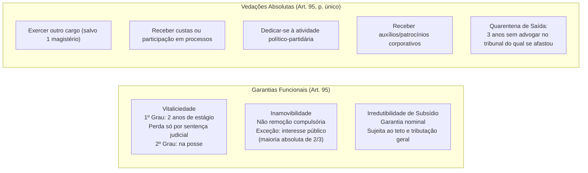
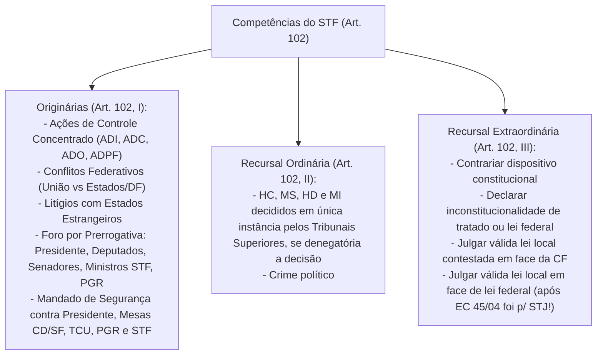
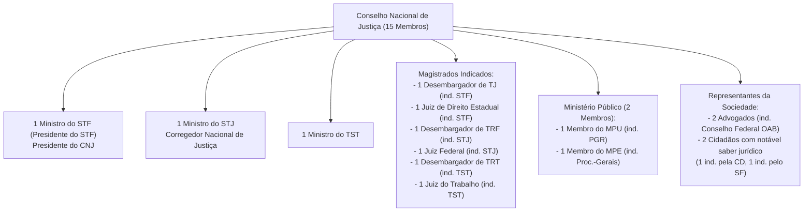

# Poder Judiciário: Estrutura Constitucional, Estatuto da Magistratura, STF, STJ e Conselho Nacional de Justiça

> O Poder Judiciário consagra a função estatal típica de dizer o direito no caso concreto em caráter definitivo (*jurisdictio*), com força de coisa julgada material e aptidão para solucionar litígios com definitividade. Sua arquitetura constitucional fundamenta-se nas autonomias orgânico-administrativa e financeiro-orçamentária dos tribunais, blindada por garantias funcionais pétreas dos magistrados (vitaliciedade, inamovibilidade e irredutibilidade de subsídios) balanceadas por vedações estritas, regime ético-disciplinar e controle administrativo-correicional centralizado no Conselho Nacional de Justiça (CNJ). No topo da hierarquia, o Supremo Tribunal Federal (STF) atua como guardião precípuo da Carta Magna e corte constitucional, enquanto o Superior Tribunal de Justiça (STJ) uniformiza a interpretação do direito federal infraconstitucional, conformando um modelo bifronte de jurisdição superior.

---

## 1. Órgãos do Poder Judiciário e Princípios Estruturantes

O art. 92 da Constituição Federal de 1988 estabelece o rol taxativo dos órgãos que integram o Poder Judiciário brasileiro.

> [!IMPORTANT]
> **Natureza Jurídica do Conselho Nacional de Justiça (CNJ):**  
> Embora o CNJ conste expressamente do rol do art. 92 (inciso I-A, inserido pela EC nº 45/2004), o órgão **não possui jurisdição**. Trata-se de órgão exclusivamente administrativo, orçamentário e disciplinar. O CNJ não pode analisar o mérito de decisões jurisdicionais nem apreciar a justiça de provimentos emanados de juízes ou tribunais no exercício de sua atividade típica.

### 1.1. Autonomia Orgânica, Administrativa e Financeira (Arts. 96 e 99)
A separação de poderes impõe que os tribunais desfrutem de autogoverno e capacidade de formular suas propostas orçamentárias:
* **Competência Privativa dos Tribunais (Art. 96, I):** Eleger seus órgãos diretivos, elaborar seus regimentos internos, organizar suas secretarias e serviços auxiliares, conceder licenças e férias a seus membros e juízes a eles vinculados, e prover, por concurso público, os cargos necessários à sua administração.
* **Iniciativa Legislativa Privativa (Art. 96, II):** Criação e extinção de cargos e remuneração dos seus serviços auxiliares e dos juízes a eles vinculados; alteração do número de membros dos tribunais inferiores; e criação ou extinção de tribunais inferiores.
* **Autonomia Financeira (Art. 99):** Os tribunais elaborarão suas propostas orçamentárias dentro dos limites da Lei de Diretrizes Orçamentárias (LDO). Se o tribunal não encaminhar a proposta no prazo legal, o Poder Executivo considerará os valores aprovados na lei orçamentária vigente, ajustados aos limites da LDO. Se enviada em desacordo com tais limites, o Executivo procederá aos ajustes necessários antes de consolidar a proposta orçamentária da União ou dos Estados.
* **Repasse em Duodécimos (Art. 168):** Os recursos orçamentários destinados ao Judiciário ser-lhe-ão entregues até o dia 20 de cada mês, em duodécimos, sendo vedada a retenção pelo Executivo.

---

## 2. Estatuto da Magistratura e Garantias Constitucionais

O Estatuto da Magistratura é regido por Lei Complementar federal de iniciativa privativa do Supremo Tribunal Federal (art. 93), recepcionada a Lei Complementar nº 35/1979 (LOMAN) naquilo que não colidir com o texto constitucional de 1988.

### 2.1. Princípios Constitucionais do Estatuto (Art. 93)
1. **Ingresso na Carreira:** Exclusivamente por concurso público de provas e títulos, com a participação da Ordem dos Advogados do Brasil (OAB) em todas as fases, exigindo-se do bacharel em direito, no mínimo, **três anos de atividade jurídica** e obedecendo-se, nas nomeações, à ordem de classificação (art. 93, I).
2. **Promoção de Entrância para Entrância:** Alternadamente, por antiguidade e merecimento (art. 93, II):
   * *Merecimento:* Obrigatória a promoção do juiz que figurar por **3 vezes consecutivas ou 5 alternadas** em lista de merecimento; a lista é formada dentre os magistrados que componham a primeira quinta parte (20%) da lista de antiguidade da entrância, salvo se não houver com tais requisitos quem aceite o lugar vago.
   * *Antiguidade:* O tribunal só poderá recusar o juiz mais antigo pelo voto fundamentado de **dois terços de seus membros**, conforme procedimento próprio, assegurada ampla defesa, repetindo-se a votação até fixar-se a indicação.
3. **Publicidade e Motivação dos Atos (Art. 93, IX):** Todos os julgamentos dos órgãos do Poder Judiciário serão públicos, e fundamentadas todas as decisões, sob pena de nulidade absoluta. A lei pode limitar a presença, em determinados atos, às próprias partes e a seus advogados, ou somente a estes, em casos nos quais a preservação do direito à intimidade do interessado no sigilo não prejudique o interesse público à informação.
4. **Órgão Especial (Art. 93, XI):** Nos tribunais com número superior a **25 julgadores**, poderá ser constituído órgão especial, com o mínimo de **11 e o máximo de 25 membros**, para o exercício das atribuições administrativas e jurisdicionais delegadas da competência do tribunal pleno.
   * *Critério de Preenchimento das Vagas:* **Metade por antiguidade e metade por eleição** realizada pelo próprio tribunal pleno (é nula a escolha por sorteio).

### 2.2. O Quinto Constitucional (Art. 94)
Um quinto (1/5) dos lugares dos Tribunais Regionais Federais (TRFs) e dos Tribunais de Justiça dos Estados (TJs) será composto de membros do Ministério Público com mais de dez anos de carreira e de advogados de notório saber jurídico e reputação ilibada, com mais de dez anos de efetiva atividade profissional:
* **Procedimento Trifásico:**
  1. Os órgãos de representação das respectivas classes (OAB ou Conselho Superior do MP) elaboram **lista sêxtupla** e a enviam ao Tribunal.
  2. O Tribunal Pleno ou Órgão Especial reduz a indicação para **lista tríplice**, enviando-a ao Chefe do Executivo (Presidente da República para TRFs; Governador para TJs).
  3. O Chefe do Poder Executivo nomeia um dos indicados nos **vinte dias subsequentes**.

---

## 3. O Regime Constitucional dos Precatórios (Art. 100)

Os pagamentos devidos pelas Fazendas Públicas Federal, Estaduais, Distrital e Municipais em virtude de sentenças judiciais transitadas em julgado far-se-ão exclusivamente na ordem cronológica de apresentação dos precatórios e à conta dos créditos respectivos, proibida a designação de casos ou de pessoas nas dotações orçamentárias.

| Parâmetro Constitucional | Regra Geral | Créditos de Natureza Alimentar |
| :--- | :--- | :--- |
| **Definição** | Obrigações patrimoniais comuns da Fazenda Pública | Salários, vencimentos, proventos, pensões, benefícios previdenciários e indenizações por morte/invalidez |
| **Precedência na Fila** | Ordem cronológica pura de apresentação (até 2 de abril para pagamento no exercício seguinte) | Pagamento com preferência sobre todos os demais débitos de mesma ordem orçamentária |
| **Superpreferência Constitucional** | Inexistente para débitos comuns | Titulares com **60 anos de idade**, pessoas com **deficiência** ou portadores de **doença grave**, até o equivalente ao **triplo do RPV** |
| **Requisição de Pequeno Valor (RPV)** | Dispensada a expedição de precatório; pagamento direto em até 60 dias | Mesmo procedimento expedito; quitação integral sem inclusão na fila orçamentária anual |

> [!NOTE]
> **Evolução Jurisprudencial — ADI 7047 e ADI 7064 (STF):**  
> As Emendas Constitucionais nº 113/2021 e nº 114/2021 instituíram teto temporal e subtetos para o pagamento de precatórios pela União. O Plenário do STF declarou inconstitucionais os limites que postergavam indefinidamente o passivo judicial da União, restaurando o dever republicano de quitação tempestiva e autorizando a abertura de créditos extraordinários para regularização do estoque de precatórios acumulados.

---

## 4. Supremo Tribunal Federal (STF): Corte Constitucional

O Supremo Tribunal Federal compõe-se de **11 Ministros**, escolhidos dentre cidadãos com mais de **35 e menos de 70 anos de idade**, de notável saber jurídico e reputação ilibada (art. 101). São nomeados pelo Presidente da República após aprovação por **maioria absoluta do Senado Federal** (arguição pública / sabatina).

### 4.1. Repercussão Geral no Recurso Extraordinário (Art. 102, § 3º)
No recurso extraordinário o recorrente deverá demonstrar a repercussão geral das questões constitucionais discutidas no caso, nos termos da lei, a fim de que o Tribunal examine a admissão do recurso.
* A repercussão geral somente pode ser recusada pela manifestação de **dois terços dos membros do STF** (8 Ministros).
* Há repercussão geral presumida sempre que o recurso impugnar acórdão que:
  1. Contrariar súmula ou jurisprudência dominante do STF;
  2. Tiver reconhecido a inconstitucionalidade de tratado ou lei federal.

### 4.2. Súmula Vinculante (Art. 103-A)
O STF poderá, de ofício ou por provocação, mediante decisão de **dois terços dos seus membros** (8 votos), após reiteradas decisões sobre matéria constitucional, aprovar súmula que, a partir de sua publicação na imprensa oficial, terá **efeito vinculante** em relação aos demais órgãos do Poder Judiciário e à administração pública direta e indireta, nas esferas federal, estadual e municipal.
* **Não Vinculação do Poder Legislativo:** A súmula vinculante **não vincula o legislador** no exercício de sua função típica legiferante (sob pena de fossilização constitucional), nem vincula o próprio STF, que pode proceder à sua revisão ou cancelamento.
* **Cabimento de Reclamação Constitucional (Art. 103-A, § 3º):** Do ato administrativo ou decisão judicial que contrariar a súmula aplicável ou que indevidamente a aplicar, caberá reclamação ao Supremo Tribunal Federal. Contra ato da administração pública, a reclamação só será admitida **após o esgotamento das vias administrativas**.

---

## 5. Superior Tribunal de Justiça (STJ): Guardião da Lei Federal

O Superior Tribunal de Justiça compõe-se de, no mínimo, **33 Ministros**, nomeados pelo Presidente da República, dentre brasileiros com mais de **35 e menos de 70 anos de idade**, de notável saber jurídico e reputação ilibada, após aprovação por maioria absoluta do Senado Federal (art. 104).

### 5.1. Composição Tripartite Constitucional (Art. 104, Parágrafo Único)
* **Um terço (1/3)** dentre juízes dos Tribunais Regionais Federais;
* **Um terço (1/3)** dentre desembargadores dos Tribunais de Justiça dos Estados;
* **Um terço (1/3)**, em partes iguais, alternadamente, dentre advogados e membros do Ministério Público Federal, Estadual, do Distrito Federal e Territórios, indicados na forma do art. 94.

### 5.2. Competências Originárias e Recursais (Art. 105)
1. **Competência Originária Relevante (Art. 105, I):**
   * *Crimes comuns e de responsabilidade:* **Governadores de Estado e do Distrito Federal** (atenção: governadores não têm prerrogativa de foro no STF, mas no STJ!);
   * *Crimes comuns:* Desembargadores dos TJs e juízes dos TRFs, membros dos Tribunais de Contas Estaduais (TCEs) e Municipais (TCMs), membros dos TRTs, TREs e TRMs;
   * *Mandados de Segurança e Habeas Data:* Contra ato de Ministro de Estado, dos Comandantes da Marinha, Exército e Aeronáutica ou do próprio Tribunal.
2. **Competência Recursal Ordinária (Art. 105, II):**
   * Habeas corpus decididos em única ou última instância pelos TRFs ou TJs, quando denegatória a decisão;
   * **Mandados de segurança decididos em única instância pelos TRFs ou pelos TJs, quando denegatória a decisão** (se a decisão conceder a segurança, não cabe ROC, cabendo apenas recurso especial e/ou extraordinário);
   * Causas em que forem partes Estado estrangeiro ou organismo internacional, de um lado, e, de outro, Município ou pessoa residente ou domiciliada no País.
3. **Recurso Especial (REsp) e o Filtro de Relevância Federal (Art. 105, III e § 2º - EC nº 125/2022):**
   * Cabe REsp contra causas decididas em única ou última instância pelos TRFs ou TJs quando a decisão recorrida:
     a) Contrariar tratado ou lei federal, ou negar-lhes vigência;  
     b) Julgar válido ato de governo local contestado em face de lei federal;  
     c) Der a lei federal interpretação divergente da que lhe haja atribuído outro tribunal.
   * *Requisito da Relevância da Questão de Direito Federal Infraconstitucional:* O recorrente deve demonstrar a relevância das questões de direito federal infraconstitucional, a qual só pode ser recusada pela manifestação de **dois terços dos membros do órgão competente para o julgamento**.
   * *Relevância Presumida (Art. 105, § 3º):* Ações penais; improbidade administrativa; causas com valor superior a 500 salários mínimos; ações que possam gerar inelegibilidade; e decisões contrárias a jurisprudência dominante do STJ.

---

## 6. Conselho Nacional de Justiça (CNJ): Controle Administrativo e Correicional

O CNJ compõe-se de **15 membros** com mandato de **dois anos**, admitida uma recondução (art. 103-B).

> [!IMPORTANT]
> **Competência Originária Concorrente Disciplinar (ADI 4638 - STF):**  
> O Supremo Tribunal Federal pacificou que o CNJ detém **competência disciplinar concorrente e primária**, e não meramente subsidiária. O CNJ pode avocar procedimentos em curso e instaurar diretamente Processos Administrativos Disciplinares (PAD) contra qualquer magistrado ou tribunal, sem a necessidade de prévia atuação ou esgotamento das instâncias corregedoras locais.

---

## 7. Questões Paradigmáticas Aplicadas

### [Questão 01](https://www.qconcursos.com/questoes-de-concursos/questoes/4378308) — [FGV — PC-PR / Delegado de Polícia — 2026]

Um servidor da Polícia Civil do Estado Alfa teve denegado requerimento administrativo no qual almejava a fruição de benefício estatutário de natureza pecuniária. Ao seu ver, o indeferimento teria colidido com o referencial de juridicidade, mais especificamente com a Constituição da República. Por tal razão, cogitou impetrar mandado de segurança perante o órgão jurisdicional competente.

Na situação descrita, considerando o nível hierárquico da autoridade responsável pela decisão, é correto afirmar que a possível competência originária do Tribunal de Justiça do Estado Alfa para processar e julgar o *mandamus*:

* **A)** deve ser verificada na Constituição Estadual.
* **B)** deve ser verificada na Lei de Organização e Divisão judiciária.
* **C)** deve ser verificada no Regimento Interno do Tribunal de Justiça.
* **D)** não é admitida, considerando que o mandado de segurança consubstancia ação de natureza cível.
* **E)** deve ser verificada na Constituição da República, considerando a simetria constitucional.

#### Gabarito: **A**
* **A (Certa):** Nos termos do art. 125, § 1º, da Constituição Federal, a competência dos tribunais estaduais será definida na Constituição do respectivo Estado, sendo a lei de organização judiciária de iniciativa privativa do Tribunal de Justiça. A CF/88 não lista taxativamente as competências originárias dos Tribunais de Justiça (como faz para o STF no art. 102 e STJ no art. 105), deferindo ao constituinte estadual a fixação das autoridades cujos atos sujeitam-se originariamente ao controle do TJ via mandado de segurança.
* **B (Errada):** A Carta Magna exige expressamente que a competência originária dos Tribunais de Justiça conste do corpo da Constituição Estadual (art. 125, § 1º).
* **C (Errada):** O Regimento Interno apenas disciplina o procedimento interno dos órgãos fracionários, mas não pode inovar na criação de competência jurisdicional originária.
* **D (Errada):** O mandado de segurança é plenamente cabível na jurisdição estadual originária ou recursal, desde que demonstrado direito líquido e certo não amparado por *habeas corpus* ou *habeas data*.
* **E (Errada):** A Constituição Federal estabelece normas gerais de organização judiciária e a competência de tribunais superiores, mas outorgou aos Estados a disciplina de suas próprias Justiças (art. 125).

---

### [Questão 02](https://www.qconcursos.com/questoes-de-concursos/questoes/4389165) — [FGV — DATAPREV / Advocacia — 2026]

Em determinado Mandado de Segurança, processado e julgado originariamente pela 2ª Turma do Tribunal Regional Federal da Região X, a ordem foi denegada sob o argumento de que a Lei federal nº Y/1981 foi recepcionada pela Constituição de 1988 e que uma interpretação conforme não amparava a tese do impetrante. O impetrante ficou irresignado com o teor do acórdão.

Na situação descrita, é correto afirmar que é cabível:

* **A)** Recurso Especial diretamente ao STJ com fundamento em contrariedade a tratado internacional.
* **B)** Recurso Extraordinário diretamente ao STF por haver debate em torno da recepção de norma constitucional.
* **C)** Recurso Ordinário Constitucional (ROC) perante o Superior Tribunal de Justiça.
* **D)** Apelação para o Plenário do Tribunal Regional Federal, por tratar-se de decisão denegatória monocrática.
* **E)** Agravo Interno para o Presidente do Superior Tribunal de Justiça.

#### Gabarito: **C**
* **A (Errada):** Não é a via recursal cabível contra acórdão denegatório em competência originária de tribunal.
* **B (Errada):** O recurso ordinário tem cognição ampla e precede o recurso extraordinário.
* **C (Certa):** O art. 105, II, "b", da CF/88 prescreve com clareza solar que compete ao STJ julgar, em recurso ordinário, "os mandados de segurança decididos em única instância pelos Tribunais Regionais Federais ou pelos tribunais dos Estados, do Distrito Federal e Territórios, quando denegatória a decisão". Tratando-se de competência originária do TRF e tendo havido denegação da segurança, a via recursal constitucionalmente adequada e de cognição ampla é o Recurso Ordinário, dispensando o prequestionamento estrito exigido no REsp ou RE.
* **D (Errada):** O acórdão foi proferido pela Turma do TRF em competência originária, não cabendo apelação entre órgãos fracionários.
* **E (Errada):** O agravo interno é recurso manejado perante o próprio tribunal prolator contra decisão monocrática de relator, e não contra acórdão colegiado.

---

### [Questão 03](https://www.qconcursos.com/questoes-de-concursos/questoes/4378381) — [OBJETIVA — Prefeitura de Cachoeira do Sul - RS / Advogado — 2026]

A discussão teórica sobre Constituição Formal e Constituição Material é especialmente relevante no caso brasileiro, uma vez que há matérias de Direito Processual no texto constitucional. Nos termos da Constituição Federal, o recurso cabível, nas causas decididas em única ou última instância, quando a decisão recorrida declarar a inconstitucionalidade de tratado ou lei federal, é o:

* **A)** Recurso extraordinário.
* **B)** Recurso especial.
* **C)** Recurso ordinário constitucional.
* **D)** Agravo em recurso extraordinário.

#### Gabarito: **A**
* **A (Certa):** Em estrita subsunção ao art. 102, inciso III, alínea "b", da CF/88, compete ao Supremo Tribunal Federal julgar, mediante recurso extraordinário, as causas decididas em única ou última instância, quando a decisão recorrida "declarar a inconstitucionalidade de tratado ou lei federal". Trata-se de hipótese taxativa de controle difuso incidental de constitucionalidade via via extraordinária.
* **B (Errada):** O recurso especial é julgado pelo STJ (art. 105, III) e visa a tutelar a vigência e higidez da legislação federal ordinária, mas a declaração incidental de inconstitucionalidade de lei federal ou tratado compete ao STF em sede de RE.
* **C (Errada):** O ROC destina-se às hipóteses taxativas dos arts. 102, II, e 105, II (mandados de segurança denegados em única instância e crimes políticos).
* **D (Errada):** O agravo em RE destina-se unicamente a destrancar recurso cujo seguimento foi inadmitido na origem pela presidência do tribunal *a quo*.

---

### [Questão 04](https://www.qconcursos.com/questoes-de-concursos/questoes/4392253) — [Quadrix — CREF - 20ª Região (SE) / Advogado — 2026]

Com base nessa situação hipotética e nas disposições da Constituição Federal de 1988 (CF/1988), julgue o item a seguir:

A criação de órgão especial com 15 membros é constitucionalmente admissível, pois os tribunais com mais de 25 julgadores podem constituir órgão especial com, no mínimo, 11 e, no máximo, 25 membros.

* **C)** Certo
* **E)** Errado

#### Gabarito: **Certo**
* **Fundamentação Técnica:** O item reproduz com total precisão a baliza numérica estatuída no art. 93, inciso XI, da Carta Política de 1988: "nos tribunais com número superior a vinte e cinco julgadores, poderá ser constituído órgão especial, com o mínimo de onze e o máximo de vinte e cinco membros, para o exercício das atribuições administrativas e jurisdicionais delegadas da competência do tribunal pleno". Logo, a fixação de um colegiado especial com 15 integrantes atende perfeitamente ao intervalo legal de 11 a 25 membros.

---

### [Questão 05](https://www.qconcursos.com/questoes-de-concursos/questoes/4392254) — [Quadrix — CREF - 20ª Região (SE) / Advogado — 2026]

Com base nessa situação hipotética e nas disposições da Constituição Federal de 1988 (CF/1988), julgue o item a seguir:

As vagas do órgão especial deverão ser preenchidas, em partes iguais, por eleição do tribunal pleno e por sorteio entre os demais desembargadores.

* **C)** Certo
* **E)** Errado

#### Gabarito: **Errado**
* **Fundamentação Técnica:** O art. 93, inciso XI, segunda parte, da CF/88 determina expressamente que as vagas do órgão especial serão providas: "provendo-se metade das vagas pelos membros mais antigos e a outra metade por eleição pelo tribunal pleno". Não há qualquer previsão de sorteio para composição do Órgão Especial.

---

### [Questão 06](https://www.qconcursos.com/questoes-de-concursos/questoes/4392255) — [Quadrix — CREF - 20ª Região (SE) / Advogado — 2026]

Com base nessa situação hipotética e nas disposições da Constituição Federal de 1988 (CF/1988), julgue o item a seguir:

O órgão especial constituído poderá exercer atribuições jurisdicionais que seriam da competência originária do tribunal pleno.

* **C)** Certo
* **E)** Errado

#### Gabarito: **Certo**
* **Fundamentação Técnica:** O art. 93, inciso XI, da CF/88 autoriza explicitamente que o órgão especial seja constituído "para o exercício das atribuições administrativas e jurisdicionais delegadas da competência do tribunal pleno". Portanto, matérias originárias do Pleno (inclusive julgamento de autoridades com foro no tribunal e declaração de inconstitucionalidade de lei pela cláusula de reserva de plenário do art. 97) são validamente delegadas ao Órgão Especial.

---

### [Questão 07](https://www.qconcursos.com/questoes-de-concursos/questoes/4393806) — [VUNESP — TJ-SP / Residência Jurídica — 2026]

Sobre o Conselho Nacional de Justiça (CNJ), é correto afirmar, à luz da Constituição Federal:

* **A)** Compete-lhe o controle da atuação administrativa e financeira do Poder Judiciário e do cumprimento dos deveres funcionais dos juízes, cabendo-lhe, além de outras atribuições conferidas pelo Estatuto da Magistratura, zelar pela autonomia do Poder Judiciário e pelo cumprimento do Estatuto da Magistratura, podendo expedir atos regulamentares, no âmbito de sua competência, ou recomendar providências.
* **B)** Possui competência jurisdicional extraordinária para cassar decisões judiciais transitadas em julgado quando violarem a jurisprudência dominante dos Tribunais Superiores.
* **C)** Sua presidência é exercida pelo Ministro Corregedor Nacional de Justiça indicado pelo Superior Tribunal de Justiça.
* **D)** Seus atos somente podem ser questionados perante o Plenário do próprio Conselho, sendo vedada qualquer intervenção judicial em respeito à independência institucional do órgão.
* **E)** Sua competência disciplinar tem caráter estritamente subsidiário, dependendo sempre do prévio arquivamento ou conclusão das apurações perante as corregedorias dos tribunais locais.

#### Gabarito: **A**
* **A (Certa):** A alternativa reproduz a inteligência expressa do art. 103-B, § 4º, incisos I e II, da Constituição da República.
* **B (Errada):** O CNJ é órgão puramente administrativo e correicional, destituído de qualquer função jurisdicional.
* **C (Errada):** A presidência do CNJ é exercida pelo Presidente do Supremo Tribunal Federal (art. 103-B, § 1º); o Ministro do STJ exerce a função de Corregedor Nacional de Justiça (§ 5º).
* **D (Errada):** Os atos do CNJ estão sujeitos a controle jurisdicional originário perante o Supremo Tribunal Federal (art. 102, I, "r").
* **E (Errada):** O STF fixou tese vinculante na ADI 4638 assegurando que o CNJ detém competência originária concorrente e direta.

---

### [Questão 08](https://www.qconcursos.com/questoes-de-concursos/questoes/4393807) — [VUNESP — TJ-SP / Residência Jurídica — 2026]

Em relação aos Recursos aos Tribunais Superiores após as inovações introduzidas pela Emenda Constitucional nº 125/2022, assinale a afirmativa correta:

* **A)** No recurso especial, o recorrente deve demonstrar a relevância das questões de direito federal infraconstitucional, cuja recusa exige o voto de dois terços dos membros do órgão competente para o julgamento, considerando-se presumida a relevância em ações penais e em ações de improbidade administrativa.
* **B)** O filtro de relevância federal aplica-se indistintamente ao recurso ordinário constitucional e ao recurso em mandado de segurança interpostos perante o Superior Tribunal de Justiça.
* **C)** A repercussão geral no Recurso Extraordinário pode ser rejeitada por maioria simples dos Ministros do Supremo Tribunal Federal.
* **D)** A presunção de relevância federal autoriza a dispensa do prequestionamento explícito da matéria de direito federal impugnada no acórdão recorrido.
* **E)** A constatação de divergência jurisprudencial notória com súmula do STJ dispensa a interposição perante o tribunal de origem, admitindo protocolo direto perante o Superior Tribunal de Justiça.

#### Gabarito: **A**
* **A (Certa):** O art. 105, §§ 2º e 3º, da CF/88, com redação da EC nº 125/2022, introduziu o filtro da relevância federal espelhando o mecanismo da repercussão geral do STF, com quórum qualificado de rejeição de 2/3 e presunção legal nas hipóteses taxativas do § 3º (ações penais e improbidade).
* **B (Errada):** O filtro de relevância é privativo do Recurso Especial (art. 105, III).
* **C (Errada):** A rejeição da repercussão geral no STF exige o quórum qualificado de dois terços (art. 102, § 3º).
* **D (Errada):** A demonstração de prequestionamento permanece como pressuposto indeclinável de cabimento do Recurso Especial (Súmulas 282 e 356 do STF e 211 do STJ).
* **E (Errada):** O REsp deve ser interposto perante a presidência do tribunal recorrido para juízo prévio de admissibilidade (art. 1.029 e 1.030 do CPC).
