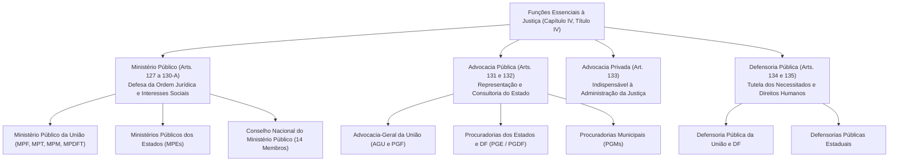
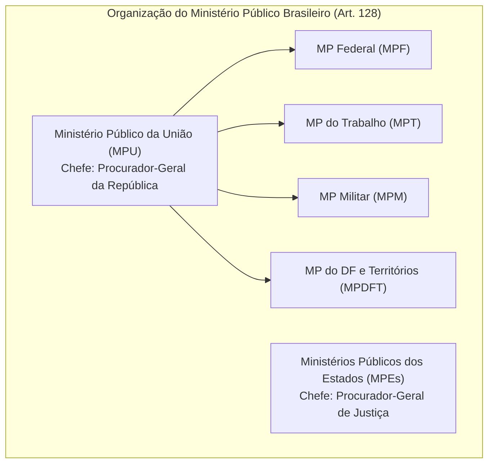
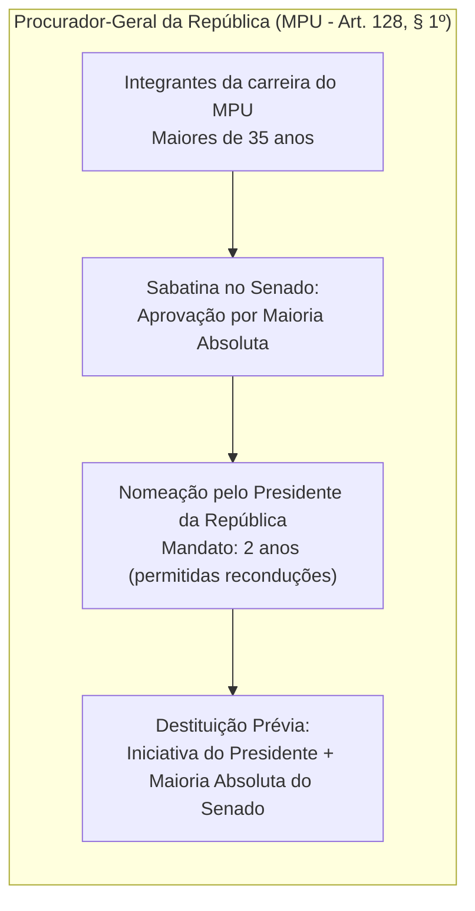
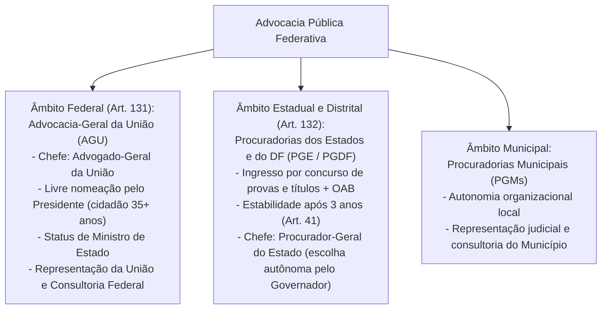
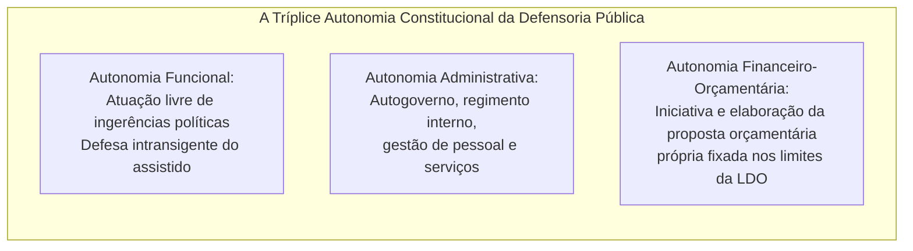

# Funções Essenciais à Justiça: Ministério Público, Advocacia Pública, Advocacia Privada e Defensoria Pública

> As Funções Essenciais à Justiça consagram as instituições autônomas e indispensáveis que viabilizam a prestação jurisdicional estatal, a tutela da ordem jurídica democrática e a concretização do acesso à justiça. O Ministério Público erige-se como defensor da sociedade, do regime democrático e dos interesses indisponíveis, gozando de garantias equivalentes às da magistratura e submetido ao Conselho Nacional do Ministério Público (CNMP), com vedação peremptória à consultoria jurídica governamental. A Advocacia Pública exerce com exclusividade a representação judicial e a consultoria dos entes políticos federados, cabendo à Advocacia Privada a representação técnica indispensável com inviolabilidade profissional relativa. Por sua vez, a Defensoria Pública atua como expressão e instrumento do regime democrático para assistência jurídica integral aos vulneráveis, dotada de plena autonomia funcional, administrativa e orçamentária após as Emendas Constitucionais nº 45/2004, nº 74/2013 e nº 80/2014.

---

## 1. Arquitetura Constitucional das Funções Essenciais

O Capítulo IV do Título IV da Constituição Federal de 1988 não integra organicamente o Poder Judiciário nem o Poder Executivo, desenhando uma rede institucional autônoma de cooperação e controle recíproco.

### 1.1. Quadro Comparativo de Regime Jurídico e Garantias Constitucionais

| Instituição | Função Constitucional Típica | Garantia de Permanência | Inamovibilidade Constitucional | Submissão a Conselho Nacional |
| :--- | :--- | :--- | :--- | :--- |
| **Magistratura** (PJ) | Prestação jurisdicional definitiva | **Vitaliciedade** (2 anos no 1º grau) | **Sim** (art. 95, II) | **CNJ** (art. 103-B) |
| **Ministério Público** | Defesa da ordem jurídica e ação penal pública | **Vitaliciedade** (2 anos de estágio probatório) | **Sim** (art. 128, § 5º, I, "b") | **CNMP** (art. 130-A) |
| **Defensoria Pública** | Assistência jurídica integral aos vulneráveis | **Estabilidade** (3 anos - art. 41 da CF) | **Sim** (art. 134, § 1º) | Inexistente (Conselhos Superiores próprios) |
| **Advocacia Pública** | Representação judicial e consultoria do Executivo | **Estabilidade** (3 anos - art. 41 da CF) | **Não** (não há inamovibilidade na CF) | Inexistente (Corregedorias próprias) |

---

## 2. Ministério Público (Arts. 127 a 130-A)

O Ministério Público é instituição permanente, essencial à função jurisdicional do Estado, incumbindo-lhe a defesa da ordem jurídica, do regime democrático e dos interesses sociais e individuais indisponíveis (art. 127).

### 2.1. Princípios Institucionais (Art. 127, § 1º)
1. **Unidade:** Os membros do Ministério Público integram um só corpo sob uma mesma direção em cada ramo institucional. A unidade é interna a cada Ministério Público (o MPU é uno; cada MPE é uno; mas o MPF e o MPE de São Paulo são ramos autônomos distintos).
2. **Indivisibilidade:** Os membros do MP podem ser substituídos uns pelos outros no processo, nos termos da lei, sem que haja cisão da atuação ministerial (o titular da ação é a instituição e não a pessoa física do promotor).
3. **Independência Funcional:** No exercício de sua atividade finalística, o membro do MP submete-se unicamente à sua consciência jurídica, à Constituição e às leis, não existindo qualquer subordinação hierárquica em relação aos órgãos superiores de chefia quanto ao teor de suas manifestações processuais.

### 2.2. Investidura e Destituição das Chefias Ministeriais

* **Chefia dos Ministérios Públicos Estaduais (PGJ - Art. 128, § 3º):**
  * Formação de **lista tríplice** mediante votação direta entre todos os integrantes da carreira;
  * Encaminhamento ao **Governador do Estado**, que possui prazo de **15 dias** para nomear qualquer um dos integrantes da lista;
  * Se o Governador não efetivar a nomeação em 15 dias, assume automaticamente o membro mais votado da lista tríplice;
  * Mandato de **dois anos**, permitida **uma única recondução** subsequente;
  * Destituição antes do mandato: mediante deliberação da **maioria absoluta do Poder Legislativo estadual** (Assembleia Legislativa), na forma de Lei Complementar.

### 2.3. Funções Institucionais e Vedações Estritas (Arts. 129 e 128, § 5º, II)
* **Atribuições Típicas Nucleares (Art. 129):**
  * Promover, com **exclusividade**, a ação penal pública, na forma da lei;
  * Zelar pelo efetivo respeito dos Poderes Públicos e dos serviços de relevância pública aos direitos assegurados na Constituição, promovendo as medidas necessárias a sua garantia;
  * Promover o inquérito civil e a ação civil pública (ACP) para a proteção do patrimônio público e social, do meio ambiente e de outros interesses difusos e coletivos;
  * Promover a ação de inconstitucionalidade ou representação para fins de intervenção da União e dos Estados, nos casos previstos na Constituição;
  * Exercer o controle externo da atividade policial;
  * Requisitar diligências investigatórias e a instauração de inquérito policial;
  * **Poder Investigatório Criminal Direto do MP (STF Tema 183 - RE 593727):** O Ministério Público dispõe de competência constitucional originária implícita para conduzir investigações de natureza criminal por meio de Procedimento Investigatório Criminal (PIC), respeitadas as garantias constitucionais da ampla defesa e as matérias sob reserva de jurisdição (quebras de sigilo telefônico, interceptações e mandados de busca e apreensão).
* **Vedações Absolutas (Art. 129, IX e Art. 128, § 5º, II):**
  > [!CAUTION]
  > **Vedação de Advocacia e Consultoria Pública (Art. 129, IX):**  
  > É taxativamente **vedada ao Ministério Público a representação judicial e a consultoria jurídica de entidades públicas**. O MP jamais defende os interesses do Estado em juízo; essa função pertence com exclusividade à Advocacia Pública. Aos membros do MP é vedado ainda: exercer a advocacia; exercer o comércio ou participar de sociedade comercial (salvo como cotista ou acionista); exercer qualquer outra função pública (salvo uma de magistério); e exercer atividade político-partidária.

### 2.4. Ministério Público de Contas (Art. 130) e o CNMP (Art. 130-A)
* **Ministério Público de Contas (MPC):** Atua perante os Tribunais de Contas (TCU, TCEs e TCMs). Embora seus membros gozem dos mesmos direitos, vedações e vencimentos do Ministério Público comum, o MPC **não integra o MPU nem o MPE**, não possui personalidade jurídica nem autonomia orçamentária própria, e seus integrantes não se submetem à jurisdição disciplinar do CNMP (STF ADI 789 e ADI 3308).
* **Conselho Nacional do Ministério Público (CNMP - Art. 130-A):** Órgão de controle da atuação administrativa e financeira do MP e do cumprimento dos deveres funcionais de seus membros.
  * **Composição (14 membros):** Presidido pelo Procurador-Geral da República (PGR); 4 membros do MPU (1 do MPF, 1 do MPT, 1 do MPM e 1 do MPDFT); 3 membros do MPE; 2 juízes (1 ind. STF, 1 ind. STJ); 2 advogados (ind. CFOAB); 2 cidadãos de notável saber jurídico e reputação ilibada (1 ind. CD, 1 ind. SF).
  * O Corregedor Nacional é eleito pelo colegiado dentre os membros do Ministério Público que integram o Conselho.

---

## 3. Advocacia Pública (Arts. 131 e 132)

A Advocacia Pública representa judicial e extrajudicialmente os entes políticos federados (União, Estados, DF e Municípios), cabendo-lhe, ainda, as atividades de consultoria e assessoramento jurídico do Poder Executivo.

### 3.1. Prerrogativas e Honorários Sucumbenciais (ADI 6053 - STF)
* **Honorários de Sucumbência dos Advogados Públicos:** O STF declarou constitucional a percepção de honorários sucumbenciais por advogados públicos federais, estaduais e municipais, fixando que tais verbas possuem natureza remuneratória e privada, mas **estão sujeitas ao teto remuneratório constitucional** (subsídio dos Ministros do STF), computadas em conjunto com as demais parcelas salariais.
* **Inexistência de Inamovibilidade Constitucional:** Diferentemente de magistrados, membros do MP e defensores públicos, os procuradores de estado e advogados públicos **não possuem a garantia constitucional expressa da inamovibilidade** no texto da Carta Magna de 1988.

---

## 4. Advocacia Privada (Art. 133)

"O advogado é indispensável à administração da justiça, sendo inviolável por seus atos e manifestações no exercício da profissão, nos limites da lei." (Art. 133).
* **Natureza da Inviolabilidade Profissional:** Trata-se de imunidade material relativa, adstrita à manifestação técnica no exercício da profissão (imunidade por crime de injúria e difamação em juízo ou fora dele na discussão da causa, nos termos do art. 7º, § 2º, da Lei nº 8.906/1994). **Não abrange o desacato nem a calúnia**.
* **Flexibilização da Indispensabilidade do Advogado:** Embora indispensável como regra, a Constituição e a lei admitem exceções nas quais o cidadão possui capacidade postulatória própria (*jus postulandi*):
  1. *Habeas Corpus* (art. 5º, LXVIII da CF);
  2. Juizados Especiais Cíveis nas causas de até 20 salários mínimos (Lei nº 9.099/1995);
  3. Justiça do Trabalho nas instâncias ordinárias (art. 791 da CLT e Súmula 425 do TST);
  4. Juizados Especiais Federais (Lei nº 10.259/2001).

---

## 5. Defensoria Pública (Arts. 134 e 135)

A Defensoria Pública é instituição permanente, essencial à função jurisdicional do Estado, incumbindo-lhe, como expressão e instrumento do regime democrático, fundamentalmente, a orientação jurídica, a promoção dos direitos humanos e a defesa, em todos os graus, judicial e extrajudicial, dos direitos individuais e coletivos, de forma integral e gratuita, aos necessitados (art. 134).

### 5.1. Evolução Constitucional e Jurisprudência Vinculante do STF
1. **Autonomias Constitucionais:**
   * **EC nº 45/2004:** Assegurou autonomia funcional, administrativa e orçamentária às **Defensorias Públicas Estaduais (DPEs)** (art. 134, § 2º);
   * **EC nº 74/2013:** Estendeu as mesmas autonomias à **Defensoria Pública da União (DPU)** e do Distrito Federal (art. 134, § 3º);
   * **EC nº 80/2014:** Fixou o princípio da unidade, indivisibilidade e independência funcional da Defensoria Pública, instituindo prazo de 8 anos para que a União, os Estados e o DF dotassem todas as comarcas e subseções de defensores públicos proporcionalmente à demanda.
2. **Honorários Sucumbenciais em Face do Próprio Ente (STF Tema 1002 - Repercussão Geral):**  
   O STF superou a antiga tese da confusão patrimonial (Súmula 421 do STJ), assentando que **são devidos honorários de sucumbência à Defensoria Pública mesmo quando litigar contra a própria pessoa jurídica de direito público à qual está vinculada**, pois tais verbas destinam-se a fundos especiais de aparelhamento e capacitação institucional da própria Defensoria Pública, e não aos cofres gerais do Estado.
3. **Desnecessidade de Inscrição na OAB (STF ADI 4636 e Tema 1070):**  
   O STF pacificou com força vinculante que a capacidade postulatória dos defensores públicos decorre diretamente de sua posse e exercício no cargo constitucional, **não sendo exigível inscrição ou pagamento de anuidade à Ordem dos Advogados do Brasil (OAB)**, tampouco submissão ao tribunal de ética e disciplina da entidade classista.

---

## 6. Questões Paradigmáticas Aplicadas

### [Questão 01](https://www.qconcursos.com/questoes-de-concursos/questoes/4395490) — [Gama Consult — Câmara de São Miguel do Guaporé - RO / Procurador Jurídico — 2026]

À luz dos arts. 132 e 134, § 1º, da Constituição Federal, a garantia expressamente assegurada aos defensores públicos, mas não aos procuradores estaduais, é a:

* **A)** Inamovibilidade.
* **B)** Vitaliciedade.
* **C)** Irredutibilidade remuneratória.
* **D)** Estabilidade bienal.

#### Gabarito: **A**
* **A (Certa):** Inamovibilidade. O art. 134, § 1º, da CF/88 outorga expressamente aos membros da Defensoria Pública as garantias da estabilidade funcional e da inamovibilidade ("São princípios institucionais da Defensoria Pública a unidade, a indivisibilidade e a independência funcional, aplicando-se também, no que couber, o disposto no art. 93 e no inciso II do art. 96 desta Constituição, sendo assegurada a seus membros a inamovibilidade"). Em contraste cirúrgico, o art. 132 da CF/88, que disciplina os Procuradores dos Estados e do Distrito Federal, prevê apenas o ingresso por concurso de provas e títulos com a participação da OAB e a estabilidade após três anos de efetivo exercício, não contemplando a prerrogativa constitucional da inamovibilidade para a Advocacia Pública.
* **B (Errada):** Vitaliciedade. A vitaliciedade é garantia privativa de magistrados (art. 95, I) e membros do Ministério Público (art. 128, § 5º, I, "a"). Nem defensores públicos nem procuradores gozam de vitaliciedade, sujeitando-se à estabilidade do art. 41.
* **C (Errada):** Irredutibilidade remuneratória. A irredutibilidade de vencimentos/subsídio é garantia geral assegurada a todos os servidores públicos efetivos (art. 37, XV da CF).
* **D (Errada):** Estabilidade bienal. A estabilidade de todos os servidores públicos civis efetivos é adquirida após três anos de efetivo exercício após a EC nº 19/1998 (art. 41).

---

### [Questão 02](https://www.qconcursos.com/questoes-de-concursos/questoes/4343984) — [CESPE / CEBRASPE — PGE-AL / Procurador do Estado — 2026]

Conforme o disposto na CF e o entendimento do STF, a escolha e a nomeação do procurador-geral dos estados e do Distrito Federal:

* **A)** Devem recair sobre advogado inscrito na Ordem dos Advogados do Brasil há pelo menos dez anos, requisito de observância obrigatória por simetria ao modelo da AGU.
* **B)** Devem observar os mesmos requisitos constitucionais previstos para a nomeação do advogado-geral da União, por se tratar de norma de reprodução obrigatória.
* **C)** Devem recair sobre integrante da carreira de procurador do estado ou do Distrito Federal, escolhido dentre os membros mais antigos.
* **D)** Devem ser precedidas da formação de lista tríplice elaborada pelos membros da carreira, a partir da qual o chefe do Poder Executivo estadual deve obrigatoriamente fazer a escolha.
* **E)** Devem ser disciplinadas por cada estado e pelo Distrito Federal, no exercício de sua autonomia política e organizacional.

#### Gabarito: **E**
* **A (Errada):** A simetria ao modelo da AGU (art. 131, § 1º) não é obrigatória para os Estados federados quanto ao tempo de advocacia para o cargo de chefia da procuradoria estadual.
* **B (Errada):** Não se trata de norma de reprodução obrigatória; os Estados possuem autonomia conformadora quanto à disciplina do Procurador-Geral do Estado.
* **C (Errada):** A vinculação obrigatória a membros mais antigos não é regra constitucional nem exigida pelo STF.
* **D (Errada):** A formação de lista tríplice é regra constitucional impositiva apenas para a chefia do Ministério Público Estadual (art. 128, § 3º), não se aplicando à chefia da Advocacia Pública estadual.
* **E (Certa):** O Supremo Tribunal Federal fixou jurisprudência pacífica no sentido de que a Carta Magna de 1988 não estabeleceu requisitos uniformes e obrigatórios para o provimento do cargo de Procurador-Geral do Estado, competindo à Constituição Estadual e à lei local dispor sobre as regras de escolha, podendo o Estado-membro condicionar a nomeação a integrantes da própria carreira ou permitir a livre escolha pelo Governador dentre advogados de reputação ilibada e notável saber jurídico (ADI 2.581).

---

### [Questão 03](https://www.qconcursos.com/questoes-de-concursos/questoes/4350596) — [CESPE / CEBRASPE — DETRAN-AL / Analista de Trânsito — Especialidade: Direito — 2026]

A Constituição permite que o Ministério Público exerça a representação judicial e a consultoria jurídica de entidade pública, desde que essas atribuições sejam compatíveis com as finalidades institucionais do órgão.

* **C)** Certo
* **E)** Errado

#### Gabarito: **Errado**
* **Fundamentação Técnica:** O art. 129, inciso IX, da Constituição Federal estabelece com clareza categórica que é função institucional do Ministério Público "exercer outras funções que lhe forem conferidas, desde que compatíveis com sua finalidade, sendo-lhe vedada, a representação judicial e a consultoria jurídica de entidades públicas". A representação e a consultoria do Estado competem com exclusividade à Advocacia Pública (AGU, Procuradorias Estaduais e Municipais).

---

### [Questão 04](https://www.qconcursos.com/questoes-de-concursos/questoes/4370282) — [CESPE / CEBRASPE — SEPLAG-AL / Analista Previdenciário — Área: Jurídica — 2026]

Acerca das funções essenciais à justiça disciplinadas na Constituição Federal de 1988 (CF), julgue o item que se segue:

É função institucional do Ministério Público exercer atribuições que lhe forem conferidas, desde que compatíveis com sua finalidade, sendo-lhe, contudo, constitucionalmente vedada a representação judicial e a consultoria jurídica de entidades públicas.

* **C)** Certo
* **E)** Errado

#### Gabarito: **Certo**
* **Fundamentação Técnica:** O item reproduz a literalidade cogente do art. 129, inciso IX, da CF/88, positivando o princípio da incompatibilidade entre as atribuições de custos juris/órgão acusador do Ministério Público e as atividades de representação e consultoria contenciosa ou graciosa do Poder Executivo.

---

### [Questão 05](https://www.qconcursos.com/questoes-de-concursos/questoes/4370283) — [CESPE / CEBRASPE — SEPLAG-AL / Analista Previdenciário — Área: Jurídica — 2026]

Acerca das funções essenciais à justiça disciplinadas na Constituição Federal de 1988 (CF), julgue o item que se segue:

As defensorias públicas estaduais são subordinadas hierarquicamente ao Poder Executivo estadual, inclusive no que se refere à elaboração de sua proposta orçamentária, a qual deve ser consolidada e alterada discricionariamente pelo governador do estado.

* **C)** Certo
* **E)** Errado

#### Gabarito: **Errado**
* **Fundamentação Técnica:** Conforme dispõe expressamente o art. 134, §§ 2º e 3º, da Carta Magna, às Defensorias Públicas Estaduais e da União são asseguradas autonomias funcional e administrativa e a iniciativa de sua proposta orçamentária dentro dos limites da Lei de Diretrizes Orçamentárias. O Chefe do Poder Executivo não detém qualquer relação de subordinação hierárquica sobre a Defensoria Pública, sendo-lhe terminantemente vedado alterar discricionariamente a proposta orçamentária da instituição enviada em consonância com a LDO.

---

### [Questão 06](https://www.qconcursos.com/questoes-de-concursos/questoes/4215814) — [FGV — MPE-ES / Agente de Apoio — Área Administrativa — 2026]

O Ministério Público do Estado Beta, por seu órgão de execução com atribuição, recebeu a informação de que determinado serviço de relevância pública vinha sendo prestado com inobservância dos direitos assegurados pela ordem constitucional.

Por essa razão, instaurou inquérito civil e, no curso de sua condução, expediu notificações para que determinadas pessoas comparecessem para prestar depoimento, sob cominações legais, bem como requisitou informações e documentos a órgãos públicos e concessionárias.

Em relação a essas prerrogativas ministeriais, assinale a afirmativa correta:

* **A)** A notificação para comparecimento perante o Ministério Público é de atendimento puramente facultativo pelas partes e testemunhas.
* **B)** A matéria deveria ser apurada exclusivamente em inquérito policial, não sendo cabível o inquérito civil.
* **C)** As requisições e notificações devem ser expedidas na forma da lei complementar disciplinadora do Ministério Público.
* **D)** O usuário do serviço lesado deve adotar individualmente as medidas necessárias à observância dos seus direitos, sendo vedada a atuação do Ministério Público.
* **E)** A supervisão do inquérito civil é de competência originária do Poder Judiciário, que deve analisar previamente a licitude de todas as notificações e requisições ministeriais.

#### Gabarito: **C**
* **A (Errada):** A notificação expedida pelo MP no bojo do inquérito civil ostenta natureza compulsória, acarretando responsabilidade legal e condução sob auxílio policial em caso de descumprimento injustificado.
* **B (Errada):** O inquérito civil é procedimento investigatório administrativo próprio e privativo do Ministério Público destinado a amparar a tutela de direitos difusos, coletivos e serviços de relevância pública (art. 129, III).
* **C (Certa):** Em perfeita subsunção ao art. 129, inciso VI, da CF/88, compete privativamente ao Ministério Público "expedir notificações nos procedimentos administrativos de sua competência, requisitando informações e documentos para instruí-los, na forma da lei complementar respectiva" (LOMPU e Lei Orgânica Nacional do MP - Lei nº 8.625/1993).
* **D (Errada):** O art. 129, II, confere ao MP atribuição para zelar pelos serviços de relevância pública, protegendo os cidadãos indistintamente.
* **E (Errada):** O inquérito civil é procedimento de natureza puramente administrativa interna, não dependendo de prévia autorização judicial para requisição de documentos ou ouvida de depoentes.

---

### [Questão 07](https://www.qconcursos.com/questoes-de-concursos/questoes/4324000) — [FEPESE — Prefeitura de Itajaí - SC / Procurador do Município — 2026]

Sobre as funções essenciais à justiça e a jurisprudência dominante dos Tribunais Superiores, assinale a alternativa correta:

* **A)** Os Ministérios Públicos dos Estados e do Distrito Federal têm legitimidade para propor e atuar em recursos e meios de impugnação de decisões perante o Supremo Tribunal Federal e o Superior Tribunal de Justiça nas causas em que atuarem na origem.
* **B)** É vedado em qualquer circunstância o recebimento de honorários sucumbenciais por advogados públicos por afronta ao regime de subsídio único.
* **C)** A inscrição na Ordem dos Advogados do Brasil é requisito indeclinável e condição permanente para a atuação dos Defensores Públicos da União e dos Estados.
* **D)** É vedado o pagamento de honorários sucumbenciais à Defensoria Pública quando atuar contra a pessoa jurídica de direito público que a remunera.
* **E)** É constitucional a lei estadual que condiciona a posse do Defensor Público à homologação do Conselho Seccional da OAB.

#### Gabarito: **A**
* **A (Certa):** O STF fixou a higidez da atuação direta dos Ministérios Públicos estaduais em sede recursal extraordinária e especial perante os Tribunais Superiores (art. 128 da CF).
* **B (Errada):** O STF julgou constitucional a percepção de honorários sucumbenciais por advogados públicos, desde que respeitado o teto constitucional (ADI 6053).
* **C (Errada):** O STF julgou inconstitucional a exigência de inscrição e fiscalização da OAB sobre os Defensores Públicos na ADI 4636 e no Tema 1070 de Repercussão Geral.
* **D (Errada):** O STF pacificou no Tema 1002 que são devidos honorários de sucumbência à Defensoria Pública mesmo nas causas contra o próprio ente federado ao qual pertence.
* **E (Errada):** A matéria foi rechaçada pelo STF na ADI 4636 em homenagem à autonomia institucional da Defensoria Pública.

---

### [Questão 08](https://www.qconcursos.com/questoes-de-concursos/questoes/4304854) — [CESPE / CEBRASPE — TJ-MT / Notário e Registrador — 2026]

A respeito do Poder Judiciário e das funções essenciais à justiça, assinale a opção correta:

* **A)** Os membros da Defensoria Pública e da Advocacia Pública não têm vitaliciedade, porém gozam de irredutibilidade de subsídios e inamovibilidade constitucional expressa.
* **B)** O Procurador-Geral da República é nomeado pelo Presidente da República entre integrantes da carreira do Ministério Público Federal, com mais de trinta e cinco anos de idade, após a aprovação de seu nome pela maioria absoluta dos membros do Senado Federal, para mandato de quatro anos, permitida a recondução.
* **C)** Nos tribunais de justiça compostos de mais de 170 desembargadores, a eleição para cargos diretivos é realizada obrigatoriamente entre membros do órgão especial por voto secreto para mandato de dois anos, vedada mais de uma recondução.
* **D)** A Constituição Federal prevê a promoção obrigatória de juiz que figure por três vezes consecutivas ou cinco alternadas em lista de merecimento.
* **E)** A justiça de paz é composta de cidadãos com mandato de quatro anos, indicados discricionariamente pela maioria absoluta do tribunal respectivo.

#### Gabarito: **D**
* **A (Errada):** A inamovibilidade é assegurada expressamente aos Defensores Públicos (art. 134, § 1º), mas não aos integrantes da Advocacia Pública (art. 131 e 132).
* **B (Errada):** O mandato constitucional do PGR é de **dois anos**, e não de quatro anos (art. 128, § 1º).
* **C (Errada):** O art. 102 da LOMAN prevê a eleição dentre os membros mais antigos do Tribunal Pleno.
* **D (Certa):** A alternativa reproduz literalmente a regra cogente do art. 93, inciso II, alínea "a", da CF/88, aplicável também subsidiariamente aos membros do Ministério Público (art. 129, § 4º).
* **E (Errada):** A justiça de paz é composta por cidadãos eleitos pelo voto direto, universal e secreto, com mandato de quatro anos (art. 98, II da CF).
