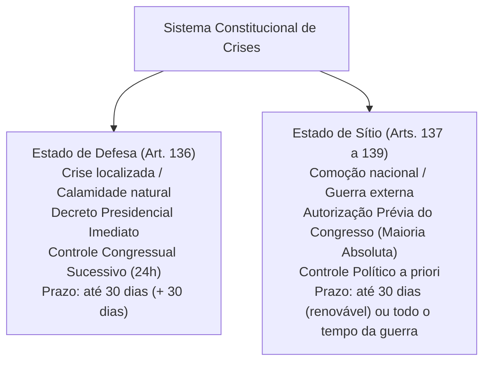
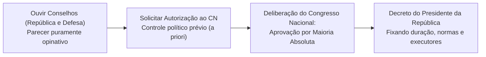
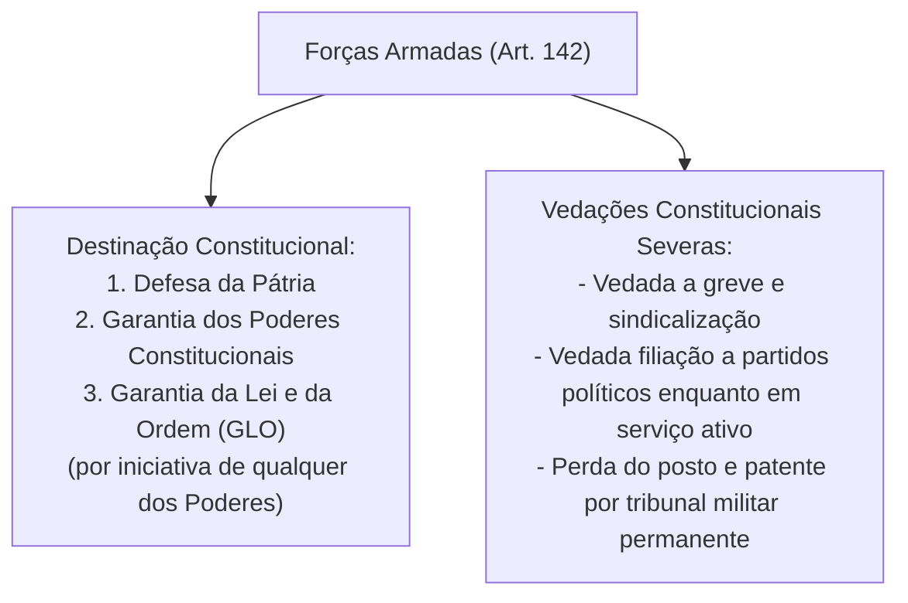

# Defesa do Estado e das Instituições Democráticas: Estado de Defesa, Estado de Sítio, Forças Armadas e Segurança Pública

> O sistema constitucional de crises consagra os mecanismos extraordinários de legalidade especial destinados a preservar ou restabelecer a ordem pública, a integridade territorial e a estabilidade das instituições democráticas diante de graves perturbações sociais ou calamidades de grandes proporções da natureza. O modelo brasileiro adota o princípio da estrita necessidade e temporariedade, estruturando-se no Estado de Defesa (decretado pelo Presidente com controle político posterior pelo Congresso) e no Estado de Sítio (que exige autorização prévia por maioria absoluta do Poder Legislativo). Na tutela da soberania, as Forças Armadas operam sob autoridade civil presidencial, sem qualquer papel de poder moderador, enquanto a Segurança Pública organiza-se em rol constitucional estrito, integrado pelas polícias da União e dos Estados, com a expressa inclusão das Polícias Penais e o reconhecimento pretoriano das Guardas Municipais como forças de segurança pública comunitária no âmbito do SUSP.

---

## 1. Sistema Constitucional das Crises: Princípios Fundamentais

O Título V da Constituição da República consagra o chamado Sistema Constitucional de Defesa ou Legalidade Extraordinária.
* **Princípio da Necessidade:** As medidas de exceção só podem ser adotadas quando os meios ordinários estatais mostrarem-se comprovadamente ineficazes para conter a crise.
* **Princípio da Proporcionalidade:** As restrições aos direitos fundamentais devem limitar-se ao estritamente necessário para restabelecer a normalidade institucional, no tempo e no espaço.
* **Princípio da Temporariedade:** O estado de legalidade especial é transitório por essência, tendo prazos fatais improrrogáveis ou renováveis unicamente sob novo crivo político parlamentar.
* **Inviolabilidade das Cláusulas Pétreas:** Durante a vigência de Estado de Defesa ou de Estado de Sítio, a Constituição **não pode ser emendada** (art. 60, § 1º — limitação circunstancial ao poder constituinte derivado reformador).

---

## 2. Estado de Defesa (Art. 136)

O Presidente da República pode, ouvidos o Conselho da República e o Conselho de Defesa Nacional, decretar estado de defesa em locais restritos e determinados.

### 2.1. Pressupostos Materiais e Espaciais
* **Pressupostos de Fato:**
  1. Grave e iminente instabilidade institucional que ameace a ordem pública ou a paz social;
  2. Calamidades de grandes proporções na natureza.
* **Localização Espacial:** O estado de defesa deve obrigatoriamente indicar **locais restritos e determinados** (não pode abranger todo o território nacional).

### 2.2. Procedimento e Prazos Fatais
1. **Oitiva Preambular (Opinativa):** O Presidente da República deve obrigatoriamente ouvir o Conselho da República e o Conselho de Defesa Nacional (art. 136, *caput*). Os pareceres têm caráter puramente consultivo e não vinculam o Chefe do Executivo.
2. **Decreto Presidencial Imediato:** O Presidente edita o decreto, determinando o tempo de sua duração, especificando as áreas a serem abrangidas e indicando as medidas coercitivas aplicáveis.
3. **Controle Político Sucessivo pelo Congresso Nacional (Art. 136, § 4º):** Decretado o estado de defesa ou sua prorrogação, o Presidente submeterá o ato com a respectiva justificação ao Congresso Nacional, **dentro de 24 horas**.
   * Se o Congresso Nacional estiver em recesso, será convocado extraordinariamente no prazo de **24 horas**.
   * O Congresso apreciará o decreto dentro de **dez dias** contados de seu recebimento, devendo continuar funcionando enquanto vigorar o estado de defesa.
   * Se o Congresso rejeitar o decreto, cessa imediatamente a vigência do estado de defesa.
4. **Duração Temporal (Art. 136, § 2º):**
   * O tempo de duração do estado de defesa **não será superior a trinta dias**, podendo ser **prorrogado uma única vez**, por igual período, se persistirem as razões que justificaram a sua decretação.
   * O prazo máximo ininterrupto é de **sessenta dias** ($30 + 30$).

### 2.3. Medidas Coercitivas Permitidas (Art. 136, § 1º)
Na vigência do estado de defesa, podem ser impostas as seguintes medidas coercitivas restritivas:
* **Restrições aos Direitos Fundamentais:**
  * Direito de reunião, ainda que exercida no seio de associações;
  * Sigilo de correspondência;
  * Sigilo de comunicação telegráfica e telefônica (atenção: não autoriza interceptação telefônica sem reserva de jurisdição para fins penais comuns, mas restrição administrativa às telecomunicações).
* **Ocupação e Uso Temporário de Bens e Serviços Públicos:** Na hipótese de calamidade pública, respondendo a União pelos danos e custos decorrentes.
* **Prisão por Crime contra o Estado:**
  * Determinada pelo executor da medida governamental;
  * Será comunicada imediatamente ao juiz competente, que a relaxará se não for legal, facultado ao preso requerer exame de corpo de delito;
  * A comunicação será acompanhada de declaração, pela autoridade, do estado físico e mental do detido no momento de sua autuação;
  * A prisão ou detenção de qualquer pessoa **não poderá ser superior a dez dias**, salvo se autorizada pelo Poder Judiciário;
  * É expressamente **vedada a incomunicabilidade do preso** (§ 7º).

---

## 3. Estado de Sítio (Arts. 137 a 139)

O Presidente da República pode, ouvidos o Conselho da República e o Conselho de Defesa Nacional, solicitar ao Congresso Nacional autorização para decretar o estado de sítio.

### 3.1. Hipóteses Constitucionais e Duração

| Hipótese Autorizadora (Art. 137) | Requisitos Materiais | Duração e Prorrogações (Art. 138) |
| :--- | :--- | :--- |
| **Inciso I (Comoção Grave ou Ineficácia do ED)** | Comoção grave de repercussão nacional **OU** ocorrência de fatos que comprovem a ineficácia de medida tomada durante o estado de defesa | Decretado por prazo **não superior a 30 dias**; cada prorrogação não pode exceder 30 dias (pode ser prorrogado sucessivamente de 30 em 30 dias enquanto persistir o fato) |
| **Inciso II (Guerra Externa ou Agressão Armada)** | Declaração de estado de guerra **OU** resposta a agressão armada estrangeira | Decretado por **todo o tempo que durar a guerra** ou a agressão armada estrangeira |

### 3.2. Medidas Coercitivas Restritivas no Estado de Sítio (Art. 139)
Na vigência do estado de sítio decretado com fundamento no art. 137, I, só poderão ser tomadas contra as pessoas as seguintes medidas taxativas:
1. Obrigação de permanência em localidade determinada;
2. Detenção em edifício não destinado a acusados ou condenados por crimes comuns;
3. Restrições relativas à inviolabilidade da correspondência, ao sigilo das comunicações, à prestação de informações e à liberdade de imprensa, radiodifusão e televisão, na forma da lei;
4. Suspensão da liberdade de reunião;
5. Busca e apreensão em domicílio;
6. Intervenção nas empresas de serviços públicos;
7. Requisição de bens.

> [!IMPORTANT]
> **Diferença Crucial no Estado de Sítio por Guerra (Art. 137, II):**  
> Na hipótese de guerra externa ou agressão armada estrangeira (art. 137, II), o Presidente da República **não está limitado às medidas restritivas do art. 139**. O decreto poderá suspender quaisquer garantias constitucionais não expressamente mantidas e estabelecer as medidas que se fizerem indispensáveis à vitória bélica, respeitadas as condições fixadas na autorização congressual (art. 138, § 1º).

### 3.3. Controle Político e Judicial das Medidas de Exceção (Arts. 140 e 141)
* **Controle Parlamentar Concomitante:** A Mesa do Congresso Nacional, ouvidos os líderes partidários, designará Comitê composto de **cinco de seus membros** para acompanhar e fiscalizar a execução das medidas referentes ao estado de defesa e ao estado de sítio (art. 140).
* **Controle Judicial Posterior (Art. 141):** Cessado o estado de defesa ou de sítio, cessarão igualmente seus efeitos, sem prejuízo da responsabilidade pelos ilícitos cometidos por seus executores ou agentes. Logo que cesse a medida, as providências tomadas serão relatadas pelo Presidente em mensagem ao Congresso, com especificação e justificação das providências e dos nomes dos atingidos. O Poder Judiciário mantém competência plena para apreciar eventuais abusos de autoridade e ilegalidades praticadas.

---

## 4. Forças Armadas (Arts. 142 e 143)

As Forças Armadas, constituídas pela Marinha, pelo Exército e pela Aeronáutica, são instituições nacionais permanentes e regulares, organizadas com base na hierarquia e na disciplina, sob a autoridade suprema do Presidente da República.

> [!CAUTION]
> **Inexistência de Poder Moderador das Forças Armadas (STF ADI 6457):**  
> O Plenário do Supremo Tribunal Federal fixou com eficácia vinculante que a Constituição Federal de 1988 **não conferiu às Forças Armadas qualquer função de Poder Moderador**, nem lhes outorgou competência para dirimir conflitos entre os Poderes Executivo, Legislativo e Judiciário ou para interferir no funcionamento das instituições republicanas. A chefia das Forças Armadas pelo Presidente é limitada pela estrita legalidade democrática.

---

## 5. Segurança Pública (Art. 144)

A segurança pública, dever do Estado, direito e responsabilidade de todos, é exercida para a preservação da ordem pública e da incolumidade das pessoas e do patrimônio.

### 5.1. Rol Taxativo dos Órgãos de Segurança Pública (Art. 144)
1. **Polícia Federal (PF):** Órgão permanente mantido pela União; polícia judiciária exclusiva da União; apura infrações penais contra a ordem política e social ou em detrimento de bens, serviços e interesses da União ou de suas entidades autárquicas e empresas públicas; reprime o tráfico ilícito de entorpecentes e drogas afins, o contrabando e o descaminho; e exerce a polícia marítima, aeroportuária e de fronteiras.
2. **Polícia Rodoviária Federal (PRF):** Órgão permanente mantido pela União; patrulhamento ostensivo das rodovias federais.
3. **Polícia Ferroviária Federal (PFF):** Órgão permanente mantido pela União; patrulhamento ostensivo das ferrovias federais.
4. **Polícias Civis (PC):** Dirigidas por delegados de polícia de carreira; incumbem as funções de polícia judiciária e a apuração de infrações penais, exceto as militares e as de competência da União. Subordinam-se aos Governadores dos Estados e do DF.
5. **Polícias Militares (PM) e Corpos de Bombeiros Militares (CBM):** Às PMs cabe a polícia ostensiva e a preservação da ordem pública; aos Corpos de Bombeiros Militares, a execução de atividades de defesa civil. São forças auxiliares e reserva do Exército, subordinadas aos Governadores dos Estados e do DF.
6. **Polícias Penais (Federal, Estaduais e Distrital - EC nº 104/2019):** Vinculadas ao órgão administrador do sistema penal da unidade federativa a que pertencem, incumbindo-lhes a segurança dos estabelecimentos penais.

### 5.2. O Estatuto Constitucional das Guardas Municipais (Art. 144, § 8º e STF ADPF 995)
* **Previsão Constitucional:** "Os Municípios poderão constituir guardas municipais destinadas à proteção de seus bens, serviços e instalações, conforme dispuser a lei." (Art. 144, § 8º).
* **Posição Jurisprudencial Atual do STF (ADPF 995 e Tema 1013):**  
  O STF declarou inconstitucional qualquer interpretação que exclua as Guardas Municipais do Sistema de Segurança Pública. As Guardas Municipais integram operacionalmente o Sistema Único de Segurança Pública (SUSP) e exercem atividade de **polícia de segurança pública comunitária**, dotadas de poder de polícia para atuação na preservação da ordem pública local e repressão de condutas infracionais em flagrante delito.

---

## 6. Questões Paradigmáticas Aplicadas

### [Questão 01](https://www.qconcursos.com/questoes-de-concursos/questoes/4378301) — [FGV — PC-PR / Delegado de Polícia — 2026]

Em razão de calamidade de grandes proporções na natureza, que ameaçou a ordem pública em dezenas de municípios da região norte do Estado Alfa, o Chefe do Poder Executivo federal, após ouvir o Conselho da República e o Conselho de Defesa Nacional, decretou o estado de defesa pelo prazo de 60 (sessenta) dias, o que foi aprovado pelo Congresso Nacional por maioria absoluta. Entre as medidas coercitivas, o decreto dispôs sobre a possibilidade de imposição de restrições ao sigilo de comunicação telefônica.

Considerando os balizamentos estabelecidos pela Constituição da República, é correto afirmar que essa narrativa:

* **A)** não apresenta incorreções.
* **B)** somente apresenta incorreção em relação ao tempo de duração do estado de defesa.
* **C)** somente apresenta incorreção em relação ao direito fundamental a ser restringido.
* **D)** somente apresenta incorreção em relação à aprovação, pelo Congresso Nacional, *a posteriori*.
* **E)** somente apresenta incorreção em relação à causa que justificou a decretação do estado de defesa.

#### Gabarito: **B**
* **A (Errada):** Há vício patente na fixação originária do prazo de duração.
* **B (Certa):** O art. 136, § 2º, da Constituição Federal estabelece expressamente que "o tempo de duração do estado de defesa não será superior a trinta dias, podendo ser prorrogado uma vez, por igual período, se persistirem as razões que justificaram a sua decretação". Portanto, o Presidente não pode decretar o estado de defesa diretamente por 60 dias ininterruptos em um único ato originário; a primeira decretação tem teto improrrogável de até 30 dias, exigindo-se nova avaliação fática e novo decreto para prorrogação por até mais 30 dias. Todos os demais elementos narrados (calamidade natural, oitiva prévia dos Conselhos, aprovação a posteriori pelo Congresso Nacional e restrição ao sigilo telefônico com fulcro no art. 136, § 1º, I, "c") estão em estrita consonância com a Constituição.
* **C (Errada):** O art. 136, § 1º, I, "c", da CF/88 autoriza explicitamente restrições ao sigilo de correspondência e de comunicação telegráfica e telefônica.
* **D (Errada):** O controle congressual no estado de defesa é tipicamente sucessivo (*a posteriori*), sendo submetido em 24 horas (art. 136, § 4º).
* **E (Errada):** As calamidades de grandes proporções na natureza constituem hipótese constitucional expressa do art. 136, *caput*.

---

### [Questão 02](https://www.qconcursos.com/questoes-de-concursos/questoes/4338745) — [FCC — PGM - Manaus - AM / Procurador do Município — 2026]

Compete privativamente ao Presidente da República:

* **A)** Manter relações com Estados estrangeiros; decretar o estado de defesa e o estado de sítio e autorizar, em terras indígenas, a exploração e o aproveitamento de recursos hídricos e a pesquisa e lavra de riquezas minerais.
* **B)** Manter relações com Estados estrangeiros; nomear os magistrados nos casos previstos na Constituição e permitir, nos casos previstos em lei complementar, que forças estrangeiras transitem pelo território nacional ou nele permaneçam temporariamente.
* **C)** Decretar o estado de calamidade pública de âmbito nacional previsto nos artigos 167-B e seguintes.
* **D)** Propor o estado de defesa e o estado de sítio ao Congresso Nacional.
* **E)** Autorizar operações externas de natureza financeira de interesse dos entes federados.

#### Gabarito: **B**
* **A (Errada):** Autorizar exploração de recursos em terras indígenas compete exclusivamente ao Congresso Nacional (art. 49, XVI).
* **B (Certa):** A alternativa reúne competências privativas indiscutíveis conferidas ao Chefe do Poder Executivo da União nos incisos VII, XVI e XXII do art. 84 da CF/88: manter relações internacionais (VII), nomear magistrados federais e de tribunais superiores (XVI) e permitir o trânsito ou permanência temporária de forças armadas estrangeiras na forma de Lei Complementar (XXII).
* **C (Errada):** O estado de calamidade nacional do art. 167-B é decretado pelo Congresso Nacional por iniciativa privativa do Presidente da República.
* **D (Errada):** O estado de defesa não é "proposto", mas decretado diretamente pelo Presidente da República, cabendo ao Congresso o controle político posterior (art. 136).
* **E (Errada):** A autorização para operações externas de crédito compete privativamente ao Senado Federal (art. 52, V).

---

### [Questão 03](https://www.qconcursos.com/questoes-de-concursos/questoes/4323948) — [FEPESE — Prefeitura de Itajaí - SC / Procurador do Município — 2026]

Sobre a intervenção federal e a intervenção estadual na Constituição Federal de 1988, é correto afirmar:

* **A)** O Supremo Tribunal Federal julgou procedente a ADI contra o decreto de intervenção federal na segurança pública do RJ em 2018.
* **B)** Compete privativamente à União decretar intervenção em Municípios localizados em Estados-membros.
* **C)** O decreto de intervenção federal deve, em regra, ser submetido à apreciação do Congresso Nacional no prazo de vinte e quatro horas, dispensando-se tal controle político nas hipóteses de mero provimento à execução de lei federal, ordem ou decisão judicial, ou de garantia à observância de princípios constitucionais sensíveis, casos em que o decreto se limitará a suspender o ato impugnado, se essa medida bastar ao restabelecimento da normalidade.
* **D)** A intervenção do Estado em Municípios decorre de conveniência política discricionária do Governador.
* **E)** A intervenção federal pode ser decretada de ofício em todas as hipóteses do art. 34.

#### Gabarito: **C**
* **A (Errada):** O STF referendou a higidez do ato interventivo fundamentado na grave perturbação da ordem pública.
* **B (Errada):** A União somente intervém diretamente em Municípios localizados em Territórios Federais (art. 35, *caput*); nos Municípios situados nos Estados, a intervenção compete ao respectivo Estado-membro.
* **C (Certa):** A alternativa reproduz com exatidão a dicção literal do art. 36, §§ 1º e 3º, da Carta Magna, que afasta o controle político congressual quando a intervenção judicial for suficiente mediante a simples suspensão do ato objurgado.
* **D (Errada):** A intervenção é medida gravíssima de exceção federativa subordinada ao rol taxativo do art. 35 da CF.
* **E (Errada):** Em casos de coação contra o Judiciário, descumprimento de ordem judicial ou violação a princípios sensíveis, a intervenção depende de requisição do STF, STJ, TSE ou provimento de representação interventiva pelo PGR (art. 36).

---

### [Questão 04](https://www.qconcursos.com/questoes-de-concursos/questoes/4393805) — [VUNESP — TJ-SP / Residência Jurídica — 2026]

O Estado da Federação X deixou de adimplir precatórios judiciais nos últimos cinco anos, alegando severa frustração na arrecadação tributária. O Governo Estadual sustenta que a destinação dos recursos orçamentários ao pagamento integral das requisições inviabilizaria a manutenção dos serviços essenciais de saúde e educação. Diante da mora, um credor requereu a intervenção federal no Estado perante o Tribunal de Justiça, cujo Presidente formulou o pedido ao STF.

Tendo em vista a Constituição Federal de 1988 e a jurisprudência do Supremo Tribunal Federal (STF), o pedido de intervenção federal deverá ser julgado:

* **A)** Procedente, visto que a Constituição Federal estabelece responsabilidade objetiva pelo descumprimento de ordens judiciais.
* **B)** Improcedente, pois a decretação de intervenção federal por inadimplemento de precatório exige descumprimento voluntário e intencional (doloso), premissa afastada quando a mora decorre de insuficiência transitória de recursos e da necessidade de resguardar serviços públicos essenciais.
* **C)** Inadmissível, em razão da ilegitimidade do particular para provocar o procedimento interventivo perante o tribunal competente.
* **D)** Procedente, pois o crédito de precatório possui prioridade absoluta sobre despesas essenciais do Estado.
* **E)** Extinto sem resolução do mérito, cabendo unicamente sequestro de verbas.

#### Gabarito: **B**
* **A (Errada):** A intervenção federal não decorre de responsabilidade automática puramente objetiva.
* **B (Certa):** O STF possui jurisprudência consolidada (IF 5105 e IF 2915) no sentido de que a intervenção federal por descumprimento de ordem judicial (art. 34, VI) pressupõe dolo, recalcitrância e vontade deliberada do ente federativo de não cumprir o provimento. A escassez orçamentária comprovada e a priorização de serviços de saúde e educação descaracterizam a insolvência dolosa, impedindo a medida extrema da intervenção.
* **C (Errada):** O credor tem legitimidade para requerer ao Presidente do Tribunal a iniciativa interventiva.
* **D (Errada):** O princípio da continuidade dos serviços públicos essenciais impõe ponderação e afasta a automática dissolução federativa.
* **E (Errada):** O sequestro de verbas do art. 100, § 6º, é cabível no preterimento de ordem cronológica, mas não anula a via interventiva em caso de calote deliberado.

---

### [Questão 05](https://www.qconcursos.com/questoes-de-concursos/questoes/4320507) — [Instituto Consulplan — CRA-PR / Advogado — 2026]

Considerando as diferentes classificações dos elementos constitucionais presentes na Constituição Federal de 1988, é correto afirmar que os elementos:

* **A)** Limitativos disciplinam a ordem econômica e financeira.
* **B)** Orgânicos correspondem às normas relativas aos direitos sociais e individuais.
* **C)** Socioideológicos restringem-se às normas de repartição de competências federativas.
* **D)** Estabilizadores destinam-se à defesa da ordem constitucional diante de situações de crise institucional.

#### Gabarito: **D**
* **A (Errada):** As normas econômicas integram os elementos socioideológicos.
* **B (Errada):** Os direitos fundamentais compõem os elementos limitativos da Constituição.
* **C (Errada):** A repartição de competências integra os elementos orgânicos.
* **D (Certa):** Segundo a clássica classificação de José Afonso da Silva, os elementos estabilizadores da Constituição compreendem os preceitos normativos destinados a assegurar a solução de conflitos institucionais, a defesa do Estado e a higidez do pacto federativo, abarcando o Estado de Defesa (art. 136), o Estado de Sítio (arts. 137 a 139), as Forças Armadas (arts. 142 e 143), a Segurança Pública (art. 144) e o controle concentrado de constitucionalidade.

---

### [Questão 06](https://www.qconcursos.com/questoes-de-concursos/questoes/4403009) — [Avança SP — Autarquia Municipal de Saúde / Auxiliar — 2026]

Em relação à Polícia Militar, assinale a alternativa correta à luz da Constituição Federal:

* **A)** É uma corporação pertencente à esfera municipal, subordinada diretamente ao prefeito.
* **B)** É uma corporação pertencente à esfera estadual, sendo subordinada diretamente ao governador do estado.
* **C)** É subordinada diretamente ao prefeito do município.
* **D)** Pertence à esfera federal, subordinada ao Ministro da Justiça.
* **E)** É subordinada diretamente ao Presidente da República.

#### Gabarito: **B**
* **A (Errada):** A PM é corporação de nível estadual.
* **B (Certa):** O art. 144, § 6º, da CF/88 estabelece que as polícias militares e os corpos de bombeiros militares, forças auxiliares e reserva do Exército, subordinam-se, juntamente com as polícias civis e as polícias penais estaduais e distrital, aos Governadores dos Estados, do Distrito Federal e dos Territórios.
* **C (Errada):** Os municípios possuem guardas municipais, e não polícias militares.
* **D (Errada):** A Polícia Militar é corporação militarizada de nível estadual e distrital.
* **E (Errada):** Apenas em caso de guerra externa ou convocação especial atuam como reserva do Exército sob comando federal.

---

### [Questão 07](https://www.qconcursos.com/questoes-de-concursos/questoes/4301039) — [Grupo TALENT — Prefeitura de Getulina - SP / Motorista — 2026]

Durante uma diligência administrativa, agentes pretendem entrar na residência de um morador sem sua autorização. Não há flagrante delito, desastre nem necessidade de prestar socorro. Há apenas ordem judicial regularmente expedida, apresentada às 22 horas. À luz da Constituição Federal, assinale a alternativa correta:

* **A)** A entrada é permitida, pois a ordem judicial autoriza o ingresso em qualquer horário.
* **B)** A entrada coercitiva com fundamento apenas na ordem judicial deve ocorrer durante o dia.
* **C)** Depende de autorização prévia da Prefeitura.
* **D)** A residência pode ser ingressada à noite sempre que a diligência tiver finalidade administrativa.

#### Gabarito: **B**
* **A (Errada):** A ordem judicial restringe-se estritamente ao período diurno.
* **B (Certa):** Em consonância com o art. 5º, inciso XI, da CF/88, a casa é asilo inviolável do indivíduo, ninguém nela podendo penetrar sem consentimento do morador, salvo em caso de flagrante delito ou desastre, ou para prestar socorro, ou, durante o dia, por determinação judicial. Apenas durante o Estado de Sítio decorrente de comoção nacional ou guerra autoriza-se a busca e apreensão domiciliar fora dos parâmetros ordinários, na forma do art. 139, V.
* **C (Errada):** A inviolabilidade domiciliar submete-se à reserva de jurisdição do Judiciário.
* **D (Errada):** Diligências administrativas não gozam de exceção noturna sem consentimento do morador.

---

### [Questão 08](https://www.qconcursos.com/questoes-de-concursos/questoes/4342054) — [FAFIPA — Prefeitura de Matinhos - PR / Procurador Municipal — 2026]

No que tange à Segurança Pública e à atuação dos Municípios conforme o art. 144 da Constituição Federal, assinale a afirmativa correta:

* **A)** Os Municípios poderão constituir guardas municipais destinadas à proteção de seus bens, serviços e instalações, conforme dispuser a lei.
* **B)** É vedada a criação de guardas municipais nos municípios com população inferior a cem mil habitantes.
* **C)** As guardas municipais subordinam-se administrativamente à Secretaria de Segurança Pública do respectivo Estado.
* **D)** As guardas municipais têm competência privativa para apuração de crimes contra o patrimônio privado ocorridos nas vias públicas.
* **E)** É vedado o porte de arma de fogo aos integrantes das guardas municipais por ausência de previsão no texto originário da Carta Magna.

#### Gabarito: **A**
* **A (Certa):** O texto reproduz a literalidade expressa do art. 144, § 8º, da CF/88, sendo atribuição das guardas municipais a tutela do patrimônio municipal e a atuação preventiva na segurança cidadã conforme jurisprudência do STF (ADPF 995).
* **B (Errada):** A Constituição não estabelece piso demográfico restritivo para criação de guardas municipais.
* **C (Errada):** As guardas municipais são órgãos integrantes da administração direta do Poder Executivo municipal, subordinadas diretamente ao Prefeito.
* **D (Errada):** A apuração de infrações penais comuns cabe com exclusividade à Polícia Civil (art. 144, § 4º).
* **E (Errada):** O STF declarou inconstitucionais as restrições demográficas ao porte de arma de fogo para guardas municipais nas ADIs 5948, 5538 e 5985.
