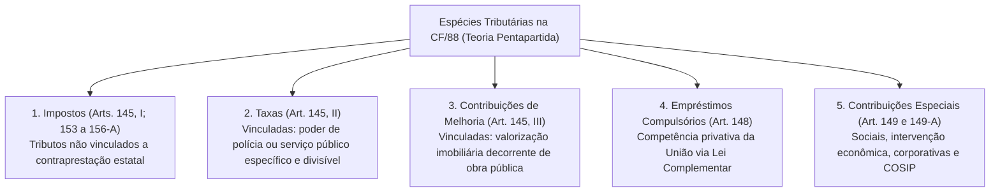
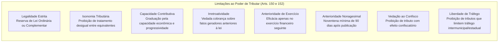
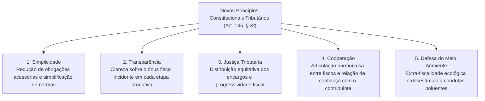
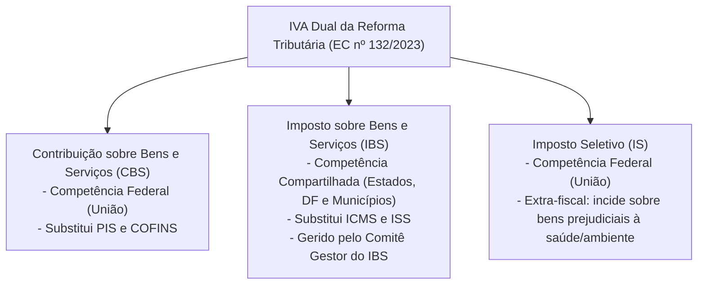

# Sistema Tributário Nacional: Princípios Constitucionais, Limitações ao Poder de Tributar e Reforma Tributária

> O Sistema Tributário Nacional fundamenta-se nas limitações constitucionais ao poder de tributar, erigidas como garantias fundamentais do contribuinte (art. 150, cláusulas pétreas na esteira do art. 60, § 4º, IV). A Carta Magna consagra a teoria pentapartida das espécies tributárias, delimitando rigidamente as competências privativas, comuns e cumulativas da União, dos Estados, do Distrito Federal e dos Municípios. Os princípios da legalidade estrita, capacidade contributiva, irretroatividade, anterioridades de exercício e nonagesimal, e vedação ao confisco conformam as balizas de contenção do Estado fiscal. Com o advento da Emenda Constitucional nº 132/2023 (Reforma Tributária), o sistema absorveu princípios basilares de modernização (simplicidade, transparência, justiça tributária, cooperação e defesa do meio ambiente) e instituiu o modelo do IVA Dual (IBS e CBS) e do Imposto Seletivo (IS), reconfigurando a tributação do consumo e as regras federativas de arrecadação e repartição de receitas.

---

## 1. Estrutura das Espécies Tributárias e Competências Constitucionais

O Supremo Tribunal Federal adota a **Teoria Quinquipartida (ou Pentapartida)** das espécies tributárias, alicerçada nos arts. 145, 148 e 149 da Constituição Federal.

### 1.1. Regras Constitucionais das Taxas vs. Impostos
* **Vedação de Base de Cálculo Própria de Impostos (Art. 145, § 2º):** As taxas não poderão ter base de cálculo própria de impostos.
* **Súmula Vinculante 29 (STF):** É constitucional a adoção, no cálculo do valor de taxa, de um ou mais elementos da base de cálculo própria de determinado imposto, desde que não haja integral identidade entre uma base e outra.
* **Súmula Vinculante 19 (STF):** A taxa cobrada exclusivamente em razão dos serviços públicos de coleta, remoção e tratamento ou destinação de lixo ou resíduos provenientes de imóveis (taxa de lixo) não viola o art. 145, II, da CF/88 (serviço específico e divisível). Em contrapartida, é **inconstitucional a taxa de iluminação pública ou limpeza de logradouros públicos** (*uti universi*), ensejando a criação da contribuição para o custeio do serviço de iluminação pública e monitoramento de segurança urbana (COSIP - art. 149-A).

---

## 2. Princípios Constitucionais Tributários e o Quadro de Exceções

As limitações ao poder de tributar traduzem direitos individuais inalienáveis e salvaguardas patrimoniais contra o arbítrio estatal.

### 2.1. Matriz Constitucional de Anterioridade de Exercício vs. Nonagesimal

A regra geral impõe a observância cumulativa da Anterioridade Anual (exercício seguinte) e da Anterioridade Nonagesimal (espera de 90 dias). As exceções constitucionais são taxativas:

| Tributo Impugnado | Anterioridade Anual (Art. 150, III, "b") | Anterioridade Nonagesimal (Art. 150, III, "c") | Fundamento Constitucional |
| :--- | :---: | :---: | :--- |
| **II, IE, IOF** (Extrafiscais) | **NÃO** | **NÃO** | Cobrança imediata no dia da publicação da alteração de alíquota |
| **Impostos Extraordinários de Guerra e Empréstimos Compulsórios de Calamidade/Guerra** | **NÃO** | **NÃO** | Urgência extrema nacional (arts. 148, I e 154, II) |
| **IPI** | **NÃO** | **SIM** | Exige noventena, mas incide no mesmo exercício financeiro |
| **CIDE-Combustíveis e ICMS-Combustíveis (redução e restabelecimento de alíquotas)** | **NÃO** | **SIM** | Flexibilidade para regulação de preços de energia |
| **Contribuições para Seguridade Social (Art. 195, § 6º)** | **NÃO** | **SIM** | Noventena especial de 90 dias da seguridade |
| **IR (Fixação e Majoração)** | **SIM** | **NÃO** | Exige virada de exercício financeiro, sem esperar 90 dias |
| **Fixação de Base de Cálculo do IPTU e IPVA** | **SIM** | **NÃO** | Exige virada de exercício, sem esperar 90 dias |
| **IBS e CBS (Reforma Tributária - EC 132/2023)** | **SIM** | **SIM** | Sujeição cumulativa à anual e à nonagesimal |

---

## 3. Os Novos Princípios do Sistema Tributário (EC nº 132/2023)

A Emenda Constitucional nº 132/2023 inseriu o § 3º no art. 145 da Carta Magna, positivando cinco novos princípios reitores para a administração tributária:

> [!IMPORTANT]
> **Defesa do Meio Ambiente e o Imposto Seletivo (Art. 153, VIII):**  
> O princípio da defesa do meio ambiente foi consagrado no art. 145, § 3º, e corporifica-se funcionalmente na criação do **Imposto Seletivo (IS)**, de competência da União, incidente sobre a produção, extração, comercialização ou importação de bens e serviços prejudiciais à saúde ou ao meio ambiente.

---

## 4. Imunidades Constitucionais Tributárias (Art. 150, VI)

As imunidades são hipóteses de não incidência constitucionalmente qualificadas, subtraindo do legislador ordinário a própria competência para instituir impostos sobre determinadas pessoas, bens ou atividades.

### 4.1. Imunidade Recíproca (Art. 150, VI, "a")
* **Regra Geral:** É vedado à União, aos Estados, ao Distrito Federal e aos Municípios instituir impostos sobre patrimônio, renda ou serviços uns dos outros.
* **Extensão Constitucional (Art. 150, § 2º):** Aplica-se às autarquias e às fundações instituídas e mantidas pelo poder público, no que se refere ao patrimônio, à renda e aos serviços vinculados a suas finalidades essenciais ou às delas decorrentes.
* **Extensão Jurisprudencial às Empresas Estatais (STF):**
  * *Empresas Públicas e Sociedades de Economia Mista Delegatárias de Serviço Público em Regime de Exclusividade (não concorrencial e sem intuito lucrativo primário):* **Gozam de imunidade tributária recíproca** (ex.: Empresa Brasileira de Correios e Telégrafos - ECT, INFRAERO, companhias públicas de saneamento básico e saneamento e hospitais universitários públicos).
  * *Empresas Estatais Exploradoras de Atividade Econômica de Mercado:* **Não gozam de imunidade recíproca** (art. 173, § 2º — submissão ao regime jurídico das empresas privadas, sob pena de violação à livre concorrência).
  * *Imóvel Público Cedido a Particular:* O STF pacificou no Tema 437 de Repercussão Geral que a imunidade recíproca não se estende à empresa privada que explora economicamente bem público mediante concessão ou arrendamento (incide IPTU sobre o possuidor).

### 4.2. Imunidade Religiosa (Art. 150, VI, "b")
* Veda a instituição de impostos sobre "templos de qualquer culto".
* Compreende não apenas o local físico das cerimônias religiosas, mas todo o patrimônio, renda e serviços diretamente relacionados com o funcionamento da entidade religiosa (residência do pároco/pastor, veículos da igreja, cemitérios e creches mantidas pela congregação, desde que as rendas sejam revertidas integralmente nas finalidades religiosas).

### 4.3. Imunidade Política e Sindical (Art. 150, VI, "c")
* Veda a instituição de impostos sobre patrimônio, renda ou serviços dos partidos políticos, inclusive suas fundações, das entidades sindicais dos trabalhadores, e das instituições de educação e de assistência social, sem fins lucrativos, atendidos os requisitos da lei (art. 14 do CTN).
* Atenção de Prova: A imunidade sindical protege as entidades sindicais dos **trabalhadores**, não alcançando os sindicatos patronais.

### 4.4. Imunidade Cultural e da Imprensa (Art. 150, VI, "d")
* Livros, jornais, periódicos e o papel destinado a sua impressão.
* **Súmula Vinculante 57 (STF):** A imunidade tributária do art. 150, VI, "d", da CF/88 abrange os livros eletrônicos (*e-books*), os suportes materiais digitais exclusivos para sua leitura (*e-readers*, como Kindle) e os arquivos digitais respectivos.

---

## 5. O Novo Paradigma da Tributação do Consumo: O IVA Dual (EC nº 132/2023)

A Reforma Tributária substituiu os tributos fragmentados sobre o consumo (PIS, COFINS, IPI, ICMS e ISS) por um modelo moderno de **Imposto sobre Valor Agregado Dual (IVA Dual)**, composto por duas figuras tributárias com fatos geradores e bases de cálculo idênticos:

### 5.1. Regras Comuns e Harmonização Obrigatória entre IBS e CBS (Art. 149-B)
A Emenda Constitucional nº 132/2023 fixou expressamente que o IBS e a CBS obedecerão às mesmas regras uniformes em todo o território nacional, estabelecidas por Lei Complementar, quanto a:
1. Fatos geradores, bases de cálculo, hipóteses de não incidência e sujeitos passivos;
2. Imunidades tributárias;
3. Regimes específicos, diferenciados ou favorecidos de tributação;
4. Regras relativas à não cumulatividade plena e creditamento financeiro.

> [!IMPORTANT]
> **Autonomia Federativa na Definição de Alíquotas:**  
> A uniformização entre IBS e CBS **NÃO alcança a fixação das alíquotas**! Cada Estado, o Distrito Federal e cada Município fixará sua alíquota própria do IBS por lei específica ordinária, respeitada a alíquota de referência fixada pelo Senado Federal.

---

## 6. Questões Paradigmáticas Aplicadas

### [Questão 01](https://www.qconcursos.com/questoes-de-concursos/questoes/4304855) — [CESPE / CEBRASPE — TJ-MT / Notário e Registrador — 2026]

Assinale a opção correta acerca do sistema tributário nacional e da ordem econômica e financeira:

* **A)** Segundo entendimento do STF, é constitucional lei municipal que impede a instalação de estabelecimentos comerciais do mesmo ramo em determinada área.
* **B)** É inconstitucional a adoção, no cálculo do valor de taxa, de um ou mais elementos da base de cálculo própria de determinado imposto, ainda que não haja integral identidade entre uma base e outra.
* **C)** A progressividade da alíquota que resulta do rateio do custo da iluminação pública entre os consumidores de energia elétrica não afronta o princípio da capacidade contributiva.
* **D)** Consoante posicionamento do STF, é constitucional taxa municipal de conservação de estradas de rodagem cuja base de cálculo seja idêntica à do ITR.
* **E)** As empresas públicas e as sociedades de economia mista poderão gozar de privilégios fiscais, ainda que extensivos às do setor privado.

#### Gabarito: **C**
* **A (Errada):** A Súmula Vinculante 49 do STF estabelece que "ofende o princípio da livre concorrência lei municipal que impede a instalação de estabelecimentos comerciais do mesmo ramo em determinada área".
* **B (Errada):** A Súmula Vinculante 29 do STF autoriza a utilização de elementos de base de cálculo de imposto na taxa, desde que não ocorra identidade integral.
* **C (Certa):** O Supremo Tribunal Federal fixou a tese vinculante no Tema 696 de Repercussão Geral (RE 573.675): "É constitucional a lei municipal que institui a contribuição para o custeio da iluminação pública (COSIP) com base de cálculo calculada a partir do consumo de energia elétrica e alíquotas progressivas fixadas conforme as faixas de consumo dos usuários". A progressividade ampara-se diretamente na capacidade contributiva presumida pelo nível de consumo do contribuinte.
* **D (Errada):** É inconstitucional taxa que possua base de cálculo idêntica à de imposto (art. 145, § 2º da CF).
* **E (Errada):** O art. 173, § 2º, veda privilégios fiscais não extensivos ao setor privado para empresas estatais de atividade econômica.

---

### [Questão 02](https://www.qconcursos.com/questoes-de-concursos/questoes/4362507) — [FEPESE — Prefeitura de Itajaí - SC / Assistente Jurídico — 2026]

Compreendem os novos princípios do Sistema Tributário Nacional, incluídos pela Emenda Constitucional nº 132/2023:

* **A)** Simplicidade, transparência, justiça tributária, cooperação e defesa do meio ambiente.
* **B)** Transparência, neutralidade, conformidade, justiça tributária e proteção do meio ambiente.
* **C)** Simplicidade, justiça tributária, neutralidade, cooperação e livre concorrência.
* **D)** Justiça tributária, cooperação, neutralidade, defesa do meio ambiente e não cumulatividade.
* **E)** Simplicidade, não cumulatividade, neutralidade, justiça tributária, proteção do meio ambiente.

#### Gabarito: **A**
* **A (Certa):** O art. 145, § 3º, introduzido pela EC nº 132/2023, estabelece com rigor literal que o Sistema Tributário Nacional observará os princípios da simplicidade, da transparência, da justiça tributária, da cooperação e da defesa do meio ambiente.
* **B (Errada):** Cita "conformidade" e "neutralidade", que não figuram no rol expressamente positivado no art. 145, § 3º.
* **C (Errada):** Cita "livre concorrência", princípio geral da ordem econômica (art. 170, IV), mas não elencado no § 3º do art. 145.
* **D (Errada):** Cita "não cumulatividade", que é técnica/regra constitucional de tributação, e não um dos cinco novos princípios do § 3º.
* **E (Errada):** Confunde técnicas tributárias com o rol taxativo de novos princípios introduzidos pela reforma.

---

### [Questão 03](https://www.qconcursos.com/questoes-de-concursos/questoes/4368788) — [LEGALLE Concursos — Prefeitura de Francisco Alves - PR / Agente Tributário — 2026]

Considere que um Município pretende estabelecer, por meio de legislação própria, regras distintas das aplicáveis à Contribuição sobre Bens e Serviços (CBS) para disciplinar o Imposto sobre Bens e Serviços (IBS), especialmente quanto aos regimes diferenciados de tributação e às regras de creditamento. Considerando as disposições da Constituição Federal após a Emenda Constitucional nº 132/2023, essa iniciativa:

* **A)** É permitida, pois o IBS é de competência dos Estados, do Distrito Federal e dos Municípios.
* **B)** É permitida, desde que a legislação municipal seja compatível com a legislação federal.
* **C)** É vedada apenas quanto aos regimes diferenciados, pois as regras de creditamento podem ser disciplinadas livremente pelos Municípios.
* **D)** É vedada, pois os regimes diferenciados e as regras de creditamento estão entre as matérias que devem observar as mesmas regras para o IBS e a CBS.

#### Gabarito: **D**
* **A (Errada):** A competência compartilhada do IBS submete-se ao modelo uniforme nacional da Lei Complementar federal.
* **B (Errada):** Não há margem para fragmentação local de regimes de creditamento ou regimes diferenciados.
* **C (Errada):** As regras de creditamento são de harmonização obrigatória nacional.
* **D (Certa):** Conforme dispõe categoricamente o art. 149-B da Constituição Federal (inserido pela EC nº 132/2023), o IBS e a CBS observarão as mesmas regras fixadas em lei complementar única para regimes diferenciados, hipóteses de não incidência, sujeitos passivos e regras de não cumulatividade e creditamento, sendo vedado aos Municípios inovar nessa disciplina.

---

### [Questão 04](https://www.qconcursos.com/questoes-de-concursos/questoes/4246974) — [FURB — Câmara de Curitibanos - SC / Controlador Interno — 2026]

O Título VI da Constituição Federal de 1988 dispõe sobre a "Tributação e o Orçamento". Tomando-se por base a Carta Magna, é correto afirmar que:

* **A)** As taxas poderão ter base de cálculo própria de impostos, desde que exigidas por entes diferentes.
* **B)** Os Estados e Municípios podem estabelecer diferença tributária entre bens e serviços em razão de sua procedência ou destino.
* **C)** A União não pode, em nenhuma hipótese, instituir tributo não uniforme em todo o país.
* **D)** Diante do princípio da igualdade, nem mesmo a lei complementar poderá estabelecer critérios especiais de tributação.
* **E)** É vedada a instituição de impostos sobre o patrimônio, renda ou serviços dos partidos políticos, inclusive suas fundações, e das entidades sindicais dos trabalhadores.

#### Gabarito: **E**
* **A (Errada):** O art. 145, § 2º, veda de forma absoluta taxa com base de cálculo própria de impostos, independentemente do ente tributante.
* **B (Errada):** O art. 152 proíbe categoricamente qualquer diferenciação tributária em razão de procedência ou destino.
* **C (Errada):** O art. 151, I, admite expressamente incentivos fiscais destinados a promover o equilíbrio do desenvolvimento socioeconômico regional.
* **D (Errada):** O art. 146, III, "d", prevê regimes especiais de tributação (como o Simples Nacional).
* **E (Certa):** A alternativa reflete a imunidade tributária expressa inscrita no art. 150, inciso VI, alínea "c", da Constituição Federal, condicionada à observância dos requisitos legais de destinação institucional.

---

### [Questão 05](https://www.qconcursos.com/questoes-de-concursos/questoes/4251179) — [INSTITUTO AOCP — CESAMA / Contador — 2026]

A Emenda Constitucional (EC) nº 132/2023, ao promover a reforma tributária, criou a Contribuição sobre Bens e Serviços (CBS) e o Imposto sobre Bens e Serviços (IBS). Com base nas disposições da EC nº 132/2023, são regras de uniformização obrigatória aplicáveis ao IBS e à CBS, EXCETO:

* **A)** Regimes específicos, diferenciados ou favorecidos de tributação.
* **B)** Hipóteses de não incidência e sujeito passivo.
* **C)** Imunidades tributárias e definição de alíquotas.
* **D)** Regras relativas à não cumulatividade e ao creditamento.

#### Gabarito: **C**
* **A (Errada):** Regimes específicos, diferenciados ou favorecidos de tributação são matéria de uniformização obrigatória (art. 149-B).
* **B (Errada):** Hipóteses de não incidência e sujeito passivo devem ser rigorosamente idênticos para ambos os tributos.
* **C (Certa):** Embora as imunidades tributárias devam ser harmônicas, a **definição de alíquotas NÃO é objeto de uniformização obrigatória** entre o IBS e a CBS. Cada ente da Federação (União na CBS; cada Estado, o DF e cada Município no IBS) tem a competência privativa constitucional para fixar suas próprias alíquotas por lei ordinária respectiva, garantindo a autonomia federativa orçamentária.
* **D (Errada):** Regras relativas à não cumulatividade e ao creditamento financeiro são matérias expressas de uniformização nacional obrigatória.

---

### [Questão 06](https://www.qconcursos.com/questoes-de-concursos/questoes/4255353) — [Instituto Consulplan — TJ-MG / Juiz de Direito Substituto — 2026]

Sobre as alterações promovidas pela Reforma Tributária (EC nº 132/2023), analise as afirmativas a seguir:

I. A COSIP, de competência dos municípios e do Distrito Federal, passa a ter especial relevância no financiamento da segurança pública local, dada a nova finalidade de custear os serviços de monitoramento e preservação do patrimônio público.  
II. A identidade de fatos geradores, base de cálculo e contribuintes do IVA Dual permite corrigir a fragmentação das bases de incidência previstas até então nos impostos sobre o consumo, reduzindo conflitos de competência e simplificando a interpretação.  
III. A EC 132/2023 estabeleceu, de forma expressa, que tanto o ITCD quanto o ITBI deverão ter suas alíquotas obrigatoriamente progressivas.  
IV. O IVA Dual incidirá em todas as etapas da cadeia de bens e serviços, com não cumulatividade plena, adotará o princípio do destino e terá restrição na concessão de incentivos fiscais heterônomos.

Está correto o que se afirma apenas em:

* **A)** I, II e III.
* **B)** I e III.
* **C)** II e IV.
* **D)** I, II e IV.

#### Gabarito: **D**
* **A (Errada):** O item III está incorreto.
* **B (Errada):** Contém afirmações falsas.
* **C (Errada):** O item I também é correto.
* **D (Certa):** O item I é verdadeiro, pois a EC nº 132/2023 ampliou a destinação da COSIP (art. 149-A) para abranger o custeio, a expansão e a melhoria de sistemas de monitoramento voltados à segurança e à preservação de logradouros públicos. O item II é verdadeiro, consubstanciando a exata finalidade do art. 149-B na criação do IVA Dual. O item IV é verdadeiro, refletindo os pilares do IVA Dual (princípio do destino, não cumulatividade ampla e restrição a benefícios fiscais predadores). Já o item III é falso: a EC nº 132/2023 tornou **obrigatória a progressividade do ITCMD** (art. 155, § 1º, VI), mas **não impôs progressividade obrigatória ao ITBI**, cuja alíquota progressiva é apenas facultada pela jurisprudência pretoriana do STF (Súmula 656 e Súmula Vinculante 29).
