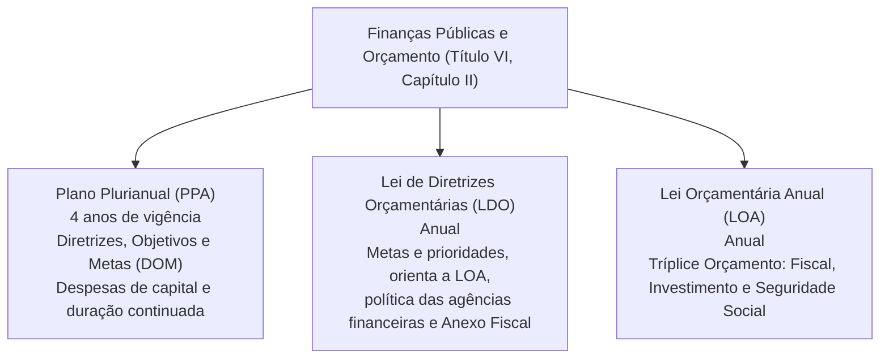
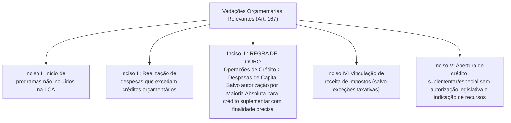
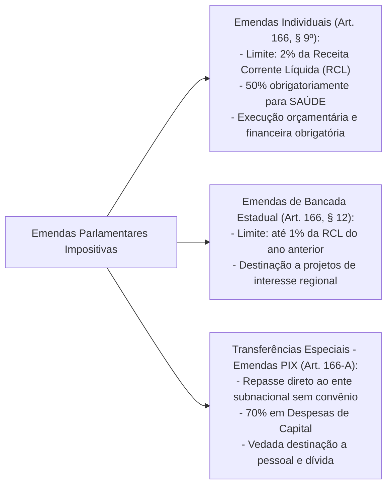

# Finanças Públicas e Orçamento: PPA, LDO, LOA, Princípios Orçamentários e Emendas Impositivas

> As finanças públicas e o direito orçamentário consagram os instrumentos de planejamento, gestão e controle democrático da alocação de recursos escassos do Estado para satisfação das necessidades coletivas. A Constituição Federal estrutura o planejamento governamental em um ciclo integrado tripartite de leis de iniciativa privativa do Poder Executivo: o Plano Plurianual (PPA), a Lei de Diretrizes Orçamentárias (LDO) e a Lei Orçamentária Anual (LOA). O regime orçamentário é regido por princípios constitucionais cogentes (universalidade, unidade, exclusividade e não vinculação de impostos) e por vedações estritas, destacando-se a "Regra de Ouro" (art. 167, III) para conter o endividamento estatal. Nas últimas décadas, o modelo evoluiu do orçamento meramente autorizativo para um regime de impositividade parcial, consolidando as emendas parlamentares individuais (2% da RCL) e de bancada, bem como as transferências especiais diretas ("Emendas PIX" do art. 166-A), com regras rígidas de transparência e rastreabilidade sob o escrutínio dos Tribunais de Contas e do STF.

---

## 1. O Marco Constitucional das Finanças Públicas (Arts. 163 a 164)

O art. 163 da Constituição da República reserva à Lei Complementar federal a fixação de normas gerais sobre:
* Finanças públicas;
* Dívida pública fundada e mobiliária dos entes federados;
* Concessão de garantias pelas entidades públicas;
* Emissão e resgate de títulos da dívida pública;
* Fiscalização financeira da administração direta e indireta.

### 1.1. Disponibilização de Dados e Transparência Fiscal (Art. 163-A)
Inserido pela Emenda Constitucional nº 108/2020: "A União, os Estados, o Distrito Federal e os Municípios disponibilizarão suas informações e dados contábeis, orçamentários e fiscais, conforme periodicidade, formato e sistema estabelecidos pelo órgão central de contabilidade da União, de forma a garantir a rastreabilidade, a **comparabilidade** e a publicidade dos dados coletados".

---

## 2. A Tríade do Planejamento Orçamentário (Art. 165)

Leis de iniciativa exclusiva do Chefe do Poder Executivo (art. 165, *caput*):

### 2.1. Plano Plurianual (PPA - Art. 165, § 1º)
* **Finalidade Constitucional:** Estabelecer, de forma regionalizada, as **diretrizes, objetivos e metas** (mnemônico: `DOM`) da administração pública federal para as despesas de capital e outras delas decorrentes e para as relativas aos programas de duração continuada.
* **Vigência e Transição Política:** O PPA vigora por **quatro anos**, iniciando-se no segundo ano do mandato presidencial e estendendo-se até o término do primeiro ano do mandato subsequente, garantindo a continuidade das políticas públicas estruturantes.
* **Regra Proibitiva (Art. 167, § 1º):** Nenhum investimento cuja execução ultrapasse um exercício financeiro poderá ser iniciado sem prévia inclusão no PPA, ou sem lei que autorize a inclusão, sob pena de crime de responsabilidade.

### 2.2. Lei de Diretrizes Orçamentárias (LDO - Art. 165, § 2º)
* **Atribuições:**
  1. Compreende as metas e prioridades da administração pública, incluindo as despesas de capital para o exercício financeiro subsequente;
  2. Orienta a elaboração da Lei Orçamentária Anual;
  3. Dispõe sobre as alterações na legislação tributária;
  4. Estabelece a política de aplicação das agências financeiras oficiais de fomento;
  5. Integra o Anexo de Metas Fiscais e o Anexo de Riscos Fiscais (nos termos da LRF - LC nº 101/2000).
* **Sessão Legislativa Condicionada (Art. 57, § 2º):** O Congresso Nacional **não será interrompido** no recesso de julho sem a aprovação do projeto de Lei de Diretrizes Orçamentárias.

### 2.3. Lei Orçamentária Anual (LOA - Art. 165, § 5º)
A LOA compreende três orçamentos integrados:
1. **Orçamento Fiscal:** Referente aos Poderes da União, seus fundos, órgãos e entidades da administração direta e indireta, inclusive fundações instituídas e mantidas pelo Poder Público;
2. **Orçamento de Investimento:** Das empresas em que a União, direta ou indiretamente, detenha a maioria do capital social com direito a voto;
3. **Orçamento da Seguridade Social:** Abrange todas as entidades e órgãos a ela vinculados, da administração direta ou indireta, bem como os fundos e fundações instituídos e mantidos pelo Poder Público (custeio da Saúde, Previdência e Assistência Social).

---

## 3. Princípios Orçamentários Constitucionais

| Princípio Orçamentário | Fundamento Constitucional | Conteúdo Normativo e Alcance Prático |
| :--- | :--- | :--- |
| **Unidade / Totalidade** | Art. 165, § 5º | Deve existir um único orçamento para cada ente federativo em cada exercício, integrando os orçamentos fiscal, de investimento e da seguridade social. |
| **Universalidade** | Art. 165, § 5º | A lei orçamentária anual deve conter todas as receitas e todas as despesas de todos os Poderes e órgãos governamentais (vedado o orçamento paralelo). |
| **Anualidade / Periodicidade** | Art. 165, § 5º | O orçamento deve ter vigência limitada a um exercício financeiro, que no Brasil coincide com o ano civil (1º de janeiro a 31 de dezembro). |
| **Exclusividade** | Art. 165, § 8º | A LOA não conterá dispositivo estranho à previsão da receita e à fixação da despesa (vedadas as "caudas orçamentárias" ou "orçamentos rabilongos"). **Ressalvas expressas:** autorização para abertura de créditos suplementares e contratação de operações de crédito, ainda que por antecipação de receita (ARO). |
| **Não Vinculação de Impostos** | Art. 167, IV | É vedada a vinculação de receita de impostos a órgão, fundo ou despesa. **Ressalvas constitucionais taxativas:** repartições tributárias, saúde, ensino, administração tributária e prestação de garantias à União. |

---

## 4. Vedações Orçamentárias Constitucionais e a "Regra de Ouro" (Art. 167)

O art. 167 da CF/88 enumera proibições categóricas destinadas a manter o equilíbrio financeiro do Estado.

### 4.1. A Regra de Ouro e seu Mecanismo de Exceção (Art. 167, III)
* **Enunciado da Regra:** É vedada a realização de operações de crédito (endividamento público) que excedam o montante das despesas de capital (investimentos, inversões financeiras e amortização da dívida).
* **Objetivo:** Impedir que o Estado contraia dívidas para pagar despesas correntes de custeio (como salários de servidores públicos ou manutenção da máquina pública).
* **Mecanismo Excepcional de Flexibilização:** A realização de operações de crédito que excedam as despesas de capital é permitida se for **autorizada mediante créditos suplementares ou especiais com finalidade precisa, aprovados pelo Poder Legislativo por maioria absoluta de seus membros**.

---

## 5. Regime Constitucional das Emendas Parlamentares Impositivas

A partir das Emendas Constitucionais nº 86/2015, nº 100/2019, nº 105/2019 e nº 126/2022, o orçamento brasileiro adquiriu feição de impositividade material mandatória para a execução de emendas legislativas.

### 5.1. Transferências Especiais ("Emendas PIX" - Art. 166-A)
Os recursos repassados na modalidade de transferência especial:
1. São repassados diretamente ao Estado, DF ou Município beneficiário, **independentemente da celebração de convênio** ou de instrumento congênere;
2. Pertencem ao ente federado no ato da efetiva transferência financeira;
3. Pelo menos **70% (setenta por cento)** devem ser aplicados em **despesas de capital**, e até 30% em despesas correntes;
4. É terminantemente **vedada a aplicação em despesas com pessoal e encargos da dívida** (§ 1º);
5. Não integram a receita corrente líquida da União para fins de repartição, mas submetem-se à fiscalização do Tribunal de Contas da União e do tribunal de contas local quanto à destinação legal e rastreabilidade dos pagamentos.

---

## 6. Questões Paradigmáticas Aplicadas

### [Questão 01](https://www.qconcursos.com/questoes-de-concursos/questoes/4380329) — [VUNESP — TCE-SP / Auditor de Controle Externo — Área: Direito — 2026]

Ao executar o orçamento, determinado Estado verificou que pretendia contratar operação de crédito de R$ 800 milhões, embora as despesas de capital previstas totalizassem R$ 650 milhões. Para viabilizar a operação, o Poder Executivo propôs crédito suplementar de R$ 150 milhões, com finalidade específica de custeio, e vinculou a receita do ICMS ao pagamento das parcelas do empréstimo. O projeto foi aprovado pela Assembleia Legislativa por maioria absoluta.

Diante do regramento constitucional sobre o orçamento público, é correto afirmar:

* **A)** A operação de crédito será integralmente válida, pois a autorização legislativa para abertura do crédito suplementar afasta a Regra de Ouro e convalida a vinculação do ICMS.
* **B)** A operação de crédito deverá limitar-se às despesas de capital, pois a Constituição Federal não admite qualquer exceção à chamada Regra de Ouro.
* **C)** O excedente da operação de crédito poderá ser realizado nas condições previstas no art. 167, III, da Constituição Federal, mas a vinculação da receita de imposto é inconstitucional por afrontar o art. 167, IV, da Carta Magna.
* **D)** A vinculação da receita de impostos será válida, pois o pagamento de dívida decorrente de obra pública constitui finalidade de relevante interesse coletivo.
* **E)** A aprovação por maioria absoluta autoriza tanto o excedente da operação de crédito quanto a vinculação da receita de imposto.

#### Gabarito: **C**
* **A (Errada):** A vinculação de receita de ICMS a pagamento de dívida ordinária é vedada pelo art. 167, IV.
* **B (Errada):** O art. 167, III, admite exceção expressa mediante aprovação por maioria absoluta de crédito com finalidade precisa.
* **C (Certa):** A flexibilização da Regra de Ouro foi atendida formalmente pela aprovação legislativa de crédito suplementar por maioria absoluta com finalidade precisa (art. 167, III). Todavia, a vinculação da receita do ICMS é patentemente inconstitucional, pois o art. 167, IV, veda a vinculação de receita de impostos a despesas correntes, não se enquadrando em nenhuma das ressalvas taxativas da Carta Política.
* **D (Errada):** O rol de exceções à não vinculação de impostos é taxativo (*numerus clausus*).
* **E (Errada):** O quórum de maioria absoluta mitiga apenas a Regra de Ouro do inciso III, mas não derroga a proibição do inciso IV.

---

### [Questão 02](https://www.qconcursos.com/questoes-de-concursos/questoes/4382254) — [VUNESP — TCE-SP / Auditor de Controle Externo — Área: Ciências Contábeis — 2026]

Observe o seguinte excerto da Constituição Federal:  
"As emendas individuais ao projeto de lei orçamentária serão aprovadas no limite de ______________ da receita corrente líquida do exercício anterior ao do encaminhamento do projeto, observado que ______________ desse percentual será destinada a ações e serviços públicos de ______________."

Assinale a alternativa que preenche, correta e respectivamente, as lacunas do texto constitucional:

* **A)** cinco por cento … um quarto … de educação.
* **B)** cinco por cento … um quarto … de saúde.
* **C)** dois por cento … metade … de educação.
* **D)** cinco por cento … metade … de saúde.
* **E)** dois por cento … metade … de saúde.

#### Gabarito: **E**
* **A (Errada):** Percentuais e vinculações incorretos.
* **B (Errada):** O limite é de 2%, e a fração é metade (50%).
* **C (Errada):** A destinação obrigatória de 50% é para a saúde, não educação.
* **D (Errada):** O limite global é de 2%, e não 5%.
* **E (Certa):** Conforme dispõe expressamente o art. 166, § 9º, da Constituição Federal (com a redação dada pela Emenda Constitucional nº 126/2022), as emendas individuais ao projeto de lei orçamentária serão aprovadas no limite de **2% (dois por cento)** da receita corrente líquida do exercício anterior ao do encaminhamento do projeto, observado que **metade (50%)** desse percentual será destinada a ações e serviços públicos de **saúde**.

---

### [Questão 03](https://www.qconcursos.com/questoes-de-concursos/questoes/4338790) — [FCC — PGM - Manaus - AM / Procurador do Município — 2026]

Considere que no curso da tramitação do projeto de Lei Orçamentária Anual da União tenha sido aprovada emenda parlamentar impositiva, na forma de transferência especial, destinando recursos ao Município de Manaus, e que este pretenda aplicá-los na reforma e em despesas de custeio de uma Unidade Básica de Saúde. À luz da Constituição Federal:

* **A)** A aplicação de recursos oriundos de transferência especial restringe-se a despesas correntes, vedada despesa de capital.
* **B)** A efetiva destinação depende da celebração de convênio com a União.
* **C)** Os recursos recebidos por força de emenda de tal natureza pertencem ao Município no ato da transferência, porém não integram a receita corrente líquida da União para fins de repartição tributária, e pelo menos setenta por cento devem ser aplicados em despesas de capital, vedada a destinação para pagamento de pessoal ou encargos da dívida.
* **D)** É vedada a aplicação do montante recebido em despesas de reforma predial.
* **E)** Os recursos recebidos não integram o patrimônio do Município, remanescendo sob titularidade federal.

#### Gabarito: **C**
* **A (Errada):** O art. 166-A, § 1º, I, exige que pelo menos 70% sejam aplicados em despesas de capital.
* **B (Errada):** A transferência especial dispensa expressamente convênio ou contrato de repasse (art. 166-A, I).
* **C (Certa):** O art. 166-A da CF/88 estatui que os recursos repassados pertencem ao ente federado no ato da transferência, não integram a receita da União para partilhas constitucionais e impõem vinculação mínima de 70% a investimentos de capital, com vedação peremptória a pessoal e amortização de dívida.
* **D (Errada):** A reforma que importe valorização e ampliação de ativo enquadra-se como despesa de capital perfeitamente admissível.
* **E (Errada):** Os recursos passam a pertencer ao ente federado no momento do repasse financeiro (art. 166-A, § 2º, I).

---

### [Questão 04](https://www.qconcursos.com/questoes-de-concursos/questoes/4323969) — [FEPESE — Prefeitura de Itajaí - SC / Procurador do Município — 2026]

Assinale a alternativa correta sobre as vedações em matéria orçamentária previstas na Constituição Federal de 1988:

* **A)** É vedada, em qualquer hipótese, a realização de operações de crédito que excedam as despesas de capital.
* **B)** A vedação à concessão de empréstimos por instituições financeiras estatais para pagamento de despesas de pessoal foi revogada pela EC nº 109/2021.
* **C)** A abertura de crédito suplementar ou especial prescinde de prévia autorização legislativa quando houver superávit.
* **D)** É permitida a utilização de recursos dos orçamentos fiscal e da seguridade para suprir necessidade de empresas estatais deficitárias independentemente de lei específica.
* **E)** É vedada a vinculação de receita de impostos a órgão, fundo ou despesa, ressalvadas, entre outras hipóteses, a repartição do produto da arrecadação dos impostos a que se referem os arts. 158 e 159, a destinação de recursos para as ações e serviços públicos de saúde, para manutenção e desenvolvimento do ensino e para a realização de atividades da administração tributária.

#### Gabarito: **E**
* **A (Errada):** A Regra de Ouro comporta ressalva expressa no art. 167, III.
* **B (Errada):** A vedação permanece hígida no art. 167, X.
* **C (Errada):** A abertura de créditos suplementares e especiais depende sempre de prévia autorização legislativa (art. 167, V).
* **D (Errada):** É expressamente proibido pelo art. 167, VIII.
* **E (Certa):** O art. 167, inciso IV, da CF/88 elenca a regra de ouro da não afetação de impostos juntamente com as ressalvas constitucionais estritas.

---

### [Questão 05](https://www.qconcursos.com/questoes-de-concursos/questoes/4303082) — [Avança SP — Câmara de Três Corações - MG / Contador — 2026]

Complete a lacuna com a literalidade do Art. 163-A da Constituição Federal (incluído pela Emenda Constitucional nº 108/2020):  
"A União, os Estados, o Distrito Federal e os Municípios disponibilizarão suas informações e dados contábeis, orçamentários e fiscais, conforme periodicidade, formato e sistema estabelecidos pelo órgão central de contabilidade da União, de forma a garantir a rastreabilidade, a ______________ e a publicidade dos dados coletados."

* **A)** Economicidade.
* **B)** Comparabilidade.
* **C)** Anualidade.
* **D)** Seletividade.
* **E)** Progressividade.

#### Gabarito: **B**
* **A (Errada):** Não corresponde ao texto constitucional.
* **B (Certa):** O texto constitucional positivado no art. 163-A pela EC nº 108/2020 determina a garantia expressa da rastreabilidade, da **comparabilidade** e da publicidade das demonstrações fiscais de todos os entes federados para viabilizar o controle social e interfederativo.
* **C (Errada):** Princípio orçamentário temporal, não termo do art. 163-A.
* **D (Errada):** Princípio de seletividade tributária.
* **E (Errada):** Critério de capacidade econômica.

---

### [Questão 06](https://www.qconcursos.com/questoes-de-concursos/questoes/4307859) — [IV - UFG — Câmara de Ipameri - GO / Agente Administrativo — 2026]

Em municípios com população de até 100.000 habitantes, o total da despesa do Poder Legislativo municipal, que inclui os subsídios dos vereadores e os gastos com pessoal inativo e pensionistas, não poderá ultrapassar o limite de:

* **A)** 10%.
* **B)** 8%.
* **C)** 7%.
* **D)** 5%.

#### Gabarito: **C**
* **A (Errada):** Não há previsão de 10% na CF.
* **B (Errada):** O percentual de 8% inexiste nessa faixa demográfica.
* **C (Certa):** Nos termos do art. 29-A, inciso I, da Constituição Federal de 1988, o total da despesa do Poder Legislativo Municipal, incluídos os subsídios dos Vereadores e excluídos os gastos com inativos, não poderá ultrapassar **7% (sete por cento)** no caso de Municípios com população de até 100.000 habitantes.
* **D (Errada):** O percentual de 5% aplica-se a municípios de grande porte (população entre 1.500.001 e 3.000.000 de habitantes).
