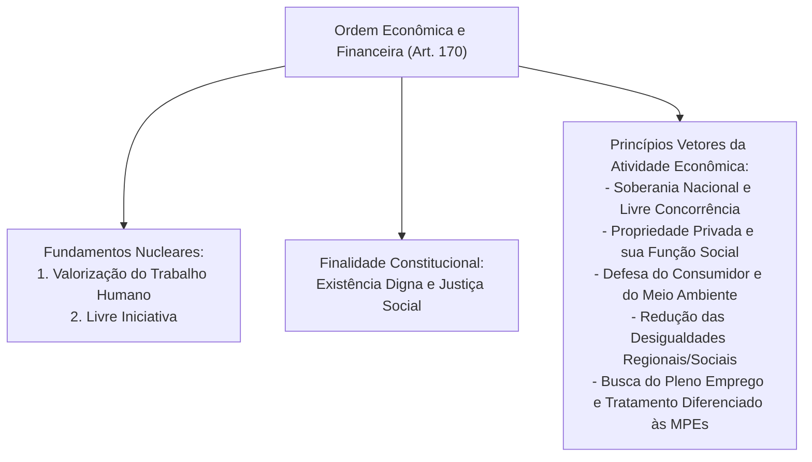
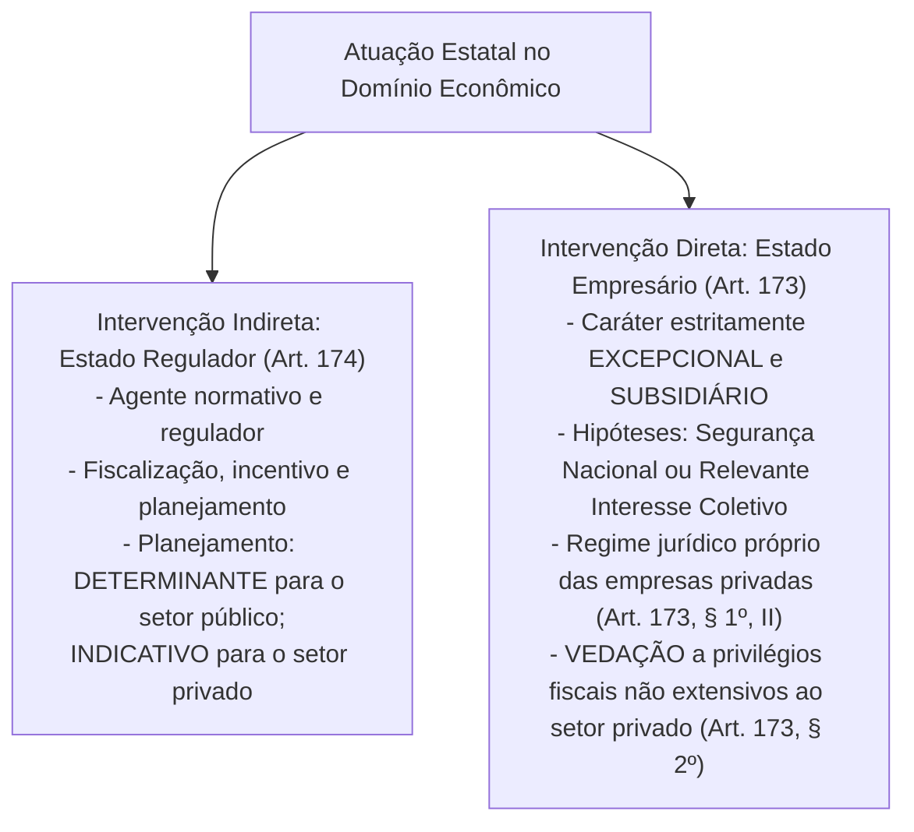
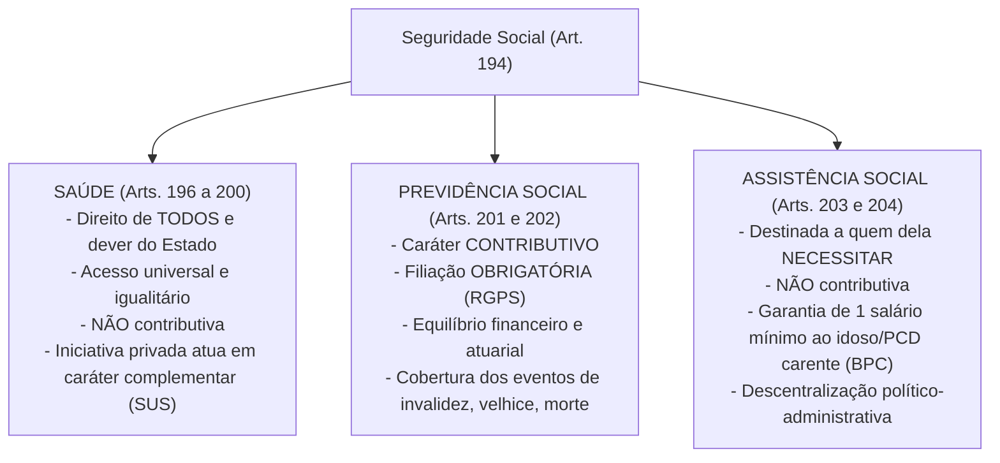
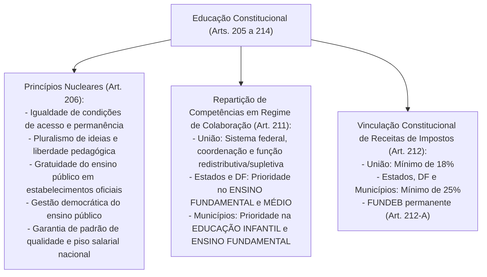

# Ordem Econômica, Financeira e Ordem Social: Princípios Gerais, Intervenção Estatal, Monopólios, Reforma Agrária, Seguridade Social e Meio Ambiente

> A ordem econômica e financeira e a ordem social estruturam o modelo de Estado social e democrático de direito conformador estabelecido pela Constituição da República de 1988, fundando a atividade produtiva na valorização do trabalho humano e na livre iniciativa para assegurar a todos existência digna, e orientando as políticas públicas de seguridade social, educação e meio ambiente sob a égide da solidariedade intergeracional e da justiça distributiva.

[← Voltar ao Índice Geral de Direito Constitucional](../README.md)

---

## 1. Princípios Gerais da Atividade Econômica e Intervenção Estatal (Arts. 170 a 181)

A Ordem Econômica e Financeira positivada no Título VII da Constituição da República de 1988 adota o modelo de **economia social de mercado** (ou capitalismo conformador), fundada na valorização do trabalho humano e na livre iniciativa, tendo por escopo precípuo assegurar a todos existência digna, conforme os ditames da justiça social (art. 170, *caput*).

### 1.1. O Decálogo dos Princípios Econômicos Constitucionais (Art. 170)

1. **Soberania Nacional (inciso I):** Autoafirmação do poder decisório nacional sobre as diretrizes econômicas internas, impedindo a subordinação a interesses alienígenas.
2. **Propriedade Privada (inciso II) e sua Função Social (inciso III):** A Carta Magna garante o direito de propriedade, mas afasta categoricamente o conceito absolutista oitocentista. A propriedade privada apenas goza de proteção jurídica plena quando atende à sua destinação coletiva, produtiva e sustentável.
3. **Livre Concorrência (inciso IV):** Corolário da livre iniciativa; veda práticas de cartel, truste e oligopolização desleal. O art. 173, § 4º, determina expressamente que a lei reprimirá o abuso do poder econômico que vise à dominação dos mercados, à eliminação da concorrência e ao aumento arbitrário dos lucros (disciplinado pela Lei nº 12.529/2011 - Sistema Brasileiro de Defesa da Concorrência / CADE).
4. **Defesa do Consumidor (inciso V):** Reconhecimento da vulnerabilidade estrutural e informacional do consumidor no mercado (art. 5º, XXXII e ADCT, art. 48 - Lei nº 8.078/1990 - CDC).
5. **Defesa do Meio Ambiente (inciso VI):** Inclusive mediante tratamento diferenciado conforme o impacto ambiental dos produtos e serviços e de seus processos de elaboração e prestação (redação conferida pela EC nº 42/2003). A proteção ambiental não é entrave ao desenvolvimento, mas pressuposto indeclinável da atividade econômica (princípio do desenvolvimento sustentável).
6. **Redução das Desigualdades Regionais e Sociais (inciso VII):** Instrumentaliza a distribuição equitativa de incentivos fiscais e créditos de fomento regional (fundos constitucionais FNO, FNE e FCO - art. 159, I, "c").
7. **Busca do Pleno Emprego (inciso VIII):** Foco nas políticas macroeconômicas de geração de postos de trabalho dignos.
8. **Tratamento Favorecido para as Empresas de Pequeno Porte e Microempresas (inciso IX):** Garantia de regimes jurídicos e tributários simplificados e diferenciados (art. 146, III, "d", art. 179 e LC nº 123/2006 - Estatuto Nacional da Microempresa e Empresa de Pequeno Porte).
9. **Livre Exercício da Atividade Econômica (Parágrafo Único):** É assegurado a todos o livre exercício de qualquer atividade econômica, independentemente de autorização de órgãos públicos, salvo nos casos expressamente previstos em lei. Esse postulado foi densificado e operacionalizado pela **Lei da Liberdade Econômica (Lei nº 13.874/2019)**, que consagrou o direito à imunidade burocrática para atividades de baixo risco e a presunção de boa-fé dos atos mercantis.

---

## 2. Modalidades de Atuação do Estado no Domínio Econômico

O constituinte originário estabeleceu duas formas básicas de intervenção estatal na economia: a intervenção **indireta** (Estado Regulador) e a intervenção **direta** (Estado Empresário).

### 2.1. O Estado Regulador (Intervenção Indireta - Art. 174)

Como agente normativo e regulador da atividade econômica, o Estado exercerá, na forma da lei, as funções de fiscalização, incentivo e planejamento, sendo este:
- **Determinante** para o setor público (efeito cogente e impositivo).
- **Indicativo** para o setor privado (efeito indutivo e orientador).

A regulação setorial é exercida precipuamente pelas **Agências Reguladoras** (ANATEL, ANEEL, ANP, ANVISA, ANS etc.), autarquias em regime especial dotadas de independência decisória, mandato fixo para dirigentes e competência normativa técnica infraconstitucional.

### 2.2. O Estado Empresário (Intervenção Direta - Art. 173)

Ressalvados os casos previstos na Constituição, a exploração direta de atividade econômica pelo Estado só será permitida quando necessária:
1. Aos imperativos da **segurança nacional**; OU
2. A **relevante interesse coletivo**, conforme definidos em lei.

#### Estatuto Jurídico das Empresas Estatais Exploradoras de Atividade Econômica

A lei estabelecerá o estatuto jurídico da empresa pública, da sociedade de economia mista e de suas subsidiárias que explorem atividade econômica de produção ou comercialização de bens ou de prestação de serviços (Lei nº 13.303/2016 - Lei das Estatais), dispondo sobre:
- **Sujeição ao regime jurídico próprio das empresas privadas**, inclusive quanto aos direitos e obrigações civis, comerciais, trabalhistas e tributários (art. 173, § 1º, II).
- **Proibição expressa de privilégios fiscais:** As empresas públicas e as sociedades de economia mista não poderão gozar de privilégios fiscais não extensivos aos do setor privado (art. 173, § 2º).
- **Submissão à licitação pública:** Sujeitam-se a regras de licitação e contratação próprias, respeitados os princípios da legalidade, impessoalidade, moralidade, publicidade e eficiência (art. 173, § 1º, III e Lei nº 13.303/2016).
- **Não sujeição à falência:** Por expressa disposição do art. 2º, inciso I, da Lei nº 11.101/2005 (Lei de Falência e Recuperação Judicial), as empresas públicas e sociedades de economia mista não estão sujeitas à falência nem à recuperação judicial.

> [!IMPORTANT]
> **Distinção Fundamental na Jurisprudência do STF: Estatais Exploradoras de Atividade Econômica vs. Estatais Prestadoras de Serviços Públicos Não Concorrenciais**  
> - **Estatais Exploradoras de Atividade Econômica em Mercado Concorrente (ex: Petrobras, Banco do Brasil, Caixa Econômica Federal em atividades financeiras):** Submetem-se estritamente ao regime de direito privado (art. 173, § 1º). NÃO gozam de imunidade tributária recíproca (art. 150, § 3º), seus bens são plenamente penhoráveis e suas dívidas executam-se sob o regime comum do CPC, sem precatórios.  
> - **Estatais Prestadoras de Serviço Público Próprio do Estado em Regime Monopolista/Não Concorrencial (ex: Correios/ECT, Infraero, Casa da Moeda, companhias públicas de saneamento/água e esgoto):** O STF (Tema 508, Tema 130 e precedentes consolidados) firmou que essas entidades gozam de **imunidade tributária recíproca** (art. 150, VI, "a"), **impenhorabilidade absoluta de seus bens** e pagamento de suas condenações judiciais exclusivamente sob o **regime constitucional de precatórios** (art. 100 da CF).

### 2.3. Monopólios Econômicos da União (Art. 177)

Constituem monopólio da União (art. 177 da CF/88):
1. A pesquisa e a lavra das jazidas de petróleo e gás natural e outros hidrocarbonetos fluidos;
2. A refinação do petróleo nacional ou estrangeiro;
3. A importação e exportação dos produtos e derivados básicos resultantes das atividades anteriores;
4. O transporte marítimo do petróleo bruto de origem nacional ou de derivados básicos de petróleo produzidos no País, bem assim o transporte, por meio de conduto, de petróleo bruto, seus derivados e gás natural de qualquer origem;
5. A pesquisa, a lavra, o enriquecimento, o reprocessamento, a industrialização e o comércio de minérios e minerais nucleares e seus derivados.

> [!NOTE]
> **Flexibilização do Monopólio do Petróleo (EC nº 9/1995):**  
> O art. 177, § 1º, autoriza expressamente a União a contratar com empresas estatais ou empresas privadas a realização das atividades monopolizadas, mediante os regimes de **concessão** (Lei nº 9.478/1997) ou de **partilha de produção** no pré-sal (Lei nº 12.351/2010). O monopólio é de titularidade inalienável da União, mas sua execução pode ser delegada a agentes privados sob regulação da ANP.

---

## 3. Política Urbana, Agrícola, Fundiária e Reforma Agrária

| Parâmetro Constitucional | Política Urbana (Arts. 182 e 183) | Política Agrícola e Reforma Agrária (Arts. 184 a 191) |
| :--- | :--- | :--- |
| **Competência / Titularidade** | Executada pelo **Poder Público Municipal** conforme diretrizes gerais fixadas em lei federal (Estatuto da Cidade - Lei nº 10.257/2001). | Desapropriação para reforma agrária é de competência **privativa da União** (art. 184). |
| **Instrumento Básico** | **Plano Diretor**, obrigatório para cidades com mais de 20.000 habitantes (art. 182, § 1º). | Plano Nacional de Reforma Agrária e zoneamento agroecológico. |
| **Sanções Sucessivas para Imóvel não Edificado/Subutilizado** | 1. Parcelamento ou edificação compulsórios; 2. IPTU progressivo no tempo; 3. Desapropriação mediante pagamento em **títulos da dívida pública** resgatáveis em até 10 anos (art. 182, § 4º). | Desapropriação direta por interesse social para fins de reforma agrária do imóvel rural que não cumpra sua função social (art. 184). |
| **Forma de Pagamento da Indenização** | - Terra nua/imóvel: Títulos da dívida pública municipal resgatáveis em até 10 anos. - Benfeitorias necessárias e úteis: Pagas em **dinheiro** (art. 182, § 4º, III). | - Imóvel/Terra: **Títulos da Dívida Agrária (TDA)** resgatáveis em até 20 anos, a partir do 2º ano de emissão. - Benfeitorias úteis e necessárias: Pagas em **dinheiro vivo** (art. 184, § 1º). |
| **Imunidades à Desapropriação por Reforma Agrária** | Não se aplica (o Município atua nos limites do Plano Diretor). | São insuscetíveis de desapropriação para reforma agrária (art. 185): 1. **Pequena e média propriedade rural**, desde que seu proprietário não possua outra; 2. A **propriedade produtiva**. |
| **Usucapião Constitucional Especial** | **Usucapião Urbana / Pro Misero (Art. 183):** Área de até 250 m², posse mansa por 5 anos ininterruptos para moradia própria ou familiar, desde que não seja proprietário de outro imóvel urbano ou rural. Vedada reiteração. | **Usucapião Rural / Pro Labore (Art. 191):** Área de até 50 hectares em zona rural, posse mansa por 5 anos ininterruptos, tornando a terra produtiva por seu trabalho ou familiar e tendo nela sua moradia, sem ser proprietário de outro imóvel. |
| **Vedações Absolutas** | Os imóveis públicos urbanos **não serão adquiridos por usucapião** (art. 183, § 3º e Súmula 340 do STF). | Os imóveis públicos rurais **não serão adquiridos por usucapião** (art. 191, parágrafo único). |

---

## 4. Sistema Financeiro Nacional (Art. 192)

O Sistema Financeiro Nacional, estruturado de forma a promover o desenvolvimento equilibrado do País e a servir aos interesses da coletividade, em todas as partes que o compõem, abrangendo as cooperativas de crédito, será regulado por **leis complementares** que disporão, inclusive, sobre a participação do capital estrangeiro nas instituições que o integram.

> [!WARNING]
> **Revogação do Teto Constitucional de Juros e Súmula Vinculante nº 7**  
> A redação original do art. 192, § 3º, previa que as taxas de juros reais não poderiam ser superiores a 12% ao ano. A **EC nº 40/2003** revogou integralmente esse parágrafo. O STF, mesmo antes da emenda, já havia pacificado a controvérsia na **Súmula Vinculante nº 7**:  
> *"A norma do § 3º do artigo 192 da Constituição, revogada pela Emenda Constitucional nº 40/2003, que limitava a taxa de juros reais a 12% ao ano, tinha sua aplicação condicionada à edição de lei complementar."*

---

## 5. Ordem Social: Arquitetura Geral e a Seguridade Social (Arts. 193 a 204)

A ordem social tem como base o **primado do trabalho**, e como objetivo o **bem-estar e a justiça sociais** (art. 193). O núcleo de proteção humana mais exigido nos certames tributários e de controle é o sistema da **Seguridade Social**, estruturado no clássico tripé: **Saúde, Previdência Social e Assistência Social**.

### 5.1. Princípios Constitucionais da Seguridade Social (Art. 194, Parágrafo Único)

1. **Universalidade da Cobertura e do Atendimento:** A cobertura refere-se aos riscos sociais protegidos (invalidez, morte, desemprego, velhice, doença); o atendimento refere-se aos destinatários (todos os cidadãos e residentes).
2. **Uniformidade e Equivalência dos Benefícios e Serviços às Populações Urbanas e Rurais:** Vedação a qualquer discriminação histórica de critérios ou valores entre trabalhadores rurais e urbanos.
3. **Seletividade e Distributividade na Prestação dos Benefícios e Serviços:** Critério de escolha dos riscos sociais de maior relevância pelo legislador ordinário e distribuição de renda aos segmentos mais desfavorecidos.
4. **Irredutibilidade do Valor dos Benefícios:**
   - Para a Seguridade Social em geral: Irredutibilidade **nominal** (preservação do valor numérico em moeda corrente).
   - Para a Previdência Social (art. 201, § 4º): Irredutibilidade **real** (garantia de reajustamento periódico para preservação permanente do poder aquisitivo contra a inflação).
5. **Equidade na Forma de Participação no Custeio:** Quem detém maior capacidade econômica contribui com alíquotas e bases superiores (princípio da capacidade contributiva no custeio previdenciário).
6. **Diversidade da Base de Financiamento:** O custeio social provém de múltiplas fontes econômicas (folha, lucro, faturamento, loterias, importações), identificando-se em rubricas contábeis próprias para cada área (art. 194, parágrafo único, VI, alterado pela EC nº 103/2019).
7. **Caráter Democrático e Descentralizado da Administração:** Mediante gestão **quadripartite**, com participação dos trabalhadores, dos empregadores, dos aposentados e do Governo nos órgãos colegiados (art. 194, VII).

### 5.2. O Financiamento da Seguridade Social (Art. 195)

A seguridade social será financiada por toda a sociedade, de forma direta e indireta, mediante recursos provenientes dos orçamentos da União, dos Estados, do Distrito Federal e dos Municípios, e das seguintes **contribuições sociais**:

| Fonte de Financiamento (Art. 195) | Fato Gerador / Incidência | Disciplina e Peculiaridades Constitucionais |
| :--- | :--- | :--- |
| **Empregador, Empresa e Entidade Equiparada (Inciso I)** | - Folha de salários e demais rendimentos do trabalho. - Receita ou faturamento (**COFINS** e PIS). - Lucro líquido (**CSLL**). | Podem ter alíquotas ou bases de cálculo diferenciadas em razão da atividade econômica, da utilização intensiva de mão de obra, do porte da empresa ou da condição estrutural do mercado de trabalho (§ 9º). |
| **Trabalhador e Demais Segurados (Inciso II)** | Salários e remunerações de contribuição. | Alíquotas **progressivas** de acordo com a faixa salarial (EC nº 103/2019). Não incide sobre aposentadorias e pensões do RGPS até o teto do RGPS. |
| **Concursos de Prognósticos (Inciso III)** | Receita das loterias e apostas oficiais. | Recursos destinados à sustentação orçamentária da previdência e desporto. |
| **Importador de Bens ou Serviços (Inciso IV)** | Importação de bens ou serviços do exterior. | Incide tanto sobre pessoas físicas quanto jurídicas (PIS/COFINS-Importação). |

#### Regras de Ouro do Custeio da Seguridade Social

1. **Princípio da Contrapartida / Precedência da Fonte de Custeio (Art. 195, § 5º):**  
   Nenhum benefício ou serviço da seguridade social poderá ser criado, majorado ou estendido sem a correspondente fonte de custeio total.
2. **Anterioridade Mitigada / Nonagesimal (Art. 195, § 6º):**  
   As contribuições sociais de seguridade social só poderão ser exigidas após decorridos **90 (noventa) dias** da data de publicação da lei que as houver instituído ou modificado. **NÃO se aplica a anterioridade anual** (art. 150, III, "b") às contribuições para a seguridade social.
3. **Imunidade das Entidades Beneficentes de Assistência Social (Art. 195, § 7º):**  
   São isentas (imunes, segundo o STF) de contribuição para a seguridade social as entidades beneficentes de assistência social que atendam aos requisitos estabelecidos em lei complementar (art. 146, II e Lei Complementar nº 187/2021).
4. **Vedações Estruturais da Reforma da Previdência (EC nº 103/2019):**  
   - É terminantemente vedada a remissão ou o anistia de contribuições sociais de seguridade social para débitos de valor superior ao fixado em lei complementar (art. 195, § 11).
   - A lei não poderá estabelecer qualquer forma de contagem de tempo de contribuição fictício (art. 201, § 14).

---

## 6. Saúde, Educação, Meio Ambiente e Comunicação Social

### 6.1. Saúde Pública (Arts. 196 a 200)

- **Natureza:** Direito de todos e dever do Estado, garantido mediante políticas sociais e econômicas que visem à redução do risco de doença e de outros agravos e ao acesso universal e igualitário às ações e serviços para sua promoção, proteção e recuperação.
- **Participação Privada Complementar (Art. 199):** As instituições privadas poderão participar de forma complementar do Sistema Único de Saúde (SUS), segundo diretrizes deste, mediante contrato de direito público ou convênio, tendo **preferência as entidades filantrópicas e as sem fins lucrativos**.
- **Vedações Expressas:**
  - É vedada a destinação de recursos públicos para auxílios ou subvenções às instituições privadas com fins lucrativos (art. 199, § 2º).
  - É vedada a comercialização de órgãos, tecidos e substâncias humanas para fins de transplante, pesquisa ou tratamento (art. 199, § 4º).
- **Financiamento Constitucional Mínimo (Art. 198, §§ 2º e 3º):**  
  - União: Mínimo equivalente a 15% da Receita Corrente Líquida do exercício financeiro respectivo.  
  - Estados e DF: Mínimo de 12% da receita de impostos estaduais.  
  - Municípios e DF: Mínimo de 15% da receita de impostos municipais.

### 6.2. Educação (Arts. 205 a 214)

A educação, direito de todos e dever do Estado e da família, será promovida e incentivada com a colaboração da sociedade, visando ao pleno desenvolvimento da pessoa, seu preparo para o exercício da cidadania e sua qualificação para o trabalho.

> [!NOTE]
> **Precedentes Vinculantes do STF sobre Educação:**  
> 1. **Gratuidade do Ensino Público e Cobrança em Pós-Graduação *Lato Sensu* (Tema 514 / Súmula Vinculante 12 / RE 597.854):** O STF fixou a tese de que *"A garantia constitucional da gratuidade de ensino em estabelecimentos oficiais não obsta a cobrança por universidades públicas de mensalidade em cursos de pós-graduação lato sensu."* A gratuidade é estrita para o ensino regular (graduação e pós-graduação *stricto sensu* - mestrado e doutorado).  
> 2. **Vagas em Creche e Pré-Escola de 0 a 5 Anos (Tema 548 do STF / RE 1.008.166):** O Supremo pacificou que o dever constitucional do Estado de assegurar atendimento em creche e pré-escola às crianças de até 5 anos de idade é de **eficácia plena e aplicabilidade imediata**, não podendo a Administração Pública invocar a cláusula da reserva do possível para afastar a concessão de vaga judicialmente pleiteada.  
> 3. **Distribuição de Vagas para Irmãos na Mesma Escola:** O STF considerou plenamente constitucional lei estadual ou municipal que garante preferência de matrícula na mesma escola para irmãos que frequentem a mesma etapa ou ciclo de ensino, concretizando o princípio da proteção integral à família (art. 226 e 227).

### 6.3. Meio Ambiente (Art. 225)

Todos têm direito ao meio ambiente ecologicamente equilibrado, bem de uso comum do povo e essencial à sadia qualidade de vida, impondo-se ao Poder Público e à coletividade o dever de defendê-lo e preservá-lo para as presentes e futuras gerações.

- **Instrumentos de Proteção:** Exigência de **Estudo Prévio de Impacto Ambiental (EPIA/RIMA)**, a que se dará publicidade, para instalação de obra ou atividade potencialmente causadora de **significativa degradação do meio ambiente** (art. 225, § 1º, IV).
- **Proibição de Práticas Cruéis contra Animais:** O art. 225, § 1º, VII, veda práticas que submetam os animais a crueldade (ADI da Vaquejada e EC nº 96/2017 que introduziu o § 7º, ressalvando práticas desportivas que constituam manifestações culturais registradas como patrimônio cultural imaterial brasileiro).
- **Tríplice Responsabilidade Ambiental (Art. 225, § 3º):** As condutas e atividades consideradas lesivas ao meio ambiente sujeitarão os infratores, pessoas físicas ou jurídicas, a **sanções penais e administrativas**, independentemente da **obrigação de reparar os danos causados** (responsabilidade civil objetiva, integral e imprescritível - Tema 999 do STF).

### 6.4. Comunicação Social (Arts. 220 a 224)

- **Liberdade de Manifestação e Vedação à Censura (Art. 220):** A manifestação do pensamento, a criação, a expressão e a informação, sob qualquer forma, processo ou veículo, não sofrerão qualquer restrição, observado o disposto na Constituição. É vedada toda e qualquer censura de natureza política, ideológica e artística (§ 2º).
- **Restrições Comerciais Especiais (Art. 220, § 4º):** A propaganda comercial de **tabaco, bebidas alcoólicas, agrotóxicos, medicamentos e terapias** estará sujeita a restrições legais e conterá, sempre que necessário, advertência sobre os malefícios decorrentes de seu uso.
- **Propriedade de Empresas de Comunicação (Art. 222):** A propriedade de empresa jornalística e de radiodifusão sonora e de sons e imagens é privativa de **brasileiros natos ou naturalizados há mais de 10 (dez) anos**, ou de pessoas jurídicas constituídas sob as leis brasileiras e que tenham sede no País, exigindo-se que pelo menos 70% do capital total e votante pertença a brasileiros natos ou naturalizados há mais de 10 anos.

---

## 7. Quadro Sinótico Integrado: Ordem Econômica e Ordem Social

| Instituição / Mecanismo | Base Constitucional | Regra Fundamental | Exceção / Modulação Jurisprudencial |
| :--- | :--- | :--- | :--- |
| **Exploração Direta pelo Estado** | Art. 173 da CF | Excepcional: Relevante interesse coletivo ou segurança nacional. | Submete-se ao regime privado; sem privilégios tributários. |
| **Estatais Prestadoras de Serviço** | Art. 175 e Jurisprudência | Atuam em regime não concorrencial e monopolista. | Gozam de imunidade recíproca, precatórios e impenhorabilidade (Tema 508). |
| **Monopólio do Petróleo** | Art. 177 da CF | Titularidade inalienável da União Federal. | Execução delegável mediante concessão ou partilha (EC 9/95). |
| **Reforma Agrária** | Arts. 184 e 185 | Competência privativa da União; indenização em TDA. | Pequena e média propriedade (única) e produtiva são imunes. |
| **Seguridade Social** | Arts. 194 e 195 | Tripé: Saúde (gratuita), Previdência (contributiva), Assistência (gratuita). | Financiamento diverso; anterioridade nonagesimal estrita (90 dias). |
| **Gratuidade do Ensino Público** | Art. 206, IV da CF | Ensino básico e superior (graduação/mestrado/doutorado) 100% gratuitos. | Universidades podem cobrar por pós-graduação *lato sensu* (Tema 514). |
| **Vagas em Creches (0 a 5 anos)** | Art. 208, IV da CF | Dever estatal indisponível de aplicabilidade imediata. | Inaplicável a cláusula da reserva do possível pelo Poder Público (Tema 548). |
| **Dano Ambiental** | Art. 225, § 3º da CF | Tríplice responsabilidade cumulativa: penal, administrativa e civil. | A reparação civil por dano ambiental é imprescritível (Tema 999). |

---

## 8. Questões Paradigmáticas Aplicadas

### [Questão 01](https://www.qconcursos.com/questoes-de-concursos/questoes/318872f9-c8) — [FGV — PC-PR / Delegado de Polícia — 2026]

Uma instituição de ensino oficial, vinculada a determinado ente federativo, oferece cursos de extensão e de especialização, neste último caso a nível de pós-graduação *lato sensu*. Com o objetivo de obter mais recursos para promover melhorias estruturais, o órgão competente da referida instituição decidiu que tanto a matrícula como as mensalidades seriam objeto de cobrança, o que gerou grande resistência em certos setores do ambiente sociopolítico.

Na situação descrita, à luz dos balizamentos estabelecidos pela ordem constitucional, é correto afirmar que a cobrança é:

* **A)** lícita, considerando a natureza dos cursos.
* **B)** ilícita, considerando a natureza da instituição de ensino.
* **C)** ilícita, apenas em relação às mensalidades, não quanto à matrícula.
* **D)** lícita, desde que a instituição de ensino oficial não seja uma universidade.
* **E)** lícita, desde que a instituição de ensino não receba recursos públicos para as despesas de custeio.

#### Gabarito: **A**
* **A (Certa):** Nos termos da jurisprudência vinculante fixada pelo Supremo Tribunal Federal no julgamento do **Tema 514 da Repercussão Geral (RE 597.854)** e consolidada em sua jurisprudência uniforme, a garantia constitucional da gratuidade de ensino em estabelecimentos oficiais (art. 206, IV, da CF/88) alcança os cursos de graduação e de pós-graduação *stricto sensu* (mestrado e doutorado), mas não obsta a cobrança por universidades públicas de matrícula e mensalidades em cursos de especialização (*pós-graduação lato sensu*) e extensão, considerando a sua natureza e destinação acadêmica específica.
* **B (Errada):** A natureza de instituição oficial de ensino superior não impede a cobrança legítima por cursos de pós-graduação *lato sensu* e extensão.
* **C (Errada):** Tanto a matrícula quanto as mensalidades podem ser cobradas na pós-graduação *lato sensu*, não havendo fracionamento de licitude entre matrícula e mensalidade.
* **D (Errada):** O precedente paradigma do STF aplicou-se precisamente no âmbito das universidades públicas oficiais.
* **E (Errada):** O recebimento de recursos orçamentários públicos para custeio não anula a higidez da captação de receitas próprias pela oferta facultativa de especializações *lato sensu*.

---

### [Questão 02](https://www.qconcursos.com/questoes-de-concursos/questoes/e497c63e-c8) — [VUNESP — TCE-SP / Auditor de Controle Externo — Área: Direito — 2026]

Com relação às regras constitucionais e precedentes relacionados à educação e ao desporto, assinale a alternativa correta:

* **A)** É constitucional lei estadual que considera como despesa de manutenção e desenvolvimento do ensino os gastos com inativos do setor de educação.
* **B)** A Constituição Federal assegura o direito à creche para as crianças de zero a cinco anos, condicionado o gozo à existência de disponibilidade orçamentária e financeira.
* **C)** É constitucional regra da Constituição Estadual que concede autonomia financeira e orçamentária para Universidade Estadual.
* **D)** Os municípios devem destinar, pelo menos, 30% (trinta por cento) de sua receita corrente líquida para os gastos com a manutenção e desenvolvimento do ensino.
* **E)** É constitucional lei estadual que determina a reserva de vagas para que irmãos que cursem a mesma etapa ou mesmo ciclo escolar frequentem a mesma escola.

#### Gabarito: **E**
* **A (Errada):** O STF já assentou em controle concentrado de constitucionalidade que os pagamentos de proventos de aposentadoria e pensões a inativos e pensionistas não podem ser computados nos percentuais mínimos obrigatórios de aplicação em manutenção e desenvolvimento do ensino (art. 212 da CF e art. 70 e 71 da LDB).
* **B (Errada):** Conforme fixado pelo STF no Tema 548 da Repercussão Geral, a educação básica na fase da educação infantil (creche e pré-escola até cinco anos) é direito público subjetivo fundamental de eficácia plena, sendo inoponível ao Estado a alegação de indisponibilidade orçamentária (reserva do possível).
* **C (Errada):** As universidades gozam de autonomia didático-científica, administrativa e de gestão financeira e patrimonial (art. 207 da CF), mas a Carta Magna não outorgou às universidades autonomia orçamentária originária com competência para fixar percentuais vinculados de receita fora dos limites estipulados na legislação financeira e orçamentária privativa do Chefe do Executivo.
* **D (Errada):** Os Municípios devem aplicar, anualmente, nunca menos de **25% (vinte e cinco por cento)** da receita resultante de impostos, compreendida a proveniente de transferências, na manutenção e desenvolvimento do ensino (art. 212, *caput*), e não 30% de sua receita corrente líquida.
* **E (Certa):** O Supremo Tribunal Federal pacificou ser plenamente constitucional lei estadual ou municipal que determina a garantia de vagas no mesmo estabelecimento de ensino para irmãos que cursem a mesma etapa ou ciclo educacional, consubstanciando medida voltada à facilitação da rotina doméstica e à proteção integral da família (arts. 226 e 227 da CF).

---

### [Questão 03](https://www.qconcursos.com/questoes-de-concursos/questoes/d1e38622-c9) — [VUNESP — TCE-SP / Auditor de Controle Externo — Ciências Contábeis — 2026]

Durante auditoria realizada em autarquia estadual, verificou-se controvérsia acerca da instituição e da incidência de contribuições previdenciárias destinadas ao custeio do regime próprio de previdência social dos servidores públicos. Considerando a Constituição Federal, com as alterações promovidas pela Emenda Constitucional nº 103/2019, é correto afirmar que:

* **A)** os estados não podem instituir alíquotas progressivas para a contribuição previdenciária de seus servidores.
* **B)** a contribuição previdenciária dos servidores inativos incide exclusivamente sobre a parcela dos proventos que supere o dobro do teto do RGPS.
* **C)** é vedada a cobrança de contribuição previdenciária sobre proventos de aposentadorias concedidas a servidores públicos estaduais.
* **D)** havendo deficit atuarial comprovado, a contribuição dos servidores inativos e pensionistas pode incidir sobre o valor dos proventos que supere o salário-mínimo nacional.
* **E)** o regime de previdência complementar dos servidores públicos é de filiação compulsória aos admitidos após a implantação do benefício.

#### Gabarito: **D**
* **A (Errada):** A EC nº 103/2019 autorizou expressamente no art. 149, § 1º, que os Estados, o Distrito Federal e os Municípios instituam alíquotas progressivas de acordo com o valor da base de contribuição de seus servidores ativos, inativos e pensionistas.
* **B (Errada):** Em regra, a contribuição dos inativos e pensionistas do RPPS incide sobre o valor dos proventos e das pensões que supere o limite máximo estabelecido para os benefícios do RGPS (teto do RGPS), conforme art. 40, § 18.
* **C (Errada):** A incidência de contribuição sobre proventos de inativos e pensionistas do setor público é expressamente admitida desde a EC nº 41/2003 e mantida pela EC nº 103/2019.
* **D (Certa):** Conforme a redação do art. 149, § 1º-A, introduzido pela EC nº 103/2019, quando houver deficit atuarial no âmbito do regime próprio de previdência social, a contribuição ordinária dos aposentados e pensionistas poderá incidir sobre o montante dos proventos de aposentadorias e de pensões que supere o **salário-mínimo**, conferindo suporte emergencial ao reequilíbrio atuarial do fundo.
* **E (Errada):** A previdência complementar ostenta caráter facultativo (art. 202, *caput*), sendo inconstitucional a filiação compulsória.

---

### [Questão 04](https://www.qconcursos.com/questoes-de-concursos/questoes/7fde74b2-cb) — [VUNESP — UENP / Comunicador Social — 2026]

Conforme estabelece o art. 220, § 4º, da Constituição Federal de 1988, determinados produtos, quando anunciados por meio de propaganda comercial, estão sujeitos a restrições legais e devem conter advertência sobre os malefícios de seu uso, quando necessário.

Assinale a alternativa que indica corretamente produtos expressamente mencionados no dispositivo constitucional:

* **A)** Combustíveis fósseis e jogos de azar.
* **B)** Tabaco, bebidas alcoólicas, agrotóxicos, medicamentos e terapias.
* **C)** Alimentos ultraprocessados e refrigerantes açucarados.
* **D)** Produtos eletrônicos com bateria de lítio e fogos de artifício.
* **E)** Automóveis de alta velocidade e armas de fogo.

#### Gabarito: **B**
* **A (Errada):** Combustíveis fósseis e jogos de azar não integram o rol taxativo do art. 220, § 4º.
* **B (Certa):** Em estrita literalidade ao art. 220, § 4º, da Constituição Federal de 1988: "A propaganda comercial de tabaco, bebidas alcoólicas, agrotóxicos, medicamentos e terapias estará sujeita a restrições legais, nos termos do inciso II do § 3º do art. 220, e conterá, sempre que necessário, advertência sobre os malefícios decorrentes de seu uso."
* **C (Errada):** Alimentos e refrigerantes não constam no texto constitucional de restrições de propaganda.
* **D (Errada):** Baterias de lítio e fogos de artifício não figuram no rol constitucional.
* **E (Errada):** Automóveis e armas de fogo não são contemplados no art. 220, § 4º.

---

### [Questão 05](https://www.qconcursos.com/questoes-de-concursos/questoes/98048240-cc) — [FGV — DATAPREV / Analista — Especialidade: Direito — 2026]

Foi apresentada proposta, no âmbito do governo federal, na qual se sugeriu o encaminhamento de projeto de lei, pelo Chefe do Poder Executivo, visando à consolidação das ações governamentais na área de assistência social.

A proposta, a ser reproduzida no projeto, tinha três diretrizes estruturais:
I. utilização de recursos da seguridade social;
II. centralização político-administrativa; e
III. vedação de vinculação, pelos estados e pelo Distrito Federal, de percentual da receita tributária líquida a programas de promoção social.

Um grupo de trabalho constituído especialmente para esse fim analisou a proposta e concluiu, corretamente, em relação à conformidade constitucional das três diretrizes, que:

* **A)** apenas a diretriz I é harmônica com a Constituição da República.
* **B)** apenas a diretriz II é harmônica com a Constituição da República.
* **C)** apenas as diretrizes I e II são harmônicas com a Constituição da República.
* **D)** apenas as diretrizes I e III são harmônicas com a Constituição da República.
* **E)** as diretrizes I, II e III são harmônicas com a Constituição da República.

#### Gabarito: **A**
* **A (Certa):** Apenas a diretriz I é constitucional. A assistência social integra o orçamento da seguridade social (art. 195). A diretriz II é inconstitucional porque o art. 204, inciso I, da CF impõe como diretriz da assistência social a **descentralização político-administrativa**, cabendo a coordenação e as normas gerais à esfera federal e a coordenação e a execução dos respectivos programas às esferas estadual e municipal. A diretriz III é inconstitucional porque o parágrafo único do art. 204 autoriza expressamente que os Estados e o Distrito Federal vinculem a programa de apoio à inclusão e promoção social até cinco décimos por cento de sua receita tributária líquida.
* **B (Errada):** A diretriz II viola frontalmente o princípio da descentralização político-administrativa (art. 204, I).
* **C (Errada):** A diretriz II colide com o texto constitucional.
* **D (Errada):** A diretriz III colide com o art. 204, parágrafo único, que faculta expressamente aos Estados e DF a vinculação de receita tributária para assistência social.
* **E (Errada):** Somente a primeira diretriz atende aos postulados constitucionais da seguridade.

---

### [Questão 06](https://www.qconcursos.com/questoes-de-concursos/questoes/f4253fa2-cc) — [Quadrix — CREF - 20ª Região (SE) / Assistente Administrativo — 2026]

Acerca da organização da Administração Pública, dos conceitos de servidor público e serviço público, bem como dos princípios que regem a atuação administrativa, julgue o item seguinte:

A exploração de atividade econômica pelo Estado submete‑se, tal como o serviço público, ao regime jurídico de direito público.

* **C)** Certo
* **E)** Errado

#### Gabarito: **Errado**
* **Fundamentação Técnica:** Assertiva flagrantemente incorreta. A prestação de serviço público pelo Estado submete-se originariamente a regime de direito público, com todas as prerrogativas e prerrogativas públicas correlatas. Em contrapartida, a exploração direta de atividade econômica em sentido estrito (produção ou circulação de bens e mercadorias) submete-se, por força cogente do art. 173, § 1º, inciso II, da Constituição Federal, ao **regime jurídico próprio das empresas privadas**, inclusive quanto aos direitos e obrigações civis, comerciais, trabalhistas e tributários, assegurando a paridade de armas com o setor privado e coibindo concorrência predatória estatal.

---

### [Questão 07](https://www.qconcursos.com/questoes-de-concursos/questoes/b76405e0-cd) — [Gama Consult — Câmara de São Miguel do Guaporé - RO / Procurador Jurídico — 2026]

Segundo o art. 173, § 2º, da Constituição Federal, empresa pública exploradora de atividade econômica poderá usufruir privilégio fiscal:

* **A)** mediante decreto autônomo.
* **B)** por relevante interesse coletivo.
* **C)** quando instituído pela União.
* **D)** se extensivo ao setor privado.

#### Gabarito: **D**
* **A (Errada):** É vedada a concessão de privilégios privativos a empresas públicas exploradoras de atividade econômica, independentemente de veículo infralegal ou autônomo.
* **B (Errada):** O relevante interesse coletivo é requisito de autorização para a própria intervenção estatal na economia (art. 173, *caput*), mas não autoriza privilégios tributários que desnivelem a livre concorrência.
* **C (Errada):** A concessão unilateral de privilégios fiscais privativos da União às suas empresas em detrimento do setor privado viola o pacto federativo e a livre concorrência.
* **D (Certa):** Nos termos taxativos do art. 173, § 2º, da Constituição Federal: "As empresas públicas e as sociedades de economia mista não poderão gozar de privilégios fiscais não extensivos aos do setor privado." Portanto, a empresa estatal exploradora da atividade econômica só pode fruir incentivo ou isenção fiscal se este for indistintamente conferido e estendido aos concorrentes privados.

---

### [Questão 08](https://www.qconcursos.com/questoes-de-concursos/questoes/b4f15cfb-ce) — [ACCESS — Prefeitura de Guapimirim - RJ / Professor I — 2026]

A Constituição Federal de 1988 estabelece, em seu art. 211, que a União, os Estados, o Distrito Federal e os Municípios organizarão, em regime de colaboração, seus sistemas de ensino.

De acordo com esse dispositivo constitucional, os Municípios atuarão prioritariamente no:
I. Ensino Médio.
II. Ensino Fundamental.
III. Educação Infantil.

É correto o que se afirma em:

* **A)** I, II e III.
* **B)** II e III, apenas.
* **C)** III, apenas.
* **D)** II, apenas.

#### Gabarito: **B**
* **A (Errada):** O Ensino Médio é de atuação prioritária dos **Estados e do Distrito Federal** (art. 211, § 3º), e não dos Municípios.
* **B (Certa):** Em obediência direta ao art. 211, § 2º, da Constituição da República: "Os Municípios atuarão prioritariamente no **ensino fundamental** e na **educação infantil**."
* **C (Errada):** O dispositivo não restringe a atuação prioritária à educação infantil, incluindo expressamente o ensino fundamental.
* **D (Errada):** O dispositivo abrange tanto o ensino fundamental quanto a educação infantil.
