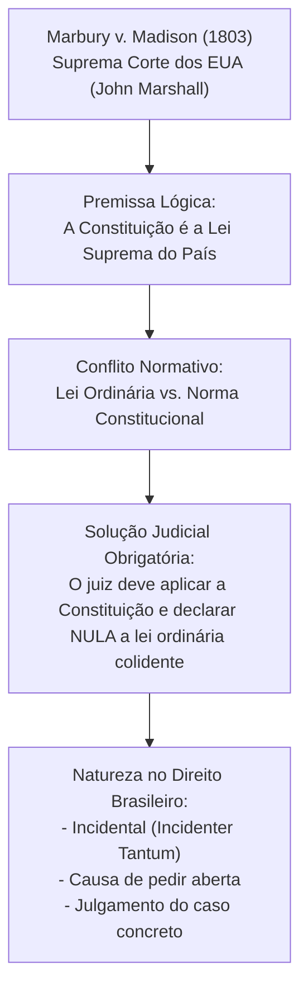
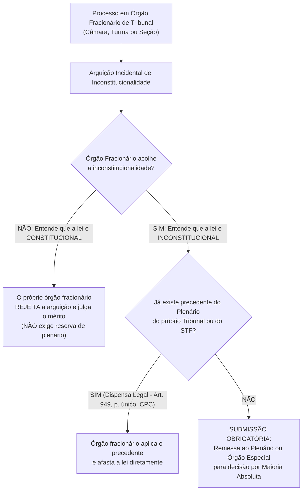
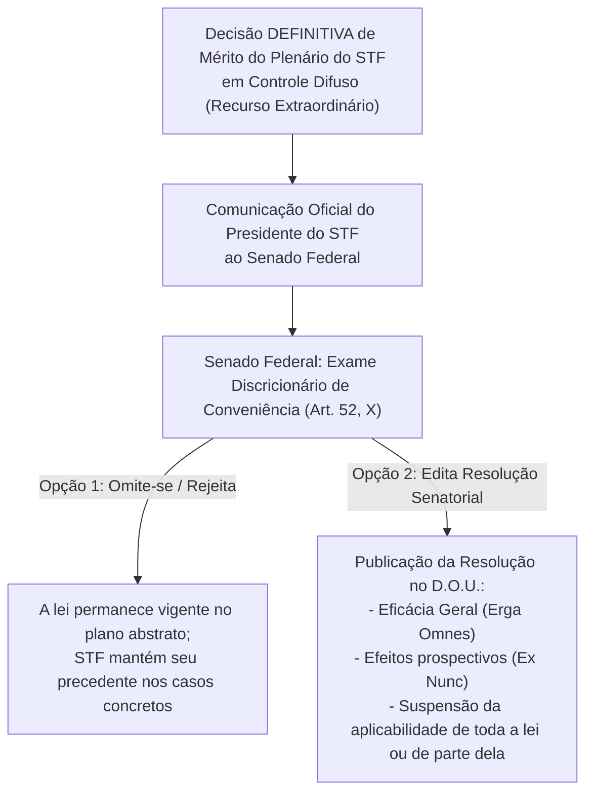
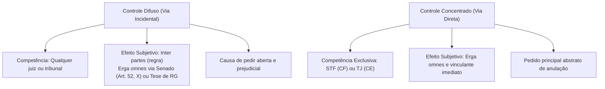

# Controle Difuso de Constitucionalidade e Cláusula de Reserva de Plenário: Teoria Incidental, Reserva de Plenário (Art. 97 e SV 10), Papel do Senado e Repercussão Geral

> O modelo difuso de constitucionalidade consagra a prerrogativa universal e indeclinável de qualquer órgão jurisdicional singular ou colegiado afastar a incidência de normas incompatíveis com a Constituição no exame incidental de uma lide concreta, condicionado, no âmbito dos tribunais, à estrita observância da cláusula de reserva de plenário (art. 97 da CF e Súmula Vinculante nº 10) e culminando na formação de precedentes dotados de repercussão geral ou enunciados de súmula vinculante perante a Suprema Corte.

[← Voltar ao Índice Geral de Direito Constitucional](../README.md)

---

## 1. Origem Histórica, Fundamentos e Natureza do Modelo Difuso

O controle difuso de constitucionalidade (também denominado *controle incidental*, *via de exceção*, *via de defesa* ou modelo norte-americano) remonta ao julgamento do histórico caso **Marbury v. Madison (1803)** pela Suprema Corte dos Estados Unidos, relatado pelo Chief Justice John Marshall.

### 1.1. Características Essenciais do Controle Difuso Brasileiro

1. **Competência Ampla e Universal:** Qualquer juiz togado monocrático de primeira instância ou qualquer tribunal (órgão colegiado de 2º grau ou Tribunal Superior) possui competência jurisdicional para examinar a constitucionalidade de lei ou ato normativo.
2. **Via Incidental (*Incidenter Tantum*):** A declaração de inconstitucionalidade não constitui o pedido principal da ação, mas sim a **causa de pedir** (questão prejudicial indispensável à solução do mérito). O autor postula uma prestação jurídica material concreta (ex: repetição de indébito tributário, anulação de auto de infração, concessão de posse em concurso), tendo como pressuposto a inconstitucionalidade da norma aplicável.
3. **Causa de Pedir Aberta:** O órgão julgador não está adstrito aos fundamentos constitucionais alegados pelas partes, aplicando o princípio *jura novit curia* para confrontar a norma infraconstitucional com qualquer preceito da Carta Magna.
4. **Objeto Ilimitado:** Qualquer lei ou ato normativo do Poder Público (federal, estadual, distrital ou municipal, presente ou pretérito, inclusive direito pré-constitucional sob a ótica da recepção) pode ser objeto de controle difuso.
5. **Eficácia Subjetiva Clássica (*Inter Partes*):** Tradicionalmente, a decisão proferida em controle difuso opera efeitos apenas entre as partes litigantes do processo judicial. A extensão desses efeitos a terceiros depende da atuação do Senado Federal (art. 52, X) ou dos mecanismos modernos de padronização decisória (Repercussão Geral e Súmulas Vinculantes).

---

## 2. A Cláusula de Reserva de Plenário (Art. 97 da CF e Súmula Vinculante nº 10)

O art. 97 da Constituição Federal estabelece uma das mais relevantes regras processuais de organização judiciária e segurança jurídica do ordenamento pátrio, conhecida na doutrina internacional como *full bench rule*:

> **Art. 97 da CF/88:**  
> *"Somente pelo voto da maioria absoluta de seus membros ou dos membros do respectivo órgão especial poderão os tribunais declarar a inconstitucionalidade de lei ou ato normativo do Poder Público."*

### 2.1. O Conteúdo Vinculante da Súmula Vinculante nº 10 do STF

Para coibir subterfúgios jurisprudenciais de câmaras e turmas isoladas que contornavam a regra do art. 97, o STF editou a **Súmula Vinculante nº 10**:

> **Súmula Vinculante nº 10 do STF:**  
> *"Viola a cláusula de reserva de plenário (CF, artigo 97) a decisão de órgão fracionário de tribunal que, embora não declare expressamente a inconstitucionalidade de lei ou ato normativo do Poder Público, afasta sua incidência, no todo ou em parte."*

A violação ocorre tanto quando o órgão fracionário usa o vocábulo "inconstitucional" sem o plenário quanto na hipótese de "inconstitucionalidade disfarçada" ou "esvaziamento teleológico", na qual o tribunal deixa de aplicar a norma legal válida sob justificativas principiológicas ou interpretações constitucionais sem remessa ao órgão competente.

### 2.2. Rol Taxativo de Exceções à Cláusula de Reserva de Plenário

Não há violação ao art. 97 da CF/88 nas seguintes situações consolidadas pela doutrina e pelo art. 949, parágrafo único, do CPC/2015:
1. **Pronunciamento Anterior do Plenário ou STF:** Quando já houver pronunciamento anterior do plenário do próprio tribunal ou do plenário do Supremo Tribunal Federal declarando a inconstitucionalidade da norma (art. 949, parágrafo único, do CPC).
2. **Juízo Singular de Primeira Instância:** O juiz monocrático atua isoladamente e não integra órgão colegiado fracionário, possuindo competência plena e direta para declarar a inconstitucionalidade difusa.
3. **Turmas Recursais dos Juizados Especiais:** O STF fixou que as Turmas Recursais dos Juizados Especiais Cíveis e Federais não ostentam o status constitucional de "tribunais", inexistindo plenário a ser convocado.
4. **Rejeição da Arguição de Inconstitucionalidade:** Se o órgão fracionário entender que a norma impugnada é harmônica com a Constituição (constitucional), ele próprio decide o incidente, pois o art. 97 exige quórum qualificado apenas para *declarar a inconstitucionalidade*.
5. **Direito Pré-Constitucional (Juízo de Revogação / Não Recepção):** A incompatibilidade superveniente entre lei editada sob a égide de Constituição revogada e a nova Carta Magna resolve-se na seara do direito intertemporal como **revogação material pura por não recepção**, e não como vício de inconstitucionalidade. Logo, o órgão fracionário pode reconhecer a não recepção sem convocar o plenário.
6. **Interpretação Conforme a Constituição sem Redução de Texto:** Segundo jurisprudência tradicional, a interpretação conforme a Constituição sem declaração de nulidade expressa de texto pode ser admitida, desde que não importe esvaziamento total do preceito legal.

---

## 3. O Papel Constitucional do Senado Federal (Art. 52, Inciso X)

> **Art. 52, X da CF/88:**  
> *"Compete privativamente ao Senado Federal suspender a execução, no todo ou em parte, de lei declarada inconstitucional por decisão definitiva do Supremo Tribunal Federal."*

### 3.1. Regime Jurídico Clássico do Art. 52, X

- **Ato de Suspensão:** Dá-se mediante **Resolução do Senado Federal** (veículo normativo de competência privativa, sem participação da Câmara dos Deputados e sem sanção presidencial).
- **Discricionariedade Política:** O Senado não atua como mero órgão homologador autômato. Trata-se de ato eminentemente discricionário quanto à conveniência e oportunidade: o Senado pode decidir suspender ou não a eficácia da lei. Todavia, se decidir suspender, **não pode alterar nem ampliar o conteúdo do acórdão do STF**.
- **Efeitos da Resolução Senatorial:** Opera efeitos *erga omnes* (contra todos) e, em regra, com eficácia prospectiva (*ex nunc*, a partir da publicação da resolução no Diário Oficial), expurgando a aplicabilidade geral da norma no ordenamento.

### 3.2. A Tese da Abstrativização do Controle Difuso e a Mutação Constitucional do Art. 52, X

Na doutrina contemporânea e em votos de vanguarda no STF (liderados pelo Min. Gilmar Mendes no julgamento da Rcl 4.335/AC e ADIs 3.406 e 3.470), defendeu-se a tese da **abstrativização do controle difuso**.

Segundo essa corrente:
- Com a expansão dos poderes concentrados do STF, o instituto da Repercussão Geral e o advento da Súmula Vinculante, a decisão definitiva tomada pelo Plenário do STF em sede difusa já nasce com eficácia geral e efeito expansivo.
- O papel do art. 52, X, da CF teria sofrido uma **mutação constitucional**: a função do Senado Federal não seria mais a de conferir eficácia *erga omnes* à decisão, mas meramente a de dar **publicidade institucional** à declaração de inconstitucionalidade proclamada pela Corte Suprema.

> [!WARNING]
> **Posição Dominante para Concursos Públicos de Elite:**  
> Embora a tese da abstrativização seja amplamente debatida na academia e invocada em sede doutrinária, o STF e as principais bancas examinadoras (FGV, Cebraspe, FCC, VUNESP) mantêm a premissa de que a competência do art. 52, X, **permanece plenamente em vigor como ato político privativo do Senado Federal**. O que confere eficácia vinculante aos julgamentos em controle difuso atualmente são os institutos processuais expressos da **Repercussão Geral** (art. 102, § 3º) e da **Súmula Vinculante** (art. 103-A), e não uma revogação fática do art. 52, X.

---

## 4. Repercussão Geral no Recurso Extraordinário e Súmulas Vinculantes

O sistema jurisdicional brasileiro sofreu profunda reformulação a partir da **Emenda Constitucional nº 45/2004**, que instituiu filtros de relevância e mecanismos de pacificação obrigatória de precedentes no âmbito do controle difuso perante o STF.

| Mecanismo de Uniformização | Base Normativa | Quórum de Deliberação | Efeitos e Destinatários |
| :--- | :--- | :--- | :--- |
| **Repercussão Geral** | Art. 102, § 3º da CF e arts. 1.035 a 1.040 do CPC | Recusa exige **2/3 dos votos** (8 ministros). Julgamento do mérito: maioria absoluta. | A tese fixada vincula todos os juízos e tribunais pátrios no julgamento de casos idênticos (art. 927, III, CPC). |
| **Súmula Vinculante** | Art. 103-A da CF e Lei nº 11.417/2006 | Aprovação, revisão ou cancelamento por **2/3 dos membros** (8 ministros do STF). | Eficácia vinculante obrigatória sobre o Poder Judiciário e toda a Administração Pública (federal, estadual, distrital e municipal). **NÃO vincula o Legislativo na função de legislar**. |
| **Reclamação Constitucional** | Art. 103-A, § 3º da CF e arts. 988 a 993 do CPC | Julgada pelo plenário ou turmas do STF | Cabível contra decisão judicial ou ato administrativo que contrarie enunciado de súmula vinculante, exigindo **estrita aderência temática**. |

### 4.1. Procedimento e Regras Especiais da Súmula Vinculante (Lei nº 11.417/2006)

1. **Legitimidade Ativa:** Possuem legitimidade para propor a edição, revisão ou cancelamento de enunciado de súmula vinculante os mesmos legitimados do art. 103 da CF, acrescidos do Procurador-Geral da República (que atua obrigatoriamente se não for o proponente), o Defensor Público-Geral da União, os Tribunais Superiores e os Tribunais de Justiça e TRFs, bem como o **Município**, este exclusivamente de forma incidental ao processo em que seja parte (art. 3º, § 1º, da Lei 11.417/2006).
2. **Não Suspensão Automática dos Processos:** A mera propositura de edição, revisão ou cancelamento de súmula vinculante **NÃO autoriza a suspensão automática dos processos em curso** nos quais se debata a mesma controvérsia jurídica (art. 2º, § 5º, da Lei nº 11.417/2006).
3. **Reclamação por Descumprimento Administrativo:** Do ato administrativo que contrariar a súmula vinculante caberá reclamação ao Supremo Tribunal Federal, mas o ajuizamento da medida exige o prévio **esgotamento das vias administrativas** ordinárias (art. 7º, § 1º, da Lei nº 11.417/2006).

---

## 5. Quadro Sinótico Integrado: Controle Difuso vs. Controle Concentrado

| Critério Diferenciador | Controle Difuso (Incidental / Aberto) | Controle Concentrado (Abstrato / Direto) |
| :--- | :--- | :--- |
| **Competência Jurisdicional** | Ampla: qualquer juiz monocrático ou tribunal brasileiro. | Exclusiva: STF (face à CF) ou Tribunais de Justiça (face à CE). |
| **Origem e Via de Acesso** | Concreta e litigiosa: veiculada como questão prejudicial no caso. | Abstrata e objetiva: veiculada por ações autônomas diretas (ADI, ADC, ADO, ADPF). |
| **Legitimação Ativa** | Universal: qualquer titular de direito subjetivo que litiga em juízo. | Restrita: taxativamente fixada no art. 103 da CF (rol de legitimados constitucionais). |
| **Cláusula de Reserva de Plenário** | Aplica-se no âmbito dos Tribunais (art. 97 da CF e SV 10). | Inerente: a ação é distribuída diretamente ao Tribunal Pleno. |
| **Objeto de Controle** | Ilimitado: leis federais, estaduais, municipais, vigentes ou pré-constitucionais. | Delimitado pela CF (leis federais e estaduais na ADI; apenas federais na ADC). |
| **Eficácia Subjetiva Primária** | *Inter partes* (extensível via Senado, RG ou Súmula Vinculante). | *Erga omnes* e vinculante imediato desde a publicação da ata. |
| **Não Vinculação do Legislador** | Aplica-se. | Aplica-se: nem o controle concentrado vincula o Parlamento na função legiferante. |

---

## 6. Questões Paradigmáticas Aplicadas

### [Questão 01](https://www.qconcursos.com/questoes-de-concursos/questoes/eb7a5ed4-cc) — [IASPE — UNIFAI / Analista Jurídico — 2026]

No que tange à disciplina constitucional e à jurisprudência do Supremo Tribunal Federal (STF) sobre o controle de constitucionalidade, assinale a alternativa correta:

* **A)** O controle difuso de constitucionalidade só pode ser exercido pelos Tribunais de Justiça e Tribunais Regionais Federais, sendo vedado aos juízes singulares de primeira instância.
* **B)** Como regra geral, a decisão definitiva de mérito proferida pelo STF em sede de Ação Direta de Inconstitucionalidade (ADI) produz eficácia contra todos (*erga omnes*) e efeito vinculante relativamente aos demais órgãos do Poder Judiciário e à Administração Pública, não vinculando, contudo, o Poder Legislativo em sua função típica de legislar.
* **C)** Os efeitos da declaração incidental de inconstitucionalidade pelo STF no controle difuso são, como regra geral, *erga omnes* e vinculantes desde a publicação do acórdão, independentemente de atuação do Senado Federal.
* **D)** Prefeitos Municipais possuem legitimidade ativa para propor Ação Direta de Inconstitucionalidade perante o Supremo Tribunal Federal em face de leis federais que afetem a autonomia local.
* **E)** Admite-se a propositura de Ação Direta de Inconstitucionalidade em face de normas constitucionais originárias, desde que violem cláusulas pétreas.

#### Gabarito: **B**
* **A (Errada):** O controle difuso no Brasil é amplo e difuso por excelência, cabendo a qualquer magistrado singular ou órgão colegiado no exercício da jurisdição em caso concreto.
* **B (Certa):** O art. 102, § 2º, da Constituição Federal dispõe expressamente que as decisões definitivas de mérito proferidas pelo STF na ADI e na ADC possuem eficácia *erga omnes* e efeito vinculante em relação aos demais órgãos do Poder Judiciário e à Administração Pública direta e indireta, mas **não vinculam o Poder Legislativo** em sua função típica de produção normativa. Se o efeito vinculante alcançasse o legislador ordinário, ocorreria a inadmissível "fossilização constitucional", retirando do parlamento a competência para reabrir o debate político ou superar a jurisprudência da Corte (*efeito backlash* legítimo / superação legislativa).
* **C (Errada):** No controle difuso clássico, a decisão produz originariamente efeitos *inter partes*, exigindo intervenção do Senado (art. 52, X) para conferir eficácia geral, ressalvadas as teses vinculantes sob o rito da Repercussão Geral.
* **D (Errada):** Prefeitos municipais não figuram no rol taxativo do art. 103 da Carta Magna de legitimados para acionar o STF em sede concentrada.
* **E (Errada):** O STF adota a doutrina da soberania do Poder Constituinte Originário (Otto Bachof rejeitado), reputando incabível ADI contra normas da redação originária da Constituição de 1988 (ADI 815).

---

### [Questão 02](https://www.qconcursos.com/questoes-de-concursos/questoes/b73fcf5c-cd) — [Gama Consult — Câmara de São Miguel do Guaporé - RO / Procurador Jurídico — 2026]

Nos termos da Súmula Vinculante nº 10 do STF e do art. 97 da CF/88, a violação à cláusula de reserva de plenário ocorre quando o órgão fracionário de tribunal:

* **A)** Rejeita a arguição de inconstitucionalidade com amparo na literalidade da norma impugnada.
* **B)** Aplica jurisprudência consolidada do plenário do próprio tribunal que declarou a higidez do ato.
* **C)** Afasta a incidência de lei ou ato normativo infraconstitucional, no todo ou em parte, com base em fundamento constitucional, sem declarar formalmente a inconstitucionalidade.
* **D)** Suspende o processamento do recurso originário para aguardar julgamento de repercussão geral correlata pelo STF.

#### Gabarito: **C**
* **A (Errada):** A rejeição da arguição de inconstitucionalidade pelo órgão fracionário (juízo de constitucionalidade positivo) dispensa expressamente a submissão ao plenário do tribunal.
* **B (Errada):** Havendo pronunciamento prévio do plenário do próprio tribunal ou do STF, o art. 949, parágrafo único, do CPC dispensa expressamente a nova remessa ao plenário.
* **C (Certa):** A alternativa traduz com exatidão literal a tese consagrada na **Súmula Vinculante nº 10 do STF**: *"Viola a cláusula de reserva de plenário (CF, artigo 97) a decisão de órgão fracionário de tribunal que, embora não declare expressamente a inconstitucionalidade de lei ou ato normativo do Poder Público, afasta sua incidência, no todo ou em parte."* A censura constitucional atinge o afastamento oblíquo ou disfarçado da norma legal.
* **D (Errada):** O sobrestamento de recursos para aguardar precedente qualificado do STF é determinação legal expressa do sistema de precedentes do CPC (art. 1.036).

---

### [Questão 03](https://www.qconcursos.com/questoes-de-concursos/questoes/b7440388-cd) — [Gama Consult — Câmara de São Miguel do Guaporé - RO / Procurador Jurídico — 2026]

Conforme o art. 103-A da CF/88 e a jurisprudência do STF, o cabimento de Reclamação Constitucional contra ato judicial ou administrativo que contrarie Súmula Vinculante exige:

* **A)** Autorização prévia e discricionária do Procurador-Geral da República.
* **B)** Esgotamento das instâncias recursais ordinárias exclusivamente na hipótese de ato omissivo ou comissivo praticado pelo Poder Executivo.
* **C)** Demonstração de estrita aderência temática (pertinência material) entre o ato impugnado e o conteúdo vinculante do enunciado sumular.
* **D)** Depósito judicial preparatório de caução financeira no valor equivalente a dez salários mínimos legais.

#### Gabarito: **C**
* **A (Errada):** A reclamação pode ser ajuizada diretamente pela parte prejudicada ou pelo Ministério Público, independentemente de chancela discricionária do PGR.
* **B (Errada):** A exigência legal de prévio esgotamento das instâncias administrativas aplica-se a atos administrativos (art. 7º, § 1º, da Lei nº 11.417/2006).
* **C (Certa):** O Supremo Tribunal Federal consolidou jurisprudência categórica no sentido de que a propositura de Reclamação Constitucional fundada em afronta a Súmula Vinculante pressupõe a comprovação inequívoca de **estrita aderência temática** entre o conteúdo do paradigma sumular e o objeto do ato judicial ou administrativo censurado. Não se admite o uso da reclamação para estender por analogia o alcance de enunciados sumulares vinculantes a situações fáticas diversas.
* **D (Errada):** A legislação e a jurisprudência dos Tribunais Superiores não impõem caução econômica para o manejo de reclamação constitucional.

---

### [Questão 04](https://www.qconcursos.com/questoes-de-concursos/questoes/a2631f35-b1) — [FAU — Câmara de Imbituva - PR / Procurador Jurídico — 2026]

Acerca do controle de constitucionalidade no ordenamento jurídico brasileiro, assinale a alternativa correta:

* **A)** O controle difuso de constitucionalidade é exercido exclusivamente pelo Supremo Tribunal Federal, sendo vedado aos juízes de primeiro grau reconhecer a inconstitucionalidade de lei no caso concreto.
* **B)** No controle difuso, qualquer juiz ou tribunal pode reconhecer, incidentalmente, a inconstitucionalidade de lei ou ato normativo no julgamento de um caso concreto.
* **C)** A Ação Direta de Inconstitucionalidade (ADI) pode ser proposta por qualquer cidadão que se sinta prejudicado por lei ou ato normativo considerado inconstitucional.
* **D)** O controle concentrado de constitucionalidade perante o STF tem por finalidade principal a tutela de situações subjetivas concretas de direito das partes litigantes.
* **E)** As decisões proferidas em sede de controle difuso produzem automaticamente eficácia *erga omnes* e efeito vinculante sobre o Poder Legislativo.

#### Gabarito: **B**
* **A (Errada):** No modelo difuso, a competência judicial é aberta e descentralizada para todos os magistrados e tribunais brasileiros.
* **B (Certa):** O controle difuso consagra a faculdade e o dever de todo e qualquer magistrado ou órgão jurisdicional colegiado apreciar, incidentalmente e em caráter prejudicial à lide de mérito, a compatibilidade vertical das leis com a Constituição Federal.
* **C (Errada):** O cidadão individualmente considerado não detém legitimidade ativa para propor Ação Direta de Inconstitucionalidade (art. 103 da CF).
* **D (Errada):** O controle concentrado ostenta natureza objetiva, abstrata e despersonalizada, visando à higidez da ordem constitucional em si e não à tutela de direito subjetivo individual.
* **E (Errada):** No controle difuso clássico a eficácia primária é *inter partes*, não havendo vinculação sobre a função legislativa típica do Parlamento.

---

### [Questão 05](https://www.qconcursos.com/questoes-de-concursos/questoes/98048240-cc) — [CESPE / CEBRASPE — DETRAN-AL / Analista de Trânsito — Especialidade: Direito — 2026]

É cabível a instauração, pelo STF, de incidente de assunção de competência em recurso extraordinário pendente de julgamento e afetado à sistemática de repercussão geral.

* **C)** Certo
* **E)** Errado

#### Gabarito: **Errado**
* **Fundamentação Técnica:** Assertiva flagrantemente incorreta. Conforme o regramento processual do CPC/2015 (art. 947, *caput* e § 1º), o **Incidente de Assunção de Competência (IAC)** tem como requisito negativo indispensável o **não cabimento ou a ausência de afetação à sistemática da resolução de demandas repetitivas** (IRDR ou Recursos Repetitivos / Repercussão Geral). A sistemática da Repercussão Geral no STF destina-se precisamente a causas de relevante e massiva multiplicação jurídica e social (caráter repetitivo), configurando causa de pedir incompatível com o rito próprio e residual do IAC, que visa a uniformizar questões com relevante interesse público mas desprovidas de massificação processual prévia.

---

### [Questão 06](https://www.qconcursos.com/questoes-de-concursos/questoes/3a525a4a-a1) — [VUNESP — CAU-SP / Advogado — 2026]

Considere que o Procurador-Geral da República (PGR) apresentou proposta de edição de uma súmula vinculante ao Supremo Tribunal Federal (STF), que trata sobre a interpretação de uma norma da Lei de Ação Civil Pública.

Com base na situação hipotética apresentada e no disposto na Lei da Súmula Vinculante (Lei nº 11.417/2006), é correto afirmar que:

* **A)** o PGR possui legitimidade ativa para propor a edição de súmula vinculante, o que também se aplica ao Município, desde que a proposta ocorra incidentalmente ao curso de um processo em que seja parte, o que autoriza a imediata suspensão do processo.
* **B)** a proposta de edição de enunciado de súmula vinculante feita pelo PGR não autoriza a suspensão dos processos em que se discuta a mesma questão.
* **C)** sob pena de nulidade, é obrigatória a manifestação do PGR antes da edição da súmula vinculante, o que se aplica, inclusive, nas propostas que ele houver formulado.
* **D)** o relator poderá admitir, por decisão recorrível por meio de agravo interno, a manifestação de terceiros na questão, desde que demonstrada a pertinência temática e relevância social.
* **E)** modificada a lei em que se fundou a edição do enunciado de súmula vinculante, o STF, desde que mediante provocação do PGR, procederá à sua revisão ou ao seu cancelamento, conforme o caso.

#### Gabarito: **B**
* **A (Errada):** A proposta incidental formulada por Município em processo no qual seja parte não autoriza a suspensão automática do processo de origem (art. 3º, § 1º, da Lei nº 11.417/2006).
* **B (Certa):** Em estrita consonância com o art. 2º, § 5º, da Lei nº 11.417/2006: "A proposta de edição, revisão ou cancelamento de enunciado de súmula vinculante não autoriza a suspensão dos processos em que se discuta a mesma questão."
* **C (Errada):** A manifestação do PGR é obrigatória quando a proposta for formulada por outrem, sendo desnecessária quando ele for o próprio proponente.
* **D (Errada):** A admissão de manifestação de terceiros (*amici curiae*) pelo relator é decisão irrecorrível (art. 3º, § 2º, da Lei nº 11.417/2006).
* **E (Errada):** O STF pode proceder à revisão ou cancelamento de enunciado sumular de ofício, não dependendo de provocação exclusiva do Procurador-Geral da República.

---

### [Questão 07](https://www.qconcursos.com/questoes-de-concursos/questoes/9495e7a1-a8) — [IGECS — Câmara de Arujá - SP / Analista Jurídico — 2026]

No tocante ao sistema brasileiro de controle de constitucionalidade, especialmente quanto à distinção entre controle preventivo e controle repressivo, assinale a alternativa correta:

* **A)** O controle preventivo de constitucionalidade é atribuição do Poder Legislativo, não sendo admitida a participação do Poder Executivo ou do Poder Judiciário antes do ingresso da norma no ordenamento jurídico.
* **B)** O controle repressivo pela via de exceção possui como objeto principal a declaração de inconstitucionalidade da norma impugnada, produzindo, em regra, efeitos *erga omnes* e vinculantes.
* **C)** O veto presidencial por inconstitucionalidade constitui manifestação de controle preventivo de constitucionalidade, destinado a impedir o ingresso de ato normativo incompatível com a Constituição no sistema jurídico.
* **D)** O controle concentrado de constitucionalidade somente pode ser exercido em relação a projetos de lei já aprovados pelo Poder Legislativo, antes da promulgação e publicação do ato normativo.
* **E)** A arguição incidental de inconstitucionalidade, no controle difuso, pode ser suscitada apenas pelos legitimados do art. 103 da Constituição Federal, em razão da presunção de constitucionalidade das leis.

#### Gabarito: **C**
* **A (Errada):** O controle preventivo é exercido pelo Legislativo (CCJ e Plenário), pelo Executivo (veto jurídico do Presidente da República - art. 66, § 1º) e, excepcionalmente, pelo Judiciário (Mandado de Segurança impetrado exclusivamente por parlamentar contra proposta de emenda que fira cláusula pétrea ou processo com vício formal).
* **B (Errada):** O controle repressivo pela via de exceção (difuso) tem por objeto principal o direito material subjetivo controvertido, sendo a inconstitucionalidade apreciada apenas em caráter incidental, operando efeitos *inter partes*.
* **C (Certa):** O veto do Chefe do Executivo fundamentado em inconstitucionalidade do projeto de lei (denominado pela doutrina de "veto jurídico") constitui expressão clássica de **controle preventivo político de constitucionalidade**, atuando sobre o projeto de lei aprovado para obstar o seu ingresso irregular no ordenamento positivo nacional.
* **D (Errada):** O controle concentrado incide precipuamente sobre atos normativos já promulgados e vigentes no ordenamento (controle repressivo).
* **E (Errada):** A arguição de inconstitucionalidade difusa pode ser alegada por qualquer das partes do processo concreto ou conhecida de ofício pelo magistrado.

---

### [Questão 08](https://www.qconcursos.com/questoes-de-concursos/questoes/e1ca2f4d-a0) — [FAU — Prefeitura de Boa Esperança do Iguaçu - PR / Advogado — 2026]

A Constituição Federal prevê a possibilidade de o Supremo Tribunal Federal editar súmulas vinculantes com o objetivo de conferir maior uniformidade à interpretação constitucional e reduzir a multiplicação de controvérsias sobre determinada matéria.

Considerando as disposições constitucionais relativas às súmulas vinculantes, assinale a alternativa correta:

* **A)** A aprovação, revisão ou cancelamento de súmula vinculante depende do voto favorável da maioria absoluta dos membros do Supremo Tribunal Federal.
* **B)** A súmula vinculante pode ser editada pelo Supremo Tribunal Federal após única decisão sobre matéria constitucional, desde que reconhecida sua relevância jurídica.
* **C)** A eficácia vinculante da súmula alcança apenas os órgãos do Poder Judiciário, não se estendendo à Administração Pública.
* **D)** A aprovação, revisão ou cancelamento de súmula vinculante depende do voto favorável de dois terços dos membros do Supremo Tribunal Federal.
* **E)** As súmulas vinculantes possuem eficácia vinculante apenas em relação à Administração Pública Federal.

#### Gabarito: **D**
* **A (Errada):** O quórum constitucional para aprovação, revisão ou cancelamento de súmula vinculante é qualificado de **dois terços** (8 votos), e não de maioria absoluta (6 votos).
* **B (Errada):** A Carta Magna exige expressamente reiteradas decisões prévias sobre a matéria constitucional controvertida (art. 103-A, *caput*).
* **C (Errada):** A súmula vinculante produz eficácia vinculante sobre os demais órgãos do Poder Judiciário e sobre a Administração Pública direta e indireta de todos os entes federativos.
* **D (Certa):** Nos termos literais do art. 103-A da Constituição Federal: "O Supremo Tribunal Federal poderá, de ofício ou por provocação, mediante decisão de **dois terços dos seus membros**, após reiteradas decisões sobre matéria constitucional, aprovar súmula que, a partir de sua publicação na imprensa oficial, terá efeito vinculante..."
* **E (Errada):** A vinculação abrange as administrações públicas federal, estadual, distrital e municipal.
