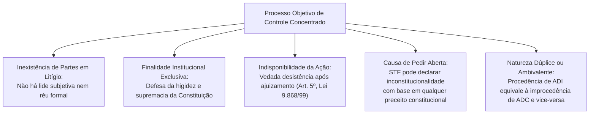
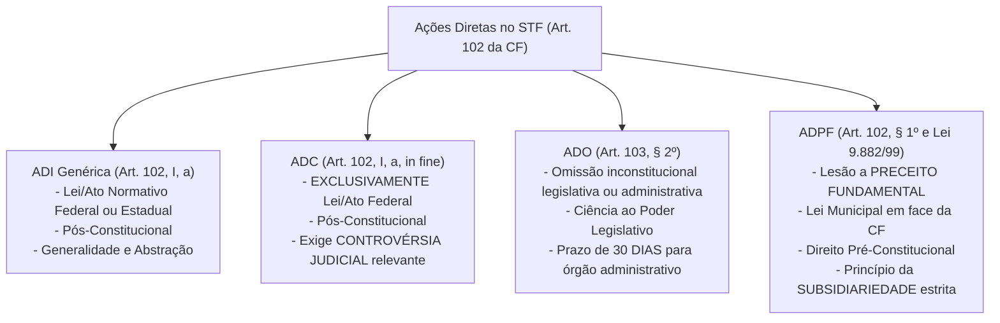
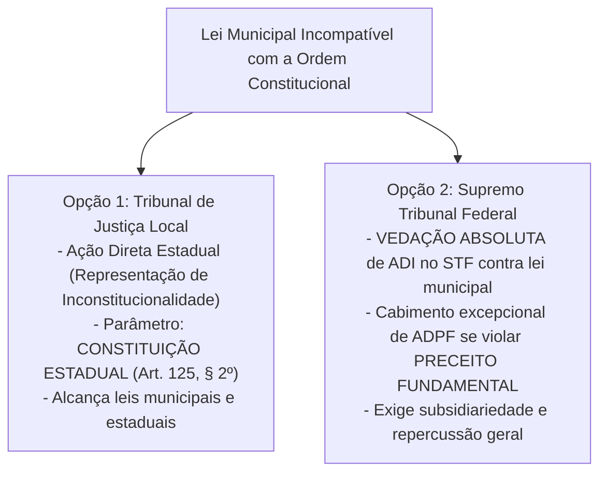

# Controle Concentrado Abstrato: Ações Diretas (ADI, ADC, ADO e ADPF), Legitimidade Ativa (Art. 103), Parâmetro de Controle e Competência Estadual (Art. 125, § 2º)

> O controle abstrato concentrado de constitucionalidade tutela de forma direta e objetiva a higidez normativa da ordem constitucional perante o Supremo Tribunal Federal e os Tribunais de Justiça estaduais, estruturando-se em ações com finalidades e âmbitos materiais rigorosamente demarcados (ADI, ADC, ADO e ADPF), submetidas ao rol restrito de legitimados do art. 103 da Carta Magna e informadas pelos princípios da universalidade ou da pertinência temática.

[← Voltar ao Índice Geral de Direito Constitucional](../README.md)

---

## 1. Arquitetura e Natureza do Controle Abstrato Objetivo

O sistema concentrado brasileiro, de matriz kelseniana e consolidado no Texto Constitucional de 1988, caracteriza-se pela instauração de um **processo objetivo**.

### 1.1. Postulados Procedimentais das Ações Concentradas
1. **Indeclinabilidade e Impossibilidade de Desistência:** O autor da ação direta não pode desistir da ação já ajuizada perante o STF (art. 5º da Lei nº 9.868/1999 e art. 9º da Lei nº 9.882/1999).
2. **Inadmissibilidade de Intervenção de Terceiros Comum:** Não se admite assistência, oposição, denunciação da lide ou chamamento ao processo. Admite-se unicamente o ingresso de **Amicus Curiae** (amigo da corte), fixado pelo relator por decisão irrecorrível, considerando a relevância da matéria e a representatividade dos postulantes.
3. **Causa de Pedir Aberta (*Causa Petendi Aberta*):** O STF não está vinculado aos fundamentos jurídicos articulados na petição inicial; todavia, está adstrito ao **pedido** (pedido delimitado pelo autor na petição inicial).

---

## 2. As Ações Diretas do Controle Concentrado perante o STF

### 2.1. Ação Direta de Inconstitucionalidade (ADI Genérica)

- **Fundamento:** Art. 102, inciso I, alínea "a", da CF/88 e Lei nº 9.868/1999.
- **Objeto Idôneo:**
  - Leis ordinárias, complementares, delegadas, medidas provisórias e decretos legislativos **federais e estaduais** (inclusive do Distrito Federal quando editar normas no exercício de sua competência estadual).
  - Emendas Constitucionais (controle de constitucionalidade formal e material em face das cláusulas pétreas do art. 60, § 4º).
  - Tratados internacionais regulares aprovados pelo Congresso Nacional.
- **Atos NÃO Passíveis de ADI:**
  - **Leis municipais** (mesmo que contrariem diretamente a Constituição Federal - caberá ADPF no STF ou ADI estadual perante o TJ local);
  - **Normas pré-constitucionais** (anteriores a 05/10/1988 - o vício é de revogação/não recepção e deve ser desafiado por ADPF);
  - **Normas constitucionais originárias** (STF rejeita a teoria das normas constitucionais inconstitucionais);
  - **Súmulas e Enunciados Jurisprudenciais** (inclusive súmulas vinculantes, que possuem rito próprio de cancelamento no art. 103-A);
  - **Projetos de Lei** (objeto de controle preventivo via MS por parlamentar, nunca de ADI);
  - **Atos normativos secundários/regulamentares** com ofensa reflexa ou indireta à CF (mera ilegalidade infraconstitucional).

### 2.2. Ação Declaratória de Constitucionalidade (ADC)

- **Fundamento:** Introduzida pela EC nº 03/1993, positivada no art. 102, I, "a", parte final, e Lei nº 9.868/1999.
- **Objeto Estrito:** Somente **lei ou ato normativo federal**. Não cabe ADC contra ato estadual, distrital ou municipal.
- **Requisito Específico de Admissibilidade:** Exige-se a demonstração analítica de **controvérsia judicial relevante** que coloque em risco a presunção de constitucionalidade e cause grave insegurança jurídica (art. 14, III, da Lei nº 9.868/1999). A mera incerteza doutrinária não autoriza o manejo da ADC.

### 2.3. Ação Direta de Inconstitucionalidade por Omissão (ADO)

- **Fundamento:** Art. 103, § 2º, da CF/88 e arts. 12-A a 12-H da Lei nº 9.868/1999 (incluídos pela Lei nº 12.063/2009).
- **Finalidade:** Declarar a inconstitucionalidade decorrente da inércia do poder público (omissão total ou omissão parcial) em editar medida legislativa ou regulamentar indispensável à efetividade de norma constitucional de eficácia limitada.
- **Consequências Jurídicas da Decisão de Procedência:**
  - **Se a omissão for de Poder Legislativo:** O STF dará ciência ao Poder competente para a adoção das providências cabíveis. Em razão da separação de poderes (art. 2º), **não se fixa prazo cogente** ao legislador, embora o STF possa declarar a mora legislativa ou autorizar aplicação analógica de regimes jurídicos existentes (ex: mandado de injunção da greve de servidores).
  - **Se a omissão for de Órgão Administrativo:** O STF determinará que a medida seja implementada no prazo constitucional de **30 (trinta) dias**, ou em prazo razoável expressamente fixado pela Corte (art. 103, § 2º da CF).

### 2.4. Arguição de Descumprimento de Preceito Fundamental (ADPF)

- **Fundamento:** Art. 102, § 1º, da CF/88 e Lei nº 9.882/1999.
- **Finalidade:** Evitar ou reparar lesão a **preceito fundamental** resultante de ato do Poder Público. O rol de preceitos fundamentais não é taxativo no texto, abrangendo os princípios fundamentais (arts. 1º a 4º), direitos e garantias individuais (art. 5º), cláusulas pétreas (art. 60, § 4º) e os princípios constitucionais sensíveis (art. 34, VII).
- **Hipóteses Típicas de Cabimento:**
  1. Lei ou ato normativo **municipal** em face da Constituição Federal;
  2. Direito **pré-constitucional** (leis anteriores a 1988) em face da CF/88;
  3. Controvérsia judicial relevante sobre lei federal, estadual ou municipal;
  4. Atos de efeitos concretos do Poder Público que violem preceito fundamental.
- **O Princípio da Subsidiariedade (Art. 4º, § 1º, da Lei nº 9.882/1999):**  
  *"Não será admitida a arguição de descumprimento de preceito fundamental quando houver qualquer outro meio eficaz de sanar a lesividade."*  
  O STF consolidou que o "outro meio eficaz" refere-se a **outra ação de controle concentrado abstrato perante o STF** (ADI ou ADC). A existência de meios recursais difusos ordinários não impede o ajuizamento da ADPF se não forem capazes de produzir decisão com eficácia imediata, ampla e vinculante.

---

## 3. Legitimação Ativa perante o STF (Art. 103 da CF)

O rol de legitimados para propor as ações de controle concentrado no STF é taxativo (*numerus clausus*), disciplinado no art. 103 da Constituição:

| Categoria de Legitimados | Integrantes do Rol Constitucional (Art. 103) | Requisito de Pertinência Temática | Capacidade Postulatória |
| :--- | :--- | :---: | :---: |
| **Legitimados Universais / Neutros** | 1. Presidente da República (inciso I) 2. Mesa do Senado Federal (inciso II) 3. Mesa da Câmara dos Deputados (inciso III) 4. Procurador-Geral da República (inciso VI) 5. Conselho Federal da OAB (inciso VII) 6. Partido Político com representação no Congresso Nacional (inciso VIII) | **DISPENSADA** (podem impugnar qualquer matéria ou tema de relevância constitucional) | - Pres. República: Atua via AGU. - Mesas: Atuam por suas advocacias. - PGR e CFOAB: Capacidade plena. - Partidos: **Exigem advogado com procuração**. |
| **Legitimados Especiais / Interessados** | 7. Governador de Estado ou do DF (inciso V) 8. Mesa da Assembleia Legislativa ou da CLDF (inciso IV) 9. Confederação Sindical ou Entidade de Classe de âmbito nacional (inciso IX) | **EXIGIDA** (devem demonstrar vínculo direto entre o conteúdo da norma impugnada e seus objetivos institucionais ou esfera territorial) | - Governador: Atua por si ou via PGE. - Mesas Estaduais: Atuam por procuradorias legislativas. - Confederação/Entidade: **Exigem advogado com procuração**. |

> [!IMPORTANT]
> **Requisitos Rigorosos da Jurisprudência do STF sobre Entidades de Classe de Âmbito Nacional (Art. 103, IX):**  
> 1. **Comprovação de Caráter Nacional:** Presença de associados em pelo menos 9 (nove) Estados da Federação (aplicação analógica da Lei dos Partidos Políticos).  
> 2. **Homogeneidade da Categoria:** A entidade deve congregar membros de uma categoria profissional ou econômica específica e homogênea (STF rejeita a legitimidade de associações heterogêneas ou que congreguem múltiplos setores).  
> 3. **Vedação de Associação de Associações:** A confederação reúne sindicatos e federações sindicais. As entidades de classe de âmbito nacional devem ser compostas por pessoas físicas ou jurídicas diretamente associadas, e não por outras entidades regionais autônomas.

---

## 4. O Controle Concentrado no Âmbito Estadual (Art. 125, § 2º)

A Constituição Federal descentralizou o controle concentrado abstrato, conferindo competência aos Tribunais de Justiça dos Estados para julgar ações diretas de inconstitucionalidade:

> **Art. 125, § 2º da CF/88:**  
> *"Cabe aos Estados a instituição de representação de inconstitucionalidade de leis ou atos normativos estaduais ou municipais em face da Constituição Estadual, vedada a atribuição da legitimação para agir a um único órgão."*

### 4.1. Normas de Reprodução Obrigatória e Recurso Extraordinário contra Acórdão do TJ
- **Parâmetro de Controle Local:** É formalmente a **Constituição Estadual**. Leis municipais jamais podem ser confrontadas diretamente em ADI estadual com a Constituição Federal.
- **Normas Constitucionais Federais de Reprodução Obrigatória:** Quando o dispositivo da Constituição Estadual for mera reprodução cogente de norma da Constituição Federal (ex: princípios do art. 37, LIMPE, limites da despesa com pessoal, processo legislativo), o Tribunal de Justiça deve aplicá-lo.
- **Recurso Extraordinário para o STF:** Do acórdão do Tribunal de Justiça proferido em representação de inconstitucionalidade que julgar a validade de lei local contestada em face de norma da Constituição Estadual que reproduza norma federal cogente, **cabe Recurso Extraordinário para o STF** (Súmula 643 e Tema 450 do STF).

---

## 5. Quadro Sinótico Integrado: Ações do Controle Concentrado

| Parâmetro | ADI Genérica | ADC | ADO | ADPF |
| :--- | :--- | :--- | :--- | :--- |
| **Norma Constitucional** | Art. 102, I, "a" | Art. 102, I, "a", parte final | Art. 103, § 2º | Art. 102, § 1º |
| **Lei Regulamentadora** | Lei nº 9.868/1999 | Lei nº 9.868/1999 | Lei nº 9.868/99 (Lei 12.063/09) | Lei nº 9.882/1999 |
| **Objeto Impugnado** | Lei/ato normativo federal ou estadual | Somente lei/ato normativo **federal** | Omissão de dever de legislar ou agir | Atos lesivos a preceito fundamental |
| **Direito Municipal?** | Não cabe | Não cabe | Sim (se for de autoridade local) | **Sim (hipótese típica)** |
| **Direito Pré-Constitucional?** | Não cabe | Não cabe | Não cabe | **Sim (hipótese típica)** |
| **Requisito Específico** | Vigência e abstração | **Controvérsia judicial relevante** | Inércia inconstitucional prolongada | **Subsidiariedade estrita** |
| **Legitimados Ativos** | Rol do art. 103 da CF | Rol do art. 103 da CF | Rol do art. 103 da CF | Rol do art. 103 da CF |
| **Efeitos da Decisão de Mérito** | *Erga omnes*, vinculante e *ex tunc* (regra) | *Erga omnes*, vinculante e *ex tunc* | Ciência ao Poder ou **30 dias** para órgão | *Erga omnes*, vinculante e *ex tunc* |

---

## 6. Questões Paradigmáticas Aplicadas

### [Questão 01](https://www.qconcursos.com/questoes-de-concursos/questoes/5d95ef65-c7) — [FGV — PC-PR / Agente de Polícia Judiciária — 2026]

A respeito do objeto da ação direta de inconstitucionalidade perante o Supremo Tribunal Federal, tendo como parâmetro de controle as normas da Constituição da República, é correto afirmar que podem ser impugnadas(os):

* **A)** Leis anteriores à Constituição em vigor.
* **B)** Leis municipais.
* **C)** Súmulas.
* **D)** Projetos de Lei.
* **E)** Emendas Constitucionais.

#### Gabarito: **E**
* **A (Errada):** Leis editadas antes de 05/10/1988 não se submetem à ADI perante o STF, pois o conflito resolve-se no plano do direito intertemporal como revogação/não recepção (cabendo ADPF ou controle difuso).
* **B (Errada):** As leis municipais não podem ser objeto de Ação Direta de Inconstitucionalidade originária perante o STF em face da CF/88 (cabendo ADI perante o TJ ou ADPF perante o STF).
* **C (Errada):** Súmulas e enunciados de jurisprudência (inclusive Súmulas Vinculantes) não constituem atos normativos autônomos e primários suscetíveis de ADI.
* **D (Errada):** Projetos de lei não integram o ordenamento jurídico positivo como atos acabados, sujeitando-se exclusivamente ao controle preventivo parlamentar ou via Mandado de Segurança impetrado por parlamentar.
* **E (Certa):** As Emendas Constitucionais consubstanciam atos do Poder Constituinte Derivado Reformador, estando plenamente sujeitas ao controle de constitucionalidade formal (observância do rito de dois turnos por 3/5 em cada Casa) e material (não abolição das cláusulas pétreas do art. 60, § 4º da CF/88).

---

### [Questão 02](https://www.qconcursos.com/questoes-de-concursos/questoes/475026e3-c7) — [Instituto IDEAP — Câmara de Santa Margarida - MG / Procurador Legislativo — 2026]

Não tem competência para propor Ação Direta de Inconstitucionalidade:

* **A)** O Procurador Geral da República.
* **B)** O Conselho Federal da Ordem dos Advogados do Brasil.
* **C)** A Mesa da Câmara Municipal.
* **D)** O Governador do Distrito Federal.

#### Gabarito: **C**
* **A (Errada):** O Procurador-Geral da República é legitimado universal expressamente previsto no art. 103, inciso VI, da CF/88.
* **B (Errada):** O Conselho Federal da OAB é legitimado universal expressamente catalogado no art. 103, inciso VII, da Carta Magna.
* **C (Certa):** A Mesa da Câmara Municipal **não possui legitimidade ativa** para deflagrar Ação Direta de Inconstitucionalidade perante o Supremo Tribunal Federal. O art. 103 da Constituição elenca apenas as Mesas da Câmara dos Deputados e do Senado Federal (esfera federal) e as Mesas das Assembleias Legislativas dos Estados ou da Câmara Legislativa do Distrito Federal (esfera estadual/distrital), excluindo categoricamente as autoridades e órgãos legislativos municipais do controle abstrato perante o STF.
* **D (Errada):** O Governador do Distrito Federal integra expressamente o rol de legitimados do art. 103, inciso V, da CF.

---

### [Questão 03](https://www.qconcursos.com/questoes-de-concursos/questoes/31833b09-c8) — [FGV — PC-PR / Delegado de Polícia — 2026]

Em razão de ampla mobilização dos policiais civis do Estado Alfa, um grupo de parlamentares apresentou projeto de lei promovendo o reajuste da remuneração dos policiais civis, considerando a inflação acumulada desde o último reajuste, observados os índices oficiais.

Após o trâmite regular, o projeto foi aprovado pela maioria simples dos integrantes da Casa Legislativa, sendo sancionado e promulgado pelo Governador do Estado Alfa, o que resultou na publicação da Lei nº X. Por entender que esse diploma normativo destoava da Constituição da República, um legitimado deflagrou o controle concentrado de constitucionalidade.

Na situação descrita, é correto afirmar que a Lei nº X:

* **A)** não apresenta vício de inconstitucionalidade.
* **B)** apresenta apenas vício de inconstitucionalidade formal, em razão dos autores da proposição legislativa.
* **C)** apresenta apenas vício de inconstitucionalidade por omissão, por não ter abrangido as demais categorias do funcionalismo público.
* **D)** apresenta apenas vício de inconstitucionalidade material, considerando que a só reposição das perdas inflacionárias não consubstancia reajuste.
* **E)** não pode ser cotejada com a Constituição da República, para fins de controle concentrado de constitucionalidade, apenas com a Constituição do Estado Alfa.

#### Gabarito: **B**
* **A (Errada):** A norma padece de vício insanável de iniciativa, gerando inconstitucionalidade formal subjetiva.
* **B (Certa):** Nos termos do art. 61, § 1º, inciso II, alínea "a", da Constituição Federal de 1988 (aplicável aos Estados e Municípios por força do princípio da simetria constitucional), são de iniciativa privativa do Chefe do Poder Executivo as leis que disponham sobre criação de cargos, funções ou empregos públicos na administração direta e autárquica ou **aumento de sua remuneração**. A apresentação do projeto por parlamentares configura vício de iniciativa formal subjetivo. Conforme jurisprudência pacífica e consolidada do STF, **a sanção do Governador do Estado NÃO convalida o vício formal de iniciativa parlamentar** (superação definitiva da antiga Súmula nº 5 do STF).
* **C (Errada):** A inconstitucionalidade é de ação e decorre do vício de iniciativa formal e não de omissão.
* **D (Errada):** O conteúdo do reajuste em si não padece de inconstitucionalidade material intrínseca; a mácula repousa estritamente na forma e na autoria do processo legislativo.
* **E (Errada):** Leis estaduais podem ser cotejadas diretamente com a Constituição da República mediante ADI perante o STF (art. 102, I, "a").

---

### [Questão 04](https://www.qconcursos.com/questoes-de-concursos/questoes/318ad3f7-c8) — [FGV — PC-PR / Delegado de Polícia — 2026]

Foi editada a Lei nº X, no âmbito do Estado Alfa, dispondo sobre as regras a serem observadas para que despachantes documentalistas pudessem atuar no âmbito dos órgãos de trânsito do respectivo ente federativo, estatuindo requisitos mínimos de escolaridade e impedimentos, além de cominar penalidades administrativas.

Um legitimado submeteu a Lei nº X ao controle concentrado de constitucionalidade, sendo corretamente decidido que esse diploma normativo é:

* **A)** inconstitucional, por afrontar competência legislativa privativa e delegável da União.
* **B)** inconstitucional, por afrontar competência legislativa privativa e indelegável da União.
* **C)** constitucional, por versar sobre matéria de competência legislativa residual do Estado Alfa.
* **D)** constitucional, por versar sobre matéria de competência legislativa comum entre os entes federativos.
* **E)** constitucional, por versar sobre matéria de competência legislativa concorrente com a União, desde que observadas eventuais normas gerais.

#### Gabarito: **A**
* **A (Certa):** O Supremo Tribunal Federal fixou jurisprudência pacífica e reiterada no sentido de que lei estadual que disciplina a atividade de despachante perante órgãos de trânsito (DETRAN) usurpa a competência privativa da União para legislar sobre **trânsito e transporte** (art. 22, XI) e sobre **condições para o exercício de profissões** (art. 22, XVI). Trata-se de competência privativa da União que ostenta natureza **delegável** aos Estados-membros mediante Lei Complementar específica (art. 22, parágrafo único), cuja ausência torna a legislação estadual formalmente inconstitucional.
* **B (Errada):** A competência privativa do art. 22 não é indelegável; o parágrafo único do art. 22 expressamente autoriza a União a delegar aos Estados a disciplina de questões específicas mediante Lei Complementar.
* **C (Errada):** A atuação de despachantes documentais e regras de trânsito não integram a competência legislativa residual estadual (art. 25, § 1º).
* **D (Errada):** A competência do art. 23 é administrativa comum e material, não comportando edição de normas regulatórias de profissão privativas da União.
* **E (Errada):** Não se trata de competência concorrente do art. 24, mas de matéria estritamente privativa federal do art. 22.

---

### [Questão 05](https://www.qconcursos.com/questoes-de-concursos/questoes/b8555e71-a8) — [Instituto Consulplan — TJ-MG / Titular de Serviços Notariais e de Registros — 2026]

Em determinada cidade, foi promulgada lei municipal que estabelece restrições ao funcionamento de estabelecimentos comerciais no perímetro urbano. A Associação Comercial local entende que a referida norma municipal colide com princípios protegidos pela Constituição Estadual e pela Constituição Federal. Discute-se qual via de controle abstrato pode ser utilizada.

Considerando o sistema brasileiro de controle de constitucionalidade, assinale a alternativa correta:

* **A)** Lei municipal pode ser objeto de ADI no STF quando o parâmetro seja a Constituição Federal e a controvérsia possua relevância nacional, sem necessidade de utilização de outra via abstrata.
* **B)** A lei municipal pode ser objeto de controle concentrado no Tribunal de Justiça em face da Constituição Estadual.
* **C)** Lei municipal somente admite controle difuso, pois o controle concentrado perante os Tribunais de Justiça alcança atos estaduais, mas não normas editadas pelos Municípios.
* **D)** A inexistência de ADI no STF torna a ADPF automaticamente cabível contra lei municipal, independentemente de lesão a preceito fundamental ou do requisito legal de subsidiariedade.
* **E)** O Tribunal de Justiça pode usar diretamente qualquer dispositivo da Constituição Federal como parâmetro autônomo para invalidar lei municipal em ação concentrada estadual.

#### Gabarito: **B**
* **A (Errada):** Não cabe Ação Direta de Inconstitucionalidade (ADI) perante o Supremo Tribunal Federal contra lei municipal, ainda que fundada em parâmetro constitucional federal direto (art. 102, I, "a").
* **B (Certa):** Por expressa determinação do art. 125, § 2º, da Constituição Federal, compete aos Estados a instituição de representação de inconstitucionalidade de leis ou atos normativos estaduais ou **municipais em face da Constituição Estadual**, conferindo aos Tribunais de Justiça o exercício do controle abstrato sobre normas municipais.
* **C (Errada):** A lei municipal admite controle concentrado estadual perante o respectivo Tribunal de Justiça de forma expressa no art. 125, § 2º.
* **D (Errada):** A ADPF no STF contra lei municipal pressupõe necessariamente a demonstração de violação a **preceito fundamental** e a observância rigorosa do princípio da subsidiariedade (art. 4º, § 1º, da Lei nº 9.882/1999).
* **E (Errada):** O parâmetro de controle abstrato no Tribunal de Justiça é a Constituição Estadual, sendo incabível o uso isolado de dispositivo da CF/88 que não ostente caráter de norma de reprodução obrigatória positivada na ordem estadual.

---

### [Questão 06](https://www.qconcursos.com/questoes-de-concursos/questoes/b3a5fa96-d1) — [Avança SP — Autarquia Municipal de Saúde / Procurador Autárquico — 2026]

Nos termos da Constituição Federal, assinale a alternativa correta acerca do prazo para a adoção das providências necessárias pelo órgão administrativo, quando declarada a inconstitucionalidade por omissão de medida destinada a tornar efetiva norma constitucional:

* **A)** 90 dias.
* **B)** 180 dias.
* **C)** 60 dias.
* **D)** 30 dias.
* **E)** Não há prazo constitucionalmente estabelecido.

#### Gabarito: **D**
* **A (Errada):** O prazo constitucionalmente fixado para o órgão administrativo não é de 90 dias.
* **B (Errada):** O prazo de 180 dias não consta no regramento do art. 103, § 2º.
* **C (Errada):** O constituinte originário não fixou prazo de 60 dias.
* **D (Certa):** Conforme enuncia a literalidade categórica do art. 103, § 2º, da Constituição da República de 1988: "Declarada a inconstitucionalidade por omissão de medida para tornar efetiva norma constitucional, será dada ciência ao Poder competente para a adoção das providências necessárias e, **em se tratando de órgão administrativo, para fazê-lo em trinta dias**."
* **E (Errada):** A Constituição Federal estabeleceu prazo expresso e cogente de 30 dias exclusivamente quando a omissão for imputável a órgão administrativo.

---

### [Questão 07](https://www.qconcursos.com/questoes-de-concursos/questoes/90360815-d2) — [CESPE / CEBRASPE — AGEPAR / Especialista em Regulação — Área: Direito — 2026]

Assinale a opção correta em relação ao controle de constitucionalidade:

* **A)** É vedado o controle difuso de constitucionalidade nas ações civis públicas e nas ações populares visto que suas decisões têm eficácia *ultra partes*.
* **B)** O STF adota a transcendência dos motivos determinantes no julgamento da ação direta de inconstitucionalidade.
* **C)** A ação direta de inconstitucionalidade é instrumento hábil para impugnar norma anterior à promulgação da Constituição Federal de 1988 que com ela seja incompatível.
* **D)** A ação declaratória de constitucionalidade proposta por governador de estado com vistas à declaração de constitucionalidade de lei estadual pode ser conhecida desde que demonstrada a pertinência temática.
* **E)** Há necessidade de aplicação da cláusula de reserva de plenário (*full bench*) quando um tribunal for declarar a inconstitucionalidade, sem redução de texto, de uma lei no controle difuso de constitucionalidade.

#### Gabarito: **E**
* **A (Errada):** O STF e o STJ admitem plenamente o controle difuso de constitucionalidade no bojo de ações civis públicas e ações populares, desde que a inconstitucionalidade seja alegada de forma incidental como causa de pedir, e não como pedido principal da demanda.
* **B (Errada):** O STF rejeitou formalmente a teoria da transcendência dos motivos determinantes no controle abstrato, assentando que o efeito vinculante e a eficácia *erga omnes* limitam-se à parte dispositiva do julgado.
* **C (Errada):** A incompatibilidade de norma anterior à CF/88 é resolvida como não recepção (revogação), incabível de apreciação em ADI.
* **D (Errada):** A ADC tem por objeto exclusivo lei ou ato normativo **federal**, sendo absolutamente incabível para declarar a constitucionalidade de lei estadual perante o STF (art. 102, I, "a").
* **E (Certa):** A técnica da interpretação conforme a Constituição com ou sem redução de texto e a declaração de inconstitucionalidade parcial sem redução de texto importam juízo de censura constitucional da norma legal, exigindo a estrita observância da **cláusula de reserva de plenário** (art. 97 da CF e Súmula Vinculante nº 10 do STF) para afastar o sentido da norma pelo tribunal.

---

### [Questão 08](https://www.qconcursos.com/questoes-de-concursos/questoes/bc3dbaa6-b1) — [Avança SP — Câmara de Três Corações - MG / Advogado — 2026]

Sobre a competência e a natureza jurídica das ações de controle de constitucionalidade, de acordo com a Constituição Federal e o entendimento do Supremo Tribunal Federal, é correto afirmar:

* **A)** O sistema constitucional brasileiro adota a teoria das normas constitucionais inconstitucionais para viabilizar a declaração de invalidade de normas originárias em face de princípios superiores.
* **B)** A ação direta de inconstitucionalidade constitui o meio processual adequado para a impugnação direta de leis municipais que confrontem a Constituição Federal perante o Supremo Tribunal Federal.
* **C)** Compete ao Tribunal de Justiça local processar e julgar representação de inconstitucionalidade de leis municipais ou estaduais em face da respectiva Constituição Estadual.
* **D)** A natureza dúplice das ações de controle abstrato implica que a eficácia vinculante de uma decisão de mérito em ADI apresenta essência distinta daquela proferida em sede de Ação Declaratória de Constitucionalidade.
* **E)** Na hipótese de tramitação simultânea de ações contra a mesma lei estadual perante o Tribunal de Justiça e o Supremo Tribunal Federal, o curso da ação no Supremo Tribunal Federal deve ser suspenso até o julgamento final na instância local.

#### Gabarito: **C**
* **A (Errada):** O STF rechaça a teoria das normas constitucionais inconstitucionais (tese de Otto Bachof), firmando a presunção absoluta de validade e higidez das normas decorrentes do poder constituinte originário.
* **B (Errada):** Não cabe ADI no STF contra lei municipal; a impugnação direta contra a CF/88 opera-se por via de ADPF.
* **C (Certa):** A alternativa espelha a exata dicção do art. 125, § 2º, da Constituição Federal, atribuindo competência originária aos Tribunais de Justiça para o julgamento da representação de inconstitucionalidade de leis ou atos normativos municipais ou estaduais em face da Constituição Estadual.
* **D (Errada):** Pelo caráter dúplice ou ambivalente, a decisão de procedência da ADC possui rigorosamente a mesma eficácia vinculante e *erga omnes* da declaração de inconstitucionalidade proferida em ADI.
* **E (Errada):** Na hipótese de ajuizamento simultâneo de ADI estadual no TJ e ADI no STF contra a mesma lei estadual, a tramitação no Tribunal de Justiça é que deve ser sobrestada até a decisão definitiva do STF, em razão da prevalência hierárquica da jurisdição constitucional federal.
