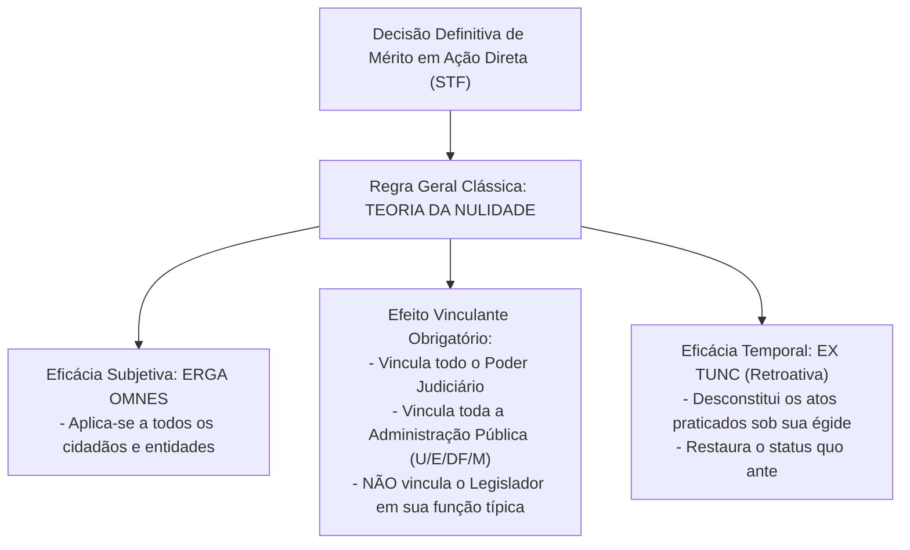
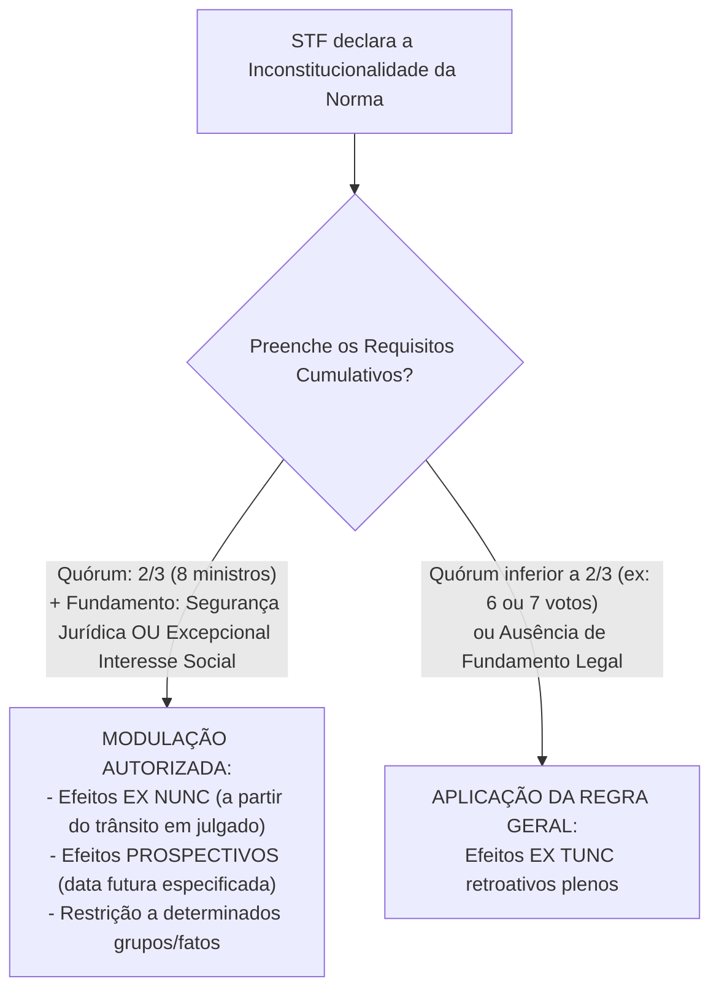
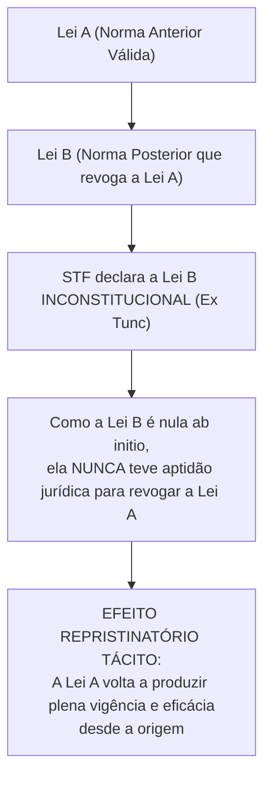
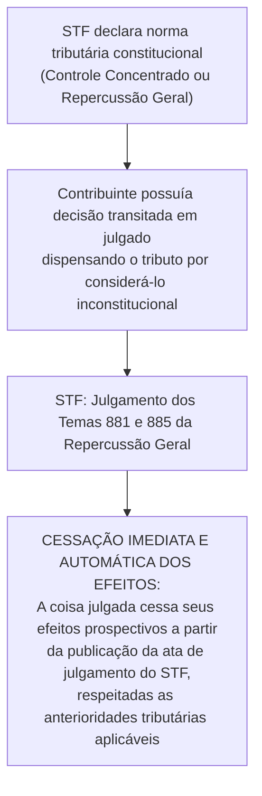

# Efeitos da Decisão no Controle de Constitucionalidade, Modulação Temporal, Efeito Repristinatório e Coisa Julgada Inconstitucional

> A decisão definitiva de mérito proferida pelo Supremo Tribunal Federal em controle concentrado de constitucionalidade irradia eficácia erga omnes, efeito vinculante e natureza ex tunc retroativa, admitindo a mitigação prospectiva dos efeitos (modulação temporal) mediante o quórum qualificado de dois terços por razões de segurança jurídica ou excepcional interesse social, projetando o efeito repristinatório sobre a ordem pré-existente e disciplinando a cessação automática de efeitos de coisas julgadas em relações jurídicas de trato continuado.

[← Voltar ao Índice Geral de Direito Constitucional](../README.md)

---

## 1. O Regime Jurídico Clássico dos Efeitos da Declaração de Inconstitucionalidade

O direito constitucional brasileiro adota originariamente a **Teoria da Nulidade** (formulada pelo Chief Justice John Marshall em *Marbury v. Madison* e recepcionada por Rui Barbosa), segundo a qual a lei inconstitucional nasce morta (*natimorta*), sendo destituída de qualquer validade jurídica desde o momento de sua promulgação.

### 1.1. Dimensões do Efeito Vinculante e a Não Vinculação do Poder Legislativo

O art. 102, § 2º, da Constituição Federal estabelece:
> *"As decisões definitivas de mérito, proferidas pelo Supremo Tribunal Federal, nas ações diretas de inconstitucionalidade e nas ações declaratórias de constitucionalidade produzirão eficácia contra todos e efeito vinculante, relativamente aos demais órgãos do Poder Judiciário e à administração pública direta e indireta, nas esferas federal, estadual e municipal."*

- **Órgãos Vinculados:** Todos os juizados, juízos singulares e tribunais do Poder Judiciário pátrio, além de todos os órgãos e entidades da Administração Pública direta, autárquica, fundacional e empresas estatais de todos os entes federados (União, Estados, DF e Municípios).
- **Órgãos NÃO Vinculados:**
  1. **O próprio Plenário do STF:** O Supremo Tribunal Federal não está vinculado aos seus próprios precedentes em julgamentos futuros, podendo rever sua jurisprudência para adequar a interpretação constitucional à evolução dos fatos sociais (*mutação constitucional* ou *overruling*).
  2. **O Poder Legislativo na sua Função Típica de Legislar:** O parlamento federal, estadual ou municipal não é atingido pelo efeito vinculante quando exerce a sua competência legislativa primária. Se o efeito vinculante alcançasse o legislador, haveria o fenômeno antidemocrático da **fossilização constitucional** (engessamento do processo político). O Poder Legislativo pode editar nova lei com teor idêntico à norma declarada inconstitucional pelo STF, provocando o legítimo diálogo institucional e o fenômeno da reação legislativa (*efeito backlash*).

---

## 2. A Modulação Temporal dos Efeitos (Art. 27 da Lei nº 9.868/1999)

A teoria da nulidade absoluta pode, em determinados contextos fáticos, gerar insegurança jurídica intolerável ou grave desordem social. Diante disso, o legislador consagrou o instituto da **modulação temporal dos efeitos** (também denominado *declaração de inconstitucionalidade com eficácia prospectiva*):

> **Art. 27 da Lei nº 9.868/1999:**  
> *"Ao declarar a inconstitucionalidade de lei ou ato normativo, e tendo em vista razões de segurança jurídica ou de excepcional interesse social, poderá o Supremo Tribunal Federal, por maioria de dois terços de seus membros, restringir os efeitos daquela declaração ou decidir que ela só tenha eficácia a partir de seu trânsito em julgado ou de outro momento que venha a ser fixado."*

### 2.1. Requisitos Indispensáveis para a Modulação
1. **Quórum Qualificado Estrito:** Exige-se o voto favorável de pelo menos **dois terços dos membros do STF (8 ministros)**. A maioria absoluta simples (6 votos) não é suficiente para modular efeitos temporais.
2. **Fundamentação Material Alternativa:**
   - **Razões de Segurança Jurídica:** Proteção da boa-fé, da confiança legítima e de situações jurídicas consolidadas pelo decurso de longo período de tempo.
   - **Excepcional Interesse Social:** Preservação da ordem pública, do erário coletivo ou de serviços públicos essenciais indispensáveis à população.
3. **Modalidades de Fixação Temporal:**
   - **Eficácia *Ex Nunc*:** Os efeitos da declaração operam a partir do trânsito em julgado do acórdão do STF.
   - **Eficácia *Pro Futuro*:** A decisão só passará a produzir efeitos a partir de data futura expressamente designada pela Corte (conferindo prazo razoável para o Poder Legislativo adequar o ordenamento jurídico).
   - **Restrição de Efeitos:** A inconstitucionalidade atinge apenas determinados grupos ou resguarda pagamentos pretéritos recebidos de boa-fé.

> [!TIP]
> **Modulação Temporal no Controle Difuso de Constitucionalidade:**  
> O STF pacificou que o instituto da modulação temporal previsto no art. 27 da Lei nº 9.868/1999 e no art. 927, § 3º, do CPC/2015 **aplica-se plenamente ao controle difuso de constitucionalidade** exercido pelo Supremo no julgamento de Recursos Extraordinários com repercussão geral, exigindo rigorosamente o mesmo quórum qualificado de **dois terços dos votos**.

---

## 3. O Efeito Repristinatório Tácito e o Efeito Ricochete

A declaração de inconstitucionalidade com eficácia *ex tunc* opera a nulidade ab initio da lei impugnada. Disso decorre logicamente o **efeito repristinatório tácito** (ou restauração automática da vigência da norma revogada):

### 3.1. Distinção entre Repristinação Legislativa e Efeito Repristinatório Constitucional
- **Repristinação na Teoria Geral do Direito (Art. 2º, § 3º, da LINDB):** Salvo disposição em contrário, a lei revogada não se restaura por ter a lei revogadora perdido a vigência. A repristinação legislativa exige previsão expressa na nova lei.
- **Efeito Repristinatório Constitucional da Declaração de Nulidade:** Ocorre automaticamente por decorrência lógica da teoria da nulidade da lei inconstitucional. Não se confunde com o instituto da LINDB: a norma revogadora inconstitucional jamais possuiu validade para produzir o efeito extintivo da norma anterior.

### 3.2. O Efeito Ricochete e a Impugnação de Toda a Cadeia Normativa
Se a lei anterior restaurada pelo efeito repristinatório (Lei A) também padecer de vício de inconstitucionalidade idêntico, o autor da ação direta deve **impugnar expressamente toda a cadeia normativa sucessiva** na petição inicial em pedidos cumulativos ou sucessivos. Se não o fizer, a declaração de inconstitucionalidade da norma mais recente fará ressurgir a lei pretérita igualmente inconstitucional (inconstitucionalidade por via de ricochete ou oblíqua).

---

## 4. Coisa Julgada Inconstitucional e Relações Tributárias de Trato Sucessivo

A estabilidade da coisa julgada (art. 5º, XXXVI, da CF) confronta-se periodicamente com a autoridade das decisões do STF tomadas em sede de controle concentrado ou de repercussão geral:

### 4.1. Temas 881 e 885 da Repercussão Geral (STF - RE 949.297 e RE 955.227)
O Supremo Tribunal Federal fixou a tese de que:
1. As decisões do STF em controle concentrado ou em sede de repercussão geral interrompem automaticamente os efeitos futuros de decisões transitadas em julgado que envolvam relações jurídicas tributárias de **trato continuado / sucessivo** (ex: CSLL, PIS, COFINS, IRPJ).
2. Não é necessária a propositura de Ação Rescisória para fazer cessar a eficácia da coisa julgada individual nas relações continuativas.
3. A cobrança do tributo pelo Fisco deve respeitar estritamente o princípio da **anterioridade anual e/ou nonagesimal**, conforme a natureza do tributo considerado, contadas da data de publicação da ata de julgamento do STF.

### 4.2. Inexigibilidade do Título Executivo Judicial Inconstitucional no CPC (Arts. 525 e 535)
O Código de Processo Civil de 2015 positivou o regramento da coisa julgada inconstitucional no cumprimento de sentença:
- Considera-se **inexigível a obrigação** reconhecida em título executivo judicial fundado em lei ou ato normativo considerado inconstitucional pelo STF, ou fundado em aplicação ou interpretação da lei tidas pelo STF como incompatíveis com a Constituição (art. 525, § 12, e art. 535, § 5º, do CPC).
- A decisão do STF deve ser **anterior ao trânsito em julgado** do título executivo judicial. Se a decisão do STF for **posterior ao trânsito em julgado**, a desconstituição da coisa julgada em causas de obrigação individual pretérita exigirá o ajuizamento de **Ação Rescisória** no prazo decadencial de dois anos (art. 525, § 15, e art. 535, § 8º).

---

## 5. A Rejeição da Transcendência dos Motivos Determinantes no STF

A teoria da transcendência dos motivos determinantes sustentava que o efeito vinculante e a eficácia *erga omnes* das decisões do STF no controle concentrado deveriam irradiar-se não apenas sobre a **parte dispositiva** do acórdão, mas também sobre a sua fundamentação essencial (*ratio decidendi* ou motivos determinantes).

> [!WARNING]
> **Posição Pacífica e Consolidada do STF:**  
> O Supremo Tribunal Federal **REJEITOU expressamente a teoria da transcendência dos motivos determinantes** (Rcl 4.381/RJ, Rcl 3.014/MG, Rcl 11.111/SP). Para o STF, a eficácia vinculante restringe-se estritamente à **parte dispositiva da decisão de mérito**, não sendo cabível Reclamação Constitucional fundada exclusivamente na violação aos motivos determinantes ou fundamentos teóricos do julgado paradigma.

---

## 6. Quadro Sinótico Integrado: Regime Temporal e Efeitos

| Instituto Processual | Regra Geral | Quórum Constitucional / Legal | Limites e Condições de Aplicação |
| :--- | :--- | :---: | :--- |
| **Declaração de Inconstitucionalidade** | Efeito *Ex Tunc* (retroativo nulo) | Maioria Absoluta (6 votos no STF / plenário no tribunal) | Desconstitui os atos passados praticados com amparo na lei nula. |
| **Modulação Temporal de Efeitos** | Efeito *Ex Nunc* ou *Pro Futuro* | **Maioria de 2/3 (8 ministros do STF)** | Exige Segurança Jurídica OU Excepcional Interesse Social (art. 27). |
| **Efeito Vinculante** | Vincula Judiciário e toda Administração | Maioria Absoluta na decisão de mérito | **NÃO vincula o Legislador** na sua função típica de legislar. |
| **Efeito Repristinatório** | Restauração da norma anterior revogada | Consequência lógica da declaração de nulidade | O autor deve impugnar a cadeia sucessiva se a lei anterior for viciada. |
| **Relações Tributárias de Trato Sucessivo** | Cessação automática da coisa julgada | Tema 881 e 885 de Repercussão Geral | Observância impositiva das anterioridades anual e nonagesimal. |
| **Transcendência dos Motivos** | Rejeitada pelo STF | Jurisprudência uniforme da Corte | Vinculação estrita ao dispositivo; não cabe Reclamação por ratio. |

---

## 7. Questões Paradigmáticas Aplicadas

### [Questão 01](https://www.qconcursos.com/questoes-de-concursos/questoes/26e9d6e9-c9) — [VUNESP — UENP / Advogado — 2026]

Após o STF declarar, em controle concentrado, a constitucionalidade de determinada lei federal, um órgão administrativo de universidade estadual deixa de aplicá-la em processo sancionador sob o argumento de que, no caso concreto, considera a norma desproporcional e contrária a princípios constitucionais.

Com base em seus conhecimentos sobre controle de constitucionalidade, assinale a alternativa correta:

* **A)** A Administração Pública pode deixar de aplicar lei declarada constitucional pelo STF se demonstrar, em processo motivado, que o caso concreto apresenta peculiaridades não examinadas na ação direta, pois o efeito vinculante alcança apenas o Poder Judiciário.
* **B)** A decisão do STF em controle concentrado vincula apenas os tribunais, não atingindo órgãos administrativos estaduais ou municipais, em razão da autonomia federativa e da separação entre função jurisdicional e função administrativa.
* **C)** A autoridade administrativa pode afastar lei federal declarada constitucional se entender que ela viola princípios constitucionais implícitos, pois decisões em controle concentrado não afastam a apreciação pela autoridade administrativa da constitucionalidade de normas sancionatórias no caso concreto.
* **D)** A decisão do STF em controle concentrado possui eficácia contra todos e efeito vinculante em relação aos órgãos do Poder Judiciário e da Administração Pública, de modo que a autoridade administrativa não poderá afastar, no caso concreto, a aplicação de lei declarada constitucional pelo STF.
* **E)** A declaração de constitucionalidade impede o controle abstrato posterior, mas não interfere na aplicação administrativa da lei, já que todo agente público tem a competência e o dever constitucional de afastar normas que considere formalmente inconstitucionais.

#### Gabarito: **D**
* **A (Errada):** O efeito vinculante das decisões proferidas pelo STF em sede de controle abstrato de constitucionalidade (art. 102, § 2º da CF) alcança de forma cogente e obrigatória todos os órgãos da Administração Pública direta e indireta.
* **B (Errada):** A decisão vincula não apenas os tribunais, mas toda a Administração Pública de todas as esferas federativas (federal, estadual, distrital e municipal).
* **C (Errada):** A autoridade administrativa não detém poder jurisdicional para afastar norma cuja higidez e compatibilidade constitucional foram declaradas em controle concentrado pelo STF.
* **D (Certa):** Nos exatos termos do art. 102, § 2º, da Constituição da República de 1988 e da Lei nº 9.868/1999, as decisões definitivas de mérito proferidas pelo Supremo Tribunal Federal em sede de Ação Direta de Inconstitucionalidade e Ação Declaratória de Constitucionalidade possuem eficácia contra todos (*erga omnes*) e **efeito vinculante** em relação aos demais órgãos do Poder Judiciário e a **toda a Administração Pública** direta e indireta, sendo vedado à autoridade administrativa estadual recusar cumprimento ao comando da lei federal declarada constitucional.
* **E (Errada):** O servidor ou autoridade administrativa submete-se estritamente ao princípio da legalidade e à autoridade vinculante das decisões da Suprema Corte.

---

### [Questão 02](https://www.qconcursos.com/questoes-de-concursos/questoes/e495267b-c8) — [VUNESP — TCE-SP / Auditor de Controle Externo — Área: Direito — 2026]

Considere que o Tribunal de Contas está apreciando a validade da prorrogação antecipada de contrato de concessão do serviço de transporte urbano de passageiros, celebrado entre o Município X e o consórcio Z. A prorrogação foi realizada com a finalidade de viabilizar investimentos não previstos no contrato original, especialmente a substituição da frota de ônibus movidos a diesel por veículos elétricos. Ao analisar o termo aditivo, a equipe técnica verifica que a prorrogação foi fundamentada em lei local que autoriza a adoção da medida, desde que demonstrada, mediante estudos técnicos, a sua vantajosidade para a Administração e assumidos, pelo concessionário, compromissos de realização de novos investimentos. Os órgãos técnicos do Tribunal, contudo, suscitam dúvida quanto à constitucionalidade da lei, por entenderem que a prorrogação antecipada poderia constituir mecanismo destinado a contornar o dever constitucional de prévia licitação para a concessão de serviços públicos, motivo pelo qual consideram a possibilidade de utilizar, no caso concreto, a Súmula 347 do Supremo Tribunal Federal (STF), que estipula o seguinte: "O Tribunal de contas, no exercício de suas atribuições, pode apreciar a constitucionalidade de leis e dos atos do poder público."

Com base na situação hipotética e na jurisprudência atual do Supremo Tribunal Federal acerca do controle de constitucionalidade exercido pelos Tribunais de Contas, é correto afirmar que o Tribunal de Contas:

* **A)** somente poderá declarar, incidentalmente, a inconstitucionalidade da norma local caso ela implique em patente violação a dispositivo constitucional ou contrarie a jurisprudência do STF sobre a matéria, o que não se configura no caso.
* **B)** pode utilizar a súmula para declarar, em abstrato, a inconstitucionalidade da norma local, pois também está submetida ao princípio da supremacia da constituição.
* **C)** não pode utilizar a súmula, pois ela foi superada pelo STF em precedente recente.
* **D)** pode declarar a inconstitucionalidade incidental da norma, ainda que haja posicionamento doutrinário dominante em sentido contrário e não haja precedente do STF sobre o tema.
* **E)** pode utilizar a súmula no caso, pois há precedentes do STF declarando a inconstitucionalidade de norma que autoriza a prorrogação antecipada de contratos.

#### Gabarito: **A**
* **A (Certa):** O Supremo Tribunal Federal, ao modular e reinterpretar o alcance contemporâneo da **Súmula 347 do STF** (especialmente no julgamento de Mandados de Segurança como o MS 25.888 e decisões colegiadas recentes), firmou a compreensão de que os Tribunais de Contas não detêm competência jurisdicional abstrata para declarar a invalidade de leis, e que o exercício da apreciação de constitucionalidade incidental pela Corte de Contas deve ser extraordinário, exigindo manifesta e direta violação à Constituição ou **descompasso flagrante com jurisprudência consolidada do próprio STF**, evitando que o Tribunal de Contas usurpe a competência típica dos órgãos judiciários.
* **B (Errada):** O Tribunal de Contas jamais possui competência para declarar a inconstitucionalidade em abstrato de qualquer lei ou ato normativo.
* **C (Errada):** A Súmula 347 não foi formalmente cancelada, mas seu alcance foi estritamente balizado pela jurisprudência contemporânea da Corte.
* **D (Errada):** Sem precedente firmado pelo STF e havendo razoabilidade jurídica e estudos técnicos na norma local, o Tribunal de Contas não pode recusar vigência à lei local.
* **E (Errada):** A prorrogação antecipada de concessões condicionada a investimentos e vantajosidade já foi reputada constitucional pelo STF e positivada em legislação federal (ex: Lei nº 13.448/2017).

---

### [Questão 03](https://www.qconcursos.com/questoes-de-concursos/questoes/72034e2d-cc) — [VUNESP — TJ-SP / Programa de Residência Jurídica — 2026]

De acordo com a Constituição Federal e a jurisprudência do Supremo Tribunal Federal, assinale a alternativa que apresenta uma hipótese na qual o órgão fracionário de um tribunal está dispensado de submeter a arguição de inconstitucionalidade ao Plenário ou ao Órgão Especial:

* **A)** Quando o afastamento da aplicação da lei for realizado mediante interpretação sistemática embasada em enunciado de súmula de Tribunal Superior – Superior Tribunal de Justiça ou Supremo Tribunal Federal.
* **B)** Quando já houver pronunciamento prévio do Plenário (ou Órgão Especial) do próprio tribunal ou do Plenário do Supremo Tribunal Federal sobre a questão constitucional respectiva.
* **C)** Quando o órgão fracionário empregar a técnica de declaração de inconstitucionalidade parcial sem redução de texto, negando vigência apenas a determinado sentido interpretativo.
* **D)** Quando a ação tramitar nas justiças especiais – Justiça do Trabalho, Militar e Eleitoral, tendo em vista o princípio da especialidade.
* **E)** Quando a norma impugnada for ato normativo estadual ou municipal, uma vez que a cláusula de reserva de plenário restringe-se ao controle de constitucionalidade de leis federais.

#### Gabarito: **B**
* **A (Errada):** Súmulas não vinculantes do STJ não autorizam órgão fracionário de tribunal a descumprir o art. 97 da CF.
* **B (Certa):** Em estrita obediência ao art. 949, parágrafo único, do Código de Processo Civil de 2015 e à consolidada jurisprudência do STF: "Os órgãos fracionários dos tribunais não submeterão ao plenário ou ao órgão especial a arguição de inconstitucionalidade quando já houver **pronunciamento destes ou do plenário do Supremo Tribunal Federal sobre a questão**." Trata-se de hipótese expressa de dispensa legal da cláusula de reserva de plenário para preservar a celeridade e a segurança jurídica.
* **C (Errada):** A técnica de interpretação conforme a Constituição ou declaração de inconstitucionalidade parcial sem redução de texto exige a observância da reserva de plenário (art. 97 e SV 10).
* **D (Errada):** A cláusula de reserva de plenário aplica-se a todos os tribunais do país, inclusive tribunais do trabalho, militares e eleitorais.
* **E (Errada):** A cláusula de reserva de plenário aplica-se indistintamente a leis ou atos normativos federais, estaduais, distritais e municipais.

---

### [Questão 04](https://www.qconcursos.com/questoes-de-concursos/questoes/0c1a0d2e-cc) — [Quadrix — CREF - 20ª Região (SE) / Advogado — 2026]

Com base nas disposições da Constituição Federal de 1988 (CF/1988), julgue o item a seguir:

A declaração de inconstitucionalidade de lei ou ato normativo pelo tribunal exige voto da maioria absoluta de seus membros ou dos membros do respectivo órgão especial.

* **C)** Certo
* **E)** Errado

#### Gabarito: **Certo**
* **Fundamentação Técnica:** Assertiva inteiramente correta. O item reproduz a literalidade cogente da **cláusula de reserva de plenário** insculpida no art. 97 da Constituição da República Federativa do Brasil: "Somente pelo voto da **maioria absoluta de seus membros** ou dos membros do respectivo órgão especial poderão os tribunais declarar a inconstitucionalidade de lei ou ato normativo do Poder Público."

---

### [Questão 05](https://www.qconcursos.com/questoes-de-concursos/questoes/8c59ac77-cc) — [Quadrix — CREF - 20ª Região (SE) / Agente de Fiscalização — 2026]

Quanto aos princípios fundamentais da República Federativa do Brasil, aos direitos e garantias essenciais, ao controle de constitucionalidade e às finanças públicas, julgue o item a seguir:

O controle de constitucionalidade preventivo caracteriza‑se politicamente quando é exercido pelas comissões parlamentares de constituição e de justiça, durante a tramitação do projeto de lei.

* **C)** Certo
* **E)** Errado

#### Gabarito: **Certo**
* **Fundamentação Técnica:** Item correto. O controle preventivo atua antes do aperfeiçoamento da norma jurídica (durante a fase constitutiva do processo legislativo), objetivando evitar o ingresso de projetos colidentes com a Carta Magna no ordenamento positivo. Quando realizado pelas Comissões de Constituição e Justiça (CCJ) da Câmara dos Deputados, do Senado Federal ou das Assembleias Legislativas, consubstancia expressão típica de **controle preventivo político**, haja vista ser exercido por órgão integrante do Poder Legislativo.

---

### [Questão 06](https://www.qconcursos.com/questoes-de-concursos/questoes/eb7a5ed4-cc) — [IASPE — UNIFAI / Analista Jurídico — 2026]

Em sede de controle de constitucionalidade, assinale a opção correta a respeito da eficácia subjetiva e vinculante das decisões:

* **A)** A decisão proferida pelo STF que declara a inconstitucionalidade de lei federal em sede de ação direta vincula o Poder Judiciário, o Poder Executivo e o Poder Legislativo, impedindo que este venha a aprovar lei com idêntico teor normativo.
* **B)** A decisão definitiva de mérito proferida pelo STF em sede de Ação Direta de Inconstitucionalidade (ADI) produz eficácia contra todos (*erga omnes*) e efeito vinculante relativamente aos demais órgãos do Poder Judiciário e à Administração Pública, não vinculando, contudo, o Poder Legislativo em sua função típica de legislar.
* **C)** O efeito vinculante das decisões do STF em controle concentrado atinge com igual intensidade a função jurisdicional atípica exercida pelo Senado Federal no julgamento de crime de responsabilidade.
* **D)** O Supremo Tribunal Federal admite o cabimento de Reclamação Constitucional fundada na violação aos motivos determinantes da decisão proferida em controle concentrado.
* **E)** A declaração de constitucionalidade de lei federal em sede de ADC não produz efeito vinculante sobre os Tribunais Regionais Federais.

#### Gabarito: **B**
* **A (Errada):** A decisão do STF não vincula o Legislador em sua função típica, sendo plenamente constitucional a edição de nova lei com o mesmo teor (superação legislativa / diálogo institucional).
* **B (Certa):** Conforme enuncia o art. 102, § 2º, da Constituição Federal, o efeito vinculante das decisões definitivas de mérito do STF em ADI e ADC restringe-se aos demais órgãos do Poder Judiciário e a toda a Administração Pública, não vinculando o Poder Legislativo em sua função legiferante típica para evitar a fossilização normativa.
* **C (Errada):** O Senado Federal, ao julgar crimes de responsabilidade (art. 52, I e II), atua como tribunal político constitucional independente.
* **D (Errada):** O STF rejeitou expressamente a teoria da transcendência dos motivos determinantes, não admitindo Reclamação Constitucional calcada na *ratio decidendi* do precedente paradigma.
* **E (Errada):** A ADC produz efeito vinculante cogente e imediato sobre todos os órgãos do Poder Judiciário, inclusive TRFs.

---

### [Questão 07](https://www.qconcursos.com/questoes-de-concursos/questoes/5d95ef65-c7) — [FGV — PC-PR / Agente de Polícia Judiciária — 2026]

Acerca da modulação temporal dos efeitos da declaração de inconstitucionalidade pelo Supremo Tribunal Federal, é correto afirmar que:

* **A)** pode ser adotada por maioria simples dos ministros presentes à sessão de julgamento.
* **B)** exige decisão tomada pela maioria absoluta de seus membros (seis votos favoráveis).
* **C)** depende exclusivamente do requerimento expresso e fundamentado do Advogado-Geral da União.
* **D)** pode ser decidida por maioria de dois terços dos membros do STF, com fundamento em segurança jurídica ou excepcional interesse social.
* **E)** opera efeitos exclusivamente prospectivos para o prazo máximo improrrogável de sessenta dias a contar do acórdão.

#### Gabarito: **D**
* **A (Errada):** A modulação exige quórum qualificado solene expressamente definido em lei e na Constituição.
* **B (Errada):** A maioria absoluta (6 votos) autoriza a declaração da inconstitucionalidade em si, mas não é suficiente para a modulação de seus efeitos temporais.
* **C (Errada):** A modulação pode ser determinada pelo STF inclusive de ofício, independentemente de provocação das partes ou do AGU.
* **D (Certa):** Nos termos literais do art. 27 da Lei nº 9.868/1999: "Ao declarar a inconstitucionalidade de lei ou ato normativo, e tendo em vista razões de **segurança jurídica** ou de **excepcional interesse social**, poderá o Supremo Tribunal Federal, por **maioria de dois terços de seus membros**, restringir os efeitos daquela declaração ou decidir que ela só tenha eficácia a partir de seu trânsito em julgado ou de outro momento que venha a ser fixado."
* **E (Errada):** A fixação do marco temporal prospectivo fica ao prudente critério discricionário da Corte Suprema, não existindo limitação de 60 dias na legislação.

---

### [Questão 08](https://www.qconcursos.com/questoes-de-concursos/questoes/90360815-d2) — [CESPE / CEBRASPE — AGEPAR / Especialista em Regulação — Área: Direito — 2026]

Assinale a opção correta em relação ao controle de constitucionalidade e à jurisprudência do STF:

* **A)** É vedado o controle difuso de constitucionalidade nas ações civis públicas visto que suas decisões têm eficácia coletiva ampla.
* **B)** O STF adota a transcendência dos motivos determinantes no julgamento da ação direta de inconstitucionalidade para estender o efeito vinculante às razões de decidir.
* **C)** A ação direta de inconstitucionalidade é instrumento hábil para impugnar norma anterior à promulgação da Constituição Federal de 1988 que com ela seja materialmente incompatível.
* **D)** A declaração de inconstitucionalidade pelo STF restaura a eficácia da lei anterior revogada pelo ato inconstitucional, fenômeno conhecido como efeito repristinatório tácito.
* **E)** A decisão do STF que julga improcedente Ação Declaratória de Constitucionalidade não gera efeito vinculante.

#### Gabarito: **D**
* **A (Errada):** O controle difuso de constitucionalidade é plenamente cabível em sede de ação civil pública, desde que a inconstitucionalidade seja alegada de forma incidental como causa de pedir.
* **B (Errada):** O STF rejeitou formalmente a tese da transcendência dos motivos determinantes em sua jurisprudência consolidada.
* **C (Errada):** Normas anteriores a 1988 incompatíveis com a Constituição são consideradas revogadas por não recepção, matéria imprópria para a via da ADI.
* **D (Certa):** Em virtude da teoria da nulidade da lei inconstitucional (que torna o ato normativo viciado nulo desde a sua origem), a declaração de inconstitucionalidade opera a restauração da aplicabilidade da norma legal pretérita que havia sido revogada pela lei inconstitucional, configurando o **efeito repristinatório tácito ou indireto**.
* **E (Errada):** Pelo caráter dúplice das ações abstratas, o julgamento de improcedência da ADC equivale à declaração de inconstitucionalidade da lei, operando efeitos vinculantes e *erga omnes* idênticos.
