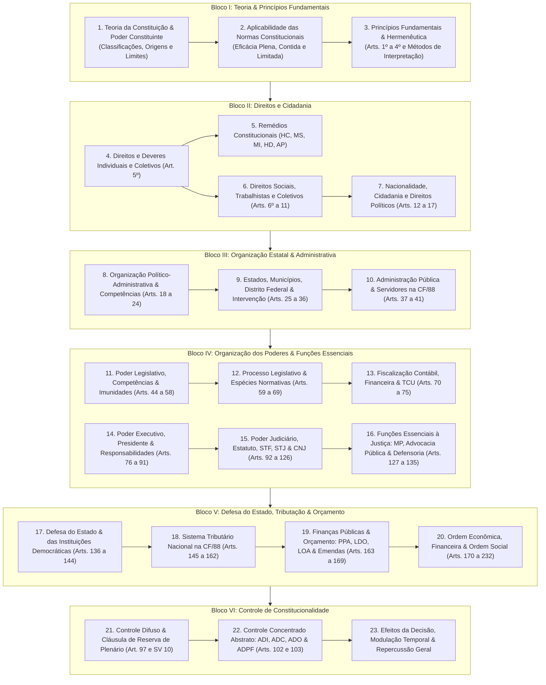

# ⚖️ Direito Constitucional

> **Escopo Temático:** Teoria da Constituição e Poder Constituinte, Direitos e Garantias Fundamentais, Organização Político-Administrativa do Estado, Organização dos Poderes (Executivo, Legislativo e Judiciário), Funções Essenciais à Justiça, Defesa do Estado, Tributação, Orçamento e Controle de Constitucionalidade.
> **Foco de Carreira:** Auditor Fiscal da Receita Federal do Brasil (AFRFB), Analista Tributário (ATRFB), SEFAZ, Tribunais de Contas (TCU/TCEs) e Controladorias (CGU).

---

## 🗺️ Arquitetura Sistêmica da Disciplina

---

## 📑 Matriz Oficial de Verbetes e Tratados de Estudo

### Eixo 01: Teoria da Constituição e Princípios Fundamentais
| Arquivo | Tópicos Principais e Normas Primárias | Bancas-Alvo | Relevância | Status |
| :--- | :--- | :---: | :---: | :---: |
| [`01-teoria-da-constituicao-e-poder-constituinte.md`](01-teoria-da-constituicao-e-principios-fundamentais/01-teoria-da-constituicao-e-poder-constituinte.md) | Conceito, sentidos sociológico (Lassalle), político (Schmitt) e jurídico (Kelsen); classificações; neoconstitucionalismo; poder constituinte originário, derivado (reformador, revisor, decorrente) e difuso. | FGV, Cebraspe, FCC | Crítica | 🟢 Concluído |
| [`02-aplicabilidade-e-eficacia-das-normas-constitucionais.md`](01-teoria-da-constituicao-e-principios-fundamentais/02-aplicabilidade-e-eficacia-das-normas-constitucionais.md) | Classificação tripartite de José Afonso da Silva: normas de eficácia plena, contida e limitada (princípio institutivo e programáticas); normas de eficácia exaurida. | FGV, Cebraspe, FCC | Altíssima | 🟢 Concluído |
| [`03-principios-fundamentais-e-hermeneutica-constitucional.md`](01-teoria-da-constituicao-e-principios-fundamentais/03-principios-fundamentais-e-hermeneutica-constitucional.md) | Arts. 1º a 4º da CF/88; fundamentos, objetivos fundamentais e princípios das relações internacionais; métodos de interpretação constitucional e princípios hermenêuticos. | FGV, Cebraspe | Alta | 🟢 Concluído |

### Eixo 02: Direitos e Garantias Fundamentais
| Arquivo | Tópicos Principais e Normas Primárias | Bancas-Alvo | Relevância | Status |
| :--- | :--- | :---: | :---: | :---: |
| [`01-direitos-e-deveres-individuais-e-coletivos-art-5.md`](02-direitos-e-garantias-fundamentais/01-direitos-e-deveres-individuais-e-coletivos-art-5.md) | Teoria geral dos direitos fundamentais; gerações/dimensões; destinatários; inviolabilidade do domicílio, sigilo fiscal/bancário/telefônico, tribunal do júri e devido processo legal. | FGV, Cebraspe, FCC | Crítica | 🟢 Concluído |
| [`02-remedios-constitucionais-e-garantias-processuais.md`](02-direitos-e-garantias-fundamentais/02-remedios-constitucionais-e-garantias-processuais.md) | Ações constitucionais em espécie: Habeas Corpus, Mandado de Segurança (individual e coletivo), Mandado de Injunção (Lei 13.300/16), Habeas Data e Ação Popular. | FGV, Cebraspe, FCC | Altíssima | 🟢 Concluído |
| [`03-direitos-sociais-trabalhistas-e-coletivos.md`](02-direitos-e-garantias-fundamentais/03-direitos-sociais-trabalhistas-e-coletivos.md) | Arts. 6º a 11 da CF/88; catálogo de direitos sociais; direitos dos trabalhadores urbanos e rurais; liberdade de associação sindical e direito de greve no serviço público. | FGV, FCC | Alta | 🟢 Concluído |
| [`04-nacionalidade-cidadania-e-direitos-politicos.md`](02-direitos-e-garantias-fundamentais/04-nacionalidade-cidadania-e-direitos-politicos.md) | Arts. 12 a 17 da CF/88; brasileiro nato vs. naturalizado; perda e reaquisição da nacionalidade (EC 131/2023); direitos políticos; inelegibilidades e partidos políticos. | FGV, Cebraspe | Altíssima | 🟢 Concluído |

### Eixo 03: Organização do Estado e Administração Pública
| Arquivo | Tópicos Principais e Normas Primárias | Bancas-Alvo | Relevância | Status |
| :--- | :--- | :---: | :---: | :---: |
| [`01-organizacao-politico-administrativa-e-competencias.md`](03-organizacao-do-estado-e-administracao-publica/01-organizacao-politico-administrativa-e-competencias.md) | Federação brasileira, forma de Estado; repartição constitucional de competências: privativas, exclusivas, comuns e concorrentes (arts. 21 a 24). | FGV, Cebraspe, FCC | Crítica | 🟢 Concluído |
| [`02-estados-municipios-distrito-federal-e-intervencao.md`](03-organizacao-do-estado-e-administracao-publica/02-estados-municipios-distrito-federal-e-intervencao.md) | Autonomia dos entes federativos; criação de Municípios; vedações federativas (art. 19); Intervenção Federal e Intervenção Estadual (arts. 34 a 36). | FGV, Cebraspe | Alta | 🟢 Concluído |
| [`03-administracao-publica-e-servidores-publicos-na-cf88.md`](03-organizacao-do-estado-e-administracao-publica/03-administracao-publica-e-servidores-publicos-na-cf88.md) | Arts. 37 a 41 da CF/88; princípios expressos (LIMPE) e implícitos; concurso público, teto remuneratório, acumulação de cargos, estabilidade e regime previdenciário. | FGV, Cebraspe, FCC | Crítica | 🟢 Concluído |

### Eixo 04: Organização dos Poderes e Funções Essenciais
| Arquivo | Tópicos Principais e Normas Primárias | Bancas-Alvo | Relevância | Status |
| :--- | :--- | :---: | :---: | :---: |
| [`01-poder-legislativo-competencias-e-imunidades.md`](04-organizacao-dos-poderes-e-funcoes-essenciais/01-poder-legislativo-competencias-e-imunidades.md) | Estrutura bicameral; competências exclusivas do CN, da Câmara e do Senado; estatuto dos congressistas: imunidades material e formal (art. 53); CPIs. | FGV, Cebraspe, FCC | Altíssima | 🟢 Concluído |
| [`02-processo-legislativo-e-especies-normativas.md`](04-organizacao-dos-poderes-e-funcoes-essenciais/02-processo-legislativo-e-especies-normativas.md) | Procedimento legislativo ordinário, sumário e especial; Emendas Constitucionais (iniciativa, limites materiais e cláusulas pétreas); Medidas Provisórias (art. 62). | FGV, Cebraspe, FCC | Crítica | 🟢 Concluído |
| [`03-fiscalizacao-contabil-financeira-e-tcu.md`](04-organizacao-dos-poderes-e-funcoes-essenciais/03-fiscalizacao-contabil-financeira-e-tcu.md) | Controle externo exercido pelo Congresso com auxílio do TCU (arts. 70 a 75); competências judicantes vs. opinativas; eficácia de título executivo (art. 71, § 3º). | FGV, Cebraspe | Crítica | 🟢 Concluído |
| [`04-poder-executivo-presidente-e-responsabilidades.md`](04-organizacao-dos-poderes-e-funcoes-essenciais/04-poder-executivo-presidente-e-responsabilidades.md) | Presidencialismo brasileiro; atribuições privativas do Presidente (art. 84); crimes comuns vs. crimes de responsabilidade; processo de impeachment; Ministros de Estado. | FGV, FCC | Alta | 🟢 Concluído |
| [`05-poder-judiciario-estatuto-stf-stj-e-cnj.md`](04-organizacao-dos-poderes-e-funcoes-essenciais/05-poder-judiciario-estatuto-stf-stj-e-cnj.md) | Órgãos do Poder Judiciário; garantias e vedações da magistratura; Quinto Constitucional; competências originárias e recursais do STF e STJ; regime de precatórios. | FGV, Cebraspe | Altíssima | 🟢 Concluído |
| [`06-funcoes-essenciais-a-justica-mp-advocacia-e-defensoria.md`](04-organizacao-dos-poderes-e-funcoes-essenciais/06-funcoes-essenciais-a-justica-mp-advocacia-e-defensoria.md) | Ministério Público (autonomia, garantias, vedações, CNMP); Advocacia Pública (AGU, PGFN e Procuradorias); Defensoria Pública. | FGV, Cebraspe | Alta | 🟢 Concluído |

### Eixo 05: Defesa do Estado, Tributação e Orçamento
| Arquivo | Tópicos Principais e Normas Primárias | Bancas-Alvo | Relevância | Status |
| :--- | :--- | :---: | :---: | :---: |
| [`01-defesa-do-estado-e-das-instituicoes-democraticas.md`](05-defesa-do-estado-tributacao-e-orcamento/01-defesa-do-estado-e-das-instituicoes-democraticas.md) | Estado de Defesa e Estado de Sítio (requisitos, decretação, controles parlamentares); Forças Armadas; Segurança Pública (art. 144 da CF/88). | FGV, Cebraspe | Média | 🟢 Concluído |
| [`02-sistema-tributario-nacional-principios-e-imunidades.md`](05-defesa-do-estado-tributacao-e-orcamento/02-sistema-tributario-nacional-principios-e-imunidades.md) | Competência tributária na CF/88; princípios constitucionais tributários (legalidade, anterioridade, irretroatividade); imunidades tributárias genéricas e específicas (EC 132/23). | FGV, Cebraspe, FCC | Crítica | 🟢 Concluído |
| [`03-financas-publicas-orcamento-ppa-ldo-loa-e-emendas.md`](05-defesa-do-estado-tributacao-e-orcamento/03-financas-publicas-orcamento-ppa-ldo-loa-e-emendas.md) | Arts. 163 a 169 da CF/88; princípios orçamentários; leis orçamentárias (PPA, LDO e LOA); emendas impositivas parlamentares; vedações orçamentárias (regra de ouro). | FGV, Cebraspe, FCC | Crítica | 🟢 Concluído |
| [`04-ordem-economica-financeira-e-ordem-social.md`](05-defesa-do-estado-tributacao-e-orcamento/04-ordem-economica-financeira-e-ordem-social.md) | Princípios gerais da atividade econômica (art. 170); intervenção do Estado no domínio econômico; monopólios estatais; seguridade social (saúde, previdência e assistência). | FGV, FCC | Alta | 🟢 Concluído |

### Eixo 06: Controle de Constitucionalidade
| Arquivo | Tópicos Principais e Normas Primárias | Bancas-Alvo | Relevância | Status |
| :--- | :--- | :---: | :---: | :---: |
| [`01-controle-difuso-e-reserva-de-plenario.md`](06-controle-de-constitucionalidade/01-controle-difuso-e-reserva-de-plenario.md) | Sistema difuso/concreto incidental; legitimidade; cláusula de reserva de plenário (art. 97 e SV 10); papel do Senado Federal (art. 52, X); mutação constitucional e repercussão geral. | FGV, Cebraspe, FCC | Crítica | ⚪ Planejado |
| [`02-controle-concentrado-abstrato-adi-adc-ado-e-adpf.md`](06-controle-de-constitucionalidade/02-controle-concentrado-abstrato-adi-adc-ado-e-adpf.md) | Ações do controle abstrato perante o STF: ADI, ADC, ADO e ADPF; rol de legitimados do art. 103 (universais vs. especiais/pertinência temática); parâmetro de controle e bloco de constitucionalidade. | FGV, Cebraspe, FCC | Crítica | ⚪ Planejado |
| [`03-efeitos-da-decisao-e-modulacao-temporal.md`](06-controle-de-constitucionalidade/03-efeitos-da-decisao-e-modulacao-temporal.md) | Eficácia *erga omnes*, efeito vinculante e natureza *ex tunc* vs. *ex nunc*; modulação temporal de efeitos (quórum qualificado de 2/3); coisa julgada inconstitucional e transcendência dos motivos determinantes. | FGV, Cebraspe, FCC | Altíssima | ⚪ Planejado |

---

[⬅️ Voltar para o Portal Principal](../../README.md)
