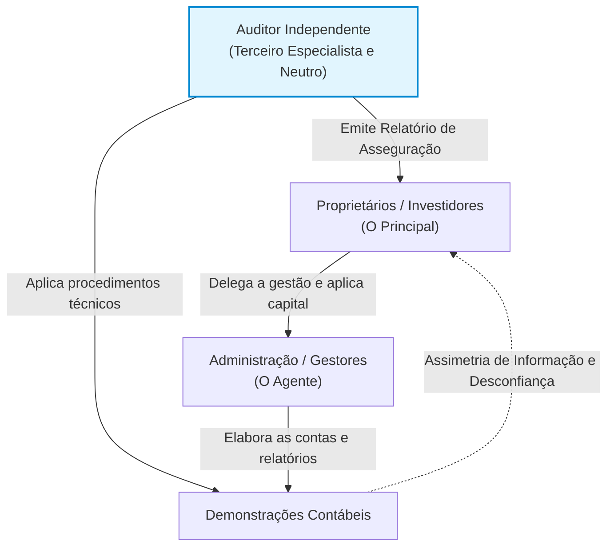
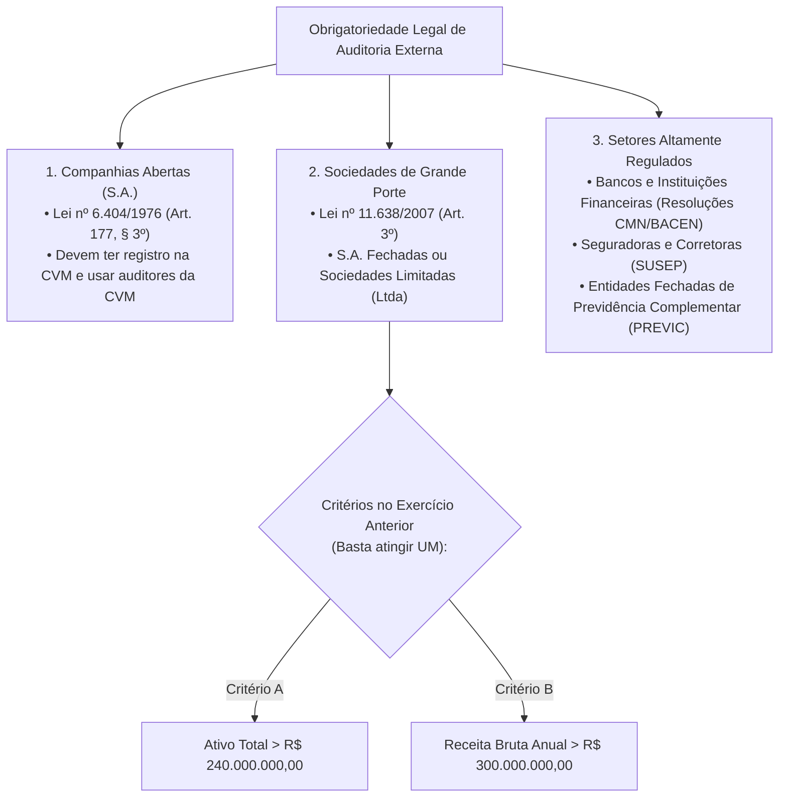
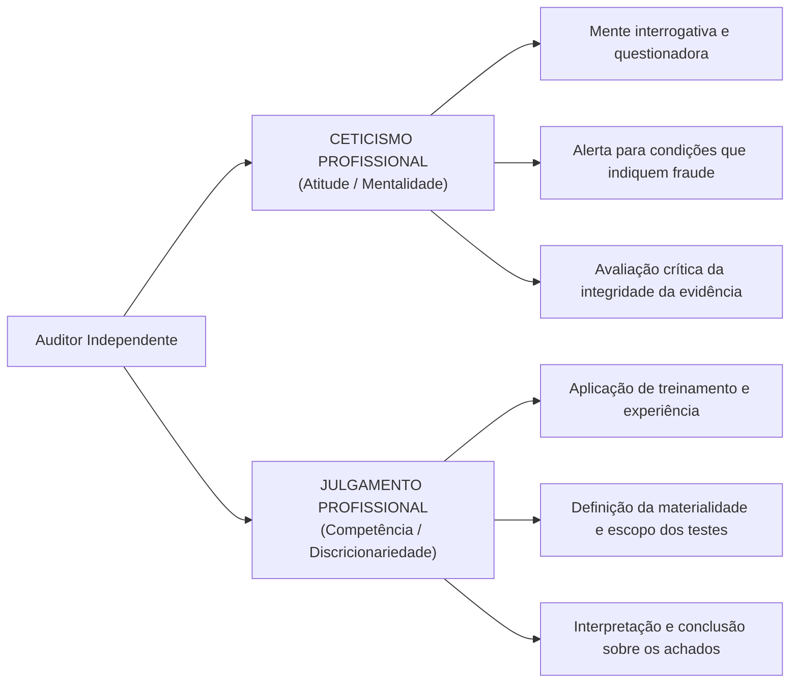
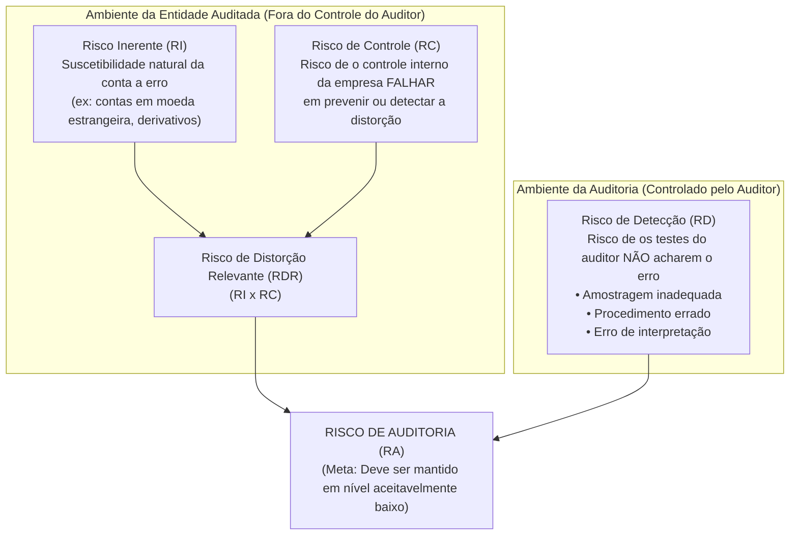

# Módulo 00: Teoria Geral da Auditoria, Classificações e a NBC TA 200 (R1)

> **BLUF (Bottom Line Up Front):**  
> A Auditoria é uma disciplina técnica de confrontação sistemática entre uma **condição real** (fatos, atos de gestão, demonstrações contábeis) e um **critério pré-estabelecido** (leis, normas contábeis, padrões operacionais), culminando na emissão de um relatório formal. No campo das demonstrações contábeis, a norma matriz é a **NBC TA 200 (R1)** (convergente com a ISA 200 da IFAC). Seu objetivo exclusivo é **aumentar o grau de confiança dos usuários previstos nas Demonstrações Contábeis (DC)** por meio da expressão de uma opinião técnica fundamentada em **asseguração razoável** (segurança de nível elevado, mas **NÃO absoluta**). O auditor independente **não** garante a viabilidade futura da entidade, **não** atesta a eficiência da gestão e **não** tem como objetivo primário a detecção ou prevenção de fraudes (responsabilidade primária da governança corporativa).

---

## 1. Evolução Histórica e Fundamentos Epistemológicos da Auditoria

A palavra *auditoria* tem raiz no latim *audire* (ouvir), remontando à prática dos magistrados romanos que ouviam os prestadores de contas públicas. Com a Revolução Industrial e o surgimento das grandes corporações no Reino Unido e Estados Unidos, ocorreu o fenômeno da **separação entre a propriedade do capital (acionistas/investidores) e a gestão executiva (diretores/administradores)**.

Essa separação gerou o clássico **Conflito de Agência (*Agency Theory*)**:
- **Principal (Proprietário/Acionista):** Deseja o crescimento sustentável do patrimônio e a maximização do retorno sobre o investimento.
- **Agente (Gestor/Administrador):** Possui incentivos próprios (bônus de curto prazo, status, manutenção do emprego) e pode ter a tentação de manipular as demonstrações financeiras para aparentar melhor desempenho (*earnings management*).

> [!NOTE]
> **A Função Econômica da Auditoria:** Reduzir a **assimetria de informação** entre a administração e os agentes de mercado, diminuindo o custo de capital da entidade e conferindo credibilidade ao mercado financeiro.

---

## 2. Taxonomia Canônica: As Classificações da Auditoria

Em provas de alto nível, os examinadores exploram as fronteiras conceituais entre as diferentes espécies de auditoria. Analisemos cada vetor classificatório:

### 2.1. Quanto ao Sujeito que Executa (Auditoria Interna vs. Externa)

| Vetor de Análise | Auditoria Interna (NBC TI 01) | Auditoria Externa / Independente (NBC TA 200) |
| :--- | :--- | :--- |
| **Vínculo Empregatício** | É empregado celetista ou estatutário da própria entidade (ou terceirizado subordinado). | Profissional autônomo ou sociedade de auditoria sem qualquer subordinação hierárquica. |
| **Destinatário do Trabalho** | A própria administração, Conselho de Administração ou Comitê de Auditoria. | Usuários externos previstos (acionistas minoritários, bancos, Fisco, CVM, sociedade). |
| **Finalidade Primária** | Avaliar a eficácia dos controles internos, mitigar riscos operacionais e sugerir melhorias na governança. | Emitir uma opinião formal sobre a fidedignidade das demonstrações contábeis em todos os aspectos relevantes. |
| **Objeto de Exame** | Todos os processos operacionais, sistemas de controle, contratos, segurança da informação e conformidade. | Especificamente os registros contábeis e as demonstrações contábeis históricas da entidade. |
| **Grau de Independência** | **Independência relativa:** Não pode auditar suas próprias rotinas operacionais, mas é subordinado à cúpula da entidade. | **Independência ampla e absoluta:** Não pode possuir interesses financeiros, comerciais ou de parentesco com a auditada. |
| **Periodicidade** | Ação contínua, permanente e integrada à rotina diária da organização. | Ação periódica, pontual (geralmente coincidente com o encerramento do exercício social). |
| **Responsabilidade Legal** | Restrita aos limites do contrato de trabalho e ao estatuto interno da empresa. | Ampla: responde civilmente (perante terceiros), administrativamente (CVM/CFC) e penalmente por dolo ou negligência. |

---

### 2.2. Quanto à Natureza da Entidade Auditada (Setor Privado vs. Setor Público)

1. **Auditoria no Setor Privado:** Foco na salvaguarda de ativos patrimoniais, maximização do lucro, conformidade com a legislação societária (Lei 6.404/76) e pronunciamentos técnicos (CPC).
2. **Auditoria Governamental / Pública:** Exerce o controle da gestão pública, disciplinada pelas normas **NBASP (Normas Brasileiras de Auditoria do Setor Público)**, editadas pelo Instituto Rui Barbosa (IRB) em convergência com as normas internacionais **ISSAI (INTOSAI)**:
   * **Auditoria Financeira:** Assemelha-se à auditoria externa privada, avaliando se as demonstrações contábeis do ente público foram elaboradas de acordo com as normas contábeis públicas (NBC TSP / MCASP).
   * **Auditoria de Conformidade:** Verifica se as ações, operações orçamentárias e atos administrativos estão em estrita conformidade com as leis e regulamentos vigentes (princípio da legalidade estrita).
   * **Auditoria Operacional (de Desempenho):** Avalia a governança, eficiência, eficácia, efetividade e economicidade dos programas e políticas públicas (os chamados 5 Es da gestão pública).

---

### 2.3. Quanto à Obrigatoriedade Legal no Brasil

No Brasil, a regra geral é que a contratação de auditoria independente é uma decisão voluntária dos sócios. Contudo, **leis federais específicas tornam a auditoria externa compulsória** para determinados entes:

> [!IMPORTANT]
> **Atenção Cirúrgica à Lei nº 11.638/2007:**
> O artigo 3º considera de grande porte a sociedade (ou conjunto de sociedades sob controle comum) que tiver, no exercício social anterior:
> - **Ativo total superior a R\$ 240 milhões**; **OU**
> - **Receita bruta anual superior a R\$ 300 milhões**.
> *Pegadinha das Bancas:* As bancas adoram afirmar que são necessários ambos os requisitos, ou que sociedades limitadas (Ltda) estão dispensadas. **ERRADO.** O requisito é **alternativo (OU)** e aplica-se às **Limitadas** indistintamente!

---

## 3. A Estrutura Normativa Brasileira: A NBC TA 200 (R1) em Detalhes

O Conselho Federal de Contabilidade (CFC), em cooperação com o IBRACON, estabeleceu as **Normas Brasileiras de Contabilidade Técnicas de Auditoria (NBC TA)**, traduzindo integralmente os padrões emitidos pela IFAC (*International Federation of Accountants*).

### 3.1. Objetivo Geral do Auditor Independente (NBC TA 200, item 11)
Ao conduzir a auditoria de demonstrações contábeis, os objetivos gerais do auditor são:
1. **Obter segurança razoável** de que as demonstrações contábeis como um todo estão livres de distorção relevante, independentemente se causadas por **fraude** ou por **erro**, possibilitando assim que o auditor expresse uma opinião sobre se as demonstrações contábeis foram elaboradas, em todos os aspectos relevantes, em conformidade com a estrutura de relatório financeiro aplicável; e
2. **Apresentar relatório** sobre as demonstrações contábeis e comunicar-se como exigido pelas NBC TAs, em conformidade com as suas constatações.

### 3.2. O que NÃO É Objetivo da Auditoria (As Fronteiras do Trabalho)

A própria NBC TA 200 faz questão de delimitar o que não está incluído no escopo de um trabalho de auditoria independente:

| Não é Objetivo do Auditor Independente | Racionalidade Técnica da Norma |
| :--- | :--- |
| **Garantir a viabilidade futura da entidade** | A auditoria avalia demonstrações históricas de um exercício findo. Uma empresa auditada sem ressalvas pode quebrar nos meses seguintes devido a choques macroeconômicos ou concorrência. |
| **Atestar a eficiência da administração** | O auditor não julga o mérito comercial das decisões dos administradores, mas sim se as operações foram adequadamente registradas. |
| **Prevenir ou detectar fraudes como função primária** | A responsabilidade primária pela salvaguarda do patrimônio e controle antifraude é da **Administração e dos Responsáveis pela Governança**. |
| **Elaborar ou retificar Demonstrações Contábeis** | A elaboração é privativa da entidade. Se o auditor fizer lançamentos ou ajustar contas por conta própria, ele perderá a independência ao auditar o seu próprio trabalho. |

---

## 4. Postura e Conduta Profissional: Os Dois Pilares da NBC TA 200

### 4.1. Ceticismo Profissional (NBC TA 200, item 13-l)
> *"É a postura que inclui uma mente questionadora, o estar alerta para condições que possam indicar possível distorção devida a erro ou fraude e uma avaliação crítica das evidências de auditoria."*

O ceticismo profissional exige que o auditor fique especialmente vigilante a:
* Evidências de auditoria que contradigam outras evidências obtidas;
* Informações que coloquem em dúvida a confiabilidade de documentos e respostas a indagações;
* Condições que possam indicar a possibilidade de fraude;
* Circunstâncias que sugiram a necessidade de procedimentos adicionais aos exigidos pelas normas.

> [!WARNING]
> **Ceticismo Não É Presunção de Má-Fé:** O auditor não presume que a administração seja desonesta, mas também não aceita uma declaração oral ou escrita da gerência como evidência suficiente sem corroborá-la com testes documentais e físicos.

### 4.2. Julgamento Profissional (NBC TA 200, item 13-k)
> *"É a aplicação de treinamento, conhecimento e experiência relevantes, dentro do contexto fornecido pelas normas de auditoria, contábeis e éticas, na tomada de decisões informadas sobre os cursos de ação apropriados nas circunstâncias do trabalho de auditoria."*

O julgamento profissional é obrigatório, sobretudo, em:
1. Determinação da **materialidade** e dos limites de distorção aceitáveis;
2. Avaliação do risco de auditoria e concepção da **natureza, época e extensão** dos procedimentos;
3. Avaliação se foi obtida evidência de auditoria **suficiente e apropriada**;
4. Formação da opinião de auditoria com base nas evidências coletadas.

---

## 5. Asseguração Razoável e as Limitações Inerentes da Auditoria

A NBC TA 200 deixa claro que a auditoria independente proporciona **asseguração razoável**, que é um nível de segurança elevado, porém **não absoluto**. 

### Por que a segurança NÃO pode ser absoluta (100%)?
Porque a auditoria está sujeita a **Limitações Inerentes**:
1. **A Natureza das Demonstrações Financeiras:** Muitas contas contábeis dependem de julgamento e **estimativas subjetivas** (ex: provisão para créditos de liquidação duvidosa, depreciação, impairment), inexistindo uma medida de certeza matemática absoluta.
2. **A Natureza dos Procedimentos de Auditoria:** O auditor trabalha primordialmente por **amostragem**, e não examinando 100% das transações da empresa. Além disso, esquemas sofisticados de fraude (com falsificação de assinaturas e conluio entre diretores) são propositadamente desenhados para enganar qualquer auditor.
3. **Equilíbrio entre Custo e Benefício (Tempestividade):** Os usuários precisam das demonstrações em tempo hábil. Seria economicamente inviável e impraticável auditar toda e qualquer nota fiscal emitida ao longo de um ano.

---

## 6. A Dinâmica Matemática do Risco de Auditoria

O **Risco de Auditoria (RA)** é a probabilidade de o auditor emitir uma opinião inadequada (por exemplo, aprovar sem ressalvas demonstrações que contêm distorções relevantes).

$$\mathbf{RA = RDR \times RD}$$

$$\mathbf{RDR = RI \times RC}$$

Logo:

$$\mathbf{RA = (RI \times RC) \times RD}$$

### O Teorema da Relação Inversa entre RDR e RD

| Se a Entidade Auditada apresenta... | O Auditor é obrigado a dimensionar... | Ação Prática de Campo do Auditor |
| :--- | :--- | :--- |
| **Risco de Distorção Relevante ALTO** (Setor arriscado, controles internos frágeis ou inexistentes) | **Risco de Detecção BAIXO** | O auditor não pode aceitar risco de seus testes falharem. Deve **aumentar a amostra**, aplicar testes próximos à data do balanço e priorizar inspeção física/circularização. |
| **Risco de Distorção Relevante BAIXO** (Controles internos robustos, operações simples e auditadas há anos) | **Risco de Detecção MAIS ALTO** | O auditor pode aceitar um nível maior de tolerância em seus testes, reduzindo o tamanho das amostras e aplicando procedimentos mais sintéticos. |

> [!TIP]
> **Regra de Ouro para a Prova:** O auditor **NÃO altera nem manipula o Risco Inerente ou o Risco de Controle**. Ele apenas os **avalia** para, em seguida, **gerenciar o Risco de Detecção** (que é o único que está sob seu domínio).

---

## 7. Evidência de Auditoria: Suficiência vs. Adequação

Para fundamentar sua opinião, o auditor deve obter evidências que satisfaçam simultaneamente dois vetores independentes:

$$\text{Evidência Válida} = \text{Suficiência (Quantidade)} + \text{Adequação (Qualidade)}$$

* **Suficiência (Métrica Quantitativa):** Reflete o volume de evidências coletadas. A suficiência necessária é influenciada pela avaliação do auditor sobre os riscos de distorção (quanto maior o risco, maior a amostra necessária) e pela própria qualidade da evidência (quanto melhor a evidência, menor quantidade pode ser exigida).
* **Adequação / Apropriação (Métrica Qualitativa):** Reflete a **relevância** (relação lógica com o objetivo do teste) e a **confiabilidade** (origem e natureza do documento).

### Hierarquia da Confiabilidade das Evidências (Regras Doutrinárias Clássicas)
1. **Evidência Externa vs. Interna:** Evidências obtidas de terceiros externos independentes (ex: extrato bancário emitido pelo banco, circularização de advogados) são mais confiáveis do que documentos gerados internamente pela empresa.
2. **Controle Eficaz vs. Controle Ineficaz:** Evidências geradas internamente são mais confiáveis quando os controles internos relacionados são robustos.
3. **Evidência Direta vs. Indireta:** Evidências obtidas diretamente pelo auditor (ex: contagem física de estoques) são mais confiáveis do que informações obtidas por meio de indagações verbais aos funcionários.
4. **Documentos Originais vs. Cópias:** Documentos em suporte físico/digital original são mais confiáveis do que cópias ou digitalizações sujeitas a adulteração.

---

## 8. Matriz Anti-Pegadinha de Bancas (FGV, Cebraspe, FCC)

| Afirmação Típica de Concurso | Julgamento | Fundamentação Técnica e Pegadinha Desmontada |
| :--- | :---: | :--- |
| *"A auditoria externa assegura de modo absoluto a inexistência de fraudes nas demonstrações contábeis."* | **ERRADO** | A asseguração é **razoável** devido às limitações inerentes da auditoria (amostragem, subjetividade das estimativas e possibilidade de conluio). |
| *"Ao emitir parecer sem ressalvas, o auditor garante a viabilidade comercial e a solvência futura da entidade."* | **ERRADO** | A opinião foca exclusivamente no exercício financeiro encerrado e na conformidade com as normas contábeis, não sendo garantia de sucesso empresarial. |
| *"Identificada uma fraude material, é dever do auditor retificar imediatamente as demonstrações contábeis."* | **ERRADO** | O auditor **propõe e solicita** a retificação. A competência para alterar os relatórios financeiros é exclusiva da **Administração**. |
| *"O auditor independente deve atestar a eficácia e a economicidade das decisões da administração."* | **ERRADO** | Isso é escopo de **Auditoria Operacional**. A auditoria de demonstrações contábeis atesta fidedignidade de apresentação, não eficiência gerencial. |
| *"Se o Risco de Distorção Relevante (RDR) for considerado alto, o auditor deve elevar o seu Risco de Detecção para compensar."* | **ERRADO** | A relação é **inversa**: se o RDR é alto, o auditor deve **reduzir** o Risco de Detecção ao mínimo possível através de testes mais exaustivos. |
| *"Sociedade limitada com ativo de R$ 250 milhões não está sujeita à auditoria externa por não ser anônima."* | **ERRADO** | Pela Lei 11.638/07 (art. 3º), a condição de Sociedade de Grande Porte alcança qualquer sociedade (incluindo Ltda) com Ativo > 240 mi ou Receita > 300 mi. |

---

## 9. Mnemônicos & Âncoras de Memória

> [!TIP]
> **Mnemônico: Os 5 Princípios Éticos Fundamentais do Auditor (NBC PA 01 / NBC PG 100)**  
> **`I-O-C-C-C`**  
> - **I** - **I**ntegridade: Ser direto, honesto e verdadeiro em todas as relações profissionais.  
> - **O** - **O**bjetividade: Não comprometer julgamentos por conflito de interesses ou viés.  
> - **C** - **C**ompetência e Devido Zelo: Manter conhecimento técnico atualizado e agir com diligência.  
> - **C** - **C**onfidencialidade: Guardar sigilo total sobre as informações obtidas no trabalho.  
> - **C** - **C**omportamento Profissional: Cumprir as leis e abster-se de condutas que desabonem a profissão.

> [!TIP]
> **Mnemônico: Requisitos da Grande Porte (Lei 11.638/07)**  
> **`A-240 / R-300`** (Basta um!)  
> - **A**tivo > **240** milhões  
> - **R**eceita > **300** milhões  

---

## 10. Questões Paradigmáticas de Prova Comentadas

### Questão 01 (FGV - Câmara dos Deputados - Analista Legislativo - 2023)
**Enunciado:**  
A NBC TA 200 (R1) dispõe sobre os objetivos gerais do auditor independente e a condução da auditoria em conformidade com as normas. Em relação aos objetivos do auditor e às limitações inerentes ao seu trabalho, assinale a afirmativa correta:
- (A) O auditor obtém segurança absoluta de que as demonstrações contábeis estão livres de distorções relevantes causadas por fraude ou erro.
- (B) A opinião do auditor assegura a viabilidade futura da entidade bem como a eficácia e eficiência com a qual a administração conduziu os negócios.
- (C) As limitações inerentes de uma auditoria decorrem, entre outros fatores, da natureza dos relatórios financeiros e da natureza dos procedimentos de auditoria.
- (D) O ceticismo profissional dispensa o auditor de obter evidências de auditoria persuasivas quando a integridade da administração não for questionada.
- (E) O julgamento profissional não é exigido na avaliação da suficiência e adequação das evidências de auditoria obtidas.

**Gabarito Oficial:** **C**  
**Comentário Analítico:**  
- **A está incorreta:** A segurança obtida é **razoável**, nunca absoluta (NBC TA 200, item 5).
- **B está incorreta:** A opinião sobre as demonstrações financeiras não assegura a viabilidade futura nem a eficiência da administração (NBC TA 200, item A1).
- **C está CORRETA:** As limitações inerentes à auditoria originam-se da natureza do processo contábil (estimativas subjetivas), da natureza dos procedimentos de auditoria (amostragem, risco de conluio) e da necessidade de tempestividade e equilíbrio custo/benefício (NBC TA 200, itens A45 a A52).
- **D está incorreta:** O ceticismo profissional é permanente; o fato de a administração parecer íntegra não dispensa o auditor de obter evidências que sustentem a opinião (NBC TA 200, item A22).
- **E está incorreta:** O julgamento profissional é elementar e compulsório para avaliar se a evidência é suficiente e apropriada (NBC TA 200, item A26).

---

### Questão 02 (FGV - SEFAZ-MT - Auditor Fiscal de Tributos Estaduais - 2023)
**Enunciado:**  
Sobre a relação entre os componentes do risco de auditoria definidos na NBC TA 200, considere que o auditor avaliou que a empresa sob análise possui um ambiente operacional altamente complexo, com operações em moeda estrangeira não protegidas e controles internos precários.  
Nessas circunstâncias, para manter o risco de auditoria em um nível aceitavelmente baixo, o auditor deve:
- (A) Reduzir o risco inerente por meio de testes adicionais de observância.
- (B) Estabelecer um nível mais baixo de risco de detecção, aumentando a extensão dos testes substantivos.
- (C) Solicitar que a administração altere o seu risco de controle antes de dar continuidade ao trabalho.
- (D) Aumentar o risco de detecção, visto que o risco de distorção relevante já é elevado.
- (E) Dispensar a execução de testes substantivos, focando em testes de conformidade.

**Gabarito Oficial:** **B**  
**Comentário Analítico:**  
- A complexidade do ambiente e operações em moeda estrangeira elevam o **Risco Inerente (RI)**.
- Os controles internos precários elevam o **Risco de Controle (RC)**.
- O produto desses dois fatores resulta em um **Risco de Distorção Relevante (RDR) muito ALTO**.
- Como $RA = RDR \times RD$ e a meta normativa é manter o Risco de Auditoria ($RA$) em nível baixo, o auditor tem o dever técnico de **REDUZIR o Risco de Detecção (RD)**.
- Para reduzir o Risco de Detecção a um nível baixo, o auditor deve intensificar a auditoria: aplicar **mais testes substantivos**, aumentar o tamanho da amostra e obter evidências com fontes externas. Portanto, alternativa B.

---

### Questão 03 (Cebraspe - SEFAZ-SE - Auditor Fiscal de Tributos)
**Enunciado:**  
À luz da Lei nº 11.638/2007 e das normas do Conselho Federal de Contabilidade, julgue o item a seguir:  
*Uma sociedade empresária constituída sob a forma de sociedade limitada que tenha apresentado, no exercício social anterior, ativo total de R$ 260 milhões e receita bruta anual de R$ 180 milhões não é considerada de grande porte e, por consequência, está dispensada de submeter suas demonstrações contábeis a auditoria independente.*

**Gabarito Oficial:** **ERRADO**  
**Comentário Analítico:**  
A Lei nº 11.638/2007, em seu Artigo 3º, parágrafo único, estipula que a condição de Sociedade de Grande Porte é atribuída à entidade que apresentar ativo total superior a R\$ 240 milhões **OU** receita bruta anual superior a R\$ 300 milhões. Como a sociedade em tela apresentou ativo total de R\$ 260 milhões (portanto, superior a R\$ 240 milhões), ela é **obrigatoriamente uma sociedade de grande porte**, mesmo sendo do tipo Limitada e mesmo que sua receita bruta tenha ficado abaixo de R\$ 300 milhões. Dessa forma, ela **está obrigada** à auditoria independente por auditor registrado na CVM. O item está incorreto.

---

## 11. Links e Conexões Temáticas

- 🔗 [Módulo 01: Auditoria Interna (NBC TI 01 e NBC PI 01)](01-auditoria-interna-nbc-ti-01.md)
- 🔗 [Módulo 02: Planejamento de Auditoria (NBC TA 300) e Documentação (NBC TA 230)](02-planejamento-documentacao-nbc-ta-300-230.md)
- 🔗 [Módulo 05: Materialidade e Fraude (NBC TA 320 e 240)](05-materialidade-risco-fraude-nbc-ta-320-240.md)
