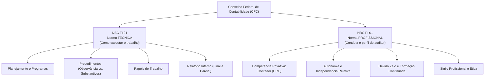
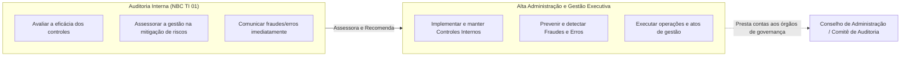
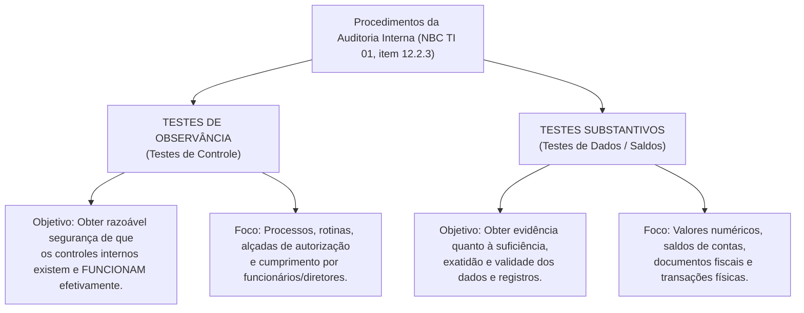
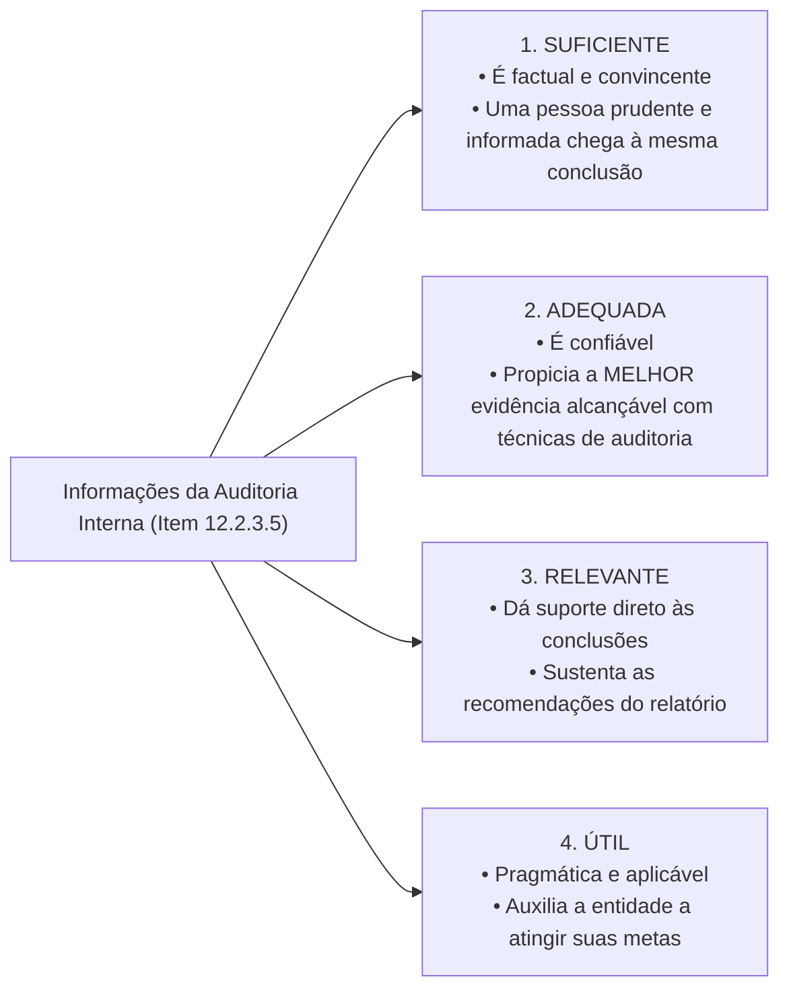

# Módulo 01: Auditoria Interna (NBC TI 01 e NBC PI 01)

> **BLUF (Bottom Line Up Front):**  
> A Auditoria Interna é uma **atividade de avaliação independente e de assessoramento à administração**, estruturada dentro da entidade, com a missão de **fortalecer os controles internos, mitigar riscos e aperfeiçoar os processos de governança**. Regulamentada pelo CFC por meio da **NBC TI 01** (aspectos técnicos) e da **NBC PI 01** (aspectos profissionais), sua execução é de **competência privativa de Contador habilitado e registrado no CRC**. Ao contrário do auditor independente (que visa emitir opinião para o público externo), o auditor interno **não opina sobre as demonstrações contábeis perante terceiros**, mas emite relatórios internos contendo **recomendações preventivas e corretivas** para a alta administração.

---

## 1. Fundamentação Normativa e Competência Legal

No Brasil, a regulamentação do Conselho Federal de Contabilidade divide a atuação do Auditor Interno em duas normas complementares:
- **NBC TI 01:** Estabelece os conceitos, objetivos, procedimentos técnicos, papéis de trabalho, planejamento e elaboração do relatório da auditoria interna.
- **NBC PI 01:** Fixa as normas profissionais, independência moral e técnica, competência, sigilo, zelo e controle de qualidade do auditor interno.

> [!IMPORTANT]
> **Competência Exclusiva de Contador (NBC TI 01, item 12.1.1.2):**  
> *"A auditoria interna é de competência exclusiva de contador, devidamente registrado em Conselho Regional de Contabilidade (CRC)."*  
> *Atenção de Prova:* Embora no serviço público existam cargos de controle interno com formações multidisciplinares, **para os efeitos das normas do CFC (NBC TI 01), a auditoria interna é privativa de Contador**.

---

## 2. A Função de Assessoramento e a Responsabilidade sobre Fraudes e Erros

A relação entre a Auditoria Interna e a governança corporativa é pautada pelo binômio **Assessoramento vs. Execução**.

### 2.1. Definições Oficiais de Fraude e Erro (Item 12.1.3)
A norma faz distinção ontológica rigorosa baseada no elemento subjetivo (**intenção**):

* **Fraude (Ato Intencional):** É o ato intencional de omissão ou manipulação de transações, adulteração ou falsificação de documentos, registros, relatórios e demonstrações financeiras. Caracteriza-se pelo dolo, má-fé, ocultação ou desvio de ativos.
* **Erro (Ato Não-Intencional):** É o ato não-intencional resultante de omissão, desatenção, desconhecimento ou má interpretação de fatos, leis ou normas na elaboração de registros e demonstrações. Caracteriza-se pela culpa (negligência, imprudência ou imperícia).

> [!WARNING]
> **Papel da Auditoria Interna em Relação a Fraudes:**  
> A Auditoria Interna **não tem como objetivo primário caçar fraudes**, nem pode ser responsabilizada pela sua ocorrência na empresa. Sua função é **assessorar a administração no trabalho de prevenção e identificação**. Caso tome conhecimento de indícios de fraude ou erro durante seus testes, deve **comunicar o fato de forma imediata e confidencial à administração**.

---

## 3. Planejamento da Auditoria Interna e Análise de Riscos

O planejamento da auditoria interna deve abranger todas as áreas da entidade ao longo do tempo (plano plurianual/anual), considerando os fatores relevantes da organização.

### 3.1. Requisitos Obrigatórios do Planejamento (Item 12.2.1)
O planejamento deve documentar:
1. O conhecimento detalhado das atividades da entidade (ambiente de negócios e contexto regulatório);
2. A política e os objetivos estratégicos da organização;
3. O volume de transações, a complexidade das operações e a dispersão geográfica das filiais;
4. O uso de processamento eletrônico de dados (TI);
5. O histórico de deficiências de controle e os apontamentos de auditorias anteriores.

### 3.2. Análise de Riscos (Item 12.2.2)
> *"A análise dos riscos da Auditoria Interna deve ser feita na fase de **planejamento** dos trabalhos."*

A análise de riscos deve considerar:
* A **probabilidade** da ocorrência de eventos desfavoráveis;
* O **impacto (gravidade)** econômico, financeiro, operacional e de imagem sobre a entidade;
* A eficácia demonstrada pelo desenho dos controles internos já existentes.

---

## 4. Procedimentos de Auditoria Interna: Observância vs. Substantivos

Para fundamentar seus relatórios, o auditor interno executa procedimentos de investigação classificados em dois grandes grupos:

### Quadro Comparativo: Testes de Observância vs. Testes Substantivos

| Critério de Diferenciação | Testes de Observância (Controles) | Testes Substantivos (Dados e Valores) |
| :--- | :--- | :--- |
| **Finalidade Teórica** | Verificar se a norma/controle interno da empresa está sendo cumprido na prática. | Constatar se os números, saldos e registros contábeis estão corretos, exatos e válidos. |
| **Pergunta-Chave** | *"O procedimento de conferência e autorização foi seguido pelo funcionário?"* | *"O valor de R$ 500.000,00 registrado no balanço realmente existe e pertence à empresa?"* |
| **Exemplo Típico** | Verificar se todas as notas de compras possuem a assinatura de autorização do gerente de suprimentos antes do pagamento. | Conferir fisicamente os itens no almoxarifado (inventário) e confrontar a contagem física com o razão contábil. |
| **Falha Detectada** | Desvio de controle / quebra de conformidade de processo. | Distorção monetária (superavaliação ou subavaliação de ativos/passivos/resultados). |

---

## 5. As 4 Características da Informação na Auditoria Interna (Obrigatoriedade da NBC TI 01)

No processo de obtenção e avaliação de evidências, a **NBC TI 01 (item 12.2.3.5)** estabelece que as informações que fundamentam os resultados devem possuir **quatro atributos rigorosos**. Este é um dos temas de decoreba literal mais explorados pela FGV e FCC:

### A Matriz Mnemônica de Fixação:

| Atributo Normativo | Definição Literal Exata da Norma (NBC TI 01) | Palavra-Gatilho de Prova | Mnemônico |
| :--- | :--- | :--- | :---: |
| **Suficiente** | É **factual e convincente**, de tal forma que uma pessoa prudente e informada possa entendê-la da mesma forma que o auditor interno. | *Factual e Convincente* | **SU-FA-CO** |
| **Adequada** | Sendo **confiável**, propicia a **melhor evidência** alcançável, por meio do uso apropriado das técnicas de Auditoria Interna. | *Confiável e Melhor Evidência* | **A-ME** |
| **Relevante** | Dá suporte às **conclusões e às recomendações** da Auditoria Interna. | *Suporte a Conclusões* | **RE-CO** |
| **Útil** | Auxilia a entidade a **atingir as suas metas**. | *Atingir Metas* | **U-M** |

> [!WARNING]
> **Pegadinha da Informação "Tempestiva":**  
> As bancas adoram incluir a alternativa: *"A informação tempestiva é aquela que..."*. A **NBC TI 01 NÃO lista "tempestiva"** entre as quatro características essenciais das informações probatórias! Apenas: **Suficiente, Adequada, Relevante e Útil**.

---

## 6. Papéis de Trabalho na Auditoria Interna

Os papéis de trabalho (documentação de auditoria) constituem os documentos e registros dos fatos, argumentos e comprovações coletadas pelo auditor durante a execução dos serviços.

### 6.1. Regras Operacionais dos Papéis de Trabalho (Item 12.1.2)
1. **Completude e Clareza:** Devem ter abrangência e grau de detalhe suficientes para permitir que um auditor interno experiente, sem experiência prévia com o trabalho, compreenda os exames realizados, as evidências obtidas e as conclusões alcançadas.
2. **Propriedade:** Os papéis de trabalho são de **propriedade exclusiva da entidade**, ficando sob a custódia e guarda da Auditoria Interna.
3. **Confidencialidade e Sigilo:** Seu acesso é restrito; terceiros só podem examiná-los mediante autorização expressa da alta administração ou determinação judicial/legal.

---

## 7. O Relatório da Auditoria Interna

O relatório é o documento formal pelo qual a Auditoria Interna apresenta o resultado dos seus exames, contendo seus achados, conclusões e recomendações.

### 7.1. Estrutura Mínima Obrigatória (Item 12.3.1)
O relatório deve conter, no mínimo:
* O **objetivo e a extensão** dos trabalhos realizados;
* A metodologia e os procedimentos adotados;
* As **limitações de escopo** porventura encontradas (ex: recusa de departamento em fornecer documentos);
* Os **fatos constatados** e as evidências encontradas;
* As **conclusões** do auditor interno;
* As **recomendações** detalhadas e o cronograma de implementação sugerido para correção dos desvios.

### 7.2. Relatórios Parciais (Emissão Imediata)
> [!IMPORTANT]
> **Relatório Parcial da Auditoria Interna (Item 12.3.2):**  
> O auditor interno deve emitir relatório parcial quando constatar **impropriedades ou irregularidades graves** que exijam **medidas corretivas urgentes e imediatas** pela administração, não podendo aguardar o término completo dos demais exames para alertar a cúpula da entidade.

### 7.3. Destinatários do Relatório
O relatório é endereçado a:
* À administração da entidade (Diretoria Executiva);
* Aos membros do Conselho de Administração ou órgão de governança equivalente;
* Ao Comitê de Auditoria (se houver).
* *Atenção:* O relatório da auditoria interna **não é publicado nem distribuído ao mercado/sociedade** (ao contrário do parecer da auditoria externa).

---

## 8. Matriz Anti-Pegadinha de Bancas (FGV, Cebraspe, FCC)

| O que a Questão Afirma | Gabarito | Justificativa Técnica Oficial |
| :--- | :---: | :--- |
| *"A auditoria interna pode ser exercida por administrador, economista ou advogado com pós-graduação na área."* | **ERRADO** | Segundo a NBC TI 01 (item 12.1.1.2), a auditoria interna é de competência **exclusiva de Contador devidamente registrado no CRC**. |
| *"O objetivo da auditoria interna é emitir uma opinião formal sobre as demonstrações contábeis para o mercado."* | **ERRADO** | A auditoria interna visa **assessorar a administração**, avaliar controles e processos internos. Quem emite opinião externa para o mercado é a auditoria externa (NBC TA 200). |
| *"Constatado desvio grave no almoxarifado, o auditor interno deve aguardar a conclusão global do plano anual para emitir o relatório final."* | **ERRADO** | Havendo irregularidade grave que demande ação imediata, o auditor interno deve expedir **Relatório Parcial** imediatamente (NBC TI 01, item 12.3.2). |
| *"Os papéis de trabalho da auditoria interna pertencem ao contador que os produziu."* | **ERRADO** | Os papéis de trabalho são de **propriedade exclusiva da entidade**, ficando sob custódia da unidade de auditoria interna. |
| *"A análise dos riscos da auditoria interna deve ser feita primordialmente durante a execução dos testes em campo."* | **ERRADO** | Conforme o item 12.2.2.1, a análise de riscos deve ser realizada na **fase de planejamento** dos trabalhos. |

---

## 9. Mnemônicos & Âncoras de Memória

> [!TIP]
> **Mnemônico: As 4 Características da Informação Probatória**  
> **`AME - UM - SUFACO - RECO`**  
> - **A-ME:** **A**dequada = **M**elhor **E**vidência alcançável (confiável).  
> - **U-M:** **Ú**til = auxilia a atingir **M**etas da entidade.  
> - **SU-FA-CO:** **SU**ficiente = **FA**ctual e **CO**nvincente (pessoa prudente entende igual).  
> - **RE-CO:** **RE**levante = dá suporte às **CO**nclusões e recomendações.

---

## 10. Questões Paradigmáticas de Prova Comentadas

### Questão 01 (FGV - Assembleia Legislativa de Santa Catarina - 2024)
**Enunciado:**  
De acordo com a NBC TI 01 – Da Auditoria Interna, os testes substantivos visam à obtenção de evidência quanto à suficiência, exatidão e validade dos dados produzidos pelos sistemas de informação da entidade.  
No processo de obtenção de informações sobre os assuntos relacionados aos objetivos e ao alcance da Auditoria Interna, devem ser observadas as características da informação, à exceção de uma. Assinale-a:
- (A) A informação útil auxilia a entidade a atingir as suas metas.
- (B) A informação relevante dá suporte às conclusões e às recomendações da Auditoria Interna.
- (C) A informação tempestiva é conservadora e livre de erros materiais.
- (D) A informação suficiente é factual e convincente, de tal forma que uma pessoa prudente e informada possa entendê-la da mesma forma que o auditor interno.
- (E) A informação adequada, sendo confiável, propicia a melhor evidência alcançável, por meio do uso apropriado das técnicas de Auditoria Interna.

**Gabarito Oficial:** **C**  
**Comentário Analítico:**  
A NBC TI 01 (item 12.2.3.5) lista expressamente que as informações obtidas devem ser:
1. Suficiente (factual e convincente - letra D);
2. Adequada (confiável, propicia a melhor evidência - letra E);
3. Relevante (suporte às conclusões e recomendações - letra B);
4. Útil (auxilia a entidade a atingir metas - letra A).  
A norma **não inclui a tempestividade** em seu rol de características conceituais da informação probatória. Portanto, a afirmativa incorreta é a C.

---

### Questão 02 (Cebraspe - Telebras - Auditor Interno)
**Enunciado:**  
A respeito da atuação da auditoria interna e dos papéis de trabalho, julgue o item a seguir com base na NBC TI 01:  
*Caso a auditoria interna identifique a prática de atos ilícitos e indícios consistentes de fraude cometidos por colaboradores de média gerência, cumpre ao auditor interno aplicar advertência imediata aos envolvidos e efetuar os lançamentos de estorno necessários na contabilidade da empresa.*

**Gabarito Oficial:** **ERRADO**  
**Comentário Analítico:**  
A Auditoria Interna é órgão de **assessoramento e avaliação**, não exercendo atos de gestão operacional nem aplicando punições disciplinares (que são prerrogativas da Diretoria Executiva / RH). Além disso, o auditor **jamais deve efetuar lançamentos contábeis ou estornos**, sob pena de violar sua independência funcional. O dever estrito do auditor interno diante de fraude é documentar os achados com evidências suficientes e **comunicar o fato de forma reservada e imediata à administração**, para que esta tome as medidas cabíveis.

---

### Questão 03 (FCC - SEFAZ-PE - Auditor Fiscal do Tesouro Estadual)
**Enunciado:**  
Na execução de seus trabalhos, a Auditoria Interna realizou testes para verificar se os limites de concessão de crédito a clientes, estabelecidos pela diretoria em manual de procedimentos internos, estavam sendo rigorosamente respeitados pelos operadores do departamento comercial.  
Esse procedimento classifica-se tecnicamente como:
- (A) Teste de confirmação externa.
- (B) Teste substantivo de detalhes.
- (C) Teste de observância.
- (D) Procedimento analítico substantivo.
- (E) Exame de suficiência documental.

**Gabarito Oficial:** **C**  
**Comentário Analítico:**  
O teste descrito visa verificar se os funcionários estão cumprindo as normas e controles internos pré-estabelecidos pela entidade (limites de alçada de crédito). Conforme o item 12.2.3.2 da NBC TI 01, os procedimentos que buscam obter razoável segurança de que os controles internos estabelecidos pela administração estão em efetivo funcionamento e sendo cumpridos são denominados **Testes de Observância (ou Testes de Controle)**. Se o auditor estivesse conferindo o valor financeiro do saldo devedor do cliente no balanço, seria teste substantivo. Portanto, gabarito alternativa C.

---

## 11. Links e Conexões Temáticas

- 🔗 [Módulo 00: Teoria Geral da Auditoria e NBC TA 200](00-conceitos-iniciais-nbc-ta-200.md)
- 🔗 [Módulo 02: Planejamento de Auditoria e Documentação (NBC TA 300 e 230)](02-planejamento-documentacao-nbc-ta-300-230.md)
- 🔗 [Módulo 03: Procedimentos de Auditoria e Testes Substantivos (NBC TA 500)](03-procedimentos-testes-evidencias-nbc-ta-500-505-520.md)
- 🔗 [Módulo 11: Utilização do Trabalho da Auditoria Interna pelo Auditor Externo (NBC TA 610)](11-trabalho-outros-profissionais-nbc-ta-610-620.md)
