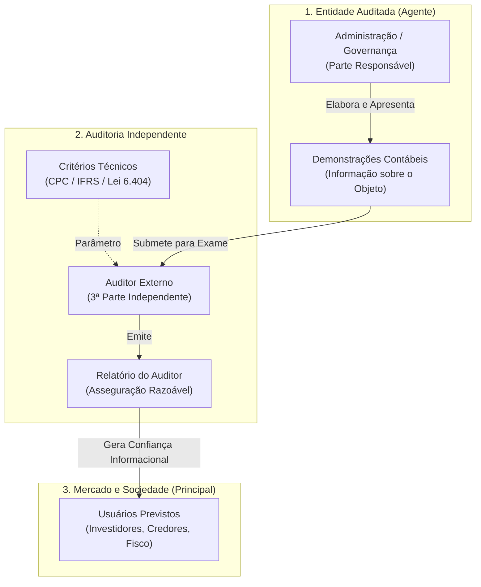
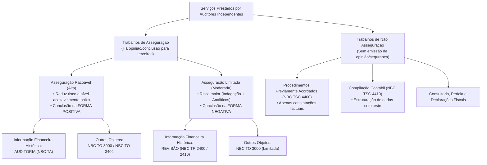
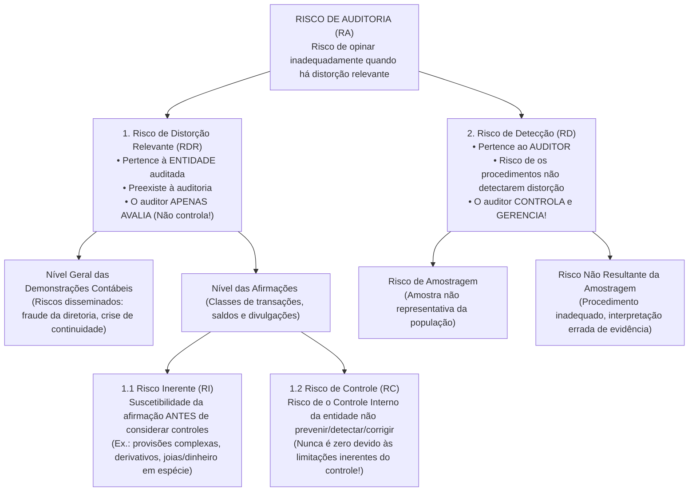

# 01. Estrutura Conceitual de Asseguração e Objetivos Gerais do Auditor Independente (NBC TA Estrutura Conceitual, NBC TO 3000 e NBC TA 200)

> **Resumo Executivo (BLUF):** A Auditoria Independente das Demonstrações Contábeis é uma espécie do gênero **Trabalho de Asseguração Razoável (Alta)**, cujo objetivo é aumentar o grau de confiança dos usuários previstos nas demonstrações financeiras mediante a expressão de uma opinião técnica sobre se elas foram elaboradas, em todos os aspectos relevantes, em conformidade com uma estrutura de relatório financeiro aplicável. Por força das **limitações inerentes da auditoria** (uso de testes seletivos, limitações do controle interno, natureza persuasiva e não conclusiva das evidências e julgamento subjetivo nas estimativas), o auditor **jamais fornece asseguração absoluta (100%)**, mas sim **asseguração razoável**, reduzindo o **Risco de Auditoria ($RA = RI \times RC \times RD$)** a um nível aceitavelmente baixo mediante o exercício contínuo de **ceticismo profissional** e **julgamento profissional**.

---

## 1. Gênese Econômica, Teoria da Agência e Taxonomia das Auditorias

### 1.1 Assimetria Informacional e Conflito de Agência
Na economia corporativa moderna, a separação entre a **propriedade do capital** (acionistas, investidores, credores, Estado) e o **controle da gestão** (administradores, diretores executivos) instaura o chamado **Conflito de Agência** (Jensen & Meckling, 1976).
* **O Agente (Administração):** Detém o monopólio operacional das informações internas da companhia e elabora as demonstrações contábeis que medem seu próprio desempenho (risco moral ou *moral hazard*, incentivos a bônus por metas de lucro, ocultação de endividamento).
* **O Principal (Usuários Externos):** Necessita de informações fidedignas para alocar capital, conceder crédito ou arrecadar tributos, mas sofre de **assimetria informacional**, não tendo acesso físico aos livros diários, estoques ou contratos internos da entidade.
* **O Papel Institucional da Auditoria Independente:** Atua como um mecanismo redutor do custo de agência e da assimetria informacional. Ao submeter as demonstrações preparadas pelo Agente ao escrutínio técnico de um terceiro independente dotado de fé pública contábil, restaura-se a confiança sistêmica do mercado de capitais.

---

### 1.2 Obrigatoriedade Legal de Auditoria Independente no Brasil
No ordenamento jurídico brasileiro, a submissão obrigatória das demonstrações financeiras à auditoria independente decorre de três pilares legais fundamentais:

1. **Companhias Abertas (Lei nº 6.404/1976, Art. 177, § 3º):**
   * As demonstrações financeiras das sociedades por ações de capital aberto (cujos valores mobiliários são admitidos à negociação na bolsa ou no mercado de balcão) serão **obrigatoriamente** auditadas por auditores independentes registrados na **Comissão de Valores Mobiliários (CVM)**.
2. **Sociedades de Grande Porte (Lei nº 11.638/2007, Art. 3º):**
   * Aplicam-se às sociedades de grande porte, **ainda que não constituídas sob a forma de sociedades por ações** (ex.: Sociedades Limitadas — LTDA), as disposições da Lei nº 6.404/1976 sobre escrituração e elaboração de demonstrações financeiras e a **obrigatoriedade de auditoria independente** por auditor registrado na CVM.
   * **Critério Legal de Grande Porte (Art. 3º, Parágrafo Único da Lei nº 11.638/2007):** Considera-se de grande porte a sociedade ou conjunto de sociedades sob controle comum que tiver, **no exercício social anterior**:
     * **Ativo Total superior a R\$ 240.000.000,00** (duzentos e quarenta milhões de reais); **OU**
     * **Receita Bruta Anual superior a R\$ 300.000.000,00** (trezentos milhões de reais).
3. **Entidades Reguladas por Órgãos Setoriais:**
   * Instituições financeiras e demais entidades autorizadas a funcionar pelo **Banco Central do Brasil (BACEN)**;
   * Sociedades seguradoras, de capitalização e entidades abertas de previdência complementar supervisionadas pela **SUSEP**;
   * Entidades fechadas de previdência complementar (Fundos de Pensão) supervisionadas pela **PREVIC**;
   * Operadoras de planos de assistência à saúde reguladas pela **ANS**.

> [!CAUTION]
> **Pegadinha Clássica de Prova (Lei nº 11.638/2007):**
> As bancas adoram trocar o conectivo lógico **"OU"** por **"E"** nos critérios de Sociedade de Grande Porte, ou inverter os valores (colocando R\$ 300 milhões para o Ativo e R\$ 240 milhões para a Receita).
> * **Mnemônico Alfabético e Crescente:**
>   * **A**tivo Total > **R\$ 240 milhões** (**A** vem antes de **R**; 240 é menor que 300).
>   * **R**eceita Bruta Anual > **R\$ 300 milhões** (**R** vem depois de **A**; 300 é maior que 240).
>   * Basta atingir **UM** dos dois limites no **exercício social anterior** (critério alternativo: **OU**).

---

### 1.3 Matriz Comparativa das Vertentes de Auditoria e Perícia
As provas de carreiras fiscais e de controle exigem a distinção cirúrgica entre **Auditoria Independente (Externa)**, **Auditoria Interna**, **Auditoria Governamental**, **Auditoria Fiscal Tributária** e **Perícia Contábil**:

| Atributo Estrutural | Auditoria Independente (Externa) | Auditoria Interna | Auditoria Governamental (Controle Externo/Interno) | Auditoria Fiscal Tributária | Perícia Contábil |
| :--- | :--- | :--- | :--- | :--- | :--- |
| **Norma de Regência** | NBC TA (CFC / IFAC) | NBC TI 01 e NBC PI 01 (CFC) / IPPF (IIA) | NBASP (IRB) / ISSAI (INTOSAI) / NAT (TCU) | CTN, Lei 9.430/96, RIR/2018, LC 105/01 | NBC TP 01 e NBC PP 01 / CPC |
| **Objetivo Central** | Emitir opinião sobre a adequação das demonstrações contábeis. | Assessorar a administração, testar controles internos e agregar valor à gestão. | Fiscalizar a legalidade, legitimidade, economicidade e desempenho da gestão pública. | Verificar o cumprimento de obrigações tributárias principais e acessórias e constituir o crédito tributário. | Produzir prova técnica (laudo/parecer) para subsidiar solução de litígio judicial ou arbitral. |
| **Vínculo com a Entidade** | Profissional/Firma externa contratada (**sem vínculo empregatício**). | Empregado do quadro da própria empresa ou terceirizado subordinado à alta administração. | Servidor público de carreira de Estado (Auditor de Controle / Conselheiro / Ministro). | Autoridade pública investida de poder de império (Auditor Fiscal da RFB, SEFAZ, ISS). | Auxiliar da Justiça nomeado pelo Juiz (Perito do Juízo) ou contratado pelas partes (Assistente Técnico). |
| **Grau de Independência** | **Absoluto** em relação à entidade auditada (de pensamento e de aparência). | **Relativo**: possui autonomia técnica/funcional, mas subordinação à alta administração/Conselho. | **Constitucional/Funcional** face ao órgão fiscalizado. | **Poder de Polícia / Império Estatal** (relação vertical de sujeição tributária). | Imparcialidade estrita (sujeito a impedimento e suspeição processual). |
| **Destinatário Principal** | **Usuários externos** (acionistas, credores, mercado) e governança. | Exclusivamente **usuários internos** (Alta Administração, Conselho, Comitê). | Poder Legislativo, sociedade civil e gestores públicos. | Fazenda Pública (Estado) e sujeito passivo tributário. | Juiz da causa, árbitro e partes do processo. |
| **Produto Final** | Relatório do Auditor Independente (Opinião). | Relatório de Auditoria Interna (Recomendações). | Relatório de Auditoria / Acórdão (Determinações e Recomendações). | Auto de Infração / Notificação de Lançamento / Termo de Encerramento. | Laudo Pericial Contábil ou Parecer Técnico-Contábil. |
| **Escopo e Seletividade** | Exame periódico por **amostragem** focado no risco de distorção relevante. | Exame contínuo e permanente dos processos operacionais e controles. | Auditoria Financeira, de Conformidade e Operacional (5 Es). | Exame focado em fatos geradores, omissão de receitas e malhas digitais (SPED). | **Restrito à matéria fática controvertida** delimitada pelos quesitos judiciais (repudia amostragem arbitrária). |

---

## 2. NBC TA Estrutura Conceitual e NBC TO 3000: Trabalhos de Asseguração

### 2.1 Definição e Anatomia dos 5 Elementos do Trabalho de Asseguração
De acordo com a **NBC TA Estrutura Conceitual para Trabalhos de Asseguração**, trabalho de asseguração é aquele no qual o auditor independente visa obter evidências apropriadas e suficientes para expressar uma **conclusão** destinada a **aumentar o grau de confiança dos usuários previstos** (outros que não a própria parte responsável) sobre o resultado da mensuração ou avaliação do objeto de acordo com critérios aplicáveis.

Todo trabalho de asseguração deve apresentar obrigatoriamente **cinco elementos estruturais**:

1. **Relação entre Três Partes:**
   * **Auditor Independente:** O profissional ou firma que conduz o trabalho;
   * **Parte Responsável:** A administração (e, quando aplicável, os responsáveis pela governança) responsável pelo objeto ou pela informação sobre o objeto;
   * **Usuários Previstos:** Os indivíduos, organizações ou grupos (investidores, bancos, fisco) para os quais o auditor elabora o relatório de asseguração. *(Nota: A parte responsável pode ser um dos usuários previstos, mas **nunca o único**!).*
2. **Objeto Apropriado:**
   * Pode assumir diversas formas: desempenho ou condições financeiras históricas ou prospectivas (demonstrações contábeis, projeções), desempenho não financeiro (indicadores de sustentabilidade ESG), características físicas (capacidade de planta industrial), sistemas e processos (controles internos, TI) ou comportamento (conformidade legal, governança).
   * Para ser **apropriado**, o objeto deve ser identificável e passível de mensuração ou avaliação consistente contra critérios, de modo que a informação resultante possa ser submetida a procedimentos para obtenção de evidências.
3. **Critérios Adequados:**
   * São as referências (*benchmarks*) utilizadas para avaliar ou mensurar o objeto (ex.: Normas Brasileiras de Contabilidade / IFRS na auditoria de demonstrações financeiras; COSO na avaliação de controle interno; legislação ambiental em auditoria de conformidade).
   * **As 5 Características Obrigatórias de Critérios Adequados (`CC-RNC`):**
     * **Relevância:** Contribuem para conclusões que auxiliam a tomada de decisão dos usuários previstos;
     * **Integralidade (*Completeness*):** Os critérios são completos quando não omitem fatores relevantes que poderiam afetar as conclusões;
     * **Confiabilidade:** Permitem avaliação ou mensuração razoavelmente consistente do objeto quando utilizados em circunstâncias semelhantes por diferentes auditores;
     * **Neutralidade:** Contribuem para conclusões livres de tendenciosidade (viés);
     * **Compreensibilidade:** Contribuem para conclusões claras, abrangentes e não sujeitas a interpretações significativamente divergentes.
4. **Evidências Apropriadas e Suficientes:**
   * O auditor planeja e executa o trabalho com ceticismo profissional para obter evidência **suficiente** (medida quantitativa) e **apropriada** (medida qualitativa de relevância e confiabilidade).
5. **Relatório de Asseguração Escrito:**
   * Documento formal contendo a conclusão do auditor, redigido no formato apropriado para um trabalho de asseguração razoável ou de asseguração limitada.

---

### 2.2 Classificação Dupla dos Trabalhos de Asseguração

#### A) Quanto ao Papel do Avaliador: Trabalho de Atribuição (Certificação) vs. Trabalho de Relatório Direto
* **Trabalho de Atribuição (*Attestation Engagement* / Certificação):** Uma parte que não o auditor (o mensurador ou avaliador — geralmente a própria Administração) mensura ou avalia o objeto de acordo com os critérios e apresenta a **informação sobre o objeto** (ex.: as Demonstrações Contábeis). O papel do auditor é testar se essa informação está livre de distorção relevante. **A Auditoria de Demonstrações Contábeis é sempre um trabalho de atribuição!**
* **Trabalho de Relatório Direto (*Direct Engagement*):** O próprio auditor mensura ou avalia diretamente o objeto contra os critérios e apresenta a informação sobre o objeto como parte do seu próprio relatório de asseguração (muito comum em Auditoria Operacional no Setor Público — NBASP 100).

#### B) Quanto ao Nível de Segurança: Asseguração Razoável vs. Asseguração Limitada

| Dimensão Comparativa | Trabalho de Asseguração Razoável | Trabalho de Asseguração Limitada |
| :--- | :--- | :--- |
| **Exemplo Clássico** | **Auditoria** de Demonstrações Contábeis Anuais (**NBC TAs**). | **Revisão** de Informações Trimestrais — ITR (**NBC TR 2400 / 2410**). |
| **Objetivo quanto ao Risco** | Reduzir o risco do trabalho de asseguração a um **nível aceitavelmente baixo** nas circunstâncias do trabalho. | Reduzir o risco do trabalho a um **nível que seja aceitável** nas circunstâncias, mas onde o risco é **maior** do que no trabalho de asseguração razoável. |
| **Extensão dos Procedimentos** | **Ampla e profunda**: avaliação de riscos, entendimento do controle interno, testes de controle, testes substantivos de detalhes, confirmações externas, inspeções físicas e procedimentos analíticos. | **Restrita / Deliberadamente limitada**: baseia-se primordialmente em **indagações** às pessoas responsáveis e **procedimentos analíticos**, com menor ênfase em testes de detalhes ou inspeções. |
| **Forma de Expressão da Conclusão** | **Forma Positiva (Afirmativa):** *"Em nossa opinião, as demonstrações contábeis apresentam adequadamente, em todos os aspectos relevantes..."* | **Forma Negativa:** *"Com base em nossa revisão, **não temos conhecimento de nenhum fato** que nos leve a acreditar que as informações intermediárias não foram elaboradas, em todos os aspectos relevantes..."* |

---

### 2.3 Trabalhos que NÃO são de Asseguração (Exclusões da NBC TA Estrutura Conceitual)
Nem todo serviço prestado por uma firma de auditoria é um trabalho de asseguração! A norma exclui expressamente:
1. **Trabalhos de Procedimentos Previamente Acordados (NBC TSC 4400):** O auditor é contratado apenas para executar procedimentos de natureza de auditoria que foram acordados entre o auditor, a entidade e terceiros, e relatar as **constatações factuais** (*factual findings*). **Não há emissão de opinião nem de asseguração**; os próprios usuários avaliam os procedimentos e tiram suas próprias conclusões.
2. **Trabalhos de Compilação de Informações Contábeis (NBC TSC 4410):** O profissional aplica sua especialização contábil (e não de auditoria) para coletar, classificar e resumir informações financeiras, sem testar nem assegurar sua fidedignidade.
3. **Elaboração de Declarações de Impostos** nas quais nenhuma conclusão de asseguração é expressa.
4. **Trabalhos de Consultoria (ou Assessoria)** de gestão ou tributária, e atuação como perito ou testemunha técnica em processos judiciais.

---

## 3. Dissecação Exaustiva da NBC TA 200 (Objetivos Gerais do Auditor Independente)

A **NBC TA 200 (R1)** é a norma-mãe de todas as normas brasileiras de auditoria independente de informação contábil histórica (equivalente à **ISA 200** da IFAC).

### 3.1 Alcance e Premissa das Responsabilidades da Administração (Itens 1 a 10)
* **Objetivo da Auditoria (Item 3):** Aumentar o grau de confiança nas demonstrações contábeis por parte dos usuários. Isso é alcançado mediante a expressão de uma opinião pelo auditor sobre se as demonstrações contábeis foram elaboradas, em todos os aspectos relevantes, em conformidade com uma estrutura de relatório financeiro aplicável.
* **Limites do Escopo da Opinião (Item A1):** A opinião do auditor trata se as demonstrações foram elaboradas segundo a estrutura aplicável. Ela **NÃO** assegura, por exemplo:
  1. A **viabilidade futura** da entidade; nem
  2. A **eficiência ou eficácia** com que a administração conduziu os negócios da entidade.
* **A Premissa Fundamental da Auditoria (Itens 4 e 13(j)):** A auditoria é conduzida com base na **premissa** de que a administração e, quando apropriado, os responsáveis pela governança reconhecem e entendem que têm responsabilidade:
  1. Pela **elaboração das demonstrações contábeis** em conformidade com a estrutura de relatório financeiro aplicável (incluindo sua apresentação adequada);
  2. Pelo **controle interno** que a administração e a governança determinam ser necessário para permitir a elaboração de demonstrações contábeis livres de distorção relevante, independentemente se causada por fraude ou erro; e
  3. Por **fornecer ao auditor**:
     * **(i)** Acesso a todas as informações relevantes para a elaboração das demonstrações contábeis (registros, documentação e outros assuntos);
     * **(ii)** Informações adicionais que o auditor possa solicitar da administração para fins da auditoria; e
     * **(iii)** **Acesso irrestrito a pessoas** da entidade das quais o auditor determina ser necessário obter evidências de auditoria.

> [!IMPORTANT]
> **Princípio da Intangibilidade da Responsabilidade da Administração (Item 4):**
> A auditoria das demonstrações contábeis **NÃO EXIME** a administração nem os responsáveis pela governança de suas responsabilidades! Mesmo que o auditor emita uma opinião limpa (não modificada) e no dia seguinte descubra-se uma fraude milionária oculta na empresa, a responsabilidade primária pela fidedignidade das demonstrações e pelos controles internos permanece 100% com a Administração e a Governança.

---

### 3.2 Os Dois Objetivos Gerais do Auditor Independente (Item 11)
Ao conduzir a auditoria de demonstrações contábeis, os **objetivos gerais do auditor** são:
1. **Obter segurança razoável** de que as demonstrações contábeis como um todo estão livres de distorção relevante, independentemente se causadas por **fraude ou erro**, possibilitando assim que o auditor expresse uma opinião sobre se as demonstrações contábeis foram elaboradas, em todos os aspectos relevantes, em conformidade com a estrutura de relatório financeiro aplicável; e
2. **Apresentar relatório** sobre as demonstrações contábeis e **comunicar-se** como exigido pelas NBC TAs, em conformidade com as constatações do auditor.

#### E se a segurança razoável NÃO puder ser obtida? (Item 12)
Em todos os casos em que **não for possível obter segurança razoável** e a **opinião com ressalva no relatório do auditor for insuficiente** nas circunstâncias para atender aos usuários previstos das demonstrações contábeis, as NBC TAs requerem que o auditor:
* **Se abstenha de emitir uma opinião** (Abstenção de Opinião); **OU**
* **Renuncie ao trabalho** (retire-se do trabalho), quando a renúncia for possível de acordo com a lei ou regulamentação aplicável.

---

### 3.3 Postura Mental e Técnica do Auditor (Itens 14 a 16)

#### 1. Requisitos Éticos Relevantes (Item 14)
O auditor deve cumprir os requisitos éticos relevantes, inclusive os pertinentes à **independência** (independência de pensamento e independência na aparência), no que se refere aos trabalhos de auditoria de demonstrações contábeis (Código de Ética do CFC, NBC PG 100, 200, 300 e NBC PA 400).

#### 2. Ceticismo Profissional (Itens 13(l) e 15)
* **Definição Normativa Exata (Item 13(l)):** Postura que inclui uma **mente questionadora e alerta** para condições que possam indicar possível distorção devido a **erro ou fraude**, e uma **avaliação crítica das evidências de auditoria**.
* **Indicadores de Alerta para o Ceticismo Profissional (Item A18):**
  * Evidências de auditoria que **contradigam** outras evidências obtidas;
  * Informações que coloquem em dúvida a **confiabilidade dos documentos** e das respostas às indagações a serem utilizadas como evidências;
  * Condições que possam indicar **possível fraude**;
  * Circunstâncias que sugiram a necessidade de procedimentos de auditoria **além dos exigidos pelas NBC TAs**.
* **Equilíbrio na Avaliação da Honestidade da Administração (Item A21):** Não se pode esperar que o auditor desconsidere a experiência passada de honestidade e integridade da administração e da governança. Todavia, **a convicção de que a administração e os responsáveis pela governança são honestos e têm integridade NÃO alivia o auditor da necessidade de manter o ceticismo profissional**, nem permite que o auditor se satisfaça com evidência de auditoria **menos que persuasiva** para a obtenção de segurança razoável!

#### 3. Julgamento Profissional (Itens 13(k) e 16)
* **Definição Normativa Exata (Item 13(k)):** A aplicação do **treinamento, conhecimento e experiência relevantes**, dentro do contexto fornecido pelas normas de auditoria, contábeis e éticas, na tomada de decisões informadas a respeito dos cursos de ação apropriados nas circunstâncias do trabalho de auditoria.
* **Áreas em que o Julgamento Profissional é Essencial (Item A23):**
  1. Determinação da **materialidade** e do **risco de auditoria**;
  2. Natureza, época e extensão dos procedimentos de auditoria usados para cumprir as exigências das NBC TAs e coletar evidências;
  3. Avaliação se foi obtida evidência suficiente e apropriada, e se algo mais precisa ser feito para que os objetivos das NBC TAs sejam cumpridos;
  4. Avaliação dos julgamentos da administração na aplicação da estrutura de relatório financeiro aplicável;
  5. Extração de conclusões baseadas nas evidências obtidas (por exemplo, pela avaliação da razoabilidade das estimativas feitas pela administração).
* **Limite Absoluto do Julgamento Profissional (Item A27):** O julgamento profissional precisa ser exercido ao longo de toda a auditoria e adequadamente documentado. Contudo, **o julgamento profissional NÃO deve ser usado como justificativa para decisões que, de outra forma, não sejam sustentadas pelos fatos e circunstâncias do trabalho ou por evidência de auditoria apropriada e suficiente**!

---

## 4. A Equação Matemática do Risco de Auditoria e seus Componentes

### 4.1 Conceito e Decomposição Algébrica (Item 13(c) e (n))
O **Risco de Auditoria ($RA$)** é o risco de que o auditor expresse uma **opinião de auditoria inadequada** quando as demonstrações contábeis contiverem distorção relevante.

> [!WARNING]
> **Pegadinha Mortal sobre o Conceito de Risco de Auditoria (Item A33):**
> 1. O Risco de Auditoria refere-se **exclusivamente** ao risco de emitir uma opinião limpa/inadequada quando **EXISTE** distorção relevante não detectada. Ele **NÃO inclui** o risco de o auditor expressar uma opinião de que as demonstrações contábeis contêm distorção relevante quando elas **não contêm** (esse risco é normalmente insignificante na prática profissional).
> 2. Além disso, o Risco de Auditoria é um termo técnico ligado ao processo de auditoria; ele **NÃO se refere aos riscos do negócio do auditor**, tais como perda por litígio judicial, publicidade adversa ou danos à reputação profissional decorrentes da falha ou falência da empresa auditada!

Matematicamente, o Risco de Auditoria é uma função de dois grandes blocos: os **Riscos de Distorção Relevante ($RDR$)** e o **Risco de Detecção ($RD$)**:

$$RA = RDR \times RD$$

Como o **Risco de Distorção Relevante ($RDR$)** no nível das afirmações subdivide-se em **Risco Inerente ($RI$)** e **Risco de Controle ($RC$)**, a equação fundamental expandida assume a forma:

$$RA = (RI \times RC) \times RD$$

Isolando o **Risco de Detecção ($RD$)** para definir o nível máximo de risco que o auditor pode aceitar nos seus testes substantivos a fim de manter o $RA$ em um teto fixo aceitavelmente baixo:

$$RD = \frac{RA}{RI \times RC}$$

---

### 4.2 Anatomia dos Três Componentes do Risco

| Componente | Definição Técnica (NBC TA 200, Item 13) | Quem detém / controla? | Relação com os Demais Elementos |
| :--- | :--- | :--- | :--- |
| **Risco Inerente ($RI$)** | Suscetibilidade de uma afirmação a respeito de uma transação, saldo contábil ou divulgação a uma distorção que possa ser relevante, individualmente ou em conjunto com outras distorções, **antes da consideração de quaisquer controles relacionados**. | Pertence à **Entidade** e à natureza da conta/setor. O auditor apenas **identifica e avalia**. | Contas que envolvem estimativas complexas (ex.: passivos atuariais, *impairment*), obsolescência tecnológica rápida ou alta liquidez (caixa) possuem $RI$ intrinsecamente mais elevado. |
| **Risco de Controle ($RC$)** | Risco de que uma distorção que possa ocorrer em uma afirmação e que possa ser relevante, individualmente ou em conjunto com outras, **não seja prevenida, detectada e corrigida tempestivamente pelo controle interno da entidade**. | É função da eficácia do desenho, implementação e manutenção do **Controle Interno pela Administração**. O auditor apenas **avalia** (e testa, se planejar confiar nos controles). | Devido às limitações inerentes do controle interno (erro humano, conluio, burla pela administração), **o Risco de Controle nunca pode ser zero ($RC > 0$)**. |
| **Risco de Detecção ($RD$)** | Risco de que os **procedimentos executados pelo auditor** para reduzir o risco de auditoria a um nível aceitavelmente baixo **não detectem** uma distorção existente que possa ser relevante, individualmente ou em conjunto com outras distorções. | Pertence ao **Auditor Independente**. É o **único** componente que o auditor controla diretamente (ajustando a natureza, época e extensão dos procedimentos substantivos). | Possui **relação INVERSA** com o $RDR$ ($RI \times RC$) e **relação INVERSA** com a extensão dos testes substantivos. |

---

### 4.3 A Dinâmica das Relações Diretas e Inversas (O Que Mais Cai em Prova!)
Para manter o Risco de Auditoria ($RA$) constante em um nível aceitavelmente baixo (ex.: $RA \le 5\%$):

1. **Se o Risco de Distorção Relevante ($RDR = RI \times RC$) for avaliado como ALTO:**
   * O **Risco de Detecção ($RD$) aceitável deve ser BAIXO** ($\uparrow RDR \implies \downarrow RD$ — **Relação Inversa**).
   * Para alcançar um **Risco de Detecção ($RD$) BAIXO**, o auditor deve executar testes substantivos **mais rigorosos, mais próximos do encerramento do exercício e com MAIOR extensão / tamanho de amostra** ($\downarrow RD \implies \uparrow \text{Testes Substantivos}$ — **Relação Inversa**).
   * Logo, entre o **Risco de Distorção Relevante ($RDR$)** e a **Extensão dos Testes Substantivos / Quantidade de Evidências**, a relação é **DIRETA** ($\uparrow RDR \implies \uparrow \text{Evidências Necessárias}$).
2. **Se o Risco de Distorção Relevante ($RDR$) for avaliado como BAIXO:**
   * O auditor pode aceitar um **Risco de Detecção ($RD$) MAIS ALTO** ($\downarrow RDR \implies \uparrow RD$), aplicando procedimentos substantivos menos extensos ou em datas intermediárias.

> [!TIP]
> **Por que o Risco de Detecção ($RD$) NUNCA pode ser reduzido a ZERO?**
> De acordo com o item A45 da NBC TA 200, para um determinado nível de risco de auditoria, o nível aceitável de risco de detecção tem uma relação inversa com os riscos avaliados de distorção relevante no nível da afirmação. Entretanto, **o Risco de Detecção só poderia ser reduzido a zero se o auditor examinasse 100% da classe de transações, saldo contábil ou divulgação E utilizasse procedimentos infalíveis**. Como a auditoria utiliza testes seletivos e sofre limitações na interpretação humana (risco não resultante da amostragem), o $RD$ jamais chega a zero!

---

## 5. As Limitações Inerentes da Auditoria (Itens A47 a A54 da NBC TA 200)

Por que não é possível — nem economicamente viável — esperar que o auditor reduza o Risco de Auditoria a **zero** ou obtenha **segurança absoluta**? A NBC TA 200 estabelece que **a maior parte das evidências de auditoria nas quais o auditor baseia suas conclusões e sua opinião é persuasiva, ao invés de conclusiva**.

As **limitações inerentes da auditoria** decorrem de **quatro causas estruturais** (Item A47):

### 5.1 A Natureza do Relatório Financeiro (Subjetividade Contábil)
A elaboração de demonstrações contábeis envolve **julgamentos da administração** na aplicação dos requisitos da estrutura de relatório financeiro aos fatos e circunstâncias da entidade. Além disso, muitas rubricas contábeis envolvem **decisões ou avaliações subjetivas** ou um grau de **incerteza de mensuração** (ex.: provisões para contingências judiciais, vida útil econômica de ativos imobilizados, valor justo de instrumentos financeiros sem mercado ativo, perdas esperadas de crédito). Consequentemente, algumas demonstrações estão sujeitas a uma **variabilidade inerente** que não pode ser eliminada pela aplicação de procedimentos adicionais de auditoria.

### 5.2 A Natureza dos Procedimentos de Auditoria (Limitações Práticas e Legais)
Existem limites práticos e jurídicos à capacidade do auditor de obter evidências de auditoria (Item A49):
1. **Omissão Intencional ou Não Intencional:** Há a possibilidade de que a administração ou outros não forneçam, intencionalmente ou não, todas as informações relevantes para a elaboração das demonstrações contábeis ou solicitadas pelo auditor. Assim, o auditor **não pode estar certo da integridade (completude) da informação**, mesmo que tenha executado procedimentos para obter segurança de que todas as informações relevantes foram obtidas.
2. **Sofisticação da Fraude e Falsificação Documental:** A fraude pode envolver esquemas sofisticados e cuidadosamente organizados para ocultá-la (como **conluio** entre diretores e terceiros ou falsificação ideológica/material de documentos). **A auditoria NÃO é uma investigação oficial de suposto delito**; o auditor não é treinado nem se espera que seja perito na autenticação ou exame grafotécnico/documentoscópico de documentos falsificados.
3. **Ausência de Poder de Polícia / Coerção Legal:** Diferentemente do Auditor Fiscal da Receita Federal ou de uma autoridade policial/judicial, **o auditor independente NÃO recebe poderes legais específicos, tais como o poder de busca e apreensão ou de quebra de sigilo**, que podem ser necessários para uma investigação criminal ou fiscal.

### 5.3 Tempestividade do Relatório Financeiro e Equilíbrio entre Custo e Benefício
* A relevância e a utilidade da informação financeira diminuem com o passar do tempo. Os usuários das demonstrações contábeis esperam que o auditor emita sua opinião dentro de um **prazo razoável** e a um **custo razoável**, reconhecendo que é impraticável investigar exaustivamente todas as informações existentes ou esgotar todos os assuntos até a certeza absoluta (uso de **amostragem e testes seletivos** direcionados pela avaliação de riscos).
* **Regra de Ouro da NBC TA 200 (Item A50):** Apesar de o equilíbrio entre custo e benefício explicar por que a auditoria é baseada em testes e na avaliação de riscos, **a dificuldade, o tempo ou o custo envolvido NÃO constituem, por si sós, base válida para o auditor omitir um procedimento de auditoria para o qual não haja alternativa, ou para se satisfazer com evidência de auditoria que seja menos que persuasiva!**

### 5.4 Outros Assuntos que Afetam as Limitações Inerentes (Áreas Críticas — Item A53)
A norma destaca **quatro áreas específicas** em que as limitações inerentes à capacidade do auditor de detectar distorções relevantes são particularmente acentuadas:
1. **Fraude, particularmente fraude envolvendo a alta administração ou conluio** (ver NBC TA 240);
2. **Existência e integridade de relacionamentos e transações com partes relacionadas** (ver NBC TA 550);
3. **Ocorrência de descumprimento de leis e regulamentos** (*Non-Compliance with Laws and Regulations — NOCLAR*, ver NBC TA 250); e
4. **Eventos ou condições futuras que possam causar a interrupção da continuidade operacional da entidade** (ver NBC TA 570).

> [!IMPORTANT]
> **Efeito Jurídico das Limitações Inerentes (Item A54):**
> Devido às limitações inerentes de uma auditoria, há um **risco inevitável** de que algumas distorções relevantes das demonstrações contábeis não sejam detectadas, **mesmo que a auditoria seja adequadamente planejada e executada em conformidade com as NBC TAs**.
> Portanto, **a descoberta posterior de uma distorção relevante nas demonstrações contábeis resultante de fraude ou erro NÃO indica, por si só, falha na condução da auditoria de acordo com as NBC TAs!** Se o auditor cumpriu ou não as NBC TAs é determinado pela adequação dos procedimentos executados nas circunstâncias e pela suficiência e adequação das evidências obtidas com base nesses procedimentos, e **NÃO** pelo simples fato de uma distorção ter sido descoberta posteriormente.

---

## 6. Condução da Auditoria em Conformidade com as NBC TAs (Itens 18 a 24)

### 6.1 Cumprimento Integral e Proibição de Referência Parcial (Item 20)
* O auditor deve cumprir **todas as NBC TAs relevantes para a auditoria**. Uma NBC TA é relevante quando está em vigor e as circunstâncias tratadas por ela existem.
* **O auditor NÃO deve declarar conformidade com as NBC TAs no seu relatório a menos que tenha cumprido com as exigências da NBC TA 200 e de todas as demais NBC TAs relevantes para a auditoria!**

### 6.2 Anatomia Interna de uma Norma NBC TA
Cada NBC TA é estruturada em **cinco seções padronizadas**:
1. **Introdução:** Contexto, alcance, objeto e data de vigência;
2. **Objetivo(s):** O resultado esperado que vincula os requisitos ao objetivo geral da NBC TA 200;
3. **Definições:** Conceitos normativos exatos aplicáveis às normas;
4. **Requisitos (Itens numerados):** Obrigações imperativas expressas pelo verbo **"deve"** (*shall*);
5. **Aplicação e Outros Materiais Explicativos (Itens precedidos pela letra "A"):** Embora não imponham uma exigência autônoma, são relevantes para a aplicação apropriada dos requisitos, explicando mais precisamente o que um requisito significa ou dando exemplos de procedimentos apropriados.

### 6.3 Obrigatoriedade dos Requisitos e a Única Exceção de Afastamento (Itens 22 e 23)
O auditor deve cumprir **cada requisito** de uma NBC TA, a menos que, nas circunstâncias da auditoria:
1. **Toda a NBC TA não seja relevante** (ex.: a entidade não possui função de auditoria interna, logo a NBC TA 610 não se aplica); **OU**
2. **O requisito não seja relevante porque é condicional e a condição não existe** (ex.: o requisito exige modificação de opinião se houver limitação de escopo, mas nenhuma limitação ocorreu).

#### Afastamento Excepcional de um Requisito Relevante (Item 23 da NBC TA 200 c/c Item 12 da NBC TA 230)
Em **circunstâncias excepcionais**, o auditor pode julgar necessário **afastar-se de um requisito relevante** em uma NBC TA.
* **Quando isso é permitido?** **Única e exclusivamente** quando o requisito se referir a um procedimento específico que, nas circunstâncias exclusivas do trabalho, seria **ineficaz** para alcançar o objetivo do requisito!
* **O que o auditor é obrigado a fazer nesse caso?**
  1. Executar **procedimentos alternativos de auditoria** para alcançar o objetivo daquele requisito; **E**
  2. **Documentar nos papéis de trabalho (NBC TA 230, item 12)** como os procedimentos alternativos executados alcançam o objetivo daquele requisito e as razões do afastamento.

### 6.4 Falha em Alcançar um Objetivo de uma NBC TA Relevante (Item 24)
Se o objetivo de uma NBC TA relevante **não puder ser alcançado**, o auditor deve avaliar se isso **impede que ele alcance os objetivos gerais do auditor** e, portanto, exige que o auditor, de acordo com as NBC TAs:
* **Modifique a opinião** do auditor (Ressalva ou Abstenção); **OU**
* **Renuncie ao trabalho** (quando a renúncia for possível sob a lei ou regulamentação aplicável).
* A falha em alcançar um objetivo em uma NBC TA relevante representa um **assunto significativo** que requer documentação obrigatória de acordo com a NBC TA 230!

---

## 7. Estudo de Caso Aplicado: Simulação de Matriz de Risco de Auditoria

### Cenário Prático
A firma de auditoria independente *Vértice Auditores S/S* foi contratada para auditar as demonstrações contábeis de 2025 da *Indústria Farmacêutica BioVida S.A.* (Companhia Aberta). A equipe de auditoria estipulou que o **Risco de Auditoria ($RA$) global máximo aceitável é de $5\%$ ($0,05$)** para todas as rubricas materiais. Durante a fase de identificação e avaliação de riscos (NBC TA 315), o sócio do trabalho analisou três rubricas críticas:

| Rubrica Contábil | Natureza da Conta e Contexto Operacional | Risco Inerente ($RI$) Avaliado | Eficácia do Controle Interno e Risco de Controle ($RC$) | Risco de Distorção Relevante ($RDR = RI \times RC$) | Risco de Detecção ($RD = RA / RDR$) Aceitável | Resposta Substantiva do Auditor (NBC TA 330) |
| :--- | :--- | :--- | :--- | :--- | :--- | :--- |
| **1. Aplicações Financeiras (CDBs em Bancos de 1ª Linha)** | Saldo concentrado em 2 instituições financeiras com cotação diária pública e baixa complexidade. | **Baixo ($25\%$)** | Conciliação bancária diária automatizada e dupla assinatura digital testadas e eficazes $\rightarrow$ **$RC$ Baixo ($20\%$)**. | $0,25 \times 0,20 = \mathbf{5\%}$ (**Baixo**) | $0,05 / 0,05 = \mathbf{100\%}$ (**Alto $RD$ aceitável**) | Circularização simples dos 2 bancos e recálculo global de rendimentos. Amostra reduzida. |
| **2. Estoques de Medicamentos Termolábeis** | Alto risco de perda por variação térmica, vencimento de validade e furto de insumos controlados. | **Alto ($80\%$)** | Controles físicos de câmara fria falhos; divergências recorrentes no kardex sem conciliação mensal $\rightarrow$ **$RC$ Alto ($75\%$)**. | $0,80 \times 0,75 = \mathbf{60\%}$ (**Muito Alto**) | $0,05 / 0,60 = \mathbf{8,33\%}$ (**Baixíssimo $RD$ aceitável**) | Acompanhamento presencial da contagem física no encerramento do exercício (31/12), inspeção de lotes vencidos, corte (*cut-off*) rigoroso e amostra substantiva extensa. |
| **3. Provisão para Contingências Tributárias e Ambientais** | Centenas de autos de infração complexos com alto grau de subjetividade jurídica e incerteza de desfecho. | **Muito Alto ($90\%$)** | Revisão jurídica trimestral pelo comitê interno funciona adequadamente, mas sujeita a viés da diretoria $\rightarrow$ **$RC$ Moderado ($50\%$)**. | $0,90 \times 0,50 = \mathbf{45\%}$ (**Alto**) | $0,05 / 0,45 = \mathbf{11,11\%}$ (**Baixo $RD$ aceitável**) | Circularização direta de 100% dos escritórios jurídicos externos (NBC TA 501), uso de especialista tributário do auditor (NBC TA 620) e revisão individualizada dos processos relevantes. |

---

## 8. Armadilhas de Banca ("Cascas de Banana")

> [!WARNING]
> **Armadilha 01 — "A dificuldade ou o custo elevado justifica omitir procedimento obrigatório":**
> **FALSO!** A NBC TA 200 (Item A50) crava que **dificuldade, tempo ou custo não são base válida** para omitir um procedimento de auditoria para o qual não haja alternativa, nem para aceitar evidência menos que persuasiva.
>
> **Armadilha 02 — "Se o histórico da administração é íntegro, o auditor pode dispensar o ceticismo":**
> **FALSO!** Embora o auditor não desconsidere a experiência passada, a convicção na honestidade da administração **jamais alivia** o dever de manter o ceticismo profissional ou permite aceitar evidência menos que persuasiva (Item A21).
>
> **Armadilha 03 — "A descoberta de fraude após a emissão de parecer limpo comprova falha do auditor":**
> **FALSO!** Por causa das limitações inerentes da auditoria, há risco inevitável de não detecção. A descoberta posterior de distorção relevante **não indica, por si só, falha na condução da auditoria** (Item A54).
>
> **Armadilha 04 — "O Risco de Auditoria inclui o risco de o auditor dar opinião modificada quando as demonstrações estão corretas":**
> **FALSO!** Pela definição literal da NBC TA 200 (Itens 13(c) e A33), o Risco de Auditoria **não inclui** o risco de o auditor expressar opinião de que as demonstrações contêm distorção relevante quando não contêm, nem inclui os riscos de negócio do auditor (litígio, perda de reputação).
>
> **Armadilha 05 — "A relação entre o Risco de Distorção Relevante e o Risco de Detecção é direta":**
> **FALSO!** Para um dado nível de Risco de Auditoria, a relação entre o **Risco de Distorção Relevante ($RDR$)** e o **Risco de Detecção ($RD$) aceitável** é **INVERSA** ($\uparrow RDR \implies \downarrow RD$). Já a relação entre o $RDR$ e a **quantidade de evidências / extensão dos testes substantivos** é **DIRETA** ($\uparrow RDR \implies \uparrow \text{Evidências}$).

---

## 9. Mnemônicos & Âncoras de Memória

| Gatilho / Alvo de Prova | Mnemônico / Regra de Bolso | Decodificação Rápida |
| :--- | :--- | :--- |
| **Sociedade de Grande Porte (Lei 11.638/07)** | **A-240** **OU** **R-300** (Ordem Alfabética e Numérica Crescente) | **A**tivo Total > **R\$ 240 milhões** **OU** **R**eceita Bruta Anual > **R\$ 300 milhões** no **exercício social anterior**. |
| **5 Elementos do Trabalho de Asseguração** | **3P - O - C - E - R** | **3 P**artes (Auditor, Parte Responsável, Usuários Previstos) + **O**bjeto apropriado + **C**ritérios adequados + **E**vidências suficientes/apropriadas + **R**elatório escrito. |
| **5 Características dos Critérios Adequados** | **C - C - R - N - C** | **C**ompletos (Integralidade), **C**ompreensíveis, **R**elevantes, **N**eutros e **C**onfiáveis. |
| **Asseguração Razoável vs. Limitada** | **RAZ-POS-BAIXO** vs. **LIM-NEG-MAIOR** | **Razoável (Auditoria):** Conclusão **Positiva**, risco reduzido a nível aceitavelmente **baixo**. **Limitada (Revisão):** Conclusão **Negativa** (*"não temos conhecimento de nenhum fato..."*), risco **maior** (foco em indagação e analíticos). |
| **Equação e Controle dos Riscos** | **$RA = (RI \times RC) \times RD$** | **$RI$ e $RC$ ($RDR$):** Da **Entidade** (o auditor só **avalia**). **$RD$:** Do **Auditor** (o auditor **controla** via testes substantivos). |
| **Bússola de Relações dos Riscos** | **$\uparrow RDR \implies \downarrow RD \implies \uparrow \text{Testes}$** | Quanto **maior** o risco da empresa ($RDR$), **menor** a folga de erro que o auditor pode aceitar ($RD$) e **maior** o volume de testes substantivos. |

---

## 10. Bateria de Questões Oficiais Comentadas Alternativa por Alternativa

### [Questão 01](https://www.qconcursos.com/questoes-de-concursos/questoes/0b87fc6b-c3) — [FGV — Receita Federal do Brasil / Auditor-Fiscal da Receita Federal — 2023]

A auditoria independente, a auditoria interna e a perícia contábil diferenciam-se pelo vínculo do profissional, pelo escopo dos procedimentos e pela finalidade do trabalho. Considerando essas distinções técnicas e normativas, assinale a alternativa correta.

* **A)** A perícia contábil destina-se à emissão de opinião de asseguração razoável sobre a fidedignidade das demonstrações contábeis da entidade como um todo.
* **B)** A perícia contábil constitui atividade contínua e permanente voltada à avaliação operacional dos controles internos da entidade.
* **C)** A auditoria interna é exercida obrigatoriamente por profissional externo sem vínculo empregatício, contratado para opinar perante o mercado de capitais.
* **D)** A auditoria interna vincula-se primordialmente ao usuário externo e reporta suas conclusões diretamente aos credores e investidores da entidade auditada.
* **E)** A auditoria independente é executada por profissional externo, sem vínculo empregatício com a entidade auditada, visando emitir opinião sobre a adequação das demonstrações contábeis.

#### Gabarito e Dissecação Técnica: **Alternativa E**
* **Análise da Alternativa A (Incorreta):** A emissão de opinião de asseguração razoável sobre as demonstrações contábeis como um todo é o objetivo da **Auditoria Independente** (NBC TA 200). A **Perícia Contábil** (NBC TP 01) tem escopo restrito à matéria fática controvertida de um litígio judicial ou extrajudicial, emitindo laudo ou parecer técnico.
* **Análise da Alternativa B (Incorreta):** A avaliação contínua e permanente dos controles internos para assessorar a gestão é característica da **Auditoria Interna** (NBC TI 01). A perícia é eventual e temporalmente delimitada pelo processo.
* **Análise da Alternativa C (Incorreta):** Inverteu os conceitos: quem atua sem vínculo empregatício para opinar perante o mercado é o **Auditor Independente**. O auditor interno pertence aos quadros da empresa (ou atua de modo terceirizado subordinado à administração).
* **Análise da Alternativa D (Incorreta):** O destinatário dos relatórios da Auditoria Interna é exclusivamente a **Administração / Governança** (usuário interno). Seus relatórios são confidenciais e só podem ser entregues a terceiros mediante autorização expressa da entidade.
* **Análise da Alternativa E (Correta):** Perfeita definição doutrinária e normativa. O auditor independente mantém independência absoluta (de pensamento e de aparência), não possui vínculo empregatício com a auditada e tem por finalidade aumentar o grau de confiança dos usuários previstos mediante emissão de opinião sobre as demonstrações contábeis.

> **Fique Ligado:** Perfeita definição doutrinária e normativa.

---

### [Questão 02](https://www.qconcursos.com/questoes-de-concursos/questoes/1f2d2c0f-c3) — [CESPE / CEBRASPE — TCU / Auditor Federal de Controle Externo — 2022]

Acerca da Estrutura Conceitual para Trabalhos de Asseguração (NBC TA Estrutura Conceitual) e dos objetivos gerais do auditor independente (NBC TA 200), assinale a opção correta.

* **A)** Nos trabalhos de procedimentos previamente acordados (NBC TSC 4400), o auditor independente expressa uma conclusão de asseguração limitada na forma negativa.
* **B)** A convicção fundamentada do auditor na honestidade e na integridade da administração, comprovada ao longo de auditorias de exercícios anteriores, permite ao auditor flexibilizar o ceticismo profissional e aceitar evidências menos que persuasivas em contas de baixo risco.
* **C)** Em um trabalho de asseguração razoável, o auditor reduz o risco do trabalho a um nível aceitavelmente baixo nas circunstâncias como base para a expressão de uma conclusão na forma positiva.
* **D)** Critérios estabelecidos pela própria administração para uso interno e sem divulgação explícita aos usuários são sempre considerados critérios adequados para fins de auditoria de demonstrações contábeis de propósito geral.
* **E)** Caso seja descoberta uma fraude material nas demonstrações contábeis seis meses após a emissão de um relatório de auditoria sem ressalvas, resta configurada presunção absoluta de falha técnica do auditor na condução dos trabalhos.

#### Gabarito e Dissecação Técnica: **Alternativa C**
* **Análise da Alternativa A (Incorreta):** Trabalhos de **Procedimentos Previamente Acordados (NBC TSC 4400)** **NÃO são trabalhos de asseguração**! O auditor não expressa nenhuma opinião ou conclusão (nem positiva nem negativa); ele apenas relata as constatações factuais (*factual findings*) para que os próprios usuários tirem suas conclusões.
* **Análise da Alternativa B (Incorreta):** Viola frontalmente o item A21 da NBC TA 200: a convicção na honestidade e integridade da administração **jamais alivia** o auditor da necessidade de manter o ceticismo profissional nem permite que se satisfaça com evidência menos que persuasiva.
* **Análise da Alternativa C (Correta):** Reproduz com exatidão a NBC TA Estrutura Conceitual: na asseguração razoável (como a auditoria), o risco é reduzido a um nível aceitavelmente baixo e a conclusão é expressa na **forma positiva** (*"Em nossa opinião, as demonstrações contábeis apresentam adequadamente..."*).
* **Análise da Alternativa D (Incorreta):** Critérios adequados exigem **relevância, integralidade, confiabilidade, neutralidade e compreensibilidade**, além de estarem disponíveis aos usuários previstos. Critérios internos arbitrários e não divulgados não atendem aos requisitos de uma estrutura de propósito geral.
* **Análise da Alternativa E (Incorreta):** Conforme o item A54 da NBC TA 200, em virtude das limitações inerentes da auditoria, a descoberta posterior de distorção relevante resultante de fraude ou erro **não indica, por si só**, falha na condução da auditoria de acordo com as NBC TAs.

> **Fique Ligado:** Reproduz com exatidão a NBC TA Estrutura Conceitual: na asseguração razoável (como a auditoria), o risco é reduzido a um nível aceitavelmente baixo e a conclusão é expressa na **forma positiva** (*"Em nossa opinião, as demonstrações contábeis apresentam adequadamente.

---

### [Questão 03](https://www.qconcursos.com/questoes-de-concursos/questoes/78999538-91) — [FGV — SEFAZ-MG / Auditor Fiscal da Receita Estadual — 2023]

Ao planejar a auditoria das demonstrações financeiras de uma companhia varejista, o auditor independente constatou que a empresa implementou um novo sistema de faturamento sem segregação de funções adequada e sem conciliação automática com a expedição de mercadorias. Considerando o modelo de Risco de Auditoria previsto na NBC TA 200, é correto afirmar que:

* **A)** O risco inerente da rubrica de receitas foi reduzido a zero em função da informatização do sistema, permitindo ao auditor elevar o risco de detecção.
* **B)** O risco de controle é elevado, o que eleva o risco de distorção relevante e exige que o auditor reduza o nível aceitável do risco de detecção por meio da ampliação dos procedimentos substantivos.
* **C)** O auditor deve intervir diretamente na gestão operacional da companhia para corrigir o sistema de controle interno e, assim, reduzir o risco de controle antes de iniciar os testes substantivos.
* **D)** O risco de distorção relevante e o risco de detecção possuem relação diretamente proporcional para um nível constante de risco de auditoria.
* **E)** O risco de auditoria compreende o risco de o auditor sofrer processos judiciais de indenização por parte dos acionistas caso a empresa auditada venha a falir no exercício seguinte.

#### Gabarito e Dissecação Técnica: **Alternativa B**
* **Análise da Alternativa A (Incorreta):** A falha na implantação de um novo sistema e a ausência de segregação de funções aumentam o risco de controle (e a mudança tecnológica também pressiona o risco inerente), jamais reduzindo-os a zero.
* **Análise da Alternativa B (Correta):** A ausência de segregação de funções e de conciliação faz com que o **Risco de Controle ($RC$)** seja avaliado como **alto**. Isso eleva o **Risco de Distorção Relevante ($RDR = RI \times RC$)**. Pela relação inversa ($RD = RA / RDR$), para manter o Risco de Auditoria ($RA$) baixo, o **Risco de Detecção ($RD$) aceitável deve ser reduzido**, o que é alcançado ampliando a extensão e o rigor dos testes substantivos.
* **Análise da Alternativa C (Incorreta):** A criação, implementação e manutenção do controle interno é responsabilidade exclusiva da **Administração**. O auditor independente jamais pode assumir responsabilidades de gestão (sob pena de violar a independência por ameaça de autorrevisão).
* **Análise da Alternativa D (Incorreta):** Para um nível fixo de Risco de Auditoria, a relação entre o $RDR$ e o nível aceitável de $RD$ é **inversamente proporcional** (item A44 da NBC TA 200).
* **Análise da Alternativa E (Incorreta):** O risco de litígio judicial ou perda reputacional constitui **risco do negócio do auditor**, que é expressamente excluído do conceito técnico de Risco de Auditoria (item A33 da NBC TA 200).

> **Fique Ligado:** A ausência de segregação de funções e de conciliação faz com que o **Risco de Controle ($RC$)** seja avaliado como **alto**.

---

### [Questão 04](https://www.qconcursos.com/questoes-de-concursos/questoes/1f4f7fb8-c3) — [FCC — SEFAZ-PE / Auditor Fiscal do Tesouro Estadual — 2014]

Nos termos da Lei nº 11.638/2007 e da Lei nº 6.404/1976, uma sociedade empresária constituída sob a forma de Sociedade Limitada (LTDA), que não emite valores mobiliários no mercado de capitais, apresentou no encerramento do exercício social anterior um Ativo Total de R\$ 195.000.000,00 e uma Receita Bruta Anual de R\$ 315.000.000,00. Diante desses dados, a referida sociedade:

* **A)** Está dispensada de submeter suas demonstrações financeiras à auditoria independente, pois não é constituída sob a forma de sociedade por ações.
* **B)** Está dispensada de auditoria independente, visto que não atingiu cumulativamente os limites legais de Ativo Total superior a R\$ 240 milhões e Receita Bruta Anual superior a R\$ 300 milhões.
* **C)** É classificada legalmente como sociedade de grande porte e está obrigada a submeter suas demonstrações financeiras à auditoria por auditor independente registrado na Comissão de Valores Mobiliários (CVM).
* **D)** É classificada como sociedade de grande porte, mas pode contratar qualquer contador com registro ativo no CRC para auditar seu balanço, sendo inexigível o registro na CVM.
* **E)** Somente estará obrigada à auditoria independente se mantiver o faturamento superior a R\$ 300 milhões por três exercícios sociais consecutivos.

#### Gabarito e Dissecação Técnica: **Alternativa C**
* **Análise da Alternativa A (Incorreta):** O art. 3º da Lei nº 11.638/2007 aplica-se às sociedades de grande porte **ainda que não constituídas sob a forma de sociedades por ações** (alcançando plenamente as Sociedades Limitadas).
* **Análise da Alternativa B (Incorreta):** Os requisitos legais são **alternativos ("OU")** e não cumulativos. Embora o Ativo Total (R\$ 195 milhões) tenha ficado abaixo de R\$ 240 milhões, a Receita Bruta Anual (R\$ 315 milhões) superou o limite de R\$ 300 milhões.
* **Análise da Alternativa C (Correta):** Ao superar o limite de R\$ 300 milhões de Receita Bruta Anual no exercício social anterior, a LTDA enquadra-se como **Sociedade de Grande Porte** e fica obrigada às regras da Lei nº 6.404/76 quanto à escrituração, elaboração de demonstrações financeiras e **obrigatoriedade de auditoria independente por auditor registrado na CVM** (art. 3º, *caput* e parágrafo único da Lei nº 11.638/2007).
* **Análise da Alternativa D (Incorreta):** O art. 3º exige expressamente que a auditoria independente seja realizada por auditor **registrado na Comissão de Valores Mobiliários (CVM)**.
* **Análise da Alternativa E (Incorreta):** A aferição legal considera apenas o **exercício social imediatamente anterior**, inexistindo exigência de triênio consecutivo.

> **Fique Ligado:** Ao superar o limite de R\$ 300 milhões de Receita Bruta Anual no exercício social anterior, a LTDA enquadra-se como **Sociedade de Grande Porte** e fica obrigada às regras da Lei nº 6.

---

### [Questão 05](https://www.qconcursos.com/questoes-de-concursos/questoes/0b7523a1-c3) — [FGV — CGU / Auditor Federal de Finanças e Controle — 2022]

De acordo com a NBC TA 200, as limitações inerentes da auditoria impedem que o auditor obtenha segurança absoluta de que as demonstrações contábeis estão livres de distorção relevante. Assinale a alternativa que apresenta corretamente um fator que dá origem às limitações inerentes da auditoria:

* **A)** A decisão do auditor de omitir a confirmação externa de contas a receber em razão do elevado custo postal e do tempo reduzido imposto pelo cliente.
* **B)** A falta de treinamento técnico da equipe de auditoria na aplicação das normas internacionais de relatório financeiro (IFRS).
* **C)** O fato de a maior parte das evidências de auditoria ser conclusiva e irrefutável, dispensando o exercício de julgamento profissional.
* **D)** A possibilidade de que a administração ou terceiros não forneçam, intencionalmente ou não, todas as informações relevantes solicitadas, aliada à ausência de poderes legais de investigação, como o poder de busca e apreensão.
* **E)** A prerrogativa conferida pelas NBC TAs para que o auditor afaste livremente qualquer requisito normativo sempre que julgar conveniente para reduzir seus honorários.

#### Gabarito e Dissecação Técnica: **Alternativa D**
* **Análise da Alternativa A (Incorreta):** Omitir procedimento necessário por causa de custo ou tempo **não é limitação inerente**, mas sim **violação grave da NBC TA 200 (item A50)**!
* **Análise da Alternativa B (Incorreta):** Falta de competência técnica da equipe não é limitação inerente da auditoria; é deficiência de controle de qualidade da firma (NBC TA 220 / NBC PA 01) e gera risco não resultante da amostragem.
* **Análise da Alternativa C (Incorreta):** A maior parte das evidências de auditoria é **persuasiva**, e **não conclusiva** (item A47 da NBC TA 200).
* **Análise da Alternativa D (Correta):** Reflete exatamente o item A49 da NBC TA 200: entre as limitações práticas e legais da natureza dos procedimentos de auditoria estão a possibilidade de omissão intencional ou não intencional de informações pela administração, a sofisticação de fraudes com conluio e a ausência de poderes legais específicos de investigação criminal (como busca e apreensão).
* **Análise da Alternativa E (Incorreta):** O afastamento de um requisito relevante (item 23 da NBC TA 200) só é admitido em circunstâncias excepcionais quando o procedimento exigido for ineficaz para atingir o objetivo do requisito, exigindo a execução de procedimentos alternativos.

> **Fique Ligado:** Reflete exatamente o item A49 da NBC TA 200: entre as limitações práticas e legais da natureza dos procedimentos de auditoria estão a possibilidade de omissão intencional ou não intencional de informações pela administração, a sofisticação de fraudes com conluio e a ausência de poderes legais específicos de investigação criminal (como busca e apreensão).

---

### [Questão 06](https://www.qconcursos.com/questoes-de-concursos/questoes/1f5b7033-c3) — [CESPE / CEBRASPE — SEFAZ-CE / Auditor Fiscal da Receita Estadual — 2021]

A respeito do julgamento profissional, do ceticismo profissional e da condução da auditoria conforme a NBC TA 200, assinale a opção correta.

* **A)** O julgamento profissional pode ser invocado pelo auditor nos papéis de trabalho como justificativa autônoma para embasar conclusões para as quais não foi possível obter evidência de auditoria apropriada e suficiente.
* **B)** Quando um requisito de uma NBC TA for condicional e a condição não existir nas circunstâncias do trabalho, o auditor está desobrigado de cumprir aquele requisito específico, sem que isso impeça a declaração de conformidade com as NBC TAs.
* **C)** Caso o auditor cumpra 90% das NBC TAs aplicáveis ao trabalho, ele poderá declarar em seu relatório que a auditoria foi conduzida em conformidade parcial com as normas brasileiras e internacionais de auditoria.
* **D)** Em todas as circunstâncias em que não for possível obter segurança razoável, o auditor deve emitir opinião adversa sobre as demonstrações contábeis.
* **E)** O risco de detecção independe da eficácia do procedimento de auditoria aplicado e da forma como ele é executado pela equipe de trabalho.

#### Gabarito e Dissecação Técnica: **Alternativa B**
* **Análise da Alternativa A (Incorreta):** O item A27 da NBC TA 200 proíbe expressamente que o julgamento profissional seja usado como justificativa para decisões que não sejam sustentadas pelos fatos e circunstâncias do trabalho ou por evidência apropriada e suficiente.
* **Análise da Alternativa B (Correta):** De acordo com o item 22(b) da NBC TA 200, o auditor deve cumprir cada requisito de uma NBC TA, a menos que o requisito não seja relevante porque é **condicional e a condição não existe** (ex.: inexistência de incerteza relevante quanto à continuidade operacional).
* **Análise da Alternativa C (Incorreta):** O item 20 da NBC TA 200 veda a declaração de conformidade se o auditor não tiver cumprido **todas** as exigências da NBC TA 200 e de todas as demais NBC TAs relevantes para a auditoria. Não existe "conformidade parcial" no relatório!
* **Análise da Alternativa D (Incorreta):** Quando não é possível obter segurança razoável (limitação de escopo) e a opinião com ressalva é insuficiente, o item 12 da NBC TA 200 determina que o auditor **se abstenha de emitir opinião (Abstenção)** ou **renuncie ao trabalho** (jamais opinião adversa, pois a opinião adversa exige evidência suficiente e apropriada de distorção relevante e generalizada!).
* **Análise da Alternativa E (Incorreta):** Conforme o item A44 da NBC TA 200, o risco de detecção relaciona-se diretamente com a natureza, a época e a extensão dos procedimentos determinados pelo auditor e é uma função da **eficácia do procedimento de auditoria e de sua aplicação pelo auditor** (incluindo planejamento adequado, designação de pessoal apropriado, aplicação de ceticismo e supervisão).

> **Fique Ligado:** De acordo com o item 22(b) da NBC TA 200, o auditor deve cumprir cada requisito de uma NBC TA, a menos que o requisito não seja relevante porque é **condicional e a condição não existe** (ex.

---

### [Questão 07](https://www.qconcursos.com/questoes-de-concursos/questoes/82aad190-c7) — [FCC — ISS São Paulo / Auditor-Fiscal Tributário Municipal — 2023]

Durante a execução da auditoria de uma indústria química, o auditor independente verificou que um requisito específico de uma NBC TA exigia determinado procedimento que, dadas as peculiaridades tecnológicas únicas da planta industrial da auditada, mostrar-se-ia totalmente ineficaz para atingir o objetivo daquele requisito. Nessa situação, segundo a NBC TA 200:

* **A)** O auditor é obrigado a executar o procedimento ineficaz, pois os requisitos das NBC TAs expressos pelo verbo "deve" não comportam exceção sob nenhuma hipótese.
* **B)** O auditor deve imediatamente renunciar ao trabalho de auditoria ou abster-se de emitir opinião sobre as demonstrações contábeis.
* **C)** O auditor pode afastar-se excepcionalmente desse requisito relevante, desde que execute procedimentos alternativos de auditoria para alcançar o objetivo daquele requisito e documente as razões do afastamento e como os procedimentos alternativos alcançaram o objetivo.
* **D)** O auditor pode simplesmente dispensar o requisito mediante autorização verbal do diretor financeiro da companhia auditada, sem necessidade de procedimentos alternativos.
* **E)** O auditor deve emitir opinião com ressalva por limitação de escopo imposta pelas circunstâncias tecnológicas da entidade.

#### Gabarito e Dissecação Técnica: **Alternativa C**
* **Análise das Alternativas A, B, D e E (Incorretas):** Negam ou distorcem a regra de afastamento excepcional prevista no item 23 da NBC TA 200 (c/c item 12 da NBC TA 230).
* **Análise da Alternativa C (Correta):** Retrata exatamente o item 23 da NBC TA 200: em circunstâncias excepcionais, o auditor pode julgar necessário afastar-se de um requisito relevante quando o procedimento exigido for **ineficaz** para alcançar o objetivo do requisito, devendo obrigatoriamente **executar procedimentos alternativos** para alcançar esse objetivo e **documentar nos papéis de trabalho** os motivos do afastamento e a eficácia dos procedimentos alternativos.

> **Fique Ligado:** Retrata exatamente o item 23 da NBC TA 200: em circunstâncias excepcionais, o auditor pode julgar necessário afastar-se de um requisito relevante quando o procedimento exigido for **ineficaz** para alcançar o objetivo do requisito, devendo obrigatoriamente **executar procedimentos alternativos** para alcançar esse objetivo e **documentar nos papéis de trabalho** os motivos do afastamento e a eficácia dos procedimentos alternativos.

---

### [Questão 08](https://www.qconcursos.com/questoes-de-concursos/questoes/1f3cf5d3-c3) — [FGV — TCE-BA / Auditor Estadual de Controle Externo — 2022]

Em relação aos trabalhos de revisão de informações contábeis intermediárias (NBC TR 2410) e aos trabalhos de auditoria de demonstrações contábeis (NBC TA 200), assinale a afirmativa correta:

* **A)** Ambos são trabalhos de asseguração razoável, diferindo apenas quanto ao período abrangido pelas demonstrações (trimestral versus anual).
* **B)** Na revisão de informações intermediárias, o auditor executa procedimentos exaustivos de confirmação externa e contagem física de estoques para expressar opinião positiva.
* **C)** A revisão de informações intermediárias é um trabalho de asseguração limitada, baseado principalmente em indagações e procedimentos analíticos, cuja conclusão é expressa na forma negativa.
* **D)** A auditoria de demonstrações contábeis é um trabalho de relatório direto no qual o próprio auditor elabora o balanço patrimonial e garante a viabilidade futura da empresa.
* **E)** Na revisão limitada, como o risco do trabalho é menor do que na auditoria anual, o auditor fica dispensado de cumprir os requisitos de independência e ceticismo profissional.

#### Gabarito e Dissecação Técnica: **Alternativa C**
* **Análise da Alternativa A (Incorreta):** A auditoria é trabalho de **asseguração razoável**, enquanto a revisão (NBC TR 2400/2410) é trabalho de **asseguração limitada**.
* **Análise da Alternativa B (Incorreta):** Na revisão limitada, os procedimentos limitam-se primordialmente a **indagações** e **procedimentos analíticos**, e a conclusão é expressa na **forma negativa**.
* **Análise da Alternativa C (Correta):** Síntese perfeita da NBC TA Estrutura Conceitual e da NBC TR 2410: a revisão proporciona asseguração limitada (moderada), apoia-se em indagações e procedimentos analíticos e expressa conclusão negativa (*"não temos conhecimento de nenhum fato que nos leve a acreditar..."*).
* **Análise da Alternativa D (Incorreta):** A auditoria de demonstrações contábeis é um **trabalho de atribuição (certificação)**, quem elabora o balanço é a Administração, e a opinião do auditor jamais assegura a viabilidade futura da entidade (item A1 da NBC TA 200).
* **Análise da Alternativa E (Incorreta):** Na asseguração limitada, o risco do trabalho é **maior** (e não menor) do que na asseguração razoável, e os requisitos éticos de independência e ceticismo profissional são obrigatórios em **todos** os trabalhos de asseguração.

> **Fique Ligado:** Síntese perfeita da NBC TA Estrutura Conceitual e da NBC TR 2410: a revisão proporciona asseguração limitada (moderada), apoia-se em indagações e procedimentos analíticos e expressa conclusão negativa (*"não temos conhecimento de nenhum fato que nos leve a acreditar.

---

### [Questão 09](https://www.qconcursos.com/questoes-de-concursos/questoes/0b9e2ca4-c3) — [FGV — SEFAZ-AM / Auditor Fiscal de Tributos Estaduais — 2022]

De acordo com a NBC TA 200, a estrutura de relatório financeiro adotada pela administração para elaborar as demonstrações contábeis pode ser classificada como uma estrutura de apresentação adequada ou uma estrutura de conformidade. Sobre essa distinção, é correto afirmar que:

* **A)** A estrutura de conformidade exige que a administração forneça divulgações além daquelas especificamente exigidas pela estrutura ou se afaste de um requisito da estrutura para alcançar a apresentação adequada.
* **B)** A estrutura de apresentação adequada é aquela que exige a conformidade com as exigências da estrutura, mas reconhece explícita ou implicitamente que, para alcançar a apresentação adequada das demonstrações contábeis, pode ser necessário que a administração forneça divulgações além das especificamente exigidas pela estrutura ou, em circunstâncias extremamente raras, se afaste de uma exigência da estrutura.
* **C)** As Normas Brasileiras de Contabilidade convergente com as normas internacionais (IFRS) constituem exemplo clássico de estrutura estrita de conformidade, vedando qualquer divulgação adicional não prevista literalmente na norma.
* **D)** O auditor independente é o responsável por escolher qual estrutura de relatório financeiro será utilizada pela empresa auditada no encerramento do exercício social.
* **E)** Em uma estrutura de conformidade, o auditor não emite opinião sobre as demonstrações contábeis, limitando-se a um relatório de procedimentos previamente acordados.

#### Gabarito e Dissecação Técnica: **Alternativa B**
* **Análise da Alternativa A (Incorreta):** A estrutura de conformidade (*compliance framework*) exige apenas o cumprimento estrito dos requisitos da estrutura, **sem** reconhecer as possibilidades de divulgações adicionais para apresentação adequada ou afastamento excepcional de requisito (item 13(a) da NBC TA 200).
* **Análise da Alternativa B (Correta):** Reproduz literalmente a definição normativa de **Estrutura de Apresentação Adequada** (*fair presentation framework*) contida no item 13(a)(i) e (ii) da NBC TA 200.
* **Análise da Alternativa C (Incorreta):** As normas CPC/IFRS são o exemplo paradigmático de **Estrutura de Apresentação Adequada** (tanto que o CPC 26 prevê expressamente a sobreposição da representação fidedigna em circunstâncias extremamente raras).
* **Análise da Alternativa D (Incorreta):** A escolha e aplicação da estrutura de relatório financeiro (dentro dos ditames legais) compete à **Administração** (Parte Responsável), cabendo ao auditor avaliar sua aceitabilidade (NBC TA 210).
* **Análise da Alternativa E (Incorreta):** O auditor emite opinião normal (NBC TA 700) tanto sobre demonstrações elaboradas segundo estrutura de apresentação adequada quanto segundo estrutura de conformidade (mudando apenas a fraseologia da opinião: *"apresentam adequadamente, em todos os aspectos relevantes..."* versus *"foram elaboradas, em todos os aspectos relevantes, de acordo com..."*).

> **Fique Ligado:** Reproduz literalmente a definição normativa de **Estrutura de Apresentação Adequada** (*fair presentation framework*) contida no item 13(a)(i) e (ii) da NBC TA 200.

---

### [Questão 10](https://www.qconcursos.com/questoes-de-concursos/questoes/14a466da-94) — [CESPE / CEBRASPE — CGU / Auditor Federal de Finanças e Controle — 2022]

Em auditoria de demonstrações financeiras conduzida segundo as NBC TAs, o componente do risco de auditoria que reflete a suscetibilidade de uma afirmação a respeito de uma transação, saldo contábil ou divulgação a uma distorção que possa ser relevante, individualmente ou em conjunto com outras distorções, antes da consideração de quaisquer controles relacionados, denomina-se:

* **A)** risco de controle.
* **B)** risco de detecção.
* **C)** risco de amostragem.
* **D)** risco inerente.
* **E)** risco residual de negócio.

#### Gabarito e Dissecação Técnica: **Alternativa D**
* **Análise da Alternativa A (Incorreta):** O risco de controle considera exatamente a falha do sistema de controle interno em prevenir, detectar e corrigir tempestivamente a distorção.
* **Análise da Alternativa B (Incorreta):** O risco de detecção refere-se à possibilidade de os procedimentos executados pelo auditor não detectarem uma distorção relevante existente.
* **Análise da Alternativa C (Incorreta):** O risco de amostragem (NBC TA 530) é o risco de que a conclusão do auditor baseada em amostra seja diferente da conclusão que seria alcançada se toda a população fosse submetida ao mesmo procedimento.
* **Análise da Alternativa D (Correta):** Definição literal de **Risco Inerente ($RI$)** prevista no item 13(n)(i) da NBC TA 200: suscetibilidade de uma afirmação a uma distorção relevante **antes da consideração de quaisquer controles relacionados**.
* **Análise da Alternativa E (Incorreta):** Risco de negócio (NBC TA 315) é o risco que resulta de condições, eventos, circunstâncias ou ações significativas que possam afetar adversamente a capacidade da entidade de alcançar seus objetivos e executar suas estratégias.

> **Fique Ligado:** Definição literal de **Risco Inerente ($RI$)** prevista no item 13(n)(i) da NBC TA 200: suscetibilidade de uma afirmação a uma distorção relevante **antes da consideração de quaisquer controles relacionados**.

---

## 11. Quadro Sinóptico de Fechamento: Estrutura de Relatório Financeiro (Item 13(a) da NBC TA 200)

Para garantir 100% de acerto nas questões que cruzam a **NBC TA 200** com a **NBC TA 700** e a **NBC TA 800**, domine as duas classificações das Estruturas de Relatório Financeiro:

### 11.1 Quanto à Abrangência de Usuários
1. **Estrutura de Relatório Financeiro de Propósito Geral (NBC TA 700):** Estrutura elaborada para satisfazer às necessidades comuns de informação financeira de uma **ampla gama de usuários** (ex.: CPCs completos, CPC PME, Normas Contábeis do Setor Público — NBC TSP).
2. **Estrutura de Relatório Financeiro de Propósito Especial (NBC TA 800):** Estrutura elaborada para satisfazer às necessidades de informação financeira de **usuários específicos** (ex.: base contábil fiscal para acompanhar declaração de imposto de renda; base de recebimentos e pagamentos de fluxo de caixa para credores; disposições sobre relatório financeiro estabelecidas por regulador ou contrato específico).

### 11.2 Quanto à Flexibilidade para Representação Fidedigna
1. **Estrutura de Apresentação Adequada (*Fair Presentation Framework*):** Exige conformidade com as exigências da estrutura, mas reconhece explícita ou implicitamente que, para alcançar a apresentação adequada das demonstrações contábeis, pode ser necessário que a administração:
   * **(i)** Forneça **divulgações além daquelas especificamente exigidas** pela estrutura; ou
   * **(ii)** Em circunstâncias **extremamente raras**, **se afaste de uma exigência da estrutura** quando o cumprimento daquela exigência produziria entendimento distorcido/enganoso (*true and fair override*).
2. **Estrutura de Conformidade (*Compliance Framework*):** Exige o cumprimento estrito das exigências da estrutura, **sem** conter os reconhecimentos dos itens (i) ou (ii) acima.
