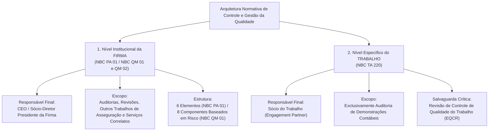
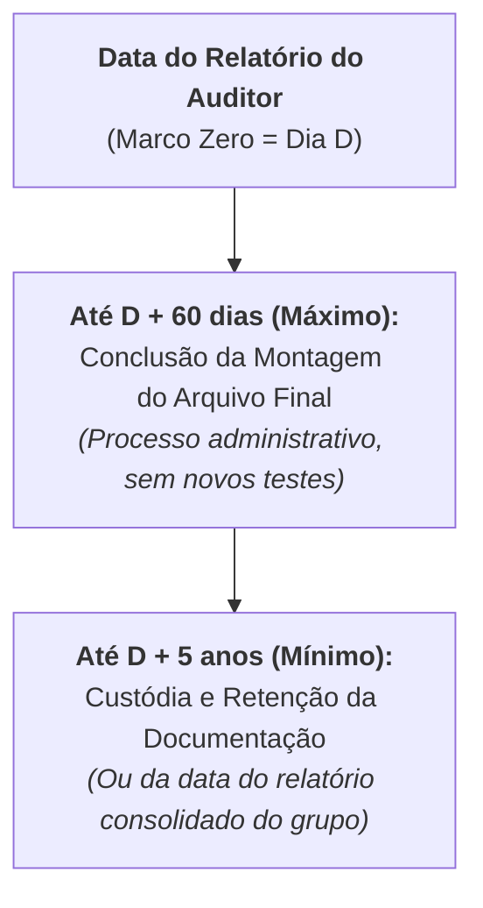

# 02. Gestão e Controle de Qualidade da Auditoria (NBC PA 01 / NBC QM 01, NBC QM 02 e NBC TA 220)

> O controle de qualidade na auditoria independente opera em **duas camadas complementares**: (1) no **nível da Firma de Auditoria**, regido historicamente pela **NBC PA 01** e modernizado pelas normas de Gestão da Qualidade **NBC QM 01 e NBC QM 02** (baseadas em riscos), que obrigam a sociedade de auditoria a estabelecer um sistema institucional abrangendo liderança, ética, aceitação de clientes, recursos humanos, execução e monitoramento; e (2) no **nível do Trabalho Individual de Auditoria**, regido pela **NBC TA 220**, cuja responsabilidade final recai sobre o **Sócio do Trabalho**, exigindo direção, supervisão, revisão hierárquica dos papéis de trabalho (do menos experiente pelo mais experiente) e, para companhias abertas/entidades listadas, a nomeação obrigatória de um **Revisor do Controle de Qualidade do Trabalho (EQCR)** antes da data do relatório.

---

## 1. Arquitetura Dual da Qualidade: Nível da Firma vs. Nível do Trabalho

Para resolver qualquer questão de banca examinadora (FGV, Cebraspe, FCC), o primeiro passo é distinguir a norma aplicável à **Sociedade/Firma de Auditoria como um todo** da norma aplicável a **um contrato específico de auditoria de demonstrações contábeis**:

| Critério Comparativo | NBC PA 01 / NBC QM 01 (Nível da Firma) | NBC TA 220 (Nível do Trabalho) |
| :--- | :--- | :--- |
| **Sujeito Passivo / Destinatário** | A **Firma de Auditoria** (pessoa jurídica ou auditor independente pessoa física). | O **Sócio do Trabalho** e a **Equipe de Trabalho** designada para aquela auditoria específica. |
| **Abrangência de Serviços** | **Ampla:** Auditorias (NBC TA), Revisões (NBC TR), Outros Trabalhos de Asseguração (NBC TO) e Serviços Correlatos (NBC TSC). | **Específica:** Exclusivamente trabalhos de **Auditoria de Demonstrações Contábeis**. |
| **Responsabilidade Final** | **Presidente (CEO) da Firma** ou conselho diretor de sócios equivalente. | **Sócio do Trabalho** (*Engagement Partner*) responsável pelo relatório de auditoria. |
| **Relação de Dependência** | Cria as políticas, manuais, metodologias e ferramentas globais da firma. | A equipe de trabalho tem direito de **confiar no sistema da firma**, a menos que informações fornecidas pela firma ou outras partes sugiram o contrário. |

---

## 2. O Sistema de Controle de Qualidade da Firma (NBC PA 01) e a Evolução para a NBC QM 01

> [!NOTE]
> **Atenção Dupla para Concursos:**
> Embora o CFC tenha aprovado a **NBC QM 01 (Gestão da Qualidade para Firmas — equivalente à ISQM 1)** e a **NBC QM 02 (Revisões de Qualidade de Trabalhos — ISQM 2)** em substituição à **NBC PA 01 (ISQC 1)**, muitos editais e bancos de questões continuam cobrando expressamente a literalidade da **NBC PA 01**. Por isso, este tratado disseca **ambas as estruturas** de forma comparada!

### 2.1 Os 6 Elementos do Sistema de Controle de Qualidade na NBC PA 01 (Item 16)
Segundo a NBC PA 01, o sistema de controle de qualidade da firma deve incluir políticas e procedimentos que tratem de **seis elementos obrigatórios (`L - E - A - R - E - M`)**:

1. **Responsabilidades da Liderança pela Qualidade na Firma:**
   * A firma deve estabelecer políticas destinadas a promover uma **cultura interna** que reconheça que a **qualidade é essencial na execução dos trabalhos**.
   * O **presidente da firma** (ou equivalente) deve assumir a **responsabilidade final** pelo sistema de controle de qualidade.
   * Quem for designado pelo presidente para a responsabilidade operacional pelo sistema de controle de qualidade deve possuir **experiência e capacidade suficientes e apropriadas**, além da **autoridade necessária** para assumir essa responsabilidade (Item 19).
   * **Primazia da Qualidade sobre o Comercial:** As políticas de avaliação de desempenho, remuneração e promoção de sócios e profissionais devem demonstrar que a firma tem como **prioridade máxima a qualidade**, de modo que as considerações comerciais **não se sobreponham** à qualidade do trabalho executado.
2. **Requisitos Éticos Relevantes:**
   * Cumprimento dos princípios fundamentais de ética profissional (**Integridade, Objetividade, Competência e Zelo Profissional, Confidencialidade e Comportamento Profissional**) e de **Independência**.
   * **Confirmação Escrita de Independência (Item 24):** Pelo menos **uma vez por ano (anualmente)**, a firma deve obter **confirmação por escrito** do cumprimento de suas políticas e procedimentos sobre independência de **todo o pessoal da firma** que precisa ser independente de acordo com os requisitos éticos relevantes!
   * **Rotação (Rodízio) de Sócios em Companhias Abertas / Entidades Listadas (Item 25):** Estabelecer critérios para reduzir a **ameaça de familiaridade** a um nível aceitável, exigindo a **rotação do sócio do trabalho, do revisor do controle de qualidade (EQCR) e de outros sócios-chave** após um período predefinido (no Brasil, **5 anos**, com quarentena de 2 anos segundo regras da CVM, ou conforme NBC PA 400).
3. **Aceitação e Continuidade do Relacionamento com Clientes e de Trabalhos Específicos:**
   * Antes de aceitar um novo cliente ou decidir pela continuidade de um cliente existente, a firma deve avaliar **três pilares cumulativos (Item 26)**:
     * **(a) Competência, Capacidade e Recursos da Firma:** Temos pessoal qualificado, tempo, especialistas e tecnologia para fazer o trabalho?
     * **(b) Cumprimento de Requisitos Éticos:** Somos independentes em relação a esse cliente?
     * **(c) Integridade do Cliente:** A firma considerou a integridade dos principais proprietários, da administração-chave e dos responsáveis pela governança da entidade (ex.: reputação nos negócios, natureza das operações, indícios de lavagem de dinheiro, postura agressiva na interpretação de normas contábeis ou limitação indevida de escopo)?
   * **Descoberta Posterior de Fato Impeditivo (Item 28):** Se a firma obtiver informações após aceitar o trabalho que teriam levado à sua recusa caso fossem conhecidas antes, a firma deve considerar as responsabilidades profissionais e legais e a possibilidade de **renunciar ao trabalho** (e ao relacionamento com o cliente).
4. **Recursos Humanos:**
   * Políticas de recrutamento, avaliação de desempenho, competência, desenvolvimento profissional contínuo (Educação Profissional Continuada — EPC), carreira e remuneração.
   * Designação de um **Sócio do Trabalho** para cada trabalho, comunicando sua identidade e função à administração e aos responsáveis pela governança do cliente.
5. **Execução do Trabalho:**
   * Consistência na qualidade da execução por meio de manuais, programas eletrônicos, direção, supervisão e revisão.
   * **Consultas técnicas**, **Revisão do Controle de Qualidade do Trabalho (EQCR)**, resolução de **Diferenças de Opinião** e **Documentação do Trabalho** (montagem do arquivo final e guarda por no mínimo 5 anos).
6. **Monitoramento:**
   * Processo contínuo de consideração e avaliação do sistema de controle de qualidade da firma, incluindo a **inspeção periódica de uma seleção de trabalhos concluídos**!

---

### 2.2 A Transição para a Gestão da Qualidade Baseada em Riscos (NBC QM 01 e NBC QM 02)
A **NBC QM 01** substituiu a abordagem linear e estática dos 6 elementos da NBC PA 01 por um **Sistema de Gestão da Qualidade (SGQ) proativo e baseado em riscos**, composto por **8 componentes inter-relacionados**:

| Os 6 Elementos da NBC PA 01 (Clássica) | Os 8 Componentes da NBC QM 01 (Moderna / ISQM 1) |
| :--- | :--- |
| *(Inexistente como componente autônomo)* | **1. Processo de Avaliação de Riscos da Firma** (estabelecer objetivos de qualidade -> identificar e avaliar riscos de qualidade -> desenhar e implementar respostas). |
| 1. Responsabilidades da Liderança pela Qualidade | **2. Governança e Liderança** (cultura organizacional, responsabilidade pelo SGQ). |
| 2. Requisitos Éticos Relevantes | **3. Requisitos Éticos Relevantes** (incluindo independência). |
| 3. Aceitação e Continuidade de Clientes e Trabalhos | **4. Aceitação e Continuidade de Relacionamento com Clientes e de Trabalhos Específicos**. |
| 5. Execução do Trabalho | **5. Execução do Trabalho** (direção, supervisão, revisão, consultas, diferenças de opinião, EQCR). |
| 4. Recursos Humanos | **6. Recursos** (ampliado para abranger: **Recursos Humanos**, **Recursos Tecnológicos** — softwares de auditoria, TI — e **Recursos Intelectuais** — metodologias, guias e bases de dados) + gestão de **Provedores de Serviços Externos**. |
| *(Diluído nos demais elementos)* | **7. Informação e Comunicação** (fluxo contínuo de informações internamente na firma e externamente com partes interessadas). |
| 6. Monitoramento | **8. Processo de Monitoramento e Correção** (avaliação anual obrigatória da eficácia do SGQ pela liderança e planos de ação corretiva sobre a causa-raiz das deficiências). |

---

## 3. Execução do Trabalho: Supervisão, Revisão, Consultas e Diferenças de Opinião

### 3.1 Direção, Supervisão e a Regra Hierárquica de Revisão (NBC PA 01, Item A35; NBC TA 220, Item 17)
* **Supervisão do Trabalho:** Inclui acompanhar o progresso do trabalho, considerar a competência e capacidade de cada membro da equipe, tratar de assuntos significativos que surjam durante a auditoria (modificando a abordagem planejada se necessário) e identificar assuntos para consulta ou consideração por membros mais experientes da equipe.
* **Princípio da Revisão Hierárquica:** As políticas de responsabilidade de revisão da firma são determinadas na base de que **o trabalho de membros menos experientes da equipe é revisado por membros mais experientes da equipe**!
* **O que o Sócio do Trabalho DEVE revisar pessoalmente? (NBC TA 220, Item 16 e A18):**
  * O Sócio do Trabalho **não precisa revisar toda a documentação de auditoria**, mas pode fazê-lo. Contudo, ele deve revisar a documentação referente a:
    1. **Áreas críticas de julgamento**, especialmente aquelas relacionadas a questões difíceis ou controversas identificadas no decorrer do trabalho;
    2. **Riscos significativos**; e
    3. Outras áreas que o sócio do trabalho considere importantes.
  * **Quando a revisão pelo Sócio do Trabalho deve ocorrer? (Item 17):** **Na data ou antes da data do relatório do auditor**, o sócio do trabalho deve estar satisfeito, por meio da revisão da documentação de auditoria e de discussão com a equipe de trabalho, de que foi obtida evidência de auditoria apropriada e suficiente para suportar as conclusões alcançadas e para a emissão do relatório do auditor!

---

### 3.2 Consultas Técnicas (NBC PA 01, Item 34; NBC TA 220, Item 18)
* **Conceito:** A consulta inclui discussão no nível profissional apropriado, com indivíduos de **dentro ou de fora da firma** que têm **experiência especializada** em assuntos difíceis ou controversos (contábeis, tributários, éticos ou de auditoria).
* **Obrigações do Sócio do Trabalho nas Consultas (NBC TA 220, Item 18):**
  1. Assegurar que a equipe de trabalho faça consultas apropriadas sobre assuntos difíceis ou controversos;
  2. Certificar-se de que a **natureza, o alcance e as conclusões** resultantes dessas consultas sejam **documentados e acordados** com o profissional consultado; e
  3. Determinar que as **conclusões resultantes dessas consultas foram efetivamente implementadas**!

---

### 3.3 Diferenças de Opinião (NBC PA 01, Item 43; NBC TA 220, Item 22)
Podem surgir divergências técnicas de opinião:
* **(a)** Dentro da própria equipe de trabalho (ex.: entre o gerente sênior e o sócio do trabalho);
* **(b)** Com as pessoas consultadas (ex.: entre o sócio do trabalho e o departamento técnico da firma); ou
* **(c)** Entre o **Sócio do Trabalho** e o **Revisor do Controle de Qualidade do Trabalho (EQCR)**.

> [!CAUTION]
> **Regra de Bloqueio Absoluto na Emissão do Relatório (NBC PA 01, Item 44; NBC TA 220, Item 22):**
> Caso surjam diferenças de opinião, a equipe deve seguir as políticas e procedimentos da firma para tratá-las e resolvê-las. **O relatório do auditor NÃO DEVE SER DATADO (nem emitido) até que a questão que originou a diferença de opinião seja formalmente resolvida!**

---

## 4. Revisão do Controle de Qualidade do Trabalho — EQCR (NBC PA 01, NBC QM 02 e NBC TA 220)

### 4.1 Conceito e Quem pode ser o Revisor (EQCR)
* **Revisor do Controle de Qualidade do Trabalho (*Engagement Quality Control Reviewer — EQCR*):** É um sócio, outro profissional da firma, uma **pessoa externa adequadamente qualificada**, ou uma equipe composta por essas pessoas, **nenhuma delas fazendo parte da equipe de trabalho**, com experiência e autoridade suficientes e apropriadas para avaliar objetivamente os julgamentos significativos feitos pela equipe de trabalho e as conclusões atingidas para elaboração do relatório.

### 4.2 Quando a Revisão do Controle de Qualidade (EQCR) é OBRIGATÓRIA? (NBC PA 01, Item 35; NBC TA 220, Item 19)
A Revisão do Controle de Qualidade do Trabalho (EQCR) **NÃO é exigida para todas as auditorias**! Ela é obrigatória apenas em **duas hipóteses**:
1. **Sempre (Obrigatoriedade Absoluta):** Para **todas as auditorias de demonstrações contábeis de entidades listadas (companhias abertas)**; e
2. **Por Critério de Risco da Firma:** Para outros trabalhos de auditoria, revisão ou asseguração para os quais a firma tenha determinado, em suas políticas, que uma revisão de controle de qualidade é necessária (ex.: entidades de interesse público como bancos, seguradoras, fundos de pensão, ou trabalhos com risco inusitadamente alto).

---

### 4.3 Salvaguardas de Objetividade do Revisor (EQCR)
Para garantir que o Revisor (EQCR) tenha isenção e objetividade ao avaliar os julgamentos da equipe de trabalho, as normas impõem **quatro travas rigorosas**:
1. **Não faz parte da equipe de trabalho** e **não é selecionado pelo próprio Sócio do Trabalho**;
2. **Não toma decisões pela equipe de trabalho** durante a execução da auditoria;
3. **Consultas feitas pelo Sócio do Trabalho ao EQCR durante o trabalho:** O Sócio do Trabalho pode consultar o Revisor (EQCR) durante o trabalho (por exemplo, para verificar se um julgamento feito pelo sócio será aceitável para o revisor). Entretanto, deve-se tomar cuidado para que a extensão da consulta **não comprometa a objetividade do revisor**; se a objetividade ficar comprometida, a firma deve substituir o revisor!
4. **Período de Quarentena (*Cooling-off Period* — NBC QM 02):** Um indivíduo que atuou anteriormente como **Sócio do Trabalho** em uma auditoria **NÃO pode assumir imediatamente a função de Revisor de Qualidade (EQCR)** daquele mesmo cliente! A **NBC QM 02** exige um período de resfriamento (*cooling-off*) de **2 anos (dois anos)** antes que o ex-sócio do trabalho possa atuar como EQCR daquele trabalho.

---

### 4.4 Requisitos Específicos na Auditoria de Entidades Listadas / Companhias Abertas (NBC TA 220, Item 20 e 21)
Para auditorias de demonstrações contábeis de entidades listadas (companhias abertas), o Revisor (EQCR) deve considerar especificamente, além da discussão de assuntos significativos e da revisão das demonstrações e de documentação selecionada:
1. A avaliação da equipe de trabalho sobre a **independência da firma** em relação ao trabalho específico;
2. Se foram feitas **consultas apropriadas** sobre assuntos envolvendo diferenças de opinião ou outros assuntos difíceis ou controversos, e as conclusões decorrentes dessas consultas; e
3. Se a **documentação selecionada para revisão** reflete o trabalho executado em relação aos **julgamentos significativos** e se suporta as conclusões obtidas.

> [!IMPORTANT]
> **Marco Temporal da Revisão do Controle de Qualidade (NBC TA 220, Item 19(c)):**
> Nos trabalhos em que o EQCR é exigido, **o Sócio do Trabalho NÃO deve datar o relatório do auditor até que a revisão do controle de qualidade do trabalho tenha sido formalmente concluída!**
> Além disso, a realização da Revisão de Controle de Qualidade (EQCR) **NÃO reduz as responsabilidades do Sócio do Trabalho** pelo trabalho e pela sua execução (NBC PA 01, item A49).

---

## 5. Documentação do Trabalho, Prazos de Montagem, Guarda e Propriedade (NBC PA 01, Itens 45 a 47)

A **NBC PA 01** (em total harmonia com a **NBC TA 230**) estabelece regras imperativas sobre o arquivo final, a confidencialidade, a retenção e a propriedade dos papéis de trabalho:

1. **Prazo para Conclusão da Montagem do Arquivo Final (Item A54 da NBC PA 01 c/c NBC TA 230):**
   * Quando a lei ou regulamento não prescrever prazo menor, o limite de tempo adequado para concluir a montagem dos arquivos finais de um trabalho de auditoria normalmente **não ultrapassa 60 (sessenta) dias após a data do relatório do auditor**.
   * **Se houver 2 ou mais relatórios para a mesma informação sobre o objeto** (ex.: um relatório emitido para o mercado nacional e outro para o exterior): a firma deve tratar **cada relatório como se fosse um trabalho separado** para fins de montagem do arquivo final (Item 45).
2. **Prazo Mínimo de Guarda / Retenção da Documentação (Item A61 da NBC PA 01 c/c NBC TA 230):**
   * O período de retenção para trabalhos de auditoria **não é, normalmente, inferior a 5 (cinco) anos a contar da data do relatório do auditor**, ou, **se superior, da data do relatório do auditor do grupo** (nas auditorias de demonstrações consolidadas — NBC TA 600).
3. **Propriedade Exclusiva da Documentação do Trabalho (Item A63 da NBC PA 01):**
   * A menos que especificado de outro modo por lei ou regulamento, **a documentação do trabalho (papéis de trabalho) é de PROPRIEDADE DA FIRMA DE AUDITORIA**!
   * A firma pode, a seu exclusivo critério, disponibilizar partes ou trechos da documentação aos clientes, **desde que essa divulgação não prejudique a validade do trabalho executado ou, no caso de trabalhos de asseguração, a independência da firma ou de seu pessoal**!
4. **Documentação do Revisor de Controle de Qualidade — EQCR (NBC TA 220, Item 25):**
   * O Revisor (EQCR) deve documentar, para o trabalho revisado, que:
     * **(a)** Os procedimentos exigidos pelas políticas da firma sobre revisão de controle de qualidade foram executados;
     * **(b)** A revisão de controle de qualidade foi concluída **na data ou antes da data do relatório do auditor**; e
     * **(c)** O revisor **não tem conhecimento de nenhum assunto não resolvido** que o levaria a acreditar que os julgamentos significativos feitos pela equipe de trabalho e as conclusões obtidas não eram apropriados.

---

## 6. Monitoramento do Sistema de Qualidade, Ciclo de Inspeção e Reclamações (NBC PA 01, Itens 48 a 56)

### 6.1 O Processo de Monitoramento e o Ciclo de Inspeção de Trabalhos Concluídos (Item 48 e A66)
A firma deve estabelecer um processo de monitoramento destinado a fornecer segurança razoável de que as políticas e os procedimentos relacionados ao sistema de controle de qualidade são relevantes, adequados e estão operando de maneira efetiva. Esse processo **deve incluir**:

1. **Inspeção Cíclica de Trabalhos Concluídos:** A inspeção, em base cíclica, de **pelo menos um trabalho concluído para cada sócio do trabalho**!
   * **Qual é a duração do ciclo na NBC PA 01 (Item A66)?** A maneira pela qual o ciclo de inspeção é organizado (incluindo o momento de seleção dos trabalhos individuais) depende de muitos fatores (porte da firma, número e localização geográfica dos escritórios, resultados de monitoramentos anteriores, grau de autoridade e risco dos clientes), mas **um ciclo pode abranger, por exemplo, 3 (três) anos** (pelo menos 1 trabalho concluído por sócio do trabalho a cada 3 anos).
   * **Seleção sem Aviso Prévio:** O processo de inspeção inclui a seleção de trabalhos individuais, **alguns dos quais podem ser selecionados sem notificação prévia à equipe de trabalho**!
2. **Proibição de Autoinspeção (Item 48(c)):** Exige que a responsabilidade pelo processo de monitoramento seja atribuída a um sócio ou sócios, ou outras pessoas com experiência e autoridade suficientes e apropriadas na firma, e **VEDA expressamente que os envolvidos na execução do trabalho ou na revisão do controle de qualidade do trabalho (EQCR) participem da inspeção daquele trabalho específico**!

---

### 6.2 Tratamento das Deficiências Identificadas no Monitoramento (Itens 50 a 52)
Quando o monitoramento identifica deficiências:
* **Deficiência Isolada vs. Sistêmica (Item 50):** A firma deve avaliar se as deficiências observadas são:
  * **(a)** Casos que **não indicam** necessariamente que o sistema de controle de qualidade é insuficiente; **OU**
  * **(b)** Deficiências **sistêmicas, repetitivas ou outras deficiências significativas** que requerem **ação corretiva imediata**.
* **Comunicação Anual dos Resultados do Monitoramento (Item 53):** A firma deve comunicar, **pelo menos uma vez por ano (anualmente)**, os resultados do monitoramento de seu sistema de controle de qualidade aos **sócios de trabalho e a outras pessoas apropriadas na firma**, inclusive ao **presidente da firma** (ou conselho diretor de sócios).
  * **Detalhe Crítico sobre a Identificação de Trabalhos na Comunicação Geral (Item A69):** A comunicação de deficiências identificadas a outras pessoas que **não sejam os respectivos sócios de trabalho** **NÃO precisa incluir a identificação dos trabalhos específicos**, embora possa haver casos em que essa identificação seja necessária para o devido exercício das responsabilidades dessas pessoas.

---

### 6.3 Reclamações e Alegações (Itens 55 e 56)
A firma deve estabelecer políticas e procedimentos para tratar de reclamações e alegações de que o trabalho realizado pela firma não cumpre as normas profissionais e exigências legais, ou de descumprimento do sistema de controle de qualidade da firma.
* **Canais de Denúncia Interna e Externa:** As reclamações e alegações podem se originar de **dentro ou de fora da firma** (pessoal da firma, clientes ou outros terceiros), devendo existir canais claramente definidos que permitam ao pessoal comunicar preocupações **sem medo de represálias (retaliação)**.
* **Investigação Independente:** A investigação deve ser supervisionada por sócio com experiência suficiente e apropriada que **não esteja de outro modo envolvido no trabalho**, podendo a firma de menor porte contratar um **profissional externo qualificado** ou outra firma para conduzir a investigação.

---

## 7. Estudo de Caso Aplicado: Incidente de Controle de Qualidade em Auditoria de Companhia Aberta

### Cenário Prático
A firma *Alfa Auditores Independentes* audita as demonstrações financeiras da *Companhia Energética Solar S.A.* (listada no Novo Mercado da B3). Em 25 de março de 2026, véspera do prazo prometido pelo Diretor Financeiro do cliente ao Conselho de Administração, ocorrem três eventos simultâneos:
1. O Sócio do Trabalho, Dr. Roberto, completou 5 exercícios anuais consecutivos auditando a *Solar S.A.* em 2025 e pretende transferir a função de Sócio do Trabalho para sua sócia, Dra. Helena, em 2026, assumindo ele próprio (Dr. Roberto) imediatamente a função de **Revisor do Controle de Qualidade do Trabalho (EQCR)** da *Solar S.A.* no exercício de 2026.
2. Na auditoria de 2025, surgiu uma **diferença de opinião** grave entre o Sócio do Trabalho e a atual Revisora de Qualidade (EQCR) quanto à suficiência da provisão de desmantelamento de usinas (diferença de R\$ 80 milhões). Pressionado pelo cliente, o Sócio do Trabalho cogita datar e assinar o relatório de auditoria em 26/03/2026 e resolver a divergência interna na semana seguinte, durante o período de 60 dias de montagem do arquivo final.
3. Um assistente júnior da equipe aplicou os testes substantivos de corte (*cut-off*) de receita em 25/03/2026, e o gerente sênior propôs revisar esses papéis de trabalho apenas em abril de 2026, após a emissão do relatório.

### Diagnóstico Técnico-Normativo das 3 Violações
1. **Violação da Quarentena do EQCR (NBC QM 02 / NBC PA 01):** O Dr. Roberto **NÃO pode** sair da função de Sócio do Trabalho em 2025 e assumir imediatamente a função de Revisor de Qualidade (EQCR) da mesma entidade em 2026, pois isso gera grave ameaça de **autorrevisão** e compromete a objetividade do revisor. A NBC QM 02 exige um período de resfriamento (*cooling-off*) mínimo de **2 anos** antes que o ex-sócio do trabalho possa atuar como EQCR daquele trabalho.
2. **Violação do Bloqueio por Diferença de Opinião e Conclusão do EQCR (NBC TA 220, Itens 19(c) e 22; NBC PA 01, Item 44):** Em companhias abertas, o relatório do auditor **JAMAIS pode ser datado ou emitido** antes que: (a) a Revisão do Controle de Qualidade (EQCR) esteja **100% concluída**, e (b) toda **diferença de opinião** técnica tenha sido **formalmente resolvida** segundo as políticas da firma. O prazo de 60 dias após a data do relatório serve exclusivamente para o processo **administrativo** de montagem do arquivo final, sendo terminantemente proibido deixar julgamentos ou procedimentos pendentes para depois da data do relatório!
3. **Violação da Tempestividade da Revisão Hierárquica (NBC TA 220, Item 17):** Toda a revisão dos papéis de trabalho que suportam as conclusões da auditoria deve estar concluída **na data ou antes da data do relatório do auditor**.

---

## 8. Armadilhas de Banca ("Cascas de Banana")

> [!WARNING]
> **Armadilha 01 — "A Revisão de Controle de Qualidade do Trabalho (EQCR) é obrigatória para TODAS as auditorias de demonstrações contábeis":**
> **FALSO!** O EQCR é obrigatório por norma apenas para auditorias de **entidades listadas (companhias abertas)** e para outros trabalhos nos quais **a própria firma** determinou, por seus critérios de risco, que a revisão é necessária (NBC PA 01, item 35; NBC TA 220, item 19).
>
> **Armadilha 02 — "O Sócio do Trabalho é obrigado a revisar 100% de todos os papéis de trabalho da equipe":**
> **FALSO!** O item A18 da NBC TA 220 esclarece que o sócio do trabalho **não precisa revisar toda a documentação de auditoria**, mas deve revisar as áreas críticas de julgamento, os riscos significativos e outras áreas que considere importantes.
>
> **Armadilha 03 — "A presença do Revisor de Qualidade (EQCR) divide ou reduz a responsabilidade do Sócio do Trabalho":**
> **FALSO!** O item A49 da NBC PA 01 determina expressamente que a revisão do controle de qualidade do trabalho **não reduz as responsabilidades do sócio do trabalho**.
>
> **Armadilha 04 — "O Revisor de Qualidade (EQCR) pode ser escolhido livremente pelo próprio Sócio do Trabalho entre os membros da equipe":**
> **FALSO!** O EQCR **não pode fazer parte da equipe de trabalho** e **não pode ser selecionado pelo próprio Sócio do Trabalho** (para preservar sua isenção e objetividade).
>
> **Armadilha 05 — "Os papéis de trabalho pertencem à empresa auditada que pagou os honorários":**
> **FALSO!** Salvo disposição legal em contrário, a documentação do trabalho é de **propriedade exclusiva da firma de auditoria** (NBC PA 01, item A63).

---

## 9. Mnemônicos & Âncoras de Memória

| Gatilho / Alvo de Prova | Mnemônico / Regra de Bolso | Decodificação Rápida |
| :--- | :--- | :--- |
| **6 Elementos da NBC PA 01** | **L - E - A - R - E - M** | **L**iderança + **É**tica + **A**ceitação/Continuidade + **R**ecursos Humanos + **E**xecução do Trabalho + **M**onitoramento. |
| **Novidades da NBC QM 01 (8 Componentes)** | **Risco + TI/Intelectual + Info/Comunicação** | Adiciona o **Processo de Avaliação de Riscos da Firma**, expande RH para **Recursos Humanos, Tecnológicos e Intelectuais**, e cria **Informação e Comunicação**. |
| **Prazos Críticos da Qualidade** | **1 - 2 - 3 - 5 - 60** | **1 ano:** Confirmação escrita de independência e comunicação anual do monitoramento. **2 anos:** Quarentena (*cooling-off*) para Sócio do Trabalho virar EQCR (NBC QM 02). **3 anos:** Ciclo exemplificativo de inspeção de pelo menos 1 trabalho concluído por sócio (NBC PA 01). **5 anos:** Prazo mínimo de guarda da documentação (e rodízio de sócios CVM). **60 dias:** Prazo máximo para montagem administrativa do arquivo final. |
| **Trava de Data do Relatório (NBC TA 220)** | **Sem EQCR concluído ou com Divergência Aberta = PROIBIDO DATAR!** | O relatório do auditor **nunca** pode ser datado antes da conclusão do EQCR (quando exigido) nem enquanto houver diferença de opinião não resolvida. |

---

## 10. Bateria de Questões Oficiais Comentadas Alternativa por Alternativa

### [Questão 01](https://www.qconcursos.com/questoes-de-concursos/questoes/0b97cb23-c3) — [FGV — Receita Federal do Brasil / Auditor-Fiscal da Receita Federal — 2023]

De acordo com a NBC TA 220 (Controle de Qualidade da Auditoria de Demonstrações Contábeis) e a NBC PA 01, em relação à Revisão do Controle de Qualidade do Trabalho (EQCR), é correto afirmar que:

* **A)** É obrigatória para todos os trabalhos de auditoria independente, independentemente do porte ou da natureza societária da entidade auditada.
* **B)** O revisor do controle de qualidade do trabalho deve ser um membro sênior integrante da própria equipe de trabalho, indicado diretamente pelo sócio do trabalho.
* **C)** Nas auditorias de demonstrações contábeis de entidades listadas (companhias abertas), o sócio do trabalho não deve datar o relatório do auditor até que a revisão do controle de qualidade do trabalho tenha sido concluída.
* **D)** Caso ocorra diferença de opinião entre o sócio do trabalho e o revisor do controle de qualidade, prevalece imediatamente o voto do sócio do trabalho, podendo o relatório ser emitido antes da resolução formal do conflito.
* **E)** A aprovação do trabalho pelo revisor do controle de qualidade transfere a este metade da responsabilidade técnica e civil pela opinião emitida no relatório de auditoria.

#### Gabarito e Dissecação Técnica: **Alternativa C**
* **Análise da Alternativa A (Incorreta):** O EQCR é obrigatório para auditorias de demonstrações contábeis de **entidades listadas (companhias abertas)** e para outros trabalhos nos quais a firma tenha determinado sua necessidade por critérios próprios de risco (NBC TA 220, item 19; NBC PA 01, item 35).
* **Análise da Alternativa B (Incorreta):** O revisor (EQCR) **jamais pode fazer parte da equipe de trabalho** nem ser selecionado pelo próprio sócio do trabalho.
* **Análise da Alternativa C (Correta):** Reproduz literalmente o comando imperativo do item 19(c) da NBC TA 220 (e item 36 da NBC PA 01): o relatório do auditor **não deve ser datado** até a conclusão da revisão do controle de qualidade do trabalho.
* **Análise da Alternativa D (Incorreta):** Havendo diferença de opinião, o relatório **não deve ser datado nem emitido** até que a divergência seja formalmente resolvida segundo as políticas da firma (NBC TA 220, item 22).
* **Análise da Alternativa E (Incorreta):** A revisão do controle de qualidade do trabalho **não reduz nem divide** as responsabilidades do sócio do trabalho (NBC PA 01, item A49).

> **Fique Ligado:** Reproduz literalmente o comando imperativo do item 19(c) da NBC TA 220 (e item 36 da NBC PA 01): o relatório do auditor **não deve ser datado** até a conclusão da revisão do controle de qualidade do trabalho.

---

### [Questão 02](https://www.qconcursos.com/questoes-de-concursos/questoes/0b90336c-c3) — [CESPE / CEBRASPE — TCU / Auditor Federal de Controle Externo — 2022]

No que concerne ao sistema de controle de qualidade de uma firma de auditoria independente (NBC PA 01 / NBC QM 01), assinale a opção correta.

* **A)** A confirmação do cumprimento das políticas e procedimentos sobre independência pelo pessoal da firma pode ser obtida de forma meramente verbal a cada triênio.
* **B)** No processo de monitoramento do sistema de controle de qualidade, é permitido que o próprio revisor de controle de qualidade do trabalho (EQCR) atue como inspetor daquele mesmo trabalho concluído, haja vista não ter integrado a equipe de campo.
* **C)** A documentação do trabalho é de propriedade conjunta da firma de auditoria e da entidade auditada, tendo o cliente direito subjetivo irrestrito a todos os papéis de trabalho elaborados pelo auditor.
* **D)** A firma deve obter, pelo menos uma vez por ano, confirmação por escrito do cumprimento de suas políticas e procedimentos sobre independência de todo o pessoal da firma que precisa ser independente.
* **E)** Caso uma firma de pequeno porte não disponha de sócios suficientes em seus quadros internos para realizar a revisão de controle de qualidade do trabalho (EQCR) ou consultas técnicas, ela fica legalmente dispensada dessas exigências.

#### Gabarito e Dissecação Técnica: **Alternativa D**
* **Análise da Alternativa A (Incorreta):** A confirmação de independência deve ser obtida **por escrito** e pelo menos **uma vez por ano (anualmente)** (NBC PA 01, item 24).
* **Análise da Alternativa B (Incorreta):** O item 48(c) da NBC PA 01 **proíbe expressamente** que os envolvidos na execução do trabalho **ou na revisão do controle de qualidade do trabalho (EQCR)** participem da inspeção de monitoramento daquele trabalho.
* **Análise da Alternativa C (Incorreta):** Salvo disposição legal em contrário, a documentação do trabalho é de **propriedade exclusiva da firma de auditoria** (item A63 da NBC PA 01).
* **Análise da Alternativa D (Correta):** Literalidade do item 24(b) da NBC PA 01: confirmação **por escrito**, no mínimo **anualmente**, de todo o pessoal sujeito aos requisitos de independência.
* **Análise da Alternativa E (Incorreta):** Firmas de pequeno porte **não estão dispensadas**; elas devem contratar **pessoas externas adequadamente qualificadas** ou usar outras firmas para realizar revisões de qualidade (EQCR), consultas ou inspeções de monitoramento (NBC PA 01, itens A40, A50 e A67).

> **Fique Ligado:** Literalidade do item 24(b) da NBC PA 01: confirmação **por escrito**, no mínimo **anualmente**, de todo o pessoal sujeito aos requisitos de independência.

---

### [Questão 03](https://www.qconcursos.com/questoes-de-concursos/questoes/0b844a41-c3) — [FGV — SEFAZ-BA / Auditor Fiscal — 2022]

Sobre a responsabilidade de revisão da documentação de auditoria pelo Sócio do Trabalho, nos termos da NBC TA 220, assinale a afirmativa correta:

* **A)** O sócio do trabalho deve revisar integralmente todos os papéis de trabalho produzidos pelos assistentes e seniores antes da montagem do arquivo final, no prazo de até 60 dias após a data do relatório.
* **B)** Na data ou antes da data do relatório do auditor, o sócio do trabalho deve estar satisfeito, por meio da revisão da documentação de auditoria e de discussão com a equipe de trabalho, de que foi obtida evidência apropriada e suficiente para suportar as conclusões alcançadas, não precisando revisar toda a documentação, mas devendo revisar áreas críticas de julgamento e riscos significativos.
* **C)** A revisão dos papéis de trabalho é estruturada de modo que os membros menos experientes revisem o trabalho dos sócios para fins de treinamento prático em serviço.
* **D)** Quando o sócio do trabalho utiliza um especialista do auditor (NBC TA 620), fica dispensado de revisar as conclusões desse especialista nos papéis de trabalho.
* **E)** Caso um novo sócio do trabalho assuma a auditoria no decorrer do exercício em substituição ao sócio anterior, ele deve revisar apenas os procedimentos executados a partir da data de sua posse.

#### Gabarito e Dissecação Técnica: **Alternativa B**
* **Análise da Alternativa A (Incorreta):** Dois erros graves: (1) o sócio não precisa revisar 100% da documentação, e (2) a revisão deve ocorrer **na data ou antes da data do relatório**, jamais nos 60 dias posteriores!
* **Análise da Alternativa B (Correta):** Combina com perfeição o requisito do item 17 com a aplicação explicativa do item A18 da NBC TA 220.
* **Análise da Alternativa C (Incorreta):** O princípio da revisão é exatamente o inverso: o trabalho dos membros **menos experientes** é revisado pelos membros **mais experientes** (item A35 da NBC PA 01).
* **Análise da Alternativa D (Incorreta):** O sócio do trabalho mantém responsabilidade integral e deve avaliar a adequação do trabalho do especialista como evidência de auditoria.
* **Análise da Alternativa E (Incorreta):** Conforme o item A20 da NBC TA 220, o novo sócio do trabalho que assume durante a auditoria deve aplicar os procedimentos de revisão **como se tivesse assumido a responsabilidade pelo trabalho desde o início** (revisando todo o trabalho realizado até a data da mudança)!

> **Fique Ligado:** Combina com perfeição o requisito do item 17 com a aplicação explicativa do item A18 da NBC TA 220.

---

### [Questão 04](https://www.qconcursos.com/questoes-de-concursos/questoes/0b6f6897-c3) — [FCC — TCE-GO / Analista de Controle Externo — 2022]

De acordo com a NBC PA 01, em relação aos prazos de montagem do arquivo final, retenção da documentação e ciclo de monitoramento por inspeção nas auditorias de demonstrações contábeis, os parâmetros normativos de referência são, respectivamente:

* **A)** Montagem do arquivo final em até 30 dias; retenção por no mínimo 3 anos; e ciclo de inspeção de 5 anos.
* **B)** Montagem do arquivo final em até 60 dias após a data do relatório; retenção por período não inferior a 5 anos a contar da data do relatório; e ciclo de inspeção que pode abranger, por exemplo, 3 anos (pelo menos um trabalho concluído para cada sócio do trabalho).
* **C)** Montagem do arquivo final até a data do relatório; retenção por 10 anos; e inspeção semestral de 100% dos trabalhos da firma.
* **D)** Montagem do arquivo final em até 90 dias; retenção por 5 anos; e ciclo de inspeção de 2 anos, conduzido pelo próprio sócio do trabalho.
* **E)** Montagem do arquivo final em até 60 dias; retenção por 2 anos; e ciclo de inspeção anual apenas para companhias abertas.

#### Gabarito e Dissecação Técnica: **Alternativa B**
* **Análise das Alternativas A, C, D e E (Incorretas):** Apresentam prazos conflitantes com os itens A54, A61 e A66 da NBC PA 01 (e itens A21 e A23 da NBC TA 230).
* **Análise da Alternativa B (Correta):** Crava com precisão cirúrgica os três marcos numéricos da NBC PA 01:
  1. **Montagem do arquivo final (Item A54):** até **60 dias** após a data do relatório do auditor;
  2. **Retenção/Guarda da documentação (Item A61):** não inferior a **5 anos** a contar da data do relatório do auditor (ou do relatório do auditor do grupo, se posterior);
  3. **Ciclo de inspeção de monitoramento (Item A66):** pelo menos um trabalho concluído para cada sócio do trabalho em um ciclo que pode abranger, por exemplo, **3 anos**.

> **Fique Ligado:** A assertiva correta consagra o comando literal da NBC TA 200.

---

### [Questão 05](https://www.qconcursos.com/questoes-de-concursos/questoes/22cfc945-c4) — [FGV — CGE-SC / Auditor Interno do Poder Executivo — 2023]

A nova norma brasileira de gestão da qualidade para firmas de auditoria (NBC QM 01), convergente com a ISQM 1 da IFAC, aprimorou a antiga estrutura da NBC PA 01 ao introduzir uma abordagem baseada em riscos. Assinale a alternativa que apresenta uma inovação estrutural trazida pela NBC QM 01 e pela NBC QM 02:

* **A)** Eliminação da necessidade de confirmação anual de independência por escrito pelo pessoal da firma.
* **B)** Permissão para que o sócio do trabalho atue simultaneamente como revisor de qualidade (EQCR) nas auditorias de entidades de pequeno porte.
* **C)** Ampliação do componente de Recursos para abranger explicitamente, além dos recursos humanos, os recursos tecnológicos e os recursos intelectuais (bem como provedores de serviços), aliada à instituição de um período de quarentena (*cooling-off*) de dois anos para que o ex-sócio do trabalho possa atuar como revisor de qualidade (EQCR) do mesmo trabalho.
* **D)** Substituição do arquivo de papéis de trabalho por relatórios meramente verbais apresentados ao comitê de auditoria.
* **E)** Transferência da responsabilidade final pelo sistema de gestão da qualidade da firma para o conselho federal de contabilidade.

#### Gabarito e Dissecação Técnica: **Alternativa C**
* **Análise das Alternativas A, B, D e E (Incorretas):** Violam frontalmente os pilares da NBC QM 01 e da NBC QM 02.
* **Análise da Alternativa C (Correta):** Destaca exatamente duas das mais importantes inovações das normas NBC QM 01 e NBC QM 02: (1) a ampliação do antigo elemento "Recursos Humanos" para o componente **Recursos** (que agora engloba **Recursos Humanos, Recursos Tecnológicos e Recursos Intelectuais**, além da gestão de provedores de serviços externos), e (2) a exigência expressa na NBC QM 02 de um período de resfriamento (*cooling-off period*) de **2 anos** antes que um ex-sócio do trabalho possa assumir a função de Revisor da Qualidade do Trabalho (EQCR) naquele mesmo cliente.

> **Fique Ligado:** Destaca exatamente duas das mais importantes inovações das normas NBC QM 01 e NBC QM 02: (1) a ampliação do antigo elemento "Recursos Humanos" para o componente **Recursos** (que agora engloba **Recursos Humanos, Recursos Tecnológicos e Recursos Intelectuais**, além da gestão de provedores de serviços externos), e (2) a exigência expressa na NBC QM 02 de um período de resfriamento (*cooling-off period*) de **2 anos** antes que um ex-sócio do trabalho possa assumir a função de Revisor da Qualidade do Trabalho (EQCR) naquele mesmo cliente.

---

### [Questão 06](https://www.qconcursos.com/questoes-de-concursos/questoes/ab7ab51a-c4) — [CESPE / CEBRASPE — SEFAZ-RS / Auditor-Fiscal da Receita Estadual — 2019]

A firma de auditoria independente *Delta S/S* concluiu a auditoria das demonstrações contábeis da *Companhia Beta* e emitiu dois relatórios distintos sobre a mesma informação contábil na mesma data: um destinado ao cumprimento das exigências societárias brasileiras e outro destinado à bolsa de valores estrangeira onde a companhia possui recibos de ações negociados. Nessa hipótese, segundo a NBC PA 01, para fins de montagem dos arquivos finais do trabalho:

* **A)** A firma deve unificar ambos os relatórios em um único arquivo físico, dispondo do prazo dobrado de 120 dias para encerrar a montagem.
* **B)** A firma deve definir políticas e procedimentos para tratar cada relatório como se fosse para um trabalho separado.
* **C)** Apenas o relatório emitido para o mercado nacional está sujeito ao prazo de montagem de 60 dias, ficando o relatório internacional isento de arquivamento.
* **D)** A montagem do arquivo final deve ser concluída no mínimo 30 dias antes da data de emissão do primeiro relatório.
* **E)** O prazo de retenção documental de 5 anos passa a ser reduzido pela metade quando há emissão de múltiplos relatórios.

#### Gabarito e Dissecação Técnica: **Alternativa B**
* **Análise das Alternativas A, C, D e E (Incorretas):** Inventam regras inexistentes na norma.
* **Análise da Alternativa B (Correta):** Reproduz literalmente o **item 45 (parte final) da NBC PA 01**: *"No caso de dois ou mais diferentes relatórios serem emitidos com relação à mesma informação sobre o objeto de uma entidade, as políticas e os procedimentos da firma relativos aos limites de tempo para a montagem dos arquivos finais devem tratar cada relatório como se fosse para um trabalho separado."*

> **Fique Ligado:** Reproduz literalmente o **item 45 (parte final) da NBC PA 01**: *"No caso de dois ou mais diferentes relatórios serem emitidos com relação à mesma informação sobre o objeto de uma entidade, as políticas e os procedimentos da firma relativos aos limites de tempo para a montagem dos arquivos finais devem tratar cada relatório como se fosse para um trabalho separado.

---

### [Questão 07](https://www.qconcursos.com/questoes-de-concursos/questoes/ab862fdf-c4) — [FCC — SEFAZ-SC / Auditor Fiscal da Receita Estadual — 2018]

Ao considerar a aceitação de um novo cliente de auditoria ou a decisão de continuar um trabalho existente, a NBC PA 01 e a NBC TA 220 exigem que a firma e o sócio do trabalho obtenham informações consideradas necessárias nas circunstâncias. Caso a firma obtenha informações, **após** a aceitação do trabalho, que teriam levado à sua recusa se fossem conhecidas anteriormente (por exemplo, evidências de que os principais proprietários estão envolvidos em lavagem de dinheiro e práticas contábeis fraudulentas reiteradas), as políticas da firma devem incluir a consideração sobre:

* **A)** A cobrança imediata de um adicional de periculosidade nos honorários de auditoria para compensar o risco reputacional.
* **B)** A ocultação do fato nos papéis de trabalho para preservar o bom relacionamento comercial com a diretoria do cliente.
* **C)** As responsabilidades profissionais e legais que se aplicam às circunstâncias e a possibilidade de se retirar (renunciar) do trabalho ou de ambos, do trabalho e do relacionamento com o cliente.
* **D)** A emissão imediata de opinião sem ressalvas acompanhada de uma carta confidencial isentando o auditor de responsabilidade civil.
* **E)** A transferência compulsória do contrato para uma firma concorrente sem comunicação à administração da entidade.

#### Gabarito e Dissecação Técnica: **Alternativa C**
* **Análise das Alternativas A, B, D e E (Incorretas):** Condutas antiéticas e ilegais que violam a NBC PA 01 e o Código de Ética.
* **Análise da Alternativa C (Correta):** Corresponde ipsis litteris ao **item 28 da NBC PA 01** (e item A9 da NBC TA 220): quando a firma obtém informações que teriam levado à recusa do trabalho se fossem conhecidas antes, deve considerar as responsabilidades profissionais e legais aplicáveis (incluindo se há exigência de informar à pessoa que contratou a firma ou às autoridades reguladoras) e **a possibilidade de se retirar do trabalho ou de ambos, do trabalho e do relacionamento com o cliente**.

> **Fique Ligado:** Corresponde ipsis litteris ao **item 28 da NBC PA 01** (e item A9 da NBC TA 220): quando a firma obtém informações que teriam levado à recusa do trabalho se fossem conhecidas antes, deve considerar as responsabilidades profissionais e legais aplicáveis (incluindo se há exigência de informar à pessoa que contratou a firma ou às autoridades reguladoras) e **a possibilidade de se retirar do trabalho ou de ambos, do trabalho e do relacionamento com o cliente**.

---

### [Questão 08](https://www.qconcursos.com/questoes-de-concursos/questoes/22c4a4a2-c4) — [FGV — ISS Rio de Janeiro / Fiscal de Rendas — 2023]

Durante uma auditoria de demonstrações financeiras, a equipe de trabalho deparou-se com uma questão contábil altamente complexa envolvendo instrumentos financeiros derivativos exóticos, decidindo realizar uma consulta técnica a um especialista externo à firma. De acordo com a NBC TA 220, sobre o procedimento de consulta, cabe ao sócio do trabalho:

* **A)** Proibir consultas a profissionais externos à firma, visto que isso configuraria quebra automática de sigilo profissional.
* **B)** Certificar-se de que a natureza, o alcance e as conclusões resultantes dessa consulta sejam documentados e acordados com o profissional consultado, e determinar que as conclusões resultantes foram implementadas.
* **C)** Delegar ao assistente júnior a decisão de acatar ou ignorar verbalmente a conclusão do especialista consultado, sem registro nos papéis de trabalho.
* **D)** Exigir que o especialista consultado assine conjuntamente o relatório de auditoria independente na condição de corresponsável técnico.
* **E)** Emitir opinião com abstenção sempre que houver necessidade de consulta técnica a especialistas de fora da firma.

#### Gabarito e Dissecação Técnica: **Alternativa B**
* **Análise da Alternativa A (Incorreta):** O item A22 da NBC TA 220 e o item A38 da NBC PA 01 autorizam expressamente consultas a profissionais **de dentro ou de fora da firma** (respeitados os cuidados de confidencialidade/anonimização quando cabível).
* **Análise da Alternativa B (Correta):** Reproduz fielmente o **item 18(b), (c) e (d) da NBC TA 220**: o sócio do trabalho deve estar satisfeito de que a natureza, o alcance e as conclusões resultantes das consultas foram acordados com o profissional consultado e documentados, e determinar que as conclusões resultantes foram implementadas.
* **Análise das Alternativas C, D e E (Incorretas):** A documentação é obrigatória, a responsabilidade pela opinião no relatório é exclusiva e indivisível do sócio do trabalho/firma, e a realização de consulta técnica aprimora a qualidade da auditoria, não gerando modificação de opinião.

> **Fique Ligado:** Reproduz fielmente o **item 18(b), (c) e (d) da NBC TA 220**: o sócio do trabalho deve estar satisfeito de que a natureza, o alcance e as conclusões resultantes das consultas foram acordados com o profissional consultado e documentados, e determinar que as conclusões resultantes foram implementadas.
