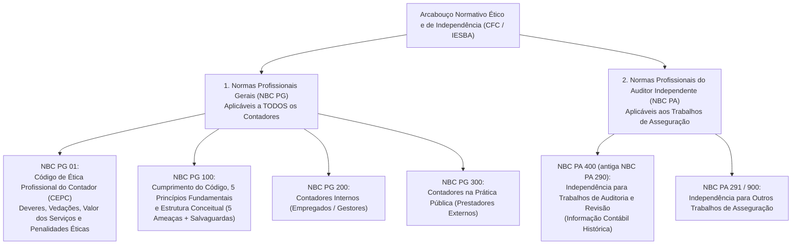
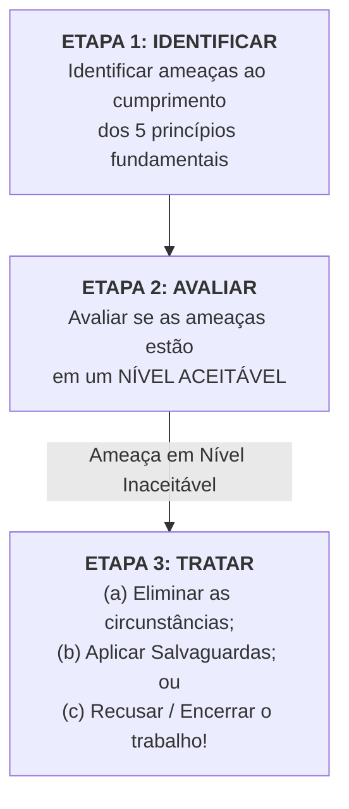

# 03. Código de Ética, Princípios Fundamentais e Normas de Independência (NBC PG 01, NBC PG 100, NBC PG 200/300 e NBC PA 400)

> A conduta ética do auditor assenta-se nos **cinco princípios fundamentais da NBC PG 100** (**Integridade, Objetividade, Competência Profissional e Devido Zelo, Sigilo Profissional e Comportamento Profissional**) e na aplicação obrigatória da **Estrutura Conceitual de Ética**, pela qual o profissional deve **identificar, avaliar e tratar as cinco categorias de ameaças** (**Interesse Próprio, Autorrevisão, Defesa de Interesse do Cliente, Familiaridade e Intimidação**). Nos trabalhos de auditoria e revisão (NBC PA 400 / NBC PA 290), exige-se **Independência de Pensamento** (atitude mental íntima) e **Independência na Aparência** (percepção de um terceiro razoável e informado), impondo salvaguardas rigorosas como o **rodízio obrigatório de sócios e responsáveis técnicos a cada 5 exercícios anuais** (com quarentena de 2 anos segundo a CVM) e a **proibição de honorários contingentes** (condicionados ao resultado).

---

## 1. Arquitetura Normativa da Ética Contábil e de Auditoria no Brasil

O arcabouço ético-profissional editado pelo Conselho Federal de Contabilidade (CFC), convergente com o *International Code of Ethics for Professional Accountants (including International Independence Standards)* do **IESBA / IFAC**, é estruturado em duas grandes famílias normativas:

---

## 2. Os 5 Princípios Éticos Fundamentais (NBC PG 100, Item 110.1 A1)

Todo profissional da contabilidade e todo auditor independente deve observar incondicionalmente **cinco princípios éticos fundamentais (`I - O - C - S - C`)**:

| Princípio Fundamental | Definição Normativa Exata (NBC PG 100, Seção 111 a 115) | Vedações e Desdobramentos Práticos em Provas |
| :--- | :--- | :--- |
| **1. Integridade** | Ser **franco e honesto** em todos os relacionamentos profissionais e comerciais. Envolve também transações justas e **verdadeiras**. | O profissional **NÃO deve associar-se intencionalmente** a relatórios, declarações ou comunicações que acredite: **(a)** conter informação **significativamente falsa ou enganosa**; **(b)** conter informações fornecidas de maneira **leviana (imprudente)**; ou **(c)** **omitir ou ocultar** informações necessárias quando essa omissão for enganosa. *(Exceção: se emitir relatório modificado apontando esse fato, não há violação da integridade!)* |
| **2. Objetividade** | Exercer o julgamento profissional ou comercial **sem comprometimento** devido a: **(a) viés (preconceito)**; **(b) conflito de interesses**; ou **(c) influência indevida** de (ou confiança indevida em) indivíduos, organizações, tecnologia ou outros fatores. | O profissional não deve realizar atividade profissional se uma circunstância ou relacionamento influenciar indevidamente seu julgamento profissional sobre aquela atividade. É a base sobre a qual se ergue a **Independência**! |
| **3. Competência Profissional e Devido Zelo** | **(a)** Alcançar e manter o **conhecimento e a habilidade profissionais** no nível necessário para assegurar que o cliente ou a organização empregadora receba serviço profissional competente, baseado nas normas técnicas e profissionais e na legislação aplicável; e **(b)** Agir **diligentemente** e de acordo com as normas técnicas e profissionais aplicáveis. | Subdivide-se em duas fases: **obtenção** da competência profissional e **manutenção** da competência profissional (consciência contínua e entendimento dos desenvolvimentos técnicos, profissionais e comerciais — Educação Profissional Continuada). Inclui assegurar que os subordinados recebam treinamento e supervisão apropriados. |
| **4. Sigilo Profissional (Confidencialidade)** | Respeitar o **sigilo das informações obtidas** em decorrência de relacionamentos profissionais e comerciais. | Proíbe divulgar informações confidenciais a terceiros sem autorização apropriada e específica, e proíbe **usar informações confidenciais para vantagem pessoal** do profissional ou de terceiros. **O dever de sigilo continua MESMO APÓS o término do relacionamento entre o profissional e o cliente ou empregador!** |
| **5. Comportamento Profissional** | Cumprir as **leis e os regulamentos pertinentes** e **evitar qualquer conduta** que o profissional sabe, ou deveria saber, que pode **desacreditar a profissão**. | Na divulgação e promoção de si mesmo e de seu trabalho (marketing/publicidade), o profissional **não deve**: **(a)** fazer alegações exageradas sobre os serviços que pode oferecer, suas qualificações ou experiência; nem **(b)** fazer referências depreciativas ou comparações sem fundamento ao trabalho de outros colegas. |

---

### 2.1 Exceções ao Dever de Sigilo Profissional (NBC PG 100, Item 114.1 A1)
O sigilo profissional é regra de ouro, mas **NÃO é absoluto**. A NBC PG 100 estabelece as circunstâncias em que o profissional da contabilidade é obrigado ou pode divulgar informações confidenciais:

1. **Divulgação exigida por lei:**
   * Produção de documentos ou outras evidências no curso de **processos judiciais**; ou
   * Divulgação às **autoridades públicas competentes** sobre infrações à lei que vierem à tona (ex.: comunicações obrigatórias ao COAF sobre indícios de lavagem de dinheiro nos termos da Lei nº 9.613/1998 e Resolução CFC nº 1.530/2017).
2. **Divulgação permitida por lei e autorizada pelo cliente ou pela organização empregadora.**
3. **Direito ou dever profissional de divulgar, quando não for proibido por lei:**
   * Para cumprir com a **revisão de qualidade** do Conselho Regional/Federal de Contabilidade (CRC/CFC — Revisão pelos Pares / CRE);
   * Para responder a **inquérito ou investigação** do CRC/CFC ou de outro órgão regulador (CVM, BACEN, SUSEP);
   * Para **proteger os interesses profissionais** de um profissional da contabilidade em processos legais/éticos; ou
   * Para cumprir com **normas técnicas e profissionais**, inclusive exigências de ética.

---

## 3. A Estrutura Conceitual de Ética: As 5 Ameaças e o Tratamento (NBC PG 100, Seção 120)

A Estrutura Conceitual especifica uma abordagem em **três etapas** para que o profissional cumpra os princípios fundamentais e os requisitos de independência:

### 3.1 O Critério do "Terceiro Razoável e Informado" (Item 120.5 A6)
Como saber se uma ameaça está ou não em um **nível aceitável**?
* **Nível Aceitável:** É o nível em que o profissional da contabilidade, usando o teste do **terceiro razoável e informado**, provavelmente concluiria que o profissional cumpre os princípios fundamentais (e é independente).
* **Terceiro Razoável e Informado:** É uma pessoa externa que pondera todos os fatos e circunstâncias relevantes que o profissional conhece, ou poderia razoavelmente esperar que conhecesse no momento da avaliação, sem precisar ser um contador, mas possuindo o conhecimento e a experiência necessários para entender e avaliar a adequação das conclusões do profissional de maneira imparcial.

---

### 3.2 As 5 Categorias Clássicas de Ameaças (`I - A - D - F - I`)
Toda questão de prova sobre ética e independência exige a classificação precisa das situações práticas dentro das **cinco categorias normativas de ameaças**:

| Categoria de Ameaça | Definição Normativa Exata (NBC PG 100, Item 120.6 A3) | Casos Clássicos Cobrados em Concursos (NBC PG 300 / NBC PA 400) |
| :--- | :--- | :--- |
| **1. Ameaça de Interesse Próprio** | Ameaça de que um **interesse financeiro ou outro interesse** influenciará de forma não apropriada o julgamento ou o comportamento do profissional. | • Sócio ou membro da equipe deter **ações, debêntures ou participação societária direta** no cliente de auditoria; • **Dependência econômica excessiva** dos honorários pagos por um único cliente; • **Honorários contingentes** (vinculados ao sucesso/resultado do trabalho); • Empréstimos ou garantias tomados junto ao cliente (salvo condições normais de mercado em bancos); • Negociação de futuro emprego na entidade auditada. |
| **2. Ameaça de Autorrevisão** | Ameaça de que o profissional **não avaliará apropriadamente os resultados de um julgamento feito anteriormente** ou de uma atividade realizada por ele mesmo, ou por outro indivíduo da firma ou organização empregadora, no qual o profissional confiará ao formar um julgamento como parte da prestação do serviço atual. | • Auditar demonstrações contábeis cuja **escrituração contábil ou cálculo de provisões/impostos** foi elaborado pela própria firma de auditoria; • Desenhar e implementar sistemas de tecnologia da informação (TI) que geram dados contábeis relevantes para o cliente e depois auditá-los; • Ex-diretor ou ex-contador do cliente ingressar na equipe de auditoria para auditar o período em que ele mesmo elaborou as demonstrações na empresa! |
| **3. Ameaça de Defesa de Interesse do Cliente** | Ameaça de que o profissional **promoverá a posição de um cliente** ou organização empregadora a ponto de **comprometer a sua objetividade**. | • Atuar como **advogado ou defensor técnico** do cliente de auditoria em litígios judiciais ou disputas tributárias perante tribunais ou terceiros; • Promover, negociar ou subscrever ações ou títulos mobiliários emitidos pelo cliente de auditoria no mercado de capitais. |
| **4. Ameaça de Familiaridade** | Ameaça de que, devido a um **relacionamento longo ou próximo** com um cliente ou organização empregadora, o profissional torne-se **solidário demais (excessivamente simpático)** aos interesses deles ou **aceite demais (sem o devido rigor crítico)** o seu trabalho. | • Permanência prolongada do mesmo Sócio do Trabalho ou pessoal sênior na auditoria do mesmo cliente por muitos anos (**exige Rodízio de Sócios!**); • Ter membro imediato ou próximo da família (cônjuge, filho, pais) atuando como diretor, conselheiro ou empregado em cargo que exerça influência significativa sobre as demonstrações do cliente; • Aceitação de **presentes ou hospitalidade** de valor significativo do cliente. |
| **5. Ameaça de Intimidação** | Ameaça de que o profissional será **dissuadido de agir de forma objetiva** devido a **pressões reais ou percebidas**, incluindo tentativas de exercer influência indevida sobre o profissional. | • Ameaça do cliente de **demitir ou substituir a firma de auditoria** caso o auditor insista em emitir opinião com ressalva ou exigir ajuste contábil; • Ameaça do cliente de mover **ação judicial** contra a firma; • Pressão agressiva do cliente para reduzir de forma não razoável a extensão dos procedimentos de auditoria a fim de cortar honorários; • Diretor dominante do cliente que coage psicologicamente os membros da equipe. |

---

### 3.3 As Três Formas de Tratar Ameaças que Não Estão em Nível Aceitável (Item 120.10)
Se o profissional determinar que as ameaças identificadas **não estão em um nível aceitável**, ele deve tratar as ameaças eliminando-as ou reduzindo-as a um nível aceitável por meio de:
1. **Eliminação das circunstâncias** (incluindo interesses ou relacionamentos) que estão criando as ameaças (ex.: vender imediatamente a ação detida ou afastar o profissional que possui parente na diretoria do cliente da equipe de trabalho);
2. **Aplicação de Salvaguardas**, quando disponíveis e passíveis de serem aplicadas, para reduzir as ameaças a um nível aceitável (ex.: designar um revisor adicional que não participou do serviço para revisar o trabalho de auditoria; fazer rotação do pessoal sênior); **OU**
3. **Recusa ou encerramento (renúncia) da atividade profissional específica**, quando as ameaças não puderem ser eliminadas e não existirem salvaguardas capazes de reduzi-las a um nível aceitável!

---

## 4. Independência na Auditoria e Revisão: NBC PA 400 (Antiga NBC PA 290)

### 4.1 As Duas Dimensões Indissociáveis da Independência (Item 400.5)
A auditoria independente exige que o auditor seja independente da entidade auditada. A independência compreende **duas dimensões cumulativas**:
1. **Independência de Pensamento (*Independence of Mind*):** Postura (estado mental) que permite a apresentação de conclusão **sem ser afetada por influências** que comprometam o julgamento profissional, permitindo que a pessoa atue com **integridade**, **objetividade** e **ceticismo profissional**.
2. **Independência na Aparência (*Independence in Appearance*):** A **evitação de fatos e circunstâncias tão significativos** que um **terceiro razoável e informado** provavelmente concluiria que a integridade, a objetividade ou o ceticismo profissional da firma, ou de membro da equipe de auditoria, ficaram comprometidos!

> [!IMPORTANT]
> **"Não basta à mulher de César ser honesta; ela precisa parecer honesta":**
> Em provas de concurso, se um auditor for 100% íntegro subjetivamente (possui independência de pensamento), mas for casado com a Diretora Financeira da companhia auditada, **há violação fatal da Independência na Aparência**! Ambas as dimensões são obrigatórias simultaneamente.

---

### 4.2 Período de Independência (Item 400.30)
Durante qual intervalo temporal a firma e a equipe de auditoria precisam ser independentes do cliente?
* A independência é exigida **durante AMBOS os períodos abaixo**:
  1. **O Período do Trabalho:** Começa quando a equipe de auditoria **inicia a execução dos serviços de auditoria** e termina quando **o relatório de auditoria é emitido** (exceto se o trabalho for de natureza recorrente, caso em que só termina com a notificação de uma das partes de que o relacionamento profissional chegou ao fim ou com a emissão do relatório final, o que for posterior); **E**
  2. **O Período Coberto pelas Demonstrações Contábeis:** O exercício social a que se referem as demonstrações auditadas (ex.: 01/01/2025 a 31/12/2025).

---

### 4.3 Situações Críticas de Independência na NBC PA 400 (e NBC PO 900)

#### 1. Fusões e Aquisições envolvendo Cliente de Auditoria (NBC PA 400, Seção 400.70)
Uma entidade pode se tornar **entidade relacionada** de um cliente de auditoria em decorrência de **fusão ou aquisição**. Interesses ou relacionamentos prévios ou atuais entre a firma (ou firma em rede) e essa entidade adquirida podem criar ameaças à independência. Nessa situação, a firma **deve**:
1. Tomar providências para **terminar (encerrar) os interesses ou relacionamentos que não são permitidos até a data efetiva da fusão ou aquisição**;
2. Caso o interesse ou relacionamento **não possa ser terminado, de forma razoável, até a data efetiva da fusão ou aquisição**:
   * **(a)** A firma deve **avaliar a ameaça** que é criada pelo interesse ou relacionamento; e
   * **(b)** A firma deve **discutir com os responsáveis pela governança** as razões pelas quais o interesse ou relacionamento não pode ser encerrado até a data efetiva da fusão/aquisição e a avaliação do nível da ameaça.
   * Se os responsáveis pela governança solicitarem que a firma continue como auditor, a firma só poderá fazê-lo se: **(i)** o interesse/relacionamento for encerrado o mais rápido possível (e **nunca além de 6 meses** após a data efetiva da fusão/aquisição); **(ii)** qualquer indivíduo com esse interesse/relacionamento não fizer parte da equipe de auditoria nem do EQCR; e **(iii)** forem aplicadas medidas transitórias apropriadas (como revisão do trabalho por profissional externo à equipe).

#### 2. Honorários, Dependência Econômica, Honorários Em Atraso e Honorários Contingentes (Seção 410)
* **Proporção Elevada de Honorários (Dependência Econômica):** Quando o total de honorários gerados por um único cliente de auditoria representa uma grande proporção do total de honorários da firma (ou da receita de um sócio individual), são criadas ameaças de **interesse próprio** e de **intimidação**!
  * **Regra dos 15% para Entidades de Interesse Público (Companhias Abertas):** Se, por **2 (dois) anos consecutivos**, o total de honorários de um cliente de auditoria que é entidade de interesse público representar **mais de 15%** do total de honorários recebidos pela firma, a firma deve divulgar esse fato aos responsáveis pela governança e aplicar salvaguardas (como uma revisão de controle de qualidade pré-emissão ou pós-emissão por profissional externo ou órgão regulador).
* **Honorários Vencidos (Em Atraso):** Se uma parcela significativa dos honorários devidos por um cliente de auditoria permanecer **não paga por longo período** (especialmente se não for paga **antes da emissão do relatório de auditoria do exercício seguinte**), cria-se uma **ameaça de interesse próprio** (pois o recebimento da dívida antiga passa a se assemelhar a um empréstimo concedido ao cliente!).
* **Honorários Contingentes (*Contingent Fees* — PROIBIÇÃO ABSOLUTA):**
  * Honorários contingentes são honorários calculados sobre uma base predeterminada relacionada ao **desfecho (resultado) de uma transação** ou ao **resultado dos serviços prestados** (ex.: cobrar $X\%$ sobre o lucro líquido apurado no balanço ou cobrar honorários condicionados à obtenção de financiamento bancário com base no relatório limpo).
  * **A firma NÃO DEVE cobrar, direta ou indiretamente, honorários contingentes por um trabalho de auditoria ou revisão!** *(Nota: Honorários fixados por juiz ou autoridade pública competente não são considerados honorários contingentes).*

#### 3. Presentes, Brindes e Hospitalidade (Seção 420)
* Aceitar produtos, serviços ou hospitalidade de um cliente de auditoria pode criar ameaças de **interesse próprio**, **familiaridade** ou **intimidação**.
* **Regra Imperativa:** A firma, a firma em rede ou o membro da equipe de auditoria **NÃO DEVE aceitar presentes e hospitalidade de um cliente de auditoria**, a menos que o valor seja **trivial e inconsequente** (insignificante aos olhos de um terceiro razoável e informado e sem intenção de influenciar comportamento).

#### 4. Litígio Real ou Ameaça de Litígio com o Cliente (Seção 430 e NBC PO 900)
* Quando ocorre um litígio judicial (ou ameaça real de litígio) entre o cliente de auditoria (ou sua administração) e a firma ou membro da equipe de auditoria, colocam-se ambos em **posições antagônicas (adversariais)**.
* Isso afeta a disposição da administração em fazer divulgações completas e cria graves ameaças de **interesse próprio** e de **intimidação**!
* **Fatores relevantes para avaliar o nível da ameaça:**
  1. A **materialidade** do litígio;
  2. Se o litígio se refere a um **trabalho de auditoria/asseguração anterior**; e
  3. Se o litígio envolve um **membro específico da equipe de auditoria** (caso em que uma salvaguarda possível, se o litígio for restrito àquele indivíduo, é removê-lo da equipe).

---

## 5. Rodízio (Rotação) Obrigatório de Auditores e Sócios no Brasil: CVM vs. BACEN vs. SUSEP vs. PREVIC

A **vinculação prolongada** de indivíduos ou da própria firma de auditoria com o mesmo cliente gera **ameaça de familiaridade** e de **interesse próprio**. No Brasil, além da NBC PA 400, os quatro grandes órgãos reguladores do sistema financeiro e de capitais impõem regras específicas de **rotação periódica** e **intervalo mínimo de retorno (quarentena / *cooling-off*)** que despencam em provas da FGV, FCC e Cebraspe:

| Órgão Regulador e Norma | Alvo da Substituição Obrigatória | Prazo Máximo de Permanência Consecutiva | Intervalo Mínimo para Retorno (Quarentena / *Cooling-off*) | Regra Especial com Comitê de Auditoria Estatutário (CAE) |
| :--- | :--- | :--- | :--- | :--- |
| **CVM** (Resolução CVM nº 23/2021 — Companhias Abertas) | **Firma de Auditoria** (Pessoa Jurídica ou PF) | **5 anos** consecutivos (Regra Geral). | **3 anos** para a Firma retornar. | Se a companhia possuir **Comitê de Auditoria Estatutário (CAE)** em funcionamento permanente e fizer o rodízio do Responsável Técnico/Equipe em até 5 anos, o prazo da **Firma** sobe para até **10 anos**! |
| **CVM** (Resolução CVM nº 23/2021 — Equipe) | **Responsável Técnico, Diretor, Gerente e Sócio** da equipe | **5 anos** consecutivos. | **3 anos** (Regra Geral da CVM) / **2 a 5 anos** (conforme função na NBC PA 400). | Obrigatório em até **5 anos** para permitir a extensão do prazo da firma para 10 anos com CAE. |
| **BACEN / CMN** (Resolução CMN nº 4.910/2021 — Bancos e IFs) | **Apenas a Equipe Gerencial** (Responsável técnico, diretor, gerente, supervisor e qualquer integrante com função de gerência). *(Nota: O CMN extinguiu o rodízio obrigatório da Firma PJ, exigindo apenas o rodízio da equipe!)* | Após emitidos relatórios relativos a **5 exercícios sociais completos** e consecutivos. | **3 exercícios sociais completos** contados a partir da data de substituição. | O rodízio da equipe gerencial em 5 exercícios (com quarentena de 3 exercícios) é a regra geral para todas as IFs. |
| **PREVIC / CNPC** (Resolução CNPC nº 44/2021 — Fundos de Pensão / EFPC) | **Responsável Técnico, Diretor, Gerente e Supervisor** da equipe de auditoria. | Após emitidos relatórios relativos a **5 exercícios sociais consecutivos**. | **3 exercícios sociais completos** para o retorno. | Exige observância estrita de independência, vedação de consultoria conflitante e comunicação aos órgãos de governança e à PREVIC. |
| **NBC PA 400** (Padrão Internacional IESBA — Entidades de Interesse Público) | **Sócios-Chave da Auditoria** (*Engagement Partner*, *EQCR* e outros sócios-chave). | Máximo acumulado de **7 anos** (se a legislação local não fixar prazo menor como o de 5 anos no Brasil). | • **5 anos** de *cooling-off* se atuou como **Sócio do Trabalho**; • **3 anos** de *cooling-off* se atuou como **Revisor de Qualidade (EQCR)**; • **2 anos** de *cooling-off* para outros sócios-chave. | Proíbe que o sócio em quarentena participe da auditoria, preste consultoria técnica sobre o trabalho ou influencie o resultado. |

> [!CAUTION]
> **Pegadinha de Ouro FGV (Resolução CMN nº 4.910/2021 — BACEN):**
> Nas provas recentes da FGV (como na questão `Q4369448` de 2026), a banca cobra a regra do Banco Central (Resolução CMN nº 4.910/2021):
> 1. Substituição do responsável técnico, diretor, gerente, supervisor e qualquer integrante com função de gerência após relatórios relativos a **5 exercícios sociais completos e consecutivos** $\rightarrow$ **VERDADEIRO**!
> 2. Intervalo mínimo de retorno (*quarentena*) de **3 exercícios sociais completos** contados da substituição $\rightarrow$ **VERDADEIRO**!
> 3. A banca inventa uma terceira frase dizendo que *"quando a dispensa decorrer de decisão unilateral da instituição, esta deverá aguardar 10 anos para recontratar o auditor"* $\rightarrow$ **FALSO!** Não existe essa quarentena punitiva de 10 anos na Resolução CMN nº 4.910/2021!

---

## 6. Código de Ética Profissional do Contador — NBC PG 01: Deveres, Vedações e Penalidades

Além da NBC PG 100 e da NBC PA 400, todo auditor independente no Brasil é um Contador regido pela **NBC PG 01 (Código de Ética Profissional do Contador — CEPC)** e pelo **Decreto-Lei nº 9.295/1946**.

### 6.1 Principais Deveres e Vedações na NBC PG 01 (Itens 4 e 5)
* **É DEVER do Contador (Item 4):**
  * Exercer a profissão com zelo, diligência, honestidade e capacidade técnica;
  * **Guardar sigilo** sobre o que souber em razão do exercício profissional, inclusive no âmbito do serviço público, ressalvados os casos previstos em lei ou quando solicitado por autoridades competentes (entre estas, os **Conselhos Federal e Regionais de Contabilidade**);
  * Informar a quem de direito, obrigatoriamente, fatos que conheça e que considere em condições de **prejudicar o usuário de seu serviço**, decidindo por **não ser conivente com o erro ou com atos infringentes de normas técnicas ou legais**;
  * Comunicar imediatamente ao cliente ou ao empregador, em **documento reservado**, eventual circunstância adversa que possa gerar riscos e ameaças ou influir na decisão daqueles que são usuários dos relatórios e serviços contábeis;
  * **Transferir o contrato de serviços a seu substituto**, ou entregar documentos e informações ao cliente, quando solicitado ou quando deixar de prestar os serviços, **sendo VEDADO reter documentos ou arquivos contábeis do cliente sob a alegação de inadimplência de honorários**!
* **É VEDADO ao Contador (Item 5):**
  * Assinar documentos ou peças contábeis elaborados por outrem **alheio à sua orientação, supervisão ou revisão**;
  * Exercer a profissão quando **impedido**, ou facilitar, por qualquer meio, o seu exercício aos **não habilitados ou impedidos** (acobertamento de exercício ilegal);
  * Auferir qualquer provento em função do exercício profissional que não decorra exclusivamente de sua prática lícita, ou perceber comissão/vantagem em prejuízo do cliente;
  * **Aviltar (rebaixar de forma vil/indigna) os valores dos serviços profissionais** ou fazer concorrência desleal;
  * Iludir ou tentar iludir a boa-fé de cliente, empregador ou terceiros, alterando ou deturpando o exato teor de documentos, bem como fornecendo falsas informações ou elaborando peças contábeis inidôneas;
  * **Reter abusivamente livros, papéis ou documentos (físicos ou eletrônicos)** confiados à sua guarda pelo cliente, mesmo em caso de falta de pagamento de honorários! *(Nota: Lembre-se da diferença! Os livros e documentos originais do cliente pertencem ao cliente e não podem ser retidos; já os **papéis de trabalho elaborados pelo auditor** pertencem à firma de auditoria — NBC PA 01).*

---

### 6.2 As Três Penalidades Ético-Disciplinares da NBC PG 01 (Item 20) vs. Sanções Técnicas do Decreto-Lei nº 9.295/1946

> [!WARNING]
> **Distinção Clássica de Prova: Penalidades Éticas (NBC PG 01) vs. Penalidades Técnicas/Legais (DL 9.295/46)**
> As bancas adoram perguntar quais são as penalidades aplicáveis por infração especificamente ao **Código de Ética (NBC PG 01)**, tentando confundir o candidato com as penas de multa ou suspensão/cassação do exercício profissional previstas no Decreto-Lei nº 9.295/1946!

| Esfera Normativa | Penalidades Previstas | Quem Aplica e Observações Críticas |
| :--- | :--- | :--- |
| **Infração ao Código de Ética (NBC PG 01, Item 20)** **Mnemônico: `A - C - C` (Três Penas Morais!)** | 1. **Advertência Reservada**; 2. **Censura Reservada**; 3. **Censura Pública**. | Aplicadas pelos Tribunais Regionais de Ética e Disciplina (TRED / CRC), cabendo recurso ao Tribunal Superior de Ética e Disciplina (TSED / CFC). **Atenção:** A NBC PG 01 **NÃO** prevê multa nem cassação; ela prevê apenas as **3 penas éticas (`Advertência Reservada`, `Censura Reservada` e `Censura Pública`)**! |
| **Infração Legal e Técnica ao Decreto-Lei nº 9.295/1946 (Art. 27)** | • **Multas** pecuniárias (alíneas *a*, *b*, *c*); • **Suspensão do exercício da profissão** (por até 2 anos ou até aprovação em exame de suficiência na incapacidade técnica); • **Cassação do exercício profissional** (com aprovação de $2/3$ dos membros do CRC e homologação obrigatória de $2/3$ do Plenário do CFC!). | Aplicadas pelo CRC/CFC por infrações legais, fraude, falsificação ou incapacidade técnica reiterada. |

#### Circunstâncias Atenuantes e Agravantes no Julgamento Ético (NBC PG 01, Itens 21 e 22)
* **Atenuantes (Reduzem a pena):**
  1. Ação desenvolvida em **defesa de prerrogativa profissional**;
  2. **Ausência de punição ética anterior** (primariedade ética);
  3. **Prestação de serviços relevantes à Contabilidade**; e
  4. Aplicação de **salvaguardas**.
* **Agravantes (Aumentam a pena):**
  1. Ação ou omissão que **macule publicamente a imagem do contador**;
  2. **Punição ética anterior transitada em julgado** (reincidência ética); e
  3. **Gravidade da infração**.

---

## 7. Armadilhas de Banca ("Cascas de Banana")

> [!WARNING]
> **Armadilha 01 — "Ter ceticismo profissional é um dos 5 princípios fundamentais de ética da NBC PG 100":**
> **FALSO!** (Cobrado literalmente na questão `Q3606539` de 2025!). Os **5 princípios fundamentais de ética** da NBC PG 100 são: **(1) Integridade, (2) Objetividade, (3) Competência Profissional e Devido Zelo, (4) Sigilo Profissional (Confidencialidade) e (5) Comportamento Profissional**. O **Ceticismo Profissional** (e a Independência) apoia-se nesses princípios (especialmente na Integridade e na Objetividade), mas **não é listado como um dos 5 princípios fundamentais** do Código de Ética!
>
> **Armadilha 02 — "A independência está vinculada ao princípio da impessoalidade na NBC PA 400":**
> **FALSO!** (Cobrado literalmente pela FGV na questão `Q4368104` de 2026!). Segundo a NBC PA 400 (item 400.5 A1), a independência está vinculada aos princípios fundamentais da **objetividade e da integridade** (e **não** da "impessoalidade", que é princípio constitucional da Administração Pública do art. 37 da CF/88!).
>
> **Armadilha 03 — "A independência deve ser mantida durante o período de contratação, o período do trabalho e o período das demonstrações":**
> **FALSO!** (Cobrado pela FGV na mesma questão `Q4368104` de 2026!). Segundo o item 400.30 R400.30 da NBC PA 400, a independência deve ser mantida durante **dois** períodos: **(a) o período do trabalho** e **(b) o período coberto pelas demonstrações contábeis** (não existe "período de contratação" autônomo na regra!).
>
> **Armadilha 04 — "A prática de autorrevisão, quando acompanhada de salvaguardas, não representa uma ameaça à independência":**
> **FALSO!** (Cobrado na questão `Q3606538` de 2025!). A autorrevisão **é, por definição, uma das 5 categorias de ameaças à independência**! As salvaguardas servem para **reduzir a ameaça existente a um nível aceitável** (quando permitido pela norma), mas jamais descaracterizam a existência da ameaça.

---

## 8. Mnemônicos & Âncoras de Memória

| Gatilho / Alvo de Prova | Mnemônico / Regra de Bolso | Decodificação Rápida |
| :--- | :--- | :--- |
| **5 Princípios Éticos Fundamentais (NBC PG 100)** | **C - O - I - S - C** *(Cuidado: Ceticismo e Impessoalidade NÃO entram!)* | **C**ompetência profissional e devido zelo, **O**bjetividade, **I**ntegridade, **S**igilo profissional (Confidencialidade) e **C**omportamento profissional. |
| **5 Ameaças Éticas e à Independência** | **I - A - D - F - I** | **I**nteresse Próprio, **A**utorrevisão, **D**efesa de Interesse do Cliente, **F**amiliaridade e **I**ntimidação. |
| **2 Pilares da Independência (NBC PA 400)** | **Mente + Aparência (Vinculada a O + I)** | **Independência de Pensamento** + **Independência na Aparência** (vinculada exclusivamente à **O**bjetividade e **I**ntegridade). |
| **2 Períodos da Independência (NBC PA 400)** | **Trabalho + Demonstrações** | **(1) Período do Trabalho** (do início dos serviços até a emissão do relatório) + **(2) Período Coberto pelas Demonstrações Contábeis**. |
| **3 Penas Éticas da NBC PG 01** | **A - C - C** *(1 Advertência + 2 Censuras)* | **A**dvertência Reservada (**nunca** existe advertência pública!), **C**ensura Reservada e **C**ensura Pública. |
| **Rodízio BACEN / PREVIC (5 x 3)** | **5 Exercícios de Trabalho $\rightarrow$ 3 Exercícios de Quarentena** | Substituição da equipe gerencial após **5 exercícios sociais completos e consecutivos**, com intervalo mínimo de **3 exercícios** para retorno. |

---

## 9. Bateria de Questões Oficiais Comentadas Alternativa por Alternativa

### [Questão 01](https://www.qconcursos.com/questoes-de-concursos/questoes/0b6f6897-c3) — [FGV — CFC / Exame de Qualificação Técnica Geral (QTG) — 2026]

Além de ser de interesse público, exige-se que os contadores que prestam serviços, denominados contadores externos, atuem com independência ao realizar trabalhos de auditoria e revisão. A NBC PA 400 – INDEPENDÊNCIA PARA TRABALHO DE AUDITORIA E REVISÃO dispõe exaustivamente sobre o assunto.

Considerando o exposto nessa norma, analise as afirmativas a seguir e assinale (V) para a verdadeira e (F) para a falsa.

(   ) A independência em auditoria pode ser ameaçada por conflitos de interesse, familiaridade ou pressões externas. Identificar e aplicar salvaguardas contra tais ameaças é responsabilidade do auditor.
(   ) A independência está vinculada aos princípios da objetividade, da integridade e da impessoalidade.
(   ) A independência compreende a independência de pensamento e a aparência de independência.
(   ) A independência deve ser mantida durante o período de contratação, o período do trabalho e o período coberto pelas demonstrações contábeis.

As afirmativas são, respectivamente,
* **A)** V – F – V – F.
* **B)** V – V – F – F.
* **C)** F – V – F – V.
* **D)** F – F – V – V.
* **E)** V – F – F – V.

#### Gabarito Oficial e Dissecação Técnica: **Alternativa A**
* **1ª Afirmativa — VERDADEIRA (V):** Pela estrutura conceitual aplicada à independência (NBC PA 400, seção 400.12), cabe ao auditor identificar ameaças (interesse próprio, autorrevisão, defesa de interesse do cliente, familiaridade e intimidação/pressões externas), avaliá-las e tratá-las mediante salvaguardas quando não estiverem em nível aceitável.
* **2ª Afirmativa — FALSA (F):** Pegadinha clássica da FGV! Segundo o item 400.5 A1 da NBC PA 400, *"A independência está vinculada aos princípios da **objetividade e da integridade**"*. O princípio da "impessoalidade" pertence ao Direito Administrativo (art. 37 da CF/88) e não integra os princípios fundamentais da NBC PG 100 / NBC PA 400!
* **3ª Afirmativa — VERDADEIRA (V):** Literalidade do item 400.5 A1 da NBC PA 400: a independência compreende **(a) Independência de pensamento** e **(b) Aparência de independência**.
* **4ª Afirmativa — FALSA (F):** Segundo o item R400.30 da NBC PA 400, a independência deve ser mantida durante **dois** períodos: **(a) o período do trabalho** e **(b) o período coberto pelas demonstrações contábeis**. A norma não menciona "período de contratação". Portanto, a sequência correta é **V – F – V – F** (**Alternativa A**).

> **Fique Ligado:** A independência vincula-se aos princípios da objetividade e da integridade (não há impessoalidade na norma contábil); abrange independência de pensamento e aparência de independência.

---

### [Questão 02](https://www.qconcursos.com/questoes-de-concursos/questoes/22c4a4a2-c4) — [FGV — CFC / Banco Central do Brasil (BCB) — 2026]

A Resolução CMN nº 4.910/2021 e alterações, editada pelo Conselho Monetário Nacional e aplicada pelo Banco Central do Brasil, estabelece as regras sobre a prestação de serviços de auditoria independente para as instituições financeiras e demais entidades autorizadas a funcionar pelo Banco Central do Brasil.

Com relação à substituição periódica do auditor independente em instituições financeiras e demais instituições autorizadas a funcionar pelo Banco Central do Brasil, avalie, com base na Resolução CMN nº 4.910/2021, as afirmativas a seguir e assinale (V) para a verdadeira e (F) para a falsa.

(   ) As instituições devem proceder à substituição do responsável técnico, diretor, gerente, supervisor e de qualquer outro integrante, com função de gerência, da equipe envolvida nos trabalhos de auditoria, após emitidos relatórios relativos a cinco exercícios sociais completos e consecutivos.
(   ) As instituições devem observar o intervalo mínimo de três exercícios sociais completos para o retorno do responsável técnico, diretor, gerente, supervisor ou qualquer outro integrante, com função de gerência, da equipe envolvida nos trabalhos de auditoria, contados a partir da data de substituição.
(   ) Quando a dispensa da auditoria independente decorrer de decisão unilateral da instituição, esta deverá aguardar o intervalo mínimo de dez anos para ser auditada, novamente, pelo auditor independente que foi substituído.

As afirmativas são, respectivamente,
* **A)** V – V – V.
* **B)** V – V – F.
* **C)** V – F – V.
* **D)** F – V – V.
* **E)** V – F – F.

#### Gabarito Oficial e Dissecação Técnica: **Alternativa B**
* **1ª Afirmativa — VERDADEIRA (V):** Reproduz exatamente o art. 12, *caput*, da Resolução CMN nº 4.910/2021: substituição obrigatória do responsável técnico, diretor, gerente, supervisor e qualquer outro integrante com função de gerência da equipe após emitidos relatórios relativos a **5 (cinco) exercícios sociais completos e consecutivos**.
* **2ª Afirmativa — VERDADEIRA (V):** Reproduz exatamente o art. 12, § 2º, da Resolução CMN nº 4.910/2021: o retorno dos profissionais substituídos exige o intervalo mínimo (*quarentena*) de **3 (três) exercícios sociais completos**, contados a partir da data da substituição.
* **3ª Afirmativa — FALSA (F):** Invenção normativa da banca! Não existe qualquer exigência de aguardar 10 anos em caso de dispensa unilateral pela instituição financeira. Sequência correta: **V – V – F** (**Alternativa B**).

> **Fique Ligado:** Ameaças de familiaridade e interesse próprio surgem em relacionamentos pessoais ou comerciais de longo prazo com clientes de auditoria; devem ser tratadas por salvaguardas ou recusa do trabalho.

---

### [Questão 03](https://www.qconcursos.com/questoes-de-concursos/questoes/0b823bbe-c3) — [FGV — CFC / Exame de Qualificação Técnica Geral (QTG) — 2026]

A NBC PA 400 dispõe sobre a independência para trabalho de auditoria e revisão. A entidade pode se tornar entidade relacionada de cliente de auditoria em decorrência de fusão ou aquisição. A ameaça à independência e, portanto, à capacidade da firma de continuar o trabalho de auditoria, pode ser criada por interesses ou relacionamentos prévios ou atuais entre a firma ou a firma em rede e essa entidade relacionada.

A respeito das situações em que a fusão de cliente cria ameaça, avalie se a firma deve:

I. Tomar providências para terminar com os interesses e os relacionamentos que não são permitidos até a data efetiva da fusão ou aquisição.
II. Verificar se o interesse ou o relacionamento não pode ser terminado, de forma razoável, até a data efetiva da fusão ou aquisição, e se este for o caso, a firma deve avaliar a ameaça que é criada pelo interesse ou pela relação.
III. Verificar se o interesse ou o relacionamento não pode ser terminado, de forma razoável, até a data efetiva da fusão ou aquisição, e se este for o caso, a firma deve discutir com os responsáveis pela governança as razões pelas quais o interesse ou o relacionamento não pode ser terminado, de forma razoável, até a data efetiva da fusão ou aquisição e a avaliação do nível da ameaça.

Está correto o que se afirma em
* **A)** I, apenas.
* **B)** I e II, apenas.
* **C)** III, apenas.
* **D)** I e III, apenas.
* **E)** I, II e III.

#### Gabarito Oficial e Dissecação Técnica: **Alternativa E**
* **Análise dos Itens I, II e III (Todos Corretos):** Os três itens reproduzem com exatidão os dispositivos da **Seção 400.70 (R400.71 a R400.73) da NBC PA 400**: quando uma entidade passa a ser parte relacionada de um cliente de auditoria por fusão ou aquisição, a firma deve extinguir qualquer interesse ou relacionamento proibido até a data efetiva da operação (Item I). Se não for razoavelmente possível encerrá-lo até essa data, a firma deve avaliar a ameaça gerada (Item II) e discutir com os responsáveis pela governança as razões da impossibilidade de encerramento imediato e a avaliação do nível da ameaça (Item III), encerrando o vínculo no máximo em até 6 meses.

> **Fique Ligado:** O dever de sigilo profissional proíbe o uso de informações confidenciais para vantagem pessoal do auditor ou de terceiros; subsiste mesmo após o término do vínculo profissional.

---

### [Questão 04](https://www.qconcursos.com/questoes-de-concursos/questoes/0b844a41-c3) — [FGV — CFC / Exame de Qualificação Técnica Geral (QTG) — 2026]

A NBC PO 900 dispõe sobre a independência para trabalho de asseguração diferente de auditoria e revisão. A relação entre a administração do cliente e os membros da equipe de asseguração deve ser caracterizada pela transparência completa e pela divulgação integral de todos os aspectos das operações do cliente. Posições contrárias podem resultar de litígios reais ou ameaças de litígio entre cliente de asseguração e a firma ou membro da equipe de asseguração. Essas posições contrárias podem afetar a disposição da administração para fazer divulgações completas e criar ameaças de interesse próprio e de intimidação.

Julgue se os fatores relevantes na avaliação do nível ou solução dessas ameaças incluem:

I. A materialidade do litígio.
II. Se o litígio se refere ao trabalho de asseguração anterior.
III. Se o litígio envolve membro da equipe de asseguração.

Está correto o que se apresenta em
* **A)** I, apenas.
* **B)** I e II, apenas.
* **C)** I e III, apenas.
* **D)** II e III, apenas.
* **E)** I, II e III.

#### Gabarito Oficial e Dissecação Técnica: **Alternativa E**
* **Análise dos Itens I, II e III (Todos Corretos):** De acordo com a Seção 930 da NBC PO 900 (e Seção 430 da NBC PA 400), quando há litígio ou ameaça de litígio entre o cliente e a firma/equipe, geram-se ameaças de **interesse próprio** e de **intimidação**. Os fatores expressamente previstos na norma para avaliar o nível dessas ameaças (e se uma salvaguarda como afastar um membro específico da equipe é suficiente) incluem: **(I) a materialidade do litígio**, **(II) se o litígio refere-se a um trabalho de asseguração/auditoria anterior**, e **(III) se o litígio envolve um membro específico da equipe**.

> **Fique Ligado:** Salvaguardas são ações ou medidas que reduzem as ameaças a um nível aceitável; caso nenhuma salvaguarda elimine ou reduza a ameaça, o auditor DEVE recusar ou renunciar ao trabalho.

---

### [Questão 05](https://www.qconcursos.com/questoes-de-concursos/questoes/1f2d2c0f-c3) — [FGV — CFC / Comissão de Valores Mobiliários (CVM) — 2026]

Em relação aos trabalhos de asseguração diferentes de auditoria e revisão, que incluem auditoria de elementos, contas ou itens específicos das demonstrações contábeis e asseguração de desempenho com base nos principais indicadores de desempenho da empresa, analise os itens a seguir:

I. Uma firma de auditoria foi contratada para realizar um trabalho de asseguração diferente de auditoria e revisão. No decorrer do processo, identificou-se que um diretor do cliente de asseguração é familiar próximo de membro da equipe de asseguração. Em função do tipo de trabalho para o qual a firma de auditoria foi contratada, não há necessidade de remoção da pessoa da equipe de asseguração.
II. As normas de independência para trabalhos de auditoria e revisão estão descritas na NBC PA 400 – Independência para Trabalho de Auditoria e Revisão. Entretanto, se a firma de auditoria realiza trabalho de asseguração e trabalho de auditoria ou de revisão para o mesmo cliente, prevalecem os requisitos da NBC PO 900 – Independência para Trabalho de Asseguração Diferente de Auditoria e Revisão.
III. A ameaça de interesse próprio, de autorrevisão ou de familiaridade pode ser criada se membro da equipe de asseguração atuou recentemente como conselheiro ou diretor, ou empregado do cliente de asseguração.
IV. Uma firma de auditoria foi contratada para executar um trabalho de asseguração referente a um relatório preparado por um consultor ambiental sobre as práticas de sustentabilidade do cliente de asseguração. Nesse caso, o consultor ambiental é a parte responsável pelas informações do objeto, mas a empresa é a responsável pelo objeto (as práticas de sustentabilidade).

Estão corretos os itens
* **A)** I e II, apenas.
* **B)** I e III, apenas.
* **C)** II e III, apenas.
* **D)** II e IV, apenas.
* **E)** III e IV, apenas.

#### Gabarito Oficial e Dissecação Técnica: **Alternativa E**
* **Item I (Incorreto):** Mesmo em trabalhos de asseguração diferentes de auditoria e revisão (NBC PO 900, Seção 921), ter um familiar imediato ou próximo como conselheiro ou diretor do cliente gera grave ameaça de interesse próprio, familiaridade ou intimidação, exigindo salvaguardas como a **remoção do indivíduo da equipe de asseguração**.
* **Item II (Incorreto):** Inverteu a hierarquia de rigor! Quando a firma realiza simultaneamente um trabalho de auditoria/revisão (NBC PA 400) e outro trabalho de asseguração (NBC PO 900) para o mesmo cliente, **prevalecem os requisitos mais rigorosos da NBC PA 400** (e não da NBC PO 900!).
* **Item III (Correto):** Atuação recente de membro da equipe como conselheiro, diretor ou empregado do cliente cria ameaças de **interesse próprio, autorrevisão e familiaridade** (NBC PO 900, Seção 922 / NBC PA 400, Seção 522).
* **Item IV (Correto):** Distinção perfeita entre o **responsável pelo objeto** (a empresa, que executa as práticas de sustentabilidade) e o **mensurador/avaliador responsável pela informação sobre o objeto** (o consultor ambiental que preparou o relatório). Logo, apenas **III e IV** estão corretos (**Alternativa E**).

> **Fique Ligado:** Ameaça de autorrevisão: ocorre quando o auditor avalia resultados de julgamento ou serviço anterior prestado por ele mesmo ou por sua firma.

---

### [Questão 06](https://www.qconcursos.com/questoes-de-concursos/questoes/ab862fdf-c4) — [FGV — CFC / Superintendência Nacional de Previdência Complementar (Previc) — 2026]

Um auditor independente, responsável pelos trabalhos de auditoria das demonstrações contábeis de uma entidade fechada de previdência complementar (EFPC), foi procurado pela diretoria da entidade para discutir a renovação do contrato de prestação de serviços. Durante a reunião, alguns dirigentes sustentaram que, em razão do longo relacionamento profissional existente entre as partes, não haveria necessidade de observar requisitos específicos relativos à independência do auditor, à comunicação com os órgãos de governança ou à substituição periódica de determinados integrantes da equipe de auditoria.

Além disso, foi sugerido que a contratação de serviços adicionais de consultoria pela mesma firma de auditoria poderia ocorrer sem qualquer avaliação dos potenciais riscos à independência, desde que os trabalhos fossem executados por profissionais distintos daqueles envolvidos na auditoria das demonstrações contábeis. Por fim, um dos administradores afirmou que eventuais irregularidades ou situações relevantes identificadas pelo auditor durante os trabalhos deveriam ser comunicadas exclusivamente à administração da entidade, por se tratar de matéria de natureza interna da EFPC.

Nesse contexto, à luz das disposições da Resolução CNPC nº 44/2021, que dispõe sobre a prestação de serviços de auditoria independente para as entidades fechadas de previdência complementar e dá outras providências, o auditor independente deverá concluir que
* **A)** a prestação de serviços adicionais à EFPC pela firma de auditoria é sempre permitida, desde que sejam executados por profissionais distintos daqueles responsáveis pelos trabalhos de auditoria das demonstrações contábeis.
* **B)** a comunicação de irregularidades ou de situações relevantes identificadas nos trabalhos deve restringir-se à administração da entidade, sendo dispensável a interação com os órgãos de governança e com a autoridade supervisora competente.
* **C)** a manutenção de um relacionamento profissional prolongado com a entidade afasta a necessidade de observância dos requisitos de independência, desde que a administração esteja satisfeita com os serviços prestados pela auditoria.
* **D)** a prestação dos serviços de auditoria independente exige a observância dos requisitos de independência e de comunicação, bem como a avaliação de situações que possam comprometer a objetividade e a independência do auditor.
* **E)** a contratação de serviços de consultoria pela mesma firma de auditoria elimina quaisquer riscos à independência quando os trabalhos forem executados por equipes distintas e aprovados pela alta administração da empresa contratante.

#### Gabarito Oficial e Dissecação Técnica: **Alternativa D**
* **Análise das Alternativas A e E (Incorretas):** A prestação de serviços de não asseguração (como consultoria atuarial, contábil ou de gestão) para o mesmo cliente de auditoria — ainda que por equipes distintas da mesma firma ou rede — pode gerar **ameaça inaceitável de autorrevisão**, sendo vedada quando comprometer a independência (NBC PA 400, Seção 600 e Resolução CNPC nº 44/2021).
* **Análise da Alternativa B (Incorreta):** O auditor independente de EFPC tem dever legal e regulatório de comunicar irregularidades relevantes aos órgãos de governança (Conselho Deliberativo / Conselho Fiscal) e à **PREVIC**.
* **Análise da Alternativa C (Incorreta):** O relacionamento prolongado **aumenta** a ameaça de familiaridade (exigindo rodízio da equipe em 5 exercícios), jamais afastando o dever de independência.
* **Análise da Alternativa D (Correta):** Sintetiza perfeitamente os deveres de independência, avaliação de ameaças à objetividade e comunicação obrigatória à governança e ao órgão supervisor.

> **Fique Ligado:** Presentes e hospitalidade: o auditor NÃO deve aceitar presentes ou favores que possam influenciar ou aparentar influenciar o seu julgamento profissional, exceto se triviais e inconsequentes.

---

### [Questão 07](https://www.qconcursos.com/questoes-de-concursos/questoes/29bb14fa-93) — [Quadrix — CRP-SP / Especialista em Gestão - Contador — 2025]

Quanto aos objetivos e aos princípios da auditoria independente, julgue o item seguinte.

A prática de autorrevisão, quando adequadamente controlada e acompanhada por salvaguardas eficazes, não representa, por si só, uma ameaça à independência do auditor.
* **C)** Certo
* **E)** Errado

#### Gabarito Oficial e Dissecação Técnica: **Errado (E)**
* **Fundamentação Técnica:** De acordo com a NBC PG 100 (item 120.6 A3) e a NBC PA 400, a **autorrevisão** (avaliar os resultados de um julgamento ou serviço feito anteriormente pelo próprio profissional ou por sua firma) **é, por sua própria natureza normativa, uma das cinco categorias de ameaças à independência**! O uso de salvaguardas (quando cabível) serve para **tratar e reduzir a ameaça existente a um nível aceitável**, mas não faz com que a autorrevisão deixe de ser uma ameaça.

> **Fique Ligado:** Competência e zelo devido: o profissional deve manter conhecimento atualizado e agir com diligência de acordo com as normas técnicas e profissionais aplicáveis.

---

### [Questão 08](https://www.qconcursos.com/questoes-de-concursos/questoes/29bd9c92-93) — [Quadrix — CRP-SP / Especialista em Gestão - Contador — 2025]

Quanto aos objetivos e aos princípios da auditoria independente, julgue o item seguinte.

Ter ceticismo não é um dos princípios fundamentais de ética profissional relevantes para o auditor na condução de trabalhos de auditoria das demonstrações contábeis.
* **C)** Certo
* **E)** Errado

#### Gabarito Oficial e Dissecação Técnica: **Certo (C)**
* **Fundamentação Técnica:** Questão de altíssimo nível que separa quem decorou superficialmente de quem domina a literalidade da **NBC PG 100 (item 110.1 A1)** e da **NBC TA 200 (item A14)**! Os **cinco princípios fundamentais de ética profissional** são taxativamente: **(1) Integridade, (2) Objetividade, (3) Competência profissional e devido zelo, (4) Sigilo profissional (Confidencialidade) e (5) Comportamento profissional**. O **ceticismo profissional** é uma postura técnica exigida pela NBC TA 200 (sustentada pela integridade e objetividade), mas **não constitui um dos cinco princípios fundamentais de ética profissional** do Código de Ética! Por isso, a afirmação de que *"ter ceticismo não é um dos princípios fundamentais de ética profissional"* está **CERTA**.

> **Fique Ligado:** Comportamento profissional: o auditor deve cumprir leis e regulamentos e evitar qualquer conduta que possa desacreditar a profissão contábil.

---

### [Questão 09](https://www.qconcursos.com/questoes-de-concursos/questoes/f1211899-5c) — [FGV — Receita Federal / Auditor-Fiscal — 2023]

A NBC PG 100 (R1) — Diretrizes Gerais para o Exercício Profissional estabelece a estrutura conceitual que deve ser aplicada pelos contadores para identificar, avaliar e tratar ameaças ao cumprimento dos princípios fundamentais de ética profissional. Associe as categorias de ameaças da Coluna I às situações práticas descritas na Coluna II:

**Coluna I**
1. Ameaça de interesse próprio.
2. Ameaça de autorrevisão.
3. Ameaça de defesa de interesse do cliente (*advocacy*).
4. Ameaça de familiaridade.
5. Ameaça de intimidação.

**Coluna II**
( ) A firma de auditoria atua como defensora da entidade auditada em um litígio judicial tributário contra a Receita Federal.
( ) Um membro da equipe de auditoria tem cônjuge que exerce o cargo de diretora financeira da companhia auditada.
( ) O auditor é pressionado pelo conselho da entidade com a ameaça de demissão e substituição da firma caso não emita opinião sem ressalvas.
( ) A firma de auditoria aufere 80% do total de sua receita anual de um único cliente de auditoria.
( ) O auditor testa os controles internos de um sistema de custos que foi desenhado e implementado pela sua própria firma de auditoria no ano anterior.

Assinale a opção que apresenta a sequência correta, de cima para baixo:

* **A)** 3 — 4 — 5 — 1 — 2.
* **B)** 1 — 2 — 3 — 4 — 5.
* **C)** 3 — 1 — 5 — 4 — 2.
* **D)** 2 — 4 — 5 — 1 — 3.
* **E)** 4 — 3 — 1 — 5 — 2.

#### Gabarito e Dissecação Técnica: **Alternativa A**

**Comentário Analítico Alternativa por Alternativa:**
* **(3) Defesa de interesse do cliente (*Advocacy*):** Ocorre quando o contador promove a posição do cliente a ponto de comprometer a sua objetividade (ex: atuar como advogado ou porta-voz em litígios judiciais).
* **(4) Familiaridade:** Decorre de relacionamento próximo ou longo com o cliente, levando o auditor a ser excessivamente complacente ou solidário (cônjuge na diretoria financeira).
* **(5) Intimidação:** Ocorre quando o auditor é dissuadido de agir objetivamente por causa de pressões reais ou percebidas, incluindo tentativas de exercer influência indevida (ameaça de rescisão contratual).
* **(1) Interesse próprio:** Ameaça decorrente de interesse financeiro ou outro interesse próprio do auditor ou da firma (dependência financeira extrema de 80% dos honorários de um único cliente).
* **(2) Autorrevisão:** Ocorre quando o auditor avalia resultados de julgamento ou serviço anterior prestado por ele mesmo ou por sua firma (auditar sistema de custos que a própria firma implementou).
* A correspondência correta é: **3 — 4 — 5 — 1 — 2**, correspondendo à **Alternativa A**.

> **Fique Ligado:** As 5 Ameaças Éticas da NBC PG 100: **Interesse Próprio** (bolso/dinheiro), **Autorrevisão** (auditar o próprio trabalho), **Defesa de Interesses** (advogar pelo cliente), **Familiaridade** (parentesco/intimidade) e **Intimidação** (pressão/ameaças).

---

### [Questão 10](https://www.qconcursos.com/questoes-de-concursos/questoes/7b188979-0b) — [Cebraspe — TCU / Auditor Federal de Controle Externo — 2022]

De acordo com a NBC PA 400 (Independência para Trabalho de Auditoria e Revisão) e a NBC PG 100, no que concerne à fixação de honorários profissionais, assinale a opção CORRETA:

* **A)** A cobrança de honorários contingentes para trabalhos de auditoria de demonstrações contábeis é permitida, desde que a porcentagem não ultrapasse 15% do lucro líquido apurado pela entidade auditada.
* **B)** A cobrança de honorários contingentes para trabalhos de auditoria independente gera uma ameaça de interesse próprio tão significativa que nenhuma salvaguarda pode reduzi-la a um nível aceitável, sendo terminantemente proibida pelas normas profissionais.
* **C)** O auditor independente pode receber comissões e honorários de corretagem pela indicação de produtos de investimentos aos seus clientes auditados.
* **D)** Caso os honorários de auditoria fiquem pendentes de pagamento por mais de dois anos, presume-se extinta qualquer ameaça à independência do auditor.
* **E)** A fixação de honorários em valor excessivamente baixo constitui infração penal incondicionada sob a Lei de Falências.

#### Gabarito e Dissecação Técnica: **Alternativa B**

**Comentário Analítico Alternativa por Alternativa:**
* **(A) INCORRETA:** A cobrança de honorários contingentes (atrelados ao resultado da auditoria, como emissão de parecer limpo ou percentual de lucro) é **terminantemente PROIBIDA** em auditoria independente.
* **(B) CORRETA:** Conforme a seção 410 da NBC PA 400 e NBC PG 100 (item R410.10): honorários contingentes em trabalhos de auditoria geram ameaça de interesse próprio tão profunda que **nenhuma salvaguarda** é capaz de eliminá-la ou reduzi-la a nível aceitável. A proibição é absoluta!
* **(C) INCORRETA:** O auditor não pode receber comissões ou corretagens por indicar serviços a clientes de auditoria, sob pena de violação da integridade e independência.
* **(D) INCORRETA:** Honorários vencidos e não pagos geram ameaça grave de interesse próprio (equivalente a um empréstimo concedido ao cliente).
* **(E) INCORRETA:** Honorários abaixo do custo (*lowballing*) criam ameaça à qualidade e ao zelo profissional, mas não configuram crime falimentar per se.

> **Fique Ligado:** Honorários Contingentes em Auditoria Independente são **TERMINANTEMENTE PROIBIDOS**! Criam ameaça de interesse próprio absoluta que NENHUMA salvaguarda pode mitigar.

---

### [Questão 11](https://www.qconcursos.com/questoes-de-concursos/questoes/e6194568-0c) — [FCC — SEFAZ-PE / Auditor Fiscal do Tesouro Estadual — 2022]

A respeito da rotação obrigatória de auditores (*rotatividade de firmas e sócios*) em entidades de interesse público e companhias abertas fiscalizadas pela CVM, segundo as normas do CFC (NBC PA 400) e os regulamentos do mercado de capitais:

* **A)** O sócio-chave da auditoria responsável pelo relatório deve ser substituído compulsoriamente a cada 5 (cinco) anos consecutivos, devendo cumprir período de resfriamento (*cooling-off period*) de, no mínimo, 3 (três) anos consecutivos antes de poder retornar aos trabalhos daquela entidade.
* **B)** A rotação do auditor é facultativa caso a companhia obtenha certificação internacional de sustentabilidade corporativa.
* **C)** O período de resfriamento impede que o auditor atue como cliente, mas permite que ele continue revisando os papéis de trabalho da auditoria como consultor informal.
* **D)** A rotação aplica-se exclusivamente aos auditores juniores e estagiários da equipe, permanecendo o sócio do trabalho de forma vitalícia para preservar a memória técnica.
* **E)** O prazo máximo ininterrupto de atuação de uma mesma firma de auditoria independente em companhias abertas sem comitê de auditoria estatutário é de 10 anos.

#### Gabarito e Dissecação Técnica: **Alternativa A**

**Comentário Analítico Alternativa por Alternativa:**
* **(A) CORRETA:** Conforme a NBC PA 400 (seção 540) e a Instrução/Resolução CVM aplicável: para combater a ameaça de familiaridade em entidades de interesse público, o sócio-chave da auditoria deve ser submetido à rotação obrigatória após um período máximo de **5 (cinco) anos consecutivos**, com período de resfriamento (*cooling-off*) de, no mínimo, **3 (três) anos consecutivos** (ou 5 anos na rotatividade da firma).
* **(B) INCORRETA:** A rotação é compulsória e decorre de exigência legal/regulatória cogente, sem exceções por sustentabilidade.
* **(C) INCORRETA:** Durante o período de resfriamento, o profissional não pode fazer parte da equipe de auditoria, nem exercer controle de qualidade, nem prestar consultoria sobre o cliente.
* **(D) INCORRETA:** A rotação incide justamente sobre o **sócio-chave da auditoria** e sobre o revisor de controle de qualidade do trabalho (quem toma as decisões substantivas).
* **(E) INCORRETA:** O prazo geral da CVM para a firma de auditoria é de 5 anos (podendo estender-se a 10 anos apenas se a companhia mantiver Comitê de Auditoria Estatutário - CAE).

> **Fique Ligado:** Rotação do Sócio-Chave da Auditoria (CVM e NBC PA 400): atuação máxima de **5 anos consecutivos** + período de resfriamento (*cooling-off*) obrigatório de no mínimo **3 anos consecutivos**.

---

### [Questão 12](https://www.qconcursos.com/questoes-de-concursos/questoes/1b208951-0d) — [FGV — SEFAZ-MG / Auditor Fiscal da Receita Estadual — 2023]

Segundo a NBC PA 400, a prestação de serviços diferentes de auditoria (*non-audit services*) a uma entidade que é cliente de auditoria pode gerar ameaças graves à independência, especialmente a ameaça de autorrevisão e a ameaça de defesa de interesse do cliente. Em relação a entidades de interesse público (como companhias abertas, bancos e seguradoras), a firma de auditoria:

* **A)** Está expressamente PROIBIDA de prestar serviços de contabilidade e escrituração, incluindo a preparação de registros contábeis e de demonstrações contábeis sujeitas à auditoria da própria firma.
* **B)** Pode preparar integralmente o balanço patrimonial e a DRE do cliente, desde que a assinatura do contador seja feita por procuração eletrônica.
* **C)** Pode assumir temporariamente a gestão operacional da tesouraria do cliente de auditoria durante as férias do Diretor Financeiro.
* **D)** Está autorizada a prestar serviços de avaliação de empresas (*valuation*) quando o resultado da avaliação for diretamente incorporado às demonstrações contábeis auditadas como valor justo material.
* **E)** Pode exercer atividades de recrutamento e seleção de membros da Diretoria Executiva que tomarão decisões financeiras estratégicas na entidade.

#### Gabarito e Dissecação Técnica: **Alternativa A**

**Comentário Analítico Alternativa por Alternativa:**
* **(A) CORRETA:** Conforme o item R601.7 da NBC PA 400: a firma de auditoria **não deve prestar serviços de contabilidade e escrituração** (como preparação de registros ou demonstrações contábeis) para um cliente de auditoria que seja **entidade de interesse público**! Essa prestação gera ameaça fatal de **autorrevisão** (o auditor estaria auditando os números que a sua própria firma gerou).
* **(B) INCORRETA:** A preparação das demonstrações contábeis é responsabilidade exclusiva e intransferível da administração do cliente.
* **(C) INCORRETA:** A assunção de responsabilidade de gestão operacional viola frontalmente a independência (ameaça que nenhuma salvaguarda mitiga).
* **(D) INCORRETA:** Serviços de avaliação que tenham efeito material nas demonstrações financeiras geram ameaça grave de autorrevisão e são expressamente proibidos para entidades de interesse público (seção 603 da NBC PA 400).
* **(E) INCORRETA:** Serviços de recrutamento de pessoal executivo-chave geram ameaça de interesse próprio e familiaridade, sendo vedados (seção 609 da NBC PA 400).

> **Fique Ligado:** A firma de auditoria JAMAIS pode prestar serviços de escrituração contábil, preparação de demonstrações contábeis ou avaliações materiais para clientes que sejam entidades de interesse público (ameaça letal de AUTORREVISÃO).

