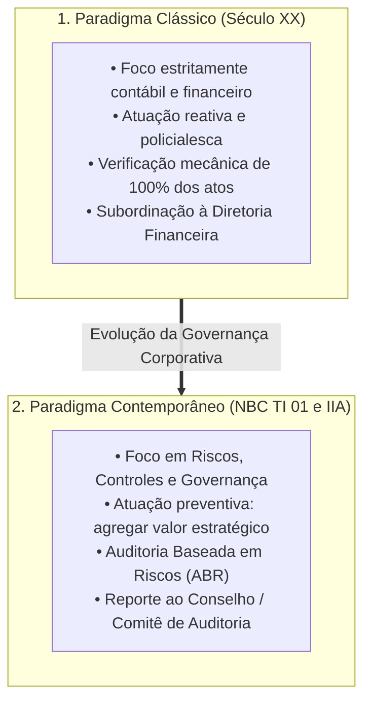
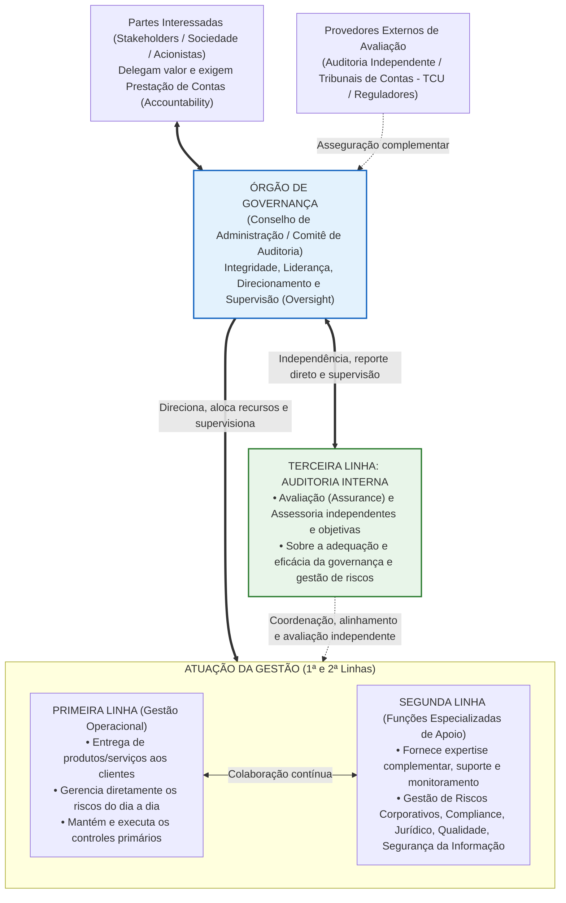
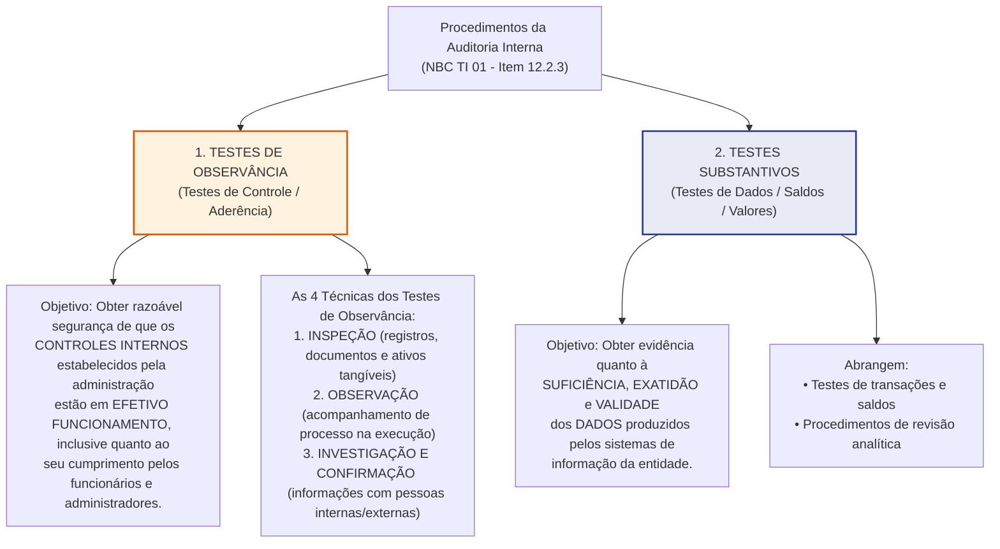
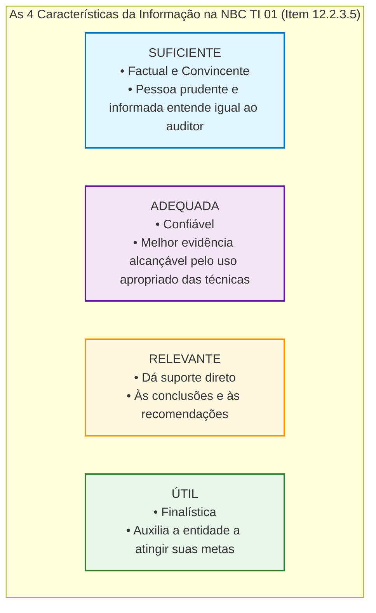
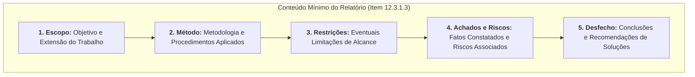
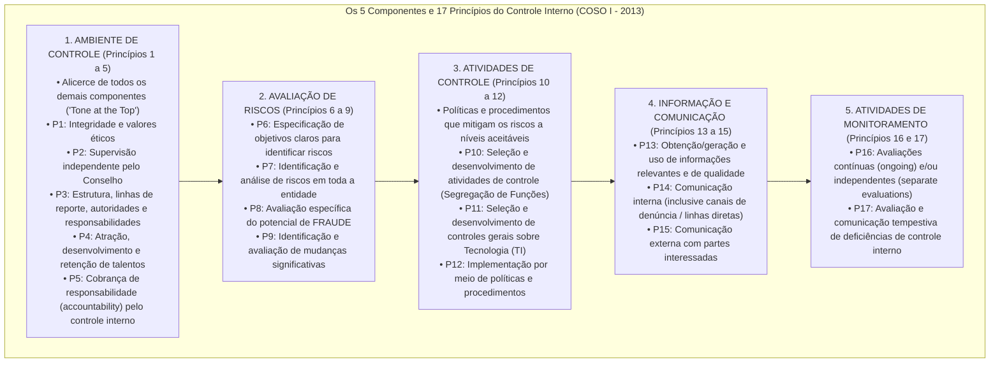

# Auditoria Interna e Governança Corporativa: Dissecação Integral da NBC TI 01 e Modelo das Três Linhas

> A **Auditoria Interna** é uma atividade de avaliação independente, objetiva e de assessoramento estratégico estruturada no interior da própria organização, projetada para **agregar valor**, aperfeiçoar as operações e fortalecer o sistema de controles internos, gerenciamento de riscos e governança. No ordenamento contábil brasileiro, sua norma técnica matriz é a **NBC TI 01 (aprovada pela Resolução CFC nº 986/2003 — antiga NBC T 12)**, complementada internacionalmente pelo *International Professional Practices Framework (IPPF)* e pelo **Modelo das Três Linhas** do *Institute of Internal Auditors (IIA)*. Diferentemente do auditor independente — cujo objetivo é emitir opinião sobre as demonstrações contábeis para usuários externos —, o auditor interno **possui vínculo funcional com a entidade**, **não emite parecer de asseguração para o mercado** e materializa seu trabalho por meio de um **Relatório de Auditoria Interna** confidencial, endereçado à alta administração ou ao órgão de governança, contendo conclusões e **recomendações de soluções** para as não conformidades detectadas.

---

## 1. Origem, Evolução e Papel da Auditoria Interna na Governança Corporativa

### 1.1. Da Verificação Contábil Policialesca à Geração de Valor Estratégico

Historicamente, a Auditoria Interna surgiu no início do século XX como um desdobramento do crescimento vertical e geográfico das grandes corporações ferroviárias, industriais e bancárias. Naquele momento embrionário, como os proprietários e diretores não conseguiam supervisionar pessoalmente todas as plantas fabris e filiais distantes, criaram um corpo técnico interno cuja missão original era atuar como uma "extensão dos olhos da diretoria", verificando a exatidão aritmética dos registros contábeis, conferindo caixas e prevenindo desvios patrimoniais.

Todavia, a evolução da **Governança Corporativa** — impulsionada por marcos históricos como a fundação do *The Institute of Internal Auditors (IIA)* em 1941, a publicação do *Relatório Cadbury* (1992), o *Framework COSO I* (1992/2013) e a *Lei Sarbanes-Oxley (SOX)* de 2002 após os colapsos da Enron e da WorldCom — promoveu uma mudança paradigmática na ontologia da Auditoria Interna:

1. **Superação do Enfoque Policialesco (Caça às Bruxas):** O auditor interno deixou de ser visto como um "inspetor punitivo" focado exclusivamente em apontar erros passados (*post-mortem*) para tornar-se um **consultor estratégico e avaliador proativo de processos e riscos**.
2. **Expansão do Escopo (Além da Contabilidade):** Enquanto a auditoria externa permanece concentrada nas demonstrações financeiras históricas, a Auditoria Interna expandiu seu raio de ação para **todas as engrenagens operacionais da entidade**: suprimentos, logística, tecnologia da informação, recursos humanos, *compliance* regulatório, qualidade industrial e sustentabilidade.
3. **Alinhamento aos Objetivos Organizacionais:** Toda recomendação emitida pela Auditoria Interna tem uma única bússola teleológica: auxiliar a organização a **atingir suas metas estratégicas** com integridade, eficiência, eficácia e economicidade.

---

### 1.2. A Definição Internacional do IIA: Serviços de Avaliação (*Assurance*) vs. Consultoria

Nas provas da FGV, Cebraspe e FCC para Auditor Fiscal e Controle (CGU/TCU/CGE), é indispensável dominar a definição global de Auditoria Interna consagrada pelo **IIA (IPPF)**, amplamente recepcionada nos manuais de auditoria governamental (como a IN SFC/CGU nº 3/2017):

> *"A auditoria interna é uma atividade independente e objetiva de **avaliação (assurance)** e de **consultoria**, desenhada para adicionar valor e melhorar as operações de uma organização. Ela auxilia uma organização a alcançar seus objetivos a partir da aplicação de uma abordagem sistemática e disciplinada para avaliar e melhorar a eficácia dos processos de gerenciamento de riscos, controle e governança."*

A partir dessa definição, as normas internacionais dividem os trabalhos da Auditoria Interna em duas naturezas distintas:

| Característica | Serviços de Avaliação (*Assurance*) | Serviços de Consultoria (*Consulting*) |
| :--- | :--- | :--- |
| **Objetivo Central** |Examinar objetivamente evidências com o propósito de fornecer uma **opinião ou conclusão independente** sobre uma operação, processo, sistema ou controle. | Fornecer **aconselhamento, assessoria, treinamento e facilitação** a pedido de um gestor (cliente do trabalho), sem assumir responsabilidades de gestão. |
| **Quem Define a Natureza e o Escopo** | Determinados unilateralmente pelo **Auditor Interno**, com base na avaliação de riscos. | Definidos em **comum acordo** entre o Auditor Interno e o **cliente do trabalho** (gestor solicitante). |
| **Número de Partes Envolvidas** | **Três partes (Relação Tripartite):** 1. O proprietário do processo (auditado); 2. O auditor interno (avaliador); 3. O usuário da avaliação (Alta Administração / Conselho). | **Duas partes (Relação Bipartite):** 1. O solicitante/cliente do serviço (gestor); 2. O auditor interno (consultor interno). |
| **Exemplo Prático** | Auditoria de conformidade e desempenho sobre os controles internos do setor de licitações. | Orientação técnica e *workshop* sobre metodologia de mapeamento de riscos para uma nova diretoria. |

> [!CAUTION]
> **Armadilha Letal de Prova (FGV/Cebraspe):**  
> Ao prestar **serviços de consultoria**, o auditor interno **JAMAIS pode assumir responsabilidades de gestão** (como decidir qual fornecedor contratar, aprovar pagamentos ou gerenciar projetos operacionais). Se o auditor interno tomar decisões gerenciais, sua **objetividade e independência estarão irremediavelmente comprometidas** quando aquela área precisar ser auditada no futuro!

---

## 2. O Modelo das Três Linhas do IIA (Atualização do Antigo Modelo das "Três Linhas de Defesa")

Em julho de 2020, o *Institute of Internal Auditors (IIA)* atualizou o clássico modelo das "Três Linhas de Defesa", rebatizando-o simplesmente como **Modelo das Três Linhas (*The IIA's Three Lines Model*)**. A remoção da palavra "defesa" teve um motivo conceitual profundo: a gestão de riscos não serve apenas para "defender" a entidade contra perdas, mas também para **criar e proteger valor** no alcance dos objetivos estratégicos.

### 2.1. Anatomia Detalhada dos Papéis no Modelo das Três Linhas

1. **Órgão de Governança (Conselho de Administração / Comitê de Auditoria):**
   * Não é uma "linha", mas a instância máxima que representa os interesses dos *stakeholders*.
   * Define a visão, a missão, os valores éticos e o **apetite a risco** da organização.
   * Delega recursos à Gestão e institui a **Auditoria Interna (3ª Linha)** como seu braço independente de avaliação.
2. **Primeira Linha (Papéis da Gestão Operacional / Proprietários dos Riscos):**
   * Composta pelos gerentes operacionais, líderes de linha de frente e servidores que executam as atividades finalísticas e entregam produtos ou serviços aos clientes/cidadãos.
   * São os **proprietários diretos dos riscos**: cabe à 1ª linha identificar, avaliar, mitigar e controlar os riscos diariamente no fluxo operacional (ex.: o gerente de compras que confere a requisição antes de lançar o pedido).
3. **Segunda Linha (Papéis de Monitoramento, *Compliance* e Especialistas de Gestão de Riscos):**
   * Composta por unidades especializadas criadas pela própria gestão para apoiar, desafiar e monitorar a 1ª linha em temas transversais: **Gestão de Riscos Corporativos (ERM), Conformidade (*Compliance*), Controle Interno de Gestão (Controladoria), Segurança da Informação (LGPD/Cibersegurança), Meio Ambiente, Saúde e Segurança (EHS) e Qualidade**.
   * **Atenção:** A 2ª linha **faz parte da Gestão**! Ela não possui a independência da 3ª linha, pois está subordinada à Diretoria Executiva e participa da construção de políticas e matrizes de risco.
4. **Terceira Linha (Auditoria Interna):**
   * Exercida exclusivamente pela unidade de **Auditoria Interna**.
   * Sua marca registrada é a **independência em relação às responsabilidades da gestão** (1ª e 2ª linhas).
   * Presta **avaliação (*assurance*) e assessoria independentes e objetivas** ao Órgão de Governança e à Alta Administração sobre a adequação e a eficácia tanto da 1ª quanto da 2ª linha!

> [!WARNING]
> **Onde ficam o Tribunal de Contas (TCU/TCE) e o Auditor Independente no Modelo das Três Linhas?**  
> Nem o TCU nem a Auditoria Independente (Externa) integram as Três Linhas! As três linhas são estruturas **internas** da organização. Os auditores externos e órgãos de controle externo situam-se **fora da estrutura organizacional**, atuando como *Provedores Externos de Avaliação*. Contudo, cuidado com a nomenclatura específica da Administração Pública Federal (IN Conjunta MP/CGU nº 1/2016 e Lei nº 14.133/2021, art. 169): na Lei de Licitações (art. 169), o legislador brasileiro chamou de "terceira linha de defesa" o *órgão central de controle interno da Administração e o tribunal de contas*. Portanto, leia atentamente o comando da questão:
> - **Se cobrar o Modelo das Três Linhas do IIA / CGU (Referencial Técnico):** A 3ª linha é exclusivamente a **Auditoria Interna**.
> - **Se cobrar a literalidade do art. 169 da Lei nº 14.133/2021:** A 1ª linha são os servidores/agentes de licitação; a 2ª linha são o assessoramento jurídico e controle interno setorial; e a 3ª linha são o órgão central de controle interno e o Tribunal de Contas.

---

## 3. Dissecação Integral da NBC TI 01 (Resolução CFC nº 986/2003)

No âmbito do Conselho Federal de Contabilidade, a norma técnica que rege a execução da Auditoria Interna é a **NBC TI 01 — Da Auditoria Interna** (originalmente editada como NBC T 12 pela Resolução CFC nº 986/2003). Esta norma é cobrada na literalidade absoluta pelas bancas examinadoras. Vamos dissecar cada um de seus tópicos estruturais.

### 3.1. Conceituação e Objetivos da Auditoria Interna (Item 12.1.1)

A norma inaugura seu texto com dois parágrafos definidores que resumem a essência e a finalidade da atividade:

1. **Conceito (Item 12.1.1.1):**  
   A Auditoria Interna compreende os **exames, análises, avaliações, levantamentos e comprovações**, metodologicamente estruturados para a avaliação da **integridade, adequação, eficácia, eficiência e economicidade** dos processos, dos sistemas de informações e de controles internos integrados ao ambiente, e de gerenciamento de riscos, com vistas a **assistir à administração da entidade no cumprimento de seus objetivos**.
2. **Enfoque e Finalidade (Item 12.1.1.3):**  
   A atividade da Auditoria Interna está estruturada em procedimentos, com enfoque **técnico, objetivo, sistemático e disciplinado**, e tem por finalidade **agregar valor ao resultado da organização**, apresentando subsídios para o aperfeiçoamento dos processos, da gestão e dos controles internos, por meio da **recomendação de soluções para as não-conformidades** apontadas nos relatórios.
3. **Competência Profissional Exclusiva (Item 12.1.1.2):**  
   *"A Auditoria Interna é exercida nas pessoas jurídicas de direito público, interno ou externo, e de direito privado."*  
   Na redação histórica da NBC T 12 e na NBC PI 01, o CFC firma que a execução da auditoria interna contábil é prerrogativa de **Contador devidamente registrado no Conselho Regional de Contabilidade (CRC)**.

```mermaid
flowchart TD
    ROOT["O que faz?"]
    ROOT --> node_2["Exames e Análises"]
    ROOT --> node_3["Avaliações e Levantamentos"]
    ROOT --> node_4["Comprovações Metodológicas"]
    ROOT["O que avalia?  Atributos "]
    ROOT --> node_6["Integridade"]
    ROOT --> node_7["Adequação"]
    ROOT --> node_8["Eficácia"]
    ROOT --> node_9["Eficiência"]
    ROOT --> node_10["Economicidade"]
    ROOT["Sobre qual Objeto?"]
    ROOT --> node_12["Processos Operacionais"]
    ROOT --> node_13["Sistemas de Informações"]
    ROOT --> node_14["Controles Internos Integrados"]
    ROOT --> node_15["Gerenciamento de Riscos"]
    ROOT["Para qual Finalidade?"]
    ROOT --> node_17["Assistir a Administração"]
    ROOT --> node_18["Agregar Valor ao Resultado"]
    ROOT --> node_19["Recomendar Soluções para Não-Conformidades"]
```

> [!TIP]
> **Leitura Cirúrgica dos 5 Atributos de Avaliação (Item 12.1.1.1):**  
> Memorize os 5 substantivos que a Auditoria Interna avalia nos processos e controles internos segundo a NBC TI 01: **I-A-E-E-E** (**I**ntegridade, **A**dequação, **E**ficácia, **E**ficiência e **E**conomicidade). As bancas costumam trocar um desses termos por "lucratividade garantida" ou "infalibilidade".

---

### 3.2. Papéis de Trabalho na Auditoria Interna (Item 12.1.2)

Os **Papéis de Trabalho** constituem o alicerce documental de toda auditoria. Na definição literal da NBC TI 01:

* **Natureza e Suporte (Item 12.1.2.1):** A Auditoria Interna deve ser documentada por meio de papéis de trabalho, elaborados em **meio físico ou eletrônico**, que devem ser organizados e arquivados de forma **sistemática e racional**.
* **Conteúdo Probatório (Item 12.1.2.2):** Constituem documentos e registros dos fatos, informações e provas, obtido no curso da auditoria, a fim de **evidenciar os exames realizados e dar suporte à sua opinião, críticas, sugestões e recomendações**.
* **Requisitos Qualitativos (Item 12.1.2.3):** Os papéis de trabalho devem ter **abrangência e grau de detalhe suficientes** para propiciarem a **compreensão do planejamento, da natureza, da oportunidade e da extensão dos procedimentos de Auditoria Interna aplicados**, bem como do julgamento exercido e das conclusões alcançadas.
* **Verificação de Integridade de Documentos Anexados (Item 12.1.2.4):**  
  > *"Análises, demonstrações ou quaisquer outros documentos **devem ter sua integridade verificada sempre que forem anexados aos papéis de trabalho**."*

> [!IMPORTANT]
> **Cláusula de Ouro do Item 12.1.2.4:**  
> O auditor interno não é um mero "colecionador de cópias". Sempre que ele anexar um relatório gerencial, uma planilha de conciliação ou uma demonstração fornecida pelo auditado aos seus papéis de trabalho, ele tem o **dever obrigatório de verificar a integridade (exatidão, autenticidade e completude)** daquele documento! Essa frase exata cai reiteradamente em provas da FCC e FGV.

---

### 3.3. Fraude e Erro na Visão da NBC TI 01 (Item 12.1.3)

A distinção entre **fraude** e **erro** e o protocolo de comunicação quando da descoberta de irregularidades formam o tópico de maior incidência estatística da NBC TI 01.

#### A) A Fronteira Subjetiva: Intencionalidade (Dolo vs. Culpa)

| Figura | Definição Literal na NBC TI 01 (Item 12.1.3.2 e 12.1.3.3) | Elemento Subjetivo | Exemplos Clássicos |
| :--- | :--- | :---: | :--- |
| **FRAUDE** | Aplica-se a **ato intencional** de omissão e/ou manipulação de transações e operações, **adulteração de documentos**, registros, relatórios, informações e demonstrações contábeis, tanto em termos físicos quanto monetários. | **Intencional** (Dolo / Má-fé) | Pagamento a fornecedor fantasma; superfaturamento deliberado; desvio físico de mercadorias com baixa simulada no sistema; falsificação de assinaturas. |
| **ERRO** | Aplica-se a **ato não-intencional** de omissão, **desatenção, desconhecimento ou má interpretação** de fatos na elaboração de registros, informações e demonstrações contábeis, bem como de transações e operações da entidade, tanto em termos físicos quanto monetários. | **Não-Intencional** (Culpa / Negligência / Imperícia) | Inversão involuntária de dígitos ao lançar uma nota fiscal (R\$ 54.000 em vez de R\$ 45.000); aplicação equivocada de uma alíquota por desconhecimento de nova instrução normativa. |

#### B) Dever de Assessoramento e Forma de Comunicação (Item 12.1.3.1)

Leia e releia a literalidade do item 12.1.3.1 da NBC TI 01, pois cada palavra é uma potencial questão de prova:

> *"A Auditoria Interna deve **assessorar a administração da entidade no trabalho de prevenção de fraudes e erros**, obrigando-se a informá-la, **sempre por escrito**, de **maneira reservada**, sobre quaisquer **indícios ou confirmações** de irregularidades detectadas no decorrer de seu trabalho."*

Extraímos daqui **quatro regras pétreas** que derrubam candidatos desatentos:
1. **Quem previne fraudes primariamente é a Administração:** A Auditoria Interna apenas **assessora** a administração na prevenção.
2. **Forma da comunicação — SEMPRE POR ESCRITO:** Na NBC TI 01, quando o auditor interno detecta indícios ou confirmações de fraudes ou erros, a comunicação à administração deve ser feita **sempre por escrito** (é **PROIBIDO** comunicar apenas verbalmente!). *Nota comparativa:* Na NBC TA 240 (Auditoria Externa) e no item 12.3.1.2 (Relatório geral de auditoria interna, em hipóteses excepcionais acordadas), admite-se comunicação verbal em certos contextos, mas **para fraude e erro na NBC TI 01 (item 12.1.3.1), a exigência é taxativa: SEMPRE POR ESCRITO!**
3. **Caráter sigiloso — DE MANEIRA RESERVADA:** A comunicação não deve ser divulgada em murais internos, redes sociais ou enviada a órgãos externos sem passar pela administração, devendo tramitar em caráter confidencial/reservado.
4. **Gatilho amplo — INDÍCIOS OU CONFIRMAÇÕES:** O auditor interno não precisa ter certeza absoluta e prova cabal transitada em julgado para comunicar a alta administração; a mera detecção de **indícios consistentes** (ou confirmações) já obriga a comunicação escrita e reservada!

---

## 4. Normas de Execução dos Trabalhos da Auditoria Interna (Item 12.2)

### 4.1. Planejamento da Auditoria Interna (Item 12.2.1)

O planejamento do trabalho da Auditoria Interna compreende os exames preliminares das áreas, atividades, produtos e processos, para definir a **amplitude e a época** do trabalho a ser realizado, de acordo com as diretrizes estabelecidas pela administração da entidade.

#### Fatores Relevantes no Planejamento (Item 12.2.1.2)
O planejamento deve considerar todos os fatores relevantes na execução dos trabalhos, especialmente os seguintes:
1. O **conhecimento detalhado da política e dos instrumentos de gestão de riscos** da entidade;
2. O **conhecimento detalhado das atividades operacionais e dos sistemas contábil e de controles internos** e seu **grau de confiabilidade**;
3. A **natureza, a oportunidade e a extensão** dos procedimentos de Auditoria Interna a serem aplicados, alinhados com a política de gestão de riscos da entidade;
4. A **existência de entidades associadas, filiais e partes relacionadas** que estejam no âmbito dos trabalhos da Auditoria Interna;
5. O **uso do trabalho de especialistas**;
6. Os **riscos de auditoria**, quer pelo volume ou pela complexidade das transações e operações;
7. O **conhecimento do resultado e das providências tomadas em relação a trabalhos anteriores**, semelhantes ou relacionados;
8. As **orientações e as expectativas externadas pela administração** aos auditores internos; e
9. O **conhecimento da missão e dos objetivos estratégicos** da entidade.

#### Documentação do Planejamento e Programas de Trabalho (Itens 12.2.1.3 e 12.2.1.4)
* O planejamento deve ser **documentado** e os **programas de trabalho** devem ser **formalmente preparados**, detalhando-se o que é necessário para a compreensão dos procedimentos que serão aplicados, em termos de **natureza, oportunidade, extensão, equipe técnica e uso de equipamentos e técnicas especializados**.
* Os programas de trabalho (que estruturam a execução passo a passo) devem ser **estruturados de forma a servir como guia e meio de controle de sua execução**, e **devem ser revisados e atualizados sempre que as circunstâncias o exigirem** (princípio da flexibilidade e adaptabilidade do planejamento).

---

### 4.2. Riscos da Auditoria Interna (Item 12.2.2)

> **Conceito de Risco de Auditoria Interna:** É a possibilidade de o auditor interno **não atingir, de forma satisfatória, o objetivo dos trabalhos**, emitindo conclusões equivocadas ou deixando de perceber falhas relevantes nos controles ou distorções nos dados.

A NBC TI 01 fixa três diretrizes essenciais sobre a análise de riscos:
1. **Momento de Realização (Item 12.2.2.1):** A análise dos riscos da Auditoria Interna deve ser feita na **fase de planejamento** dos trabalhos; está relacionada à possibilidade de não se atingir, de forma satisfatória, o objetivo dos trabalhos.
2. **Foco Especial (Item 12.2.2.1):** Nesse sentido, devem ser considerados, principalmente, os seguintes aspectos:
   * A **verificação e a comunicação de eventuais limitações ao alcance** dos procedimentos da Auditoria Interna, a serem aplicados, considerando o volume ou a complexidade das transações e das operações;
   * A **extensão da responsabilidade** do auditor interno no uso dos trabalhos de especialistas.
3. **Dois Pilares de Concentração na Avaliação dos Riscos (Item 12.2.2.2):** Para estabelecer a amplitude do trabalho, o auditor interno deve concentrar seu exame de riscos em dois vetores:
   * **A análise dos controles internos** (capacidade de prevenir ou detectar falhas); e
   * **A fidedignidade das informações** (confiabilidade dos dados gerados pelos sistemas), além da atenção a **eventos ou transações não previstas** ou atípicas.

---

### 4.3. Procedimentos da Auditoria Interna (Item 12.2.3)

Os procedimentos da Auditoria Interna constituem **exames e investigações, incluindo testes de observância e testes substantivos**, que permitem ao auditor interno obter **subsídios suficientes** para fundamentar suas conclusões e recomendações à administração da entidade.

#### A) Testes de Observância e Suas Técnicas (Itens 12.2.3.2 e 12.2.3.3)

Os **Testes de Observância** visam à obtenção de **razoável segurança** de que os controles internos estabelecidos pela administração estão em **efetivo funcionamento**, inclusive quanto ao seu cumprimento pelos funcionários e administradores da entidade.

Na aplicação dos testes de observância, o auditor interno deve considerar a execução dos seguintes procedimentos técnicos (Item 12.2.3.3):

| Técnica da NBC TI 01 | Definição Literal Exata (Item 12.2.3.3) | Exemplo Prático em Campo |
| :--- | :--- | :--- |
| **a) Inspeção** | Verificação de **registros, documentos e ativos tangíveis**. | Examinar contratos licitatórios para checar a presença do visto jurídico; contar fisicamente os notebooks do setor de TI. |
| **b) Observação** | **Acompanhamento de processo ou procedimento quando de sua execução**. | Presenciar *in loco* o recebimento de caminhões de insumos na doca do almoxarifado para ver se o conferente realmente pesa a carga. |
| **c) Investigação e Confirmação** | **Obtenção de informações perante pessoas físicas ou jurídicas** conhecedoras das transações e das operações, **dentro ou fora da entidade**. | Entrevistar o gerente de tesouraria sobre a rotina de conciliação (investigação interna) ou oficiar um banco/fornecedor sobre a validade de uma garantia (confirmação externa). |

#### B) Testes Substantivos (Item 12.2.3.4)

Os **Testes Substantivos** visam à obtenção de evidência quanto à **suficiência, exatidão e validade dos dados** produzidos pelos sistemas de informação da entidade.

> [!CAUTION]
> **O Clássico "Troca-Troca" das Bancas Examinadoras:**  
> Em 90% das questões sobre procedimentos na NBC TI 01, a banca simplesmente inverte os conceitos:
> - Afirma que os *testes de observância* visam verificar a *"suficiência, exatidão e validade dos dados"*. **ERRADO!** Isso é **Teste Substantivo**!
> - Afirma que os *testes substantivos* visam verificar se os *"controles internos estão em efetivo funcionamento"*. **ERRADO!** Isso é **Teste de Observância**!
> *Regra de Bolso:*
> - **Observância** = **O**bediência às normas/controles internos (**Efetivo Funcionamento**).
> - **Substantivo** = **S**aldos, **S**uficiência, **E**xatidão e **V**alidade dos **Dados** (**SEV dos Dados**).

---

### 4.4. As 4 Características da Informação Probatória e o Conceito de Evidência (Itens 12.2.3.5 e 12.2.3.6)

Este é o ponto mais cobrado da NBC TI 01 em provas da FGV, FCC e Cebraspe. A norma diferencia primeiramente as características do processo de obtenção da informação (item 12.2.3.5) e a definição de evidência (item 12.2.3.6):

#### As 4 Características da Informação (Item 12.2.3.5)
As informações que fundamentam os resultados da Auditoria Interna são denominadas de **"evidências"**, que devem ser suficientes, fidedignas, relevantes e úteis, de modo a fornecer base sólida para as conclusões e recomendações à administração da entidade. O processo de obtenção e avaliação das informações compreende:
1. **I — Obtenção de informações** sobre os assuntos relacionados aos objetivos e ao alcance da Auditoria Interna, devendo ser considerado que:
   * **a) A informação SUFICIENTE** é **factual e convincente**, de tal forma que uma **pessoa prudente e informada** possa entendê-la da mesma forma que o auditor interno.
   * **b) A informação ADEQUADA**, sendo **confiável**, propicia a **melhor evidência alcançável**, por meio do uso apropriado das técnicas de Auditoria Interna.
   * **c) A informação RELEVANTE** dá **suporte às conclusões e às recomendações** da Auditoria Interna.
   * **d) A informação ÚTIL** **auxilia a entidade a atingir as suas metas**.
2. **II — Avaliação da efetividade das informações obtidas**, mediante a aplicação de procedimentos de Auditoria Interna, incluindo testes substantivos, se cabíveis.

> [!WARNING]
> **Comparação Crucial: "Suficiente e Adequada" na NBC TA 500 vs. NBC TI 01!**  
> Não confunda as duas normas na hora da prova:
> - **Na Auditoria Independente (NBC TA 500):** *Suficiência* é a medida da **quantidade** de evidência; *Adequação* é a medida da **qualidade** (relevância e confiabilidade).
> - **Na Auditoria Interna (NBC TI 01, item 12.2.3.5):**
>   - **Suficiente** = **Factual e convincente** (pessoa prudente e informada entende igual).
>   - **Adequada** = Sendo **confiável**, propicia a **melhor evidência alcançável**.
>   - **Relevante** = Dá **suporte às conclusões e recomendações**.
>   - **Útil** = Auxilia a entidade a **atingir suas metas**.

#### Supervisão e Controle de Qualidade na Execução (Itens 12.2.3.7 e 12.2.3.8)
* O processo de obtenção das evidências deve ser **supervisionado** para alcançar razoável segurança de que o objetivo do trabalho da Auditoria Interna está sendo atingido.
* A Auditoria Interna deve adotar procedimentos adequados para **assegurar que as contingências ativas e passivas relevantes** — decorrentes de processos judiciais, reivindicações e reclamações, bem como de lançamentos de tributos e de contribuições em disputa — **foram identificadas e são do conhecimento da administração da entidade**.
* A Auditoria Interna deve avaliar continuamente o **processamento eletrônico de dados (PED/TI)** da entidade (Item 12.2.5) e pode valer-se de **Amostragem Estatística ou Não-Estatística** (Item 12.2.4) ao determinar a extensão de um teste ou método de seleção de itens.

---

### 4.5. Amostragem e Processamento Eletrônico de Dados — PED (Itens 12.2.4 e 12.2.5)

1. **Amostragem na Auditoria Interna (Item 12.2.4.1):**  
   Ao determinar a extensão de um teste de auditoria ou um método de seleção de itens a serem testados, podem ser empregadas **técnicas de amostragem**. Ao usar métodos de amostragem **estatística ou subjetiva (não-estatística)**, o auditor interno deve projetar e selecionar uma amostra que possa proporcionar evidência de auditoria suficiente e adequada.
2. **Processamento Eletrônico de Dados — PED (Item 12.2.5.1):**  
   A utilização de processamento eletrônico de dados pela entidade requer que exista, na equipe de Auditoria Interna, **profissional com conhecimento suficiente sobre a tecnologia da informação e os sistemas de informação utilizados**, de maneira a implementar os próprios procedimentos ou, então, orientar, supervisionar e revisar os trabalhos de especialistas.

---

## 5. Normas Relativas ao Relatório da Auditoria Interna (Item 12.3)

O **Relatório** é o documento pelo qual a Auditoria Interna apresenta o resultado dos seus trabalhos. Diferentemente do relatório do auditor independente (que possui parágrafos padronizados de opinião como "sem ressalva", "com ressalva", "adverso" ou "abstenção"), o relatório da auditoria interna é um **instrumento gerencial construtivo**.

### 5.1. Requisitos de Redação e Forma de Apresentação (Itens 12.3.1.1 e 12.3.1.2)

1. **Objetividade e Imparcialidade (Item 12.3.1.1):**  
   O relatório da Auditoria Interna deve ser redigido com **objetividade e imparcialidade**, de forma a expressar claramente suas conclusões, recomendações e providências a serem tomadas pela administração da entidade.
2. **Quem Recebe e Qual a Forma (Item 12.3.1.2):**  
   O relatório da Auditoria Interna deve ser apresentado **a quem tenha solicitado o trabalho ou a quem este autorizar**, devendo ser preservada a **confidencialidade** do seu conteúdo.

### 5.2. Os 5 Aspectos Obrigatórios do Relatório (Item 12.3.1.3)

O relatório da Auditoria Interna deve abordar, no mínimo, os seguintes aspectos:
1. **a) O objetivo e a extensão** dos trabalhos;
2. **b) A metodologia** adotada;
3. **c) Os principais procedimentos** de auditoria aplicados e sua extensão;
4. **d) Eventuais limitações ao alcance** dos procedimentos de auditoria;
5. **e) A descrição dos fatos constatados e as evidências encontradas**;
6. **f) Os riscos associados aos fatos constatados**; e
7. **g) As conclusões e as recomendações** resultantes dos fatos constatados.

### 5.3. Relatórios Parciais — A Exceção de Urgência (Itens 12.3.2.1)

Em regra, o relatório é emitido ao final do trabalho planejado. Todavia, a NBC TI 01 prevê uma hipótese obrigatória de **emissão antecipada/intermediária**:

> **Relatórios Parciais (Item 12.3.2.1):**  
> *"A Auditoria Interna deve avaliar a necessidade de emissão de **relatório parcial**, na hipótese de constatar **impropriedades/irregularidades/ilegalidades que necessitem providências imediatas da administração da entidade**, e que **não possam aguardar o final dos exames**."*

---

## 6. Estudo de Caso Aplicado: Ciclo Completo de Auditoria Interna segundo a NBC TI 01

Para consolidar a aplicação prática da norma em questões discursivas e estudos de caso da FGV/Cebraspe, acompanhe o seguinte cenário realístico:

* **Contexto:** O Comitê de Auditoria da *Companhia Energética S.A.* aprovou no Plano Anual de Auditoria Interna (PAINT) a realização de uma auditoria sobre o ciclo de **Suprimentos e Pagamento a Fornecedores**.
* **Fase 1 (Planejamento e Análise de Riscos — Itens 12.2.1 e 12.2.2):** Na fase de planejamento, a auditora interna (Contadora registrada no CRC) mapeou os sistemas ERP de compras, verificou os relatórios de auditorias anteriores e identificou alto risco na modalidade de "Compras Emergenciais sem Cotação". Elaborou formalmente o **Programa de Trabalho**.
* **Fase 2 (Execução de Testes de Observância e Substantivos — Item 12.2.3):**
  1. Aplicou um **Teste de Observância (Inspeção e Observação)**: verificou uma amostra de 60 processos de compra para checar se todos continham as duas assinaturas eletrônicas exigidas pelo manual de alçadas da companhia. Constatou que em 12 processos o próprio comprador cadastrou o fornecedor e aprovou sozinho o pagamento (falha de segregação de funções).
  2. Diante da falha de controle, ampliou os **Testes Substantivos (Investigação, Confirmação e Recálculo)**: cruzou os CNPJs dos 12 processos com bases cadastrais e confirmou que a empresa *Alfa Serviços Ltda.*, que recebeu R\$ 480.000,00, não entregou qualquer mercadoria no almoxarifado e pertencia ao cunhado do comprador.
* **Fase 3 (Papéis de Trabalho, Comunicação de Fraude e Relatório Parcial — Itens 12.1.2, 12.1.3 e 12.3.2):**
  1. Verificou a integridade de todas as notas fiscais e extratos bancários anexados aos **Papéis de Trabalho**.
  2. Tratando-se de **ato intencional de manipulação e desvio (Fraude)** que exigia bloqueio imediato de novos pagamentos agendados para a semana seguinte, a auditora **não aguardou o encerramento da auditoria**: comunicou o fato **por escrito e de maneira reservada** à Alta Administração e emitiu um **Relatório Parcial** recomendando o bloqueio cautelar dos pagamentos e a revisão dos perfis de acesso no ERP.

---

## 7. Cascas de Banana e Armadilhas de Bancas (FGV / Cebraspe / FCC)

| Armadilha Recorrente em Prova ("Casca de Banana") | Por que está ERRADA? (Contra-Ataque Técnico) |
| :--- | :--- |
| *"Detectada uma fraude grave durante os exames, o auditor interno deve comunicá-la verbalmente e imediatamente ao superior hierárquico para garantir celeridade."* | **ERRADO!** O item 12.1.3.1 da NBC TI 01 exige que a comunicação de indícios ou confirmações de fraudes e erros à administração seja feita **SEMPRE POR ESCRITO** e de **maneira reservada**. |
| *"A análise dos riscos da Auditoria Interna deve ser realizada durante a fase de execução dos testes substantivos em campo."* | **ERRADO!** Conforme o item 12.2.2.1 da NBC TI 01, a análise dos riscos da Auditoria Interna deve ser feita na **FASE DE PLANEJAMENTO** dos trabalhos. |
| *"Os testes de observância visam à obtenção de evidência quanto à suficiência, exatidão e validade dos dados produzidos pelos sistemas."* | **ERRADO!** Suficiência, exatidão e validade dos dados são objetivos dos **TESTES SUBSTANTIVOS** (item 12.2.3.4). Os testes de observância visam verificar se os controles internos estão em **efetivo funcionamento**. |
| *"A informação suficiente é aquela que dá suporte às conclusões e às recomendações da Auditoria Interna."* | **ERRADO!** Quem dá suporte às conclusões e recomendações é a informação **RELEVANTE**. A informação **SUFICIENTE** é aquela **factual e convincente** (pessoa prudente e informada entende igual). |
| *"No Modelo das Três Linhas do IIA, a unidade de Compliance e Gestão de Riscos Corporativos compõe a Terceira Linha."* | **ERRADO!** *Compliance*, Controles Internos de Gestão e Gerenciamento de Riscos integram a **SEGUNDA LINHA** (funções especializadas da gestão). A **TERCEIRA LINHA** é exclusiva da **Auditoria Interna**. |
| *"Ao constatar um erro ou fraude contábil, cabe ao auditor interno efetuar os lançamentos de estorno e aplicar advertência ao funcionário."* | **ERRADO!** A Auditoria Interna é órgão de **assessoramento e avaliação**, não praticando atos de gestão executiva, não efetuando lançamentos contábeis e não aplicando sanções disciplinares. |
| *"O relatório da Auditoria Interna é público e deve ser divulgado juntamente com as demonstrações financeiras anuais."* | **ERRADO!** O relatório da Auditoria Interna é **confidencial** e restrito a quem solicitou o trabalho ou a quem este autorizar (item 12.3.1.2). |

---

## 8. Mnemônicos & Âncoras de Memória

> [!TIP]
> ### 🧠 Mnemônico 1: As 4 Características da Informação na NBC TI 01 (Item 12.2.3.5)
> Grave a combinação silábica infalível: **`SUFACO` — `AME` — `RECO` — `UM`**
> * **`SU-FA-CO`** $\rightarrow$ **SU**ficiente = **FA**ctual e **CO**nvincente (pessoa prudente e informada entende da mesma forma que o auditor).
> * **`A-ME`** $\rightarrow$ **A**dequada = Confiável, propicia a **M**elhor **E**vidência alcançável pelo uso apropriado das técnicas.
> * **`RE-CO`** $\rightarrow$ **RE**levante = Dá suporte às **CO**nclusões e às recomendações da Auditoria Interna.
> * **`U-M`** $\rightarrow$ **Ú**til = Auxilia a entidade a atingir as suas **M**etas.

> [!TIP]
> ### 🧠 Mnemônico 2: As Técnicas dos Testes de Observância (Item 12.2.3.3)
> Grave a sigla: **`I - O - I/C`**
> * **I — Inspeção:** Verificação de registros, documentos e ativos tangíveis (*olhar a coisa ou o papel*).
> * **O — Observação:** Acompanhamento de processo ou procedimento **quando de sua execução** (*olhar alguém fazendo ao vivo*).
> * **I/C — Investigação e Confirmação:** Obtenção de informações perante **pessoas físicas ou jurídicas** conhecedoras das transações, dentro ou fora da entidade (*perguntar / circularizar*).

> [!TIP]
> ### 🧠 Mnemônico 3: Comunicação de Fraudes e Erros na NBC TI 01 (Item 12.1.3.1)
> Grave o trinômio: **`E - R - I`**
> * **E**scrito (**Sempre por escrito**, nunca apenas verbal!).
> * **R**eservado (De maneira **reservada**/confidencial à administração).
> * **I**ndícios ou Confirmações (Comunica tanto a suspeita fundamentada quanto a certeza).

---

## 9. Questões Paradigmáticas Aplicadas

### [Questão 01](https://www.qconcursos.com/questoes-de-concursos/questoes/1f625ea5-c3) — [FGV — ALESC / Auditor Interno — 2024]

De acordo com a NBC TI 01 – Da Auditoria Interna, os testes substantivos visam à obtenção de evidência quanto à suficiência, exatidão e validade dos dados produzidos pelos sistemas de informação da entidade. No processo de obtenção de informações sobre os assuntos relacionados aos objetivos e ao alcance da Auditoria Interna, devem ser observadas as características da informação, à exceção de uma. Assinale-a:

* **A)** A informação útil auxilia a entidade a atingir as suas metas.
* **B)** A informação relevante dá suporte às conclusões e às recomendações da Auditoria Interna.
* **C)** A informação tempestiva é conservadora e livre de erros materiais.
* **D)** A informação suficiente é factual e convincente, de tal forma que uma pessoa prudente e informada possa entendê-la da mesma forma que o auditor interno.
* **E)** A informação adequada, sendo confiável, propicia a melhor evidência alcançável, por meio do uso apropriado das técnicas de Auditoria Interna.

#### Gabarito: **C**
* **A (Certa):** Reproduz literalmente o item 12.2.3.5, I, "d", da NBC TI 01 (Mnemônico `UM`: **Ú**til $\rightarrow$ atingir **M**etas).
* **B (Certa):** Reproduz literalmente o item 12.2.3.5, I, "c", da NBC TI 01 (Mnemônico `RECO`: **RE**levante $\rightarrow$ suporte às **CO**nclusões e recomendações).
* **C (Errada):** A NBC TI 01 elenca apenas **quatro** características da informação probatória (Suficiente, Adequada, Relevante e Útil). A norma **não prevê** a característica "tempestiva" nesse rol, tampouco a define como "conservadora e livre de erros materiais".
* **D (Certa):** Reproduz literalmente o item 12.2.3.5, I, "a", da NBC TI 01 (Mnemônico `SUFACO`: **SU**ficiente $\rightarrow$ **FA**ctual e **CO**nvincente).
* **E (Certa):** Reproduz literalmente o item 12.2.3.5, I, "b", da NBC TI 01 (Mnemônico `AME`: **A**dequada $\rightarrow$ confiável, **M**elhor **E**vidência alcançável).

> **Fique Ligado:** A informação da Auditoria Interna possui apenas 4 características: **SUFACO** (Suficiente = Factual e Convincente), **AME** (Adequada = Confiável, Melhor Evidência), **RECO** (Relevante = suporte a Conclusões) e **UM** (Útil = atingir Metas). 'Tempestiva' não integra esse rol!

---

### [Questão 02](https://www.qconcursos.com/questoes-de-concursos/questoes/8ca27246-10) — [FGV — CGE-SC / Auditor do Estado — 2023]

Conforme a atualização do Modelo das Três Linhas do *Institute of Internal Auditors* (IIA), a terceira linha de atuação distingue-se das demais por exercer função precípua de:

* **A)** Prestação de avaliação independente, objetiva e assessoria sobre a adequação e eficácia da governança e da gestão de riscos.
* **B)** Monitoramento contínuo da conformidade regulatória e gestão do risco concorrencial integrada à alta administração.
* **C)** Aprovação final do plano estratégico plurianual e definição do apetite a risco do órgão governamental.
* **D)** Execução direta dos controles operacionais cotidianos e entrega final dos produtos e serviços aos usuários.
* **E)** Elaboração das matrizes de riscos corporativos e implementação direta de políticas de *compliance* e integridade.

#### Gabarito: **A**
* **A (Certa):** No Modelo das Três Linhas do IIA (2020), a **Terceira Linha** corresponde à **Auditoria Interna**, cuja missão primordial é fornecer avaliação (*assurance*) e assessoria independentes e objetivas ao Órgão de Governança e à Alta Administração sobre a adequação e a eficácia da governança e do gerenciamento de riscos (abrangendo a 1ª e a 2ª linhas).
* **B (Errada):** O monitoramento contínuo da conformidade regulatória (*compliance*) subordinado à alta administração é papel típico da **Segunda Linha**.
* **C (Errada):** A aprovação final do plano estratégico e a definição do apetite a risco competem ao **Órgão de Governança** (Conselho de Administração ou equivalente) em conjunto com a Alta Administração, jamais à Auditoria Interna.
* **D (Errada):** A execução direta dos controles operacionais cotidianos e a entrega de produtos/serviços na ponta constituem atribuições da **Primeira Linha** (gestão operacional).
* **E (Errada):** A elaboração de matrizes de riscos e a implementação de políticas de integridade pertencem à **Segunda Linha** (gestão de riscos e *compliance*).

> **Fique Ligado:** No Modelo das Três Linhas (IIA 2020), a **3ª Linha é privativa da Auditoria Interna** e presta avaliação (*assurance*) e assessoria independentes diretamente ao Órgão de Governança, enquanto conformidade (*compliance*) e gestão de riscos pertencem à **2ª Linha**.

---

### [Questão 03](https://www.qconcursos.com/questoes-de-concursos/questoes/37fa319a-d5) — [FCC — SEFAZ-PE / Auditor Fiscal do Tesouro Estadual — 2022]

A atividade da auditoria interna está estruturada em procedimentos, com enfoque técnico, objetivo, sistemático e disciplinado, e tem por finalidade agregar valor ao resultado da organização, apresentando subsídios para o aperfeiçoamento dos processos, da gestão e dos controles internos, por meio da recomendação de soluções para as não-conformidades apontadas nos relatórios. No que tange à auditoria interna, assinale a afirmativa que está em DESACORDO com a Norma Brasileira de Contabilidade NBC TI 01:

* **A)** Os testes substantivos visam à obtenção de evidência quanto à suficiência, exatidão e validade dos dados produzidos pelos sistemas de informação da entidade.
* **B)** A análise dos riscos da auditoria interna deve ser feita na fase de planejamento dos trabalhos, considerando a possibilidade de não atingir, de forma satisfatória, o objetivo dos trabalhos.
* **C)** A auditoria interna deve ser documentada por meio de papéis de trabalho, elaborados em meio físico ou eletrônico, que devem ser organizados e arquivados de forma sistemática e racional.
* **D)** O termo "erro" se aplica ao ato intencional de omissão e/ou manipulação de transações e operações, adulteração de documentos, registros, relatórios, informações e demonstrações contábeis, tanto em termos físicos quanto monetários.
* **E)** Análises, demonstrações ou quaisquer outros documentos devem ter sua integridade verificada sempre que forem anexados aos papéis de trabalho.

#### Gabarito: **D**
* **A (Certa):** Literalidade do item 12.2.3.4 da NBC TI 01 sobre os testes substantivos.
* **B (Certa):** Literalidade do item 12.2.2.1 da NBC TI 01, que posiciona a análise de riscos na fase de planejamento.
* **C (Certa):** Literalidade do item 12.1.2.1 da NBC TI 01 sobre os papéis de trabalho em meio físico ou eletrônico.
* **D (Errada):** A banca inverteu os conceitos dos itens 12.1.3.2 e 12.1.3.3. O ato **intencional** de omissão, manipulação ou adulteração de documentos denomina-se **FRAUDE**. O **ERRO** aplica-se exclusivamente a ato **não-intencional** resultante de omissão, desatenção, desconhecimento ou má interpretação de fatos.
* **E (Certa):** Literalidade do item 12.1.2.4 da NBC TI 01 quanto ao dever de verificar a integridade dos documentos anexados aos papéis de trabalho.

> **Fique Ligado:** A intenção é o divisor de águas: **Fraude é ato intencional** (dolo/adulteração); **Erro é ato involuntário/não intencional** (desatenção/omissão). Além disso, a comunicação de fraudes/erros pela Auditoria Interna deve ser **sempre por escrito e de maneira reservada**.

---

### [Questão 04](https://www.qconcursos.com/questoes-de-concursos/questoes/8a62bbdd-3b) — [Cebraspe — Telebras / Especialista em Gestão de Telecomunicações - Auditoria — 2022]

Conforme a Norma Brasileira de Contabilidade de Auditoria Interna (NBC TI 01), julgue os itens seguintes e assinale a alternativa correta:

I. A auditoria interna deve assessorar a administração da entidade no trabalho de prevenção de fraudes e de erros, obrigando-se a informá-la, sempre por escrito, de maneira reservada, sobre quaisquer indícios ou confirmações de irregularidades detectadas no decorrer de seu trabalho.
II. O relatório da auditoria interna deve ser apresentado a quem tenha solicitado o trabalho ou a quem este autorizar, devendo ser preservada a confidencialidade do seu conteúdo.
III. A análise dos riscos da auditoria interna deve ser realizada exclusivamente na fase de execução dos trabalhos de auditoria.

* **A)** Apenas o item I está correto.
* **B)** Apenas os itens I e II estão corretos.
* **C)** Apenas os itens I e III estão corretos.
* **D)** Apenas os itens II e III estão corretos.
* **E)** Todos os itens estão corretos.

#### Gabarito: **B**
* **Item I (Certo):** Transcreve fielmente o item 12.1.3.1 da NBC TI 01. Note os três elementos essenciais: (1) assessorar na prevenção; (2) informar **sempre por escrito** e de **maneira reservada**; (3) sobre quaisquer **indícios ou confirmações**.
* **Item II (Certo):** Transcreve com exatidão o item 12.3.1.2 da NBC TI 01 sobre o destinatário e a confidencialidade do relatório da Auditoria Interna.
* **Item III (Errado):** Segundo o item 12.2.2.1 da NBC TI 01, a análise dos riscos da Auditoria Interna deve ser feita na **fase de planejamento** dos trabalhos (e não exclusivamente na fase de execução).
* Portanto, apenas os itens **I e II** estão corretos, confirmando o gabarito na **alternativa B**.

> **Fique Ligado:** A análise de riscos da Auditoria Interna é realizada na **fase de planejamento**, não de execução. O relatório final é apresentado a quem solicitou os trabalhos e sob confidencialidade estrita.

---

### [Questão 05](https://www.qconcursos.com/questoes-de-concursos/questoes/fcb11895-c7) — [FGV — Prefeitura de São José dos Campos / Auditor Tributário Municipal — 2024]

Na fase de execução de uma auditoria conduzida pela unidade de auditoria interna, os procedimentos aplicados e os registros produzidos cumprem funções específicas e não se substituem entre si. Associe cada elemento da Coluna I à descrição correspondente da Coluna II, segundo a NBC TI 01:

**Coluna I**
1. Papéis de trabalho.
2. Testes de observância.
3. Testes substantivos.
4. Amostragem.

**Coluna II**
( ) Procedimentos voltados à obtenção de evidência quanto à suficiência, à exatidão e à validade dos dados produzidos pelos sistemas de informações da entidade.
( ) Documentos e registros dos fatos, das informações e das provas obtidos no curso do exame, que dão suporte à opinião, às críticas e às recomendações emitidas.
( ) Aplicação de procedimentos a menos da totalidade dos itens de uma população, de modo que o resultado obtido permita conclusão sobre o conjunto examinado.
( ) Procedimentos voltados à obtenção de razoável segurança de que os controles internos estabelecidos pela administração estão em efetivo funcionamento.

Assinale a alternativa que apresenta a associação correta, de cima para baixo:

* **A)** 4, 2, 3, 1.
* **B)** 1, 4, 2, 3.
* **C)** 2, 3, 1, 4.
* **D)** 3, 1, 4, 2.
* **E)** 3, 2, 4, 1.

#### Gabarito: **D**
* **1º Parêntese $\rightarrow$ (3) Testes substantivos:** Visam obter evidência quanto à **suficiência, exatidão e validade dos dados** (NBC TI 01, item 12.2.3.4).
* **2º Parêntese $\rightarrow$ (1) Papéis de trabalho:** São os documentos e registros dos fatos, informações e provas obtidos no curso da auditoria para dar suporte às conclusões e recomendações (NBC TI 01, item 12.1.2.2).
* **3º Parêntese $\rightarrow$ (4) Amostragem:** Método de seleção aplicado a menos de 100% da população para extrair conclusão sobre o universo (NBC TI 01, item 12.2.4.1).
* **4º Parêntese $\rightarrow$ (2) Testes de observância:** Visam obter razoável segurança de que os **controles internos** estabelecidos pela administração estão em **efetivo funcionamento** (NBC TI 01, item 12.2.3.2).
* A sequência exata é **3, 1, 4, 2**, o que torna correta a **alternativa D** e invalida as demais (A, B, C e E).

> **Fique Ligado:** Teste de observância avalia se o **controle interno funciona**; Teste substantivo avalia a **suficiência, exatidão e validade dos dados contábeis/operacionais**.

---

### [Questão 06](https://www.qconcursos.com/questoes-de-concursos/questoes/a3ad1ec4-2a) — [FGV — CGU / Auditor Federal de Finanças e Controle — 2022]

As Normas Internacionais para o exercício profissional da Auditoria Interna, propostas pelo *Institute of Internal Auditors* (IIA), tratam especificamente de normas de atributos e de desempenho, que constituem referência para todos os serviços de auditoria interna. Nesse contexto, suponha que o gestor de uma entidade fez uma solicitação específica para a unidade de auditoria interna, requisitando assessoria para um plano de reorganização da estrutura de processos da entidade, visando à obtenção de maior eficiência na execução de projetos. O serviço de consultoria solicitado à instância de auditoria interna:

* **A)** compreende uma avaliação objetiva das evidências a partir de critérios definidos unilateralmente pelo auditor interno.
* **B)** demanda um acordo com o cliente do trabalho para definição da natureza e do escopo do trabalho.
* **C)** envolve necessariamente três partes distintas: o proprietário do processo, o auditor interno e o terceiro usuário que utiliza a avaliação.
* **D)** implica o compartilhamento de responsabilidades decisórias da administração com a equipe de auditoria interna.
* **E)** obriga o auditor interno a emitir parecer contábil com ressalva caso o plano de reorganização não atinja a meta financeira no trimestre seguinte.

#### Gabarito: **B**
* **A (Errada):** A avaliação objetiva de evidências com escopo e critérios definidos pelo auditor interno caracteriza os serviços de **avaliação (*assurance*)**, e não os serviços de consultoria.
* **B (Certa):** Nos **serviços de consultoria (*consulting*)** prestados pela Auditoria Interna (como assessoria para redesenho de processos), a **natureza e o escopo do trabalho são definidos mediante acordo com o cliente do trabalho** (o gestor solicitante), conforme o IPPF do IIA.
* **C (Errada):** A relação tripartite (proprietário do processo, auditor interno e usuário da avaliação) é típica dos trabalhos de **avaliação (*assurance*)**. Na consultoria, a relação é **bipartite** (auditor interno e cliente do trabalho).
* **D (Errada):** A equipe de auditoria interna **jamais compartilha nem assume responsabilidades de gestão**; a decisão final de implementar ou não as sugestões cabe exclusivamente ao administrador.
* **E (Errada):** Serviços de consultoria interna não geram pareceres contábeis de auditoria financeira nem garantem metas futuras de desempenho.

> **Fique Ligado:** Nos serviços de **avaliação (*assurance*)**, o auditor define o escopo unilateralmente (relação tripartite); nos serviços de **consultoria (*consulting*)**, o escopo decorre de **acordo com o cliente** (relação bipartite), sem nunca assumir função gestora.

---

### [Questão 07](https://www.qconcursos.com/questoes-de-concursos/questoes/1517f6e8-29) — [FCC — TRT-4 / Analista Judiciário - Contabilidade — 2022]

Em uma organização de médio porte, a auditoria interna foi incumbida de avaliar a adequação dos controles relacionados ao processo de compras. Durante o planejamento dos trabalhos, o auditor definiu procedimentos considerando riscos identificados, materialidade e necessidade de obter evidência apropriada e suficiente. À luz da NBC TI 01, a atuação da auditoria interna, nesse contexto, deve priorizar a:

* **A)** emissão de opinião sobre as demonstrações contábeis perante acionistas externos, com base na revisão dos registros do setor de compras.
* **B)** verificação detalhada da totalidade (100%) das transações realizadas no exercício, independentemente da relevância dos riscos associados ao processo.
* **C)** substituição das atividades de controle executadas pelos gestores operacionais, garantindo maior confiabilidade nas operações analisadas.
* **D)** validação prévia e integral das decisões administrativas de compra, assegurando coautoria nas políticas internas previamente estabelecidas.
* **E)** aplicação de procedimentos que permitam avaliar a eficácia dos controles internos, com foco nos riscos que possam impactar os objetivos organizacionais.

#### Gabarito: **E**
* **A (Errada):** Quem emite opinião sobre as demonstrações contábeis para acionistas e usuários externos é a **Auditoria Independente (Externa)**, regida pela NBC TA 200/700.
* **B (Errada):** A NBC TI 01 (itens 12.2.2 e 12.2.4) respalda a auditoria baseada em riscos e o emprego de **técnicas de amostragem**, não exigindo o exame de 100% das transações independentemente do risco.
* **C (Errada):** A Auditoria Interna (3ª linha) avalia os controles internos, mas **jamais substitui os gestores** (1ª e 2ª linhas) na execução cotidiana desses controles.
* **D (Errada):** A coadministração ou validação prévia vinculante de atos de gestão fere a autonomia e a objetividade do auditor interno, criando risco de autorrevisão.
* **E (Certa):** Em perfeita harmonia com os itens 12.1.1.1 e 12.2.3 da NBC TI 01, a Auditoria Interna aplica procedimentos estruturados para avaliar a integridade, adequação e eficácia dos controles internos e do gerenciamento de riscos, assistindo a administração no alcance dos objetivos organizacionais.

> **Fique Ligado:** A Auditoria Interna atua baseada em riscos e amostragem (3ª linha) para assessorar a administração, jamais substituindo gestores nem conferindo 100% de transações.

---

### [Questão 08](https://www.qconcursos.com/questoes-de-concursos/questoes/a3a7f4e6-2a) — [FGV — SEFAZ-MG / Auditor Fiscal da Receita Estadual — 2023]

A adoção de modelos avançados de governança tem sido fortemente incentivada nas organizações públicas e privadas, a exemplo do Modelo das Três Linhas, desenvolvido pelo *Institute of Internal Auditors* (IIA). Esse modelo tem como objetivo auxiliar as organizações a identificar estruturas e processos que melhor auxiliam no atingimento dos objetivos e facilitam uma forte governança e gerenciamento de riscos. Nesse modelo, papéis focados em objetivos específicos do gerenciamento de riscos, a exemplo de monitoramento da conformidade com leis e regulamentos (*compliance*), comportamento ético aceitável, segurança da informação e avaliação da qualidade, fornecendo expertise complementar e suporte aos gestores operacionais, são associados a:

* **A)** primeira linha.
* **B)** segunda linha.
* **C)** terceira linha.
* **D)** órgão de governança.
* **E)** provedores externos de asseguração.

#### Gabarito: **B**
* **A (Errada):** A **primeira linha** compreende os papéis diretamente voltados à entrega de produtos ou serviços aos clientes da organização (gestão operacional na ponta).
* **B (Certa):** De acordo com o Modelo das Três Linhas do IIA, os papéis da **segunda linha** consistem em fornecer assistência, expertise complementar, suporte, monitoramento e questionamento construtivo sobre o gerenciamento de riscos, incluindo funções específicas como *compliance* (conformidade legal/regulatória), controle interno de gestão, segurança da informação, ética e qualidade.
* **C (Errada):** A **terceira linha** é exercida pela Auditoria Interna, caracterizada pela avaliação (*assurance*) independente e objetiva reportada ao órgão de governança.
* **D (Errada):** O **órgão de governança** (Conselho de Administração) supervisiona a organização como um todo e presta contas aos *stakeholders*, não executando funções gerenciais de *compliance* de 2ª linha.
* **E (Errada):** **Provedores externos** (auditores independentes e reguladores) atuam fora da estrutura da entidade.

> **Fique Ligado:** Monitoramento de *compliance*, segurança da informação e gestão de riscos são funções de suporte da **2ª Linha**. A **3ª Linha (Auditoria Interna)** avalia a 1ª e a 2ª linhas com independência absoluta face à gestão.

---

### [Questão 09](https://www.qconcursos.com/questoes-de-concursos/questoes/ab78b0bb-c4) — [FCC — CGE-SP / Auditor Estadual de Controle — 2023]

De acordo com as disposições da NBC TI 01 — Da Auditoria Interna, durante a execução de uma auditoria no departamento de logística e almoxarifado de uma companhia estadual, o auditor interno constatou a ocorrência de irregularidades gravíssimas no controle de combustíveis, com fortes evidências de desvio contínuo que exigiam providências urgentes da diretoria para estancar o prejuízo diário, não podendo aguardar o encerramento global dos exames previstos para dali a três meses. Diante dessa situação específica, a NBC TI 01 estabelece que a Auditoria Interna deve:

* **A)** interromper imediatamente o Plano Anual de Auditoria Interna e lavrar auto de infração administrativo contra o chefe do almoxarifado.
* **B)** emitir relatório parcial, expondo os fatos constatados, as evidências e as recomendações para providências imediatas da administração.
* **C)** comunicar o fato verbalmente ao gerente do almoxarifado e aguardar o relatório final para formalizar o apontamento por escrito à presidência.
* **D)** emitir relatório de abstenção de opinião sobre o balanço patrimonial da companhia e publicá-lo no Diário Oficial.
* **E)** assumir interinamente a chefia do almoxarifado até que os controles internos sejam redesenhados e o risco residual seja zerado.

#### Gabarito: **B**
* **A (Errada):** O auditor interno não lavra autos de infração punitivos (ato exclusivo de autoridade administrativa/fiscal competente) nem cancela o plano anual por conta própria.
* **B (Certa):** Conforme o item **12.3.2.1 da NBC TI 01**, a Auditoria Interna deve emitir **relatório parcial** na hipótese de constatar impropriedades, irregularidades ou ilegalidades que necessitem de **providências imediatas da administração da entidade**, e que **não possam aguardar o final dos exames**.
* **C (Errada):** Viola duplamente a NBC TI 01: indícios ou confirmações de fraudes e irregularidades devem ser comunicados à administração **sempre por escrito** e de maneira reservada (item 12.1.3.1), e casos urgentes exigem relatório parcial imediato (item 12.3.2.1).
* **D (Errada):** Abstenção de opinião e publicação externa são institutos da Auditoria Independente (NBC TA 705), estranhos à Auditoria Interna.
* **E (Errada):** Assumir a chefia operacional do setor auditado destrói a independência da Auditoria Interna, além de ser impossível reduzir o risco residual a zero absoluto.

> **Fique Ligado:** Diante de irregularidades que exijam providências imediatas da administração e não possam aguardar o final dos exames, a NBC TI 01 impõe a emissão de **Relatório Parcial**.

---

### [Questão 10](https://www.qconcursos.com/questoes-de-concursos/questoes/1f51a7a6-c3) — [FGV — Receita Federal / Auditor-Fiscal (Simulado Oficial de Normas CFC) — 2024]

Na aplicação dos testes de observância previstos na NBC TI 01 (item 12.2.3.3), o auditor interno executa três procedimentos técnicos clássicos para verificar se os controles internos estão em efetivo funcionamento. Considere as três ações descritas a seguir:

I. O auditor interno permaneceu no pátio de recepção da fábrica durante o turno da manhã, acompanhando presencialmente o modo como os operadores da balança rodoviária executavam o procedimento de pesagem e conferência de lacres dos caminhões no exato momento de sua execução.
II. O auditor interno solicitou informações formais perante o escritório jurídico terceirizado e perante o gerente de logística interna acerca de cláusulas de seguro de cargas em trânsito.
III. O auditor interno examinou os livros de registro de entrada, os certificados físicos de calibração das balanças e as mercadorias estocadas nos galpões.

Segundo a terminologia estrita da NBC TI 01, os procedimentos executados em I, II e III correspondem, respectivamente, a:

* **A)** Inspeção; Confirmação Externa; Recálculo.
* **B)** Observação; Investigação e Confirmação; Inspeção.
* **C)** Investigação; Observação; Revisão Analítica.
* **D)** Observação; Inspeção; Investigação e Confirmação.
* **E)** Inspeção Física; Indagação Verbal; Exame Documental.

#### Gabarito: **B**
* **Análise do Item I $\rightarrow$ Observação:** Conforme o item 12.2.3.3, "b", da NBC TI 01, a **observação** consiste no *"acompanhamento de processo ou procedimento quando de sua execução"*.
* **Análise do Item II $\rightarrow$ Investigação e Confirmação:** Conforme o item 12.2.3.3, "c", da NBC TI 01, a **investigação e confirmação** consistem na *"obtenção de informações perante pessoas físicas ou jurídicas conhecedoras das transações e das operações, dentro ou fora da entidade"*.
* **Análise do Item III $\rightarrow$ Inspeção:** Conforme o item 12.2.3.3, "a", da NBC TI 01, a **inspeção** consiste na *"verificação de registros, documentos e ativos tangíveis"*.
* Assim, a correlação exata é **Observação; Investigação e Confirmação; Inspeção**, cravando o gabarito na **alternativa B** e afastando as alternativas A, C, D e E.

> **Fique Ligado:** Os papéis de trabalho da Auditoria Interna são confidenciais, de custódia e propriedade exclusiva da entidade, e documentam fatos e provas que sustentam as recomendações emitidas.

---

## 10. Resumo Esquemático de Véspera de Prova

| Tópico da NBC TI 01 | Regra Normativa Crítica |
| :--- | :--- |
| **Conceito e Enfoque** | Exames metodologicamente estruturados (enfoque **técnico, objetivo, sistemático e disciplinado**) para avaliar **Integridade, Adequação, Eficácia, Eficiência e Economicidade** e **agregar valor**. |
| **Papéis de Trabalho** | Meio físico ou eletrônico; propriedade da entidade sob custódia da Auditoria Interna; documentos anexados devem ter sua **integridade verificada sempre**. |
| **Fraude vs. Erro** | **Fraude** = Ato **intencional** (manipulação/adulteração). **Erro** = Ato **não-intencional** (desatenção/desconhecimento/má interpretação). |
| **Comunicação de Fraude/Erro** | Informar à administração **SEMPRE POR ESCRITO**, de **maneira reservada**, sobre quaisquer **indícios ou confirmações**. |
| **Riscos da Auditoria Interna** | Analisados na **fase de planejamento**; foco na análise dos **controles internos**, **fidedignidade das informações** e transações não previstas. |
| **Testes de Observância** | Razoável segurança de que os **controles internos estão em efetivo funcionamento**. Técnicas: **Inspeção, Observação, Investigação e Confirmação**. |
| **Testes Substantivos** | Evidência quanto à **suficiência, exatidão e validade dos dados** produzidos pelos sistemas de informação. |
| **4 Características da Informação** | **Suficiente** (*factual e convincente*), **Adequada** (*confiável, melhor evidência*), **Relevante** (*suporte a conclusões/recomendações*) e **Útil** (*atingir metas*). |
| **Relatório Final e Parcial** | Redigido com **objetividade e imparcialidade**; confidencial. Emite-se **Relatório Parcial** quando irregularidades exigirem **providências imediatas** e não puderem aguardar o final dos exames. |

> **Fique Ligado:** Os papéis de trabalho da Auditoria Interna são confidenciais, de custódia e propriedade exclusiva da entidade, e documentam fatos e provas que sustentam as recomendações emitidas.

---

## 11. Aprofundamento Avançado: Integração da Auditoria Interna com o Sistema de Controles Internos (COSO ICIF — 2013)

Como a **NBC TI 01 (item 12.1.1.1 e 12.2.2.2)** estabelece que o foco primordial da Auditoria Interna reside na avaliação da integridade, adequação e eficácia dos **controles internos integrados ao ambiente**, as bancas examinadoras (especialmente FGV, Cebraspe e FCC) exigem que o candidato domine a interface entre a Auditoria Interna e a estrutura **COSO I — *Internal Control — Integrated Framework* (atualizada em 2013 com 5 Componentes e 17 Princípios)**.

### 11.1. Os 5 Componentes e os 17 Princípios do COSO I Avaliados pela Auditoria Interna

O cubo do COSO I articula **3 Categorias de Objetivos** (*Operacionais*, de *Divulgação/Relatório* e de *Conformidade/Compliance*), **4 Níveis da Estrutura Organizacional** (*Entidade*, *Divisão*, *Unidade Operacional* e *Função*) e **5 Componentes Inter-relacionados**, detalhados em **17 Princípios**:

### 11.2. Classificações Táticas dos Controles Internos Auditados nos Testes de Observância

Durante a execução dos **Testes de Observância (NBC TI 01, item 12.2.3.2)**, o auditor interno classifica e testa os controles internos segundo três critérios operacionais clássicos:

1. **Quanto ao Momento de Atuação em Relação ao Evento de Risco:**
   * **Controles Preventivos (*Ex-Ante*):** Atuam **antes** ou durante a ocorrência do fato administrativo para **impedir** que o erro, desvio ou fraude aconteça.
     * *Exemplos:* Segregação de funções entre quem cadastra o fornecedor e quem aprova o pagamento; bloqueio automático de senha após 3 tentativas; exigência de dupla assinatura em cheques acima de R\$ 50.000,00; controle de acesso físico com biometria ao almoxarifado.
   * **Controles Detectivos (*Ex-Post* Imediato):** Atuam **após** a ocorrência do evento para **identificar e revelar** tempestivamente erros, omissões ou fraudes que conseguiram ultrapassar a barreira preventiva.
     * *Exemplos:* Conciliação bancária mensal; inventário físico periódico de estoques em confronto com o razão contábil; revisão analítica de folha de pagamento; auditoria de *logs* de acesso no sistema ERP.
   * **Controles Corretivos:** Atuam após a detecção do desvio para **restaurar a normalidade**, corrigir os efeitos danosos e evitar a reincidência.
     * *Exemplos:* Restauração de *backup* após falha de sistema; cobrança ou glosa de valores pagos em duplicidade; aplicação de plano de ação corretivo.
2. **Quanto à Natureza Contábil vs. Administrativa (Classificação Clássica AICPA/CFC):**
   * **Controles Contábeis:** Relacionam-se diretamente com a **salvaguarda do patrimônio (proteção dos ativos)** e com a **fidedignidade e confiabilidade dos registros contábeis**.
     * *Exemplos:* Sistemas de conferência, aprovação e autorização de lançamentos; segregação entre custódia física de valores e escrituração contábil; controles físicos sobre ativos; auditoria interna contábil.
   * **Controles Administrativos (ou Operacionais):** Relacionam-se com a **eficiência operacional** e a **adesão às políticas estratégicas da administração**, tendo apenas relação indireta com os registros financeiros.
     * *Exemplos:* Análises estatísticas de produtividade fabril; programas de treinamento e capacitação de pessoal; controle de qualidade de produtos; estudos de tempos e movimentos.
3. **Quando a Segregação de Funções não é Viável: Os Controles Compensatórios:**
   * Em órgãos públicos de pequeno porte ou filiais com quadro reduzido de pessoal, muitas vezes é materialmente impossível segregar todas as etapas (autorização, execução, registro e custódia).
   * Nesses casos, a Auditoria Interna deve recomendar a implantação de **Controles Compensatórios (*Mitigating / Compensating Controls*)**, tais como a **supervisão direta mais rigorosa pelo gestor superior**, revisões independentes periódicas de lotes de transações e monitoramento eletrônico de trilhas de auditoria (*audit trails*).

> **Fique Ligado:** Os papéis de trabalho da Auditoria Interna são confidenciais, de custódia e propriedade exclusiva da entidade, e documentam fatos e provas que sustentam as recomendações emitidas.

---

### [Questão 11](https://www.qconcursos.com/questoes-de-concursos/questoes/22d4367e-c4) — [FGV — Prefeitura de Macaé / Auditor Municipal de Controle Interno — 2024]

Uma auditoria interna identificou que o mesmo servidor de determinado órgão realizava, de forma habitual, as seguintes atividades: recebia fisicamente os bens adquiridos; confirmava sozinho sua conformidade definitiva; efetuava o registro no sistema patrimonial; emitia e alterava termos de responsabilidade; registrava transferências entre unidades; e realizava a conferência do inventário anual dos bens cuja movimentação havia sido por ele próprio registrada. Embora não tenha sido constatado desvio patrimonial até aquele momento, a auditoria interna classificou o desenho do controle como vulnerável. Considerando os princípios de controle interno e a NBC TI 01, assinale a alternativa que apresenta a avaliação mais adequada da situação:

* **A)** A concentração das atividades é aceitável sempre que o servidor seja ocupante de cargo efetivo, pois a estabilidade funcional constitui mecanismo suficiente para mitigar os riscos decorrentes da ausência de segregação.
* **B)** A ausência de dano efetivamente comprovado torna irrelevante a concentração de atribuições, uma vez que controles internos se destinam prioritariamente à responsabilização posterior, e não à prevenção.
* **C)** A situação evidencia risco decorrente da concentração de funções incompatíveis ou sensíveis, pois quem executa e registra determinadas operações não deve, sempre que a estrutura administrativa razoavelmente o permita, exercer isoladamente todos os controles de validação e conferência sobre os próprios atos.
* **D)** A segregação de funções aplica-se apenas às atividades financeiras e orçamentárias de tesouraria, não alcançando recebimento, movimentação, inventário ou controle de bens permanentes no almoxarifado.
* **E)** A única incompatibilidade existente está na participação do servidor no inventário anual; todas as demais atividades de recebimento, atesto e registro podem ser concentradas sem elevação do risco de controle.

#### Gabarito: **C**
* **A (Errada):** O vínculo estatutário/efetivo do servidor jamais substitui a segregação de funções nem elimina o risco de erro não intencional ou de fraude.
* **B (Errada):** A essência do controle interno é primordialmente **preventiva e detectiva**. O fato de ainda não ter ocorrido (ou não ter sido descoberto) um furto não retira a vulnerabilidade grave no desenho do controle (*deficiência de desenho*).
* **C (Certa):** Pelo princípio da **Segregação de Funções** (Princípio 10 do COSO I e NBC TI 01), as funções de **autorização/atesto, execução/custódia física, registro contábil/patrimonial e revisão/conferência (inventário)** são funções incompatíveis e devem ser atribuídas a pessoas diferentes para reduzir o risco de erro ou ocultação de fraude.
* **D (Errada):** A segregação de funções aplica-se a todos os processos críticos da entidade, especialmente à gestão patrimonial, compras e estoques.
* **E (Errada):** Acumular a custódia física (recebimento), o atesto definitivo e o próprio lançamento no sistema patrimonial já configura concentração grave de funções incompatíveis, mesmo antes do inventário anual.

> **Fique Ligado:** O auditor interno não pode assumir responsabilidade de linha (co-gestão), sob pena de perda de objetividade e ameaça de autorrevisão em futuras auditorias.

---

### [Questão 12](https://www.qconcursos.com/questoes-de-concursos/questoes/ab862fdf-c4) — [Cebraspe — TCE-RJ / Analista de Controle Externo — 2023]

Bruno, auditor interno de uma entidade fechada de previdência complementar (EFPC), extraiu a base integral de pagamentos de benefícios do exercício e, com o auxílio de *software* especializado de auditoria (Técnicas de Auditoria Assistidas por Computador — TAAC), recalculou, item a item, a totalidade dos 41.320 benefícios pagos no ano, confrontando os valores recalculados com os valores registrados na contabilidade. Acerca desse procedimento executado no âmbito da NBC TI 01, assinale a alternativa CORRETA:

* **A)** O exame integral da população caracteriza amostragem estatística de máxima cobertura, dispensando a avaliação dos riscos da auditoria interna na fase de planejamento.
* **B)** Por abranger a totalidade (100%) da população de benefícios, o procedimento elimina integralmente o risco de auditoria interna, permitindo a emissão de conclusão com segurança absoluta.
* **C)** O exame da totalidade dos itens afasta o risco de amostragem, subsistindo, contudo, o risco de não amostragem, decorrente, entre outros fatores, da eventual inadequação do procedimento aplicado ou da falta de integridade e confiabilidade dos dados extraídos do sistema.
* **D)** A técnica empregada corresponde a um teste de observância puro, uma vez que o recálculo não verifica a exatidão ou a validade monetária dos dados, limitando-se a observar a conduta dos analistas de benefícios.
* **E)** A utilização de técnicas de auditoria auxiliadas por computador sobre dados extraídos do sistema dispensa a equipe de auditoria interna de possuir conhecimento sobre tecnologia da informação e de verificar a integridade dos dados anexados aos papéis de trabalho.

#### Gabarito: **C**
* **A (Errada):** Examinar 100% dos itens de uma população **não é amostragem** (pois amostragem, por definição, é a aplicação de procedimentos a *menos de 100%* dos itens da população). Além disso, jamais se dispensa a avaliação de riscos no planejamento (item 12.2.2.1 da NBC TI 01).
* **B (Errada):** Mesmo testando 100% dos itens de uma população, o auditor obtém apenas **segurança razoável** (nunca absoluta), pois os dados de origem podem conter fraudes documentais externas ou o algoritmo de teste pode conter falhas.
* **C (Certa):** Quando o auditor examina 100% da população, o **risco de amostragem é reduzido a zero** (pois não houve amostra), mas **permanece vivo o risco de não amostragem** (*non-sampling risk*), que é o risco de o auditor chegar a uma conclusão errônea por razões não ligadas ao tamanho da amostra (ex.: usar um procedimento inadequado, interpretar mal uma evidência ou trabalhar sobre uma base de dados corrompida/incompleta).
* **D (Errada):** O recálculo de valores pagos para verificar a **suficiência, exatidão e validade dos dados** produzidos pelo sistema é o exemplo clássico de **Teste Substantivo** (item 12.2.3.4 da NBC TI 01).
* **E (Errada):** Viola os itens 12.1.2.4 e 12.2.5.1 da NBC TI 01: o uso de processamento eletrônico de dados exige profissional com conhecimento suficiente de TI na equipe de Auditoria Interna e a verificação obrigatória da integridade dos documentos e bases anexados aos papéis de trabalho.

> **Fique Ligado:** O auditor independente pode utilizar o trabalho da auditoria interna como suporte, mas **a responsabilidade pela opinião final sobre as demonstrações é exclusiva e indelegável do auditor externo** (NBC TA 610).

---

## 12. Auditoria Baseada em Riscos (ABR), Universo Auditável, PAINT e RAINT

Na prática moderna da Auditoria Interna (tanto nas companhias abertas quanto na Administração Pública Federal e Estadual), o planejamento anual regido pelo item 12.2.1 da NBC TI 01 e pela Norma 2010 do IIA materializa-se por meio da metodologia de **Auditoria Baseada em Riscos (ABR — *Risk-Based Internal Auditing*)**.

### 12.1. Do Universo Auditável ao Plano Anual de Auditoria Interna (PAINT)

1. **Mapeamento do Universo Auditável:** Relação exaustiva de todas as unidades organizacionais, macroprocessos, programas governamentais, contratos estratégicos e sistemas de TI passíveis de serem auditados.
2. **Pontuação na Matriz de Riscos (Risco Inerente vs. Risco Residual):**
   * **Risco Inerente ($RI$):** É o risco intrínseco à atividade antes de se considerar a existência ou eficácia de qualquer controle interno implantado pela gestão.
   * **Fator de Avaliação de Controles ($FAC$):** Mede a maturidade e eficácia dos controles internos da 1ª e 2ª linhas.
   * **Risco Residual ($RR$):** É o risco que remanesce após o efeito mitigador dos controles internos ($RR = RI \times FAC$).
3. **Elaboração do PAINT (Plano Anual de Auditoria Interna):** A unidade de Auditoria Interna prioriza no seu plano anual os processos e áreas com **maior pontuação de risco residual e maior materialidade/criticidade estratégica**, submetendo o PAINT à aprovação do Conselho de Administração ou órgão equivalente.
4. **Emissão do RAINT (Relatório Anual de Atividades de Auditoria Interna):** Ao encerramento do exercício, a unidade consolida os trabalhos executados, os benefícios financeiros e não financeiros gerados (recomendações implementadas e perdas evitadas) e o grau de cumprimento do PAINT.

| Documento de Gestão da Auditoria Interna | Momento de Elaboração | Conteúdo Essencial |
| :--- | :--- | :--- |
| **Universo Auditável** | Preliminar ao Planejamento | Inventário completo de todos os processos, áreas, sistemas e contratos auditáveis da organização. |
| **Matriz de Priorização (ABR)** | Fase de Planejamento (NBC TI 01, 12.2.2) | Hierarquização dos objetos do universo auditável conforme **Probabilidade $\times$ Impacto** e maturidade dos controles. |
| **PAINT (Plano Anual)** | Antes do início do exercício | Cronograma de trabalhos de avaliação e consultoria, alocação de horas-auditor, orçamento e capacitação. |
| **Programa de Trabalho** | Antes de cada auditoria específica | Roteiro detalhado dos testes de observância e substantivos a aplicar em campo (guia e meio de controle — item 12.2.1.4). |
| **RAINT (Relatório Anual)** | Após o encerramento do exercício | Prestação de contas anual da Auditoria Interna ao Conselho sobre metas cumpridas e valor agregado. |