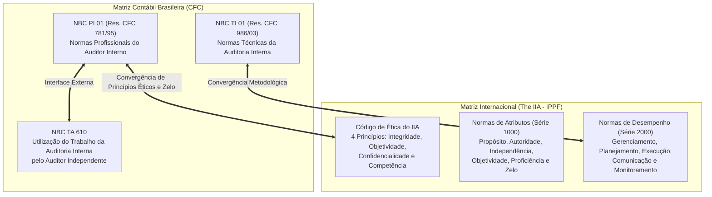
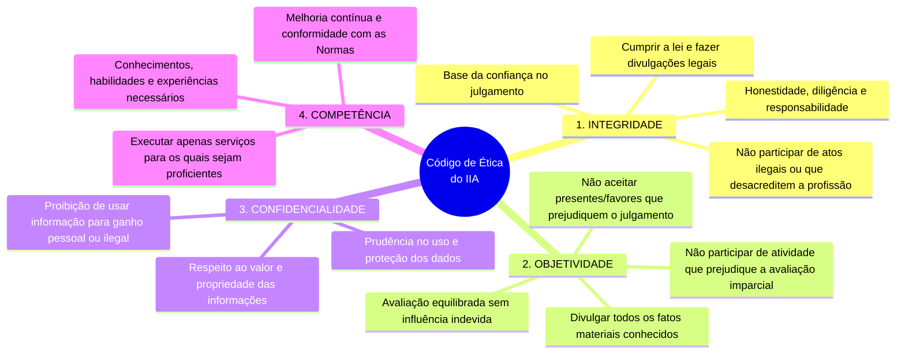
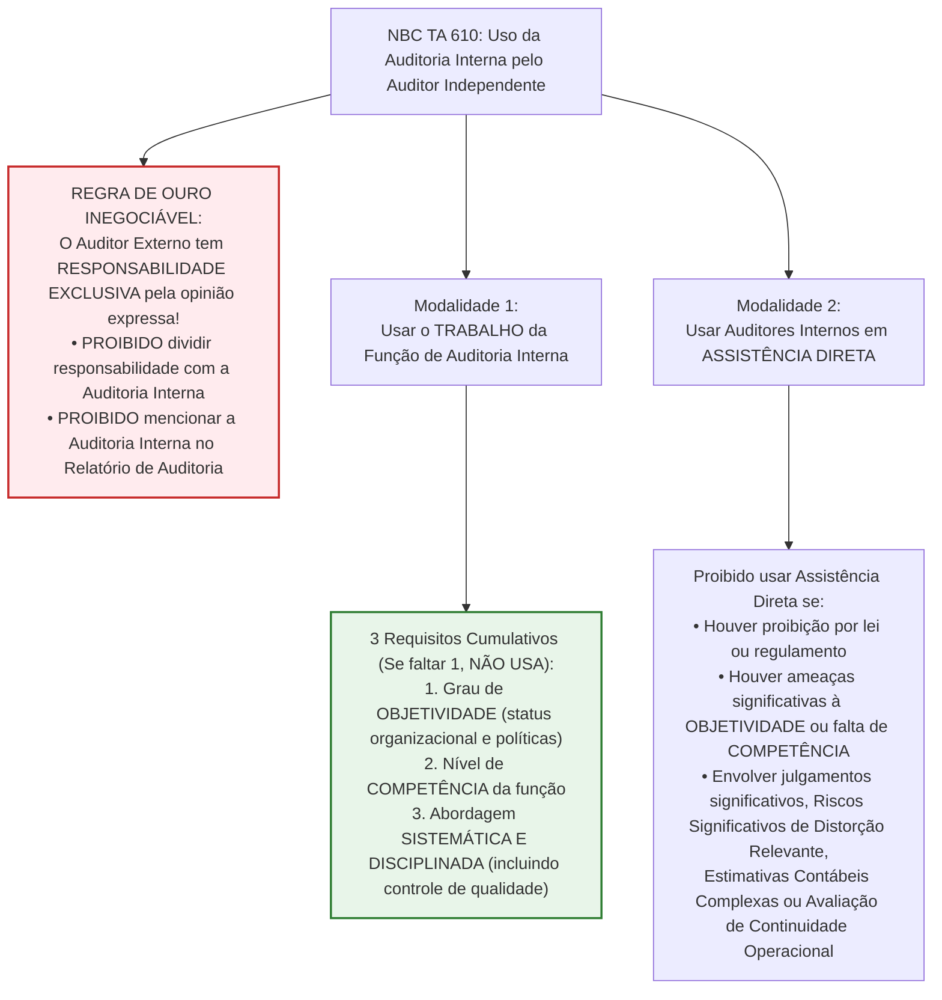
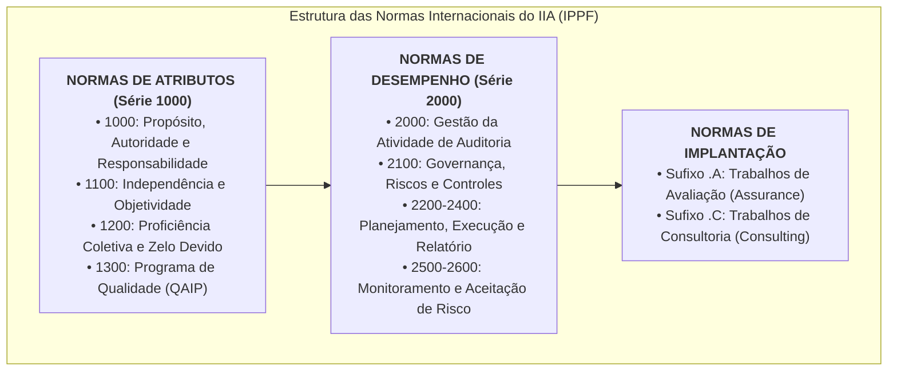

# Normas Profissionais do Auditor Interno (NBC PI 01), Ética do IIA e Cooperação com o Auditor Independente (NBC TA 610)

> **BLUF (Bottom Line Up Front):**  
> Enquanto a NBC TI 01 disciplina *como* o trabalho de auditoria interna deve ser executado (norma técnica), a **NBC PI 01 (aprovada pela Resolução CFC nº 781/1995 — antiga NBC P 3)** estatui *quem* é o Auditor Interno e *quais posturas ético-profissionais* regem sua conduta (norma profissional). Seus cinco pilares estruturantes são: **(1) Competência Técnico-Profissional** (prerrogativa exclusiva de Contador registrado no CRC, admitida a participação de especialistas de outras áreas sob sua supervisão e responsabilidade); **(2) Autonomia Profissional** (preservação da independência técnica e moral, apesar do vínculo empregatício); **(3) Responsabilidade na Obtenção de Elementos Comprobatórios**; **(4) Guarda da Documentação e Sigilo Profissional** (dever perpétuo que subsiste mesmo após a rescisão do vínculo com a empresa, salvo obrigação legal); e **(5) Cooperação com o Auditor Independente** (mediante entendimento prévio com a administração e controle exclusivo sobre seus papéis de trabalho, articulando-se diretamente com os requisitos da **NBC TA 610**).

---

## 1. Arquitetura Normativa: NBC PI 01 (CFC) vs. IPPF / Código de Ética (IIA)

Em concursos de Auditoria Fiscal (Receita Federal, SEFAZ, ISS) e Controle (CGU, TCU, CGE, Telebras, Petrobras), o examinador cobra o perfil profissional do Auditor Interno sob duas matrizes normativas complementares que apresentam nuances importantíssimas:

1. **Matriz Contábil Nacional — NBC PI 01 (Resolução CFC nº 781/1995):** Editada pelo Conselho Federal de Contabilidade, aplica-se à Auditoria Interna Contábil e exige habilitação legal como **Contador registrado em Conselho Regional de Contabilidade (CRC)**.
2. **Matriz Internacional Multidisciplinar — IPPF (*International Professional Practices Framework*) do IIA:** Adotada mundialmente e recepcionada no setor público brasileiro (ex.: Referencial Técnico da CGU — IN SFC nº 3/2017), estrutura-se em **Princípios Éticos**, **Regras de Conduta**, **Normas de Atributos (Série 1000)** e **Normas de Desempenho (Série 2000)**, admitindo equipes multidisciplinares avaliadas pela **proficiência coletiva**.



---

## 2. Dissecação Integral da NBC PI 01 (Resolução CFC nº 781/1995)

Analisemos cada um dos itens oficiais da **NBC PI 01 (antiga NBC P 3)** com rigor cirúrgico, destacando os comandos normativos literais exigidos em prova.

### 2.1. Competência Técnico-Profissional (Item 3.1)

A competência técnico-profissional é o pressuposto de legitimidade do trabalho do auditor interno perante o sistema CFC/CRC:

* **Prerrogativa Exclusiva de Contador (Item 3.1.1):**  
  > *"O contador, na função de auditor interno, deve manter o seu **nível de competência profissional** pelo conhecimento atualizado das **Normas Brasileiras de Contabilidade**, das técnicas contábeis, especialmente na área de auditoria, da legislação inerente à profissão, dos conceitos e técnicas administrativas e da legislação específica aplicável à entidade."*
* **Recusa de Trabalhos Acima da Capacitação (Item 3.1.2):**  
  > *"O auditor interno, não obstante sua posição funcional, deve **abster-se de realizar exames ou emitir parecer/relatório sobre matérias para as quais não esteja tecnicamente habilitado**, cabendo-lhe, nessa hipótese, **indicar à administração da entidade a necessidade de participação de profissionais especializados**."*
* **Equipes Multidisciplinares e Uso de Especialistas (Itens 3.1.3 e 3.1.4):**  
  Quando o trabalho exigir o concurso de especialistas de outras áreas (ex.: engenheiros civis para medir obras, atuários para fundos de pensão, peritos em segurança cibernética ou advogados tributaristas), a NBC PI 01 estabelece duas regras fundamentais:
  1. A atuação desses especialistas de outras profissões deve ocorrer sob a **coordenação, orientação, supervisão e revisão do auditor interno (Contador)**;
  2. O auditor interno **mantém a responsabilidade integral** pelos trabalhos de auditoria interna e pela utilização dos laudos desses especialistas nos seus relatórios.

| Situação Prática | Conduta Exigida pela NBC PI 01 (Item 3.1) |
| :--- | :--- |
| **Auditor interno convidado a auditar algoritmos criptográficos ou reservas minerais sem possuir habilitação técnica na matéria.** | Deve **abster-se** de emitir conclusão isolada sobre o tema estranho à sua competência e **comunicar formalmente à administração** a necessidade de alocar especialistas habilitados. |
| **Engenheiro de software ou economista integrando a equipe de Auditoria Interna.** | Podem compor a equipe técnica como especialistas, desde que orientados e supervisionados pelo Auditor Interno (Contador), que assume a responsabilidade técnica pelo relatório da Auditoria Interna. |

---

### 2.2. Autonomia Profissional vs. Subordinação Administrativa (Item 3.2)

Este é o paradoxo mais fascinante da Auditoria Interna e um dos temas favoritos de todas as bancas: **como um empregado assalariado da empresa (subordinado administrativamente) pode ser considerado "independente"?**

A NBC PI 01 resolve essa tensão por meio do conceito de **Autonomia Profissional**:

* **Literalidade do Item 3.2.1:**  
  > *"O auditor interno, **não obstante sua posição funcional**, deve **preservar sua autonomia profissional**."*

#### A Dupla Vinculação (Reporte Funcional vs. Reporte Administrativo)
Para que a autonomia profissional prevista na NBC PI 01 e a independência organizacional exigida pela Norma 1110 do IIA existam na prática, as melhores práticas de Governança Corporativa (IBGC, COSO, BACEN, CVM e CGU) estabelecem o modelo de **Duplo Reporte (*Dual Reporting*)**:

```mermaid
flowchart TD
    CONS["CONSELHO DE ADMINISTRAÇÃO<br/>(ou Comitê de Auditoria Estatutário)"]
    CEO["DIRETOR-PRESIDENTE (CEO)<br/>(Alta Administração Executiva)"]
    
    AUD["UNIDADE DE AUDITORIA INTERNA<br/>(Chefe Executivo de Auditoria - CAE)"]
    
    CONS ===>|1. SUBORDINAÇÃO FUNCIONAL<br/>• Aprova o Estatuto e o Plano Anual (PAINT)<br/>• Nomeia, avalia, remunera e destitui o Chefe da Auditoria<br/>• Recebe os relatórios sem filtro da Diretoria| AUD
    
    CEO -.->|2. VINCULAÇÃO ADMINISTRATIVA<br/>• Suporte logístico, folha de pagamento, espaço físico<br/>• Orçamento cotidiano e comunicações administrativas<br/>• SEM poder de censurar relatórios ou limitar escopo| AUD

    DIR["Diretorias Operacionais Auditadas<br/>(Financeira, Contábil, Compras, TI, RH)"]
    AUD -->|Audita com total isenção e acesso irrestrito| DIR

    style CONS fill:#e3f2fd,stroke:#1565c0,stroke-width:2px;
    style AUD fill:#e8f5e9,stroke:#2e7d32,stroke-width:2px;
    style DIR fill:#ffebee,stroke:#c62828,stroke-width:1px;
```

1. **Reporte Funcional ao Órgão de Governança (Conselho de Administração / Comitê de Auditoria):** Garante a **independência organizacional**. É o Conselho quem aprova o plano anual de auditoria, garante os recursos e tem a palavra final sobre a contratação ou demissão do executivo-chefe de auditoria (*Chief Audit Executive — CAE*). Assim, se a Auditoria Interna descobrir uma fraude praticada por um Diretor Executivo, este não poderá demitir o auditor interno para abafar o caso!
2. **Reporte Administrativo ao Executivo Principal (CEO / Presidência):** Atende às rotinas administrativas internas (aprovação de férias, folha de ponto, infraestrutura de escritório, trânsito de comunicações internas), sem jamais autorizar interferência no escopo, nos testes ou nas conclusões técnicas do auditor interno.

> [!IMPORTANT]
> **Independência (Atributo da Unidade) vs. Objetividade (Atributo do Indivíduo):**  
> Nas normas do IIA e da CGU, faça a distinção cirúrgica:
> - **Independência:** É um atributo **organizacional** da unidade de Auditoria Interna (estar livre de condições que ameacem sua capacidade de cumprir suas responsabilidades de forma imparcial, garantida pelo reporte funcional ao Conselho).
> - **Objetividade:** É uma **atitude mental individual** de cada auditor interno (atuar de modo imparcial, intelectualmente honesto e livre de conflitos de interesse, sem subordinar seu julgamento a outrem).

---

### 2.3. Quarentena Operacional e Impedimentos à Objetividade (Ameaça de Autorrevisão)

O que acontece quando um contador que trabalhava na Gerência de Contas a Pagar ou na Folha de Pagamento é transferido ou promovido para a unidade de Auditoria Interna? Ele pode, no mês seguinte, auditar o setor de Contas a Pagar onde trabalhava?

**NÃO!** Se ele auditar os lançamentos e controles que ele mesmo executou ou aprovou recentemente, estará configurada a clássica **ameaça de autorrevisão** (*self-review threat*), comprometendo frontalmente sua **objetividade e autonomia profissional**.

* **Regra da Quarentena Operacional (Norma 1130.A1 do IIA e Referencial CGU):**  
  Os auditores internos devem abster-se de avaliar operações específicas pelas quais tenham sido responsáveis anteriormente. Presume-se que a objetividade de um auditor interno está prejudicada se ele prestar serviços de avaliação (*assurance*) para uma atividade pela qual **teve responsabilidade durante o período do ano anterior (quarentena mínima de 12 meses)**.
* **Atenção:** E se o auditor interno for solicitado a prestar apenas **serviços de consultoria** (aconselhamento/treinamento) para uma área pela qual foi responsável há menos de 12 meses? Segundo a Norma 1130.C1 do IIA, **ele PODE prestar consultoria**, desde que potenciais prejuízos à independência ou objetividade sejam **divulgados ao cliente do trabalho antes de o trabalho ser aceito**!

| Tipo de Serviço da Auditoria Interna | Atividade onde o Auditor teve Responsabilidade Operacional nos últimos 12 meses | Regra Normativa (IIA / CGU / NBC PI 01) |
| :--- | :--- | :--- |
| **Serviço de Avaliação (*Assurance* / Auditoria)** | Ex.: Auditar o setor de compras que ele gerenciou há 6 meses. | **VEDADO!** Presume-se prejuízo absoluto à objetividade (Quarentena de **12 meses**). |
| **Serviço de Consultoria (*Consulting*)** | Ex.: Prestar assessoria sobre fluxo de processos ao setor que gerenciou há 6 meses. | **PERMITIDO**, desde que o potencial conflito seja **formalmente divulgado** ao solicitante antes da aceitação do trabalho. |

---

### 2.4. Responsabilidade do Auditor Interno na Execução dos Trabalhos (Item 3.3)

A NBC PI 01 vincula o zelo profissional do auditor interno à busca rigorosa da verdade material e ao embasamento probatório de suas conclusões:

* **Devido Zelo Profissional e Cuidado (Item 3.3.1):**  
  O auditor interno deve exercer suas funções com **zelo, diligência, honestidade e probidade**, aplicando o máximo de cuidado e prudência na condução dos exames e na formulação de recomendações. *(Importante: o devido zelo profissional exige o cuidado e a habilidade esperados de um auditor interno razoavelmente prudente e competente, mas **NÃO implica infalibilidade**!)*
* **Obtenção de Elementos Comprobatórios (Item 3.3.2):**  
  > *"O auditor interno deve ter o máximo de cuidado, imparcialidade e zelo na realização dos trabalhos e na exposição das conclusões, **assegurando-se de que a emissão do seu relatório está respaldada em elementos comprobatórios hábeis e suficientes**."*
* **Liberdade de Acesso e Limitação de Escopo (Item 3.3.3):**  
  O auditor interno deve ter amplo e irrestrito acesso a todos os documentos, registros, ativos, sistemas e dependências da entidade necessários ao seu trabalho. Caso sofra **restrições ou limitações de acesso** impostas por gestores auditados, deve **registrar o fato nos papéis de trabalho e comunicá-lo formalmente no relatório** dirigido à alta administração.

---

### 2.5. Guarda da Documentação e Sigilo Profissional (Item 3.4)

A confidencialidade é a pedra angular da relação de confiança entre a entidade e seu auditor interno:

1. **Dever de Sigilo (Item 3.4.1):**  
   O auditor interno deve respeitar o **sigilo profissional** relativamente às informações e dados obtidos em decorrência do exercício de suas funções, sendo-lhe **estritamente vedado divulgá-los a terceiros ou utilizá-los em benefício próprio ou de outrem** sob qualquer pretexto.
2. **Perpetuidade do Sigilo Pós-Desligamento (Item 3.4.2):**  
   > *"O dever de manter o sigilo **continua depois de terminado o vínculo empregatício ou contratual** do auditor interno com a entidade."*
3. **Prazo de Guarda dos Papéis de Trabalho (Item 3.4.3):**  
   Os papéis de trabalho e relatórios devem ser conservados em boa guarda e segurança pelo prazo de **5 (cinco) anos**, a partir da data de emissão do relatório, ou por prazo superior se determinado por disposição legal ou estatutária da entidade.
4. **Exceções Estritas à Quebra de Sigilo:**  
   O sigilo somente cede diante de:
   * **Autorização expressa** da administração da entidade; ou
   * **Obrigação legal ou determinação judicial / de órgão fiscalizador competente** (ex.: requisição do Poder Judiciário, do Conselho Federal/Regional de Contabilidade em fiscalização ética, ou comunicação obrigatória ao Tribunal de Contas no setor público — art. 74, § 1º, da CF/88).

> [!WARNING]
> **Pegadinha Clássica sobre Sigilo (FGV / FCC):**  
> As bancas costumam afirmar que *"o auditor interno fica liberado do sigilo profissional após 2 anos de sua demissão"* ou que *"pode revelar informações confidenciais a terceiros desde que isso não cause prejuízo financeiro direto à empresa"*. **AMBAS ESTÃO ERRADAS!** O dever de sigilo é **contínuo (perpétuo)** após o término do vínculo e proíbe qualquer uso ou divulgação não autorizada, mesmo sem dano aparente!

---

## 3. O Código de Ética do IIA: Os 4 Princípios vs. As Regras de Conduta

Nas provas que cobram conjuntamente a NBC PI 01 e a estrutura internacional do IIA (IPPF), o examinador exige que você saiba diferenciar os **4 Princípios Fundamentais** das suas respectivas **Regras de Conduta** (que traduzem os princípios em comportamentos práticos observáveis):



| Princípio do IIA | Essência Conceitual | Regra de Conduta Mais Cobrada em Prova |
| :--- | :--- | :--- |
| **1. Integridade** | Estabelece a **confiança** e, assim, fornece a base para a confiabilidade no julgamento do auditor interno. | Executar o trabalho com **honestidade, diligência e responsabilidade**; respeitar e contribuir para os objetivos legítimos e éticos da organização. |
| **2. Objetividade** | Exige a mais alta **isenção e imparcialidade** na coleta, avaliação e comunicação de informações, sem deixar que interesses próprios ou de terceiros influenciem o julgamento. | **Não aceitar nada** (presentes, brindes, favores) que possa prejudicar ou que se presuma que prejudique seu julgamento profissional; **divulgar todos os fatos materiais** de seu conhecimento que, se não divulgados, possam distorcer o relatório. |
| **3. Confidencialidade** | Respeito ao valor e à propriedade das informações recebidas, não as divulgando sem a devida autorização, a menos que haja obrigação legal ou profissional. | Ser **prudente** no uso e proteção das informações; **não usar informações para qualquer ganho pessoal** ou de maneira contrária à lei ou em detrimento da organização. |
| **4. Competência** | Aplicação do conhecimento, habilidades e experiência necessários no desempenho dos serviços de auditoria interna. | Envolver-se **somente em serviços para os quais possuam os necessários conhecimentos, habilidades e experiência**; melhorar continuamente a proficiência e a qualidade dos serviços. |

---

## 4. Cooperação com o Auditor Independente: NBC PI 01 (Item 3.5) vs. NBC TA 610

A interface entre o **Auditor Interno** e o **Auditor Independente (Externo)** é disciplinada sob duas óticas complementares:
* **Pelo lado do Auditor Interno:** Item **3.5 da NBC PI 01** (Cooperação com o Auditor Independente).
* **Pelo lado do Auditor Externo:** **NBC TA 610** (Utilização do Trabalho de Auditoria Interna).

### 4.1. As 3 Regras da NBC PI 01 para o Auditor Interno (Item 3.5)

Quando a empresa auditada contrata uma firma de Auditoria Independente para examinar suas demonstrações contábeis, como deve proceder o Auditor Interno segundo a NBC PI 01?

1. **Entendimento Prévio com a Administração (Item 3.5.1):**  
   O auditor interno, **quando previamente estabelecido com a administração da entidade** na qual atua, e no âmbito de planejamento conjunto do trabalho a realizar, deve **apresentar os seus papéis de trabalho ao auditor independente** e **entregar-lhe cópias**, quando este entender necessário.
2. **Controle Exclusivo sobre os Papéis de Trabalho (Item 3.5.2):**  
   O auditor interno possui **controle exclusivo** sobre os seus papéis de trabalho (que pertencem à entidade e ficam sob guarda da Auditoria Interna). Ele fornece acesso e cópias mediante autorização da administração, mas não entrega a guarda original definitiva de seus arquivos ao auditor externo.
3. **Espírito de Cooperação Técnica:**  
   A cooperação visa evitar duplicidade desnecessária de esforços, otimizar a cobertura de riscos e aprimorar a governança da companhia.

---

### 4.2. As Regras da NBC TA 610 para o Auditor Independente (Externo)

Pela ótica da **NBC TA 610**, o auditor externo pode interagir com a função de auditoria interna de **duas maneiras distintas**:
1. **Utilização do Trabalho da Função de Auditoria Interna:** O auditor externo revisa e aproveita relatórios, testes e papéis de trabalho já realizados pela Auditoria Interna para modificar a natureza ou a época, ou **reduzir a extensão** de seus próprios procedimentos de auditoria.
2. **Utilização de Auditores Internos para Prestar Assistência Direta:** Auditores internos executam procedimentos de auditoria sob a **direção, supervisão e revisão diretas do auditor externo**.



#### Os 3 Critérios de Avaliação da Função de Auditoria Interna (NBC TA 610, item 15)
Para decidir se pode ou não utilizar o trabalho da Auditoria Interna, o auditor externo deve obrigatoriamente avaliar três pilares:
1. **Objetividade:** O grau em que o status organizacional da função de auditoria interna e políticas e procedimentos relevantes sustentam a objetividade dos auditores internos (ex.: se reportam ao Conselho/Comitê de Auditoria, se estão livres de responsabilidades operacionais conflitantes);
2. **Competência:** O nível de competência da função de auditoria interna (formação técnica, treinamento, recursos adequados); e
3. **Abordagem Sistemática e Disciplinada:** Se a função de auditoria interna aplica uma abordagem sistemática e disciplinada, **incluindo controle de qualidade** (planejamento documentado, programas de trabalho, revisão de papéis de trabalho).

> [!CAUTION]
> **Quando é VEDADO usar o trabalho da Auditoria Interna (NBC TA 610, item 16)?**  
> O auditor externo **NÃO DEVE** utilizar o trabalho da função de auditoria interna se determinar que se aplica **qualquer uma** das seguintes condições:
> 1. O status da função na organização e políticas relevantes **não sustentam adequadamente a objetividade** dos auditores internos;
> 2. A função **carece de competência suficiente**; ou
> 3. A função **não aplica uma abordagem sistemática e disciplinada**, incluindo controle de qualidade.

#### Quanto Maior o Julgamento e o Risco, Menor o Uso da Auditoria Interna!
Mesmo quando a Auditoria Interna é excelente, a NBC TA 610 (itens 18 e 30) impõe limites proporcionais ao risco:
* Quanto **mais significativo o julgamento** envolvido (no planejamento/execução dos procedimentos ou na avaliação das evidências) e quanto **maior o risco avaliado de distorção relevante** no nível da afirmação (especialmente **Riscos Significativos**), **MENOS** trabalho da função de auditoria interna o auditor externo pode utilizar, e **MAIS** procedimentos o próprio auditor externo deve executar diretamente!
* Na modalidade de **Assistência Direta**, o auditor externo precisa obter **acordo por escrito** de representante autorizado da entidade (de que os auditores internos poderão seguir as instruções do auditor externo sem interferência da administração) e **acordo por escrito dos próprios auditores internos** (de que manterão confidencialidade e informarão qualquer ameaça à sua objetividade).

---

## 5. Estudo de Caso Aplicado: Dilemas Éticos e Profissionais na Auditoria Interna

Acompanhe o diagnóstico técnico de três incidentes reais de governança sob a lente da NBC PI 01, do IPPF/IIA e da NBC TA 610:

* **Incidente 1 (Falta de Habilitação Técnica — NBC PI 01, item 3.1.2):**  
  *Fato:* O auditor interno (Contador) de uma mineradora foi instado pelo Diretor-Presidente a assinar sozinho um relatório técnico atestando a estabilidade estrutural geotécnica de uma barragem de rejeitos.  
  *Solução Normativa:* Conforme o item 3.1.2 da NBC PI 01 e o Princípio da Competência do IIA, o auditor interno deve **abster-se** de realizar exames ou emitir relatório sobre matéria para a qual não esteja tecnicamente habilitado, indicando formalmente à administração a necessidade de participação de **profissionais especializados** (engenheiros geotécnicos).
* **Incidente 2 (Quebra da Quarentena Operacional — Norma 1130.A1 do IIA):**  
  *Fato:* A contadora *Maria* exerceu durante três anos o cargo de Gerente de Tesouraria e Folha de Pagamento da autarquia municipal. Há 4 meses, foi nomeada para a equipe de Auditoria Interna e escalada para chefiar a auditoria de avaliação (*assurance*) sobre a Folha de Pagamento do exercício corrente.  
  *Solução Normativa:* Há **prejuízo presumido à objetividade** (ameaça de autorrevisão), pois não transcorreu o período mínimo de **quarentena de 12 meses** desde o término de sua responsabilidade operacional naquela área. *Maria* deve declarar seu impedimento para que outro auditor interno conduza a avaliação.
* **Incidente 3 (Tentativa de Divisão de Responsabilidade — NBC TA 610 e NBC PI 01):**  
  *Fato:* A firma de auditoria externa utilizou extensivamente os relatórios da Auditoria Interna sobre a contagem física de estoques nas filiais. Ao redigir o Relatório do Auditor Independente (NBC TA 700), o sócio externo incluiu um parágrafo afirmando que *"quanto à existência física dos estoques nas filiais do Norte, nossa opinião baseia-se no relatório emitido pela Auditoria Interna da companhia"*.  
  *Solução Normativa:* Conduta **gravemente irregular**! Pela NBC TA 610 (item 11), o auditor independente tem **responsabilidade exclusiva** pela opinião de auditoria expressa, e essa responsabilidade **jamais é reduzida** pela utilização do trabalho da auditoria interna, sendo vedado fazer referência à auditoria interna no relatório para tentar dividir responsabilidade.

---

## 6. Cascas de Banana e Armadilhas de Bancas (FGV / Cebraspe / FCC)

| Armadilha Recorrente em Prova ("Casca de Banana") | Por que está ERRADA? (Contra-Ataque Técnico) |
| :--- | :--- |
| *"O auditor interno, por ser empregado subordinado à empresa, não possui autonomia profissional, devendo acatar determinações da Diretoria sobre quais falhas omitir no relatório."* | **ERRADO!** O item 3.2.1 da NBC PI 01 determina expressamente que o auditor interno, **não obstante sua posição funcional, deve preservar sua autonomia profissional**. |
| *"O dever de sigilo profissional do auditor interno extingue-se automaticamente com a homologação de sua rescisão trabalhista."* | **ERRADO!** Conforme o item 3.4.2 da NBC PI 01, o dever de manter o sigilo **continua depois de terminado o vínculo empregatício ou contratual** com a entidade. |
| *"O auditor interno deve entregar seus papéis de trabalho ao auditor independente assim que este os solicitar diretamente, independentemente de ciência da administração."* | **ERRADO!** Pelo item 3.5.1 da NBC PI 01, a apresentação de papéis de trabalho e entrega de cópias ao auditor independente exige que isso seja **previamente estabelecido com a administração da entidade**. |
| *"Quando o auditor externo utiliza o trabalho da auditoria interna nos termos da NBC TA 610, a responsabilidade pela opinião de auditoria passa a ser solidária e compartilhada entre ambos."* | **ERRADO!** Pela NBC TA 610 (item 11), a responsabilidade do auditor externo pela opinião expressa é **EXCLUSIVA e INTRANSFERÍVEL**, não sendo reduzida pelo uso da auditoria interna. |
| *"O período de carência (quarentena) para que um auditor interno possa realizar trabalhos de avaliação (assurance) em área na qual atuou operacionalmente é de 18 meses (ou 24 meses)."* | **ERRADO!** Segundo a Norma 1130.A1 do IIA e os manuais da CGU/TCU, o período de quarentena operacional em que se presume prejuízo à objetividade é de **1 ano (12 meses)**! |
| *"Se a função de auditoria interna possuir alta competência técnica, o auditor externo pode utilizar seu trabalho mesmo que ela não aplique uma abordagem sistemática e disciplinada de controle de qualidade."* | **ERRADO!** Pela NBC TA 610 (item 16), os 3 requisitos (Objetividade + Competência + Abordagem sistemática e disciplinada com controle de qualidade) são **cumulativos**. Se faltar qualquer um, o uso é **proibido**. |

---

## 7. Mnemônicos & Âncoras de Memória

> [!TIP]
> ### 🧠 Mnemônico 1: Os 5 Pilares da NBC PI 01 (Resolução CFC nº 781/1995)
> Grave a sigla: **`C - A - R - S - C`** (*"O Auditor Interno anda de CARSC"*)
> * **C — Competência Técnico-Profissional** (Contador com CRC; abster-se do que não é habilitado; supervisionar especialistas).
> * **A — Autonomia Profissional** (Preservar isenção técnica e moral mesmo com vínculo empregatício; reporte funcional ao Conselho).
> * **R — Responsabilidade na Execução** (Máximo cuidado, imparcialidade, zelo e respaldo em elementos comprobatórios hábeis).
> * **S — Sigilo e Guarda Documental** (Sigilo contínuo mesmo **após o desligamento**; guarda por **5 anos**).
> * **C — Cooperação com o Auditor Independente** (Acesso e cópias dos papéis de trabalho mediante **entendimento prévio com a administração**).

> [!TIP]
> ### 🧠 Mnemônico 2: Os 4 Princípios do Código de Ética do IIA
> Grave a palavra: **`I - O - C - C`** (*"Integridade, Objetividade, Confidencialidade, Competência"*)
> * **I**ntegridade $\rightarrow$ Gera **confiança** (honestidade, diligência e legalidade).
> * **O**bjetividade $\rightarrow$ Gera **imparcialidade** (zero conflito de interesses, recusar presentes, quarentena de **12 meses**).
> * **C**onfidencialidade $\rightarrow$ Gera **proteção da informação** (prudência, proibido ganho pessoal).
> * **C**ompetência $\rightarrow$ Gera **qualidade técnica** (conhecimento, habilidades e melhoria contínua).

> [!TIP]
> ### 🧠 Mnemônico 3: Os 3 Requisitos da NBC TA 610 para Usar a Auditoria Interna
> Grave a tríade: **`O - C - A`**
> * **O**bjetividade (status organizacional e reporte ao Conselho).
> * **C**ompetência (qualificação e recursos da equipe interna).
> * **A**bordagem sistemática e disciplinada (incluindo controle de qualidade).

---

## 8. Bateria de Questões Oficiais Comentadas Alternativa por Alternativa

### Questão 01 — [FGV — CGE-SC / Auditor Interno — 2023]

A adoção do Código de Ética recomendado pelo *The Institute of Internal Auditors* (IIA) é parte integrante da Estrutura Internacional de Práticas Profissionais (IPPF) e estabelece princípios e expectativas que governam o comportamento dos auditores internos. O Código exige que os profissionais mantenham uma postura de confiança, com avaliação objetiva da governança, do gerenciamento de riscos e do controle. Considerando os princípios fundamentais e suas respectivas regras de conduta, assinale a afirmativa correta:

- (A) O Princípio da Confidencialidade exige que o auditor interno seja prudente no uso e na proteção das informações obtidas no curso de suas funções, sendo permitido o uso de informações confidenciais para ganho pessoal, desde que essa utilização não seja financeiramente prejudicial à organização.
- (B) Para atender ao Princípio da Objetividade, o auditor interno deve atuar de forma imparcial e desimpedida, devendo se abster de avaliar atividades específicas pelas quais tenha sido responsável anteriormente, sendo o período de carência presumido de 18 meses, contado a partir do fim da responsabilidade.
- (C) O Princípio da Competência impõe que os auditores internos possuam conhecimento das Normas Internacionais para a Prática Profissional de Auditoria Interna, sendo que o desenvolvimento profissional contínuo é uma prática facultativa e dispensável para auditores seniores.
- (D) O Princípio da Integridade requer que os auditores internos sejam honestos, diligentes e responsáveis na execução das suas atribuições, autorizando-os a aplicar diretamente sanções disciplinares e demissões por justa causa aos servidores auditados.
- (E) A Objetividade é salvaguardada quando os auditores internos se abstêm de aceitar presentes, recompensas ou favores que possam prejudicar ou que se presuma que prejudiquem seu julgamento profissional, refletindo a necessidade de isenção na avaliação dos fatos e circunstâncias relevantes.

**Gabarito Oficial: E**

**Comentário Analítico Alternativa por Alternativa:**
* **(A) INCORRETA:** A Regra de Conduta 3.2 da Confidencialidade proíbe terminantemente que o auditor interno utilize informações para **qualquer ganho pessoal**, independentemente de haver ou não prejuízo direto à organização (além de a NBC PI 01 reiterar essa vedação absoluta).
* **(B) INCORRETA:** A pegadinha está no prazo! Conforme a Norma 1130.A1 do IIA, presume-se prejuízo à objetividade quando o auditor interno avalia atividade pela qual teve responsabilidade durante o **ano anterior (12 meses)**, e não 18 meses.
* **(C) INCORRETA:** Pela Regra de Conduta 4.3 do Princípio da Competência (e item 3.1.1 da NBC PI 01), a melhoria contínua da proficiência e a atualização profissional são deveres **obrigatórios e permanentes**, jamais facultativos.
* **(D) INCORRETA:** O auditor interno não exerce poder disciplinar punitivo nem aplica demissões (atos privativos da gestão executiva).
* **(E) CORRETA:** Traduz com perfeição a Regra de Conduta 2.2 do Princípio da **Objetividade** do Código de Ética do IIA: os auditores internos não devem aceitar nada que possa prejudicar ou que se presuma que prejudique seu julgamento profissional.

---

### Questão 02 — [FGV — Câmara Municipal de São Paulo / Consultor Técnico Legislativo - Contador — 2024]

Na controladoria municipal, o titular da unidade de auditoria interna assumiu temporariamente a aprovação de controles operacionais e a aceitação de riscos de um sistema de folha de pagamento. A instância de governança pretende obter asseguração (*assurance*) sobre essa área de folha de pagamento enquanto a responsabilidade operacional ainda está sendo transferida de volta à gestão. Segundo os padrões profissionais de auditoria interna (NBC PI 01 e Normas do IIA), qual é a providência que preserva a independência e a objetividade da função?

- (A) Manter a equipe da auditoria interna na avaliação, registrar o envolvimento anterior nos papéis de trabalho e submeter o relatório final a uma revisão realizada depois dos testes pela própria chefia da unidade.
- (B) Manter a equipe nos testes de asseguração, retirar do escopo os controles aprovados pelo titular e concentrar a conclusão apenas nos componentes implantados diretamente pela área de tecnologia.
- (C) Comunicar o prejuízo à independência/objetividade à governança, planejar a transferência das atribuições operacionais à gestão e atribuir o trabalho de asseguração daquela área a um prestador independente e competente, com reporte direto à governança.
- (D) Solicitar que o gestor da folha escolha os auditores internos responsáveis pelo exame, aproveitando seu conhecimento operacional para indicar profissionais com menor participação nas decisões.
- (E) Contratar um especialista externo apenas para assinar o relatório final, mantendo com a equipe interna impedida a definição do escopo, dos testes, dos achados e das conclusões do trabalho avaliativo.

**Gabarito Oficial: C**

**Comentário Analítico Alternativa por Alternativa:**
* **(A) INCORRETA:** Quando o próprio titular da unidade de Auditoria Interna (*CAE*) assume responsabilidades operacionais de gestão sobre uma área, toda a unidade subordinada a ele sofre comprometimento de independência organizacional para auditar aquela área, não bastando uma revisão interna.
* **(B) INCORRETA:** Retirar artificialmente do escopo de auditoria justamente os controles críticos de aceitação de riscos aprovados pelo titular mutila o alcance da asseguração e oculta o conflito de interesses.
* **(C) CORRETA:** Em estrita conformidade com a Norma 1112 do IIA (*Papéis do Chefe Executivo de Auditoria Além da Auditoria Interna*) e a NBC PI 01: quando o chefe da auditoria interna tem ou teve responsabilidades fora da auditoria interna (funções de gestão), a avaliação (*assurance*) daquela área específica deve ser **supervisionada por uma parte externa independente** que se reporte diretamente ao Órgão de Governança, enquanto se promove a transição das funções operacionais de volta à gestão.
* **(D) INCORRETA:** Permitir que o próprio gestor auditado escolha quem irá auditá-lo fere de morte a autonomia profissional da auditoria.
* **(E) INCORRETA:** Usar um terceiro como mero "laranja" signatário de um trabalho integralmente conduzido por equipe impedida configura fraude ética e violação da independência real e aparente.

---

### Questão 03 — [Cebraspe — Comando da Aeronáutica (CENCIAR) / Auditoria — 2024]

No âmbito do Comando da Aeronáutica, o Centro de Controle Interno da Aeronáutica (CENCIAR) desempenha papel fundamental na fiscalização e no assessoramento da gestão. Durante a realização de uma auditoria financeira externa nas demonstrações contábeis de uma unidade gestora, o auditor independente decide avaliar a possibilidade de utilizar os trabalhos realizados pelos auditores internos para fins de otimização de recursos e profundidade de testes. Considerando as disposições da NBC TA 610 – Utilização do Trabalho de Auditoria Interna e da NBC PI 01, assinale a alternativa que apresenta corretamente as responsabilidades e os requisitos para essa interação:

- (A) A responsabilidade do auditor externo pela opinião de auditoria é compartilhada com a função de auditoria interna na medida em que seus trabalhos sejam utilizados como base para as conclusões do relatório, reduzindo-se, assim, a responsabilidade legal do auditor independente.
- (B) Para que o trabalho da auditoria interna seja utilizado, o auditor externo deve avaliar apenas a competência técnica dos auditores internos, sendo prescindível a análise da objetividade da função ou do uso de uma abordagem sistemática e disciplinada.
- (C) O auditor externo pode utilizar auditores internos para prestar assistência direta em áreas de auditoria que envolvam julgamentos significativos ou que apresentem alto risco de distorção relevante, desde que esses auditores sejam supervisionados remotamente ao final do exercício.
- (D) O auditor externo tem a responsabilidade exclusiva pela opinião de auditoria expressa, e essa responsabilidade não é reduzida pela utilização do trabalho da auditoria interna; além disso, ele não deve utilizar o trabalho da função se determinar que esta não aplica uma abordagem sistemática e disciplinada, incluindo o controle de qualidade.
- (E) Os papéis de trabalho elaborados pela auditoria interna passam à propriedade exclusiva da firma de auditoria independente assim que forem utilizados para fundamentar testes substantivos.

**Gabarito Oficial: D**

**Comentário Analítico Alternativa por Alternativa:**
* **(A) INCORRETA:** Pela NBC TA 610 (item 11), a responsabilidade do auditor externo pela opinião expressa é **exclusiva e indivisível**, nunca sendo compartilhada ou reduzida pelo uso do trabalho da auditoria interna.
* **(B) INCORRETA:** Pela NBC TA 610 (itens 15 e 16), o auditor externo deve obrigatoriamente avaliar os **três requisitos cumulativos**: (1) Objetividade; (2) Competência; e (3) Abordagem sistemática e disciplinada, incluindo controle de qualidade.
* **(C) INCORRETA:** Pela NBC TA 610 (item 30), é **vedado** ao auditor externo utilizar auditores internos para prestar assistência direta em procedimentos que envolvam **julgamentos significativos** ou que se relacionem a **riscos mais altos de distorção relevante**!
* **(D) CORRETA:** Reproduz com exatidão os pilares da NBC TA 610 (itens 11, 15 e 16): responsabilidade exclusiva do auditor externo pela opinião e proibição de utilizar o trabalho da auditoria interna caso falte qualquer um dos três requisitos (objetividade, competência ou abordagem sistemática e disciplinada com controle de qualidade).
* **(E) INCORRETA:** Conforme a NBC PI 01 (item 3.5.2) e a NBC TI 01, os papéis de trabalho da auditoria interna permanecem sob **controle exclusivo do auditor interno** (e propriedade da entidade auditada), cabendo apenas o fornecimento de cópias mediante prévio entendimento com a administração.

---

### Questão 04 — [FCC — SEFAZ-BA / Auditor Fiscal — 2022]

Com relação às Normas Profissionais do Auditor Interno (NBC PI 01 — Resolução CFC nº 781/1995), no que tange à competência técnico-profissional, à autonomia, ao sigilo e à cooperação com o auditor independente, é CORRETO afirmar que:

- (A) O auditor interno, em razão de seu vínculo empregatício e subordinação hierárquica, está obrigado a emitir parecer técnico mesmo sobre matérias alheias à sua habilitação contábil, sempre que determinado por ordem escrita da Diretoria Executiva.
- (B) O dever de manter o sigilo profissional pelo auditor interno vigora durante toda a vigência do contrato de trabalho, cessando imediatamente após a rescisão contratual ou aposentadoria do profissional.
- (C) O auditor interno, quando previamente estabelecido com a administração da entidade na qual atua, e no âmbito de planejamento conjunto do trabalho a realizar, deve apresentar os seus papéis de trabalho ao auditor independente e entregar-lhe cópias, quando este entender necessário.
- (D) A guarda dos papéis de trabalho e relatórios produzidos pela auditoria interna deve ser mantida pelo prazo mínimo de 2 (dois) anos a contar do encerramento do exercício social auditado.
- (E) Quando o trabalho da auditoria interna exigir a participação de especialistas de outras áreas (como engenheiros ou atuários), a responsabilidade técnica pelo relatório de auditoria interna transfere-se integralmente ao conselho profissional do respectivo especialista.

**Gabarito Oficial: C**

**Comentário Analítico Alternativa por Alternativa:**
* **(A) INCORRETA:** Viola frontalmente os itens 3.1.2 e 3.2.1 da NBC PI 01. O auditor interno deve preservar sua autonomia profissional e **abster-se** de realizar exames ou emitir relatórios sobre matérias para as quais não esteja tecnicamente habilitado, indicando à administração a necessidade de especialistas.
* **(B) INCORRETA:** Viola o item 3.4.2 da NBC PI 01: o dever de manter o sigilo profissional **continua depois de terminado o vínculo empregatício ou contratual** do auditor interno com a entidade.
* **(C) CORRETA:** Reproduz a literalidade exata do item **3.5.1 da NBC PI 01** acerca da cooperação técnica com o auditor independente mediante entendimento prévio com a administração.
* **(D) INCORRETA:** Pelo item 3.4.3 da NBC PI 01, o prazo de guarda e conservação dos papéis de trabalho e documentos da auditoria interna é de **5 (cinco) anos** a partir da data de emissão do relatório (ou prazo superior se exigido por lei), e não 2 anos.
* **(E) INCORRETA:** Pelos itens 3.1.3 e 3.1.4 da NBC PI 01, os especialistas de outras áreas atuam sob orientação e supervisão do auditor interno, que **mantém a responsabilidade integral** pelo conjunto do trabalho de auditoria interna.

---

### Questão 05 — [Cebraspe — Petrobras / Auditoria Interna — 2023]

Quanto à auditoria interna, às Normas Profissionais do Auditor Interno (NBC PI 01) e às Normas Internacionais para o Exercício Profissional da Auditoria Interna (IIA), julgue as afirmativas a seguir:

I. A auditoria interna é um serviço independente e objetivo de avaliação e consultoria, criado para agregar valor e melhorar as operações da organização, sendo dispensável a interação da auditoria interna com o conselho de administração quando não há relatórios com ressalvas financeiras.
II. O auditor interno deve manter o sigilo profissional em relação às informações obtidas durante o seu trabalho, sendo-lhe expressamente vedado utilizar tais informações para obter vantagens pessoais ou para favorecer terceiros, obrigação que perdura mesmo após seu desligamento da organização.
III. Para assegurar a independência organizacional da atividade de auditoria interna, o executivo-chefe de auditoria deve reportar-se funcionalmente ao conselho de administração (ou comitê de auditoria) e administrativamente ao diretor-presidente (CEO) da organização.

Assinale a opção correta:

- (A) Apenas o item I está correto.
- (B) Apenas o item II está correto.
- (C) Apenas os itens I e III estão corretos.
- (D) Apenas os itens II e III estão corretos.
- (E) Todos os itens estão corretos.

**Gabarito Oficial: D**

**Comentário Analítico Alternativa por Alternativa:**
* **Análise do Item I (INCORRETO):** A primeira metade da frase está perfeita, mas a parte final é falsa! A interação periódica e direta da Auditoria Interna com o Conselho de Administração / Comitê de Auditoria (Norma 1111 do IIA) é **indispensável e contínua** (para aprovação do plano anual, reporte de atividades, avaliação de riscos e garantia da independência), jamais sendo dispensável!
* **Análise do Item II (CORRETO):** Expressa com perfeição o dever de sigilo profissional da NBC PI 01 (itens 3.4.1 e 3.4.2) e do Código de Ética do IIA (Princípio da Confidencialidade), incluindo sua vigência perpétua pós-desligamento.
* **Análise do Item III (CORRETO):** Descreve exatamente o modelo de **Duplo Reporte (*Dual Reporting*)** consagrado pela Norma 1110 do IIA e pelas diretrizes de governança: subordinação **funcional** ao Conselho (governança) e vinculação **administrativa** ao CEO (gestão).
* Logo, apenas os itens **II e III** estão corretos, confirmando o gabarito na **alternativa D**.

---

### Questão 06 — [FGV — Banrisul / Auditoria Interna — 2023]

“Especificamente, descrevem normas do comportamento esperado de auditores internos, também ajudam a interpretar os princípios em aplicações práticas e têm o objetivo de orientar a conduta ética dos profissionais de auditoria interna.” Acerca do tema Ética do profissional de auditoria interna no âmbito do IPPF (IIA), o texto acima faz referência direta às (aos):

- (A) Princípios éticos fundamentais.
- (B) Declarações de posição do IIA.
- (C) Regras de conduta.
- (D) Guias de orientação suplementar.
- (E) Normas de implantação de consultoria.

**Gabarito Oficial: C**

**Comentário Analítico Alternativa por Alternativa:**
* **(A) INCORRETA:** Os **Princípios Éticos** do Código de Ética do IIA são quatro conceitos amplos e abstratos (Integridade, Objetividade, Confidencialidade e Competência) relevantes para a profissão e prática da auditoria interna.
* **(B) INCORRETA:** Declarações de Posição (*Position Papers*) do IIA tratam de questões de governança e gestão de riscos (como o Modelo das Três Linhas), e não da estrutura interna do Código de Ética.
* **(C) CORRETA:** O Código de Ética do IIA compõe-se de duas partes essenciais: (1) os **Princípios** relevantes para a profissão; e (2) as **Regras de Conduta**, que são definidas literalmente pelo IIA nos exatos termos do enunciado: *"descrevem normas de comportamento esperado dos auditores internos. Elas são uma ajuda para interpretar os Princípios em aplicações práticas e têm a finalidade de orientar a conduta ética dos auditores internos"*.
* **(D) INCORRETA:** Guias de orientação suplementar (*Practice Guides*) são recomendações não obrigatórias sobre procedimentos operacionais.
* **(E) INCORRETA:** Normas de implantação referem-se à aplicação das normas de atributos e desempenho a trabalhos de avaliação (.A) ou consultoria (.C).

---

### Questão 07 — [FGV — SEFAZ-AM / Auditor Fiscal de Tributos Estaduais — 2022]

Durante o planejamento da auditoria independente das demonstrações contábeis de uma companhia aberta de capital misto, o sócio do trabalho decide verificar se poderá utilizar auditores internos da própria companhia para prestar **assistência direta** na execução de determinados procedimentos de auditoria, sob a direção, supervisão e revisão do auditor externo. À luz da NBC TA 610 (R2) — Utilização do Trabalho de Auditoria Interna, assinale a afirmativa CORRETA:

- (A) O auditor externo pode utilizar auditores internos para prestar assistência direta na avaliação de estimativas contábeis complexas de provisões judiciais e na decisão sobre a continuidade operacional da companhia.
- (B) A utilização de auditores internos para prestar assistência direta dispensa a concordância formal da administração da entidade, bastando o aceite verbal do auditor interno designado.
- (C) O auditor externo está proibido de utilizar auditores internos para prestar assistência direta se existirem ameaças significativas à objetividade do auditor interno ou se o auditor interno não possuir a competência necessária para executar o trabalho proposto.
- (D) Quando utiliza auditores internos em assistência direta, o auditor externo fica dispensado de revisar os papéis de trabalho por eles produzidos, cabendo essa revisão exclusivamente ao chefe da auditoria interna.
- (E) O auditor externo deve mencionar nominalmente no parágrafo de opinião do seu relatório os auditores internos que prestaram assistência direta durante o trabalho de campo.

**Gabarito Oficial: C**

**Comentário Analítico Alternativa por Alternativa:**
* **(A) INCORRETA:** Pela NBC TA 610 (item 30), o auditor externo **não deve** utilizar auditores internos para prestar assistência direta em procedimentos que envolvam **julgamentos significativos** na auditoria, que se relacionem a **riscos mais altos de distorção relevante** (como estimativas contábeis complexas com alta incerteza) ou que se relacionem com decisões sobre a **continuidade operacional**.
* **(B) INCORRETA:** Pela NBC TA 610 (item 33), antes de usar auditores internos para prestar assistência direta, o auditor externo deve obter **acordo por escrito** tanto de representante autorizado da entidade quanto dos próprios auditores internos.
* **(C) CORRETA:** Reproduz literalmente a vedação do item 28 da NBC TA 610: o auditor externo não deve utilizar um auditor interno para prestar assistência direta se: (a) existirem **ameaças significativas à objetividade** do auditor interno; ou (b) o auditor interno **não possuir a competência necessária** para executar o trabalho proposto.
* **(D) INCORRETA:** Pela NBC TA 610 (item 34), a direção, supervisão e **revisão** do trabalho executado pelos auditores internos em assistência direta devem ser feitas pelo **próprio auditor externo** de forma mais extensa do que se o trabalho tivesse sido feito por membros da própria equipe de auditoria externa, incluindo a verificação da evidência subjacente!
* **(E) INCORRETA:** É terminantemente vedado mencionar a auditoria interna no relatório do auditor independente (NBC TA 610, item 11).

---

### Questão 08 — [FCC — TRT-15 / Analista Judiciário - Área Contábil — 2023]

Em relação às normas aplicáveis ao exercício profissional da auditoria interna (NBC PI 01 e Normas Internacionais do IIA), considere as afirmativas abaixo e assinale a INCORRETA:

- (A) A natureza e o escopo do trabalho de avaliação (*assurance*) são determinados pelo auditor interno, ao passo que nos trabalhos de consultoria são acordados com o cliente do trabalho.
- (B) Todos os auditores internos são responsáveis pela conformidade com as normas em relação à objetividade individual, proficiência e zelo profissional devido.
- (C) O auditor interno, ao exercer o devido zelo profissional na condução de um trabalho de avaliação, deve garantir segurança absoluta e infalibilidade quanto à inexistência de quaisquer erros ou desvios operacionais na área auditada.
- (D) Geralmente, há três partes envolvidas nos serviços de avaliação (*assurance*): o proprietário do processo (auditado), o auditor interno (avaliador) e o usuário da avaliação (alta administração / conselho).
- (E) O auditor interno deve assegurar-se de que a emissão do seu relatório esteja respaldada em elementos comprobatórios hábeis e suficientes, mantendo a documentação em boa guarda pelo prazo mínimo de cinco anos.

**Gabarito Oficial: C**

**Comentário Analítico Alternativa por Alternativa:**
* **(A) CORRETA (não é a resposta):** Distingue perfeitamente a definição do escopo nos trabalhos de avaliação (*assurance*) e de consultoria (*consulting*).
* **(B) CORRETA (não é a resposta):** Em consonância com o IPPF do IIA e com a NBC PI 01.
* **(C) INCORRETA (Gabarito da questão):** Conforme a Norma 1220.A3 do IIA e a NBC PI 01 (item 3.3), o **devido zelo profissional NÃO implica infalibilidade** nem segurança absoluta! Os auditores internos devem estar alertas aos riscos significativos que possam afetar os objetivos, as operações ou os recursos, mas, mesmo aplicando procedimentos com todo o zelo, a garantia obtida é sempre **razoável** (devido às limitações inerentes dos controles internos e ao uso de amostragem).
* **(D) CORRETA (não é a resposta):** Descreve com precisão a relação tripartite dos trabalhos de asseguração/avaliação.
* **(E) CORRETA (não é a resposta):** Reflete fielmente os itens 3.3.2 e 3.4.3 da NBC PI 01.

---

## 9. Quadro Sinóptico Comparativo: Auditor Interno vs. Auditor Independente vs. Perito Contábil

Para fechar o estudo da Pasta 02 com chave de ouro, domine o quadro comparativo definitivo entre as três grandes carreiras contábeis de verificação e prova:

| Critério Comparativo | Auditor Interno (NBC TI 01 / NBC PI 01) | Auditor Independente (NBC TA 200 / NBC PA) | Perito Contábil (NBC TP 01 / NBC PP 01) |
| :--- | :--- | :--- | :--- |
| **Normas do CFC** | **NBC TI 01** (Técnica) e **NBC PI 01** (Profissional). | **NBC TA** (Técnicas) e **NBC PA** (Profissionais). | **NBC TP 01** (Técnica) e **NBC PP 01** (Profissional). |
| **Vínculo com a Entidade** | **Empregado / Servidor** da própria entidade (com autonomia profissional). | **Prestador externo contratado**, sem vínculo empregatício (independência absoluta). | **Auxiliar da Justiça** (nomeado pelo Juiz) ou Assistente Técnico (indicado pelas partes) ou Perito Arbitral. |
| **Objetivo Central** | **Assessorar a administração**, agregar valor e aperfeiçoar processos, riscos e controles internos. | **Emitir opinião** sobre se as demonstrações contábeis estão livres de distorção relevante. | **Esclarecer fatos contábeis controvertidos** (responder a quesitos) para subsidiar decisão judicial ou arbitral. |
| **Escopo e Abrangência** | **Amplo e contínuo** (processos operacionais, financeiros, TI, RH, qualidade e *compliance*). | **Demonstrações contábeis tomadas em conjunto** (periódico, geralmente anual). | **Específico e restrito** ao objeto do litígio e aos quesitos formulados pelo juízo e pelas partes. |
| **Uso de Amostragem** | **Amplo** (estatística ou não estatística — item 12.2.4 da NBC TI 01). | **Regra geral** (amostragem estatística ou não estatística — NBC TA 530). | **Excepcional / Criterioso** (em regra, examina a totalidade dos fatos controvertidos delimitados nos autos). |
| **Documento Final Emitido** | **Relatório da Auditoria Interna** (confidencial, com conclusões e recomendações). | **Relatório do Auditor Independente** (antigo Parecer, público para os usuários previstos). | **Laudo Pericial Contábil** (pelo Perito do Juízo) ou **Parecer Técnico-Contábil** (pelo Assistente Técnico). |
| **Destinatário Principal** | Alta Administração e Conselho de Administração / Comitê de Auditoria. | Acionistas, investidores, credores, mercado, Fisco e órgãos reguladores. | O Magistrado (Juiz), a Câmara Arbitral e as partes do processo. |
| **Prazo de Guarda dos Papéis** | **5 anos** a partir da emissão do relatório (NBC PI 01, item 3.4.3). | **5 anos** a partir da data do relatório do auditor (NBC TA 230). | Segue os prazos processuais até o trânsito em julgado e prescrição ética. |


---

## 10. Aprofundamento Internacional (IPPF / IIA): As Normas de Atributos (Série 1000) e de Desempenho (Série 2000)

Em provas de alto nível para Tribunais de Contas (TCU, TCEs), Controladorias (CGU, CGEs, CGMs) e Fiscos Estaduais (FGV e Cebraspe), as questões sobre o perfil profissional do Auditor Interno cobram conjuntamente a **NBC PI 01** e as **Normas Internacionais para a Prática Profissional de Auditoria Interna do IIA (IPPF)**, bem como o **Referencial Técnico da Atividade de Auditoria Interna Governamental do Poder Executivo Federal (IN SFC/CGU nº 3/2017)**.

### 10.1. Anatomia das Normas do IIA: Atributos (1000), Desempenho (2000) e Implantação (.A e .C)

As Normas do IIA dividem-se em duas categorias principais e um desdobramento prático:

1. **Normas de Atributos (Série 1000 — *Attribute Standards*):**  
   Tratam das **características das organizações e dos indivíduos** que executam atividades de auditoria interna. Equivalem diretamente ao escopo da **NBC PI 01**. Estruturam-se em quatro blocos:
   * **1000 — Propósito, Autoridade e Responsabilidade:** Devem estar formalmente definidos em um **Estatuto de Auditoria Interna** (*Internal Audit Charter*), consistente com a Missão de Auditoria Interna e os elementos obrigatórios do IPPF, submetido à revisão periódica e à **aprovação final do Conselho (Órgão de Governança)**.
   * **1100 — Independência e Objetividade:** A atividade de auditoria interna deve ser independente (1110 — Duplo Reporte), e os auditores internos devem ser objetivos ao executar seu trabalho (1120 — Imparcialidade individual; 1130 — Prejuízos à independência ou objetividade e quarentena de 12 meses).
   * **1200 — Proficiência e Zelo Profissional Devido:** Os trabalhos devem ser executados com proficiência (1210 — conhecimentos, habilidades e outras competências coletivas da unidade) e com zelo profissional devido (1220 — cuidado e habilidade esperados de um auditor razoavelmente prudente, sem implicar infalibilidade; 1230 — Desenvolvimento Profissional Contínuo).
   * **1300 — Programa de Garantia e Melhoria da Qualidade (*QAIP — Quality Assurance and Improvement Program*):** O executivo-chefe de auditoria (*CAE*) deve desenvolver e manter um programa que compreenda tanto **avaliações internas** quanto **avaliações externas**.
2. **Normas de Desempenho (Série 2000 — *Performance Standards*):**  
   Descrevem a **natureza das atividades de auditoria interna** e fornecem critérios de qualidade contra os quais o desempenho desses serviços pode ser avaliado. Equivalem ao escopo da **NBC TI 01**. Estruturam-se em sete blocos:
   * **2000 — Gerenciamento da Atividade de Auditoria Interna:** Planejamento baseado em riscos (PAINT), comunicação e aprovação pelo Conselho, administração de recursos, políticas e coordenação/confiança com outros provedores.
   * **2100 — Natureza do Trabalho:** Avaliação e melhoria dos processos de **Governança (2110)**, **Gerenciamento de Riscos (2120)** e **Controles (2130)**.
   * **2200 — Planejamento do Trabalho da Auditoria:** Considerações de planejamento, objetivos, escopo, alocação de recursos e programa de trabalho.
   * **2300 — Execução do Trabalho:** Identificação de informações (suficientes, confiáveis, relevantes e úteis), análise/avaliação, documentação (papéis de trabalho) e supervisão.
   * **2400 — Comunicação de Resultados:** Critérios de comunicação (precisas, objetivas, claras, concisas, construtivas, completas e tempestivas), qualidade, erros/omissões, uso da expressão *"Realizado em conformidade com as Normas Internacionais"* e divulgação de não conformidade.
   * **2500 — Monitoramento do Progresso:** Processo de acompanhamento (*follow-up*) para assegurar que as ações gerenciais foram efetivamente implantadas ou que a alta administração assumiu o risco de não tomar nenhuma ação.
   * **2600 — Comunicação da Aceitação de Riscos pela Administração:** Procedimento crítico quando a gestão aceita um nível de risco que o auditor interno considera inaceitável para a organização!
3. **Normas de Implantação (*Implementation Standards* — Sufixos `.A` e `.C`):**  
   Expandem as Normas de Atributos e de Desempenho fornecendo os requisitos aplicáveis especificamente aos serviços de **Avaliação (*Assurance* — sufixo `.A`, ex.: 1130.A1)** ou aos serviços de **Consultoria (*Consulting* — sufixo `.C`, ex.: 1130.C1)**.



---

### 10.2. O Programa de Garantia e Melhoria da Qualidade — QAIP (Norma 1300 do IIA e IN CGU 3/2017)

Um dos tópicos mais exigidos nas provas recentes da FGV e do Cebraspe é a estrutura do **Programa de Garantia e Melhoria da Qualidade (PGMQ / QAIP)** da Auditoria Interna. Segundo a Norma 1310 do IIA, o programa deve obrigatoriamente incluir **tanto avaliações internas quanto avaliações externas**:

| Tipo de Avaliação do QAIP | Subdivisões e Periodicidade Obrigatória | Quem Executa |
| :--- | :--- | :--- |
| **1. Avaliações Internas (Norma 1311)** | **a) Monitoramento contínuo** do desempenho da atividade de auditoria interna (supervisão diária dos trabalhos, *checklists* de revisão de papéis de trabalho, indicadores de tempo e qualidade).<br/>**b) Autoavaliações periódicas** ou avaliações por outras pessoas dentro da organização com conhecimento suficiente das práticas de auditoria interna. | A própria equipe de Auditoria Interna / Supervisores / *CAE* ou profissionais qualificados internos da entidade. |
| **2. Avaliações Externas (Norma 1312)** | Devem ser realizadas **pelo menos uma vez a cada 5 (cinco) anos**!<br/>Podem assumir duas modalidades:<br/>• **Avaliação externa completa**; ou<br/>• **Autoavaliação com validação independente externa**. | Avaliador ou equipe de avaliação **qualificada e independente, de fora da organização** (sem conflito de interesses real ou aparente). |

> [!IMPORTANT]
> **Quando o Auditor Interno pode declarar que seu trabalho foi "Realizado em Conformidade com as Normas Internacionais" (Norma 1321)?**  
> O executivo-chefe de auditoria (*CAE*) somente pode declarar que a atividade de auditoria interna está em conformidade com as *Normas Internacionais para a Prática Profissional de Auditoria Interna* se **os resultados do Programa de Garantia e Melhoria da Qualidade (QAIP) sustentarem essa afirmação** (incluindo a realização da avaliação externa quinquenal)!

---

### 10.3. O Conflito de Aceitação de Risco pela Alta Administração (Norma 2600 do IIA)

Imagine o seguinte dilema profissional: o Auditor Interno detecta uma vulnerabilidade grave de segurança ou de controle interno e emite uma recomendação de mitigação. O Diretor-Presidente (Alta Administração), alegando que o controle recomendado custa caro ou atrasa as vendas, decide **não implementar a recomendação e assumir o risco**. O que o Auditor Interno deve fazer?

A **Norma 2600 do IIA** traça o protocolo exato em duas etapas:
1. **1º Passo (Discussão com a Alta Administração):** Quando o executivo-chefe de auditoria concluir que a administração aceitou um nível de risco que **pode ser inaceitável para a organização** (acima do apetite a risco aprovado), ele deve **discutir o assunto com a alta administração** para tentar chegar a um entendimento.
2. **2º Passo (Escalonamento ao Conselho / Órgão de Governança):** Se o executivo-chefe de auditoria determinar que a questão relativa ao risco residual **não foi resolvida** pela alta administração, ele **DEVE comunicar o assunto ao Conselho de Administração (Órgão de Governança)**!
   * *Atenção:* Não cabe ao auditor interno resolver o risco à força nem substituir a decisão do gestor; cabe-lhe escalonar o fato ao Conselho, pois é o Conselho (e não o auditor interno) quem tem autoridade hierárquica sobre a Diretoria Executiva!

---

### Questão 09 — [FGV — CGE-PB / Auditor de Contas Públicas — 2024]

De acordo com a Estrutura Internacional de Práticas Profissionais de Auditoria Interna (IPPF) do *Institute of Internal Auditors* (IIA) e o Referencial Técnico da Atividade de Auditoria Interna Governamental (IN SFC/CGU nº 3/2017), o executivo-chefe de auditoria deve desenvolver e manter um Programa de Garantia e Melhoria da Qualidade (QAIP) que abranja todos os aspectos da atividade de auditoria interna. A respeito das avaliações que integram obrigatoriamente esse programa, assinale a alternativa CORRETA:

- (A) O programa exige exclusivamente avaliações internas contínuas, sendo dispensada a realização de avaliações externas quando a unidade de auditoria interna for chefiada por servidor efetivo com certificação internacional.
- (B) As avaliações externas devem ser realizadas pelo menos uma vez a cada cinco anos por um avaliador ou equipe de avaliação qualificada e independente, de fora da organização, podendo também consistir em uma autoavaliação com validação externa independente.
- (C) As avaliações externas devem ser conduzidas anualmente pelo próprio Diretor Financeiro da entidade auditada, que emitirá atestado de qualidade sobre os relatórios da auditoria interna.
- (D) O auditor interno está autorizado a declarar que seus relatórios foram elaborados "em conformidade com as Normas Internacionais para a Prática Profissional de Auditoria Interna" mesmo que o Programa de Garantia e Melhoria da Qualidade ainda não tenha sido implantado.
- (E) As avaliações internas limitam-se a autoavaliações trienais, sendo vedado o monitoramento contínuo do desempenho dos auditores internos durante a execução dos trabalhos de campo para não ferir sua autonomia funcional.

**Gabarito Oficial: B**

**Comentário Analítico Alternativa por Alternativa:**
* **(A) INCORRETA:** Pela Norma 1310 do IIA, o QAIP deve incluir obrigatoriamente **tanto avaliações internas quanto avaliações externas**, independentemente de certificações ou vínculo estatutário do chefe da unidade.
* **(B) CORRETA:** Reproduz com exatidão a **Norma 1312 do IIA**: as avaliações externas devem ser realizadas **pelo menos uma vez a cada 5 (cinco) anos** por avaliador ou equipe qualificada e independente, externa à organização, admitindo-se tanto a avaliação externa direta quanto a autoavaliação com validação independente externa.
* **(C) INCORRETA:** O Diretor Financeiro é um gestor interno auditado (1ª/2ª linha), jamais podendo atuar como avaliador externo independente da Auditoria Interna.
* **(D) INCORRETA:** Pela Norma 1321 do IIA, o uso da declaração *"Realizado em conformidade com as Normas Internacionais"* só é permitido se os resultados do QAIP (avaliações internas e externas) sustentarem efetivamente essa declaração.
* **(E) INCORRETA:** Pela Norma 1311 do IIA, as avaliações internas incluem obrigatoriamente o **monitoramento contínuo** do desempenho da atividade de auditoria interna (parte integrante da supervisão rotineira) somado às autoavaliações periódicas.

---

### Questão 10 — [Cebraspe — CGU / Auditor Federal de Finanças e Controle — 2022]

Durante o monitoramento das recomendações emitidas em um trabalho de avaliação sobre o sistema de concessão de benefícios e licenças de uma empresa estatal, o executivo-chefe da unidade de auditoria interna constatou que a Diretoria Executiva decidiu não implementar os controles recomendados, assumindo um nível de risco residual que, no julgamento técnico do auditor-chefe, extrapola o apetite a risco da estatal e é inaceitável para a organização. À luz das Normas Internacionais de Auditoria Interna (Norma 2600 do IIA) e das normas profissionais aplicáveis, assinale a conduta CORRETA que deve ser adotada pelo executivo-chefe de auditoria:

- (A) Emitir ordem executiva determinando o bloqueio imediato do sistema operacional da estatal e substituir os diretores responsáveis até que a recomendação seja cumprida.
- (B) Arquivar o processo de monitoramento sem qualquer providência adicional, visto que a aceitação de qualquer nível de risco é prerrogativa soberana e irrecorrível da Diretoria Executiva.
- (C) Discutir primeiramente o assunto com a alta administração (Diretoria Executiva) e, caso conclua que a questão relativa ao risco não foi resolvida, comunicar formalmente o assunto ao Conselho de Administração (órgão de governança).
- (D) Renunciar imediatamente ao cargo de auditor interno e publicar nota oficial na imprensa denunciando a resistência administrativa da diretoria.
- (E) Converter unilateralmente o relatório de auditoria interna em parecer de abstenção de opinião contábil junto à Comissão de Valores Mobiliários (CVM).

**Gabarito Oficial: C**

**Comentário Analítico Alternativa por Alternativa:**
* **(A) INCORRETA:** A Auditoria Interna (3ª linha) não possui poder de comando operacional para bloquear sistemas de gestão ou destituir diretores executivos (atos de cogestão vedados pelas normas).
* **(B) INCORRETA:** Embora a gestão seja proprietária dos riscos, ela não pode extrapolar unilateralmente o apetite a risco fixado pela governança sem que o Conselho tome ciência. Arquivar o caso configuraria omissão grave do auditor interno.
* **(C) CORRETA:** Aplica com precisão cirúrgica o rito bifásico da **Norma 2600 do IIA (*Comunicação da Aceitação de Riscos*)**: (1) discutir primeiramente o assunto com a alta administração; e (2) se o assunto continuar não resolvido, escalonar/comunicar a questão ao **Conselho de Administração (Órgão de Governança)**, que detém o poder de decidir sobre o risco ou determinar que a diretoria o mitigue.
* **(D) INCORRETA:** Publicar informações confidenciais na imprensa viola frontalmente o dever de **Sigilo Profissional** (NBC PI 01, item 3.4, e Princípio da Confidencialidade do IIA).
* **(E) INCORRETA:** Parecer de abstenção de opinião contábil perante o mercado é instituto privativo da Auditoria Independente (NBC TA 705), não cabendo ao auditor interno.


---

## 11. O Estatuto da Auditoria Interna (*Internal Audit Charter*) e os Deveres do Executivo-Chefe (CAE)

Para que a **Autonomia Profissional** prevista no item 3.2 da NBC PI 01 e a **Independência Organizacional** da Norma 1000/1100 do IIA não sejam meras cartas de intenções, toda unidade de Auditoria Interna deve possuir um **Estatuto de Auditoria Interna** (*Internal Audit Charter*) formalmente aprovado pelo Conselho de Administração.

### 11.1. Requisitos Obrigatórios do Estatuto de Auditoria Interna (Norma 1000 do IIA)

O Estatuto de Auditoria Interna é um documento formal que define o **propósito, a autoridade e a responsabilidade** da atividade de auditoria interna. Ele deve obrigatoriamente:
1. Estabelecer a **posição da atividade de auditoria interna** dentro da organização, incluindo a natureza do reporte funcional do executivo-chefe de auditoria ao Conselho;
2. **Autorizar o acesso irrestrito** a registros, pessoal e propriedades físicas relevantes para o desempenho dos trabalhos (alinhado ao item 3.3.3 da NBC PI 01);
3. Definir o **escopo das atividades** de auditoria interna (abrangendo tanto serviços de avaliação/*assurance* quanto a natureza dos serviços de consultoria);
4. Reconhecer o caráter obrigatório dos **Princípios Fundamentais**, do **Código de Ética**, das **Normas Internacionais** e da **Definição de Auditoria Interna**;
5. Ser revisado periodicamente pelo executivo-chefe de auditoria e apresentado à **alta administração e ao Conselho para aprovação**.

### 11.2. Atribuições Exclusivas do Executivo-Chefe de Auditoria (*Chief Audit Executive — CAE*)

Conforme a Série 2000 das Normas do IIA e os normativos brasileiros de governança, compete diretamente ao Chefe da Unidade de Auditoria Interna:
* Estabelecer um plano baseado em riscos (**PAINT**) para determinar as prioridades da atividade de auditoria interna, de forma consistente com as metas da organização;
* Comunicar os planos da atividade de auditoria interna e os requisitos de recursos — incluindo o **impacto de limitações de recursos** — à alta administração e ao Conselho para análise e aprovação;
* Assegurar que os recursos de auditoria interna sejam **apropriados, suficientes e eficazmente aplicados** para o cumprimento do plano aprovado;
* Estabelecer políticas e procedimentos para orientar a atividade de auditoria interna;
* Compartilhar informações, coordenar atividades e considerar a utilização do trabalho de outros prestadores internos e externos de serviços de avaliação e consultoria para assegurar a cobertura adequada e minimizar a duplicação de esforços;
* Reportar periodicamente à alta administração e ao Conselho sobre o propósito, a autoridade, a responsabilidade e o desempenho da atividade de auditoria interna em relação ao seu plano e sobre a conformidade com o Código de Ética e as Normas;
* Confirmar ao Conselho, **pelo menos anualmente**, a **independência organizacional** da atividade de auditoria interna (Norma 1110)!

---

### Questão 11 — [FGV — SEFAZ-MT / Fiscal de Tributos Estaduais — 2023]

A definição do escopo e da interação entre a Auditoria Interna (NBC PI 01 / NBC TI 01) e a Auditoria Independente (NBC TA 610) exige a observância estrita das fronteiras de responsabilidade de cada profissional. Considere as assertivas a seguir sobre a cooperação entre auditores internos e externos:

I. O auditor interno pode prestar assistência direta ao auditor independente na execução de procedimentos de auditoria, desde que não haja proibição legal, que sejam avaliadas a objetividade e a competência do auditor interno, e que o auditor externo dirija, supervisione e revise o trabalho executado.
II. O auditor interno deve fornecer cópias de seus papéis de trabalho ao auditor independente quando tal cooperação houver sido previamente estabelecida com a administração da entidade, mantendo, contudo, o controle exclusivo sobre seus próprios papéis de trabalho originais.
III. Caso o auditor independente decida utilizar o trabalho da função de auditoria interna para reduzir a extensão de seus testes substantivos, deverá inserir parágrafo específico na seção "Base para Opinião" do seu relatório, dividindo a responsabilidade civil e técnica com o contador chefe da auditoria interna.
IV. Quanto maior for o risco avaliado de distorção relevante no nível da afirmação e quanto mais elevado o grau de julgamento subjetivo envolvido, menor deverá ser a utilização do trabalho da auditoria interna pelo auditor independente, exigindo maior execução direta de testes pelo próprio auditor externo.

Estão CORRETAS apenas as assertivas:

- (A) I e II.
- (B) II e III.
- (C) I, II e IV.
- (D) I, III e IV.
- (E) II, III e IV.

**Gabarito Oficial: C**

**Comentário Analítico Alternativa por Alternativa:**
* **Análise do Item I (CORRETO):** Sintetiza com perfeição os requisitos para a prestação de **assistência direta** previstos na NBC TA 610 (itens 26 a 35).
* **Análise do Item II (CORRETO):** Reproduz literalmente os itens 3.5.1 e 3.5.2 da **NBC PI 01**: necessidade de entendimento prévio com a administração para apresentação e entrega de cópias dos papéis de trabalho ao auditor independente, preservando-se o controle exclusivo do auditor interno sobre sua documentação.
* **Análise do Item III (INCORRETO):** Pela NBC TA 610 (item 11), a responsabilidade do auditor externo pela opinião expressa é **exclusiva e indivisível**, sendo terminantemente proibido mencionar o trabalho da auditoria interna no Relatório do Auditor Independente ou tentar dividir responsabilidades.
* **Análise do Item IV (CORRETO):** Reflete fielmente o item 18 da NBC TA 610: quanto maior o julgamento envolvido e maior o risco avaliado de distorção relevante, **menos** trabalho da função de auditoria interna pode ser utilizado e **mais** procedimentos o auditor externo deve executar diretamente.
* Portanto, estão corretas apenas as assertivas **I, II e IV**, confirmando o gabarito na **alternativa C**.

---

### Questão 12 — [Cebraspe — SERPRO / Analista - Especialização: Auditoria e Controle — 2023]

No que concerne ao Estatuto de Auditoria Interna (*Internal Audit Charter*), à independência organizacional e às normas profissionais do auditor interno (NBC PI 01 e IPPF/IIA), assinale a opção CORRETA:

- (A) O Estatuto de Auditoria Interna é um contrato confidencial firmado exclusivamente entre o auditor interno e o Diretor Financeiro, dispensando aprovação do Conselho de Administração.
- (B) O executivo-chefe de auditoria deve confirmar ao Conselho de Administração, pelo menos anualmente, a independência organizacional da atividade de auditoria interna.
- (C) O Estatuto de Auditoria Interna deve restringir o acesso dos auditores internos às atas de diretoria e aos processos estratégicos sigilosos, preservando a discricionariedade dos gestores operacionais.
- (D) A declaração de que a atividade de auditoria interna é "independente" significa que os auditores internos não possuem contrato de trabalho nem recebem remuneração dos cofres da entidade auditada.
- (E) Caso um auditor interno não possua habilitação técnica para avaliar um cálculo atuarial específico, deve emitir opinião por estimativa intuitiva para cumprir o princípio da autonomia profissional previsto na NBC PI 01.

**Gabarito Oficial: B**

**Comentário Analítico Alternativa por Alternativa:**
* **(A) INCORRETA:** Conforme a Norma 1000 do IIA, o Estatuto de Auditoria Interna deve ser submetido à alta administração e **aprovado pelo Conselho (Órgão de Governança)**, jamais sendo um acordo restrito à Diretoria Financeira.
* **(B) CORRETA:** Reproduz literalmente a exigência da **Norma 1110 do IIA**: *"O executivo-chefe de auditoria deve confirmar ao conselho, pelo menos anualmente, a independência organizacional da atividade de auditoria interna"*.
* **(C) INCORRETA:** Tanto a Norma 1000 do IIA quanto o item 3.3.3 da NBC PI 01 determinam que o Estatuto e a administração devem garantir à Auditoria Interna **acesso irrestrito** a todos os registros, pessoal e propriedades físicas relevantes para o desempenho de seus trabalhos.
* **(D) INCORRETA:** Os auditores internos são, em regra, empregados ou servidores remunerados pela própria entidade. Sua independência organizacional decorre do seu posicionamento estrutural (reporte funcional ao Conselho e ausência de funções executivas de gestão), e não da ausência de vínculo trabalhista.
* **(E) INCORRETA:** Conforme o item 3.1.2 da NBC PI 01, o auditor interno deve **abster-se** de realizar exames sobre matérias para as quais não esteja tecnicamente habilitado, devendo indicar à administração a necessidade de participação de **profissionais especializados** (neste caso, um atuário).
