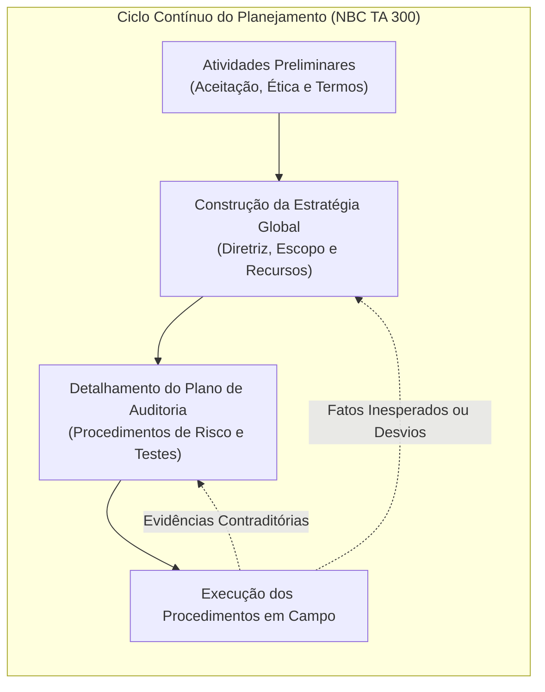
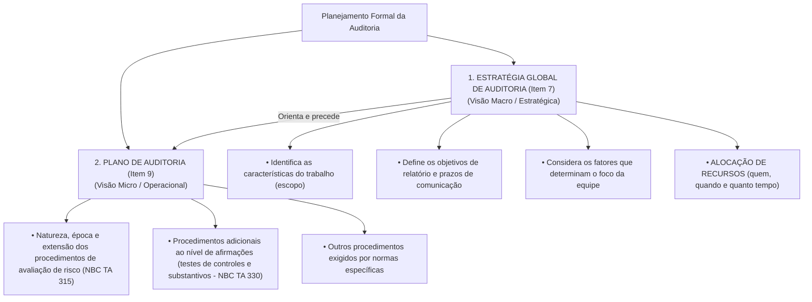
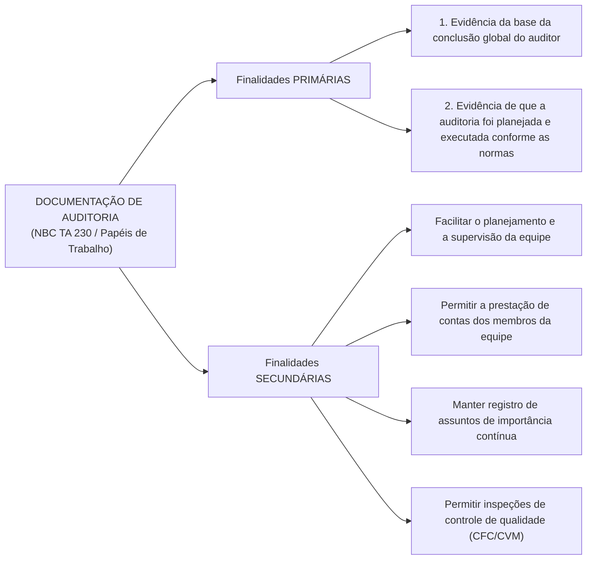
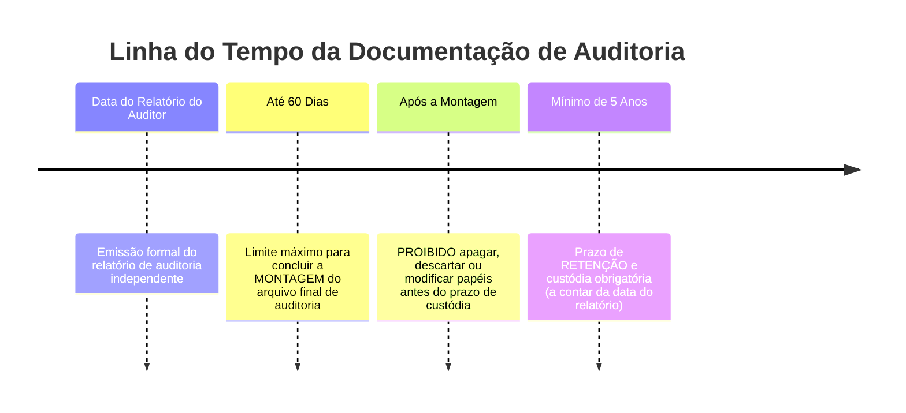

# Módulo 02: Planejamento da Auditoria (NBC TA 300) e Documentação de Auditoria (NBC TA 230)

> **BLUF (Bottom Line Up Front):**  
> O planejamento da auditoria é um **processo contínuo, dinâmico e iterativo**, que se inicia logo após a conclusão da auditoria anterior e perdura até a emissão do relatório final, desdobrando-se em dois níveis hierárquicos: a **Estratégia Global de Auditoria** (que define o alcance, época, condução e alocação de recursos) e o **Plano de Auditoria** (mais detalhado, que especifica a natureza, época e extensão dos procedimentos de avaliação de risco e testes substantivos). Toda a execução e conclusões devem ser registradas na **Documentação de Auditoria (Papéis de Trabalho - NBC TA 230)**, que deve ser autossuficiente para que um **auditor experiente, sem envolvimento prévio no trabalho**, compreenda perfeitamente o trabalho executado e os julgamentos adotados. O prazo limite para a montagem do arquivo final é de até **60 dias** após a data do relatório, e o prazo mínimo de retenção e custódia documental é de **5 (cinco) anos**.

---

## 1. Planejamento de Auditoria (NBC TA 300): Natureza e Governança

Ao contrário do que supõe o senso comum, o planejamento **não é uma fase discreta, estática ou isolada** do trabalho de auditoria. Ele é um processo dinâmico e contínuo que evolui à medida que o auditor obtém novas evidências durante o trabalho de campo.

### 1.1. Envolvimento Obrigatório dos Membros-Chave da Equipe
A NBC TA 300 (item 5) exige expressamente que o **sócio do trabalho (*engagement partner*) e os membros-chave da equipe** participem ativamente do planejamento. Isso permite que a experiência e o julgamento dos profissionais mais seniores orientem as áreas de maior risco da auditoria desde o primeiro momento.

### 1.2. Atividades Preliminares do Trabalho de Auditoria (Item 6)
Antes de iniciar qualquer procedimento de planejamento substantivo, o auditor deve realizar três atividades preliminares indelegáveis:
1. **Procedimentos de Aceitação e Continuidade:** Verificar a integridade dos administradores e a capacidade técnica da equipe para realizar o trabalho (NBC TA 220);
2. **Avaliação do Cumprimento de Exigências Éticas:** Confirmar a estrita independência do auditor perante a entidade auditada (ausência de conflitos de interesse, participações societárias ou vínculos familiares);
3. **Entendimento dos Termos do Trabalho:** Formalizar os direitos e obrigações mútuos por meio da **Carta de Contratação de Auditoria** (*Engagement Letter* - NBC TA 210).

---

## 2. Estratégia Global de Auditoria vs. Plano de Auditoria

A NBC TA 300 divide o planejamento formal em dois documentos com propósitos e níveis de detalhe distintos:

### Matriz Comparativa Detalhada: Estratégia Global vs. Plano de Auditoria

| Dimensão Comparada | Estratégia Global de Auditoria | Plano Detalhado de Auditoria |
| :--- | :--- | :--- |
| **Nível de Abstração** | Macro / Estratégico. | Micro / Tático e Operacional. |
| **Conteúdo Central** | Escopo geral, prazos contratuais de entrega, expectativas de comunicação e alocação de horas e especialistas. | Roteiro detalhado passo a passo dos procedimentos que cada auditor executará nas contas específicas do balanço. |
| **Relação com Recursos** | Define **a quantidade e o perfil dos recursos** (ex: alocar 2 seniores e 1 especialista em TI tributária). | Orienta **como os recursos executarão** cada teste de auditoria programado. |
| **Precedência Temporal** | Estabelecida em primeiro lugar, pois fornece as balizas para a elaboração do plano. | Elaborado subsequentemente, detalhando as diretrizes fixadas na estratégia global. |
| **Flexibilidade** | Pode ser revista se ocorrerem fatos supervenientes significativos. | Constantemente atualizado e ajustado durante os trabalhos de campo conforme as evidências surgem. |

> [!TIP]
> **Gatilho de Prova:** Se a questão falar em *"alocação de recursos", "definição do orçamento de horas", "escopo do trabalho" ou "datas de emissão de relatórios"*, trata-se de **Estratégia Global**. Se falar em *"natureza, época e extensão dos procedimentos de auditoria"*, trata-se de **Plano de Auditoria**.

---

## 3. Considerações Adicionais em Auditorias Iniciais (Primeiro Ano)

Quando o auditor assume a auditoria de uma entidade pela primeira vez (**Auditoria Inicial**), o planejamento exige procedimentos preliminares adicionais (NBC TA 300, item 13 e NBC TA 510):
1. **Comunicação com o Auditor Anterior:** Cumprimento rigoroso do código de ética profissional para contatar o auditor independente antecessor, indagando sobre eventuais razões profissionais para não aceitação do trabalho e examinando seus papéis de trabalho;
2. **Revisão dos Saldos Iniciais:** Obtenção de evidência suficiente de que os saldos de abertura do balanço não contêm distorções relevantes que afetem o exercício atual;
3. **Uniformidade de Práticas Contábeis:** Verificação de que as políticas contábeis adotadas no exercício anterior foram aplicadas uniformemente no exercício corrente ou se eventuais alterações foram devidamente divulgadas em notas explicativas.

---

## 4. Documentação de Auditoria (NBC TA 230): Conceito e Finalidades

A **Documentação de Auditoria** (historicamente denominada **Papéis de Trabalho**) é o conjunto de registros dos procedimentos de auditoria executados, das evidências de auditoria relevantes obtidas e das conclusões alcançadas pelo auditor.

---

## 5. O Princípio do "Auditor Experiente" (Requisito Central da NBC TA 230)

O auditor deve preparar a documentação de auditoria de modo que ela seja **autossuficiente**. A norma adota um critério objetivo fundamental:

> [!IMPORTANT]
> **A Regra de Ouro da NBC TA 230 (Item 8):**  
> O auditor deve preparar documentação de auditoria suficiente para permitir que um **auditor experiente, sem nenhum envolvimento anterior com a auditoria**, compreenda:  
> 1. A **natureza, época e extensão** dos procedimentos de auditoria executados;  
> 2. Os **resultados** dos procedimentos executados e a **evidência de auditoria** obtida; e  
> 3. Os **assuntos significativos** identificados durante a auditoria, as conclusões obtidas a respeito deles e os **julgamentos profissionais significativos** exercidos para chegar a essas conclusões.

### Quem é o "Auditor Experiente" segundo a norma?
É um profissional (interno ou externo) que possui entendimento prático dos:
- Processos de auditoria;
- Normas de auditoria e exigências legais e regulamentares aplicáveis;
- Ambiente de negócios no qual a entidade opera; e
- Assuntos de auditoria e de relatórios financeiros relevantes para o setor da entidade.

---

## 6. O que DEVE e o que NÃO DEVE Constar na Documentação

```mermaid
flowchart TD
    subgraph DEVE["DEVE Constar na Documentação de Auditoria"]
        direction TB
        D1["Programas de auditoria e análises de contas"]
        D2["Cartas de confirmação externa (circularização) e cartas de representação"]
        D3["Listas de verificação (checklists) e sumários de assuntos significativos"]
        D4["Correspondências sobre assuntos significativos (inclusive e-mails técnicos)"]
        D5["Cópia ou resumo de contratos e atas de reuniões da diretoria/conselho"]
    end

    subgraph NAO_DEVE["NÃO PRECISA / NÃO DEVE Constar"]
        direction TB
        N1["Rascunhos preliminares superados ou descartados"]
        N2["Anotações que reflitam entendimento incompleto ou preliminar"]
        N3["Cópias de documentos corrigidas por erros tipográficos"]
        N4["Duplicatas desnecessárias de documentos em geral"]
    end
```

> [!WARNING]
> **Explicações Verbais Não Substituem a Documentação (Item A5):**  
> Explicações verbais fornecidas pelo auditor, por si sós, **não representam documentação adequada** para o trabalho executado ou para as conclusões obtidas. Todavia, podem ser usadas para explicar ou esclarecer informações contidas na documentação de auditoria pré-existente.

> [!CAUTION]
> **Os Papéis de Trabalho Substituem a Contabilidade da Empresa?**  
> **NÃO.** O auditor pode incluir cópias de livros fiscais, razões ou extratos na documentação, mas a documentação de auditoria **jamais substitui os registros contábeis oficiais da entidade auditada**.

---

## 7. Montagem do Arquivo Final e Prazos Críticos de Custódia

A conclusão da documentação de auditoria após a emissão do relatório é um processo estritamente administrativo:

### 7.1. Prazo para Montagem do Arquivo Final de Auditoria
* **Prazo Regulamentar:** Geralmente **não ultrapassa 60 dias** a contar da data do relatório do auditor (NBC TA 230, item A21 e NBC PA 01).
* **Natureza dos Ajustes Permitidos nesse Prazo:** Trata-se de um processo puramente **administrativo**, que **não envolve a realização de novos procedimentos ou novas conclusões**. Exemplos de ajustes permitidos:
  - Apagar ou descartar documentação superada (rascunhos);
  - Ordenar, conferir referências cruzadas e encadernar os papéis;
  - Assinar listas de conferência relativas ao processo de montagem;
  - Documentar evidências que o auditor já havia obtido e discutido com a equipe antes da data do relatório.

### 7.2. Modificações em Circunstâncias Excepcionais após a Emissão do Relatório
Se, em circunstâncias excepcionais, o auditor realizar procedimentos novos ou adicionais ou chegar a novas conclusões após a data do relatório, ele deve documentar:
1. As circunstâncias específicas encontradas;
2. Os procedimentos novos ou adicionais executados, as evidências obtidas e as conclusões alcançadas;
3. **Quando e por quem** as alterações foram feitas e revisadas.

### 7.3. Prazo de Retenção e Guarda da Documentação
* O período de retenção para trabalhos de auditoria **geralmente não é inferior a 5 (cinco) anos** a contar da data do relatório do auditor (ou, se posterior, da data do relatório do auditor do grupo).
* Durante esse período, o auditor é o **fiel depositário** da documentação, devendo assegurar sua confidencialidade, integridade e pronta recuperação em caso de fiscalização da CVM ou do CFC.

---

## 8. Matriz Anti-Pegadinha de Bancas (FGV, Cebraspe, FCC)

| Afirmação Típica de Concurso | Julgamento | Fundamentação Técnica e Pegadinha Desmontada |
| :--- | :---: | :--- |
| *"A documentação de auditoria deve ser detalhada a ponto de permitir que qualquer leigo ou acionista compreenda os testes realizados."* | **ERRADO** | A norma exige clareza para um **auditor experiente, sem envolvimento prévio**, e não para leigos ou o público em geral. |
| *"A Estratégia Global de Auditoria é mais detalhada que o Plano de Auditoria, definindo os testes de cada conta contábil."* | **ERRADO** | É exatamente o oposto: a Estratégia Global é macro (recursos, prazos, escopo); o **Plano de Auditoria é que é detalhado** (procedimentos em cada conta). |
| *"O auditor dispõe de até 120 dias após a emissão do relatório para concluir a montagem do arquivo final de auditoria."* | **ERRADO** | O limite de tempo apropriado para a montagem final é de **até 60 dias** (NBC TA 230 / NBC PA 01). |
| *"O prazo mínimo obrigatório de retenção dos papéis de trabalho pelo auditor é de 10 anos."* | **ERRADO** | O prazo de retenção e custódia não é inferior a **5 (cinco) anos** a contar da data do relatório. |
| *"Durante o período de montagem do arquivo final (até 60 dias), o auditor pode realizar novos testes substantivos para sanar dúvidas."* | **ERRADO** | O processo de montagem é **meramente administrativo**. É proibido aplicar novos testes ou alterar conclusões nessa etapa ordinária. |
| *"Explicações verbais do auditor bastam para comprovar a realização de um teste de inventário físico não documentado."* | **ERRADO** | Explicações verbais, por si sós, **não representam documentação adequada**; o que não está documentado no papel de trabalho presume-se não executado. |

---

## 9. Mnemônicos & Âncoras de Memória

> [!TIP]
> **Mnemônico: Os Prazos Críticos da Documentação (Regra 60-5)**  
> **`60 DIAS / 5 ANOS`**  
> - **60 DIAS:** Prazo máximo para **fechar a pasta** (concluir a montagem administrativa do arquivo final).  
> - **5 ANOS:** Prazo mínimo para **guardar a pasta** (período de retenção e custódia legal obrigatória).

> [!TIP]
> **Mnemônico: Estratégia vs. Plano**  
> - **Estratégia Global = MAPA GERAL** (Para onde vamos, quais recursos levaremos e quando chegaremos).  
> - **Plano de Auditoria = ITINERÁRIO DETALHADO** (Quais passos exatos daremos em cada curva do caminho).

---

## 10. Questões Paradigmáticas de Prova Comentadas

### Questão 01 (FGV - ISS Cuiabá - Auditor Fiscal Tributário)
**Enunciado:**  
De acordo com a NBC TA 230, Documentação de Auditoria, o auditor deve preparar documentação suficiente para que um auditor experiente, sem nenhum envolvimento anterior com a auditoria, entenda:  
I. A natureza, época e extensão dos procedimentos de auditoria executados para cumprir com as normas de auditoria e exigências legais e regulamentares aplicáveis.  
II. Os resultados dos procedimentos de auditoria executados e a evidência de auditoria obtida.  
III. Os assuntos significativos identificados durante a auditoria, as conclusões obtidas a respeito deles e os julgamentos profissionais significativos exercidos para chegar a essas conclusões.  
Está correto o que se afirma em:
- (A) I, apenas.
- (B) I e II, apenas.
- (C) I e III, apenas.
- (D) II e III, apenas.
- (E) I, II e III.

**Gabarito Oficial:** **E**  
**Comentário Analítico:**  
A questão reproduz a literalidade perfeita do **item 8 da NBC TA 230**. A documentação de auditoria deve ser estruturada para que o auditor experiente compreenda:
- A natureza, época e extensão dos procedimentos executados (Item I);
- Os resultados e as evidências obtidas (Item II);
- Os assuntos significativos, conclusões e julgamentos profissionais exercidos (Item III).  
Portanto, todos os três itens estão rigorosamente corretos. Gabarito: alternativa E.

---

### Questão 02 (FCC - ALAP - Auditor de Controle)
**Enunciado:**  
A expressão papéis de trabalho vem sendo complementada pelo termo documentação de auditoria em normas que estabelecem regras para sua elaboração e guarda. A esse respeito, assinale a opção correta:
- (A) O prazo de retenção da documentação de auditoria geralmente não é inferior a 10 anos.
- (B) O auditor pode descartar rascunhos preliminares antes da conclusão da montagem do arquivo final de auditoria.
- (C) A documentação de auditoria é de propriedade pública, devendo ser disponibilizada a qualquer cidadão que a solicitar.
- (D) A montagem do arquivo final deve ocorrer no prazo improrrogável de até 15 dias após o encerramento do trabalho em campo.
- (E) As anotações verbais do auditor suprem a falta de registro formal em papéis de trabalho em qualquer circunstância.

**Gabarito Oficial:** **B**  
**Comentário Analítico:**  
- **A está incorreta:** O período de retenção não é inferior a **5 anos**, e não 10 anos (NBC TA 230, item A23).
- **B está CORRETA:** O auditor pode (e deve) descartar rascunhos preliminares, entendimentos incompletos superados e duplicatas desnecessárias durante o processo de montagem do arquivo final (NBC TA 230, item A22).
- **C está incorreta:** Os papéis de trabalho pertencem à entidade de auditoria e estão resguardados pelo **sigilo profissional**.
- **D está incorreta:** O prazo para montagem do arquivo final geralmente é de **até 60 dias**, e conta-se da **data do relatório do auditor**, não do término do trabalho em campo.
- **E está incorreta:** Explicações verbais **não substituem** a documentação adequada do trabalho executado.

---

### Questão 03 (Cebraspe - Auditor Federal de Controle Externo - TCU)
**Enunciado:**  
Julgue o item que se segue, a respeito do planejamento da auditoria conforme a NBC TA 300:  
*A estratégia global de auditoria orienta a elaboração do plano de auditoria, cabendo ao auditor estabelecer a natureza, a época e a extensão dos recursos necessários para a realização do trabalho já na fase da estratégia global.*

**Gabarito Oficial:** **CERTO**  
**Comentário Analítico:**  
Exatamente conforme prevê o item 7 e 8 da NBC TA 300: a definição da estratégia global de auditoria envolve a identificação das características do trabalho e a definição dos recursos necessários (quem alocar, onde alocar e quantidade de horas), orientando diretamente o desenvolvimento do plano de auditoria subsequente. Item perfeito e correto.

---

## 11. Links e Conexões Temáticas

- 🔗 [Módulo 00: Teoria Geral e NBC TA 200](00-conceitos-iniciais-nbc-ta-200.md)
- 🔗 [Módulo 01: Auditoria Interna (NBC TI 01)](01-auditoria-interna-nbc-ti-01.md)
- 🔗 [Módulo 03: Procedimentos de Auditoria, Testes e Evidências (NBC TA 500, 505 e 520)](03-procedimentos-testes-evidencias-nbc-ta-500-505-520.md)
- 🔗 [Módulo 04: Amostragem e Controle de Qualidade (NBC TA 530 e 220)](04-amostragem-controle-qualidade-nbc-ta-530-220.md)
