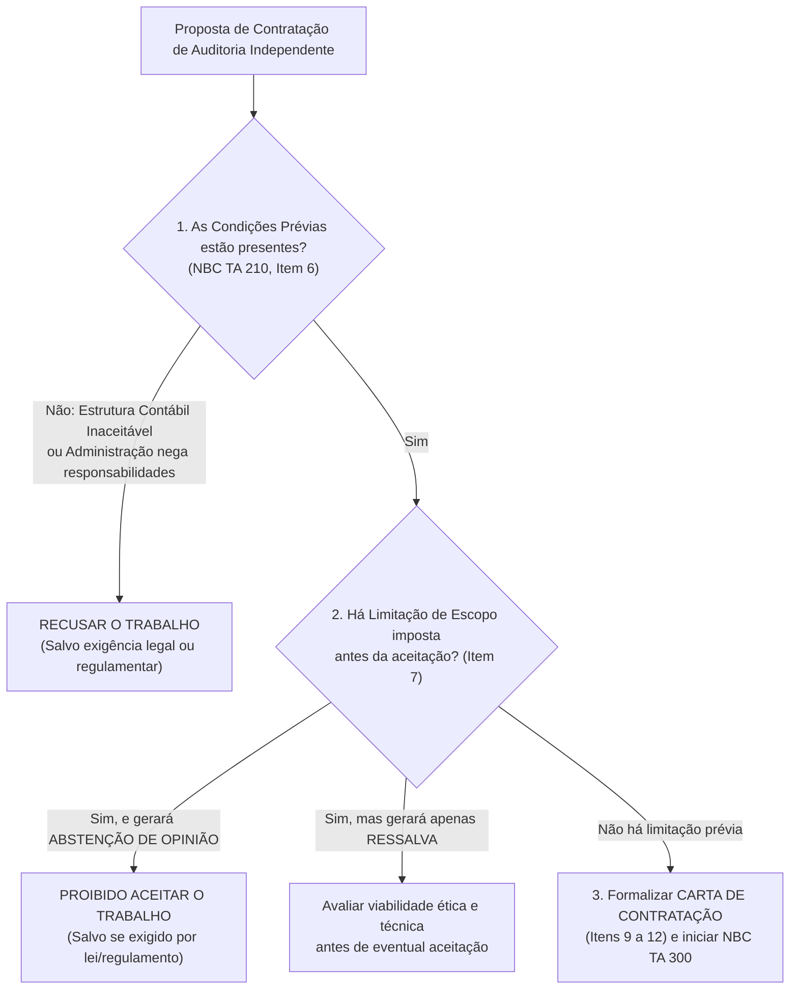
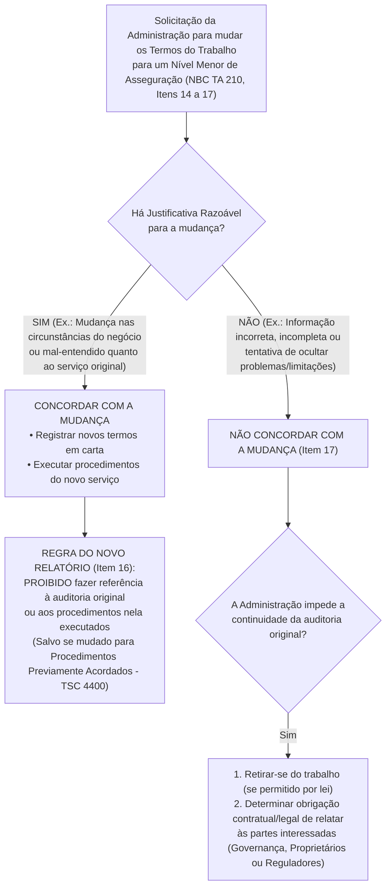
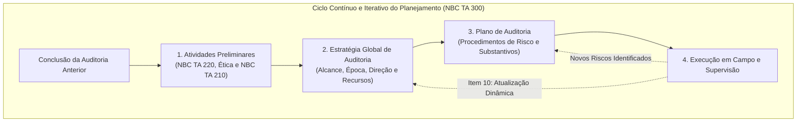
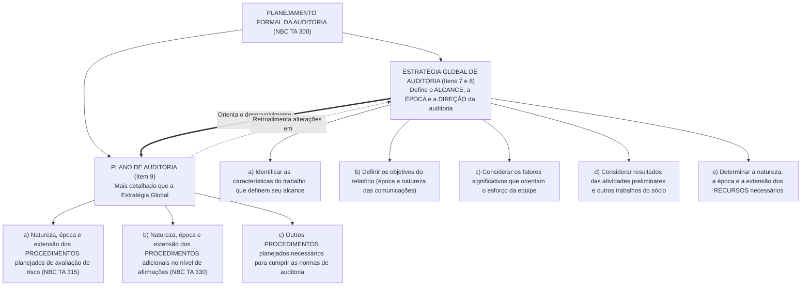
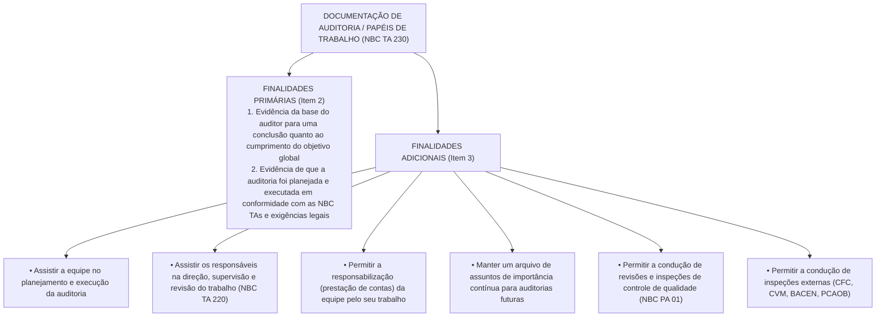
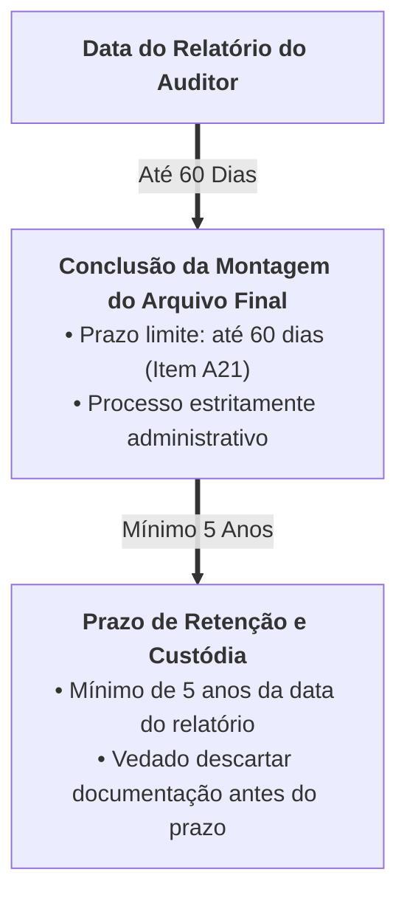

# Planejamento da Auditoria (NBC TA 210, 300 e 510) e Documentação de Auditoria (NBC TA 230)

> O ciclo operacional da auditoria independente inicia-se antes mesmo da ida a campo, mediante a verificação das **Condições Prévias** e a formalização da **Carta de Contratação (NBC TA 210)**, sendo vedado aceitar o trabalho quando a administração impuser limitação de escopo prévia que conduza à **abstenção de opinião** (salvo exigência legal). Uma vez aceito o encargo, o **Planejamento da Auditoria (NBC TA 300)** desenvolve-se como um **processo contínuo, dinâmico e iterativo** que estrutura duas peças hierárquicas e interdependentes: a **Estratégia Global de Auditoria** (visão macro: alcance, época, direção e alocação de **recursos**) e o **Plano de Auditoria** (visão micro/operacional: natureza, época e extensão dos **procedimentos** de avaliação de riscos e procedimentos adicionais). Em **Auditorias Iniciais (NBC TA 510)**, o auditor deve obter evidência suficiente sobre os **saldos iniciais** e a uniformidade das políticas contábeis. Por fim, todo o trabalho deve ser materializado na **Documentação de Auditoria / Papéis de Trabalho (NBC TA 230)** sob o crivo objetivo do **Auditor Experiente** (sem conexão prévia com o trabalho), devendo a montagem administrativa do arquivo final ser concluída em até **60 dias** após a data do relatório e os arquivos custodiados pelo prazo mínimo de **5 (cinco) anos**.

---

## 1. Concordância com os Termos do Trabalho de Auditoria (NBC TA 210)

Antes de iniciar o planejamento técnico de campo, o auditor independente deve decidir se aceita um novo cliente ou se continua prestando serviços para um cliente recorrente. A **NBC TA 210** (equivalente à *ISA 210*) estabelece as responsabilidades do auditor ao concordar com os termos do trabalho de auditoria com a administração e, quando apropriado, com os responsáveis pela governança.

O objetivo central do auditor sob a NBC TA 210 é aceitar ou continuar um trabalho de auditoria **apenas quando a base segundo a qual ele será executado tiver sido concordada**, por meio de duas etapas cumulativas (Item 3):
1. Estabelecimento de se as **condições prévias para uma auditoria** estão presentes; e
2. Confirmação de que existe um **entendimento comum** entre o auditor e a administração (e, quando apropriado, os responsáveis pela governança) acerca dos termos do trabalho de auditoria.

### 1.1. Condições Prévias para uma Auditoria (Item 6)

Para determinar se estão presentes as condições prévias que viabilizam uma auditoria de demonstrações contábeis, o auditor deve cumprir dois requisitos essenciais:

1. **Aceitabilidade da Estrutura de Relatório Financeiro (Item 6, "a"):** Determinar se a estrutura de relatório financeiro a ser aplicada na elaboração das demonstrações contábeis é aceitável (ex.: CPCs / IFRS para sociedades empresárias; NBC TSP para entidades do setor público). Para avaliar essa aceitabilidade, o auditor considera:
   - A natureza da entidade (se é uma empresa comercial, um fundo de pensão, uma autarquia pública ou uma entidade sem fins lucrativos);
   - O objetivo das demonstrações contábeis (se visam atender às necessidades comuns de informação financeira de uma ampla gama de usuários — **propósito geral** — ou às necessidades de usuários específicos — **propósito especial**);
   - A natureza das demonstrações contábeis (se constituem um conjunto completo de demonstrações ou uma demonstração isolada); e
   - Se a estrutura é prescrita por lei ou regulamento aplicável.
2. **Reconhecimento e Entendimento das Responsabilidades pela Administração (Item 6, "b"):** Obter a concordância expressa da administração de que ela reconhece e entende sua responsabilidade tripla (que constitui a *Premissa sobre a qual a Auditoria é Conduzida*):
   - **Pela elaboração das demonstrações contábeis** de acordo com a estrutura de relatório financeiro aplicável, incluindo, quando relevante, sua apresentação adequada;
   - **Pelo controle interno** que a administração determinou como necessário para permitir a elaboração de demonstrações contábeis **livres de distorção relevante, independentemente se causada por fraude ou erro**; e
   - **Por fornecer ao auditor:**
     - (i) Acesso a todas as informações das quais a administração tenha conhecimento e que sejam relevantes para a elaboração das demonstrações contábeis, como registros, documentação e outros assuntos;
     - (ii) Informações adicionais que o auditor possa solicitar da administração para fins da auditoria; e
     - (iii) **Acesso irrestrito a pessoas** dentro da entidade das quais o auditor determine ser necessário obter evidências de auditoria.

> [!IMPORTANT]
> **O Caso de Ausência das Condições Prévias (Item 8):**  
> Se as condições prévias para a auditoria **não estiverem presentes** (por exemplo, a estrutura contábil adotada pela empresa é inaceitável ou a diretoria se recusa a assinar que é responsável pelos controles internos e pelo acesso irrestrito aos documentos), o auditor deve discutir o assunto com a administração. A menos que seja obrigado por lei ou regulamento a fazê-lo, **o auditor NÃO deve aceitar o trabalho de auditoria proposto**.

---

### 1.2. Limitação de Escopo Imposta Antes da Aceitação do Trabalho (Item 7)

Uma das questões mais cobradas por FGV, Cebraspe e FCC envolve o momento em que a administração impõe uma restrição aos exames do auditor (por exemplo, proíbe o auditor de acompanhar o inventário físico de estoques ou de circularizar contas a receber situadas no exterior). O efeito jurídico-normativo depende do **momento da imposição** e da **gravidade da limitação**:

| Momento da Limitação Impelida pela Administração | Gravidade do Efeito Esperado no Relatório | Conduta Obrigatória do Auditor Independente | Base Normativa |
| :--- | :--- | :--- | :--- |
| **ANTES da aceitação do trabalho** (na proposta/carta de contratação) | Limitação relevante e generalizada (levaria à **Abstenção de Opinião**) | **RECUSAR O TRABALHO.** O auditor é proibido de aceitar esse encargo como auditoria, salvo exigência legal ou regulamentar. | NBC TA 210 (Item 7) |
| **ANTES da aceitação do trabalho** (na proposta/carta de contratação) | Limitação relevante, mas não generalizada (levaria apenas à **Opinião com Ressalva**) | A NBC TA 210 não proíbe automaticamente a aceitação, mas o auditor deve avaliar se aceita o encargo sabendo que emitirá ressalva e questionar a integridade da gestão. | NBC TA 210 (Item 7, *a contrario sensu*) |
| **APÓS a aceitação do trabalho** (durante a execução em campo) | Limitação relevante e generalizada (levaria à **Abstenção de Opinião**) | Solicitar a retirada da limitação; se mantida, comunicar à governança e **retirar-se do trabalho (rescisão)** quando praticável e legal. Se a retirada não for praticável/possível, **Abster-se de Emitir Opinião**. | NBC TA 705 (Item 13) |

> [!CAUTION]
> **Pegadinha Clássica de Prova (NBC TA 210, Item 7):**  
> As bancas costumam afirmar: *"Se a administração impuser nos termos de um trabalho proposto uma limitação de alcance que o auditor acredite que resultará em Opinião com Ressalva, o auditor está terminantemente proibido de aceitar o trabalho"*. **ERRADO!** A proibição absoluta do item 7 da NBC TA 210 aplica-se especificamente quando o auditor acredita que a limitação resultará na **abstenção de opinião** sobre as demonstrações contábeis!

---

### 1.3. A Carta de Contratação de Auditoria (*Engagement Letter* — Itens 9 a 12)

Os termos do trabalho de auditoria acordados devem ser formalizados e registrados em uma **Carta de Contratação de Auditoria** ou outra forma adequada de acordo escrito, **antes do início do trabalho**, a fim de evitar mal-entendidos a respeito da auditoria.

#### A) Elementos Obrigatórios da Carta de Contratação (Item 10)
Salvo se a lei ou regulamento já prescrever em detalhes suficientes os termos do trabalho (caso em que o auditor precisa apenas fazer referência à lei e confirmar que a administração reconhece suas responsabilidades do item 6b), a Carta de Contratação **deve incluir obrigatoriamente 5 elementos**:
1. O **objetivo e o alcance** da auditoria das demonstrações contábeis;
2. As **responsabilidades do auditor**;
3. As **responsabilidades da administração**;
4. A identificação da **estrutura de relatório financeiro aplicável** para a elaboração das demonstrações contábeis; e
5. A referência à **forma e ao conteúdo esperados de quaisquer relatórios** a serem emitidos pelo auditor e uma declaração expressa de que **podem existir circunstâncias em que um relatório pode diferir** da forma e do conteúdo esperados (por exemplo, se for necessário emitir uma opinião modificada).

#### B) Elementos Suplementares / Facultativos da Carta de Contratação (Itens A24 e A25)
Além dos cinco itens obrigatórios, a carta de contratação pode fazer referência a aspectos operacionais e contratuais, tais como:
- Detalhamento do alcance da auditoria, incluindo referência à legislação, às NBC TAs e a pronunciamentos éticos;
- O fato de que, devido às **limitações inerentes da auditoria** juntamente com as limitações inerentes do controle interno, há um risco inevitável de que algumas distorções relevantes possam não ser detectadas, mesmo que a auditoria seja adequadamente planejada e executada de acordo com as normas;
- A base em que os **honorários** são calculados e eventuais acordos de faturamento (nota: os honorários **não** podem ser contingentes ao resultado da auditoria);
- A solicitação de que a administração forneça **representações formais** (NBC TA 580) e concorde em disponibilizar a minuta das demonstrações contábeis e outras informações em tempo hábil;
- Acordos relativos ao envolvimento de **outros auditores e especialistas** (NBC TA 600 e 620) ou à utilização de **auditores internos** e outro pessoal da entidade (NBC TA 610);
- Acordos a serem firmados com o **auditor independente antecessor**, no caso de auditoria inicial; e
- Qualquer obrigação de fornecer papéis de trabalho de auditoria a outras partes (como órgãos reguladores).

---

### 1.4. Auditorias Recorrentes (Item 13 e A30)

Em auditorias recorrentes (quando a firma de auditoria já auditou o exercício anterior e permanece para o exercício corrente), o auditor **não é obrigado** a enviar uma nova carta de contratação a cada ano, **a menos que**:
1. As circunstâncias exijam que os termos do trabalho sejam revistos; ou
2. Haja necessidade de lembrar a entidade sobre os termos existentes do trabalho.

O item A30 da NBC TA 210 elenca os **fatores que podem tornar apropriado revisar os termos do trabalho ou lembrar a entidade** (enviando nova Carta de Contratação):
- Qualquer indicação de que a entidade interpreta erroneamente o objetivo e o alcance da auditoria;
- Qualquer condição especial ou revista do trabalho de auditoria;
- Uma **mudança recente na alta administração** ou nos responsáveis pela governança;
- Uma **mudança significativa na propriedade** (controle acionário) da entidade;
- Uma **mudança significativa na natureza ou no tamanho dos negócios** da entidade;
- Uma mudança nas exigências legais ou regulamentares;
- Uma mudança na estrutura de relatório financeiro adotada na elaboração das demonstrações contábeis; ou
- Uma mudança em outros relatórios solicitados.

---

### 1.5. Aceitação de Mudança nos Termos do Trabalho de Auditoria (Itens 14 a 17)

O que acontece se, no meio da auditoria, a administração da empresa solicita ao auditor que mude o contrato de **Auditoria de Demonstrações Contábeis** (asseguração razoável) para um trabalho que proporcione um **nível mais baixo de asseguração** (como uma *Revisão de Demonstrações Contábeis* sob a NBC TR 2400) ou mesmo para um serviço correlato sem asseguração (como *Procedimentos Previamente Acordados* sob a NBC TSC 4400 ou *Compilação* sob a NBC TSC 4410)?

#### A) Quando a Mudança é Razoável vs. Inaceitável (Itens A31 a A33)
- **Justificativas Razoáveis (Aceitáveis):**
  1. Uma **mudança nas circunstâncias** que afete a necessidade do serviço (por exemplo, a empresa planejava abrir capital na bolsa ou tomar um empréstimo sindicalizado que exigia auditoria completa, mas desistiu da operação e o banco credor aceita apenas um relatório de revisão limitada); ou
  2. Um **mal-entendido quanto à natureza da auditoria** originalmente solicitada.
- **Justificativas NÃO Razoáveis (Proibidas):**
  - Uma mudança **não deve ser considerada razoável** se parecer que está relacionada com **informações incorretas, incompletas ou de outra forma insatisfatórias**.
  - *Exemplo clássico de prova (Item A33):* O auditor não consegue obter evidência apropriada e suficiente em relação às **contas a receber** (ou descobre indícios de fraude ou superavaliação no estoque), e a entidade solicita que o trabalho de auditoria seja alterado para um trabalho de revisão para evitar uma opinião com ressalva ou uma abstenção de opinião pelo auditor. Nessa hipótese, **o auditor é terminantemente proibido de concordar com a mudança!**

#### B) A Regra de Ouro do Relatório Após a Mudança (Item 16)
Se o auditor concluir que há justificativa razoável para mudar o trabalho de auditoria para um trabalho de revisão ou serviço correlato, o trabalho executado até a data da mudança pode ser relevante para o trabalho alterado. Contudo, **para não confundir o leitor**, o relatório emitido sobre o serviço alterado **NÃO deve incluir referência**:
1. Ao **trabalho de auditoria original**; ou
2. A **quaisquer procedimentos que possam ter sido executados** no trabalho de auditoria original;
- **Exceção Única:** Quando o trabalho de auditoria é mudado para um trabalho de realização de **procedimentos previamente acordados (NBC TSC 4400)**, nos quais a referência aos procedimentos executados é parte normal e intrínseca do relatório!

---

### 1.6. Conflito entre Normas de Relatório Financeiro, Leis e NBC TAs (Itens 18 a 21)

Em alguns casos, a lei ou regulamento de uma jurisdição estabelece suplementos às normas de relatório financeiro ou prescreve uma forma ou texto específico para o relatório do auditor que difere significativamente das NBC TAs:
- **Suplementos às Normas Contábeis (Item 18):** O auditor deve determinar se há conflitos entre as normas de relatório financeiro e os requisitos adicionais legais. Se existirem conflitos, o auditor deve discutir com a administração se os requisitos adicionais podem ser cumpridos por meio de divulgações adicionais ou se a descrição da estrutura aplicável pode ser alterada. Se nenhuma dessas ações for possível, o auditor deve avaliar se é necessário **modificar a opinião** de acordo com a NBC TA 705.
- **Modelo de Relatório Imposto por Lei/Regulamento (Item 21):** Se a lei ou regulamento prescrever a estrutura ou a redação do relatório do auditor em termos que difiram significativamente das exigências das normas de auditoria, e o auditor concluir que uma explicação adicional no relatório não pode mitigar um possível mal-entendido pelos usuários, o auditor **não deve aceitar o trabalho de auditoria**, a menos que seja exigido por lei ou regulamento a fazê-lo. Uma auditoria conduzida de acordo com tal lei não cumpre as NBC TAs; logo, o auditor **não deve incluir no relatório qualquer referência** de que a auditoria foi conduzida de acordo com as normas de auditoria (NBC TAs / ISAs)!

---

## 2. Planejamento da Auditoria de Demonstrações Contábeis (NBC TA 300)

A **NBC TA 300** (equivalente à *ISA 300*) trata da responsabilidade do auditor de planejar a auditoria das demonstrações contábeis. Ela é redigida no contexto de auditorias recorrentes e traz considerações específicas para auditorias iniciais.

### 2.1. A Função, os Benefícios e a Oportunidade do Planejamento (Itens 2 e A1-A3)

Planejar uma auditoria envolve estabelecer a estratégia global para o trabalho e desenvolver o plano de auditoria. Segundo o item 2 da NBC TA 300, um planejamento adequado **beneficia a auditoria das demonstrações contábeis de seis maneiras fundamentais**:
1. Auxilia o auditor a **dedicar atenção apropriada às áreas importantes** da auditoria;
2. Auxilia o auditor a **identificar e resolver tempestivamente problemas potenciais**;
3. Auxilia o auditor a **organizar e dirigir adequadamente o trabalho de auditoria**, de forma que seja realizado de maneira eficaz e eficiente;
4. Auxilia na **seleção dos membros da equipe de trabalho** com níveis apropriados de capacidade e competência para responderem aos riscos esperados e na alocação apropriada de tarefas;
5. Facilita a **direção e a supervisão** dos membros da equipe de trabalho e a **revisão** do seu trabalho; e
6. Auxilia, se for o caso, na **coordenação do trabalho** realizado por auditores de componentes (controladas/coligadas) e especialistas.

> [!IMPORTANT]
> **Natureza Contínua e Iterativa do Planejamento (Item A2):**  
> O planejamento **NÃO é uma fase isolada ou estanque** da auditoria, mas sim um **processo contínuo e iterativo** que muitas vezes **começa logo após (ou em conexão com) a conclusão da auditoria anterior**, continuando até a conclusão do trabalho de auditoria atual. O planejamento, todavia, inclui a consideração da época de certas atividades e procedimentos que precisam ser concluídos *antes* da realização de procedimentos adicionais de auditoria (como a avaliação de riscos da NBC TA 315 e a determinação da materialidade da NBC TA 320).

### 2.2. Envolvimento da Equipe e Discussões com a Administração (Itens 5 e A3-A4)

- **Envolvimento Obrigatório (Item 5):** O **sócio do trabalho** (*engagement partner*) e outros **membros-chave da equipe de trabalho** devem ser envolvidos no planejamento da auditoria, incluindo o planejamento e a participação na discussão entre os membros da equipe de trabalho. O envolvimento desses profissionais seniores agrega sua experiência e visão, aumentando a eficácia e a eficiência do processo de planejamento.
- **Discussão com a Administração da Entidade (Item A3):** O auditor **pode optar** por discutir elementos do planejamento com a administração da entidade para facilitar a condução e o gerenciamento do trabalho de auditoria (por exemplo, para coordenar alguns procedimentos planejados com o trabalho do pessoal da entidade, como a data da contagem física de estoques). No entanto, quando ocorrem essas discussões, **o auditor deve ter o cuidado de não comprometer a eficácia da auditoria**. Discutir a natureza e a época detalhada dos procedimentos com a administração pode comprometer a eficácia da auditoria ao tornar os procedimentos **demasiadamente previsíveis**! Além disso, a estratégia global e o plano de auditoria permanecem sendo **responsabilidade exclusiva do auditor**.

---

### 2.3. Atividades Preliminares do Trabalho de Auditoria (Item 6)

O auditor deve realizar as seguintes **3 atividades preliminares** no início do trabalho de auditoria corrente:
1. Realizar os procedimentos exigidos pela **NBC TA 220** relativos à **continuidade do relacionamento com o cliente** e do trabalho de auditoria específico (avaliação da integridade dos principais proprietários, da administração-chave e dos responsáveis pela governança, e da competência técnica da equipe);
2. Avaliar a **conformidade com os requisitos éticos relevantes**, inclusive a **independência**, de acordo com a NBC TA 220; e
3. Estabelecer o **entendimento dos termos do trabalho**, conforme exigido pela **NBC TA 210**.

**Por que essas atividades preliminares são executadas antes de qualquer outra?** (Item A6): Porque garantem que o auditor mantenha a independência e a capacidade necessárias para realizar o trabalho, que não haja problemas de integridade da administração que afetem a disposição do auditor em continuar o trabalho, e que não haja mal-entendido com o cliente quanto aos termos do encargo.

---

### 2.4. A Arquitetura Dual do Planejamento: Estratégia Global vs. Plano de Auditoria

A distinção cirúrgica entre a **Estratégia Global de Auditoria** (Itens 7 e 8) e o **Plano de Auditoria** (Item 9) é, isoladamente, o tópico mais explorado da NBC TA 300 em provas de Auditor Fiscal e Controle Externo.

#### A) Os 5 Pilares da Estratégia Global de Auditoria (Item 8 e Apêndice da NBC TA 300)
Na definição da estratégia global de auditoria, o auditor deve percorrer cinco eixos macroestratégicos:
1. **Características do trabalho que definem o seu alcance:**
   - A estrutura de relatório financeiro aplicável (ex.: IFRS, CPC, exigências de conciliação para segunda estrutura);
   - Exigências de relatórios específicos do setor (ex.: normas do BACEN, SUSEP, ANEEL);
   - A cobertura esperada da auditoria, incluindo o número e a localização dos componentes a serem incluídos;
   - A natureza das relações de controle entre a controladora e seus componentes (consolidação);
   - Moeda de relatório e necessidade de conversão cambial;
   - A disponibilidade do trabalho dos auditores internos e a extensão da eventual confiança do auditor nesse trabalho;
   - O uso da entidade de organizações prestadoras de serviços (ex.: terceirização de folha de pagamento ou nuvem de TI — NBC TA 402);
   - O efeito da tecnologia da informação (TI) nos procedimentos de auditoria, incluindo a disponibilidade de dados e o uso esperado de técnicas de auditoria assistidas por computador (**TAACs / CAATs**).
2. **Objetivos do relatório do trabalho, de forma a planejar a época da auditoria e a natureza das comunicações requeridas:**
   - Cronograma da entidade para emissão de relatórios intermediários e anuais;
   - Organização de reuniões com a administração e com os responsáveis pela governança para discutir a natureza, a época e a extensão do trabalho;
   - Discussão sobre os tipos e épocas dos relatórios a serem emitidos e demais comunicações (escritas e verbais), incluindo a carta de recomendações sobre controles internos;
   - Comunicações com auditores de componentes e com terceiros.
3. **Fatores que no julgamento profissional do auditor são significativos para orientar os esforços da equipe de trabalho:**
   - Determinação dos níveis apropriados de **materialidade** (NBC TA 320), inclusive materialidade para componentes;
   - Identificação preliminar de áreas em que pode haver **maiores riscos de distorção relevante**;
   - O impacto do risco avaliado de distorção relevante no nível global das demonstrações contábeis na direção, supervisão e revisão;
   - A maneira pela qual o auditor enfatiza para a equipe a necessidade de manter uma postura questionadora e exercer o **ceticismo profissional**;
   - Resultados de auditorias anteriores que envolveram a avaliação da eficácia operacional do controle interno, incluindo a natureza das deficiências identificadas e as medidas tomadas para tratá-las;
   - Volume de transações, que pode determinar se é mais eficiente para o auditor confiar no controle interno;
   - Desenvolvimentos significativos nos negócios, no setor, na estrutura legal ou nas políticas contábeis.
4. **Resultados das atividades preliminares do trabalho de auditoria e, quando aplicável, a relevância do conhecimento obtido em outros trabalhos realizados pelo sócio do trabalho para a entidade.**
5. **A natureza, a época e a extensão dos RECURSOS necessários para realizar o trabalho (Item A8):**
   - **A seleção da equipe de trabalho** (incluindo, quando necessário, o revisor de controle de qualidade do trabalho — *EQCR*) e a atribuição do trabalho de auditoria aos membros da equipe, inclusive a designação de membros adequadamente experientes para áreas em que pode haver maiores riscos de distorção relevante;
   - **A elaboração do orçamento do trabalho**, incluindo a avaliação do tempo adequado que deve ser alocado para as áreas em que podem existir maiores riscos de distorção relevante.

#### B) Os 3 Pilares do Plano de Auditoria (Item 9)
O Plano de Auditoria é **mais detalhado** que a Estratégia Global de Auditoria, visto que inclui a natureza, a época e a extensão dos **procedimentos de auditoria** a serem realizados pelos membros da equipe de trabalho. O planejamento desses procedimentos ocorre no decurso da auditoria, à medida que o plano de auditoria para o trabalho é desenvolvido. Ele deve incluir a descrição de:
1. A natureza, a época e a extensão dos **procedimentos planejados de avaliação de risco**, conforme estabelecido na **NBC TA 315**;
2. A natureza, a época e a extensão dos **procedimentos adicionais de auditoria planejados no nível de afirmações** (Testes de Controle e Procedimentos Substantivos), conforme previsto na **NBC TA 330**; e
3. **Outros procedimentos de auditoria planejados** e necessários para que o trabalho esteja em conformidade com as normas de auditoria (por exemplo, buscar comunicação direta com os advogados da entidade sobre litígios — NBC TA 501).

> [!TIP]
> **O Divisor de Águas para Acertar 100% das Questões de Prova:**  
> Ambas as expressões usam a tríade *"natureza, época e extensão"*, mas o complemento muda tudo:
> - *"Natureza, época e extensão dos **RECURSOS** necessários"* $\rightarrow$ **Estratégia Global de Auditoria** (Item 8, "e").
> - *"Natureza, época e extensão dos **PROCEDIMENTOS** planejados"* $\rightarrow$ **Plano de Auditoria** (Item 9, "a" e "b").
> Além disso, lembre-se do item A11: o estabelecimento da estratégia global e do plano de auditoria detalhado **não são necessariamente processos isolados ou sequenciais**, estando intimamente inter-relacionados, visto que mudanças em um podem resultar em mudanças consequentes no outro!

### Matriz Comparativa Exaustiva: Estratégia Global vs. Plano de Auditoria

| Critério Analítico | Estratégia Global de Auditoria (Itens 7 e 8) | Plano de Auditoria (Item 9) |
| :--- | :--- | :--- |
| **Grau de Detalhamento** | Mais ampla, sintética e macroestratégica. | **Mais detalhado** que a estratégia global; analítico e operacional. |
| **Foco Central** | Definir o **alcance, a época e a direção** da auditoria e orientar o desenvolvimento do plano. | Definir as instruções detalhadas de **como executar os procedimentos** para obter evidência suficiente. |
| **Fórmula "Natureza, Época e Extensão"** | Refere-se aos **RECURSOS** necessários (equipe, especialistas, orçamento de horas). | Refere-se aos **PROCEDIMENTOS DE AUDITORIA** (avaliação de riscos, testes de controle e substantivos). |
| **Exemplo Prático** | *"Alocar um especialista em atuária e 2 auditores seniores na filial de São Paulo durante 3 semanas em novembro, usando materialidade global de R\$ 2 milhões."* | *"Selecionar amostra de 45 notas fiscais de venda de dezembro e confrontar com o canhoto de entrega assinado para testar a afirmação de Corte (Cut-off)."* |
| **Momento de Conclusão do Planejamento** | Definida antes do desenvolvimento detalhado do plano (embora sujeita a ajustes posteriores). | O planejamento dos procedimentos de avaliação de risco ocorre cedo, mas o planejamento dos procedimentos adicionais depende do resultado dessa avaliação de risco (Item A12). |

---

### 2.5. Mudanças no Planejamento, Supervisão e Documentação (Itens 10 a 12)

- **Mudanças nas Decisões de Planejamento durante a Auditoria (Item 10 e A13):** O auditor **deve atualizar e alterar** a estratégia global de auditoria e o plano de auditoria sempre que necessário no curso da auditoria. Isso ocorre como resultado de eventos inesperados, mudanças nas condições ou na evidência de auditoria obtida nos resultados de procedimentos de auditoria (por exemplo, o auditor planejava confiar nos controles internos do faturamento, mas os testes de controle revelam falhas generalizadas, obrigando-o a revisar o plano de auditoria para ampliar drasticamente os testes substantivos de detalhes).
- **Direção, Supervisão e Revisão (Item 11 e A14):** O auditor deve planejar a natureza, a época e a extensão da direção e supervisão dos membros da equipe e da revisão do seu trabalho. Esses fatores variam principalmente conforme:
  1. O **porte e a complexidade** da entidade;
  2. A **área da auditoria**;
  3. Os **riscos avaliados de distorção relevante** (um aumento no risco avaliado para uma dada área exige normalmente um aumento correspondente na extensão e no tempo da direção e supervisão e uma revisão mais detalhada do trabalho!); e
  4. A **capacidade e a competência** dos membros individuais que realizam o trabalho de auditoria.
- **Documentação Obrigatória do Planejamento (Item 12):** O auditor deve incluir na documentação de auditoria:
  1. A **estratégia global de auditoria** (que pode ser documentada por meio de um memorando contendo as decisões-chave sobre o alcance, a época e a condução da auditoria);
  2. O **plano de auditoria** (que pode ser documentado por meio de programas de auditoria padronizados ou adaptados às circunstâncias do cliente); e
  3. Eventuais **alterações significativas** ocorridas na estratégia global ou no plano de auditoria durante o trabalho, **bem como as razões dessas alterações**.

---

## 3. Trabalhos de Auditoria Inicial e Saldos Iniciais (NBC TA 300, Item 13 e NBC TA 510)

Um **Trabalho de Auditoria Inicial** é definido pela **NBC TA 510** (Item 4, "a") como um trabalho no qual:
1. As demonstrações contábeis do período anterior **não foram auditadas**; ou
2. As demonstrações contábeis do período anterior **foram auditadas por auditor independente antecessor**.

### 3.1. Atividades Adicionais no Planejamento de Auditoria Inicial (NBC TA 300, Item 13)

Antes de iniciar um trabalho de auditoria inicial, o auditor deve realizar as seguintes atividades adicionais:
1. Realizar os procedimentos exigidos pela **NBC TA 220** relativos à **aceitação do cliente** e do trabalho de auditoria específico; e
2. **Comunicar-se com o auditor antecessor**, quando houver mudança de auditores, em conformidade com os requisitos éticos relevantes (Código de Ética Profissional do Contador e NBC PA 01).

> [!NOTE]
> **Por que o Planejamento de uma Auditoria Inicial é Mais Extenso? (NBC TA 300, Item A19):**  
> Para uma auditoria inicial, o auditor pode precisar expandir as atividades de planejamento porque **normalmente não tem a experiência anterior com a entidade** que é considerada no planejamento de trabalhos recorrentes. Para a obtenção do entendimento da entidade e do seu ambiente (NBC TA 315), o auditor pode realizar procedimentos adicionais, tais como acordos com o auditor antecessor para revisar seus papéis de trabalho e avaliação de quaisquer assuntos importantes discutidos com a administração por ocasião da escolha inicial do auditor.

---

### 3.2. Auditoria dos Saldos Iniciais (NBC TA 510)

Os **Saldos Iniciais** compreendem os saldos contábeis existentes no início do período corrente. Eles se baseiam nos saldos finais do período anterior e refletem os efeitos de transações e eventos de períodos anteriores, bem como as políticas contábeis aplicadas no período anterior. Os saldos iniciais também incluem assuntos que existiam no início do período e que exigem divulgação, tais como **contingências e compromissos** (Item 4, "b").

#### A) Objetivos do Auditor na NBC TA 510 (Item 3)
Na condução de um trabalho de auditoria inicial, o objetivo do auditor com relação aos saldos iniciais é obter evidência de auditoria apropriada e suficiente sobre se:
1. Os **saldos iniciais contêm distorções** que afetam de forma relevante as demonstrações contábeis do período corrente; e
2. As **políticas contábeis apropriadas** refletidas nos saldos iniciais foram **aplicadas de maneira uniforme** nas demonstrações contábeis do período corrente, ou se as mudanças nessas políticas contábeis foram devidamente registradas e adequadamente apresentadas e divulgadas de acordo com a estrutura de relatório financeiro aplicável.

#### B) Procedimentos de Auditoria sobre os Saldos Iniciais (Itens 5 a 7)
Para validar os saldos iniciais, o auditor deve:
1. **Ler as demonstrações contábeis mais recentes**, se houver, e o respectivo relatório do auditor independente antecessor, em busca de informações relevantes para os saldos iniciais, inclusive divulgações;
2. Determinar se os saldos finais do período anterior foram **corretamente transferidos** para o período corrente ou, quando apropriado, se foram reapresentados;
3. Determinar se os saldos iniciais refletem a aplicação de políticas contábeis apropriadas; e
4. Realizar **um ou mais dos seguintes procedimentos** (Item 6, "c"):
   - (i) Quando as demonstrações do ano anterior tiverem sido auditadas, **revisar os papéis de trabalho do auditor antecessor** para obter evidência em relação aos saldos iniciais;
   - (ii) Avaliar se os **procedimentos de auditoria executados no período corrente** fornecem evidência relevante para os saldos iniciais; ou
   - (iii) Executar **procedimentos específicos de auditoria** para obter evidência em relação aos saldos iniciais.

#### C) Diferença Prática entre Contas Circulantes de Giro Rápido, Estoques e Contas Não Circulantes (Itens A3 a A7)
As bancas adoram cobrar como o auditor valida saldos iniciais de diferentes naturezas patrimoniais:
- **Contas a Receber e Contas a Pagar (Ativos e Passivos Circulantes):** Alguma evidência de auditoria pode ser obtida como parte dos procedimentos do período corrente. A **cobrança (recebimento) de contas a receber** ou o **pagamento de contas a pagar** durante o período corrente fornecerá alguma evidência de auditoria de sua existência, direitos e obrigações, integridade e avaliação no início do período!
- **Estoques Iniciais (O Caso Crítico — Item A6):** No caso de estoques, os procedimentos de auditoria do período corrente sobre o saldo final do estoque proporcionam **pouca evidência de auditoria** a respeito do estoque em existência no início do período! Portanto, procedimentos adicionais são geralmente necessários, e **um ou mais dos seguintes procedimentos** podem proporcionar evidência apropriada e suficiente:
  1. **Observação de contagem física de estoques correntes e conciliação** dessa contagem com as quantidades de estoques iniciais (fazendo o *rollback*: Estoque Final $-$ Compras/Produção do ano $+$ Vendas/Baixas do ano $=$ Estoque Inicial);
  2. Execução de procedimentos de auditoria na **avaliação dos itens do estoque inicial** (custo unitário e valor realizável líquido); e
  3. Execução de procedimentos de auditoria sobre o **lucro bruto e corte (*cut-off*)** de vendas e compras.
- **Ativos e Passivos Não Circulantes (Imobilizado, Investimentos e Dívidas de Longo Prazo — Item A7):** O auditor examina os registros contábeis e outras informações subjacentes aos saldos iniciais (como escrituras, notas fiscais de aquisição de máquinas e contratos de financiamento) ou obtém confirmação com terceiros (bancos credores).

---

### 3.3. Reflexos dos Saldos Iniciais no Relatório do Auditor (NBC TA 510, Itens 10 a 13)

| Situação Encontrada nos Saldos Iniciais | Efeito no Relatório do Auditor sobre o Período Corrente | Base na NBC TA 510 |
| :--- | :--- | :--- |
| **1. Incapacidade de obter evidência apropriada e suficiente** em relação aos saldos iniciais (ex.: empresa não tinha controle de estoques em $01/01$ e o *rollback* é impossível). | **Opinião com Ressalva** ou **Abstenção de Opinião** (por limitação de escopo). *(Nota: Em alguns casos raros do item A8, o auditor pode emitir opinião não modificada sobre o Balanço Patrimonial de $31/12$, mas Ressalva ou Abstenção sobre a DRE e a DFC!)* | Item 10 |
| **2. Os saldos iniciais contêm distorção** que afeta de forma relevante as demonstrações do período corrente, e o efeito não é devidamente registrado ou divulgado. | **Opinião com Ressalva** ou **Opinião Adversa** (por distorção relevante). | Item 11 |
| **3. Falta de uniformidade nas políticas contábeis** em relação aos saldos iniciais, ou mudança de política contábil não devidamente registrada/divulgada. | **Opinião com Ressalva** ou **Opinião Adversa** (por distorção relevante). | Item 12 |
| **4. O relatório do auditor antecessor continha opinião modificada** que permanece relevante e material para as demonstrações do período corrente. | **Modificar a opinião** do auditor sobre as demonstrações contábeis do período corrente. | Item 13 |

---

## 4. Documentação de Auditoria — Papéis de Trabalho (NBC TA 230)

A **NBC TA 230** (equivalente à *ISA 230*) trata da responsabilidade do auditor na elaboração da **documentação de auditoria** para a auditoria das demonstrações contábeis.

### 4.1. Conceito e Finalidades da Documentação de Auditoria (Itens 2, 3 e 6)

**Documentação de Auditoria** (historicamente conhecida como **Papéis de Trabalho**) é o **registro dos procedimentos de auditoria executados, da evidência de auditoria relevante obtida e das conclusões alcançadas pelo auditor** (Item 6, "a").

### 4.2. Tempestividade na Preparação e o Padrão do "Auditor Experiente" (Itens 7 a 11)

- **Preparação Tempestiva (Item 7 e A1):** O auditor deve preparar a documentação de auditoria **tempestivamente**. A preparação tempestiva de documentação suficiente e apropriada aprimora a qualidade da auditoria e facilita a revisão e a avaliação eficazes da evidência obtida e das conclusões alcançadas **antes da finalização do relatório do auditor**. A documentação elaborada *após* o trabalho de auditoria ter sido realizado tende a ser **menos precisa** do que aquela elaborada *durante* a execução do trabalho!

> [!IMPORTANT]
> **O Padrão Objetivo do "Auditor Experiente" (NBC TA 230, Item 8):**  
> O auditor deve preparar documentação de auditoria que seja suficiente para permitir que um **auditor experiente, sem nenhum envolvimento anterior com a auditoria**, entenda:
> 1. A **natureza, a época e a extensão dos procedimentos de auditoria executados** para cumprir com as normas de auditoria e exigências legais e regulamentares aplicáveis;
> 2. Os **resultados dos procedimentos de auditoria executados** e a **evidência de auditoria obtida**; e
> 3. Os **assuntos significativos** identificados durante a auditoria, as **conclusões** obtidas a respeito deles e os **julgamentos profissionais significativos** exercidos para chegar a essas conclusões.

#### Quem é o "Auditor Experiente"? (Item 6, "c")
Para a NBC TA 230, **Auditor Experiente** é um indivíduo (interno ou externo à firma) que possui experiência prática de auditoria e um entendimento razoável de:
- (i) Processos de auditoria;
- (ii) Normas de auditoria e exigências legais e regulamentares aplicáveis;
- (iii) O ambiente de negócios em que a entidade opera; e
- (iv) Assuntos de auditoria e de relatórios financeiros relevantes para o setor de atividade da entidade.

---

### 4.3. Requisitos Específicos de Registro nos Papéis de Trabalho (Itens 9 a 11)

Ao documentar a natureza, a época e a extensão dos procedimentos executados, o auditor **deve registrar obrigatoriamente** (Item 9):
1. **As características identificadoras dos itens ou assuntos específicos testados (Item 9, "a" e A12):** O registro das características identificadoras atende a diversos propósitos: permite que a equipe preste contas por seu trabalho e facilita a investigação de exceções ou inconsistências. As características variam conforme o procedimento:
   - Para um teste detalhado de ordens de compra geradas pela entidade, o auditor pode identificar os documentos selecionados por **suas datas e números exclusivos de ordem de compra**;
   - Para um procedimento que exige seleção de todos os itens acima de determinado valor de uma população, o auditor pode registrar **o escopo do procedimento e identificar a população** (ex.: todos os lançamentos no livro diário acima de R\$ 100.000,00);
   - Para uma **amostragem sistemática**, o auditor pode identificar os documentos selecionados registrando **a fonte, o ponto de partida e o intervalo de amostragem** (ex.: amostra sistemática de relatórios de expedição do log pelo período de $1º/04$ a $30/09$, começando do relatório nº $12345$ e selecionando cada $125º$ relatório);
   - Para um procedimento que requer **indagação a pessoal específico**, o auditor pode registrar **as datas das indagações, os nomes e a designação das funções** do pessoal da entidade;
   - Para um procedimento de **observação**, o auditor pode registrar **o processo ou assunto sendo observado, os indivíduos relevantes, suas respectivas responsabilidades, e onde e quando** a observação foi conduzida.
2. **Quem executou o trabalho de auditoria e a data em que foi concluído (Item 9, "b")**; e
3. **Quem revisou o trabalho de auditoria executado e a data e a extensão de tal revisão (Item 9, "c")**. *(Nota do Item A13: A exigência de documentar quem revisou o trabalho não implica a necessidade de cada papel de trabalho específico incluir evidência de revisão, mas significa documentar que trabalho foi revisado, quem o revisou e quando foi revisado).*

Além disso:
- **Discussões sobre Assuntos Significativos (Item 10):** O auditor deve documentar as discussões sobre assuntos significativos com a administração, os responsáveis pela governança e outros, incluindo a **natureza dos assuntos significativos discutidos e quando e com quem** as discussões ocorreram (não se limita a atas preparadas pela empresa; inclui memorandos preparados pelo próprio auditor).
- **Informações Inconsistentes com a Conclusão Final (Item 11):** Se o auditor identificou informações referentes a um assunto significativo que são **inconsistentes ou contraditórias com a conclusão final** do auditor a respeito desse assunto, **o auditor não pode simplesmente esconder ou apagar a informação contraditória**: ele **deve documentar como tratou essa inconsistência**!

---

### 4.4. Fatores que Determinam a Forma, Conteúdo e Extensão, e o que NÃO Incluir (Itens A2 a A5)

A forma, o conteúdo e a extensão da documentação de auditoria dependem de fatores como (Item A2):
- O tamanho e a complexidade da entidade;
- A natureza dos procedimentos de auditoria a serem executados;
- Os riscos identificados de distorção relevante;
- A importância da evidência de auditoria obtida;
- A natureza e a extensão das exceções identificadas;
- A necessidade de documentar uma conclusão ou a base para uma conclusão não prontamente determinável a partir da documentação do trabalho executado ou da evidência obtida; e
- A metodologia e as ferramentas de auditoria usadas.

| O que faz parte da Documentação de Auditoria (Exemplos — Item A3) | O que o Auditor NÃO precisa incluir na Documentação (Item A4) |
| :--- | :--- |
| • Programas de auditoria (*audit programs*) e análises de contas; • Memorandos de assuntos importantes e resumos de assuntos significativos; • Cartas de confirmação externa (circularização) e cartas de representação; • Listas de verificação (*checklists*); • Correspondências (incluindo e-mails) referentes a assuntos significativos; • Resumos ou cópias de documentos da entidade (ex.: contratos e acordos significativos e específicos). | • **Rascunhos superados** de papéis de trabalho e de demonstrações contábeis; • **Notas que reflitam entendimento incompleto ou preliminar**; • **Cópias anteriores** de documentos corrigidos por erros tipográficos ou outros erros; • **Duplicatas** de documentos. |

> [!WARNING]
> **Explicações Verbais (Item A5) e Propriedade dos Papéis de Trabalho (NBC PA 01):**  
> 1. **Explicações verbais** do auditor, por si sós, **não representam documentação adequada** para o trabalho executado pelo auditor ou para as conclusões obtidas, mas podem ser usadas para explicar ou esclarecer informações contidas na documentação de auditoria.  
> 2. A documentação de auditoria **não substitui os registros contábeis da entidade**.  
> 3. A menos que especificado de outro modo por lei ou regulamento, **a documentação de auditoria é de propriedade exclusiva do auditor (firma de auditoria)** (NBC PA 01, item A63), cabendo à firma decidir a seu critério disponibilizar partes ou trechos a terceiros, desde que isso não prejudique a validade do trabalho ou a independência!

---

### 4.5. Afastamento de Requisito Relevante e Assuntos Surgidos Após a Data do Relatório (Itens 12 e 13)

1. **Afastamento de Requisito Relevante de NBC TA (Item 12):** Se, em **circunstâncias excepcionais**, o auditor julgar necessário **deixar de cumprir um requisito relevante** de uma norma de auditoria, o auditor deve documentar:
   - Como os **procedimentos alternativos** de auditoria executados alcançam a finalidade daquele requisito; e
   - As **razões para o não cumprimento**.
   *(Nota do Item A19: Isso só se aplica a requisitos que sejam relevantes nas circunstâncias. Se uma entidade não tem auditoria interna, os requisitos da NBC TA 610 simplesmente não são relevantes, e o auditor não precisa documentar por que não os cumpriu!).*
2. **Assuntos Surgidos Após a Data do Relatório do Auditor — Fatos Novos (Item 13):** Se, em **circunstâncias excepcionais**, o auditor executar **procedimentos de auditoria novos ou adicionais** ou alcançar **novas conclusões após a data do relatório do auditor** (por exemplo, ao tomar conhecimento de um fato que existia na data do relatório e que, se conhecido naquela data, teria levado à alteração das demonstrações ou à modificação da opinião — NBC TA 560), o auditor deve documentar:
   - (a) As **circunstâncias encontradas**;
   - (b) Os **procedimentos de auditoria novos ou adicionais executados**, a evidência de auditoria obtida e as conclusões alcançadas, bem como seus efeitos sobre o relatório do auditor; e
   - (c) **Quando e por quem** as resultantes alterações na documentação de auditoria foram feitas e revisadas.

---

### 4.6. Montagem do Arquivo Final de Auditoria e Prazo de Guarda (Itens 14 a 16 e A21-A24)

#### A) O Processo Administrativo de Montagem do Arquivo Final (Itens 14 e A21-A22)
O auditor deve reunir a documentação de auditoria em um **arquivo de auditoria** e completar o **processo administrativo de montagem do arquivo final de auditoria tempestivamente** após a data do relatório do auditor.
- **Prazo Adequado (Item A21):** Um limite de tempo adequado para a conclusão da montagem do arquivo final de auditoria é, geralmente, de **não mais que 60 (sessenta) dias após a data do relatório do auditor**.
- **Natureza Estritamente Administrativa (Item A22):** A conclusão da montagem do arquivo final de auditoria após a data do relatório do auditor é um **processo administrativo que NÃO envolve a execução de novos procedimentos de auditoria ou a obtenção de novas conclusões**. Contudo, podem ser feitas alterações na documentação durante o processo final de montagem se elas forem **de natureza administrativa**. Exemplos de tais alterações incluem:
  1. **Apagar ou descartar documentação superada** (rascunhos preliminares);
  2. **Selecionar, ordenar e fazer referências cruzadas** de papéis de trabalho;
  3. **Assinar listas de verificação (*checklists*)** relativas ao processo de montagem do arquivo; e
  4. **Documentar evidência de auditoria que o auditor obteve, discutiu e concordou** com os membros relevantes da equipe de trabalho **antes** da data do relatório do auditor.

#### B) Proibição de Descarte e Prazo de Retenção / Guarda (Itens 15 e A23)
- **Proibição de Descarte (Item 15):** **Após** a montagem do arquivo final de auditoria ter sido completada, o auditor **NÃO deve apagar ou descartar documentação de auditoria de qualquer natureza antes do fim do seu período de retenção**.
- **Prazo Mínimo de Retenção (Item A23):** O período de retenção para trabalhos de auditoria geralmente **não é inferior a 5 (cinco) anos a partir da data do relatório do auditor** ou, se superior (posterior), da **data do relatório do auditor do grupo** (no caso de demonstrações consolidadas).

#### C) Modificações na Documentação Após a Montagem do Arquivo Final (Itens 16 e A24)
Quando o auditor julgar necessário **modificar a documentação de auditoria existente ou acrescentar nova documentação de auditoria após a montagem do arquivo final** de auditoria ter sido completada (por exemplo, para esclarecer documentação existente em resposta a comentários recebidos durante inspeções de monitoramento internas ou externas), independentemente da natureza das modificações ou adições, o auditor **deve documentar**:
1. As **razões específicas** para fazê-las; e
2. **Quando e por quem** foram feitas e revisadas.

---

## 5. Estudo de Caso Aplicado: Auditoria Inicial com Limitação em Estoques Iniciais

**Cenário Real de Prova Discursiva (Padrão TCU / RFB / SEFAZ):**  
A firma *Alfa Auditores Independentes* foi contratada em **agosto de 2025** para auditar, pela primeira vez, as demonstrações contábeis da *Indústria Metalúrgica Beta S.A.* referentes ao exercício findo em **$31/12/2025$**. As demonstrações de 2024 nunca haviam sido auditadas. Na fase de aceitação, a diretoria da *Beta S.A.* assinou a Carta de Contratação reconhecendo todas as suas responsabilidades (NBC TA 210), mas informou que a empresa não realizou contagem física de estoques em $31/12/2024$ e que seus controles de movimentação de almoxarifado no primeiro semestre de 2025 sofreram perda parcial de banco de dados por ataque cibernético. O saldo de Estoques representa $35\%$ do Ativo Total da companhia. Em $31/12/2025$, a equipe da *Alfa Auditores* acompanhou presencialmente o inventário físico final de estoques, validando integralmente a existência e o custo do estoque em $31/12/2025$.

**Análise Técnica à luz das NBC TAs 210, 300, 510 e 230:**
1. **Fase de Aceitação (NBC TA 210):** Como a impossibilidade de verificar o estoque em $31/12/2024$ decorreu de circunstância fática pretérita (não foi uma limitação arbitrária imposta pela administração para todo o balanço de 2025 que levasse inevitavelmente à abstenção sobre todas as demonstrações), o auditor pôde aceitar o trabalho, planejando procedimentos alternativos (NBC TA 510).
2. **Execução sobre os Saldos Iniciais (NBC TA 510, Item 6 e A6):** A observação da contagem física em $31/12/2025$ valida o **saldo final** de estoques no Balanço Patrimonial de $31/12/2025$, mas **não valida o saldo inicial** em $01/01/2025$. Devido à perda dos logs de movimentação do $1º$ semestre de 2025, o auditor não conseguiu realizar a conciliação retroativa (*rollback*) para validar a quantidade em $01/01/2025$.
3. **Reflexo Contábil e na Opinião (NBC TA 510, Item 10 e A8):** Como o Estoque Inicial compõe diretamente a fórmula do Custo das Mercadorias Vendidas ($\text{CMV} = \text{EI} + \text{Compras} - \text{EF}$), uma eventual distorção no Estoque Inicial distorce diretamente o **Resultado do Exercício de 2025 (DRE)** e os **Fluxos de Caixa Operacionais (DFC)**, embora o **Balanço Patrimonial em $31/12/2025$** esteja correto (pois o Estoque Final foi contado e o efeito acumulado no Lucro/Prejuízo Acumulado se autocompensa entre 2024 e 2025). Assim, nos termos do item A8 da NBC TA 510, o auditor emitirá **Opinião com Ressalva (ou Abstenção de Opinião) sobre o Desempenho das Operações (DRE) e os Fluxos de Caixa (DFC)** e **Opinião Não Modificada (Limpa) sobre a Posição Patrimonial e Financeira (Balanço Patrimonial)**!
4. **Documentação (NBC TA 230):** Todos os testes tentados para reconstruir o estoque inicial, as comunicações com a governança e o julgamento profissional para emitir opinião limpa sobre o Balanço e ressalva sobre a DRE devem ser documentados tempestivamente, fechando o arquivo final em até **60 dias** após a data do relatório e guardando-o por no mínimo **5 anos**.

---

## 6. Matriz Anti-Pegadinha de Bancas ("Cascas de Banana")

| Armadilha Clássica de Prova (FGV / Cebraspe / FCC) | Julgamento | Desmontagem Cirúrgica e Base Normativa |
| :--- | :---: | :--- |
| *"Se a administração impuser nos termos de um trabalho proposto uma limitação que resultará em opinião com ressalva, a NBC TA 210 obriga o auditor a recusar o trabalho."* | **ERRADO** | O item 7 da NBC TA 210 obriga a recusa prévia especificamente quando a limitação resultar em **abstenção de opinião** (salvo exigência legal). |
| *"Quando o trabalho de auditoria é alterado para revisão por justificativa razoável, o novo relatório deve mencionar os procedimentos já executados na auditoria original."* | **ERRADO** | Para não confundir o leitor, o relatório sobre o novo serviço **NÃO deve fazer referência** à auditoria original nem aos procedimentos nela executados, **salvo** se alterado para **Procedimentos Previamente Acordados (NBC TSC 4400)** (Item 16 da NBC TA 210). |
| *"O planejamento da auditoria é uma fase isolada da auditoria que deve ser integralmente encerrada antes do início dos testes substantivos."* | **ERRADO** | O planejamento **NÃO é uma fase isolada**, mas um **processo contínuo e iterativo** que vai da conclusão da auditoria anterior até a conclusão do trabalho atual (NBC TA 300, Item A2). |
| *"Para preservar o elemento de imprevisibilidade, o auditor é proibido de discutir qualquer elemento do planejamento com a administração da entidade."* | **ERRADO** | O auditor **pode optar por discutir elementos do planejamento** com a administração para facilitar a condução e coordenação do trabalho, cuidando apenas para não comprometer a eficácia da auditoria (NBC TA 300, Item A3). |
| *"O Plano de Auditoria precede a Estratégia Global e estabelece a natureza, a época e a extensão dos recursos necessários para o trabalho."* | **ERRADO** | Duplo erro: (1) a **Estratégia Global** orienta o Plano de Auditoria; e (2) a alocação de **recursos** pertence à **Estratégia Global** (Item 8, "e"), enquanto os **procedimentos** pertencem ao **Plano de Auditoria** (Item 9). |
| *"A observação da contagem física do estoque final em 31/12 fornece evidência suficiente sobre a existência do estoque inicial em 01/01 na auditoria inicial."* | **ERRADO** | Conforme a NBC TA 510 (Item A6), os procedimentos sobre o saldo final do estoque proporcionam **pouca evidência** sobre o estoque inicial, exigindo procedimentos adicionais (conciliação retroativa, testes de avaliação e de lucro bruto/corte). |
| *"A documentação de auditoria deve ser preparada de forma que qualquer usuário leigo ou acionista entenda todos os procedimentos executados."* | **ERRADO** | O padrão objetivo da NBC TA 230 (Item 8) é o entendimento por um **auditor experiente, sem nenhum envolvimento anterior com a auditoria**, e não por leigos. |
| *"Durante os 60 dias de montagem do arquivo final de auditoria, o auditor pode realizar novos testes substantivos de detalhes que haviam ficado pendentes."* | **ERRADO** | A montagem do arquivo final (até **60 dias**) é um processo **estritamente administrativo** que **não envolve** a execução de novos procedimentos ou a obtenção de novas conclusões (NBC TA 230, Item A22). |

---

## 7. Mnemônicos & Âncoras de Memória

> [!TIP]
> **Mnemônico 1: Estratégia Global vs. Plano de Auditoria (`RE-ES` vs. `PRO-PLA`)**  
> - **`RE-ES`:** Natureza, época e extensão dos **RE**cursos = **ES**tratégia Global (Visão Macro: Alcance, Época, Direção e Recursos).  
> - **`PRO-PLA`:** Natureza, época e extensão dos **PRO**cedimentos = **PLA**no de Auditoria (Visão Micro/Detalhada: Procedimentos de Risco 315 + Procedimentos Adicionais 330 + Outros Procedimentos).

> [!TIP]
> **Mnemônico 2: Regra `60 - 5` da Documentação de Auditoria (NBC TA 230)**  
> - **60 DIAS:** Prazo limite recomendado para **FECHAR A PASTA** (concluir o processo administrativo de montagem do arquivo final, a contar da data do relatório).  
> - **5 ANOS:** Prazo mínimo para **GUARDAR A PASTA** (período de retenção e custódia obrigatória, a contar da data do relatório do auditor ou do auditor do grupo, se posterior).

> [!TIP]
> **Mnemônico 3: Os 5 Elementos Obrigatórios da Carta de Contratação (`O-R-R-E-F` — NBC TA 210)**  
> - **O**bjetivo e alcance da auditoria;  
> - **R**esponsabilidades do auditor;  
> - **R**esponsabilidades da administração;  
> - **E**strutura de relatório financeiro aplicável;  
> - **F**orma e conteúdo esperados dos relatórios (e aviso de que podem diferir).

---

## 8. Questões Paradigmáticas Aplicadas

### [Questão 01](https://www.qconcursos.com/questoes-de-concursos/questoes/8a211894-5c) — [FGV — Receita Federal / Auditor-Fiscal — 2023]

De acordo com a NBC TA 210 (Concordância com os Termos do Trabalho de Auditoria), quando a administração de uma entidade solicita ao auditor independente, antes da conclusão do trabalho de auditoria, a alteração do trabalho para um serviço que proporcione um nível mais baixo de asseguração (como uma revisão de demonstrações contábeis), o auditor deve avaliar se há justificativa razoável para fazê-lo.

Assinale a opção que apresenta o procedimento **correto** do auditor caso conclua que há justificativa razoável para a mudança dos termos do trabalho de auditoria para um trabalho de revisão limitada.
* **A)** O auditor deve recusar a mudança em qualquer hipótese, pois uma vez iniciada a auditoria, as normas profissionais vedam a redução do nível de asseguração contratado.
* **B)** O auditor deve emitir o relatório de revisão, fazendo constar em parágrafo de ênfase todos os procedimentos de auditoria que já haviam sido executados até a data da alteração contratual.
* **C)** O auditor e a administração devem concordar e registrar os novos termos em carta de contratação, e o relatório emitido sobre o serviço de revisão não deve incluir referência ao trabalho de auditoria original ou aos procedimentos nele executados.
* **D)** O auditor deve emitir dois relatórios simultâneos: um com abstenção de opinião sobre a auditoria interrompida e outro com conclusão de revisão sobre o novo trabalho.
* **E)** O auditor só pode omitir a referência aos procedimentos executados na auditoria original se o trabalho for alterado para procedimentos previamente acordados (NBC TSC 4400).

#### Gabarito: **C**
* **A (Errada):** A NBC TA 210 (Itens 14 e 15) permite que o auditor concorde com a mudança para um trabalho de nível mais baixo de asseguração **quando houver justificativa razoável** (como mudança nas circunstâncias que afete a necessidade do serviço ou mal-entendido quanto à natureza do trabalho original).
* **B (Errada):** Conforme o **item 16 da NBC TA 210**, para não confundir o leitor do relatório, o relatório sobre o novo serviço **NÃO deve incluir referência** ao trabalho de auditoria original ou a quaisquer procedimentos que possam ter sido executados no trabalho original.
* **C (Certa):** Reproduz com exatidão os **itens 15 e 16 da NBC TA 210**: havendo justificativa razoável, os novos termos são registrados em carta de contratação, o auditor aplica as normas do novo trabalho (revisão) e emite o relatório apropriado **sem mencionar** a auditoria original nem os procedimentos nela realizados.
* **D (Errada):** Não há emissão de relatório de abstenção sobre o trabalho original quando a mudança contratual é legítima e aceita por ambas as partes.
* **E (Errada):** Inverte a exceção do item 16: nos trabalhos de **procedimentos previamente acordados (NBC TSC 4400)** é que a referência aos procedimentos executados **é permitida** (pois descrever os procedimentos executados é a própria essência desse relatório!).

> **Fique Ligado:** Na mudança de termos de trabalho para nível inferior de asseguração (ex: auditoria para revisão), se houver justificativa razoável, emite-se relatório de revisão SEM qualquer menção ao trabalho original ou procedimentos já executados.

---

### [Questão 02](https://www.qconcursos.com/questoes-de-concursos/questoes/5b208945-6d) — [FGV — SEFAZ-MG / Auditor Fiscal da Receita Estadual — 2023]

No planejamento da auditoria de demonstrações contábeis regido pela NBC TA 300, o auditor deve estabelecer a estratégia global de auditoria e desenvolver o plano de auditoria.

Sobre a relação e o conteúdo desses dois instrumentos de planejamento, assinale a afirmativa **correta**.
* **A)** O plano de auditoria é menos detalhado que a estratégia global e tem como objetivo fixar a data de entrega do relatório final aos acionistas.
* **B)** A estratégia global de auditoria define o alcance, a época e a direção da auditoria, contemplando a determinação da natureza, da época e da extensão dos recursos necessários para realizar o trabalho.
* **C)** O estabelecimento da estratégia global e o desenvolvimento do plano de auditoria são fases estritamente sequenciais e estanques, sendo vedado alterar a estratégia global após o início dos testes em campo.
* **D)** A descrição da natureza, da época e da extensão dos procedimentos planejados de avaliação de risco (NBC TA 315) integra exclusivamente a estratégia global de auditoria.
* **E)** O auditor deve submeter o plano de auditoria detalhado à aprovação prévia da diretoria financeira da entidade auditada para garantir a validade jurídica das evidências coletadas.

#### Gabarito: **B**
* **A (Errada):** O **plano de auditoria é MAIS detalhado** que a estratégia global de auditoria (NBC TA 300, Item A11), e a definição das datas de entrega e objetivos de relatório pertence à **estratégia global** (Item 8, "b").
* **B (Certa):** Literalidade dos **itens 7 e 8 ("e") da NBC TA 300**: a estratégia global define o alcance, a época e a direção da auditoria e inclui a determinação da natureza, da época e da extensão dos **recursos** necessários para realizar o trabalho.
* **C (Errada):** Segundo o item A11, os dois processos **não são necessariamente isolados ou sequenciais**, mas intimamente inter-relacionados; além disso, o item 10 exige que o auditor **atualize e altere** ambos sempre que necessário no curso da auditoria.
* **D (Errada):** A natureza, a época e a extensão dos **procedimentos planejados de avaliação de risco (NBC TA 315)** integram o **Plano de Auditoria** (Item 9, "a"), e não a estratégia global.
* **E (Errada):** Conforme o item A3, a estratégia global e o plano de auditoria permanecem sendo **responsabilidade exclusiva do auditor**, e o compartilhamento detalhado dos procedimentos com a administração é vedado quando puder comprometer a imprevisibilidade da auditoria.

> **Fique Ligado:** A Estratégia Global define o alcance, época e direção (RE-ES); o Plano de Auditoria é mais detalhado e inclui a natureza, época e extensão dos procedimentos de avaliação de riscos e adicionais (PRO-PLA).

---

### [Questão 03](https://www.qconcursos.com/questoes-de-concursos/questoes/3c188941-2e) — [Cebraspe — TCU / Auditor Federal de Controle Externo — 2022]

À luz da NBC TA 230 (Documentação de Auditoria) e da NBC TA 300 (Planejamento da Auditoria), assinale a opção **correta**.
* **A)** A preparação tempestiva da documentação de auditoria exige que todos os papéis de trabalho sejam redigidos exclusivamente após a emissão do relatório do auditor, durante o prazo de 60 dias de montagem do arquivo final.
* **B)** Caso o auditor identifique informações referentes a um assunto significativo que sejam inconsistentes com a sua conclusão final a respeito desse assunto, ele deve descartar tais informações antes da montagem do arquivo final para evitar ambiguidades.
* **C)** O auditor deve preparar documentação de auditoria suficiente para permitir que um auditor experiente, sem nenhum envolvimento anterior com a auditoria, entenda a natureza, a época e a extensão dos procedimentos executados, os resultados obtidos e os assuntos e julgamentos significativos.
* **D)** Na montagem do arquivo final de auditoria, o auditor dispõe do prazo de até 90 dias para concluir procedimentos substantivos complementares que confirmem as conclusões preliminares do relatório.
* **E)** Após a conclusão da montagem do arquivo final de auditoria, o auditor pode descartar papéis de trabalho considerados de baixo risco desde que decorridos 2 anos da data do relatório.

#### Gabarito: **C**
* **A (Errada):** Conforme o item 7 e A1 da NBC TA 230, a documentação deve ser elaborada **durante a execução do trabalho**, antes da finalização do relatório; a documentação elaborada após o trabalho tende a ser menos precisa.
* **B (Errada):** Viola frontalmente o **item 11 da NBC TA 230**: se o auditor identificar informações inconsistentes com a sua conclusão final sobre um assunto significativo, ele **deve documentar como tratou essa inconsistência**, jamais descartá-la!
* **C (Certa):** Reproduz integralmente a regra de ouro do **item 8 da NBC TA 230** (o padrão objetivo do *Auditor Experiente*).
* **D (Errada):** Dois erros graves: o prazo adequado de montagem do arquivo final é de **não mais que 60 dias** (Item A21), e esse processo é **estritamente administrativo**, não envolvendo a execução de novos procedimentos de auditoria (Item A22).
* **E (Errada):** Conforme os itens 15 e A23, após a montagem do arquivo final, é **proibido apagar ou descartar documentação de qualquer natureza** antes do fim do período de retenção, que não é inferior a **5 anos** a partir da data do relatório.

> **Fique Ligado:** A documentação de auditoria deve permitir que um auditor experiente sem contato prévio compreenda a natureza, época, extensão, resultados e julgamentos significativos do trabalho.

---

### [Questão 04](https://www.qconcursos.com/questoes-de-concursos/questoes/7e194561-2a) — [FCC — SEFAZ-PE / Auditor Fiscal do Tesouro Estadual — 2022]

Em relação aos trabalhos iniciais de auditoria e ao exame dos saldos iniciais disciplinados pela NBC TA 510, considere a situação em que o auditor foi contratado em outubro de $20\text{X}2$ para auditar as demonstrações contábeis do exercício findo em $31/12/20\text{X}2$, sendo que o exercício de $20\text{X}1$ foi auditado por outro auditor independente.

Nessa hipótese, de acordo com a NBC TA 510, assinale a alternativa **correta**.
* **A)** O acompanhamento da contagem física dos estoques em $31/12/20\text{X}2$ pelo auditor atual já fornece evidência de auditoria suficiente e conclusiva quanto às quantidades existentes no estoque inicial em $01/01/20\text{X}2$.
* **B)** Caso o auditor atual revise os papéis de trabalho do auditor antecessor, ele fica autorizado a dividir a responsabilidade pela opinião sobre o exercício de $20\text{X}2$ no parágrafo de opinião do seu relatório.
* **C)** Se o auditor concluir que não é possível obter evidência de auditoria apropriada e suficiente em relação aos saldos iniciais de estoques, mas validar todos os saldos finais em $31/12/20\text{X}2$, ele deverá obrigatoriamente emitir opinião adversa sobre o Balanço Patrimonial.
* **D)** O recebimento de contas a receber e o pagamento de contas a pagar durante o exercício de $20\text{X}2$ podem fornecer alguma evidência de auditoria sobre a existência, direitos e obrigações, integridade e avaliação desses saldos no início do período.
* **E)** Se o relatório do auditor antecessor sobre $20\text{X}1$ contiver uma opinião com ressalva cujo efeito permaneça relevante e material para as demonstrações de $20\text{X}2$, o auditor atual deve emitir opinião limpa e apenas mencionar o fato em parágrafo de Outros Assuntos.

#### Gabarito: **D**
* **A (Errada):** Segundo o item A6 da NBC TA 510, os procedimentos sobre o saldo final do estoque proporcionam **pouca evidência** a respeito do estoque em existência no início do período, exigindo procedimentos adicionais (conciliação retroativa, avaliação e testes de corte/lucro bruto).
* **B (Errada):** O auditor atual assume responsabilidade integral pela sua opinião e é proibido de dividir a responsabilidade no relatório (NBC TA 600 / NBC TA 700).
* **C (Errada):** A incapacidade de obter evidência suficiente configura **limitação de escopo**, que gera **Opinião com Ressalva ou Abstenção de Opinião** (Item 10), e nunca Opinião Adversa; ademais, o item A8 permite opinião limpa sobre o Balanço Patrimonial e modificada apenas sobre a DRE e a DFC.
* **D (Certa):** Transcrição fiel do **item A4 da NBC TA 510**: para ativos e passivos circulantes, a liquidação financeira (cobrança de clientes e pagamento de fornecedores) no período corrente fornece evidência sobre sua existência, direitos/obrigações, integridade e avaliação no início do período.
* **E (Errada):** Conforme o **item 13 da NBC TA 510**, se a modificação na opinião do auditor antecessor permanecer relevante e material para as demonstrações do período corrente, o auditor atual **deve modificar a sua opinião** sobre as demonstrações do período corrente!

> **Fique Ligado:** Em trabalhos iniciais (NBC TA 510), se o relatório anterior continha modificação relevante para o período corrente, o auditor atual deve modificar sua opinião em relação ao período corrente.

---

### [Questão 05](https://www.qconcursos.com/questoes-de-concursos/questoes/1f212345-6b) — [FGV — CGE-SC / Auditor do Estado — 2023]

Antes de aceitar um trabalho de auditoria independente, o auditor constatou que a administração da companhia impôs nos termos da proposta contratual uma cláusula proibindo a equipe de auditoria de examinar quaisquer contratos e extratos das controladas operacionais da empresa, os quais representam $75\%$ das receitas e dos ativos consolidados. O auditor avaliou que tal restrição geraria um efeito relevante e generalizado sobre as demonstrações contábeis.

Considerando o disposto na NBC TA 210, e sabendo que não há determinação legal ou judicial que obrigue a aceitação, o auditor deve:
* **A)** Aceitar o trabalho e emitir, ao final, um relatório com abstenção de opinião.
* **B)** Aceitar o trabalho sob condição resolutiva e comunicar o fato imediatamente à CVM.
* **C)** Não aceitar esse trabalho limitado como trabalho de auditoria.
* **D)** Aceitar o trabalho e substituir os testes nas controladas por uma Carta de Representação da Administração (NBC TA 580).
* **E)** Aceitar o trabalho e emitir uma opinião com ressalva restrita às receitas das controladas.

#### Gabarito: **C**
* **A, B e E (Erradas):** O **item 7 da NBC TA 210** é taxativo: se a administração ou os responsáveis pela governança impuserem uma limitação no alcance do trabalho do auditor nos termos de um trabalho de auditoria proposto, de tal forma que o auditor acredite que a limitação resultará na **abstenção de opinião** sobre as demonstrações contábeis, **o auditor NÃO deve aceitar esse trabalho limitado como trabalho de auditoria**, a menos que seja exigido por lei ou regulamento a fazê-lo.
* **C (Certa):** Aplicação direta do comando proibitivo do **item 7 da NBC TA 210**.
* **D (Errada):** Representações formais da administração (NBC TA 580) **jamais substituem** a evidência de auditoria apropriada e suficiente que o auditor deveria obter.

> **Fique Ligado:** Se a limitação de escopo pela administração antes da contratação resultar em abstenção de opinião, o auditor NÃO deve aceitar o trabalho, salvo determinação legal compulsória.

---

### [Questão 06](https://www.qconcursos.com/questoes-de-concursos/questoes/9a215678-9c) — [FGV — SEFAZ-MT / Auditor Fiscal de Tributos Estaduais — 2023]

Durante a execução da auditoria das demonstrações contábeis de uma instituição, o auditor deparou-se com uma circunstância excepcional na qual julgou estritamente necessário afastar-se de um requisito relevante previsto em uma Norma Brasileira de Contabilidade Técnica de Auditoria (NBC TA).

Nessa situação, de acordo com a NBC TA 230, o auditor deve:
* **A)** Interromper imediatamente a auditoria, visto que todos os requisitos das NBC TAs possuem caráter absoluto e inderrogável.
* **B)** Executar procedimentos alternativos de auditoria para alcançar a finalidade daquele requisito e documentar as razões para o não cumprimento e como os procedimentos alternativos alcançaram a finalidade do requisito.
* **C)** Solicitar autorização formal por escrito ao Conselho de Administração da entidade auditada para dispensar o cumprimento da norma técnica.
* **D)** Emitir obrigatoriamente uma opinião com ressalva no relatório de auditoria em razão do descumprimento do requisito normativo.
* **E)** Registrar o afastamento apenas verbalmente em reunião com o sócio do trabalho, sendo vedado constar tal fato nos papéis de trabalho para não fragilizar a firma perante inspeções externas.

#### Gabarito: **B**
* **A (Errada):** Tanto a NBC TA 200 (Item 22) quanto a NBC TA 230 (Item 12) preveem a possibilidade excepcional de afastamento de requisito relevante quando o procedimento exigido for ineficaz para atingir a finalidade do requisito nas circunstâncias específicas.
* **B (Certa):** Reproduz com perfeição o **item 12 da NBC TA 230**: se, em circunstâncias excepcionais, o auditor julgar necessário deixar de cumprir um requisito relevante de uma norma de auditoria, ele deve documentar **como os procedimentos alternativos executados alcançam a finalidade daquele requisito** e **as razões para o não cumprimento**.
* **C (Errada):** A administração ou a governança do cliente não têm competência técnica nem legal para dispensar o auditor do cumprimento das normas profissionais do CFC.
* **D (Errada):** Como os procedimentos alternativos alcançaram a finalidade do requisito e forneceram evidência apropriada e suficiente, não há limitação de escopo nem modificação da opinião.
* **E (Errada):** A documentação por escrito nos papéis de trabalho é obrigatória (Item 12 da NBC TA 230).

> **Fique Ligado:** Alterações na documentação após a conclusão do relatório exigem o registro das circunstâncias excepcionais, novos procedimentos, evidências obtidas e quem efetuou e revisou.

---

### [Questão 07](https://www.qconcursos.com/questoes-de-concursos/questoes/4b192345-6d) — [FCC — TCE-GO / Analista de Controle Externo — 2022]

Considere os seguintes procedimentos realizados pela equipe de auditoria durante o processo de encerramento dos trabalhos, dentro do prazo de 45 dias após a data do relatório do auditor independente:

I. Descarte de rascunhos preliminares de papéis de trabalho que foram superados pela versão revisada.  
II. Ordenação, indexação e conferência de referências cruzadas entre os papéis de trabalho e o balancete final.  
III. Envio de novas cartas de confirmação externa (circularização) a clientes cujos saldos não haviam sido testados antes da emissão do relatório, para reforçar a amostra.  
IV. Assinatura de listas de verificação (*checklists*) administrativas referentes ao fechamento do arquivo.

De acordo com a NBC TA 230, são procedimentos permitidos durante o processo administrativo de montagem do arquivo final de auditoria APENAS os constantes em:
* **A)** I e II.
* **B)** I, II e IV.
* **C)** II, III e IV.
* **D)** I, III e IV.
* **E)** I, II, III e IV.

#### Gabarito: **B**
* **Item I (Certo):** Apagar ou descartar documentação superada (rascunhos) é expressamente permitido pelo **item A22 da NBC TA 230**.
* **Item II (Certo):** Selecionar, ordenar e fazer referências cruzadas de papéis de trabalho é procedimento administrativo permitido pelo **item A22**.
* **Item III (Errado):** O processo de montagem do arquivo final é **estritamente administrativo** e **NÃO envolve a execução de novos procedimentos de auditoria** (como enviar novas circularizações) ou a obtenção de novas conclusões!
* **Item IV (Certo):** Assinar listas de verificação relativas ao processo de montagem do arquivo é expressamente autorizado pelo **item A22**.
- Assim, apenas os itens **I, II e IV** são permitidos, tornando a alternativa **(B)** a única correta.

> **Fique Ligado:** O prazo ordinário de montagem do arquivo final de auditoria é de até 60 dias da data do relatório; durante a montagem administrativa é vedado apagar papéis existentes ou mudar conclusões técnicas.

---

### [Questão 08](https://www.qconcursos.com/questoes-de-concursos/questoes/2d189012-3e) — [Cebraspe — CGU / Auditor Federal de Finanças e Controle — 2022]

No que se refere às atividades preliminares do trabalho de auditoria e à documentação do planejamento previstas na NBC TA 300, assinale a opção **correta**.
* **A)** As atividades preliminares do trabalho de auditoria devem ser realizadas após a conclusão dos procedimentos de avaliação de risco da NBC TA 315, quando o auditor já conhece os controles internos da entidade.
* **B)** A avaliação da conformidade com os requisitos éticos relevantes, inclusive a independência, integra o plano detalhado de auditoria, mas não faz parte das atividades preliminares do trabalho.
* **C)** O auditor deve incluir na documentação de auditoria a estratégia global de auditoria, o plano de auditoria e eventuais alterações significativas ocorridas nesses documentos durante o trabalho, bem como as razões dessas alterações.
* **D)** Em auditorias de entidades de pequeno porte, o auditor está dispensado de documentar a estratégia global de auditoria e o plano de auditoria nos papéis de trabalho.
* **E)** O aumento no risco avaliado de distorção relevante para uma determinada área da auditoria permite ao sócio do trabalho reduzir a extensão da supervisão e revisão sobre a equipe, concentrando esforços apenas na emissão do relatório.

#### Gabarito: **C**
* **A (Errada):** Conforme os itens 6 e A5 da NBC TA 300, as atividades preliminares são realizadas **no início do trabalho de auditoria corrente**, auxiliando na identificação e avaliação de eventos que possam afetar a capacidade do auditor de planejar e realizar o trabalho *antes* das demais atividades.
* **B (Errada):** A avaliação da conformidade com os requisitos éticos relevantes, inclusive a independência, é uma das três **atividades preliminares obrigatórias** do item 6 da NBC TA 300.
* **C (Certa):** Reproduz literalmente o **item 12 ("a", "b" e "c") da NBC TA 300** sobre a documentação obrigatória do planejamento.
* **D (Errada):** Mesmo em entidades de pequeno porte, a documentação do planejamento é obrigatória, embora possa ser feita de maneira mais simples e concisa (ex.: memorando breve e programas padronizados — Itens A16 a A18 da NBC TA 300).
* **E (Errada):** Conforme o item A14 da NBC TA 300, um aumento no risco avaliado de distorção relevante para uma dada área exige normalmente um **aumento correspondente** (relação direta!) na extensão e no tempo da direção e supervisão dos membros da equipe e uma revisão mais detalhada do seu trabalho.

> **Fique Ligado:** As atividades preliminares (NBC TA 300) incluem avaliar a continuidade do cliente, conformidade com a ética/independência e estabelecimento dos termos do trabalho (carta de contratação).

---

### [Questão 09](https://www.qconcursos.com/questoes-de-concursos/questoes/6c191234-5f) — [FGV — SEFAZ-BA / Agente de Tributos Estaduais — 2022]

Em relação ao registro das características identificadoras dos itens ou assuntos específicos testados na documentação de auditoria (NBC TA 230, item 9), assinale a afirmativa **correta**.
* **A)** O registro das características identificadoras é facultativo nos testes substantivos de detalhes, sendo exigido apenas nos testes de controle de sistemas informatizados.
* **B)** Para um procedimento de auditoria que requer amostragem sistemática de uma população de documentos, o auditor pode identificar os documentos selecionados registrando a fonte, o ponto de partida e o intervalo de amostragem.
* **C)** Explicações verbais fornecidas pelo auditor sênior durante a inspeção de controle de qualidade substituem o registro escrito das características identificadoras dos documentos examinados.
* **D)** A exigência de registrar quem revisou o trabalho de auditoria executado implica a obrigatoriedade de que cada página individual dos papéis de trabalho contenha a rubrica física e o carimbo do sócio revisor.
* **E)** Caso o auditor realize um procedimento de observação da contagem de estoques, basta registrar a palavra "Observado" no programa de auditoria, sem necessidade de identificar onde, quando e quais indivíduos foram observados.

#### Gabarito: **B**
* **A (Errada):** O registro das características identificadoras dos itens ou assuntos específicos testados é **obrigatório** ao documentar a natureza, a época e a extensão dos procedimentos executados (NBC TA 230, Item 9, "a").
* **B (Certa):** Literalidade do **item A12 da NBC TA 230**: em uma amostragem sistemática, o auditor identifica os documentos selecionados registrando a **fonte, o ponto de partida e o intervalo de amostragem**.
* **C (Errada):** Explicações verbais, por si sós, **não representam documentação adequada** (Item A5).
* **D (Errada):** Conforme o **item A13 da NBC TA 230**, a exigência de documentar quem revisou o trabalho **não implica** a necessidade de cada papel de trabalho específico incluir evidência de revisão, desde que esteja documentado que trabalho foi revisado, quem o revisou e quando foi revisado.
* **E (Errada):** Para um procedimento de observação, o item A12 exige registrar o processo ou assunto observado, os indivíduos relevantes, suas responsabilidades, e **onde e quando** a observação foi conduzida.

> **Fique Ligado:** Ao registrar características identificadoras de itens testados, deve-se registrar o número do documento/ordem ou critérios de seleção de modo a permitir nova execução independente.

---

### [Questão 10](https://www.qconcursos.com/questoes-de-concursos/questoes/8e178901-2a) — [FCC — SEFAZ-SC / Auditor Fiscal da Receita Estadual — 2021]

Sobre as auditorias recorrentes e os termos do trabalho de auditoria regulados pela NBC TA 210, é **correto** afirmar:
* **A)** Em auditorias recorrentes, o auditor é obrigado a firmar uma nova carta de contratação anualmente, sob pena de nulidade absoluta do relatório de auditoria emitido.
* **B)** Uma mudança recente na alta administração ou uma mudança significativa na propriedade ou na natureza dos negócios da entidade são exemplos de fatores que podem tornar apropriado revisar os termos do trabalho ou lembrar a entidade dos termos existentes.
* **C)** Se a lei ou regulamento de uma jurisdição prescrever uma redação para o relatório do auditor que difira significativamente das NBC TAs, e uma explicação adicional não puder mitigar o mal-entendido dos usuários, o auditor deve emitir o relatório declarando expressamente que a auditoria cumpriu integralmente as NBC TAs.
* **D)** Nas auditorias recorrentes, a administração fica eximida da responsabilidade pelo controle interno a partir do segundo ano de contrato, transferindo tal responsabilidade para a firma de auditoria independente.
* **E)** O auditor independente não pode incluir na carta de contratação qualquer menção à utilização do trabalho de auditores internos ou de especialistas, pois tais temas são sigilosos.

#### Gabarito: **B**
* **A (Errada):** Conforme o item 13 da NBC TA 210, em auditorias recorrentes o auditor **avalia se as circunstâncias exigem** que os termos sejam revistos ou se há necessidade de lembrar a entidade; não há obrigação automática de emitir nova carta todo ano quando nada mudou.
* **B (Certa):** Expressa fielmente os fatores listados no **item A30 da NBC TA 210** que justificam a revisão dos termos ou o reenvio da carta de contratação em auditorias recorrentes.
* **C (Errada):** Conforme o **item 21 da NBC TA 210**, nesse caso o auditor **não deve aceitar** o trabalho (salvo exigência legal) e, se for obrigado por lei a realizá-lo, **NÃO deve incluir no relatório qualquer referência** de que a auditoria foi conduzida de acordo com as NBC TAs!
* **D (Errada):** A responsabilidade pelo controle interno é **indelegável e permanente da administração** (Item 6, "b").
* **E (Errada):** O **item A24 da NBC TA 210** prevê expressamente que a carta de contratação pode fazer referência a acordos relativos ao envolvimento de outros auditores e especialistas e à utilização de auditores internos.

> **Fique Ligado:** Em auditorias recorrentes, o auditor deve avaliar se as circunstâncias exigem revisão dos termos ou lembrete dos termos vigentes à entidade.

---

---

### [Questão 11](https://www.qconcursos.com/questoes-de-concursos/questoes/a1211985-0b) — [FGV — Receita Federal / Analista-Tributário — 2023]

A respeito da montagem do arquivo final de documentação de auditoria e do prazo mínimo de retenção e guarda dos papéis de trabalho, conforme expressamente disciplinado na NBC TA 230 (R1), assinale a afirmativa CORRETA:

* **A)** A conclusão da montagem do arquivo final de documentação de auditoria é um processo de natureza técnica substantiva que permite a inserção de novos testes de auditoria não realizados antes da emissão do relatório.
* **B)** O prazo limite para a conclusão da montagem do arquivo final de auditoria não é superior a 60 dias após a data do relatório do auditor independente.
* **C)** O período de retenção da documentação de auditoria é de, no mínimo, dois anos a contar da data de emissão do relatório do auditor independente.
* **D)** O auditor independente pode destruir minutas e notas preliminares antes da conclusão dos trabalhos, mas é obrigado a manter correspondências irrelevantes e rascunhos rasurados no arquivo final permanente.
* **E)** Após a conclusão da montagem do arquivo final, o auditor é expressamente proibido de adicionar novas informações à documentação de auditoria, mesmo que surjam fatos novos excepcionais.

#### Gabarito: **B**
* **A (Errada):** A montagem do arquivo final é um processo puramente **administrativo** que não envolve a realização de novos procedimentos de auditoria ou a extração de novas conclusões (item A21 da NBC TA 230).
* **B (Certa):** Conforme o item A21 da NBC TA 230 (R1), o prazo ordinário apropriado para concluir a montagem do arquivo final de documentação de auditoria não é geralmente superior a **60 dias após a data do relatório do auditor**.
* **C (Errada):** Conforme o item A23 da NBC TA 230 (e NBC PA 01), o período de retenção da documentação de auditoria não é de apenas dois anos, mas de, no mínimo, **cinco (5) anos** a partir da data do relatório do auditor independente.
* **D (Errada):** Minutas preliminares, correspondências duplicadas e rascunhos descartados não precisam ser mantidos na pasta final (item A4 da NBC TA 230).
* **E (Errada):** O auditor pode modificar ou adicionar nova documentação após a conclusão do arquivo final em circunstâncias excepcionais, desde que documente as razões específicas e quem fez e revisou as alterações (itens 16 e A24 da NBC TA 230).

> **Fique Ligado:** Montagem do arquivo final = até 60 dias após a data do relatório (processo puramente administrativo). Prazo de guarda/retenção = no mínimo 5 anos.

---

### [Questão 12](https://www.qconcursos.com/questoes-de-concursos/questoes/d3115678-0c) — [Cebraspe — SEFAZ-AL / Auditor Fiscal da Receita Estadual — 2020]

No que tange ao planejamento da auditoria das demonstrações contábeis (NBC TA 300), a distinção entre Estratégia Global de Auditoria e Plano de Auditoria constitui elemento fundamental de governança do trabalho. A esse respeito, julgue os itens a seguir:

I. O estabelecimento da estratégia global de auditoria envolve a definição do alcance, da época e do direcionamento dos trabalhos, orientando o desenvolvimento do plano de auditoria.
II. O plano de auditoria é menos detalhado do que a estratégia global, pois apenas lista os membros da equipe e os honorários contratuais ajustados com a entidade auditada.
III. O auditor deve atualizar e alterar a estratégia global de auditoria e o plano de auditoria sempre que necessário durante o curso da auditoria, visto que o planejamento é um processo contínuo e iterativo.

Assinale a opção correta:

* **A)** Apenas o item I está certo.
* **B)** Apenas o item II está certo.
* **C)** Apenas os itens I e III estão certos.
* **D)** Apenas os itens II e III estão certos.
* **E)** Todos os itens estão certos.

#### Gabarito: **C**
* **Item I (Certo):** Transcreve fielmente o item 7 da NBC TA 300: a estratégia global define o alcance, época e direcionamento do trabalho, servindo de guia para o plano de auditoria.
* **Item II (Errado):** O plano de auditoria é **MAIS detalhado** do que a estratégia global (item 9 da NBC TA 300), pois engloba a natureza, época e extensão dos procedimentos de avaliação de riscos e dos procedimentos adicionais de auditoria no nível das afirmações.
* **Item III (Certo):** Reflete com precisão o item 10 da NBC TA 300: o planejamento não é uma fase estática e isolada da auditoria, mas um processo contínuo e iterativo que deve ser atualizado e alterado sempre que circunstâncias imprevistas ou novas evidências assim exigirem.
* Logo, estão certos apenas os itens **I e III**, confirmando o gabarito na **alternativa C**.

> **Fique Ligado:** A Estratégia Global define as diretrizes amplas (RE-ES); o Plano de Auditoria é MAIS detalhado (PRO-PLA: procedimentos no nível da afirmação). O planejamento é contínuo e iterativo ao longo de todo o trabalho.

## 9. Links e Conexões Temáticas

- [01. Estrutura Conceitual e Objetivos Globais do Auditor (NBC TA 200)](../01-fundamentos-e-normas-profissionais/01-estrutura-conceitual-nbc-ta-200.md)
- [02. Avaliação de Riscos e Controle Interno (NBC TA 315 e 265)](./02-avaliacao-de-riscos-e-controle-interno-nbc-ta-315-265.md)
- [03. Materialidade, Avaliação de Distorções e Tratamento de Fraudes (NBC TA 320, 450 e 240)](./03-materialidade-e-tratamento-de-fraudes-nbc-ta-320-240.md)
- [04. Procedimentos, Respostas aos Riscos, Evidências e Circularização (NBC TA 500, 330, 501, 505 e 520)](./04-procedimentos-evidencias-e-circularizacao-nbc-ta-500-505-520.md)