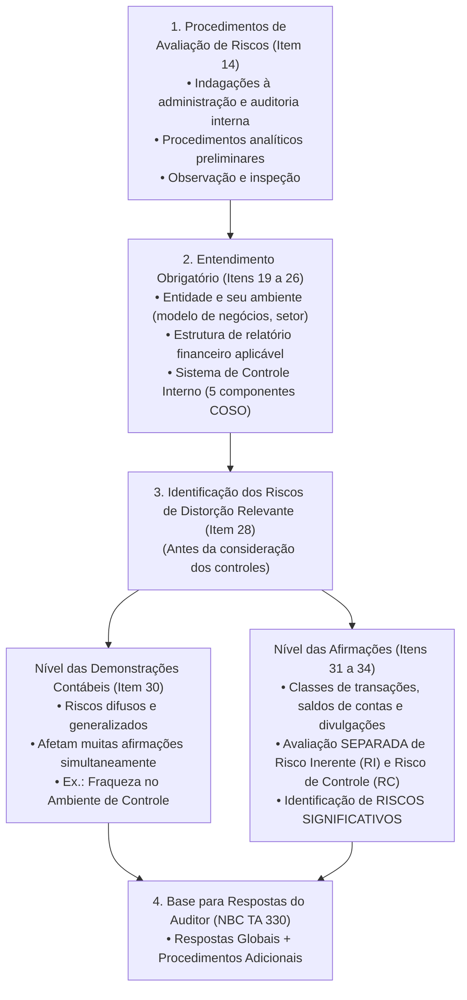
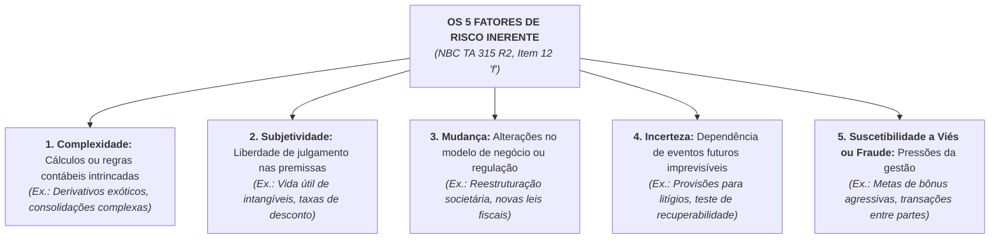
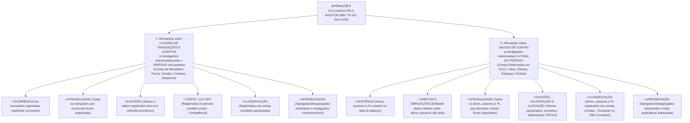
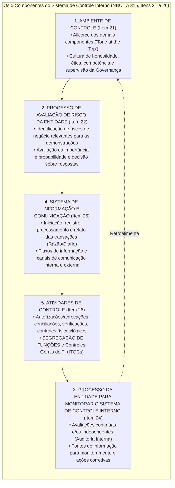
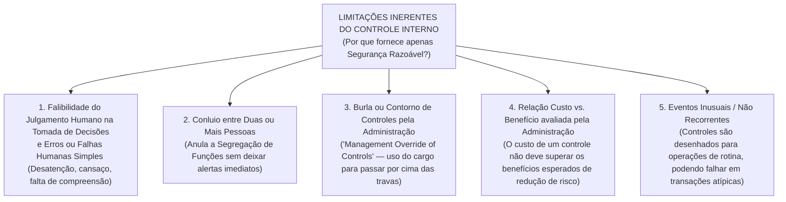
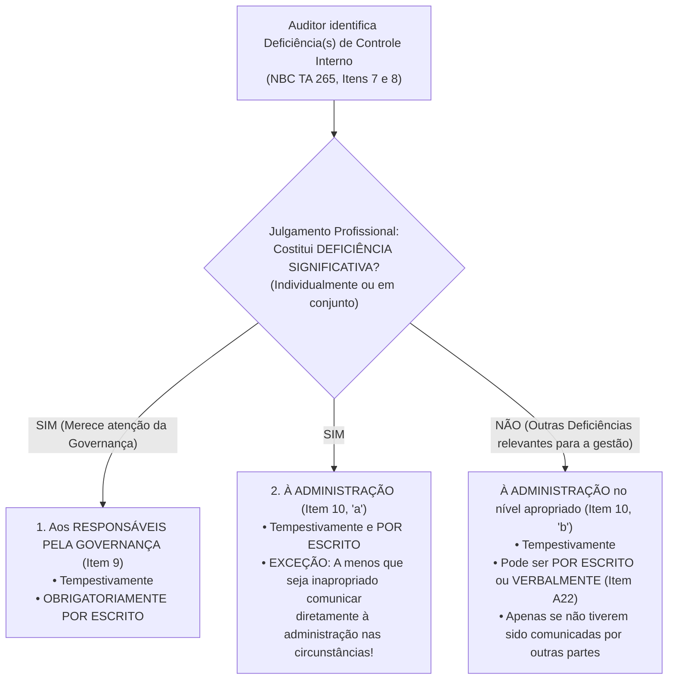

# Avaliação de Riscos, Afirmações e Controle Interno (NBC TA 315 e NBC TA 265)

> **BLUF (Bottom Line Up Front):**  
> A auditoria moderna de demonstrações contábeis é integralmente **baseada em riscos**. Pela **NBC TA 315 (R2)**, o auditor executa procedimentos de avaliação de riscos (**indagações, procedimentos analíticos, observação e inspeção**) para obter o entendimento da entidade, do seu ambiente, da estrutura de relatório financeiro e do seu sistema de controle interno, identificando e avaliando os riscos de distorção relevante (causados por fraude ou erro) em dois níveis: **no nível das demonstrações contábeis** (global) e **no nível das afirmações** (onde o **risco inerente** e o **risco de controle** devem ser avaliados **separadamente**). A avaliação do risco inerente apoia-se em **5 fatores de risco inerente** (*complexidade, subjetividade, mudança, incerteza e suscetibilidade a viés/fraude*), situando cada risco no **espectro de risco inerente**; aqueles situados próximos à extremidade superior constituem **Riscos Significativos**, que exigem tratamento especial (avaliação obrigatória do desenho e implementação dos controles, vedação de confiar em testes de controle de anos anteriores e proibição de depender apenas de procedimentos analíticos substantivos). O **Sistema de Controle Interno (COSO I)** estrutura-se em **5 componentes (`C-R-I-M-E`)** e fornece apenas **segurança razoável** devido a suas limitações inerentes (erro humano, conluio, burla pela administração e custo-benefício). Por fim, segundo a **NBC TA 265**, toda **Deficiência Significativa de Controle Interno** identificada deve ser comunicada **tempestivamente e por escrito** aos responsáveis pela governança (e à administração, salvo se inapropriado), independentemente de uma distorção contábil ter efetivamente ocorrido.

---

## 1. Identificação e Avaliação dos Riscos de Distorção Relevante (NBC TA 315)

A **NBC TA 315 (R2)** (equivalente à *ISA 315 Revised*) é a espinha dorsal metodológica da auditoria independente. Seu objetivo (Item 11) é que o auditor identifique e avalie os **riscos de distorção relevante**, independentemente se causados por fraude ou erro, nos níveis de **demonstrações contábeis** e de **afirmações**, proporcionando assim uma base sólida para o planejamento e a implementação das respostas aos riscos avaliados (tratadas na NBC TA 330).

### 1.1. Procedimentos de Avaliação de Riscos e Atividades Relacionadas (Itens 13 a 18)

O auditor deve planejar e executar **procedimentos de avaliação de riscos** para obter evidência de auditoria que forneça uma base apropriada para a identificação e avaliação dos riscos de distorção relevante, bem como para o planejamento de procedimentos adicionais de auditoria.

> [!IMPORTANT]
> **Natureza da Evidência nos Procedimentos de Avaliação de Riscos (Item 13):**  
> Os procedimentos de avaliação de riscos, **por si sós, NÃO fornecem evidência de auditoria apropriada e suficiente** na qual basear a opinião da auditoria! Eles servem para mapear os riscos; a opinião exigirá procedimentos adicionais (testes de controle e procedimentos substantivos da NBC TA 330).

Conforme o **item 14 da NBC TA 315**, os procedimentos de avaliação de riscos **devem incluir obrigatoriamente os 3 grupos a seguir**:

1. **Indagações (Item 14, "a"):** Dirigidas à administração e a outros indivíduos apropriados na entidade, incluindo indivíduos na **função de auditoria interna** (se a função existir). Além do pessoal financeiro/contábil, é estratégico indagar pessoas fora da contabilidade (Item A22):
   - *Consultores jurídicos internos:* auxiliam a entender litígios, conformidade com leis e regulamentações, suspeitas de fraude, garantias e obrigações pós-venda;
   - *Pessoal de marketing e vendas:* auxiliam a entender mudanças nas estratégias de vendas, tendências de faturamento, incentivos ou metas agressivas de comissões;
   - *Equipe de gestão de riscos e de sistemas de informação (TI):* auxiliam a compreender mudanças de sistemas, falhas operacionais e segurança de dados.
2. **Procedimentos Analíticos (Item 14, "b" e A24-A28):** Auxiliam a identificar inconsistências, transações ou eventos não usuais, e valores, índices e tendências que podem indicar assuntos que tenham implicações para a auditoria (por exemplo, um crescimento de $40\%$ na Receita Bruta acompanhado de queda no fluxo de caixa operacional e aumento explosivo no prazo médio de recebimento — forte indício de receitas fictícias!).
3. **Observação e Inspeção (Item 14, "c" e A29-A31):** Podem dar suporte a indagações junto à administração e a outros e também fornecer informações sobre a entidade e o seu ambiente. Exemplos incluem a observação das operações e instalações da entidade e a inspeção de documentos (como planos e estratégias de negócios, manuais de controles internos), relatórios elaborados pela administração (como demonstrações contábeis intermediárias) e atas de reuniões do Conselho de Administração e do Comitê de Auditoria.

#### A) Informações de Outras Fontes e de Auditorias Anteriores (Itens 15 e 16)
- **Outras Fontes (Item 15):** O auditor deve considerar informações obtidas no processo de aceitação ou continuidade do cliente e resultados de outros trabalhos realizados pelo sócio do trabalho para a entidade.
- **Informações de Auditorias Anteriores (Item 16):** Quando o auditor pretende usar informações obtidas a partir de sua experiência anterior com a entidade e de procedimentos de auditoria executados em auditorias anteriores, **ele não pode usá-las no piloto automático**: o auditor deve avaliar se essas informações continuam relevantes e confiáveis, **executando procedimentos de avaliação de riscos para determinar se ocorreram mudanças desde a auditoria anterior** que possam afetar sua relevância para a auditoria corrente!

#### B) Discussão entre a Equipe de Trabalho (*Brainstorming* — Itens 17 e 18)
O **sócio do trabalho** e outros **membros-chave da equipe de trabalho** devem discutir:
1. A aplicação da estrutura de relatório financeiro aplicável e a **suscetibilidade das demonstrações contábeis da entidade à distorção relevante** (seja por erro ou por fraude — em conjunto com a discussão exigida pela NBC TA 240); e
2. Quando há membros da equipe que não participam da discussão presencial, o sócio do trabalho deve determinar quais assuntos devem ser comunicados a esses membros.

---

### 1.2. Avaliação Separada de Risco Inerente e Risco de Controle, Espectro de Risco Inerente e os 5 Fatores de Risco Inerente

Na versão revisada da **NBC TA 315 (R2)**, a norma introduziu conceitos fundamentais que são presença obrigatória nas provas recentes de alto nível:

#### A) A Obrigação de Avaliar Risco Inerente e Risco de Controle Separadamente (Itens 31 e 34)
Para os riscos identificados de distorção relevante **no nível de afirmações**, o auditor **deve avaliar separadamente o Risco Inerente e o Risco de Controle**!
- **Avaliação do Risco Inerente (Item 31):** O auditor avalia a probabilidade e a magnitude da possível distorção levando em conta como, e o grau em que: (a) os **fatores de risco inerente** afetam a suscetibilidade das afirmações relevantes a distorções; e (b) os riscos de distorção relevante no nível das demonstrações contábeis afetam a avaliação do risco inerente no nível de afirmações.
- **Avaliação do Risco de Controle (Item 34):**
  - Se o auditor **planeja testar a eficácia operacional dos controles**, ele avalia o risco de controle (como baixo ou moderado).
  - Se o auditor **NÃO planeja testar a eficácia operacional dos controles**, sua avaliação do **risco de controle deve ser tal que a avaliação do risco de distorção relevante seja a MESMA que a avaliação do risco inerente** (ou seja, considera o risco de controle no nível máximo, sem qualquer desconto de risco!).

#### B) Os 5 Fatores de Risco Inerente (*Inherent Risk Factors* — Item 12, "f")
**Fatores de Risco Inerente** são características de eventos ou condições que afetam a suscetibilidade à distorção, independentemente se causada por fraude ou erro, de uma afirmação sobre uma classe de transações, saldo contábil ou divulgação, **antes da consideração dos controles**. Tais fatores podem ser qualitativos ou quantitativos e incluem **5 elementos canônicos**:

#### C) O Espectro de Risco Inerente (*Spectrum of Inherent Risk* — Item A9 e A208-A211)
O grau em que o risco inerente varia é referido na NBC TA 315 como o **Espectro de Risco Inerente**. Ao avaliar o risco inerente, o auditor utiliza seu julgamento profissional para posicionar o risco ao longo desse espectro contínuo (de baixo até a extremidade superior), considerando a **combinação da probabilidade de ocorrência de uma distorção e da magnitude da distorção potencial** caso a distorção ocorra:
- **Nota Técnica Importante (Item A210):** Para se situar próximo da extremidade superior do espectro de risco inerente, **não é necessário** que tanto a probabilidade quanto a magnitude sejam individualmente altíssimas; é a **interseção (combinação)** da probabilidade e da magnitude no espectro que determina se o risco avaliado é alto ou próximo ao topo!

---

### 1.3. Riscos Significativos (*Significant Risks* — Item 12, "l", e Item 32)

O conceito e o regime jurídico dos **Riscos Significativos** estão entre os temas prediletos da FGV e do Cebraspe.

> [!IMPORTANT]
> **Definição Normativa de Risco Significativo (NBC TA 315, Item 12, "l"):**  
> **Risco Significativo** é um risco de distorção relevante identificado:  
> **(i)** Para o qual a avaliação do risco inerente está **próxima da extremidade superior do espectro de risco inerente**, devido ao grau em que os fatores de risco inerente afetam a combinação da probabilidade de ocorrência de uma distorção e a magnitude da distorção potencial se essa distorção ocorrer; **OU**  
> **(ii)** Que deve ser tratado como um risco significativo de acordo com os requisitos de **outras normas de auditoria** (quais sejam: os riscos de fraude no reconhecimento de receitas e na burla de controles pela administração na **NBC TA 240**, e as transações significativas identificadas com partes relacionadas fora do curso normal dos negócios na **NBC TA 550**).

#### Regras de Ouro sobre Riscos Significativos (Como funcionam na prova):
1. **Desconsideração dos Controles na Identificação:** Ao determinar se um risco é significativo, o auditor **NÃO considera os efeitos mitigadores dos controles internos**; olha exclusivamente para o **risco inerente puro**!
2. **Avaliação Obrigatória de Desenho e Implementação (NBC TA 315, Item 26, "a", "i"):** O auditor é **obrigado** a identificar os controles que tratam dos riscos significativos, avaliar o seu **desenho** e determinar se foram **implementados**.
3. **Proibição de Rotação de Testes de Controle (NBC TA 330, Item 15):** Se o auditor planeja confiar na eficácia operacional de controles sobre um risco significativo, o auditor **DEVE testar esses controles no período corrente** (é terminantemente vedado utilizar evidências de testes de controle obtidos em auditorias anteriores!).
4. **Proibição de Usar Apenas Procedimentos Analíticos Substantivos (NBC TA 330, Item 21):** Se a abordagem do auditor a um risco significativo consistir somente em procedimentos substantivos (sem testar controles), esses procedimentos **DEVEM incluir testes de detalhes** (é proibido responder a um risco significativo aplicando apenas procedimentos analíticos substantivos!).
5. **Comunicação à Governança e Ligação com os PAA/KAM (NBC TA 260 e 701):** Os riscos significativos identificados devem ser comunicados aos responsáveis pela governança e são candidatos naturais à seleção como **Principais Assuntos de Auditoria (PAA / KAM)** no relatório do auditor de companhias abertas!

---

## 2. As Afirmações da Administração (*Assertions* — NBC TA 315, Item A190)

**Afirmações** são declarações da administração, explícitas ou não, que estão incorporadas nas demonstrações contábeis, utilizadas pelo auditor para considerar os diferentes tipos de distorções potenciais que possam ocorrer (Item 12, "a").
- **Afirmação Relevante (Item 12, "h"):** Uma afirmação sobre uma classe de transações, saldo contábil ou divulgação é **relevante** quando tem um risco identificado de distorção relevante.
- **Classe Significativa de Transações, Saldo Contábil ou Divulgação (Item 12, "k"):** É aquela para a qual existe uma ou mais afirmações relevantes.

A NBC TA 315 (Item A190) agrupa as afirmações utilizadas pelo auditor em **duas grandes categorias** (que incorporam em seu interior as afirmações sobre apresentação e divulgação):

### Tabela de Dissecação Cirúrgica das Afirmações para Concursos

| Afirmação Contábil | Categoria Principal | O que a Administração está declarando ao Mercado | Exemplo de Violação / Distorção e Procedimento do Auditor |
| :--- | :---: | :--- | :--- |
| **Ocorrência** | Transações e Eventos (DRE) | As transações e eventos registrados realmente ocorreram e referem-se à entidade (não são fictícios). | **Violação:** Contabilização de vendas fictícias (notas frias) sem entrega de mercadoria (**Superavaliação de Receita**). **Teste:** *Vouching* (partir do Razão de Receitas para a NF e comprovante de entrega). |
| **Existência** | Saldos de Contas (Balanço) | Os ativos, passivos e elementos do PL registrados no balanço realmente existem em $31/12$. | **Violação:** Manutenção no balanço de mercadorias já vendidas ou furtadas (**Superavaliação de Ativo**). **Teste:** Inspeção física do estoque e circularização de bancos/clientes. |
| **Integralidade** | Ambas (Transações e Saldos) | Tudo o que deveria ter sido registrado ou divulgado foi efetivamente registrado (não há omissão). | **Violação:** Venda sem nota (*Caixa 2*) ou omissão de passivo trabalhista/fornecedor (**Subavaliação**). **Teste:** *Tracing / Rastreamento* (partir da expedição física da mercadoria até o Razão Contábil). |
| **Direitos e Obrigações** | Saldos de Contas (Balanço) | A entidade detém ou controla os direitos sobre os ativos, e os passivos são obrigações reais da entidade. | **Violação:** Inclusão no estoque próprio de mercadorias recebidas em consignação de terceiros. **Teste:** Exame de contratos, certidões de matrícula de imóveis e notas de remessa. |
| **Corte (*Cut-off*)** | Transações e Eventos (DRE) | As transações e eventos foram registrados no exercício social correto (respeito ao Regime de Competência). | **Violação:** Vendas entregues em janeiro de $20\text{X}2$ faturadas e contabilizadas em dezembro de $20\text{X}1$ para bater meta. **Teste:** Exame das últimas NFs e remessas de dezembro e das primeiras de janeiro. |
| **Exatidão** | Transações e Eventos (DRE) | Os valores e dados de transações foram calculados e transcritos corretamente (quantidade $\times$ preço unitário). | **Violação:** Fatura emitida com alíquota de desconto errada ou erro de conversão cambial na data da venda. **Teste:** Recálculo matemático das faturas e confronto com tabelas de preços. |
| **Exatidão, Valorização e Alocação** | Saldos de Contas (Balanço) | Ativos, passivos e PL estão mensurados pelos valores apropriados e ajustes de avaliação estão corretos. | **Violação:** Falta de registro de PECLD (créditos de liquidação duvidosa), falta de depreciação ou de ajuste ao valor realizável líquido do estoque. **Teste:** Recálculo da depreciação, análise de *aging list* de clientes e testes de *impairment*. |
| **Classificação** | Ambas (Transações e Saldos) | As transações e saldos foram lançados nas contas e grupos contábeis corretos do Plano de Contas. | **Violação:** Classificar um empréstimo que vence em 6 meses no Passivo Não Circulante para inflar o Índice de Liquidez Corrente; ou lançar despesa de manutenção como Imobilizado (*Capex vs. Opex*). |
| **Apresentação** | Ambas (Transações, Saldos e Notas) | Os itens são adequadamente agregados/desagregados e as divulgações em notas explicativas são claras e completas. | **Violação:** Compensar indevidamente saldos devedores e credores no balanço ou omitir nota explicativa sobre garantias prestadas a terceiros. |

> [!CAUTION]
> **A Diferença de Ouro: Ocorrência vs. Existência!**  
> Embora ambas testem se algo é "real" (combatendo **superavaliações**), as bancas cobram a distinção terminológica exata da NBC TA 315:  
> - **OCORRÊNCIA** aplica-se a **Classes de Transações e Eventos do período** (contas de resultado/fluxo: *"a receita de vendas ocorreu"*);  
> - **EXISTÊNCIA** aplica-se a **Saldos de Contas no final do período** (contas patrimoniais estáticas: *"o saldo de estoques ou de duplicatas a receber existe em 31/12"*).

---

## 3. O Sistema de Controle Interno e a Estrutura COSO I na NBC TA 315

O **Sistema de Controle Interno** é definido na NBC TA 315 (Item 12, "m") como o sistema planejado, implementado e mantido pelos responsáveis pela governança, pela administração e por outros empregados para fornecer **segurança razoável** quanto à realização dos objetivos da entidade no que se refere à:
1. **Confiabilidade dos relatórios financeiros**;
2. **Eficácia e eficiência das operações**; e
3. **Conformidade com leis e regulamentos aplicáveis**.

*(Nota: Na auditoria independente de demonstrações contábeis, o auditor preocupa-se primordialmente com os controles relacionados à **confiabilidade dos relatórios financeiros** — os chamados controles relevantes para a auditoria ou controles que tratam riscos de distorção relevante —, não sendo obrigado a avaliar todos os controles puramente operacionais que não tenham reflexo nas demonstrações contábeis!).*

### 3.1. Os 5 Componentes Inter-relacionados do Controle Interno (`C-R-I-M-E` — Itens 21 a 26)

A NBC TA 315 adota integralmente a arquitetura dos **5 componentes do COSO I (*Internal Control — Integrated Framework*)**:

#### Dissecação Analítica dos 5 Componentes:
1. **Ambiente de Controle (*Control Environment* — Item 21):** Fornece a base geral sobre a qual os outros componentes operam. Não previne nem detecta diretamente uma distorção em uma conta isolada (é um controle **indireto / difuso**), mas sua fraqueza contamina todo o sistema. O auditor avalia se:
   - A administração, com a supervisão geral dos responsáveis pela governança, criou e manteve uma **cultura de honestidade e conduta ética** (*Tone at the Top*);
   - Os pontos fortes do ambiente de controle fornecem uma base apropriada para os outros componentes; e
   - Mudanças ou deficiências no ambiente de controle prejudicam os demais componentes.
2. **Processo de Avaliação de Risco da Entidade (*Entity's Risk Assessment Process* — Item 22):** O auditor avalia se a própria entidade tem um processo para: (i) identificar riscos de negócio relevantes para os objetivos de elaboração de relatórios financeiros; (ii) avaliar a importância desses riscos, inclusive a probabilidade de sua ocorrência; e (iii) tratar esses riscos.
   - **E se o auditor identificar um risco de distorção relevante que a administração deixou de identificar? (Item 23):** O auditor deve determinar se tal risco é do tipo que o auditor esperava que tivesse sido identificado pelo processo de avaliação de risco da entidade. Se for o caso, o auditor deve obter entendimento do motivo pelo qual esse processo falhou e avaliar se existe uma **deficiência significativa de controle interno** nesse componente!
3. **Processo da Entidade para Monitorar o Sistema de Controle Interno (*Monitoring* — Item 24):** Refere-se à avaliação da eficácia dos controles ao longo do tempo pela administração (por meio de atividades contínuas embutidas nas rotinas, avaliações separadas periódicas realizadas pela **Auditoria Interna** e comunicações de terceiros como reclamações de clientes ou ofícios de reguladores).
4. **Sistema de Informação e Comunicação (*Information and Communication* — Item 25):** Abrange as atividades de processamento de informações (incluindo dados e informações em sistemas de TI), os registros contábeis que suportam os saldos e a forma como a entidade comunica as funções e responsabilidades significativas pelo controle interno.
5. **Atividades de Controle (*Control Activities* — Item 26):** São os controles específicos desenhados para garantir que as diretrizes sejam cumpridas. Incluem:
   - **Autorizações e aprovações:** validações de que a transação está de acordo com as alçadas e políticas estabelecidas;
   - **Reconciliações / Conciliações:** comparação de dois ou mais conjuntos de dados (ex.: Razão Contábil vs. Extrato Bancário) e ação corretiva quando há diferenças;
   - **Verificações:** comparação de dois ou mais itens entre si ou com uma política (ex.: *three-way matching* — conferência cruzada entre Pedido de Compra, Nota Fiscal do Fornecedor e Relatório de Recebimento Físico antes de liberar o pagamento);
   - **Controles físicos ou lógicos:** segurança física de ativos (cofres, cercas, vigilância, contagens periódicas) e restrição lógica de acesso a programas e bancos de dados (senhas, criptografia, perfis de usuário);
   - **Segregação de Funções (*Segregation of Duties*):** atribuição a pessoas diferentes das responsabilidades de **(1) autorizar transações**, **(2) registrar transações na contabilidade** e **(3) manter a custódia física dos ativos**. A segregação de funções destina-se a reduzir as oportunidades que permitam a qualquer pessoa estar em posição de **perpetrar e ocultar erros ou fraudes** no curso normal de suas funções!

---

### 3.2. Avaliação do Desenho e Determinação da Implementação vs. Teste de Eficácia Operacional

Esta distinção metodológica é campeã absoluta de cobrança em provas da FGV e do Cebraspe:

| Etapa de Análise do Controle | O que Significa na Prática | Quando é Realizada e Por Quê | Procedimentos Utilizados |
| :--- | :--- | :--- | :--- |
| **1. Avaliar o DESENHO (*Design*)** | Avaliar se o controle (sozinho ou combinado) é **conceitualmente capaz** de prevenir efetivamente, ou detectar e corrigir, distorções relevantes. | Na fase de **Avaliação de Riscos (NBC TA 315)** para todos os controles identificados no componente Atividades de Controle (Item 26). *(Nota: Deve ser avaliado ANTES de verificar a implementação, pois não faz sentido verificar a implementação de um controle mal desenhado!).* | Indagação combinada com observação, inspeção de manuais/fluxogramas ou rastreamento (*walk-through*). |
| **2. Determinar a IMPLEMENTAÇÃO (*Implementation*)** | Constatar que o controle **existe na prática e que a entidade o está utilizando** (não é apenas um manual bonito na gaveta). | Na fase de **Avaliação de Riscos (NBC TA 315)**, logo após constatar que o desenho é adequado. | **Indagação isolada NÃO basta!** Exige indagação combinada com **observação** da aplicação do controle, **inspeção** de registros ou *walk-through* (acompanhar uma transação do início ao fim no sistema). |
| **3. Testar a EFICÁCIA OPERACIONAL (*Operating Effectiveness*)** | Testar se o controle funcionou de maneira consistente e correta **ao longo de todo o período auditado** (quem aplicou, como foi aplicado e com que regularidade). | Na fase de **Respostas aos Riscos (NBC TA 330 — Testes de Controle)**, **SOMENTE quando** o auditor planeja confiar nos controles para reduzir os testes substantivos ou quando os procedimentos substantivos sozinhos não fornecem evidência suficiente! | Indagação combinada com inspeção de amostra de aprovações ao longo do ano, observação e **reexecução** do controle pelo auditor. |

> [!WARNING]
> **Armadilha Mortal de Prova (NBC TA 315, Item A177):**  
> *"Obter o entendimento da implementação de um controle equivale a testar a sua eficácia operacional?"* **NÃO!** Determinar a implementação (NBC TA 315) significa apenas constatar que o controle existe e está em uso (por exemplo, rastreando **uma única transação** em um *walk-through*), a menos que se trate de um controle totalmente automatizado apoiado por controles gerais de TI eficazes. Já testar a eficácia operacional (NBC TA 330) exige verificar se o controle operou corretamente ao longo do período! E lembre-se: **a indagação, por si só, NÃO é suficiente** nem para determinar a implementação (NBC TA 315), nem para testar a eficácia operacional (NBC TA 330)!

---

### 3.3. Classificações dos Controles Internos e Controles de TI (*ITGCs vs. Application Controls*)

1. **Controles Diretos vs. Controles Indiretos (Item A5):**
   - **Controles Diretos:** Controles que são suficientemente precisos para tratar riscos de distorção relevante no **nível de afirmações** (ex.: conciliação mensal das contas bancárias; conferência automática de preços no faturamento).
   - **Controles Indiretos:** Controles que dão suporte aos controles diretos (ex.: controles do Ambiente de Controle, do Monitoramento e os **Controles Gerais de TI — ITGCs**).
2. **Controles Preventivos vs. Controles Detectivos:**
   - **Preventivos (*Ex Ante*):** Atuam antes ou durante o processamento da transação para **impedir** que o erro ou a fraude ocorra (ex.: segregação de funções, bloqueio sistêmico de pedido de cliente inadimplente, exigência de dupla assinatura digital para transferências acima de R\$ 50.000,00).
   - **Detectivos (*Ex Post*):** Atuam após o processamento da transação para **descobrir e corrigir** erros ou fraudes que já ocorreram (ex.: conciliação bancária, inventário físico periódico de estoques, auditoria de logs de exceção).
3. **Controles Manuais vs. Controles Automatizados:**
   - **Controles Manuais:** São mais adequados quando se exige **julgamento e discricionariedade** (ex.: transações grandes, não usuais ou não recorrentes; circunstâncias em que os erros são difíceis de definir ou prever; mudanças que exigem resposta imediata fora do sistema). Porém, são **menos confiáveis** que os automatizados porque podem ser mais facilmente contornados, ignorados ou sobrepujados e estão sujeitos a erros humanos simples e fadiga.
   - **Controles Automatizados:** São executados por sistemas de TI na ausência de intervenção manual. São altamente eficazes e consistentes para lidar com **grandes volumes de transações recorrentes**, desde que os **Controles Gerais de TI (ITGCs)** sejam eficazes!
4. **Controles de Processamento da Informação (Controles de Aplicação) vs. Controles Gerais de TI (*ITGCs* — Item 26 e Apêndice 5 e 6 da NBC TA 315):**
   - **Controles de Processamento da Informação (*Application Controls*):** São controles relacionados ao processamento de informações em aplicativos de TI ou manualmente que tratam diretamente os riscos quanto à integridade, exatidão e validade das transações (ex.: validação de dígitos verificadores, checagem de limites numéricos, numeração sequencial de faturas).
   - **Controles Gerais de TI (*General IT Controls — ITGCs*):** São políticas e procedimentos que se relacionam com muitas aplicações e dão suporte ao funcionamento eficaz dos controles de aplicação automatizados, mantendo a integridade das informações e a segurança dos dados. Compreendem **4 domínios clássicos**:
     1. **Processo de gerenciamento de acesso** (autenticação, provisionamento/desprovisionamento de usuários, acesso privilegiado de superusuários, revisão de acessos);
     2. **Processo de gerenciamento de mudanças em programas e outros aspectos do ambiente de TI** (segregação entre ambientes de desenvolvimento, homologação e produção; testes e aprovação de mudanças);
     3. **Gerenciamento de desenvolvimento ou aquisição de novos programas/sistemas** (conversão de dados e testes de implantação); e
     4. **Gerenciamento de operações de TI** (agendamento de lotes/*batch jobs*, monitoramento de falhas de interface, **cópias de segurança / *backups*** e plano de recuperação de desastres).

---

### 3.4. As Limitações Inerentes do Controle Interno (NBC TA 315, Itens A90 a A95)

O controle interno, **por mais eficaz que seja**, pode fornecer à entidade **apenas segurança razoável** — e **jamais segurança absoluta** — quanto ao cumprimento dos objetivos de elaboração de relatórios financeiros da entidade. A probabilidade de seu cumprimento é afetada pelas **limitações inerentes do controle interno**, que incluem:

---

## 4. Comunicação de Deficiências de Controle Interno (NBC TA 265)

Durante a avaliação de riscos (NBC TA 315) ou durante a execução dos testes adicionais (NBC TA 330), o auditor pode identificar falhas nos controles internos da entidade. A **NBC TA 265** (equivalente à *ISA 265*) estabelece a responsabilidade do auditor de comunicar apropriadamente, aos **responsáveis pela governança** e à **administração**, as deficiências de controle interno identificadas.

> [!NOTE]
> **A NBC TA 265 Impõe Obrigação de Caçar Deficiências?**  
> **NÃO!** Conforme o item 2 da NBC TA 265, esta norma **não impõe responsabilidades adicionais ao auditor** com relação à obtenção de entendimento do controle interno e ao planejamento e realização de testes de controles além do que já é exigido na NBC TA 315 e na NBC TA 330. Ela rege apenas a **comunicação** das deficiências que o auditor vier a identificar no curso normal do seu trabalho.

### 4.1. Deficiência de Controle Interno vs. Deficiência Significativa de Controle Interno (Item 6)

1. **Deficiência de Controle Interno (Item 6, "a"):** Existe quando:
   - **(i) Falha de Desenho, Implementação ou Operação:** um controle é planejado, implementado ou operado de tal forma que **não consegue prevenir, ou detectar e corrigir tempestivamente**, distorções nas demonstrações contábeis; **OU**
   - **(ii) Ausência de Controle:** **falta um controle** necessário para prevenir, ou detectar e corrigir tempestivamente, distorções nas demonstrações contábeis.
2. **Deficiência Significativa de Controle Interno (Item 6, "b"):** É a deficiência ou a **combinação de deficiências** de controle interno que, no **julgamento profissional do auditor**, é de **importância suficiente para merecer a atenção dos responsáveis pela governança**.

> [!IMPORTANT]
> **A Regra de Ouro da NBC TA 265 (Item A5 — Campeã de Provas):**  
> A importância de uma deficiência ou de uma combinação de deficiências de controle interno depende **NÃO SOMENTE se uma distorção realmente ocorreu**, mas também da **PROBABILIDADE de que uma distorção possa ocorrer** e da **possível MAGNITUDE da distorção**!  
> Portanto, **podem existir deficiências significativas mesmo que o auditor NÃO tenha identificado nenhuma distorção real nas demonstrações contábeis durante a auditoria!** (Por exemplo: o cofre da tesouraria e as senhas bancárias de transferências milionárias ficaram abertos sem dupla alçada durante todo o ano, mas por pura sorte ninguém desviou dinheiro; ainda assim, é uma **Deficiência Significativa de Controle Interno**!).

#### Exemplos de Indicadores de Deficiência Significativa (Item A7 da NBC TA 265):
- Evidência de aspectos ineficientes do ambiente de controle, tais como:
  - Indicação de que transações significativas em que a administração é financeiramente interessada não estão sendo devidamente examinadas pelos responsáveis pela governança;
  - Identificação de **fraude da administração**, **seja ela relevante ou não**, que não foi evitada pelo controle interno da entidade;
  - **Falta de implementação pela administração de medidas corretivas adequadas** em relação a deficiências significativas já comunicadas anteriormente;
- Ausência de processo de avaliação de risco dentro da entidade quando se esperava que esse processo tivesse sido estabelecido;
- Evidência de um processo ineficiente de avaliação de risco da entidade, tal como a falha da administração em identificar um risco de distorção relevante que o auditor esperava que o processo de avaliação de risco da entidade tivesse identificado;
- Evidência de resposta ineficiente a riscos significativos identificados (por exemplo, ausência de controles sobre esse risco);
- **Distorções detectadas pelos procedimentos do auditor que não foram evitadas, ou detectadas e corrigidas**, pelo controle interno da entidade;
- **Reapresentação de demonstrações contábeis divulgadas anteriormente** (*restatement*) para refletir a correção de uma distorção relevante devido a erro ou fraude; e
- Evidência da incapacidade da administração de supervisionar a elaboração das demonstrações contábeis.

---

### 4.2. O Rito Obrigatório de Comunicação: Quem, Como e Quando (Itens 9 a 11)

#### Matriz Comparativa da Comunicação na NBC TA 265

| Destinatário e Tipo de Deficiência | Forma Obrigatória da Comunicação | Exceções e Regras Especiais da NBC TA 265 |
| :--- | :---: | :--- |
| **Deficiências Significativas $\rightarrow$ Responsáveis pela Governança** (Item 9) | **Obrigatoriamente POR ESCRITO** | O auditor pode comunicá-las verbalmente primeiro para agilizar medidas corretivas, mas isso **NÃO o isenta** da obrigação de comunicar **por escrito** (Item A14). |
| **Deficiências Significativas $\rightarrow$ Administração** (Item 10, "a") | **Obrigatoriamente POR ESCRITO** | **Exceção:** A menos que seja **inapropriado** comunicar diretamente à administração nas circunstâncias (ex.: quando os próprios diretores estão envolvidos em fraude ou descumprimento intencional de leis — Item A20). |
| **Outras Deficiências (Não Significativas, mas importantes) $\rightarrow$ Administração** (Item 10, "b") | **Verbalmente OU Por Escrito** (Item A22) | Só precisam ser comunicadas se **não tiverem sido comunicadas à administração por outras partes** (ex.: auditoria interna ou reguladores). Os responsáveis pela governança só recebem se solicitarem ou se o auditor julgar útil informar. |
| **Deficiência Significativa de Auditoria Anterior NÃO Corrigida** (Item A17) | **Repetir a Comunicação POR ESCRITO** | O fato de já ter comunicado no ano passado **NÃO elimina a necessidade** de o auditor repetir a comunicação escrita na auditoria corrente (podendo repetir a descrição ou referenciar a carta anterior e questionar por que não foi corrigida!). |
| **Outras Deficiências (Não Significativas) de Auditoria Anterior NÃO Corrigidas** (Item A25) | **Não precisa repetir** | Se uma outra deficiência (não significativa) foi comunicada à administração em auditoria anterior e a administração optou por não corrigi-la por razões de custo ou outras, o auditor **não precisa repetir** a comunicação no período corrente. |

---

### 4.3. Conteúdo Obrigatório da Comunicação Escrita de Deficiência Significativa (Item 11)

O auditor deve incluir na comunicação por escrito das deficiências significativas de controle interno:
1. **A descrição das deficiências e uma explicação de seus possíveis efeitos (Item 11, "a"):**
   - **Detalhe crucial (Item A28):** Ao explicar os possíveis efeitos das deficiências significativas, o auditor **NÃO precisa quantificar** esses efeitos! As deficiências significativas podem ser agrupadas para fins de apresentação quando oportuno, e o auditor também pode incluir **sugestões para ação corretiva**, as respostas reais ou propostas da administração e uma declaração sobre se realizou algum procedimento para verificar se tais respostas foram implementadas.
2. **Informações suficientes para permitir que os responsáveis pela governança e a administração entendam o contexto da comunicação (Item 11, "b")**, em especial explicando que:
   - (i) A finalidade da auditoria era a de expressar uma **opinião sobre as demonstrações contábeis**;
   - (ii) A auditoria incluiu a consideração do controle interno relevante para a elaboração das demonstrações contábeis com a finalidade de planejar procedimentos de auditoria que são adequados nas circunstâncias, mas **NÃO com a finalidade de expressar uma opinião sobre a eficácia do controle interno**; e
   - (iii) Os assuntos que estão sendo comunicados estão **limitados àquelas deficiências que o auditor identificou durante a auditoria** e concluiu serem de importância suficiente para comunicar aos responsáveis pela governança.

> [!CAUTION]
> **Carta de Solicitação da Administração ou da Governança de que "Não Há Deficiências" (Item A30 da NBC TA 265):**  
> A administração ou os responsáveis pela governança podem solicitar que o auditor emita uma comunicação escrita declarando que **nenhuma deficiência de controle interno (qualquer que seja)** foi identificada durante a auditoria. O auditor **NÃO pode emitir tal declaração absoluta**, pois não auditou a totalidade dos controles internos! O máximo que o auditor pode emitir (se for o caso) é uma comunicação escrita informando que, durante a auditoria, **não identificou nenhuma deficiência SIGNIFICATIVA** de controle interno.

---

## 5. Estudo de Caso Aplicado: Riscos Significativos, *Walk-Through* e Deficiência Significativa

**Cenário Real de Auditoria:**  
Na auditoria da *Varejista Ômega S.A.*, o auditor identificou que a rubrica de *Provisão para Contingências Tributárias e Trabalhistas* (R\$ 180 milhões) envolve alta complexidade jurídica, enorme incerteza quanto ao desfecho no STF/TST e forte subjetividade na estimativa de perda provável, posicionando o risco inerente dessa afirmação de **Exatidão, Valorização e Alocação** próximo à extremidade superior do espectro de risco inerente. Ao inspecionar o sistema de controles internos sobre o provisionamento, o auditor fez um rastreamento (*walk-through*) e descobriu que o Diretor Jurídico alterava manualmente a planilha Excel de provisões na véspera do fechamento do balanço sem qualquer revisão ou aprovação do Comitê ou da Controladoria. Contudo, ao realizar testes substantivos de detalhes (circularização com os 15 escritórios externos de advocacia e recálculo individual das causas), o auditor constatou que o saldo de R\$ 180 milhões contabilizado em $31/12$ estava matematicamente correto, sem distorção relevante.

**Resolução Técnica Integrada (NBC TA 315 + NBC TA 330 + NBC TA 265):**
1. **Classificação do Risco (NBC TA 315, Item 12, "l"):** Devido à alta combinação de probabilidade e magnitude impulsionada pelos fatores de risco inerente (*complexidade, subjetividade e incerteza*), o risco é classificado como um **Risco Significativo** (independentemente dos controles!).
2. **Avaliação dos Controles (NBC TA 315, Item 26):** O auditor era obrigado a avaliar o desenho e a implementação dos controles sobre esse risco significativo. Ao fazer o *walk-through*, constatou falha grave no desenho/implementação (falta de segregação de funções e de revisão independente sobre planilha editável). Logo, avaliou o **Risco de Controle no nível máximo** (igualando o Risco de Distorção Relevante ao Risco Inerente).
3. **Execução Substantiva (NBC TA 330, Item 21):** Como não confiou nos controles e tratava-se de um **Risco Significativo**, o auditor estava proibido de aplicar apenas procedimentos analíticos substantivos, sendo **obrigado a executar Testes de Detalhes** (circularização de advogados e recálculo de processos).
4. **Comunicação de Deficiência Significativa (NBC TA 265, Item 9 e A5):** Embora os testes de detalhes tenham provado que **não ocorreu distorção relevante** no saldo final de $31/12$, a falta de controle sobre a planilha manual de R\$ 180 milhões apresenta altíssima probabilidade e magnitude potencial de distorção futura. Portanto, configura uma **Deficiência Significativa de Controle Interno** e **deve ser comunicada tempestivamente e por escrito** aos responsáveis pela governança e à administração!

---

## 6. Matriz Anti-Pegadinha de Bancas ("Cascas de Banana")

| Armadilha Clássica de Prova (FGV / Cebraspe / FCC) | Julgamento | Desmontagem Cirúrgica e Base Normativa |
| :--- | :---: | :--- |
| *"Os procedimentos de avaliação de riscos da NBC TA 315, quando bem executados, fornecem por si sós evidência apropriada e suficiente para fundamentar a opinião do auditor."* | **ERRADO** | O **item 13 da NBC TA 315** é expresso: os procedimentos de avaliação de riscos, **por si sós, NÃO fornecem** evidência apropriada e suficiente na qual basear a opinião da auditoria. |
| *"Para determinar se um risco identificado é um Risco Significativo, o auditor deve descontar o efeito mitigador dos controles internos eficazes da entidade."* | **ERRADO** | Na determinação de **Riscos Significativos**, o auditor avalia exclusivamente o **risco inerente** (próximo ao topo do espectro de risco inerente), **sem considerar o efeito dos controles** (NBC TA 315, Item 12, "l"). |
| *"A indagação ao gerente de contabilidade é suficiente para avaliar o desenho de um controle relevante e determinar se ele foi implementado."* | **ERRADO** | Conforme a NBC TA 315 (Item A175), **a indagação isolada NÃO é suficiente** para avaliar o desenho e determinar se um controle foi implementado; deve ser combinada com observação ou inspeção! |
| *"Se o auditor não identificou nenhuma distorção relevante nas demonstrações contábeis durante a auditoria, conclui-se que não existem deficiências significativas de controle interno a comunicar."* | **ERRADO** | Conforme o **item A5 da NBC TA 265**, a existência de deficiência significativa depende da **probabilidade e magnitude potencial** da distorção, e **não somente se uma distorção realmente ocorreu**. |
| *"As deficiências significativas de controle interno podem ser comunicadas apenas verbalmente aos responsáveis pela governança, desde que lavrada ata da reunião."* | **ERRADO** | O **item 9 da NBC TA 265** exige que o auditor comunique tempestivamente e **POR ESCRITO** as deficiências significativas aos responsáveis pela governança. |
| *"Se uma deficiência significativa comunicada no ano anterior continuar sem correção, o auditor fica dispensado de comunicá-la novamente na auditoria do ano corrente."* | **ERRADO** | Conforme o **item A17 da NBC TA 265**, se uma deficiência significativa comunicada anteriormente permanece não corrigida, o auditor **DEVE repetir a comunicação por escrito** na auditoria corrente! |
| *"Ao descrever uma deficiência significativa na carta aos responsáveis pela governança, o auditor é obrigado a quantificar em reais o seu exato efeito financeiro."* | **ERRADO** | Segundo o **item A28 da NBC TA 265**, ao explicar os possíveis efeitos das deficiências significativas, o auditor **NÃO precisa quantificar** esses efeitos. |
| *"A afirmação de Ocorrência refere-se aos saldos de contas patrimoniais no final do período, enquanto a afirmação de Existência refere-se às transações do período."* | **ERRADO** | É exatamente o inverso (Item A190 da NBC TA 315): **Ocorrência** refere-se a **transações e eventos do período** (DRE), enquanto **Existência** refere-se a **saldos de contas no final do período** (Balanço). |

---

## 7. Mnemônicos & Âncoras de Memória

> [!TIP]
> **Mnemônico 1: Os 5 Componentes do Controle Interno — COSO I / NBC TA 315 (`C-R-I-M-E`)**  
> - **C** — **C**ontrol Environment (**Ambiente de Controle** — a base ética e o *Tone at the Top*);  
> - **R** — **R**isk Assessment (**Processo de Avaliação de Risco da Entidade**);  
> - **I** — **I**nformation and Communication (**Sistema de Informação e Comunicação**);  
> - **M** — **M**onitoring (**Processo para Monitorar o Sistema de Controle Interno**);  
> - **E** — **E**xisting Control Activities (**Atividades de Controle** — segregação de funções, alçadas, conciliações e ITGCs).

> [!TIP]
> **Mnemônico 2: Os 5 Fatores de Risco Inerente da NBC TA 315 R2 (`C-S-M-I-S` = "CoSMIS")**  
> - **C**omplexidade;  
> - **S**ubjetividade;  
> - **M**udança;  
> - **I**ncerteza;  
> - **S**uscetibilidade à distorção devido a viés da administração ou outros fatores de risco de fraude.

> [!TIP]
> **Mnemônico 3: Ocorrência vs. Existência (`O-T` vs. `E-S`)**  
> - **O-T:** **O**corrência = **T**ransações do período (fatos que *ocorrem* ao longo do ano na DRE).  
> - **E-S:** **E**xistência = **S**aldos de contas no fim do período (bens, direitos e obrigações que *existem* em $31/12$ no Balanço).

---

## 8. Questões Oficiais Comentadas

### [Questão 01](https://www.qconcursos.com/questoes-de-concursos/questoes/9b211895-0d) — [FGV — Receita Federal / Auditor-Fiscal — 2023]

De acordo com a NBC TA 315 (R2) — Identificação e Avaliação dos Riscos de Distorção Relevante, os fatores de risco inerente são características de eventos ou condições que afetam a suscetibilidade à distorção, independentemente se causada por fraude ou erro, de uma afirmação sobre uma classe de transações, saldo contábil ou divulgação, antes da consideração dos controles.

Assinale a opção que apresenta **exclusivamente** fatores de risco inerente elencados pela NBC TA 315 (R2).
* **A)** Complexidade, subjetividade, mudança, incerteza e suscetibilidade à distorção devido à tendenciosidade da administração ou outros fatores de risco de fraude.
* **B)** Ambiente de controle, avaliação de riscos, atividades de controle, informação e comunicação, e monitoramento.
* **C)** Risco de amostragem, risco de não amostragem, risco de detecção, risco de controle e materialidade de execução.
* **D)** Ocorrência, integralidade, exatidão, corte (*cut-off*) e classificação contábil.
* **E)** Segregação de funções, controles gerais de TI, controles de aplicação, alçadas de aprovação e conciliações bancárias.

**Gabarito Oficial:** **A**

**Comentário Analítico Alternativa por Alternativa:**
- **(A) CORRETA:** Reproduz literalmente o **item 12 ("f") da NBC TA 315 (R2)**: os cinco fatores de risco inerente qualitativos ou quantitativos são **complexidade, subjetividade, mudança, incerteza e suscetibilidade à distorção devido à tendenciosidade (viés) da administração ou outros fatores de risco de fraude**, na medida em que afetam o risco inerente.
- **(B) Incorreta:** Estes são os **5 componentes do Sistema de Controle Interno (COSO I)**.
- **(C) Incorreta:** Estes são elementos do Risco de Auditoria (NBC TA 200), da Amostragem (NBC TA 530) e da Materialidade (NBC TA 320).
- **(D) Incorreta:** Estas são **afirmações sobre classes de transações e eventos** (Item A190 da NBC TA 315).
- **(E) Incorreta:** Estes são exemplos de **Atividades de Controle** (componente do controle interno).

> **Fique Ligado:** Na NBC TA 315 (R2), os fatores de risco inerente são: complexidade, subjetividade, mudança, incerteza e suscetibilidade a distorção devido a viés da administração ou fraude.

---

### [Questão 02](https://www.qconcursos.com/questoes-de-concursos/questoes/6c208946-0e) — [FGV — SEFAZ-MT / Auditor Fiscal de Tributos Estaduais — 2023]

Durante a auditoria das demonstrações contábeis de uma companhia industrial, o auditor identificou que a empresa não possuía segregação de funções entre o funcionário que cadastrava novos fornecedores no sistema ERP e o funcionário que aprovava o pagamento de faturas de serviços até R\$ 200.000,00. Ao aplicar testes substantivos de detalhes sobre a totalidade dos pagamentos efetuados no exercício, o auditor constatou que todos os serviços pagos foram efetivamente prestados e que não ocorreu nenhuma distorção nos saldos contábeis do exercício findo. Todavia, no julgamento profissional do auditor, a referida falha de controle possui importância suficiente para merecer a atenção dos responsáveis pela governança.

Diante desse cenário e à luz da NBC TA 265, o auditor deve:
* **A)** Abster-se de comunicar a falha aos responsáveis pela governança, visto que a aplicação de procedimentos substantivos comprovou que nenhuma distorção ocorreu nas demonstrações contábeis do período.
* **B)** Comunicar a deficiência significativa apenas verbalmente ao diretor financeiro, registrando o alerta nos papéis de trabalho para verificação na auditoria do exercício seguinte.
* **C)** Comunicar tempestivamente e por escrito a deficiência significativa de controle interno aos responsáveis pela governança e à administração no nível apropriado de responsabilidade.
* **D)** Emitir obrigatoriamente uma opinião com ressalva sobre as demonstrações contábeis, pois toda deficiência significativa de controle interno impõe a modificação da opinião do auditor.
* **E)** Quantificar obrigatoriamente em moeda corrente o valor exato da fraude potencial na carta de comunicação dirigida ao Conselho de Administração.

**Gabarito Oficial:** **C**

**Comentário Analítico Alternativa por Alternativa:**
- **(A) Incorreta:** Conforme o **item A5 da NBC TA 265**, a importância de uma deficiência depende **não somente se uma distorção realmente ocorreu**, mas também da **probabilidade** de que uma distorção possa ocorrer e da possível **magnitude** da distorção. Podem existir deficiências significativas mesmo sem distorção contábil ocorrida no ano!
- **(B) Incorreta:** Conforme os **itens 9 e 10 ("a") da NBC TA 265**, as deficiências significativas devem ser comunicadas **obrigatoriamente por escrito** aos responsáveis pela governança e à administração.
- **(C) CORRETA:** Aplicação exata dos **itens 9, 10 ("a") e A5 da NBC TA 265**.
- **(D) Incorreta:** O auditor não expressa opinião sobre a eficácia do controle interno, mas sim sobre as demonstrações contábeis (Item 11, "b"). Como os testes substantivos provaram que as demonstrações contábeis não contêm distorção relevante, a opinião sobre as demonstrações será **não modificada (limpa)**!
- **(E) Incorreta:** Conforme o **item A28 da NBC TA 265**, ao explicar os possíveis efeitos das deficiências significativas, o auditor **não precisa quantificar** esses efeitos.

> **Fique Ligado:** Risco significativo é aquele para o qual a avaliação do risco inerente está próxima do extremo superior do espectro, exigindo consideração especial de auditoria e testes substantivos dedicados.

---

### [Questão 03](https://www.qconcursos.com/questoes-de-concursos/questoes/4d188942-0f) — [Cebraspe — TCU / Auditor Federal de Controle Externo — 2022]

A respeito da identificação e avaliação dos riscos de distorção relevante e do entendimento do sistema de controle interno da entidade segundo a NBC TA 315 (R2), assinale a opção **correta**.
* **A)** Na avaliação dos riscos de distorção relevante no nível de afirmações, o auditor deve avaliar de forma conjunta e indissociável o risco inerente e o risco de controle, sendo vedada a sua avaliação separada.
* **B)** Se o auditor não planeja testar a eficácia operacional dos controles sobre determinada afirmação, ele ainda assim pode atribuir um risco de controle baixo caso tenha realizado indagações favoráveis junto à administração.
* **C)** Risco significativo é o risco de distorção relevante identificado para o qual a avaliação do risco inerente está próxima da extremidade superior do espectro de risco inerente, ou que deve ser tratado como tal por exigência de outras normas de auditoria.
* **D)** A indagação aos colaboradores que executam um controle manual é suficiente, por si só, para que o auditor avalie o desenho desse controle e determine que ele foi efetivamente implementado.
* **E)** Os controles gerais de tecnologia da informação (ITGCs) são controles diretos que atuam exclusivamente sobre o cálculo aritmético de uma única conta contábil, não afetando a integridade de outros aplicativos.

**Gabarito Oficial:** **C**

**Comentário Analítico Alternativa por Alternativa:**
- **(A) Incorreta:** Conforme o **item 31 da NBC TA 315 (R2)**, para os riscos identificados no nível de afirmações, o auditor **deve avaliar separadamente o risco inerente e o risco de controle**.
- **(B) Incorreta:** Conforme o **item 34 da NBC TA 315 (R2)**, se o auditor **não planeja testar a eficácia operacional dos controles**, sua avaliação do risco de controle deve ser tal que a avaliação do risco de distorção relevante seja **a mesma que a avaliação do risco inerente** (ou seja, não pode reduzir o risco sem testar os controles!).
- **(C) CORRETA:** Transcrição literal da definição de **Risco Significativo** constante do **item 12 ("l") da NBC TA 315 (R2)**.
- **(D) Incorreta:** A indagação, por si só, **não é suficiente** para avaliar o desenho de um controle nem para determinar se ele foi implementado (Item A175).
- **(E) Incorreta:** Os **ITGCs** são **controles indiretos** que se relacionam com muitas aplicações e dão suporte ao funcionamento eficaz dos controles de processamento da informação, mantendo a integridade das informações e a segurança dos dados em todo o ambiente de TI (Item 12, "e").

> **Fique Ligado:** O entendimento do controle interno abrange a avaliação do desenho e da implementação do controle; o teste de eficácia operacional só ocorre se o desenho for considerado adequado.

---

### [Questão 04](https://www.qconcursos.com/questoes-de-concursos/questoes/8f194562-0b) — [FCC — SEFAZ-PE / Auditor Fiscal do Tesouro Estadual — 2022]

Considere que, durante a auditoria das demonstrações contábeis do exercício de $20\text{X}1$, o auditor independente testou a implementação e o registro das vendas realizadas nos últimos cinco dias de dezembro de $20\text{X}1$ e nos primeiros cinco dias de janeiro de $20\text{X}2$, confrontando as datas de emissão das notas fiscais com os comprovantes de saída da transportadora e os termos de transferência de controle das mercadorias aos clientes.

Ao realizar esse procedimento específico, o auditor está testando primordialmente a seguinte afirmação sobre classes de transações e eventos:
* **A)** Apresentação e divulgação.
* **B)** Direitos e obrigações.
* **C)** Corte (*Cut-off*).
* **D)** Classificação entre ativo circulante e realizável a longo prazo.
* **E)** Valorização e alocação por equivalência patrimonial.

**Gabarito Oficial:** **C**

**Comentário Analítico Alternativa por Alternativa:**
- **(A) Incorreta:** Apresentação refere-se à agregação/desagregação clara das contas e compreensibilidade das notas explicativas.
- **(B) Incorreta:** Direitos e obrigações é uma afirmação sobre **saldos de contas no final do período** (titularidade jurídica sobre ativos e passivos).
- **(C) CORRETA:** Conforme o **item A190 ("a", "iv") da NBC TA 315**, a afirmação de **Corte (*Cut-off*)** atesta que as transações e eventos foram registrados no **período contábil correto** (observância estrita do regime de competência na virada do exercício social).
- **(D) Incorreta:** Classificação refere-se ao registro na conta contábil apropriada, e não ao período temporal de competência da receita.
- **(E) Incorreta:** Valorização e alocação refere-se à mensuração monetária apropriada de saldos patrimoniais no final do período.

> **Fique Ligado:** Relação inversa no modelo de auditoria: quanto maior o risco de distorção relevante (RI x RC), menor deve ser o risco de detecção (RD) aceito pelo auditor, aumentando a extensão dos testes substantivos.

---

### [Questão 05](https://www.qconcursos.com/questoes-de-concursos/questoes/2a212346-0c) — [FGV — CGE-SC / Auditor do Estado — 2023]

Todo sistema de controle interno, por mais bem desenhado e operado que seja, só pode fornecer segurança razoável à administração e aos responsáveis pela governança quanto ao atingimento dos objetivos de relatório financeiro da entidade.

Assinale a opção que apresenta uma **limitação inerente** do controle interno expressamente reconhecida pela NBC TA 315.
* **A)** A obrigatoriedade de rotação periódica da firma de auditoria independente a cada cinco anos.
* **B)** A possibilidade de que os controles sejam contornados por meio de conluio entre duas ou mais pessoas ou por meio de burla de controles de forma inapropriada pela administração (*management override*).
* **C)** A impossibilidade técnica de automatizar controles de processamento de informações em sistemas ERP modernos.
* **D)** A vedação legal de que a auditoria interna avalie o componente de monitoramento dos controles internos.
* **E)** A exigência de que todas as transações da entidade sejam revisadas previamente pelo Conselho Fiscal antes de sua liquidação financeira.

**Gabarito Oficial:** **B**

**Comentário Analítico Alternativa por Alternativa:**
- **(A) Incorreta:** O rodízio de auditores independentes é uma salvaguarda de independência externa (NBC PA 290 / CVM), não tendo relação com limitações internas dos controles da empresa.
- **(B) CORRETA:** Expressa com perfeição as limitações inerentes clássicas previstas na **NBC TA 315 (Itens A90 a A95)**: falibilidade do julgamento humano, erros humanos simples, **conluio entre duas ou mais pessoas** e **burla de controles pela administração (*management override*)**, além da relação custo-benefício.
- **(C) Incorreta:** Os controles de processamento de informações são amplamente automatizados nos sistemas de TI (Controles de Aplicação).
- **(D) Incorreta:** A auditoria interna é justamente um dos pilares fundamentais do componente de **Monitoramento** do sistema de controle interno (Item 24 da NBC TA 315).
- **(E) Incorreta:** O Conselho Fiscal não exerce cogestão prévia de todas as transações operacionais cotidianas.

> **Fique Ligado:** Limitações inerentes do controle interno: falhas humanas decorrentes de cansaço ou desatenção, conluio entre funcionários e sobreposição de controles pela alta administração (management override).

---

### [Questão 06](https://www.qconcursos.com/questoes-de-concursos/questoes/5c192346-0e) — [FGV — CGU / Auditor Federal de Finanças e Controle — 2022]

Em relação ao componente "Atividades de Controle" do sistema de controle interno (COSO I e NBC TA 315), um dos controles fundamentais para mitigar o risco de fraude e erro consiste em atribuir a pessoas diferentes as responsabilidades de autorizar transações, registrá-las na contabilidade e manter a custódia dos ativos.

Esse princípio basilar de controle interno denomina-se:
* **A)** Revisão analítica de desempenho.
* **B)** Rastreamento sistêmico (*walk-through*).
* **C)** Segregação de funções.
* **D)** Controle geral de tecnologia da informação (*ITGC*).
* **E)** Monitoramento contínuo de governança.

**Gabarito Oficial:** **C**

**Comentário Analítico Alternativa por Alternativa:**
- **(A) Incorreta:** Revisão de desempenho consiste em comparar o desempenho real com orçamentos, previsões e resultados de períodos anteriores.
- **(B) Incorreta:** *Walk-through* (rastreamento passo a passo) é um procedimento executado pelo auditor para confirmar o entendimento do fluxo de transações e verificar o desenho e a implementação de controles.
- **(C) CORRETA:** Conforme a **NBC TA 315**, a **Segregação de Funções** consiste exatamente em atribuir a pessoas diferentes as funções incompatíveis de **autorizar** transações, **registrar** transações e manter a **custódia** dos ativos correlatos, evitando que um único indivíduo possa perpetrar e ocultar um erro ou fraude.
- **(D) Incorreta:** *ITGCs* são controles de infraestrutura tecnológica (acesso lógico, mudanças de sistemas, operações de TI).
- **(E) Incorreta:** Monitoramento é o quinto componente do COSO voltado a avaliar a qualidade do desempenho do controle interno ao longo do tempo.

> **Fique Ligado:** Segregação de funções no COSO: separar autorização, execução, custódia de bens e registro contábil para evitar que um único indivíduo cometa e oculte fraudes ou erros.

---

### [Questão 07](https://www.qconcursos.com/questoes-de-concursos/questoes/7d191235-0a) — [FCC — TCE-GO / Analista de Controle Externo — 2022]

De acordo com a NBC TA 265, ao enviar a comunicação escrita sobre deficiências significativas de controle interno aos responsáveis pela governança e à administração, o auditor deve incluir determinadas informações obrigatórias para contextualizar a comunicação.

Sobre esse conteúdo obrigatório e as regras da NBC TA 265, é **correto** afirmar:
* **A)** O auditor deve declarar expressamente que a auditoria teve por finalidade emitir uma opinião formal sobre a eficácia global do sistema de controle interno da entidade.
* **B)** Caso a administração solicite uma declaração escrita atestando que nenhuma deficiência de controle interno, de qualquer gravidade, foi encontrada na entidade, o auditor é obrigado a emiti-la.
* **C)** Se o auditor tiver comunicado uma deficiência significativa em auditoria anterior e essa deficiência continuar não sendo corrigida pela administração no exercício corrente, o auditor deve repetir a comunicação por escrito na auditoria corrente.
* **D)** O auditor é proibido de comunicar à administração outras deficiências de controle interno que não sejam classificadas como significativas.
* **E)** Quando a própria diretoria executiva estiver diretamente envolvida em fraude dolosa revelada pela deficiência significativa, o auditor deve comunicar a deficiência primeiramente e exclusivamente à diretoria envolvida, abstendo-se de informar o Conselho de Administração.

**Gabarito Oficial:** **C**

**Comentário Analítico Alternativa por Alternativa:**
- **(A) Incorreta:** É exatamente o oposto! O **item 11 ("b", "ii") da NBC TA 265** exige que o auditor explique que a auditoria considerou o controle interno para planejar procedimentos de auditoria, mas **NÃO com a finalidade de expressar uma opinião sobre a eficácia do controle interno**.
- **(B) Incorreta:** Conforme o **item A30 da NBC TA 265**, o auditor não pode atestar a inexistência de qualquer deficiência de controle interno (no máximo, pode informar que não identificou nenhuma deficiência **significativa** durante a auditoria).
- **(C) CORRETA:** Reproduz com fidelidade o **item A17 da NBC TA 265**: o fato de o auditor ter comunicado uma deficiência significativa aos responsáveis pela governança e à administração em auditoria anterior **não elimina a necessidade** de o auditor repetir a comunicação se ainda não tiver sido tomada medida corretiva!
- **(D) Incorreta:** O **item 10 ("b") da NBC TA 265** determina que o auditor **deve comunicar** à administração no nível apropriado de responsabilidade **outras deficiências** de controle interno identificadas que não foram comunicadas por outras partes e que mereçam a atenção da administração.
- **(E) Incorreta:** Conforme o **item 10 ("a") e A20 da NBC TA 265**, quando houver dúvidas sobre a integridade ou envolvimento da administração em fraude, é **inapropriado** comunicar diretamente à administração, mas a comunicação escrita aos **responsáveis pela governança (Item 9)** permanece estritamente obrigatória!

> **Fique Ligado:** Na NBC TA 265, a comunicação de deficiências significativas deve ser SEMPRE por escrito aos responsáveis pela governança e à administração, esclarecendo que o trabalho não visou opinar sobre o controle interno.

---

### [Questão 08](https://www.qconcursos.com/questoes-de-concursos/questoes/9f178902-0b) — [Cebraspe — SEFAZ-CE / Auditor Fiscal da Receita Estadual — 2021]

Em relação aos controles manuais e aos controles automatizados no âmbito do sistema de controle interno da entidade (NBC TA 315), assinale a opção **correta**.
* **A)** Os controles manuais são sempre mais confiáveis que os controles automatizados, visto que o ser humano nunca comete erros em transações repetitivas de grande volume.
* **B)** Os controles automatizados são mais adequados para transações grandes, não usuais e não recorrentes nas quais os erros são difíceis de definir ou prever e que exigem alto grau de julgamento subjetivo.
* **C)** Os controles manuais podem ser mais adequados quando se exige julgamento e discricionariedade, como em transações grandes, não usuais ou não recorrentes, mas podem ser menos confiáveis que os controles automatizados por serem mais facilmente contornados ou sujeitos a erros simples.
* **D)** A confiabilidade de um controle de aplicação totalmente automatizado independe da eficácia dos controles gerais de tecnologia da informação (ITGCs) da entidade.
* **E)** O auditor está proibido de realizar testes sobre controles manuais, devendo restringir sua avaliação exclusivamente aos algoritmos de bancos de dados.

**Gabarito Oficial:** **C**

**Comentário Analítico Alternativa por Alternativa:**
- **(A) Incorreta:** Em transações repetitivas de alto volume, os **controles automatizados** são muito mais confiáveis e consistentes, enquanto os controles manuais sofrem com fadiga, distração e erro humano.
- **(B) Incorreta:** Transações grandes, não usuais, não recorrentes e que exigem julgamento e discricionariedade são o campo típico de adequação dos **controles manuais**, e não dos automatizados.
- **(C) CORRETA:** Síntese perfeita da doutrina da **NBC TA 315** sobre as vantagens (julgamento/discricionariedade em itens atípicos) e vulnerabilidades (erro humano, fadiga e possibilidade de contorno) dos controles manuais em face dos automatizados.
- **(D) Incorreta:** A eficácia contínua dos controles de aplicação automatizados **depende diretamente da eficácia dos ITGCs** (pois se qualquer programador puder alterar o código em produção ou editar o banco de dados sem controle de acesso/mudança, o controle automatizado perde a confiabilidade!).
- **(E) Incorreta:** O auditor avalia e testa tanto controles manuais quanto controles automatizados relevantes para a auditoria.

> **Fique Ligado:** Controles automatizados proporcionam consistência no processamento de grandes volumes, mas estão vulneráveis a acessos não autorizados e alterações inadequadas em programas ou dados mestres.

---

### [Questão 09](https://www.qconcursos.com/questoes-de-concursos/questoes/2b190124-0a) — [FGV — SEFAZ-AM / Auditor Fiscal de Tributos Estaduais — 2022]

Na execução dos procedimentos de avaliação de riscos previstos no item 14 da NBC TA 315, o auditor deve combinar três técnicas fundamentais para obter o entendimento da entidade, do seu ambiente e do seu sistema de controle interno.

Essas três técnicas obrigatórias nos procedimentos de avaliação de riscos são:
* **A)** Circularização externa positiva, reexecução de controles e amostragem estatística.
* **B)** Indagações, procedimentos analíticos, e observação e inspeção.
* **C)** Recálculo atuarial, contagem física de estoques e confirmação negativa.
* **D)** Entrevista exclusiva com o Conselho Fiscal, perícia judicial e revisão pelos pares.
* **E)** Testes substantivos de detalhes, testes de controle por rotação e carta de representação formal.

**Gabarito Oficial:** **B**

**Comentário Analítico Alternativa por Alternativa:**
- **(A), (C), (D) e (E) Incorretas:** Misturam procedimentos substantivos de detalhes (circularização, recálculo, contagem física), testes de controle (reexecução) e amostragem (NBC TA 530), que pertencem à fase de resposta aos riscos ou a normas específicas.
- **(B) CORRETA:** Reproduz literalmente os três incisos do **item 14 ("a", "b" e "c") da NBC TA 315**: os procedimentos de avaliação de riscos devem incluir **(a) indagações** à administração e a outros indivíduos apropriados na entidade (inclusive auditoria interna); **(b) procedimentos analíticos**; e **(c) observação e inspeção**.

> **Fique Ligado:** Procedimentos de avaliação de riscos (NBC TA 315): indagações à administração, procedimentos analíticos preliminares e observação e inspeção (apenas indagar não basta para obter evidência hábil).

---

### [Questão 10](https://www.qconcursos.com/questoes-de-concursos/questoes/3c175678-0d) — [FCC — SEFAZ-BA / Auditor Fiscal — 2021]

Durante a avaliação do sistema de controle interno de uma companhia aberta (NBC TA 315), o auditor verificou que o processo de avaliação de risco da própria entidade deixou de identificar um risco elevado de obsolescência tecnológica de sua principal linha de produtos em estoque, risco esse que o auditor considerou que deveria ter sido identificado pela administração.

Nessa hipótese, conforme o item 23 da NBC TA 315, cabe ao auditor:
* **A)** Ignorar a falha do processo de avaliação de risco da entidade e emitir imediatamente opinião adversa sobre o balanço.
* **B)** Obter entendimento do motivo pelo qual o processo de avaliação de risco da entidade deixou de identificar esse risco e avaliar se o processo é adequado às circunstâncias ou se existe uma deficiência significativa de controle interno.
* **C)** Substituir a diretoria da empresa na gestão operacional das vendas dos produtos obsoletos.
* **D)** Solicitar ao auditor interno que refaça toda a escrituração contábil dos últimos cinco exercícios.
* **E)** Reduzir o risco de controle avaliado para zero, dispensando a realização de testes substantivos sobre a conta de estoques.

**Gabarito Oficial:** **B**

**Comentário Analítico Alternativa por Alternativa:**
- **(A) Incorreta:** A falha no processo de avaliação de risco não gera automaticamente opinião adversa; exige investigação do motivo da falha, avaliação de deficiência significativa e resposta substantiva ao risco de avaliação do estoque.
- **(B) CORRETA:** Reproduz com exatidão cirúrgica o **item 23 da NBC TA 315**: se o auditor identificar um risco de distorção relevante que a administração deixou de identificar, e tal risco for do tipo que o auditor esperava que tivesse sido identificado pelo processo de avaliação de risco da entidade, o auditor deve **obter entendimento do motivo** pelo qual esse processo deixou de identificá-lo e avaliar se o processo é adequado ou determinar se existe uma **deficiência significativa de controle interno** com relação ao processo de avaliação de risco da entidade!
- **(C) e (D) Incorretas:** Violam a independência e a separação de papéis entre administração, auditoria interna e auditoria independente.
- **(E) Incorreta:** Uma falha no controle interno aumenta o risco avaliado, exigindo **ampliação** (e jamais dispensa!) dos procedimentos substantivos sobre a valorização dos estoques.

> **Fique Ligado:** Ambiente de controle define a postura, consciência e ações da governança (tom do topo); fornece a base para os demais componentes, mas não impede por si só distorções sem controles diretos.

---

---

### [Questão 11](https://www.qconcursos.com/questoes-de-concursos/questoes/e1215432-0a) — [FGV — SEFAZ-SP / Auditor Fiscal da Receita Estadual — 2023]

No que se refere ao Modelo de Risco de Auditoria ($RA = RDR 	imes RD$, onde $RDR = RI 	imes RC$), disciplinado na NBC TA 200 e NBC TA 315, assinale a afirmativa CORRETA:

* **A)** O risco de controle é o risco de que os procedimentos executados pelo auditor não detectem uma distorção relevante existente nas demonstrações contábeis.
* **B)** O auditor independente pode reduzir o risco inerente e o risco de controle a zero mediante a realização de procedimentos substantivos adicionais ao final do exercício.
* **C)** Existe uma relação diretamente proporcional entre o risco de distorção relevante ($RI 	imes RC$) e o risco de detecção ($RD$): se o auditor avalia o risco de distorção como alto, ele pode aceitar um risco de detecção mais alto.
* **D)** O risco inerente e o risco de controle são riscos da entidade auditada que existem independentemente da auditoria das demonstrações contábeis, cabendo ao auditor avaliá-los e fixar um risco de detecção em nível aceitavelmente baixo.
* **E)** O risco de auditoria é a possibilidade de a entidade auditada entrar em falência financeira nos doze meses subsequentes ao encerramento do exercício fiscal.

#### Gabarito e Dissecação Técnica: **Alternativa D**

**Comentário Analítico Alternativa por Alternativa:**
* **(A) INCORRETA:** A definição apresentada corresponde ao **Risco de Detecção (RD)**, e não ao Risco de Controle (RC). O RC é o risco de que o controle interno da entidade não previna, detecte e corrija tempestivamente uma distorção.
* **(B) INCORRETA:** O auditor **não tem poder de reduzir ou alterar** o risco inerente nem o risco de controle da entidade auditada. Esses são riscos intrínsecos à gestão e às operações da entidade.
* **(C) INCORRETA:** A relação entre o Risco de Distorção Relevante (RDR) e o Risco de Detecção (RD) é **estritamente INVERSA**: para manter o Risco de Auditoria ($RA$) em nível aceitavelmente baixo, quanto **maior** for o RDR avaliado, **menor** deve ser o RD aceito pelo auditor (exigindo testes substantivos mais profundos e tempestivos).
* **(D) CORRETA:** Reflete com precisão os itens A34 a A42 da NBC TA 200: os riscos inerente e de controle são funções do ambiente e das transações da entidade auditada, existindo fora do controle do auditor; ao auditor cabe avaliá-los e, em função dessa avaliação, planejar seus procedimentos para fixar o **risco de detecção** em nível aceitavelmente baixo.
* **(E) INCORRETA:** Risco de auditoria é o risco de o auditor expressar uma **opinião inadequada** quando as demonstrações contábeis contiverem distorção relevante. Risco de falência é risco de continuidade operacional/negócio, que não se confunde com o conceito de $RA$.

> **Fique Ligado:** O auditor NÃO controla $RI$ e $RC$ (riscos da entidade); o auditor apenas controla o $RD$ (risco de detecção) modulando a extensão, época e profundidade dos seus testes substantivos. A relação entre $RDR$ e $RD$ é estritamente INVERSA.

---

### [Questão 12](https://www.qconcursos.com/questoes-de-concursos/questoes/f2198765-0b) — [Cebraspe — SEFAZ-SE / Auditor Fiscal de Tributos Estaduais — 2022]

De acordo com a NBC TA 265 — Comunicação de Deficiências de Controle Interno à Governança e à Administração, assinale a opção que apresenta um requisito formal e obrigatório da comunicação por escrito das deficiências significativas:

* **A)** A declaração categórica de que a auditoria independente teve por objetivo atestar e certificar a eficácia operacional global de todo o sistema de controle interno da entidade.
* **B)** A descrição detalhada das deficiências identificadas e a explicação dos seus potenciais efeitos, acompanhada de esclarecimento suficiente para permitir que a governança compreenda o contexto da comunicação.
* **C)** A fixação de prazo decadencial improrrogável de 15 dias para que a administração demita os funcionários responsáveis pelas áreas onde foram encontradas as deficiências.
* **D)** A menção expressa de que o auditor assume a responsabilidade civil subsidiária por eventuais desvios financeiros decorrentes das deficiências comunicadas.
* **E)** O compromisso formal de que nenhuma outra deficiência além daquelas listadas no documento existe na organização auditada.

#### Gabarito e Dissecação Técnica: **Alternativa B**

**Comentário Analítico Alternativa por Alternativa:**
* **(A) INCORRETA:** O item 11 da NBC TA 265 exige exatamente o **oposto**: o auditor deve declarar expressamente que o objetivo da auditoria era expressar uma opinião sobre as demonstrações contábeis, e **NÃO** expressar opinião sobre a eficácia do controle interno.
* **(B) CORRETA:** Transcreve a literalidade do item 11 da NBC TA 265: o auditor deve incluir na comunicação escrita a descrição das deficiências e uma explicação de seus **potenciais efeitos**, com informações suficientes para que a governança compreenda o contexto.
* **(C) INCORRETA:** O auditor não tem autoridade disciplinar de gestão e não pode fixar prazos para demissões de empregados.
* **(D) INCORRETA:** A responsabilidade pelo desenho e manutenção do controle interno é exclusiva da administração da entidade (item 11, "a").
* **(E) INCORRETA:** O auditor deve esclarecer por escrito que os assuntos comunicados estão restritos às deficiências identificadas durante a auditoria e que foram consideradas de importância suficiente para merecer comunicação, e **não representam uma garantia de que não existam outras deficiências**.

> **Fique Ligado:** Na NBC TA 265, a comunicação de deficiências significativas é SEMPRE por escrito e deve conter a cláusula de salvaguarda: a auditoria NÃO tem como objetivo emitir opinião sobre a eficácia dos controles internos da entidade.

## 9. Links e Conexões Temáticas

- [01. Planejamento da Auditoria e Documentação (NBC TA 210, 300, 510 e 230)](./01-planejamento-e-documentacao-nbc-ta-300-230.md)
- [03. Materialidade, Avaliação de Distorções e Tratamento de Fraudes (NBC TA 320, 450 e 240)](./03-materialidade-e-tratamento-de-fraudes-nbc-ta-320-240.md)
- [04. Procedimentos, Respostas aos Riscos, Evidências e Circularização (NBC TA 500, 330, 501, 505 e 520)](./04-procedimentos-evidencias-e-circularizacao-nbc-ta-500-505-520.md)
- [05. Amostragem Estatística e Não Estatística em Auditoria (NBC TA 530)](./05-amostragem-estatistica-e-nao-estatistica-nbc-ta-530.md)
