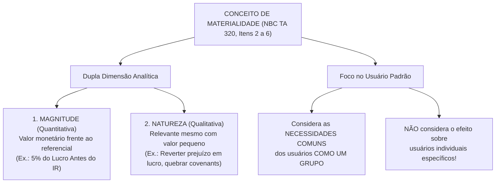
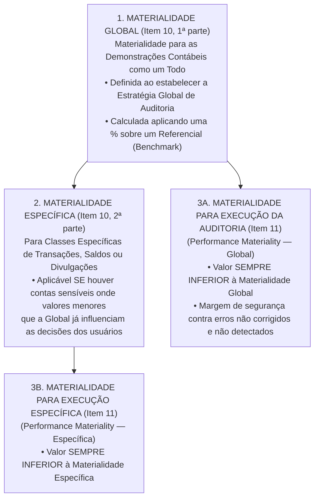
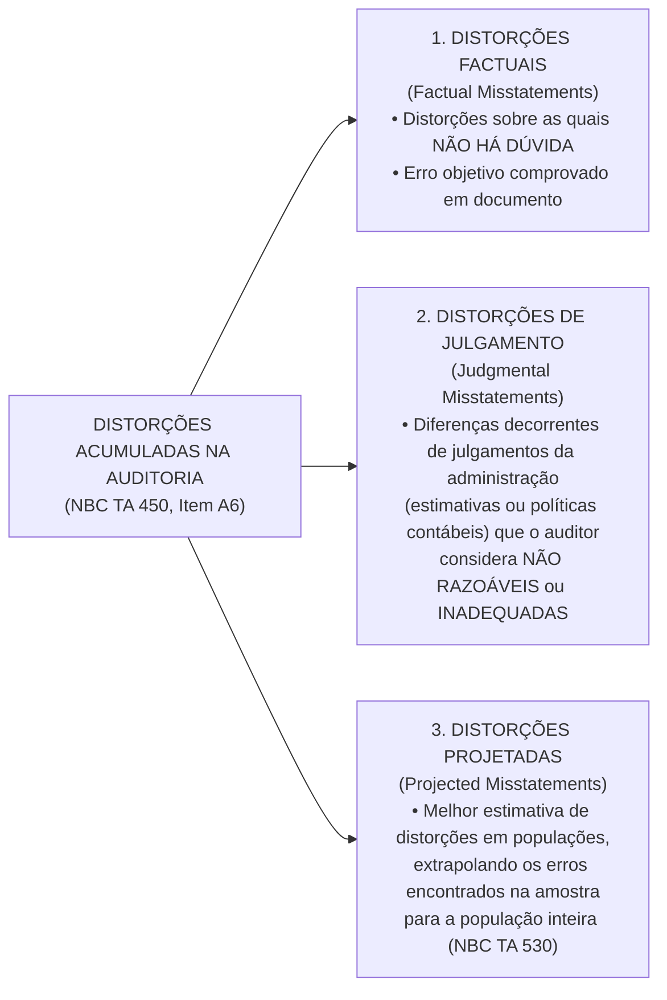
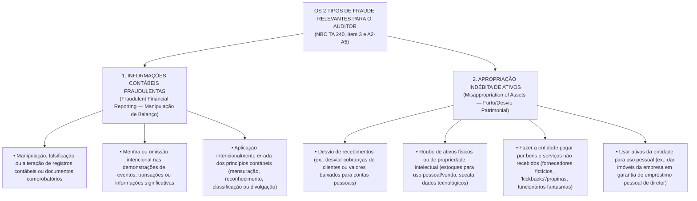
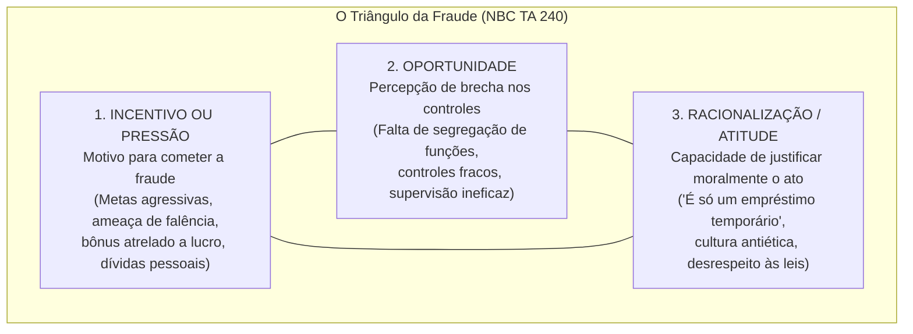
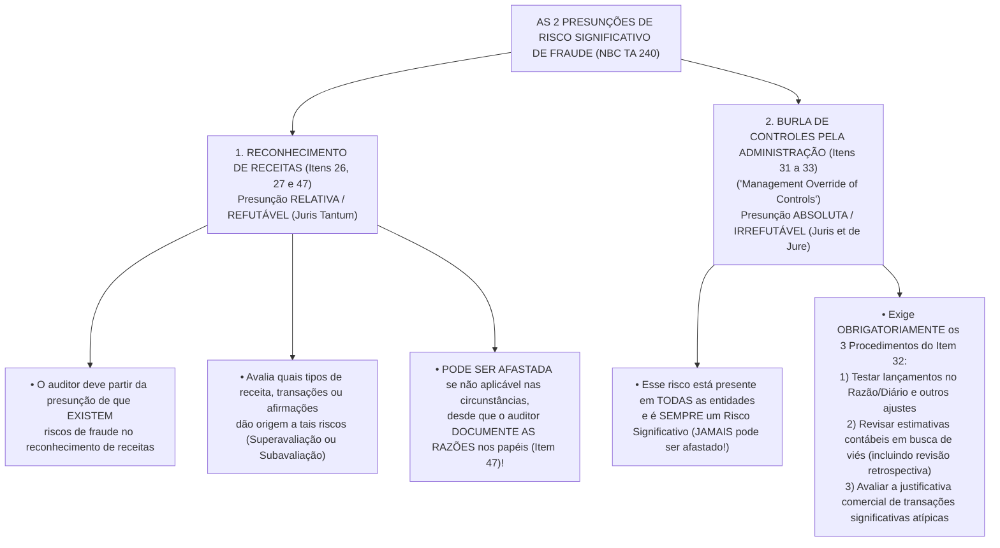

# Materialidade (NBC TA 320), Avaliação de Distorções (NBC TA 450) e Tratamento de Fraudes (NBC TA 240)

> **BLUF (Bottom Line Up Front):**  
> A **Materialidade (NBC TA 320)** é o filtro quantitativo e qualitativo que separa as distorções inconsequentes daquelas capazes de **influenciar as decisões econômicas dos usuários das demonstrações contábeis tomados como um grupo**. O auditor estrutura a materialidade em **3 níveis**: (1) **Materialidade Global** (para as demonstrações como um todo, calculada sobre um referencial/*benchmark*), (2) **Materialidade Específica** (para classes específicas de transações, saldos ou divulgações sensíveis) e (3) **Materialidade para Execução da Auditoria (*Performance Materiality*)**, sempre fixada em valor **inferior** à global (e à específica) para absorver a soma de distorções não corrigidas e não detectadas. Durante o trabalho, pela **NBC TA 450**, o auditor acumula todas as distorções identificadas (**factuais, de julgamento e projetadas**), exceto as **claramente triviais**. Já sob a **NBC TA 240**, o elemento diferenciador entre **Fraude** e **Erro** é a **intenção (dolo vs. culpa)**. Enquanto a responsabilidade primária por prevenir e detectar fraudes cabe à **Administração e à Governança**, o auditor atua sob duas **presunções normativas de Risco Significativo de Fraude**: (1) no **Reconhecimento de Receitas** (presunção *relativa/refutável* mediante justificativa documentada) e (2) na **Burla de Controles pela Administração (*Management Override*)** (presunção *absoluta/irrefutável* em todas as entidades, que exige obrigatoriamente o teste de lançamentos de diário, a revisão de estimativas quanto a viés e a análise da lógica comercial de transações atípicas).

---

## 1. Materialidade no Planejamento e na Execução da Auditoria (NBC TA 320)

A **NBC TA 320** (equivalente à *ISA 320*) trata da responsabilidade do auditor de aplicar o conceito de **materialidade** no planejamento e na execução de uma auditoria de demonstrações contábeis, funcionando em estrita simbiose com a **NBC TA 450** (que explica como a materialidade é aplicada na avaliação do efeito de distorções identificadas e de distorções não corrigidas).

### 1.1. O Conceito Normativo de Materialidade e o Foco nos Usuários como um Grupo (Itens 2 a 6)

No contexto das estruturas de relatório financeiro, a materialidade apoia-se em três pilares conceituais (Item 2):
1. **Limiar de Influência Decisória:** Distorções, incluindo omissões, são consideradas relevantes (**materiais**) quando for razoavelmente esperado que, **individualmente ou em conjunto**, **influenciem as decisões econômicas dos usuários** tomadas com base nas demonstrações contábeis;
2. **Dupla Dimensão (Quantitativa e Qualitativa):** Os julgamentos sobre a materialidade são feitos à luz das circunstâncias envolvidas e são afetados pela **magnitude (tamanho monetário)** e pela **natureza (aspecto qualitativo)** das distorções, ou por uma combinação de ambas; e
3. **Foco nas Necessidades Comuns dos Usuários como um Grupo:** Os julgamentos sobre assuntos que são relevantes para os usuários das demonstrações contábeis baseiam-se na consideração das **necessidades comuns de informações financeiras dos usuários como um grupo**. O possível efeito de distorções sobre **usuários individuais específicos**, cujas necessidades podem variar significativamente, **NÃO é considerado**!

#### Premissas Razoáveis do Auditor a Respeito dos Usuários (Item 4)
Ao determinar a materialidade, o auditor é autorizado pela norma a assumir que os usuários das demonstrações contábeis:
- **(a)** Possuem **conhecimento razoável de negócios, atividades econômicas e contabilidade** e a disposição de estudar as informações das demonstrações contábeis com **razoável diligência** (ou seja, as demonstrações e a materialidade não são desenhadas para pessoas totalmente leigas ou negligentes!);
- **(b)** Entendem que as demonstrações contábeis são elaboradas, apresentadas e auditadas considerando **níveis de materialidade**;
- **(c)** Reconhecem as **incertezas inerentes** à mensuração de valores baseados no uso de estimativas, julgamento e consideração sobre eventos futuros; e
- **(d)** Tomam **decisões econômicas razoáveis** com base nas informações das demonstrações contábeis.

#### Em Quais Momentos o Conceito de Materialidade é Aplicado pelo Auditor? (Item 5)
O conceito de materialidade é aplicado pelo auditor em **todas as etapas do ciclo da auditoria**:
1. No **planejamento** e na **execução** da auditoria (para determinar a natureza, a época e a extensão dos procedimentos de avaliação de risco e dos procedimentos adicionais — NBC TA 300, 315 e 330);
2. Na **avaliação do efeito de distorções identificadas** na auditoria e de **distorções não corrigidas**, se houver, sobre as demonstrações contábeis (NBC TA 450); e
3. Na **formação da opinião** no relatório do auditor independente (NBC TA 700 e 705).

---

### 1.2. A Arquitetura dos 3 Níveis de Materialidade na NBC TA 320 (Itens 9 a 11)

A NBC TA 320 exige que o auditor opere com até **três níveis hierárquicos de materialidade**:

#### Nível 1: Materialidade para as Demonstrações Contábeis como um Todo (Materialidade Global — Item 10)
Ao estabelecer a estratégia global de auditoria, o auditor **deve determinar a materialidade para as demonstrações contábeis como um todo**.
- **O Uso de Referenciais (*Benchmarks*) e Porcentagens (Itens A3 a A10):** A determinação da materialidade exige o exercício de julgamento profissional. Uma porcentagem é frequentemente aplicada a um **referencial (*benchmark*)** selecionado como ponto de partida. Os fatores que afetam a escolha do referencial adequado incluem:
  1. Os elementos das demonstrações contábeis (ativos, passivos, patrimônio líquido, receita, despesas);
  2. Se há itens nos quais a atenção dos usuários tende a se concentrar (para avaliar o desempenho financeiro, os usuários tendem a focar nos lucros, receitas ou ativos líquidos);
  3. A natureza da entidade, a fase do seu ciclo de vida, e o setor e ambiente econômico; e
  4. A estrutura de propriedade da entidade e a forma como ela é financiada (por exemplo, se uma entidade é financiada **somente por endividamento** em vez de capital próprio, os usuários podem dar **mais ênfase a ativos, e a direitos sobre estes**, do que aos resultados da entidade!).

| Perfil da Entidade Auditada | Referencial (*Benchmark*) Mais Apropriado segundo a NBC TA 320 |
| :--- | :--- |
| **Entidade empresarial orientada para o lucro em condições normais** | **Lucro antes dos impostos das operações continuadas** (ex.: $5\%$ do LAIR — Item A4 e A8). |
| **Entidade com lucro antes dos impostos volátil, marginal ou prejuízo ocasional** | **Receita total**, **Lucro bruto** ou **Lucro antes dos impostos normalizado** com base na média dos resultados passados (Itens A4 e A6). |
| **Entidade de investimento / Fundo Imobiliário ou *Holding* Patrimonial** | **Ativo Total** ou **Patrimônio Líquido (Ativo Líquido)**. |
| **Entidade do Setor Público (Autarquias, Ministérios, Prefeituras — Item A10)** | **Custo total** ou **Custo líquido** (despesas menos receitas ou despesas orçamentárias totais), visto que os legisladores e cidadãos focam na execução das despesas públicas! |
| **Entidade em fase pré-operacional (*Start-up*)** | **Ativos Totais** ou **Despesas de implantação/P&D**. |

*(Detalhe do Item A7: A materialidade relaciona-se às demonstrações contábeis sobre as quais o auditor está emitindo o relatório. Quando as demonstrações são elaboradas para um período de mais ou menos de 12 meses — como no caso de uma entidade recém-constituída ou de mudança na data de encerramento —, a materialidade relaciona-se às demonstrações elaboradas para esse período específico!)*

#### Nível 2: Materialidade para Classes Específicas de Transações, Saldos Contábeis ou Divulgações (Materialidade Específica — Item 10, 2ª parte, e Item A11)
Se, nas circunstâncias específicas da entidade, houver uma ou mais classes específicas de transações, saldos contábeis ou divulgações para as quais se possa razoavelmente esperar que distorções de **valores menores** que a materialidade para as demonstrações contábeis como um todo influenciem as decisões econômicas dos usuários, o auditor **deve determinar também o nível ou níveis de materialidade a serem aplicados a essas classes específicas**.
- **Fatores que indicam a existência dessas classes específicas (Item A11):**
  - Se a lei, regulamento ou a estrutura de relatório financeiro aplicável afetam as expectativas dos usuários quanto à mensuração ou divulgação de certos itens (por exemplo, **transações com partes relacionadas**, **remuneração da administração** e dos responsáveis pela governança, e análises de sensibilidade do valor justo);
  - As divulgações-chave em relação ao setor no qual a entidade opera (por exemplo, **custos de pesquisa e desenvolvimento para uma empresa farmacêutica**); e
  - Se a atenção está focada em um aspecto específico dos negócios da entidade que é divulgado separadamente nas demonstrações contábeis (por exemplo, divulgações sobre segmentos operacionais ou uma **combinação de negócios significativa / aquisição recente**).

#### Nível 3: Materialidade para Execução da Auditoria (*Performance Materiality* — Item 9 e Item 11)
> [!IMPORTANT]
> **Definição Literal da NBC TA 320 (Item 9):**  
> **Materialidade para execução da auditoria** significa o valor ou valores fixados pelo auditor, em nível **INFERIOR** ao da materialidade para as demonstrações contábeis como um todo, para **reduzir a um nível apropriadamente baixo a probabilidade de que as distorções não corrigidas e não detectadas em conjunto excedam a materialidade para as demonstrações contábeis como um todo**. Se aplicável, a materialidade para execução da auditoria refere-se, também, ao valor ou valores fixados pelo auditor em nível **inferior** ao nível ou níveis de materialidade para classes específicas de transações, saldos contábeis ou divulgações!

- **Por que a Materialidade de Execução NÃO pode ser igual à Materialidade Global? (Item A13):** Planejar a auditoria somente para detectar distorções individualmente relevantes negligencia o fato de que **a soma das distorções individualmente irrelevantes pode fazer com que as demonstrações contábeis sejam distorcidas de forma relevante**, e não deixa **nenhuma margem para possíveis distorções não detectadas**. A determinação da materialidade de execução não é um simples cálculo mecânico (embora na prática de mercado situe-se geralmente entre $50\%$ e $75\%$ da materialidade global) e envolve o exercício de julgamento profissional, sendo afetada pelo entendimento que o auditor possui sobre a entidade e pela natureza e extensão das distorções identificadas em auditorias anteriores.

---

### 1.3. Relação Inversa entre Materialidade, Risco de Auditoria e Extensão dos Procedimentos

A relação matemática e lógica entre a **Materialidade**, o **Risco de Auditoria** e a **Extensão dos Procedimentos** é uma das cobranças mais frequentes em provas de múltipla escolha:

$$\text{Valor da Materialidade Fixada} \downarrow \quad \Longleftrightarrow \quad \text{Risco de Auditoria / Rigor} \uparrow \quad \Longleftrightarrow \quad \text{Extensão dos Testes e Tamanho da Amostra} \uparrow$$

| Cenário Comparado | Valor Monetário da Materialidade de Execução | Rigor do Exame / Quantidade de Evidências Exigidas | Tamanho da Amostra nos Testes Substantivos |
| :--- | :---: | :---: | :---: |
| **Empresa com controles fracos e histórico de muitos erros contábeis** | **Menor** (ex.: R\$ 500 mil em vez de R\$ 750 mil) | **Maior** (o auditor tolera menos distorção não detectada) | **Maior** (precisa testar mais itens da população) |
| **Empresa com controles excelentes e histórico zero de ajustes** | **Maior** (ex.: R\$ 750 mil para uma Global de R\$ 1 milhão) | **Menor** (dentro do limite da segurança razoável) | **Menor** (amostras mais enxutas são suficientes) |

---

### 1.4. Revisão no Decorrer da Auditoria e Documentação Obrigatória (Itens 12 a 14)

- **Revisão no Decorrer da Auditoria (Itens 12 e 13):** O auditor **deve revisar** a materialidade para as demonstrações contábeis como um todo (e, se aplicável, a materialidade específica) no caso de tomar conhecimento de informações durante a auditoria que teriam levado o auditor a determinar inicialmente um valor diferente (por exemplo, se a materialidade foi calculada durante o planejamento antes do fim do exercício com base em lucro estimado de R\$ 100 milhões, e o lucro real do exercício caiu para R\$ 40 milhões). Se o auditor concluir que uma materialidade **mais baixa** do que a inicialmente determinada é apropriada, o auditor **deve determinar se é necessário revisar a materialidade para execução da auditoria e se a natureza, a época e a extensão dos procedimentos adicionais de auditoria continuam apropriadas**!
- **Documentação Obrigatória da Materialidade (Item 14):** O auditor deve incluir na documentação de auditoria os seguintes valores e os fatores considerados em sua determinação:
  1. **(a)** Materialidade para as demonstrações contábeis como um todo;
  2. **(b)** Se aplicável, o nível ou níveis de materialidade para classes específicas de transações, saldos contábeis ou divulgações;
  3. **(c)** Materialidade para execução da auditoria; e
  4. **(d)** Qualquer revisão de (a) a (c) à medida que a auditoria avança.

---

## 2. Avaliação das Distorções Identificadas durante a Auditoria (NBC TA 450)

À medida que executa os procedimentos substantivos em campo, o auditor encontra diferenças entre o que a empresa contabilizou/divulgou e o que exigem as normas contábeis (CPCs/IFRS). A **NBC TA 450** (equivalente à *ISA 450*) rege a acumulação, classificação, comunicação e avaliação dessas distorções.

### 2.1. Acumulação de Distorções e o Limiar "Claramente Trivial" (Item 5 e A2)

O auditor **deve acumular as distorções identificadas durante a auditoria, que não sejam claramente triviais** (Item 5).

> [!WARNING]
> **"Claramente Trivial" $\neq$ "Não Relevante / Imaterial" (NBC TA 450, Item A2):**  
> As expressões **"claramente trivial"** (*clearly trivial*) e **"não relevante"** (*not material*) **NÃO são sinônimas!**  
> - Uma distorção **não relevante (imaterial)** é aquela que está abaixo da Materialidade de Execução (ex.: uma distorção de R\$ 150.000,00 quando a Materialidade Global é R\$ 1.000.000,00 e a de Execução é R\$ 700.000,00). Ela **DEVE ser acumulada** na planilha de diferenças de auditoria, pois somada a outras distorções pode ultrapassar a Materialidade Global!  
> - Já os assuntos **claramente triviais** são de uma **ordem de grandeza totalmente diferente (muito menores)** do que a materialidade determinada na NBC TA 320 (na prática de auditoria, tipicamente fixados em até $3\%$ a $5\%$ da materialidade global, ex.: abaixo de R\$ 30.000,00), referentes a assuntos que são claramente inconsequentes, sejam considerados individualmente ou em conjunto e por qualquer critério de grandeza, natureza ou circunstâncias. Quando há **qualquer incerteza** sobre se um ou mais itens são claramente triviais, o assunto é considerado **como NÃO sendo claramente trivial** (devendo ser acumulado)!

---

### 2.2. As 3 Categorias de Distorções Acumuladas (Item A6 da NBC TA 450)

Para auxiliar o auditor a avaliar o efeito das distorções acumuladas e comunicá-las à administração e aos responsáveis pela governança, a NBC TA 450 distingue **três categorias de distorções**:

#### Comunicação, Solicitação de Correção e Compensação (*Offsetting*) (Itens 8 a 11 e A19-A21)
1. **Comunicação e Pedido de Correção (Item 8):** O auditor deve comunicar tempestivamente **todas as distorções acumuladas** durante a auditoria ao nível apropriado da administração (salvo proibição legal) e **deve solicitar à administração que corrija essas distorções**.
2. **Recusa da Administração em Corrigir (Item 9):** Se a administração se recusar a corrigir todas ou algumas das distorções comunicadas, o auditor deve obter entendimento das razões da administração para não fazer as correções e deve levar isso em consideração ao avaliar se as demonstrações contábeis como um todo estão livres de distorção relevante.
3. **Compensação de Distorções (*Offsetting* — Item A19):** A compensação de distorções não corrigidas (uma superavaliação compensando uma subavaliação) **só é apropriada dentro do mesmo saldo contábil ou da mesma classe de transações**, e desde que o risco de que possam existir outras distorções não detectadas seja considerado antes de concluir que a compensação de distorções mesmo relevantes é adequada. Em contrapartida, compensar uma superavaliação de Receita com uma superavaliação de Despesa ou de Ativo com Passivo geralmente **não é apropriado**, pois distorce os indicadores e margens das demonstrações!
4. **Circunstâncias Qualitativas que Tornam uma Distorção Relevante Mesmo Abaixo da Materialidade Numérica (Item A21 da NBC TA 450):** O auditor pode avaliar uma distorção como **relevante (material)**, mesmo que seu valor monetário seja inferior à materialidade global, quando ela:
   - Afeta a conformidade com requisitos regulamentares ou com **cláusulas restritivas de contratos de dívida (*covenants*)**;
   - Está relacionada à seleção ou aplicação incorreta de política contábil que tem efeito imaterial no período corrente, mas provavelmente terá efeito relevante em períodos futuros;
   - **Mascara uma mudança nos lucros ou outras tendências**, especialmente no contexto de condições econômicas gerais e do setor;
   - Afeta índices usados para avaliar a posição patrimonial e financeira, o resultado ou os fluxos de caixa da entidade;
   - Tem o efeito de **aumentar a remuneração da administração**, por exemplo, assegurando que os requisitos para a concessão de **bônus ou outras formas de incentivo** sejam atendidos;
   - É uma omissão de informação não especificamente exigida pela estrutura contábil, mas que, no julgamento do auditor, é importante para a compreensão dos usuários; ou
   - Afeta outros dados comunicados em documentos que contêm as demonstrações contábeis auditadas (Relatório da Administração — NBC TA 720).

---

## 3. Responsabilidade do Auditor em Relação a Fraude (NBC TA 240)

A **NBC TA 240** (equivalente à *ISA 240*) trata da responsabilidade do auditor no que se refere à fraude na auditoria de demonstrações contábeis, expandindo como a NBC TA 315 e a NBC TA 330 devem ser aplicadas em relação aos riscos de distorção relevante decorrente de fraude.

### 3.1. Fraude vs. Erro e os 2 Tipos de Fraude Relevantes para o Auditor (Itens 2 e 3)

- **O Elemento Distintivo Nuclear (Item 2):** As distorções nas demonstrações contábeis podem originar-se de fraude ou erro. **O fator distintivo entre fraude e erro está no fato de ser INTENCIONAL ou NÃO INTENCIONAL a ação subjacente que resulta em distorção nas demonstrações contábeis.**
- **Definição de Fraude (Item 11, "a"):** Ato intencional de um ou mais indivíduos da administração, dos responsáveis pela governança, empregados ou terceiros, que envolva **dolo para obtenção de vantagem injusta ou ilegal**.

Embora "fraude" seja um conceito jurídico amplo, para as finalidades das normas de auditoria o auditor está preocupado especificamente com a **fraude que causa distorção relevante nas demonstrações contábeis**. Existem **dois tipos de distorções intencionais** pertinentes para o auditor (Item 3):

---

### 3.2. O Triângulo da Fraude de Donald Cressey (Itens A1 e A26-A27 e Apêndice 1)

A fraude, seja sob a forma de informações contábeis fraudulentas ou de apropriação indébita de ativos, envolve a presença dos três vértices do **Triângulo da Fraude** (**Fatores de Risco de Fraude**):

---

### 3.3. Responsabilidades Primárias e Hierarquia do Risco de Não Detecção (Itens 4 a 8)

1. **Responsabilidade Primária da Administração e da Governança (Item 4):** A **principal responsabilidade pela prevenção e detecção da fraude** pertence aos **responsáveis pela governança da entidade e à sua administração**. É importante que a administração, com a supervisão geral dos responsáveis pela governança, enfatize a prevenção da fraude (o que pode reduzir as oportunidades de sua ocorrência) e a dissuasão da fraude (o que persuade os indivíduos a não perpetrá-la por causa da probabilidade de detecção e punição).
2. **Responsabilidade do Auditor e Assimetria do Risco de Não Detecção (Itens 5 a 8):** O auditor é responsável por obter **asseguração razoável** de que as demonstrações contábeis, como um todo, não contêm distorções relevantes, causadas por fraude ou erro. Entretanto, devido às limitações inerentes de uma auditoria, há um risco inevitável de que algumas distorções relevantes não sejam detectadas, mesmo que a auditoria seja adequadamente planejada e realizada de acordo com as normas. A NBC TA 240 estabelece **duas desigualdades fundamentais de risco**:

$$\text{Risco de NÃO detectar FRAUDE} \quad > \quad \text{Risco de NÃO detectar ERRO}$$

$$\text{Risco de NÃO detectar Fraude da ADMINISTRAÇÃO} \quad > \quad \text{Risco de NÃO detectar Fraude de EMPREGADOS}$$

| Comparação Normativa na NBC TA 240 | Qual Risco de Não Detecção é MAIOR? | Explicação Técnica da Norma (Itens 6 e 7) |
| :--- | :---: | :--- |
| **Fraude vs. Erro** (Item 6) | **FRAUDE** | Porque a fraude pode envolver **esquemas sofisticados e cuidadosamente organizados, destinados a ocultá-la**, tais como falsificação, falha deliberada em registrar transações, ou prestação intencional de informações erradas ao auditor. Essa ocultação é ainda mais difícil de detectar quando acompanhada de **conluio**! |
| **Fraude da Administração vs. Fraude de Empregados** (Item 7) | **FRAUDE DA ADMINISTRAÇÃO** | Porque a administração frequentemente tem condições de **manipular, direta ou indiretamente, os registros contábeis**, apresentar informações contábeis fraudulentas ou **burlar procedimentos de controle** destinados a prevenir fraudes semelhantes, cometidas por outros empregados! |

---

### 3.4. Ceticismo Profissional e Autenticidade de Documentos na NBC TA 240 (Itens 12 a 14)

- **Postura Questionadora Contínua (Item 12):** O auditor deve manter o ceticismo profissional durante toda a auditoria, reconhecendo a possibilidade de existir uma distorção relevante decorrente de fraude, **não obstante a experiência passada do auditor em relação à honestidade e integridade da administração e dos responsáveis pela governança da entidade**!
- **Regra sobre Autenticidade de Documentos (Item 13):** A menos que tenha razão para crer o contrário, **o auditor pode aceitar registros e documentos como genuínos** (não se espera que o auditor seja um perito em grafotecnia ou autenticação documental — Item A8). **Se as condições identificadas durante a auditoria levarem o auditor a acreditar que um documento pode não ser autêntico ou que os termos de um documento foram modificados, mas não divulgados ao auditor, o auditor deve investigar mais detalhadamente** (por exemplo, confirmando diretamente com o terceiro ou utilizando o trabalho de um especialista forense para avaliar a autenticidade do documento — Item A9)!

---

### 3.5. As Duas Presunções de Risco Significativo de Fraude na NBC TA 240 (Itens 26, 27 e 31 a 33)

Este é o ponto mais cobrado da NBC TA 240 em provas de Auditor Fiscal (RFB/SEFAZ) e Controle (TCU/CGU). A norma estabelece **duas presunções obrigatórias de risco significativo de fraude**, mas com naturezas jurídicas distintas (**uma refutável e outra irrefutável**):

#### 1) Presunção de Risco de Fraude no Reconhecimento de Receita (Itens 26, 27 e 47 — Refutável)
- Ao identificar e avaliar os riscos de distorção relevante decorrente de fraude, o auditor deve, **baseando-se na presunção de que existem riscos de fraude no reconhecimento de receitas**, avaliar quais tipos de receita, transações de receita ou afirmações dão origem a tais riscos (Item 26).
- *Como a fraude na receita ocorre? (Itens A29 e A30):* Muitas vezes resulta de uma **superavaliação de receitas** (reconhecimento prematuro de receitas ou registro de receitas fictícias para inflar lucros e bater metas) ou, inversamente, de uma **subavaliação de receitas** (por exemplo, mediante transferência indevida de receitas para um período posterior ou omissão de receitas para sonegar tributos!).
- **Como refutar a presunção? (Itens 27, 47 e A31):** A presunção de que existem riscos de fraude no reconhecimento de receitas **pode ser refutada** (por exemplo, quando há um único tipo simples de transação de receita, como a receita de locação de uma única propriedade que pode ser alugada). Quando o auditor concluir que a presunção de que existem riscos de distorção relevante decorrente de fraude relacionada ao reconhecimento de receitas **não é aplicável nas circunstâncias do trabalho**, e, portanto, não identificou o reconhecimento de receita como risco de fraude, **o auditor DEVE incluir na documentação de auditoria as razões para essa conclusão (Item 47)**!

#### 2) Risco de Burla de Controles pela Administração (*Management Override of Controls* — Itens 31 a 33 — Irrefutável)
- A administração está em uma posição única para perpetrar fraudes devido à sua capacidade de manipular os registros contábeis e elaborar demonstrações contábeis fraudulentas por meio da **burla de controles que, de outra forma, parecem funcionar eficazmente**. Embora o nível de risco de burla de controles pela administração varie de entidade para entidade, **esse risco está presente em TODAS as entidades**. Devido à maneira imprevisível pela qual tal burla pode ocorrer, **ele é um risco de distorção relevante decorrente de fraude e, portanto, um RISCO SIGNIFICATIVO** (Item 31).
- **Os 3 Procedimentos Obrigatórios em TODAS as Auditorias para Responder ao *Management Override* (Item 32):** Independentemente da avaliação do auditor quanto aos riscos de a administração burlar controles, o auditor **DEVE planejar e executar procedimentos de auditoria para**:
  1. **Testar a adequação dos lançamentos contábeis registrados no razão geral e outros ajustes feitos na elaboração das demonstrações contábeis (Item 32, "a"):** No planejamento e na execução de testes de lançamentos e outros ajustes, o auditor deve:
     - (i) Fazer indagações a indivíduos envolvidos no processo de relatório financeiro sobre atividades inadequadas ou não usuais relacionadas ao processamento de lançamentos e outros ajustes;
     - (ii) **Selecionar lançamentos e outros ajustes feitos no final do período de relatório**; e
     - (iii) Considerar a necessidade de testar lançamentos e outros ajustes **durante todo o período**.
  2. **Revisar as estimativas contábeis em busca de tendenciosidade (viés) e avaliar se as circunstâncias que geram a tendenciosidade, se houver, representam risco de distorção relevante decorrente de fraude (Item 32, "b"):** Na execução dessa revisão, o auditor deve:
     - (i) Avaliar se os julgamentos e decisões tomadas pela administração ao fazer as estimativas contábeis incluídas nas demonstrações contábeis — **mesmo se forem individualmente razoáveis** — indicam uma possível tendenciosidade por parte da administração da entidade que possa representar um risco de fraude. Se assim for, o auditor deve **reavaliar as estimativas contábeis como um todo**; e
     - (ii) Realizar uma **revisão retrospectiva dos julgamentos e premissas da administração** relacionados a estimativas contábeis significativas refletidas nas demonstrações contábeis do **exercício anterior**!
  3. **Para transações significativas que estejam fora do curso normal dos negócios da entidade, ou que de outro modo pareçam não usuais (considerando o entendimento da entidade pelo auditor), avaliar se a justificativa comercial (ou a ausência dela) das transações sugere que elas podem ter sido celebradas para gerar informações contábeis fraudulentas ou para ocultar a apropriação indébita de ativos (Item 32, "c").**

---

### 3.6. Avaliação da Evidência, Comunicações sobre Fraude e Retirada do Trabalho (Itens 35 a 43)

1. **Se o auditor identificar uma distorção (Item 35 e 36):** Deve avaliar se essa distorção é indicativa de fraude. Se houver tal indicação, o auditor deve avaliar as implicações da distorção relativamente a outros aspectos da auditoria, particularmente a **confiabilidade das representações da administração**, reconhecendo que um **caso de fraude dificilmente será uma ocorrência isolada**! Se a distorção envolver a administração (especialmente a alta administração), **mesmo que o valor monetário não seja relevante para as demonstrações contábeis**, o auditor deve reavaliar os riscos de fraude e reconsiderar a confiabilidade da evidência obtida anteriormente!
2. **Incapacidade do Auditor de Continuar o Trabalho — Retirada (*Withdrawal* — Item 38):** Se, como resultado de uma distorção decorrente de fraude ou de suspeita de fraude, o auditor encontrar circunstâncias excepcionais que coloquem em dúvida sua capacidade de continuar realizando a auditoria, o auditor deve:
   - (a) Determinar as responsabilidades profissionais e legais aplicáveis à situação, inclusive se há exigência de o auditor informar à pessoa ou pessoas que o contrataram ou, em alguns casos, às autoridades reguladoras;
   - (b) Considerar se seria apropriado **retirar-se do trabalho**, quando a retirada for possível segundo a lei ou regulamento aplicável; e
   - (c) Se o auditor se retirar: (i) discutir com o nível apropriado da administração e com os responsáveis pela governança a retirada do trabalho e as razões para a retirada; e (ii) determinar se há exigência profissional ou legal de comunicar às pessoas que o contrataram ou às autoridades reguladoras a retirada e as razões para a retirada.
3. **Comunicações à Administração, aos Responsáveis pela Governança e a Autoridades Externas (Itens 40 a 43):**
   - **À Administração (Item 40):** Se o auditor identificou uma fraude ou obteve informações que indiquem a possibilidade de fraude, deve comunicar esses assuntos **tempestivamente ao nível apropriado da administração** (que está pelo menos **um nível acima** das pessoas que parecem estar envolvidas na fraude suspeita — Item A60), a fim de informar os principais responsáveis pela prevenção e detecção de fraude.
   - **Aos Responsáveis pela Governança (Item 41):** A menos que todos os responsáveis pela governança estejam envolvidos na administração da entidade, o auditor **DEVE comunicar tempestivamente aos responsáveis pela governança** (oralmente ou por escrito; sendo que no caso de fraude da alta administração, a comunicação por escrito é altamente recomendada — Item A61) sempre que identificar ou suspeitar de fraude envolvendo:
     1. **(a) A administração**;
     2. **(b) Empregados que tenham funções significativas no controle interno**; ou
     3. **(c) Outros, quando a fraude resulte em distorção relevante nas demonstrações contábeis**.
   - **Às Autoridades Reguladoras e de Controle fora da Entidade (Item 43):** O dever profissional do auditor de manter a confidencialidade das informações do cliente pode impedir que ele relate a fraude a uma parte fora da entidade auditada. Entretanto, a responsabilidade legal do auditor varia por país e, em certas circunstâncias, **o dever de confidencialidade pode ser sobreposto por estatuto, lei ou tribunais de justiça** (por exemplo, comunicação de indícios de lavagem de dinheiro ao COAF sob a Lei nº 9.613/1998, ou comunicações exigidas pelo BACEN e pela CVM).

---

## 4. Estudo de Caso Aplicado: Acumulação de Distorções, Materialidade Qualitativa e *Management Override*

**Cenário Real de Prova:**  
Na auditoria da *Companhia Industrial Delta S.A.*, o auditor determinou a **Materialidade Global** em **R\$ 2.000.000,00** ($5\%$ do Lucro Antes do IR de R\$ 40 milhões), a **Materialidade de Execução** em **R\$ 1.400.000,00** e o limite **Claramente Trivial** em **R\$ 80.000,00**. Durante a execução dos procedimentos obrigatórios do item 32 da NBC TA 240 sobre os lançamentos contábeis feitos no último dia do exercício ($31/12$), o auditor descobriu um lançamento manual no Diário, ordenado diretamente pelo Diretor Presidente, revertendo sem justificativa técnica uma provisão para bônus operacionais e reconhecendo uma receita de consultoria com uma parte relacionada no valor de **R\$ 450.000,00**. Embora R\$ 450.000,00 seja inferior à Materialidade Global (R\$ 2 milhões) e à Materialidade de Execução (R\$ 1,4 milhão), o auditor verificou que, sem esses R\$ 450.000,00, o índice de cobertura da dívida (*EBITDA / Dívida Líquida*) cairia abaixo do limite mínimo de $2,5\text{x}$ exigido no contrato de debêntures da companhia, o que provocaria o vencimento antecipado imediato de R\$ 150 milhões em dívidas e cancelaria o bônus anual de R\$ 3 milhões da própria diretoria executiva.

**Análise Técnica à luz das NBC TAs 320, 450 e 240:**
1. **Acumulação na NBC TA 450 (Item 5):** Como R\$ 450.000,00 supera o limite *claramente trivial* (R\$ 80.000,00), a distorção **deve ser acumulada** e comunicada para correção.
2. **Avaliação Qualitativa da Relevância (NBC TA 320, Item 6 e NBC TA 450, Item A21):** Embora numericamente inferior à Materialidade Global de R\$ 2 milhões, a distorção de R\$ 450.000,00 é **material (relevante) por sua natureza qualitativa**, pois: (a) afeta o cumprimento de cláusulas restritivas de dívida (*covenants*); (b) aumenta artificialmente a remuneração/bônus da administração; e (c) decorre de ato intencional (**fraude da alta administração** via *management override*).
3. **Implicações de Fraude (NBC TA 240, Itens 36 e 41):** Por envolver a administração superior em burla de controles, o auditor deve: (i) comunicar tempestivamente o fato aos **responsáveis pela governança** (Conselho de Administração / Comitê de Auditoria); (ii) **desconfiar da confiabilidade de todas as representações anteriores da diretoria** e reavaliar a avaliação de riscos e a extensão dos testes; e (iii) exigir o estorno do lançamento indevido, sob pena de emitir **Opinião Modificada (Com Ressalva ou Adversa)** ou mesmo **retirar-se do trabalho (Item 38)** se a governança for conivente!

---

## 5. Matriz Anti-Pegadinha de Bancas ("Cascas de Banana")

| Armadilha Clássica de Prova (FGV / Cebraspe / FCC) | Julgamento | Desmontagem Cirúrgica e Base Normativa |
| :--- | :---: | :--- |
| *"Ao determinar a materialidade na NBC TA 320, o auditor deve considerar o possível efeito de distorções sobre usuários individuais específicos cujas necessidades sejam peculiares."* | **ERRADO** | O **item 2 da NBC TA 320** é taxativo: considera-se as necessidades comuns dos usuários **como um grupo**; o efeito sobre **usuários individuais específicos NÃO é considerado**! |
| *"A materialidade para execução da auditoria deve ser fixada em valor superior à materialidade global para evitar trabalho excessivo."* | **ERRADO** | A materialidade de execução (*Performance Materiality*) é sempre fixada em valor **INFERIOR** à materialidade global (e à específica, se houver) (NBC TA 320, Item 9). |
| *"Existe uma relação diretamente proporcional entre o valor monetário da materialidade e a extensão dos procedimentos de auditoria."* | **ERRADO** | A relação é **INVERSAMENTE proporcional**: quanto **menor** o valor da materialidade (menor tolerância a erro), **maior** a extensão dos procedimentos e o tamanho das amostras! |
| *"Pela NBC TA 450, a expressão 'claramente trivial' é sinônima de 'não relevante' (imaterial), dispensando a acumulação de qualquer erro abaixo da materialidade de execução."* | **ERRADO** | O **item A2 da NBC TA 450** afirma expressamente que **"claramente trivial" NÃO é outra expressão para "não relevante"**! Erros imateriais (acima do trivial e abaixo da materialidade) **devem ser acumulados**. |
| *"O risco de o auditor não detectar uma distorção relevante decorrente de erro é maior do que o risco de não detectar uma decorrente de fraude."* | **ERRADO** | Conforme o **item 6 da NBC TA 240**, o risco de não detectar distorção decorrente de **FRAUDE é MAIOR** que o decorrente de erro (e o de fraude da **administração** é maior que o de fraude de **empregados** — Item 7). |
| *"Na NBC TA 240, tanto a presunção de risco de fraude no reconhecimento de receitas quanto a burla de controles pela administração podem ser refutadas pelo auditor."* | **ERRADO** | Apenas a presunção de fraude no **reconhecimento de receitas pode ser refutada** (mediante justificativa documentada — Item 26 e 47). Já o risco de **burla de controles pela administração (*management override*) está presente em TODAS as entidades** e é **irrefutável** (Item 31)! |
| *"Diante do risco de burla de controles pela administração, basta ao auditor testar a eficácia operacional dos controles internos preventivos da empresa."* | **ERRADO** | A burla da administração contorna justamente controles que parecem funcionar eficazmente! Por isso, o **item 32 da NBC TA 240** exige **3 procedimentos substantivos específicos** (testar lançamentos de diário, revisar estimativas quanto a viés e avaliar transações atípicas). |
| *"O auditor só deve comunicar suspeita de fraude aos responsáveis pela governança quando a fraude causar distorção monetariamente relevante nas demonstrações contábeis."* | **ERRADO** | Conforme o **item 41 da NBC TA 240**, se a fraude envolver **(a) a administração** ou **(b) empregados com funções significativas no controle interno**, a comunicação à governança é obrigatória **independentemente da materialidade do valor**! Só exige distorção relevante quando praticada por **"outros"** empregados sem função significativa no controle interno (Item 41, "c"). |

---

## 6. Mnemônicos & Âncoras de Memória

> [!TIP]
> **Mnemônico 1: As 2 Presunções de Fraude da NBC TA 240 (`RE-RE` vs. `BUR-IR`)**  
> - **`RE-RE`:** **RE**conhecimento de Receita = Presunção **RE**lativa / **RE**futável (se afastar, tem que documentar o motivo no papel de trabalho!).  
> - **`BUR-IR`:** **BUR**la de Controles pela Administração (*Management Override*) = Presunção **IR**refutável (presente em 100% das auditorias; exige os **3 Testes do Item 32**: *Diário + Estimativas + Transações Atípicas*).

> [!TIP]
> **Mnemônico 2: Os 3 Tipos de Distorções da NBC TA 450 (`F-J-P`)**  
> - **F**actuais (fatos objetivos sem dúvida);  
> - **J**ulgamento (diferenças em estimativas ou escolhas de políticas contábeis não razoáveis);  
> - **P**rojetadas (extrapolação estatística ou não estatística do erro da amostra para a população).

> [!TIP]
> **Mnemônico 3: Quando Comunicar Fraude à Governança (`A - C - O` — NBC TA 240, Item 41)**  
> - **A**dministração envolvida (qualquer valor!);  
> - **C**ontrole Interno — empregados com função significativa (qualquer valor!);  
> - **O**utros empregados — **somente se** resultar em distorção **relevante (material)**.

---

## 7. Questões Oficiais Comentadas

### Questão 01 — [FGV — Receita Federal / Auditor-Fiscal — 2023]
De acordo com a NBC TA 240 (Responsabilidade do Auditor em Relação a Fraude, no Contexto da Auditoria de Demonstrações Contábeis), a administração encontra-se em uma posição única para perpetrar fraudes devido à sua capacidade de manipular os registros contábeis e elaborar demonstrações contábeis fraudulentas por meio da burla de controles que, de outra forma, parecem funcionar eficazmente (*management override of controls*).

Sobre o risco de burla de controles pela administração e a presunção de fraude no reconhecimento de receitas previstos na NBC TA 240, assinale a afirmativa **correta**.
- (A) O risco de burla de controles pela administração pode ser afastado pelo auditor na fase de planejamento caso o ambiente de controle da entidade seja avaliado como excelente, dispensando procedimentos adicionais.
- (B) A presunção de que existem riscos de fraude no reconhecimento de receitas é absoluta e irrefutável em todas as auditorias, não admitindo exceções sob nenhuma circunstância.
- (C) O risco de burla de controles pela administração está presente em todas as entidades e constitui sempre um risco significativo, exigindo que o auditor teste a adequação dos lançamentos no razão geral, revise estimativas contábeis em busca de viés e avalie a justificativa comercial de transações significativas fora do curso normal dos negócios.
- (D) Quando o auditor conclui que a presunção de risco de fraude no reconhecimento de receitas não é aplicável nas circunstâncias do trabalho, ele está dispensado de registrar as razões para essa conclusão na documentação de auditoria.
- (E) O risco de o auditor não detectar uma fraude cometida por empregados operacionais é maior do que o risco de não detectar uma fraude cometida pela alta administração.

**Gabarito Oficial:** **C**

**Comentário Analítico Alternativa por Alternativa:**
- **(A) Incorreta:** Conforme o **item 31 da NBC TA 240**, o risco de burla de controles pela administração está presente em **todas as entidades** e constitui sempre um **risco significativo** (presunção absoluta/irrefutável).
- **(B) Incorreta:** Conforme os **itens 26 e 27 da NBC TA 240**, a presunção de risco de fraude no reconhecimento de receitas **pode ser refutada** quando não for aplicável nas circunstâncias específicas do trabalho.
- **(C) CORRETA:** Reproduz com precisão cirúrgica os **itens 31 e 32 ("a", "b" e "c") da NBC TA 240**: o risco de *management override* está presente em todas as entidades, é um risco significativo e obriga o auditor a executar os três procedimentos mandatórios (testes de lançamentos contábeis, revisão de estimativas quanto a viés e avaliação da justificativa comercial de transações significativas atípicas).
- **(D) Incorreta:** O **item 47 da NBC TA 240** exige expressamente que, se o auditor concluir que a presunção de fraude no reconhecimento de receitas não é aplicável, ele **deve incluir na documentação de auditoria as razões para essa conclusão**.
- **(E) Incorreta:** Conforme o **item 7 da NBC TA 240**, o risco de não detectar fraude cometida pela **administração é MAIOR** do que no caso de fraude cometida por empregados.

---

### Questão 02 — [FGV — SEFAZ-MG / Auditor Fiscal da Receita Estadual — 2023]
Na aplicação do conceito de materialidade no planejamento e na execução da auditoria (NBC TA 320), o auditor determina a materialidade para as demonstrações contábeis como um todo e a materialidade para execução da auditoria (*performance materiality*).

A respeito desses níveis de materialidade e de sua revisão, assinale a opção **correta**.
- (A) Os julgamentos do auditor sobre a materialidade devem ser customizados para atender às necessidades específicas de cada acionista minoritário individualmente considerado.
- (B) A materialidade para execução da auditoria é fixada pelo auditor em nível inferior ao da materialidade para as demonstrações contábeis como um todo, para reduzir a um nível apropriadamente baixo a probabilidade de que as distorções não corrigidas e não detectadas em conjunto excedam a materialidade global.
- (C) Para entidades do setor público orientadas para a prestação de serviços gratuitos à população, o referencial (*benchmark*) obrigatório estipulado pela NBC TA 320 é o lucro líquido por ação.
- (D) Uma vez estabelecida na estratégia global de auditoria, a materialidade para as demonstrações contábeis como um todo é imutável até a emissão do relatório final.
- (E) Quanto maior for o valor monetário fixado para a materialidade de execução, maior será a extensão dos testes substantivos de detalhes exigidos do auditor.

**Gabarito Oficial:** **B**

**Comentário Analítico Alternativa por Alternativa:**
- **(A) Incorreta:** Conforme o **item 2 da NBC TA 320**, os julgamentos sobre a materialidade consideram as necessidades comuns dos usuários **como um grupo**; o possível efeito sobre **usuários individuais específicos não é considerado**.
- **(B) CORRETA:** Transcrição literal da definição constante do **item 9 da NBC TA 320**.
- **(C) Incorreta:** Conforme o **item A10 da NBC TA 320**, na auditoria de entidade do setor público, o **custo total ou o custo líquido** (despesas menos receitas ou despesas totais) pode ser o referencial apropriado para as atividades de programas.
- **(D) Incorreta:** O **item 12 da NBC TA 320** determina que o auditor **deve revisar** a materialidade caso tome conhecimento de informações durante a auditoria que o teriam levado a determinar inicialmente um valor diferente.
- **(E) Incorreta:** A relação é **inversa**: quanto maior o valor monetário da materialidade (maior tolerância a erros), menor a extensão dos testes; quanto menor a materialidade, maior a extensão dos procedimentos.

---

### Questão 03 — [Cebraspe — TCU / Auditor Federal de Controle Externo — 2022]
Julgue as assertivas a seguir à luz da NBC TA 450 (Avaliação das Distorções Identificadas durante a Auditoria) e assinale a opção **correta**.
- (A) O auditor deve acumular todas as distorções identificadas durante a auditoria, inclusive aquelas que sejam claramente triviais, sendo vedado estabelecer qualquer piso mínimo de acumulação.
- (B) A expressão "claramente trivial" utilizada na NBC TA 450 é sinônima de "não relevante" (imaterial), referindo-se a qualquer distorção cujo valor seja inferior à materialidade para as demonstrações contábeis como um todo.
- (C) Distorções projetadas são aquelas sobre as quais não paira qualquer dúvida fática, decorrentes da conferência individual de 100% dos documentos de uma população.
- (D) Uma distorção cujo valor numérico seja inferior à materialidade determinada para as demonstrações contábeis como um todo pode, ainda assim, ser avaliada como relevante pelo auditor em função de sua natureza e das circunstâncias, como no caso de mascarar o descumprimento de cláusulas restritivas de dívida (*covenants*) ou aumentar a remuneração da administração.
- (E) Caso a administração corrija uma distorção apontada pelo auditor antes da emissão do relatório, o auditor ainda assim é obrigado a emitir uma opinião com ressalva em razão do erro originalmente existente.

**Gabarito Oficial:** **D**

**Comentário Analítico Alternativa por Alternativa:**
- **(A) Incorreta:** Conforme o **item 5 da NBC TA 450**, o auditor deve acumular as distorções identificadas durante a auditoria, **exceto aquelas que sejam claramente triviais**.
- **(B) Incorreta:** O **item A2 da NBC TA 450** adverte expressamente que **"claramente trivial" não é outra expressão para "não relevante"**: assuntos claramente triviais são de uma ordem de grandeza totalmente diferente (muito menores) do que a materialidade da NBC TA 320.
- **(C) Incorreta:** Distorções sobre as quais não há dúvida são **distorções factuais**; já as **distorções projetadas** são a melhor estimativa do auditor envolvendo a projeção de distorções identificadas em amostras para a população inteira (Item A6 da NBC TA 450).
- **(D) CORRETA:** Reproduz com exatidão o **item 11 ("a") e o item A21 da NBC TA 450**: determinadas circunstâncias qualitativas (como afetar *covenants* de dívida, reverter tendência de lucro ou inflar bônus da diretoria) fazem com que o auditor avalie uma distorção como **relevante (material)** mesmo que numericamente inferior à materialidade global!
- **(E) Incorreta:** Se a administração corrige as distorções identificadas e o auditor valida os lançamentos de ajuste, as demonstrações contábeis passam a estar livres de distorção relevante, permitindo a emissão de **opinião não modificada (limpa)**.

---

### Questão 04 — [FCC — SEFAZ-PE / Auditor Fiscal do Tesouro Estadual — 2022]
Em relação às comunicações de fraude ou suspeita de fraude aos responsáveis pela governança nos termos do item 41 da NBC TA 240, quando os responsáveis pela governança não estão envolvidos na administração da entidade, o auditor deve comunicar tempestivamente a fraude sempre que ela envolver:
- (A) Apenas diretores estatutários e apenas quando o valor desviado ultrapassar a materialidade para as demonstrações contábeis como um todo.
- (B) Qualquer empregado da entidade, independentemente de sua função e mesmo que a distorção seja claramente trivial.
- (C) A administração; empregados que tenham funções significativas no controle interno; ou outros, quando a fraude resulte em distorção relevante nas demonstrações contábeis.
- (D) Exclusivamente terceiros externos à companhia, como fornecedores e clientes inadimplentes, sendo vedado relatar atos de funcionários internos ao Conselho de Administração.
- (E) Apenas casos de informações contábeis fraudulentas, estando dispensada a comunicação de casos de apropriação indébita de ativos praticada pela diretoria financeira.

**Gabarito Oficial:** **C**

**Comentário Analítico Alternativa por Alternativa:**
- **(A) Incorreta:** Quando a fraude envolve a **administração**, a comunicação aos responsáveis pela governança independe de o valor atingir a materialidade global!
- **(B) Incorreta:** Quando a fraude envolve "outros" empregados (que não fazem parte da administração nem têm funções significativas no controle interno), a comunicação obrigatória à governança exige que a fraude **resulte em distorção relevante nas demonstrações contábeis** (Item 41, "c").
- **(C) CORRETA:** Literalidade absoluta das três alíneas do **item 41 ("a", "b" e "c") da NBC TA 240**!
- **(D) e (E) Incorretas:** Violam frontalmente o item 41 da NBC TA 240, que abrange tanto informações contábeis fraudulentas quanto apropriação indébita de ativos nos três grupos citados.

---

### Questão 05 — [FGV — CGE-SC / Auditor do Estado — 2023]
Na execução dos procedimentos obrigatórios para responder ao risco de burla de controles pela administração (NBC TA 240, item 32), o auditor deve revisar as estimativas contábeis em busca de tendenciosidade (viés) da administração.

Como parte obrigatória dessa revisão de estimativas contábeis prevista no item 32 ("b") da NBC TA 240, o auditor deve:
- (A) Aceitar sem questionamento todas as premissas da diretoria que estejam acompanhadas de laudo de especialista interno da empresa.
- (B) Realizar uma revisão retrospectiva dos julgamentos e premissas da administração relacionados a estimativas contábeis significativas refletidas nas demonstrações contábeis do exercício anterior.
- (C) Substituir todas as estimativas contábeis do balanço por valores realizados em regime de caixa.
- (D) Avaliar cada estimativa apenas isoladamente, sendo proibido reavaliar as estimativas contábeis como um todo caso cada uma delas se situe no limite da faixa aceitável.
- (E) Solicitar que o Conselho Fiscal assuma a autoria jurídica das notas explicativas de provisões.

**Gabarito Oficial:** **B**

**Comentário Analítico Alternativa por Alternativa:**
- **(A) Incorreta:** O auditor deve manter o ceticismo profissional e avaliar criticamente a razoabilidade e eventual viés das premissas da administração.
- **(B) CORRETA:** Reproduz literalmente o **item 32 ("b", "ii") da NBC TA 240**: para identificar possível viés da administração, o auditor deve realizar uma **revisão retrospectiva dos julgamentos e premissas da administração relacionados a estimativas contábeis significativas refletidas nas demonstrações contábeis do exercício anterior**!
- **(C) Incorreta:** As demonstrações contábeis seguem o regime de competência e exigem estimativas contábeis conforme os CPCs.
- **(D) Incorreta:** Viola o **item 32 ("b", "i") da NBC TA 240**: mesmo que os julgamentos da administração sejam **individualmente razoáveis**, se todos eles apontarem sistematicamente para a mesma direção (por exemplo, todos no limite mais otimista para inflar o lucro), isso indica tendenciosidade, obrigando o auditor a **reavaliar as estimativas contábeis como um todo**!
- **(E) Incorreta:** A elaboração das demonstrações e notas explicativas é responsabilidade indelegável da administração.

---

### Questão 06 — [Cebraspe — CGU / Auditor Federal de Finanças e Controle — 2022]
Com base na NBC TA 240, no que concerne ao ceticismo profissional e à avaliação da autenticidade dos documentos examinados pelo auditor durante os trabalhos de auditoria, assinale a opção **correta**.
- (A) O auditor deve partir do pressuposto inicial de que todos os contratos e notas fiscais apresentados pela entidade são falsificados, devendo submeter 100% da documentação a perícia grafotécnica forense.
- (B) Caso o auditor tenha auditado a entidade nos últimos quatro anos e constatado que a administração sempre agiu com honestidade e integridade, ele fica autorizado a dispensar o ceticismo profissional em relação a riscos de fraude no quinto ano.
- (C) A menos que tenha razão para crer o contrário, o auditor pode aceitar registros e documentos como genuínos; todavia, se condições identificadas durante a auditoria o levarem a acreditar que um documento pode não ser autêntico ou que seus termos foram modificados sem divulgação, o auditor deve investigar mais detalhadamente.
- (D) As normas de auditoria exigem que o auditor independente seja treinado e habilitado como perito criminal em autenticação documental.
- (E) Se o auditor descobrir que o diretor financeiro adulterou um contrato bancário de pequeno valor, ele deve considerar o fato como uma ocorrência isolada e manter inalterada a confiança nas demais representações verbais e escritas desse diretor.

**Gabarito Oficial:** **C**

**Comentário Analítico Alternativa por Alternativa:**
- **(A) e (D) Incorretas:** Conforme os **itens 13 e A8 da NBC TA 240**, não se espera que o auditor seja um especialista em autenticação de documentos, podendo aceitar documentos como genuínos salvo razão em contrário.
- **(B) Incorreta:** Conforme o **item 12 da NBC TA 240**, o auditor deve manter o ceticismo profissional durante toda a auditoria, reconhecendo a possibilidade de distorção por fraude, **não obstante a experiência passada do auditor em relação à honestidade e integridade da administração e da governança**!
- **(C) CORRETA:** Reproduz literalmente o **item 13 da NBC TA 240**.
- **(E) Incorreta:** Conforme os **itens 35 e 36 da NBC TA 240**, um caso de fraude dificilmente é uma ocorrência isolada; quando envolve a administração, mesmo que imaterial em valor, o auditor **deve reconsiderar a confiabilidade da evidência obtida anteriormente e questionar a integridade das representações da administração**!

---

### Questão 07 — [FGV — SEFAZ-BA / Agente de Tributos Estaduais — 2022]
Durante a auditoria de uma rede atacadista, o auditor selecionou uma amostra estatística de $10\%$ das notas fiscais de venda do trimestre (cujo valor total da população era de R\$ 50 milhões, e a amostra era de R\$ 5 milhões) e identificou erros de cálculo de ICMS Substituição Tributária que geraram uma distorção na amostra de R\$ 120.000,00. Com base nas técnicas da NBC TA 530 e da NBC TA 450, o auditor extrapolou o erro encontrado na amostra para a população total do trimestre, estimando um erro total de R\$ 1.200.000,00 na conta contábil.

Segundo a classificação estabelecida pela NBC TA 450 (item A6), o valor de R\$ 1.200.000,00 estimado para a população como um todo é classificado como:
- (A) Distorção claramente trivial.
- (B) Distorção factual.
- (C) Distorção de julgamento.
- (D) Distorção projetada.
- (E) Distorção de apresentação qualitativa.

**Gabarito Oficial:** **D**

**Comentário Analítico Alternativa por Alternativa:**
- **(A) Incorreta:** Trata-se de valor substancial acumulado na avaliação de distorções.
- **(B) Incorreta:** Apenas os R\$ 120.000,00 efetivamente constatados nas notas examinadas da amostra constituem **distorção factual**; a extrapolação de R\$ 1.200.000,00 não é factual, mas estimada por amostragem.
- **(C) Incorreta:** Distorções de julgamento decorrem de estimativas contábeis da administração (como vida útil ou provisões) ou escolhas de políticas contábeis consideradas não razoáveis pelo auditor.
- **(D) CORRETA:** Conforme o **item A6 ("c") da NBC TA 450**, **distorções projetadas** são a melhor estimativa do auditor de distorções em populações, envolvendo a **projeção de distorções identificadas em amostras de auditoria para a população inteira** da qual as amostras foram extraídas!
- **(E) Incorreta:** Não existe essa categoria na tríade do item A6 da NBC TA 450 (*factuais, de julgamento e projetadas*).

---

### Questão 08 — [FCC — SEFAZ-SC / Auditor Fiscal da Receita Estadual — 2021]
De acordo com a NBC TA 240, as distorções relevantes decorrentes de fraude dividem-se em duas categorias: informações contábeis fraudulentas e apropriação indébita de ativos.

Assinale a alternativa que apresenta um exemplo típico de **apropriação indébita de ativos** previsto na NBC TA 240 (itens A2 a A5).
- (A) Alteração intencional das taxas de depreciação de máquinas industriais no balanço para aumentar o lucro líquido divulgado ao mercado.
- (B) Omissão deliberada de uma nota explicativa sobre passivos ambientais contingentes para não desvalorizar as ações da companhia na bolsa.
- (C) Reconhecimento antecipado de receitas de contratos de longo prazo antes da transferência do controle dos bens aos clientes (*channel stuffing*).
- (D) Fazer com que a entidade pague por bens e serviços que não foram recebidos, mediante pagamentos a fornecedores fictícios ou inclusão de funcionários fantasmas na folha de pagamento.
- (E) Classificação intencionalmente errada de dívidas bancárias de curto prazo no grupo do Passivo Não Circulante para melhorar os índices de liquidez.

**Gabarito Oficial:** **D**

**Comentário Analítico Alternativa por Alternativa:**
- **(A), (B), (C) e (E) Incorretas:** Todas essas quatro condutas são exemplos clássicos de **informações contábeis fraudulentas** (*fraudulent financial reporting* — manipulação de políticas, omissão de divulgações, reconhecimento prematuro de receitas e reclassificação dolosa no balanço — Item A3 da NBC TA 240).
- **(D) CORRETA:** Reproduz literalmente o exemplo de **apropriação indébita de ativos** constante do **item A5 da NBC TA 240**: a apropriação indébita de ativos pode ser realizada de diversas formas, incluindo desviar recebimentos, roubar ativos físicos/propriedade intelectual, **fazer com que a entidade pague por bens e serviços que não foram recebidos (pagamentos a fornecedores fictícios, subornos pagos por fornecedores aos compradores da entidade para inflar preços, ou pagamentos a funcionários fictícios)** e usar ativos da entidade para uso pessoal!

---

### Questão 09 — [FGV — SEFAZ-AM / Auditor Fiscal de Tributos Estaduais — 2022]
Na etapa final de uma auditoria, a administração da entidade auditada recusou-se a corrigir três distorções identificadas e acumuladas pelo auditor.

Nessa situação, de acordo com os itens 9 a 13 da NBC TA 450, o procedimento **correto** a ser adotado pelo auditor antes de formar sua opinião é:
- (A) Substituir o contador da empresa e efetuar diretamente os lançamentos de estorno no sistema contábil da companhia.
- (B) Obter o entendimento das razões da administração para não fazer as correções, reavaliar se a materialidade determinada na NBC TA 320 continua apropriada no contexto dos resultados reais da entidade, determinar se as distorções não corrigidas são relevantes (individualmente ou em conjunto) e comunicar as distorções não corrigidas e seu efeito aos responsáveis pela governança.
- (C) Descartar imediatamente as distorções da documentação de auditoria caso cada uma delas, isoladamente considerada, seja inferior à materialidade global, sem avaliar o seu efeito conjunto.
- (D) Renunciar obrigatoriamente ao trabalho de auditoria diante de qualquer recusa de ajuste, ainda que as distorções não corrigidas sejam imateriais individualmente e em conjunto.
- (E) Compensar automaticamente uma subavaliação no saldo de Estoques com uma subavaliação no saldo de Empréstimos a Pagar de longo prazo, declarando que o efeito líquido no Patrimônio Líquido é zero.

**Gabarito Oficial:** **B**

**Comentário Analítico Alternativa por Alternativa:**
- **(A) Incorreta:** O auditor independente é proibido de assumir funções de gestão ou escriturar a contabilidade da auditada.
- **(B) CORRETA:** Sintetiza com perfeição toda a sequência obrigatória dos **itens 9, 10, 11 e 12 da NBC TA 450**: entender os motivos da recusa (Item 9), reavaliar a materialidade antes de avaliar o efeito das distorções não corrigidas (Item 10), determinar se as distorções não corrigidas são relevantes **individualmente ou em conjunto** considerando magnitude e natureza (Item 11), e comunicar as distorções não corrigidas e seu efeito aos responsáveis pela governança (Item 12).
- **(C) Incorreta:** O auditor é obrigado a avaliar se as distorções não corrigidas são relevantes **individualmente OU EM CONJUNTO** (Item 11).
- **(D) Incorreta:** Se as distorções não corrigidas forem imateriais (tanto individualmente quanto em conjunto, quantitativa e qualitativamente), o auditor não renuncia nem modifica a opinião, apenas solicita representação formal da administração (Item 14 da NBC TA 450) de que os efeitos são imateriais.
- **(E) Incorreta:** Conforme o **item A19 da NBC TA 450**, a compensação (*offsetting*) só pode ser considerada apropriada **dentro do mesmo saldo contábil ou da mesma classe de transações**, jamais entre um Ativo Circulante (Estoques) e um Passivo Não Circulante (Empréstimos)!

---

### Questão 10 — [Cebraspe — SEFAZ-AL / Auditor Fiscal da Receita Estadual — 2021]
De acordo com o item 14 da NBC TA 320, o auditor deve incluir obrigatoriamente na documentação de auditoria (papéis de trabalho) determinados valores e os fatores considerados em sua determinação.

Assinale a opção que apresenta **todos** os elementos cuja documentação é expressamente exigida pelo item 14 da NBC TA 320.
- (A) Apenas o valor da materialidade para as demonstrações contábeis como um todo, sendo vedado documentar a materialidade de execução para que a equipe não saiba o limite de erro tolerável.
- (B) A materialidade para as demonstrações contábeis como um todo; se aplicável, o nível ou níveis de materialidade para classes específicas de transações, saldos contábeis ou divulgações; a materialidade para execução da auditoria; e qualquer revisão desses valores à medida que a auditoria avança.
- (C) Exclusivamente a lista de distorções claramente triviais e o currículo profissional do sócio revisor.
- (D) A média aritmética da materialidade utilizada pelos cinco maiores concorrentes da entidade auditada no mesmo setor econômico.
- (E) Apenas a revisão final da materialidade após o encerramento do exercício, devendo ser destruídos os registros da materialidade preliminar calculada no planejamento.

**Gabarito Oficial:** **B**

**Comentário Analítico Alternativa por Alternativa:**
- **(A), (C), (D) e (E) Incorretas:** Contrariam frontalmente a exigência documental de transparência e rastreabilidade da NBC TA 320.
- **(B) CORRETA:** Reproduz literalmente as quatro alíneas (**"a", "b", "c" e "d"**) do **item 14 da NBC TA 320**: o auditor deve documentar os valores e fatores considerados na determinação de: (a) materialidade global; (b) materialidade específica (se aplicável); (c) materialidade para execução da auditoria; e (d) qualquer revisão de (a) a (c) à medida que a auditoria avança!

---

## 8. Links e Conexões Temáticas

- [01. Planejamento da Auditoria e Documentação (NBC TA 210, 300, 510 e 230)](./01-planejamento-e-documentacao-nbc-ta-300-230.md)
- [02. Avaliação de Riscos, Afirmações e Controle Interno (NBC TA 315 e 265)](./02-avaliacao-de-riscos-e-controle-interno-nbc-ta-315-265.md)
- [04. Procedimentos, Respostas aos Riscos, Evidências e Circularização (NBC TA 500, 330, 501, 505 e 520)](./04-procedimentos-evidencias-e-circularizacao-nbc-ta-500-505-520.md)
- [05. Amostragem Estatística e Não Estatística em Auditoria (NBC TA 530)](./05-amostragem-estatistica-e-nao-estatistica-nbc-ta-530.md)
