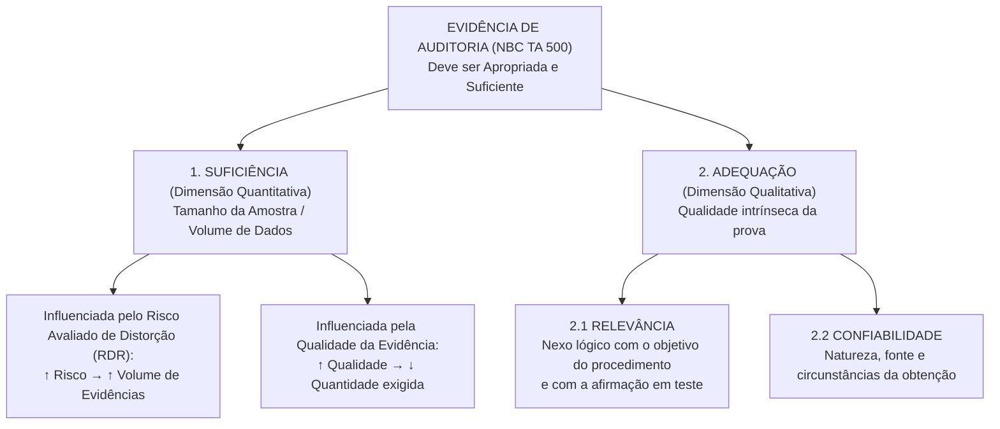
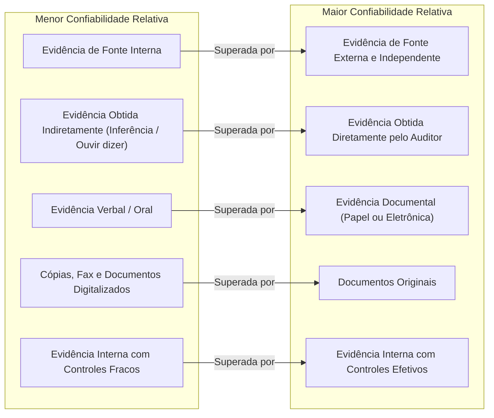
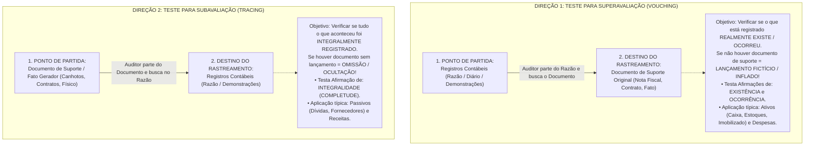

# 04. Evidências de Auditoria, Procedimentos Substantivos e Circularização (NBC TA 500, NBC TA 501, NBC TA 505, NBC TA 520 e NBC TA 330)

> **Resumo Executivo (BLUF):** A evidência de auditoria compreende as informações utilizadas pelo auditor para chegar às conclusões em que se fundamenta a sua opinião. A evidência deve ser **suficiente** (medida quantitativa, influenciada pelo risco avaliado e pela qualidade da prova) e **apropriada** (medida qualitativa = **relevância** para a afirmação testada + **confiabilidade** da fonte). O auditor obtém evidências aplicando **sete procedimentos clássicos**: Inspeção, Observação, Confirmação Externa (Circularização), Recálculo, Reexecução, Procedimentos Analíticos e Indagação. Em resposta aos riscos avaliados (NBC TA 330), o auditor realiza **Testes de Controle** (quando planeja confiar na eficácia operacional dos controles ou quando os procedimentos substantivos isolados são insuficientes) e **Procedimentos Substantivos** (Testes de Detalhes e Procedimentos Analíticos Substantivos), observando a direção dos testes: **Vouching** (do Razão para o Documento $\rightarrow$ testa **Existência / Ocorrência** e combate a **Superavaliação**) vs. **Tracing** (do Documento para o Razão $\rightarrow$ testa **Integralidade** e combate a **Subavaliação**).

---

## 1. O Conceito e a Dupla Dimensão da Evidência de Auditoria (NBC TA 500)

De acordo com o item 5(c) da **NBC TA 500 (R1)**, evidência de auditoria compreende as informações utilizadas pelo auditor para chegar às conclusões em que se fundamenta a sua opinião. A evidência inclui as **informações contidas nos registros contábeis** que suportam as demonstrações contábeis e **outras informações**.

> [!IMPORTANT]
> **A Regra de Ouro da Compensação Quantitativo-Qualitativa (Item A6):**
> A obtenção de mais evidência de auditoria **NÃO COMPENSA a sua má qualidade**! Se uma evidência for de fonte duvidosa, parcial ou irrelevante para a afirmação testada, aumentar o número de cópias ou o volume da amostra não tornará a evidência adequada para suportar a opinião do auditor.

---

## 2. A Hierarquia de Confiabilidade das Evidências (Itens A31 a A35 da NBC TA 500)

Embora a confiabilidade da evidência de auditoria seja influenciada por sua fonte e natureza e dependa das circunstâncias individuais em que é obtida, a NBC TA 500 estabelece **cinco generalizações obrigatórias** que despencam em concursos:

1. **Fonte Externa vs. Fonte Interna:** A confiabilidade da evidência de auditoria é **maior quando obtida de fontes independentes fora da entidade** (ex.: extratos bancários obtidos diretamente do banco, respostas de circularização de clientes e fornecedores).
2. **Eficácia dos Controles Internos da Entidade:** A confiabilidade da evidência gerada internamente é **maior quando os controles relacionados impostos pela entidade, incluindo os controles sobre sua elaboração e manutenção, são efetivos**!
3. **Obtenção Direta pelo Auditor vs. Obtenção Indireta:** A evidência obtida **diretamente pelo auditor** (ex.: contagem física de estoques, observação da execução de um controle, recálculo) é **mais confiável do que a evidência obtida indiretamente ou por inferência** (ex.: indagações sobre a aplicação de um controle).
4. **Forma Documental vs. Forma Verbal:** A evidência em **forma de documentos, seja em papel, meio eletrônico ou outro meio**, é **mais confiável do que evidências verbais/orais** (uma declaração escrita da diretoria é mais confiável que uma conversa informal).
5. **Documentos Originais vs. Cópias:** A evidência fornecida por **documentos originais é mais confiável do que a evidência fornecida por fotocópias, fac-símiles ou documentos que foram filmados, digitalizados ou convertidos** para o formato eletrônico (cuja autenticidade e integridade podem ser alteradas com facilidade).

---

## 3. Os 7 Procedimentos de Obtenção de Evidências (Itens A14 a A25 da NBC TA 500)

O auditor obtém evidências executando procedimentos de avaliação de riscos (NBC TA 315) e procedimentos adicionais de auditoria (NBC TA 330), combinando **sete procedimentos fundamentais**:

| Procedimento | Definição Normativa Exata (NBC TA 500) | Aplica-se como Teste de Controle? | Aplica-se como Teste Substantivo? | Cuidados Críticos em Concursos |
| :--- | :--- | :--- | :--- | :--- |
| **1. Inspeção** | Exame de **registros ou documentos**, internos ou externos, em papel, em formato eletrônico ou em outras mídias, ou o **exame físico de um ativo**. | **Sim** (inspecionar carimbos de autorização, assinaturas em ordens de compra). | **Sim** (inspecionar faturas de compra, escrituras de imóveis, examinar fisicamente máquinas e estoques). | A inspeção de um ativo físico (ex.: máquina) fornece evidência confiável sobre sua **existência**, mas **NÃO necessariamente sobre seus direitos e obrigações (propriedade) ou sobre sua valorização adequada** (pode estar obsoleta ou alienada fiduciariamente)! |
| **2. Observação** | Acompanhamento do **exame de processo ou procedimento sendo executado por outros** (ex.: o auditor observa a contagem de estoques realizada pelo pessoal da entidade ou a execução de atividades de controle). | **Sim** (observar se os funcionários cumprem o procedimento de dupla conferência). | **Sim** (observar o inventário físico da administração). | **Limitação Crítica da Observação:** A evidência é limitada **ao ponto no tempo em que a observação ocorre** e pelo fato de que o ato de ser observado pode **afetar a maneira como o processo é executado** (o funcionário trabalha com mais rigor quando sabe que está sendo observado)! |
| **3. Confirmação Externa (Circularização)** | Evidência obtida como uma **resposta formal por escrito direcionada diretamente ao auditor por um terceiro** (a parte que confirma), em papel, no formato eletrônico ou em outro meio (NBC TA 505). | **Não** (usada precipuamente como procedimento substantivo). | **Sim** (saldos bancários, contas a receber, contas a pagar, estoques em poder de terceiros, termos de acordos e litígios com advogados). | **O auditor deve manter controle absoluto sobre todo o processo de envio e recebimento das respostas!** |
| **4. Recálculo** | Verificação da **exatidão matemática** de documentos ou registros. Pode ser realizado manual ou eletronicamente. | **Não** (procedimento tipicamente substantivo). | **Sim** (recalcular juros a pagar, quotas de depreciação, amortizações, provisões fiscais). | Fornece prova conclusiva sobre exatidão aritmética, mas não garante que as premissas subjacentes ao cálculo estejam corretas. |
| **5. Reexecução** | Execução **independente pelo auditor** de procedimentos ou controles que foram originalmente realizados como parte do controle interno da entidade. | **Sim** (reexecutar a conciliação bancária mensal que o departamento financeiro afirma ter feito). | **Não** (focado na eficácia operacional dos controles internos). | É um procedimento rigoroso de teste de controle que testa diretamente o funcionamento do controle interno. |
| **6. Procedimentos Analíticos** | Avaliação das informações contábeis por meio de **análise das relações plausíveis entre dados financeiros e não financeiros** (NBC TA 520). Inclui a investigação de flutuações e relações identificadas que sejam inconsistentes com outras informações relevantes ou que difiram significativamente dos valores previstos. | **Não** (não testa funcionamento de controles). | **Sim** (Procedimentos Analíticos Substantivos: análise horizontal, vertical, testes de razoabilidade, regressão). | Obrigatórios no **planejamento** (NBC TA 315) e na **revisão geral final** (NBC TA 520); facultativos como procedimentos substantivos na execução. |
| **7. Indagação** | **Busca de informações** junto a pessoas com conhecimento, financeiro ou não financeiro, dentro ou fora da entidade. Varia desde indagações formais por escrito até conversas orais informais. | **Sim** (indagar sobre como o funcionário realiza a conferência de notas). | **Sim** (indagar à diretoria sobre a existência de litígios não provisionados ou planos operacionais futuros). | **Regra de Ouro (Item A25):** A indagação é amplamente usada, mas **a indagação isolada NÃO FORNECE EVIDÊNCIA SUFICIENTE E APROPRIADA** para detectar uma distorção relevante no nível da afirmação nem para testar a eficácia operacional dos controles! Deve ser corroborada com outros procedimentos. |

---

## 4. Resposta do Auditor aos Riscos Avaliados: NBC TA 330

A **NBC TA 330** estabelece que o auditor deve desenhar e implementar procedimentos de auditoria cuja natureza, época e extensão respondam aos riscos avaliados de distorção relevante.

### 4.1 Respostas Globais vs. Procedimentos Adicionais
* **Respostas Globais (Nível das Demonstrações Contábeis):** Quando os riscos são disseminados (ex.: diretoria antiética, ambiente de controle fraco), o auditor adota respostas globais:
  1. Enfatizar à equipe a necessidade de manter o **ceticismo profissional**;
  2. Designar **pessoal mais experiente** ou com habilidades especiais (incluindo especialistas);
  3. Proporcionar **supervisão mais intensa**;
  4. Incorporar elementos adicionais de **imprevisibilidade** na seleção dos procedimentos de auditoria (ex.: visitar filiais sem aviso prévio, testar contas de baixo valor);
  5. Fazer mudanças gerais na natureza, época ou extensão dos procedimentos de auditoria.
* **Procedimentos Adicionais (Nível das Afirmações):** Dividem-se em **Testes de Controle** e **Procedimentos Substantivos**.

---

### 4.2 Testes de Controle: Quando são Obrigatórios e Regras de Rotação (Itens 8 a 17)
O auditor **DEVE** desenhar e aplicar **Testes de Controle** em apenas **duas situações**:
1. Quando a avaliação de riscos de distorção relevante feita pelo auditor no nível das afirmações inclui uma **expectativa de que os controles estão operando de maneira efetiva** (ou seja, o auditor planeja confiar nos controles para reduzir a extensão dos testes substantivos); **OU**
2. Quando **procedimentos substantivos isolados NÃO podem fornecer evidência de auditoria apropriada e suficiente** no nível das afirmações (situação comum em empresas altamente informatizadas com processamento de transações sem documentação em papel / *paperless*).

#### Uso de Evidências de Controle Obtidas em Auditorias Anteriores (Rotação de Controles — Item 14)
Se o auditor planeja usar evidências obtidas em auditorias anteriores sobre a eficácia de controles:
1. O auditor deve testar os controles se tiverem ocorrido **mudanças significativas** desde a auditoria anterior.
2. Se **não tiverem ocorrido mudanças**, o auditor deve testar a eficácia operacional de tais controles **pelo menos uma vez a cada três auditorias** (ciclo de rotação trienal)! Em cada auditoria, deve ser testada uma parte dos controles.
3. **Proibição Absoluta de Rotação para Riscos Significativos (Item 15):** Se o auditor planeja confiar em controles sobre um **risco avaliado como SIGNIFICATIVO**, o auditor **DEVE testar a eficácia desses controles NO PERÍODO CORRENTE**! É terminantemente vedado utilizar evidências de auditorias passadas em riscos significativos.

---

### 4.3 Procedimentos Substantivos e a Direção dos Testes: Superavaliação vs. Subavaliação

> [!CAUTION]
> **Obrigação Imperativa Universal (NBC TA 330, Item 18):**
> Independentemente dos riscos avaliados de distorção relevante, **o auditor DEVE planejar e executar procedimentos substantivos para cada classe de transações, saldo de contas e divulgação RELEVANTE!** O auditor jamais pode se apoiar 100% apenas em testes de controle.

---

## 5. Confirmações Externas (Circularização): Dissecação da NBC TA 505

A **NBC TA 505** disciplina o processo de confirmação externa, que consiste na obtenção direta pelo auditor de uma declaração por escrito de um terceiro independente (bancos, clientes, fornecedores, advogados).

### 5.1 O Controle Absoluto do Auditor sobre o Processo (Item 7)
Ao usar procedimentos de confirmação externa, o auditor **deve manter o controle sobre os pedidos de confirmação externa**, incluindo:
1. Determinar as informações a serem confirmadas ou solicitadas;
2. Selecionar as partes que confirmam apropriadas;
3. Desenhar os pedidos de confirmação, incluindo a verificação de que os pedidos foram **corretamente endereçados e contêm informações para que as respostas sejam enviadas diretamente ao auditor**; e
4. **Enviar os pedidos diretamente**, incluindo pedidos de acompanhamento (*follow-up*), se aplicável, à parte que confirma.

---

### 5.2 Tipos de Pedidos de Confirmação: Positiva vs. Negativa

| Tipo de Pedido | Conceito Normativo (NBC TA 505, Item 6) | Subespécies e Dinâmica Operacional | Valor Probatório e Requisitos de Uso |
| :--- | :--- | :--- | :--- |
| **Confirmação Positiva** | Solicitação de que a parte que confirma responda **diretamente ao auditor em todos os casos**, indicando se concorda ou discorda das informações, ou fornecendo as informações solicitadas. | **(a) Em Preto:** O auditor já preenche o saldo nos papéis de confirmação e pede para o terceiro confirmar se está correto. **(b) Em Branco:** O auditor deixa o espaço do saldo em branco para que o terceiro preencha o valor existente em seus livros. | Fornece **evidência de auditoria altamente confiável**. • *Risco do pedido em preto:* A parte que confirma pode assinar e devolver sem conferir seus livros contábeis. • *Risco do pedido em branco:* Pode resultar em **taxas de resposta mais baixas**, pois exige esforço adicional da parte que confirma para levantar o dado. |
| **Confirmação Negativa** | Solicitação de que a parte que confirma responda **diretamente ao auditor APENAS se discordar** das informações fornecidas no pedido! | Se o auditor enviar o pedido e o terceiro **não responder**, o auditor presume que o saldo está correto. | Fornece **evidência de auditoria substancialmente MENOS persuasiva** que a confirmação positiva (a falta de resposta pode significar concordância, mas também pode significar que a carta foi extraviada, esquecida na gaveta ou que o destinatário mudou de endereço!). |

#### Os 4 Requisitos Cumulativos para Uso da Confirmação Negativa como Procedimento Substantivo Único (Item 15)
O auditor **NÃO DEVE** utilizar pedidos de confirmação negativa como o único procedimento substantivo de auditoria para tratar um risco avaliado de distorção relevante no nível da afirmação, **A MENOS QUE TODAS as quatro condições a seguir estejam presentes cumulativamente (`B - P - D - C`)**:
1. O auditor avaliou o risco de distorção relevante como **BAIXO** e obteve evidência apropriada e suficiente sobre a eficácia operacional dos controles relevantes para a afirmação;
2. A população de itens sujeitos a procedimentos de confirmação negativa compreende um **grande número de saldos de contas ou transações pequenas e homogêneas**;
3. É esperada uma **taxa de distorção muito baixa**; e
4. O auditor **não tem conhecimento de circunstâncias ou condições que fariam com que os destinatários dos pedidos de confirmação negativa desconsiderassem tais pedidos**!

---

### 5.3 Recusa da Administração em Permitir a Circularização (Itens 8 e 9)
Se a administração se recusar a permitir que o auditor envie um pedido de confirmação externa:
1. O auditor deve **indagar sobre as razões da administração para a recusa** e procurar evidência sobre a sua validade e razoabilidade (ex.: disputa judicial em andamento com o credor);
2. O auditor deve **avaliar as implicações da recusa da administração** sobre a avaliação dos riscos de distorção relevante feita pelo auditor, incluindo o risco de fraude, e sobre a natureza, a época e a extensão de outros procedimentos de auditoria; e
3. O auditor deve executar **procedimentos alternativos de auditoria** desenhados para obter evidência apropriada e suficiente.

> [!WARNING]
> **Consequência da Recusa Injustificada da Administração (Item 9):**
> Se o auditor concluir que a recusa da administração em permitir o envio da circularização **NÃO É RAZOÁVEL**, ou o auditor não puder obter evidência apropriada e suficiente por meio de procedimentos alternativos:
> * O auditor deve **comunicar o fato aos responsáveis pela governança** (NBC TA 260); e
> * O auditor deve **determinar as implicações para a auditoria e para a opinião no relatório do auditor**, de acordo com a **NBC TA 705 (Ressalva ou Abstenção de Opinião por Limitação de Escopo)**!

---

### 5.4 Tratamento de Não Respostas em Pedidos de Confirmação Positiva (Item 12)
Em cada caso de não resposta a um pedido de confirmação positiva, o auditor **DEVE executar procedimentos alternativos de auditoria** para obter evidência apropriada e suficiente:
* **Para contas a receber:** Examinar recebimentos de caixa subsequentes específicos (extratos bancários que comprovem o pagamento pelo cliente após a data do balanço), guias de remessa e documentação de expedição de mercadorias.
* **Para contas a pagar:** Examinar pagamentos subsequentes, correspondências de terceiros e outros registros, como notas de recebimento de mercadorias (*goods received notes*).

---

## 6. Procedimentos Analíticos Substantivos: Dissecação da NBC TA 520

A **NBC TA 520** disciplina o uso de procedimentos analíticos, que consistem na avaliação de informações financeiras por meio da análise das relações plausíveis entre dados financeiros e não financeiros.

### 6.1 Os Quatro Passos para Desenhar Procedimentos Analíticos Substantivos (Item 5)
Ao desenhar e executar procedimentos analíticos substantivos, isoladamente ou combinados com testes de detalhes, o auditor deve:
1. **Determinar a adequação dos procedimentos analíticos substantivos** específicos para as afirmações testadas (são mais eficazes para grandes volumes de transações previsíveis ao longo do tempo, como despesas de folha de pagamento, juros e aluguéis);
2. **Avaliar a confiabilidade dos dados** a partir dos quais a expectativa do auditor sobre valores registrados ou índices é desenvolvida (considerando a fonte, comparabilidade, natureza e relevância dos dados, e controles sobre sua elaboração);
3. **Desenvolver uma expectativa sobre os valores registrados ou índices** e avaliar se a expectativa é suficientemente precisa para identificar uma distorção relevante; e
4. **Determinar o valor de qualquer diferença aceitável** entre os valores registrados e os valores previstos sem que seja necessária investigação adicional.

### 6.2 Investigação de Resultados Inesperados (Item 7)
Se os procedimentos analíticos identificarem flutuações ou relações que sejam inconsistentes com outras informações relevantes ou que difiram dos valores previstos por um valor significativo, o auditor **DEVE investigar essas diferenças**:
* **(a)** **Indagando à administração** e obtendo evidência de auditoria apropriada e suficiente relevante para as respostas da administração; e
* **(b)** Executando **outros procedimentos de auditoria** conforme necessário nas circunstâncias.

---

## 7. Evidências em Itens Específicos: Estoques e Litígios (NBC TA 501)

A **NBC TA 501** trata de considerações específicas para a obtenção de evidências suficientes e apropriadas em relação a três áreas: **Estoques**, **Litígios e Reclamações** e **Informações por Segmentos**.

### 7.1 Acompanhamento da Contagem Física de Estoques (Itens 4 a 8)
Se o estoque for relevante para as demonstrações contábeis, o auditor **DEVE obter evidência sobre a sua EXISTÊNCIA e CONDIÇÃO FÍSICA** por meio do:
* **Acompanhamento da contagem física de estoques**, a menos que isso seja **impraticável**!
* **Deveres do Auditor durante o Acompanhamento:**
  1. Avaliar as instruções e procedimentos da administração para registrar e controlar os resultados da contagem física;
  2. Observar o cumprimento dos procedimentos de contagem da administração;
  3. Inspecionar o estoque (para identificar itens danificados ou obsoletos); e
  4. Executar **contagens de teste** (*test counts*), rastreando itens das folhas de contagem para o estoque físico e itens do estoque físico para as folhas de contagem (testando simultaneamente existência e integralidade).

#### Situações Especiais de Contagem de Estoque
1. **Contagem Realizada em Data Diferente da Data das Demonstrações Contábeis (Item 5):** Se a contagem física for realizada em data diferente da data do balanço (ex.: inventário rotativo ou contagem em novembro), o auditor deve executar procedimentos adicionais para obter evidências sobre se as **mudanças no estoque entre a data da contagem e a data das demonstrações contábeis foram adequadamente registradas** (testes de compras, vendas e corte / *cut-off* no período intermediário).
2. **Impraticabilidade do Acompanhamento Presencial (Item 7):** Apenas circunstâncias extremas caracterizam impraticabilidade (ex.: armazém situado em zona de guerra ou substâncias químicas altamente tóxicas sem acesso seguro). **A simples dificuldade, tempo ou custo de viagem NÃO caracterizam impraticabilidade!** Caso seja de fato impraticável, o auditor deve executar **procedimentos alternativos** (inspeção de documentação da venda subsequente). Se não for possível obter evidência suficiente por procedimentos alternativos, o auditor deve **modificar a opinião (Ressalva ou Abstenção)** por limitação de escopo!

---

### 7.2 Litígios e Reclamações Envolvendo a Entidade (Itens 9 e 10)
O auditor deve desenhar procedimentos para identificar litígios e reclamações envolvendo a entidade que possam criar risco de distorção relevante:
1. **Carta de Indagação aos Assessores Jurídicos Externos (Advogados):** O auditor deve solicitar que a administração elabore e envie uma **carta geral ou específica de indagação aos advogados externos**, solicitando que estes respondam **diretamente ao auditor** sobre a probabilidade de perda (provável, possível ou remota) e a estimativa do valor financeiro das contingências.
2. **Se a Administração se recusar a permitir a comunicação com os advogados, ou se o advogado se recusar a responder:** O auditor fica impedido de obter evidência apropriada e suficiente, devendo **modificar a opinião no seu relatório (Ressalva ou Abstenção de Opinião)** nos termos da NBC TA 705!

---

## 8. Mnemônicos & Âncoras de Memória

| Gatilho / Alvo de Prova | Mnemônico / Regra de Bolso | Decodificação Rápida |
| :--- | :--- | :--- |
| **Os 7 Procedimentos de Auditoria** | **I - O - C - R - R - P - I** | **I**nspeção + **O**bservação + **C**onfirmação Externa + **R**ecálculo + **R**eexecução + **P**rocedimentos Analíticos + **I**ndagação. |
| **Hierarquia de Confiabilidade** | **Ext > Int | Dir > Ind | Doc > Verb | Orig > Cópia** | Evidência Externa supera Interna; Direta supera Indireta; Documental supera Verbal; Original supera Cópia. |
| **Direção dos Testes** | **Vouching = Razão $\rightarrow$ Doc (EXISTÊNCIA / $\uparrow$)** **Tracing = Doc $\rightarrow$ Razão (INTEGRALIDADE / $\downarrow$)** | Partir do Razão busca superavaliação (Ativo/Despesa). Partir do Documento busca omissão/subavaliação (Passivo/Receita). |
| **Confirmação Negativa (4 Requisitos)** | **B - P - D - C** *(Só vale se tiver os 4 juntos!)* | Risco **B**aixo + Grande número de **P**equenos saldos homogêneos + Taxa esperada de **D**istorção muito baixa + Sem motivo para o cliente **C**ontestar/ignorar. |
| **Rotação de Controles (NBC TA 330)** | **1 vez a cada 3 anos (Sem Mudança)** **Risco Significativo = TODO ANO!** | Controles normais podem ser rotacionados em até 3 auditorias. Controles sobre Riscos Significativos exigem teste obrigatório no **período corrente**! |

---

## 9. Bateria de Questões Oficiais Comentadas Alternativa por Alternativa

### Questão 01 — Q4221421 — [FCC — SEFAZ-CE / Auditor Fiscal da Receita Estadual — 2026]
> **Link QC:** [Q4221421](https://www.qconcursos.com/questoes-de-concursos/questoes/78970081-91)

Durante a auditoria das demonstrações contábeis de uma indústria sujeita à apuração do ICMS, o auditor independente selecionou amostra de notas fiscais eletrônicas de saída para verificar:
• a correta aplicação das alíquotas interestaduais;
• a adequada escrituração na EFD ICMS/IPI;
• e a consistência entre os documentos fiscais e os registros contábeis de receita.

Na definição dos testes, o auditor utilizou técnica de amostragem para examinar apenas parte da população de documentos fiscais, considerando o risco de distorção relevante associado às operações tributárias da entidade.

De acordo com a NBC TA 530,
* **A)** a amostragem em auditoria exige necessariamente o uso de métodos estatísticos e seleção aleatória formal da amostra.
* **B)** o risco de amostragem ocorre quando o auditor deixa de aplicar testes substantivos.
* **C)** o risco de amostragem decorre exclusivamente da utilização inadequada de procedimentos substantivos pelo auditor.
* **D)** o risco de amostragem corresponde ao risco de que a conclusão do auditor, obtida com base na amostra, seja diferente daquela que seria alcançada caso toda a população fosse submetida ao mesmo procedimento de auditoria.
* **E)** a utilização de sistema ERP integrado elimina o risco de amostragem nos testes de auditoria relacionados ao ICMS.

#### Gabarito Oficial e Dissecação Técnica: **Alternativa D**
* **Análise da Alternativa A (Incorreta):** A amostragem em auditoria pode ser estatística ou não estatística (NBC TA 530, item 5(g)).
* **Análise das Alternativas B e C (Incorretas):** A aplicação inadequada de procedimentos decorre do risco não resultante da amostragem (erro humano ou falha técnica).
* **Análise da Alternativa D (Correta):** Definição literal de **Risco de Amostragem** prevista no item 5(c) da NBC TA 530: o risco de que a conclusão do auditor baseada em amostra seja diferente daquela que seria alcançada se toda a população fosse submetida ao mesmo procedimento.
* **Análise da Alternativa E (Incorreta):** A existência de ERP não elimina o risco de amostragem quando o auditor opta por testar menos de 100% dos itens da população.

---

### Questão 02 — Q4368114 — [FGV — CFC / Exame de Qualificação Técnica Geral (QTG) — 2026]
> **Link QC:** [Q4368114](https://www.qconcursos.com/questoes-de-concursos/questoes/0b86a87e-c3)

De acordo com a NBC TA 500 – Evidência de Auditoria, o auditor independente deve planejar e executar procedimentos de auditoria apropriados nas circunstâncias com o objetivo de obter evidência de auditoria suficiente e apropriada.

Sobre os procedimentos de obtenção de evidência de auditoria, assinale a afirmativa correta:
* **A)** A observação de procedimentos de contagem de estoques realizada pelo pessoal da entidade fornece evidência de auditoria com validade irrestrita para todo o exercício social subsequente.
* **B)** A indagação aos funcionários da entidade fornece evidência conclusiva e suficiente para fundamentar a opinião do auditor, dispensando a aplicação de outros procedimentos adicionais.
* **C)** A confirmação externa em formato negativo oferece nível de segurança idêntico à confirmação positiva, não exigindo quaisquer requisitos especiais para sua adoção exclusiva.
* **D)** O recálculo envolve a conferência da integridade documental de processos físicos de contratação de serviços por amostragem.
* **E)** A evidência de auditoria obtida diretamente pelo auditor, em formato documental e a partir de fontes externas independentes, possui confiabilidade superior à evidência obtida indiretamente ou de fontes internas.

#### Gabarito Oficial e Dissecação Técnica: **Alternativa E**
* **Análise da Alternativa A (Incorreta):** A observação limita-se ao ponto no tempo em que ocorre e pode ser afetada pelo fato de o pessoal estar sendo observado (item A17 da NBC TA 500).
* **Análise da Alternativa B (Incorreta):** A indagação isolada não fornece evidência suficiente e apropriada para detectar distorção relevante nem para testar eficácia operacional de controles (item A25 da NBC TA 500).
* **Análise da Alternativa C (Incorreta):** A confirmação negativa fornece evidência consideravelmente menos persuasiva e só pode ser usada como procedimento substantivo único se atendidas cumulativamente quatro condições estritas (NBC TA 505, item 15).
* **Análise da Alternativa D (Incorreta):** O recálculo consiste na verificação da **exatidão matemática** de documentos ou registros (item A19 da NBC TA 500).
* **Análise da Alternativa E (Correta):** Sintetiza perfeitamente as regras de ouro da hierarquia de confiabilidade da NBC TA 500: prova direta, documental e de fonte externa independente é o padrão mais alto de confiabilidade probatória.

---

### Questão 03 — Q4146446 — [Quadrix — CREF - 11ª Região (MS-MT) / Analista Contábil — 2026]
> **Link QC:** [Q4146446](https://www.qconcursos.com/questoes-de-concursos/questoes/74fe27c3-74)

Suponha‑se que, durante o planejamento de um trabalho de auditoria, o auditor tenha identificado deficiências relevantes nos controles internos relacionados à autorização de compras e ao registro de fornecedores, avaliando como elevado o risco de controle nessa área. Nesse caso, é correto afirmar que, em razão dessa avaliação, decidiu‑se aumentar o tamanho da amostra e ampliar os testes substantivos aplicados às transações e aos saldos correspondentes, sob o entendimento de que essa ampliação reduziria o risco de controle identificado.
* **C)** Certo
* **E)** Errado

#### Gabarito Oficial e Dissecação Técnica: **Errado (E)**
* **Fundamentação Técnica:** Pegadinha clássica e interdisciplinar sobre o modelo de riscos da NBC TA 200 e NBC TA 330! O auditor amplia os testes substantivos para **reduzir o RISCO DE DETECÇÃO ($RD$)**, e **NÃO para reduzir o Risco de Controle ($RC$)**! O Risco de Controle é uma característica inerente ao sistema de controles mantido pela Administração da entidade auditada; os procedimentos substantivos executados pelo auditor não têm o condão de alterar ou consertar os controles internos deficientes da empresa. Portanto, o item está **ERRADO**.

---

### Questão 04 — Q4371091 — [FGV / Ibrafc — Auditoria Fiscal]
> **Link QC:** [Q4371091](https://www.qconcursos.com/questoes-de-concursos/questoes/ddeb1c2d-c6)

Em auditoria numa clínica de fisioterapia, o fiscal suspeita que parte das sessões realizadas não foi faturada nem escriturada como receita. Para que a evidência obtida responda a esse risco, o fiscal precisa definir de onde parte a seleção dos itens a examinar. Nesse caso, assinale a alternativa que descreve o procedimento CORRETO.
* **A)** Partir das fichas de atendimento e das agendas de sessões e rastrear cada registro até a nota fiscal emitida e o correspondente lançamento de receita.
* **B)** Circularizar os pacientes que figuram no contas a receber, solicitando resposta escrita dirigida ao fiscal sobre os saldos em aberto no período.
* **C)** Recalcular o imposto devido sobre as notas fiscais emitidas e confrontar o total apurado com as guias de recolhimento efetivamente pagas no mesmo período.
* **D)** Confrontar o total das notas fiscais emitidas com a receita escriturada no Razão, conciliando mês a mês as diferenças entre esses registros.
* **E)** Tomar os lançamentos de receita do Razão e rastrear cada um até a nota fiscal emitida, a ficha de atendimento e a agenda de sessões correspondentes.

#### Gabarito Oficial e Dissecação Técnica: **Alternativa A**
* **Análise da Alternativa A (Correta):** A suspeita é de **omissão de receita / faturamento sem nota (subavaliação de receita)**. Para testar a **integralidade (completude)** e flagrar a subavaliação, a direção do teste deve ser obrigatoriamente de **TRACING (Rastreamento)**: partir do **fato gerador físico/operacional** (as fichas de atendimento e agendas de sessões realizadas) e verificar se cada atendimento foi formalmente emitido na nota fiscal e lançado no Razão como receita. Se a sessão existiu na ficha, mas não tem nota/lançamento, o Fisco aponta a omissão de receita!
* **Análise da Alternativa E (Incorreta):** Tomar os lançamentos de receita do Razão e buscar os documentos (Vouching) serve apenas para testar a **existência/superavaliação**. Se a clínica atendeu 1.000 pacientes no "caixa dois" e só lançou 200 no Razão, todos os 200 do Razão terão fichas perfeitas, e o auditor que parte do Razão jamais descobrirá os 800 pacientes omitidos!
* **Análise das Alternativas B, C e D (Incorretas):** A circularização do contas a receber examina saldos já contabilizados, o recálculo sobre notas já emitidas não detecta serviços sem nota, e conciliar notas com o Razão só pega divergências de escrituração entre documentos fiscais emitidos e a contabilidade.

---

### Questão 05 — Q4368126 — [FGV — CFC / Exame de Qualificação Técnica Geral (QTG) — 2026]
> **Link QC:** [Q4368126](https://www.qconcursos.com/questoes-de-concursos/questoes/0b9e2ca4-c3)

A Companhia Beta S.A. solicita a contratação de auditor independente para auditar suas demonstrações contábeis. Na reunião prévia, a administração informa que:
• A auditoria será feita conforme a estrutura de relatório financeiro exigida por lei/regulamento aplicável.
• Por política interna, não permitirá que o auditor tenha acesso a determinados documentos de suporte de receitas e não autorizará contato com algumas áreas operacionais, embora reconheça que isso pode limitar o alcance.
• Não concorda em reconhecer, na carta de contratação, a responsabilidade pelo controle interno e por fornecer acesso a todas as informações e pessoas necessárias à auditoria.

O auditor conclui que a limitação imposta provavelmente resultará em abstenção de opinião.

Ao ser alertada sobre os efeitos dessas restrições, propõe substituir a auditoria por uma revisão, sem apresentar mudança relevante de circunstâncias, alegando apenas que deseja evitar impacto no relatório.

Com base exclusivamente na NBC TA 210 (R1) - CONCORDÂNCIA COM OS TERMOS DO TRABALHO DE AUDITORIA, a conduta correta do auditor é
* **A)** recusar o trabalho, pois há limitação de alcance imposta antes da aceitação com provável abstenção de opinião; a administração não reconhece as responsabilidades exigidas, controle interno e acesso a informações/pessoas; e não há justificativa razoável para mudar o tipo de trabalho de auditoria para revisão. Se a continuidade for inviabilizada, avaliar retirada e comunicações cabíveis.
* **B)** aceitar o trabalho, pois a estrutura é exigida por lei/regulamento, dispensando qualquer forma de concordância por escrito.
* **C)** aceitar o trabalho, registrando na carta de contratação que haverá limitação de alcance e que o relatório será, se necessário, emitido com abstenção de opinião.
* **D)** aceitar a mudança para revisão, pois, diante de limitação de alcance, é sempre justificável reduzir o nível de asseguração para concluir o trabalho.
* **E)** aceitar o trabalho e, por se tratar de auditoria recorrente, dispensar a reavaliação dos termos, mantendo os do período anterior.

#### Gabarito Oficial e Dissecação Técnica: **Alternativa A**
* **Análise da Alternativa A (Correta):** Sintetiza com precisão cirúrgica três regras imperativas da NBC TA 210:
  1. **Limitação de Escopo Prévia (Item 7):** Se a administração impõe uma limitação de alcance nos termos de um trabalho proposto que o auditor acredita que resultará em abstenção de opinião, o auditor **NÃO DEVE aceitar esse trabalho limitado**, a menos que exigido por lei;
  2. **Condições Prévias (Item 6):** A administração recusa-se a reconhecer suas responsabilidades básicas (controle interno e fornecimento irrestrito de informações e acesso a pessoas);
  3. **Mudança de Termos do Trabalho (Item 14):** Se, antes da conclusão do trabalho de auditoria, o auditor for solicitado a mudar o trabalho para um que forneça menor nível de asseguração (revisão), o auditor deve determinar se há **justificativa razoável** para isso. Evitar impacto no relatório por causa de limitações ilegítimas de escopo **não é justificativa razoável**! Logo, a conduta correta é a **recusa imediata** do trabalho.

---

### Questão 06 — Q4368116 — [FGV — CFC / Exame de Qualificação Técnica Geral (QTG) — 2026]
> **Link QC:** [Q4368116](https://www.qconcursos.com/questoes-de-concursos/questoes/0b8a86c6-c3)

No processo de auditoria, o auditor independente pode recorrer ao trabalho de um especialista para obter evidências apropriadas em áreas que exigem conhecimentos técnicos específicos que vão além da contabilidade e auditoria. Esse especialista pode ser um profissional ou uma organização com expertise em assuntos como avaliação de ativos, cálculos atuariais, estimativas de passivos ambientais, entre outros.

Dessa forma, de acordo com a NBC TA 620 – UTILIZAÇÃO DO TRABALHO DE ESPECIALISTAS, antes de decidir utilizar o trabalho de um especialista, o auditor deve, obrigatoriamente, avaliar se
* **A)** o especialista possui conhecimento técnico apropriado e está devidamente registrado em órgãos reguladores de auditoria.
* **B)** o auditor pode se eximir da responsabilidade sobre a opinião da auditoria caso tenha seguido todos os requisitos normativos para a avaliação do trabalho do especialista.
* **C)** o trabalho do especialista pode substituir a necessidade de o auditor aplicar procedimentos de auditoria adicionais sobre a área específica analisada.
* **D)** a metodologia utilizada pelo especialista é apropriada para o objetivo da auditoria, e as conclusões apresentadas são consistentes com outras evidências de auditoria disponíveis.
* **E)** a responsabilidade final pelo relatório de auditoria pode ser transferida para o especialista, desde que seu trabalho esteja devidamente documentado e validado.

#### Gabarito Oficial e Dissecação Técnica: **Alternativa D**
* **Análise das Alternativas B e E (Incorretas):** O auditor tem responsabilidade **única e exclusiva** pela opinião expressa, e essa responsabilidade **não é reduzida nem transferida** pela utilização do trabalho de um especialista (item 3 da NBC TA 620).
* **Análise da Alternativa D (Correta):** Conforme o item 12 da NBC TA 620, o auditor deve avaliar a **adequação do trabalho do especialista** como evidência de auditoria para a afirmação relevante, incluindo: (1) a relevância e razoabilidade das constatações ou conclusões do especialista e sua **consistência com outras evidências de auditoria**; e (2) a relevância e razoabilidade de premissas e métodos significativos utilizados pelo especialista.

---

### Questão 07 — Q4368140 — [FGV — CFC / Comissão de Valores Mobiliários (CVM) — 2026]
> **Link QC:** [Q4368140](https://www.qconcursos.com/questoes-de-concursos/questoes/1f48d994-c3)

A NBC TA 540 (R2) trata das responsabilidades do auditor na auditoria de estimativas contábeis, inclusive as de valor justo, requerendo respostas proporcionais aos riscos avaliados no nível de afirmações, com foco nas razões do risco, no ceticismo profissional e na documentação.

Na auditoria das demonstrações contábeis de uma companhia aberta, o auditor avaliou como risco significativo a estimativa de perda esperada de crédito (ECL), em razão de elevada incerteza de estimativa e do uso de modelo complexo. O auditor pretende confiar em controles relevantes do processo de elaboração da estimativa.

Durante a execução dos procedimentos, o auditor concluiu que a administração não tomou providências apropriadas para entender e tratar a incerteza da estimativa nas divulgações relacionadas.

À luz da NBC TA 540 (R2), avalie se as assertivas a seguir estão corretas:

I. Para risco significativo relacionado com estimativa contábil, quando o auditor pretende confiar em controles relevantes, os procedimentos adicionais de auditoria devem incluir testes da eficácia operacional desses controles no período corrente.
II. Quando a administração não tiver tomado providências apropriadas para entender ou tratar a incerteza da estimativa, inclusive nas divulgações relacionadas, o auditor deve requerer que a administração adote medidas apropriadas, inclusive reconsiderar a estimativa pontual e/ou fornecer divulgações adicionais e avaliar a resposta. Se a resposta não for suficiente, o auditor deve desenvolver, na extensão praticável, estimativa pontual ou intervalo do auditor, e considerar as implicações para a auditoria e para o relatório, incluindo comunicações aos responsáveis pela governança, conforme aplicável.
III. Caso o auditor desenvolva estimativa pontual ou por intervalo, ele pode fazê-lo sem avaliar a adequação dos métodos, premissas e dados, pois se trata de estimativa elaborada pelo próprio auditor.
IV. O auditor deve incluir na documentação de auditoria, entre outros: (a) a relação entre os procedimentos adicionais executados e os riscos avaliados no nível de afirmações, considerando as razões do risco; e (b) as respostas do auditor quando a administração não tiver tomado providências apropriadas para entender e tratar a incerteza da estimativa, inclusive quanto às divulgações relacionadas.

Estão corretas as afirmativas
* **A)** I e II, apenas.
* **B)** II e III, apenas.
* **C)** I, II e IV, apenas.
* **D)** I, III e IV, apenas.
* **E)** I, II, III e IV.

#### Gabarito Oficial e Dissecação Técnica: **Alternativa C**
* **Assertiva I (Correta):** Se o risco for significativo e o auditor planejar confiar em controles, a NBC TA 330 (item 15) e a NBC TA 540 exigem testes de controle no **período corrente** (vedada a rotação de anos anteriores).
* **Assertiva II (Correta):** Reproduz literalmente a exigência da NBC TA 540 (item 26 e 28): indagar e exigir medidas da administração e, se insuficiente, desenvolver estimativa pontual ou intervalo do auditor.
* **Assertiva III (Incorreta):** Quando o auditor desenvolve estimativa pontual ou por intervalo, o item 29 da norma exige expressamente que ele **avalie a adequação dos métodos, premissas e dados utilizados**!
* **Assertiva IV (Correta):** Exigência documental imperativa da NBC TA 540 (item 39). Logo, estão corretas apenas **I, II e IV** (**Alternativa C**).

---

### Questão 08 — Q4375831 — [QConcursos / Banca Oficial — Auditoria — 2026]
> **Link QC:** [Q4375831](https://www.qconcursos.com/questoes-de-concursos/questoes/fcb11895-c7)

Na fase de execução de uma auditoria conduzida pela unidade de controle interno, os procedimentos aplicados e os registros produzidos cumprem funções específicas e não se substituem entre si. Associe cada elemento da Coluna I à descrição correspondente da Coluna II:

Coluna I
1. Papéis de trabalho.
2. Testes de observância.
3. Testes substantivos.
4. Amostragem.

Coluna II
(__) Procedimentos voltados à obtenção de evidência quanto à suficiência, à exatidão e à validade dos dados produzidos pelos sistemas de informações da entidade.
(__) Documentos e registros dos fatos, das informações e das provas obtidos no curso do exame, que dão suporte à opinião, às críticas e às recomendações emitidas.
(__) Aplicação de procedimentos a menos da totalidade dos itens de uma população, de modo que o resultado obtido permita conclusão sobre o conjunto examinado.
(__) Procedimentos voltados à obtenção de razoável segurança de que os controles internos estabelecidos pela administração estão em efetivo funcionamento.

Assinale a alternativa que apresenta a associação correta, de cima para baixo:
* **A)** 4, 2, 3, 1.
* **B)** 1, 4, 2, 3.
* **C)** 2, 3, 1, 4.
* **D)** 3, 1, 4, 2.

#### Gabarito Oficial e Dissecação Técnica: **Alternativa D**
* **1º Parêntese (3 - Testes Substantivos):** Procedimentos voltados à obtenção de evidência quanto à suficiência, exatidão e validade dos dados produzidos pelos sistemas contábeis da entidade.
* **2º Parêntese (1 - Papéis de Trabalho):** Documentos e registros dos fatos, informações e provas obtidos que dão suporte à opinião e recomendações.
* **3º Parêntese (4 - Amostragem):** Aplicação de procedimentos a menos de 100% dos itens da população para permitir conclusões sobre o todo.
* **4º Parêntese (2 - Testes de Observância):** Procedimentos voltados a obter segurança razoável de que os controles internos estão em efetivo funcionamento e cumprimento operacional. A sequência correta é **3, 1, 4, 2** (**Alternativa D**).
