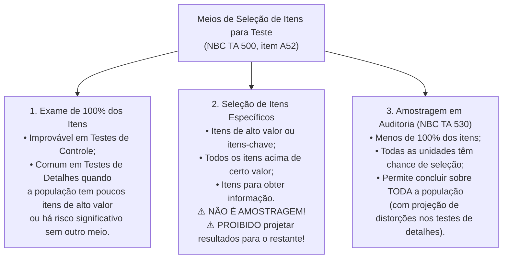
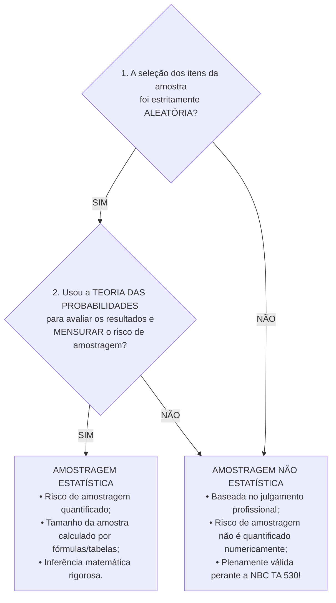
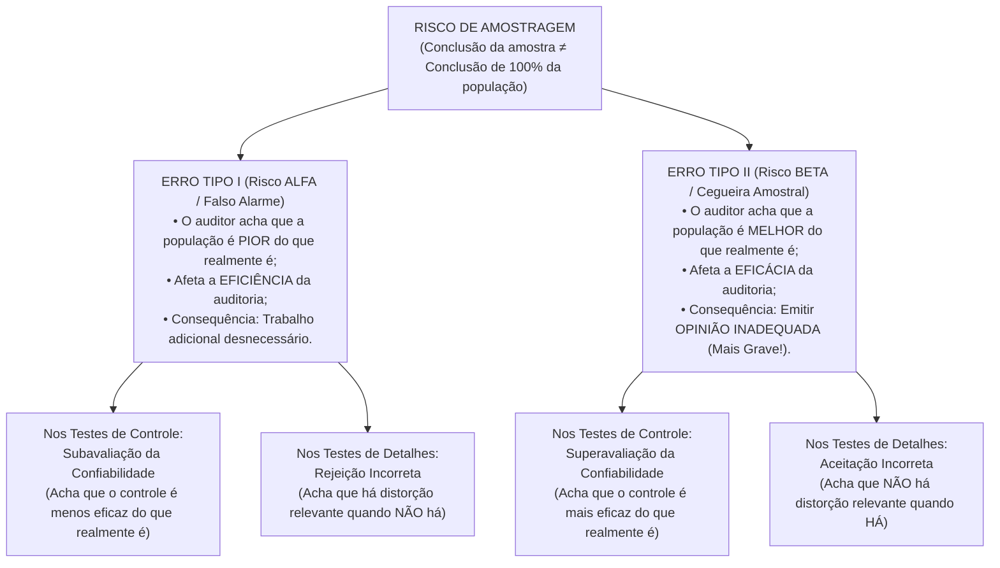
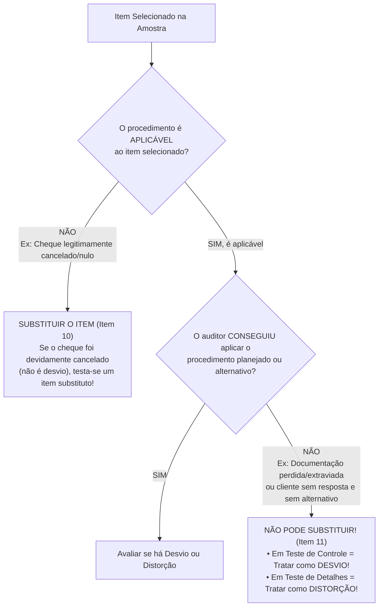

# Amostragem Estatística e Não Estatística em Auditoria (NBC TA 530)

> [!IMPORTANT]
> > A **NBC TA 530 (Amostragem em Auditoria)** regula a aplicação de procedimentos de auditoria em **menos de 100%** dos itens de uma população relevante, sob a condição inegociável de que **todas as unidades de amostragem tenham a mesma chance (ou chance conhecida diferente de zero) de serem selecionadas**, fornecendo ao auditor uma base razoável para concluir sobre toda a população. A amostragem divide-se em **Estatística** (que exige **cumulativamente** seleção aleatória e uso da teoria das probabilidades para avaliar resultados e mensurar o risco de amostragem) e **Não Estatística** (quando ausente qualquer um desses dois requisitos). O **Risco de Amostragem** desdobra-se no **Erro Tipo I (Alfa — afeta a Eficiência)** e no gravíssimo **Erro Tipo II (Beta — afeta a Eficácia e conduz a opinião inadequada)**. Na avaliação dos achados, a **projeção de distorções** é exclusiva dos **Testes de Detalhes** (excluindo-se as **anomalias** do cálculo da projeção, mas somando-as ao erro projetado no confronto final com a **Distorção Tolerável**), ao passo que nos **Testes de Controle** a taxa de desvio da amostra já constitui a própria estimativa de desvio da população.

---

## 1. Fundamentos, Escopo e Distinções Preliminares (NBC TA 500 vs. NBC TA 530)

Quando o auditor desenha procedimentos de auditoria (testes de controle ou testes de detalhes) para obter evidência apropriada e suficiente, a **NBC TA 500 (Evidência de Auditoria)** oferece **três meios distintos** para selecionar os itens que serão submetidos a teste:

1. **Seleção de todos os itens (Exame de 100%):** O auditor decide examinar a integralidade da população de uma classe de transações ou saldo contábil.
2. **Seleção de itens específicos:** O auditor escolhe a dedo itens determinados (ex.: itens de alto valor, itens acima de determinado patamar monetário, itens suspeitos ou para obter informações sobre a natureza da entidade).
3. **Amostragem em Auditoria:** O auditor testa menos de 100% dos itens com chance de seleção para todas as unidades da população, regida especificamente pela **NBC TA 530**.

### 1.1. Por que "Seleção de Itens Específicos" NÃO é Amostragem em Auditoria?

Esta é uma das distinções mais cobradas pelas bancas FGV, Cebraspe e FCC. Quando o auditor decide, por exemplo, *"examinar todas as notas fiscais emitidas no exercício cujo valor individual ultrapasse R\$ 500.000,00"*, ele está aplicando a **seleção de itens específicos** (NBC TA 500, itens A54-A56), e **não** amostragem em auditoria.

Por que razão técnica isso não configura amostragem?
* Porque as notas fiscais de valor inferior a R\$ 500.000,00 tiveram **chance zero** de serem selecionadas.
* Consequentemente, a seleção de itens específicos **não proporciona evidência de auditoria sobre o restante da população** que não foi selecionado. O auditor **jamais** pode extrapolar ou projetar os erros encontrados nos itens específicos para a parcela não examinada da população.

| Critério Comparativo | Exame de 100% | Seleção de Itens Específicos | Amostragem em Auditoria (NBC TA 530) |
| :--- | :--- | :--- | :--- |
| **Fração da População Examinada** | 100% dos itens da população (ou de um estrato específico). | Menos de 100% (apenas itens escolhidos intencionalmente). | Menos de 100% dos itens da população. |
| **Chance de Seleção das Unidades** | Certeza absoluta (100%) para todos os itens. | **Desigual e excludente:** itens fora do filtro têm **chance zero**. | **Todas** as unidades de amostragem têm chance de seleção (igual ou conhecida). |
| **Aplicabilidade em Testes de Controle** | **Improvável** (custo proibitivo e desnecessário). | **Inaplicável** para concluir sobre a eficácia operacional de toda a rotina. | **Plenamente aplicável** quando o controle deixa trilha documental de execução. |
| **Aplicabilidade em Testes de Detalhes** | **Comum** em populações pequenas de alto valor ou automação via CAAT. | **Muito comum** para isolar itens-chave, saldos atípicos ou transações suspeitas. | **Plenamente aplicável** para testar grandes volumes de transações ou saldos. |
| **Projeção de Distorções para a População** | Não há projeção (o erro apurado já é o erro real total da população). | **Expressamente vedada!** Conclusão restrita apenas aos itens examinados. | **Obrigatória** nos testes de detalhes para estimar a distorção da população. |
| **Existência de Risco de Amostragem** | **Nulo (Zero)** — toda a população foi examinada. | Não aplicável ao todo (há risco de o restante conter erros não detectados). | **Presente** (mensurável na estatística; não mensurável matematicamente na não estatística). |

> [!CAUTION]
> **Casca de Banana Clássica (FGV / FCC):**
> *"Se o auditor seleciona para exame todas as contas a receber vencidas há mais de 180 dias e identifica distorções em 15% delas, deve projetar esse percentual de 15% para as contas a vencer."*
> **FALSO!** Selecionar apenas contas vencidas há mais de 180 dias é **seleção de itens específicos** (ou, no máximo, exame de 100% de um estrato isolado). Os resultados de itens específicos (ou de um estrato específico) **não podem** ser projetados para outra parcela da população que não teve chance de seleção.

---

## 2. Conceitos Fundamentais da NBC TA 530 (Item 5)

Para dominar a linguagem técnica exigida em provas objetivas e discursivas, é indispensável memorizar as definições literais consagradas no item 5 da NBC TA 530:

1. **Amostragem em Auditoria (*Audit Sampling*):** É a aplicação de procedimentos de auditoria em **menos de 100%** dos itens de população relevante para fins de auditoria, de maneira que **todas as unidades de amostragem tenham a mesma chance de serem selecionadas** (ou probabilidade conhecida na amostragem por unidade monetária) para proporcionar uma base razoável que possibilite ao auditor concluir sobre toda a população.
2. **População (*Population*):** É o conjunto completo de dados a partir do qual a amostra é selecionada e sobre o qual o auditor deseja concluir. A população deve ser **apropriada** ao objetivo do procedimento e **completa** (íntegra).
3. **Unidade de Amostragem (*Sampling Unit*):** São os itens individuais que constituem uma população. Podem ser **itens físicos** (ex.: cheques listados em comprovantes de depósito, lançamentos de crédito em extratos bancários, faturas de vendas, saldos de devedores) ou **unidades monetárias** (cada $\text{R\$ } 1,00$ que compõe o saldo da conta).
4. **Anomalia (*Anomaly*):** É uma distorção ou um desvio que é **comprovadamente não representativo** de distorção ou desvio em uma população. Trata-se de um evento isolado, irrepetível e excepcional (ex.: erro causado por queda única de energia ou bug pontual na migração de banco de dados em uma data específica).
5. **Estratificação (*Stratification*):** É o processo de dividir uma população em **subpopulações**, cada uma sendo um grupo de unidades de amostragem que possuem **características semelhantes** (frequentemente valor monetário ou grau de risco).
6. **Distorção Tolerável (*Tolerable Misstatement*):** É um **valor monetário** definido pelo auditor para obter um nível apropriado de segurança de que esse valor não seja excedido pela distorção real na população. Aplica-se aos **Testes de Detalhes** e representa a aplicação da **materialidade para execução da auditoria** (NBC TA 320) a um procedimento de amostragem específico, podendo ser o mesmo valor ou um valor menor.
7. **Taxa Tolerável de Desvio (*Tolerable Rate of Deviation*):** É a **taxa de desvio** dos procedimentos de controles internos previstos, definida pelo auditor para obter um nível apropriado de segurança de que essa taxa não seja excedida pela taxa real de desvio na população. Aplica-se exclusivamente aos **Testes de Controle**.

---

## 3. Amostragem Estatística vs. Amostragem Não Estatística

A decisão de utilizar uma abordagem de amostragem estatística ou não estatística é uma questão de **julgamento profissional do auditor** (NBC TA 530, item A9). Todavia, a norma estabelece um critério rígido e binário para que uma amostragem possa receber o título de **Estatística**.

### 3.1. Os Dois Requisitos Cumulativos da Amostragem Estatística

Segundo o item 5(g) da NBC TA 530, **Amostragem Estatística** é a abordagem à amostragem que possui **as seguintes características cumulativas**:
1. **Seleção aleatória** dos itens da amostra; **E**
2. **O uso da teoria das probabilidades** para avaliar os resultados das amostras, **incluindo a mensuração do risco de amostragem**.

> [!WARNING]
> **Regra de Exclusão Residual (Item 5, "g", ii):**
> A abordagem de amostragem que **não apresenta** as características (i) **e** (ii) é considerada uma **amostragem não estatística** (também chamada na doutrina de amostragem por julgamento ou subjetiva).
> **Atenção:** Se o auditor selecionar os itens da amostra utilizando um gerador computadorizado de números estritamente aleatórios (cumprindo o requisito 1), mas avaliar os achados apenas com base na sua intuição e experiência, **sem usar a teoria das probabilidades para mensurar matematicamente o risco de amostragem** (descumprindo o requisito 2), a amostragem realizada será classificada como **NÃO ESTATÍSTICA**!

### 3.2. Quadro Comparativo Profundo: Estatística vs. Não Estatística

| Dimensão de Análise | Amostragem Estatística | Amostragem Não Estatística |
| :--- | :--- | :--- |
| **Critério de Seleção dos Itens** | Obrigatoriamente probabilístico/aleatório (Seleção Aleatória Simples, Sistemática com início aleatório ou Unidade Monetária — MUS). | Pode usar seleção casual (*haphazard*) ou mesmo seleção aleatória, desde que a avaliação posterior não seja probabilística. |
| **Dimensionamento do Tamanho da Amostra** | Determinado por meio de fórmulas matemáticas ou tabelas estatísticas específicas (Poisson, Binomial, Normal, Hipergeométrica). | Determinado pelo **julgamento profissional** do auditor, observando os mesmos fatores lógicos da NBC TA 530. |
| **Comparabilidade dos Tamanhos de Amostra** | O tamanho da amostra **não é um critério válido** para distinguir entre abordagens estatísticas e não estatísticas (item A9). | Uma amostra não estatística bem desenhada costuma ter tamanho **comparável** ao de uma amostra estatística para os mesmos parâmetros. |
| **Mensuração do Risco de Amostragem** | Quantifica objetivamente o risco (ex.: *"95% de nível de confiança; 5% de risco de aceitação incorreta"*). | Não quantifica matematicamente a margem de erro ou o risco amostral, embora o risco continue existindo. |
| **Projeção de Distorções (Testes de Detalhes)** | **Obrigatória** (via estimativa de razão, diferença ou MUS). | **Igualmente obrigatória!** Na amostragem não estatística de testes de detalhes, o auditor também deve projetar as distorções para a população. |
| **Custo de Implementação** | Mais elevado (requer treinamento técnico da equipe, definição rigorosa da estrutura da população e softwares de auditoria). | Mais baixo em termos ferramental, porém exige auditores experientes para evitar vieses inconscientes de seleção. |

---

## 4. Risco de Amostragem vs. Risco Não Resultante da Amostragem

Ao aplicar procedimentos de auditoria sobre uma amostra, o auditor está exposto a duas categorias fundamentais de risco: o **Risco de Amostragem** e o **Risco Não Resultante da Amostragem** (NBC TA 530, item 5, "c" e "d").

### 4.1. Risco de Amostragem (*Sampling Risk*)

É o risco de que a **conclusão do auditor, com base em uma amostra, pudesse ser diferente se toda a população fosse sujeita ao mesmo procedimento de auditoria**.
* **Causa raiz:** Ocorre exclusivamente porque o auditor examinou menos de 100% da população. Mesmo aplicando perfeitamente o procedimento correto, a amostra sorteada pode, por puro azar probabilístico, não refletir fielmente as características da população inteira.
* **Como reduzir o Risco de Amostragem?** Aumentando o **tamanho da amostra** ($n$) ou estratificando adequadamente a população. Se a amostra atingir 100% da população, o risco de amostragem cai a **zero**.

### 4.2. Risco Não Resultante da Amostragem (*Non-Sampling Risk*)

É o risco de que o auditor chegue a uma **conclusão errônea por qualquer outra razão que não seja relacionada ao risco de amostragem** (item 5, "d").
* **Causa raiz:** Falha humana, erro de julgamento metodológico ou deficiência na execução dos testes. Mesmo que o auditor examinasse **100% da população**, o risco não resultante da amostragem continuaria existindo!
* **Exemplos clássicos expressos no item A1 da NBC TA 530:**
  1. Uso de **procedimentos de auditoria inapropriados** para atingir o objetivo pretendido (ex.: para testar a *integridade* de passivos omitidos, o auditor seleciona apenas notas já lançadas no razão contábil em vez de inspecionar desembolsos subsequentes e notas de recebimento na portaria);
  2. **Interpretação errônea da evidência** de auditoria obtida (ex.: ler uma cláusula contratual complexa de derivativos e achar que a contabilização está correta quando está errada);
  3. **Falha no reconhecimento de uma distorção ou de um desvio** (ex.: por fadiga, pressa ou falta de treinamento, o auditor olha uma nota fiscal sem assinatura de aprovação ou com cálculo de imposto errado e não percebe a falha).
* **Como reduzir o Risco Não Resultante da Amostragem?** Mediante **planejamento adequado**, treinamento da equipe, instruções claras, **supervisão e revisão rigorosa dos papéis de trabalho** (NBC TA 220). Aumentar o tamanho da amostra **não reduz** o risco não resultante da amostragem!

---

## 5. A Matriz Completa dos Erros Tipo I (Alfa) e Tipo II (Beta)

O **Risco de Amostragem** pode levar a dois tipos de conclusões errôneas, detalhados no item 5(c) e nos itens A2 e A3 da NBC TA 530. Esta é, sem dúvida, a seção de maior incidência em provas de Auditor Fiscal e Controle.

### 5.1. Dissecação Analítica dos Quatro Quadrantes

1. **Nos Testes de Controle — Risco de Superavaliação da Confiabilidade (Erro Tipo II / Beta / Eficácia):**
   * **O que acontece:** Na realidade da empresa, o controle interno é falho (a taxa real de desvio na população é de 12%, superior à taxa tolerável de 5%). Porém, por azar no sorteio da amostra, o auditor pega uma amostra "limpa" (com 0% ou 1% de desvio) e conclui que **os controles são mais eficazes do que realmente são**.
   * **Por que é gravíssimo?** Confiando em um controle que na verdade não funciona, o auditor reduz indevidamente a extensão dos seus testes substantivos posteriores, deixando passar distorções relevantes no balanço e emitindo uma **opinião de auditoria inadequada**. Afeta a **eficácia** da auditoria.

2. **Nos Testes de Detalhes — Risco de Aceitação Incorreta (Erro Tipo II / Beta / Eficácia):**
   * **O que acontece:** Na realidade da empresa, o saldo da conta *Estoques* está superavaliado em R\$ 8 milhões (acima da distorção tolerável de R\$ 2 milhões). Contudo, a amostra sorteada pelo auditor cai justamente nos itens que estavam corretos. O auditor conclui que **não há distorção relevante quando, na verdade, há**.
   * **Por que é gravíssimo?** O auditor aceita como correto um saldo contábil materialmente distorcido e assina um relatório "limpo" sobre demonstrações viciadas. Afeta diretamente a **eficácia** da auditoria.

3. **Nos Testes de Controle — Risco de Subavaliação da Confiabilidade (Erro Tipo I / Alfa / Eficiência):**
   * **O que acontece:** Na realidade da empresa, o controle interno é excelente (taxa real de desvio de apenas 1%, bem abaixo da tolerável de 5%). Mas, por azar estatístico, a pequena amostra sorteada concentrou justamente os raros casos de falha. O auditor conclui que **os controles são menos eficazes do que realmente são**.
   * **Por que afeta apenas a eficiência?** O auditor deixará de confiar no controle e aumentará o volume de testes substantivos de detalhes. Ao executar esses testes adicionais, ele acabará constatando que os saldos contábeis estão corretos e emitirá a opinião correta, porém terá gasto **mais horas e recursos do que o necessário** (perda de **eficiência**).

4. **Nos Testes de Detalhes — Risco de Rejeição Incorreta (Erro Tipo I / Alfa / Eficiência):**
   * **O que acontece:** Na realidade da empresa, a conta *Fornecedores* está fidedigna (sem distorção relevante). Contudo, a amostra sorteada capturou os dois únicos erros do ano inteiro, levando a projeção amostral a superar a distorção tolerável. O auditor conclui inicialmente que **há distorção relevante quando, na verdade, não há**.
   * **Por que afeta apenas a eficiência?** Diante da rejeição inicial do saldo, a administração investigará os erros e o auditor ampliará os exames (realizando trabalho adicional), descobrindo ao final que não havia distorção relevante no restante da população. A opinião final será correta, mas houve custo e trabalho extras (**eficiência** comprometida).

| Parâmetro | Conclusão Errônea Tipo I (Risco Alfa) | Conclusão Errônea Tipo II (Risco Beta) |
| :--- | :--- | :--- |
| **Nomenclatura na Norma (NBC TA 530)** | • **Testes de Controle:** Subavaliação da confiabilidade (*Underreliance*) • **Testes de Detalhes:** Rejeição incorreta (*Incorrect Rejection*) | • **Testes de Controle:** Superavaliação da confiabilidade (*Overreliance*) • **Testes de Detalhes:** Aceitação incorreta (*Incorrect Acceptance*) |
| **Percepção do Auditor sobre a População** | Julga a população **pior** do que ela realmente é na realidade. | Julga a população **melhor** do que ela realmente é na realidade. |
| **Atributo da Auditoria Atingido** | **EFICIÊNCIA** da auditoria. | **EFICÁCIA** da auditoria. |
| **Consequência Prática** | Leva a **trabalho adicional** para estabelecer que as conclusões iniciais estavam incorretas. | É mais provável que leve a uma **opinião de auditoria não apropriada (inadequada)**. |

> [!CAUTION]
> **Cuidado com a numeração da NBC TA 530 vs. Estatística Clássica!**
> No texto literal do item 5(c) da NBC TA 530, a norma lista na **alínea (i)** os riscos que afetam a **eficácia** (superavaliação de controle / aceitação incorreta) e na **alínea (ii)** os riscos que afetam a **eficiência** (subavaliação de controle / rejeição incorreta). Em questões da FGV que transcrevem as alíneas *(i)* e *(ii)* da norma chamando-as de "tipo 1" e "tipo 2", **leia atentamente a descrição do enunciado** em vez de responder no piloto automático!

---

## 6. Estratificação e Seleção Baseada em Valor (Apêndice 1 da NBC TA 530)

Ao planejar uma amostra, o auditor frequentemente se depara com populações altamente heterogêneas (assimétricas), nas quais poucos itens concentram a maior parte do valor monetário total e milhares de itens representam valores irrisórios. Para aumentar a eficiência da auditoria, o Apêndice 1 da NBC TA 530 disciplina duas ferramentas cruciais: a **Estratificação** e a **Seleção Baseada em Valor**.

### 6.1. Estratificação da População

A **estratificação** consiste em dividir uma população em subpopulações discretas (**estratos**), cada uma constituindo um grupo de unidades de amostragem com características homogêneas (usualmente faixas de valor monetário, mas também natureza do cliente, localização geográfica ou linha de negócio).

**Objetivos e Benefícios da Estratificação:**
1. **Reduzir a variabilidade (desvio-padrão)** dos itens dentro de cada estrato;
2. Permitir que o **tamanho total da amostra seja reduzido sem aumentar o risco de amostragem**;
3. Direcionar maior esforço de auditoria para os itens de maior valor ou maior risco (ex.: examinar 100% do Estrato 1, que contém contas acima de R\$ 100.000,00, e aplicar amostragem nos Estratos 2 e 3).

### 6.2. Regras Obrigatórias na Estratificação e Projeção por Estrato

O item 3 e o item 4 do Apêndice 1 da NBC TA 530 trazem regras que despencam em provas de nível avançado:
* **Unicidade de Estrato:** Os estratos devem ser explicitamente definidos de modo que **cada unidade de amostragem possa pertencer a um único estrato** (estratos mutuamente exclusivos e coletivamente exaustivos).
* **Projeção Isolada por Estrato:** Os resultados dos procedimentos de auditoria aplicados a uma amostra de itens **dentro de um estrato só podem ser projetados para os itens que compõem aquele mesmo estrato**!
* **Consolidação para Avaliação Global:** Para chegar a uma conclusão sobre a população inteira, o auditor deve **somar as distorções projetadas de cada estrato individualmente** (mais as distorções exatas do estrato que tenha sido examinado em 100%) e considerar o risco de amostragem combinado em relação a toda a população.

#### Estudo de Caso Numérico: Estratificação e Projeção Correta vs. Incorreta
Suponha que o saldo total da conta *Duplicatas a Receber* seja de **R\$ 10.000.000,00** (composto por 2.010 faturas), e a **Distorção Tolerável** definida pelo auditor seja de **R\$ 300.000,00**. O auditor divide a população em três estratos:

| Estrato | Critério de Faixa | Quantidade ($N_i$) | Valor Contábil do Estrato | Amostra Examinada | Valor da Amostra | Erro Encontrado na Amostra | Projeção Correta no Estrato |
| :--- | :--- | :---: | :---: | :---: | :---: | :---: | :---: |
| **Estrato 1** | Acima de R\$ 200 mil | 10 itens | R\$ 4.000.000 | 10 itens (100%) | R\$ 4.000.000 | R\$ 40.000 | **R\$ 40.000** (exame de 100%, não projeta além do próprio estrato) |
| **Estrato 2** | De R\$ 10 mil a R\$ 200 mil | 500 itens | R\$ 4.000.000 | 50 itens (10%) | R\$ 400.000 | R\$ 15.000 | $\text{R\$ } 15.000 \times \frac{4.000.000}{400.000} =$ **R\$ 150.000** |
| **Estrato 3** | Até R\$ 10 mil | 1.500 itens | R\$ 2.000.000 | 30 itens (2%) | R\$ 40.000 | R\$ 1.000 | $\text{R\$ } 1.000 \times \frac{2.000.000}{40.000} =$ **R\$ 50.000** |
| **TOTAL** | **População Total** | **2.010 itens** | **R\$ 10.000.000** | **90 itens** | **R\$ 4.440.000** | **R\$ 56.000** | **Distorção Total Projetada = R\$ 240.000** |

* **Análise Técnica:** Calculando corretamente estrato por estrato, a distorção total estimada na população é de $\text{R\$ } 40.000 + \text{R\$ } 150.000 + \text{R\$ } 50.000 = \text{R\$ } 240.000,00$ (abaixo da Distorção Tolerável de R\$ 300.000,00). Se o auditor cometesse o erro grosseiro de projetar o erro do Estrato 2 para o Estrato 1 ou fizesse uma regra de três global sem respeitar os pesos dos estratos, chegaria a uma conclusão completamente viciada!

---

## 7. Determinantes do Tamanho da Amostra (Apêndices 2 e 3 da NBC TA 530)

O item 7 da NBC TA 530 determina que: *"O auditor deve definir um tamanho de amostra suficiente para reduzir o risco de amostragem a um nível aceitavelmente baixo"*. Quanto **menor o risco** que o auditor está disposto a aceitar, **maior deve ser o tamanho da amostra**.

Os Apêndices 2 e 3 da NBC TA 530 listam todos os fatores que influenciam o tamanho da amostra para **Testes de Controle** e para **Testes de Detalhes**, assumindo que os demais fatores permaneçam constantes (*ceteris paribus*).

### 7.1. Fatores que Influenciam o Tamanho da Amostra para TESTES DE CONTROLE (Apêndice 2)

Nos testes de controle, o auditor não busca valores monetários, mas sim **taxas de desvio** (percentual de vezes em que um controle interno deixou de ser cumprido, como uma ordem de compra sem assinatura do gerente).

| Fator Determinante (Apêndice 2 da NBC TA 530) | Relação | Efeito no Tamanho da Amostra | Explicação Lógica e Doutrinária |
| :--- | :---: | :---: | :--- |
| **1. Aumento da extensão em que a avaliação de risco do auditor leva em consideração os controles relevantes** | **Direta** | **AUMENTA ($\uparrow$)** | Quanto maior a confiança que o auditor pretende depositar na eficácia operacional dos controles (para reduzir seus testes substantivos), menor o risco de superavaliação que ele aceita e, portanto, **maior** precisa ser a amostra de teste de controle. |
| **2. Aumento na Taxa Tolerável de Desvio** | **Inversa** | **DIMINUI ($\downarrow$)** | A taxa tolerável é o "teto" de falhas que o auditor aceita sem perder a confiança no controle. Se o auditor é mais flexível e tolera uma taxa de erro maior (ex.: sobe de 3% para 8%), ele precisa testar **menos** itens para comprovar que o erro real não passa desse teto alto. |
| **3. Aumento na Taxa Esperada de Desvio da população a ser testada** | **Direta** | **AUMENTA ($\uparrow$)** | Se, com base no ano anterior ou em testes preliminares, o auditor já espera encontrar desvios na população, a margem de segurança entre a taxa esperada e a taxa tolerável fica estreita. Logo, ele precisa de uma amostra **maior** para fazer uma estimativa precisa. *(Obs.: Se a taxa esperada de desvio for inaceitavelmente alta — igual ou superior à taxa tolerável —, o auditor **não realiza** teste de controle e parte direto para os testes substantivos!)* |
| **4. Aumento no nível de segurança desejado pelo auditor de que a taxa tolerável de desvio não é excedida pela taxa real de desvio na população** | **Direta** | **AUMENTA ($\uparrow$)** | Nível de segurança desejado é o complemento do risco de amostragem ($\text{Confiança} = 1 - \text{Risco}$). Querer 99% de confiança em vez de 90% exige uma amostra **significativamente maior**. |
| **5. Aumento no número de unidades de amostragem na população (Tamanho da População)** | **Neutra** | **EFEITO NEGLIGENCIÁVEL ($\approx 0$)** | Para populações grandes (tipicamente acima de 5.000 unidades), o tamanho absoluto da população tem efeito **insignificante (negligenciável)** no tamanho da amostra. Só tem algum efeito quando a população é muito pequena. |

---

### 7.2. Fatores que Influenciam o Tamanho da Amostra para TESTES DE DETALHES (Apêndice 3)

Nos testes de detalhes (procedimentos substantivos), o objetivo do auditor é detectar **distorções monetárias relevantes** nas classes de transações ou saldos contábeis.

| Fator Determinante (Apêndice 3 da NBC TA 530) | Relação | Efeito no Tamanho da Amostra | Explicação Lógica e Doutrinária |
| :--- | :---: | :---: | :--- |
| **1. Aumento na avaliação do Risco de Distorção Relevante (RDR = RI × RC) feita pelo auditor** | **Direta** | **AUMENTA ($\uparrow$)** | Se o risco inerente e o risco de controle da entidade são altos, o Risco de Detecção precisa ser baixo ($\text{RA} = \text{RDR} \times \text{RD}$). Para reduzir o risco de detecção (e o risco de aceitação incorreta), o auditor deve **aumentar** o tamanho da amostra substantiva. |
| **2. Aumento no uso de outros procedimentos substantivos dirigidos à mesma afirmação** | **Inversa** | **DIMINUI ($\downarrow$)** | Se o auditor já aplicou procedimentos analíticos substantivos robustos ou testes em itens específicos sobre a mesma conta/afirmação, ele depende menos da amostragem de detalhes, podendo **reduzir** o tamanho da amostra. |
| **3. Aumento no nível de segurança desejado pelo auditor de que a distorção tolerável não é excedida pela distorção real na população** | **Direta** | **AUMENTA ($\uparrow$)** | Quanto maior o grau de certeza exigido pelo auditor de que o saldo contábil não contém erro material (menor risco de aceitação incorreta), **maior** deve ser o tamanho da amostra. |
| **4. Aumento na Distorção Tolerável** | **Inversa** | **DIMINUI ($\downarrow$)** | Quanto maior o valor monetário do erro que pode existir na conta sem impactar a decisão dos usuários (maior folga/materialidade de execução), **menor** precisa ser o tamanho da amostra. |
| **5. Aumento no valor da Distorção Esperada na população** | **Direta** | **AUMENTA ($\uparrow$)** | Quanto maior o volume de erros monetários que o auditor espera encontrar na população, mais próximo ele estará do limite da distorção tolerável, exigindo uma amostra **maior** para estimar com precisão o valor real da distorção total. |
| **6. Estratificação da população quando apropriado** | **Inversa** | **DIMINUI ($\downarrow$)** | Quando há uma ampla faixa de valores monetários na população, a divisão em estratos homogêneos reduz o desvio-padrão interno e faz com que a soma das amostras dos vários estratos seja **geralmente menor** do que a amostra única que seria necessária sem estratificação. |
| **7. Número de unidades de amostragem na população (Tamanho da População)** | **Neutra** | **EFEITO NEGLIGENCIÁVEL ($\approx 0$)** | Para populações grandes, o número físico de itens na população tem efeito **negligenciável**. Contudo, na amostragem por unidade monetária (MUS), o **valor monetário total** da população importa (se o saldo em reais dobrar e a distorção tolerável continuar igual, a amostra MUS dobra!). |

> [!TIP]
> **Regra de Ouro Relâmpago para Provas sobre Tamanho da Amostra:**
> Apenas **TRÊS** fatores fazem o tamanho da amostra **DIMINUIR**:
> 1. **Aumento do que é TOLERÁVEL** (Taxa Tolerável de Desvio ou Distorção Tolerável);
> 2. **Uso de OUTROS procedimentos substantivos** na mesma afirmação;
> 3. **ESTRATIFICAÇÃO** da população.
> O **Tamanho da População** (em unidades físicas, para populações grandes) tem **efeito negligenciável**.
> **TODOS os demais fatores** (aumento do risco avaliado, aumento da confiança nos controles, aumento do nível de segurança desejado, aumento do desvio/distorção esperada) fazem o tamanho da amostra **AUMENTAR**!

---

## 8. Os 5 Métodos de Seleção de Amostra (Apêndice 4 da NBC TA 530)

O item 8 da NBC TA 530 estabelece a regra matriz: *"O auditor deve selecionar itens para a amostra de forma que cada unidade de amostragem na população tenha a mesma chance de ser selecionada"*. O Apêndice 4 descreve os cinco métodos reconhecidos pela norma:

### 8.1. Seleção Aleatória (*Random Selection*)
* **Como funciona:** Aplicada por meio de geradores de números aleatórios (computadorizados ou tabelas de números aleatórios). Cada item da população recebe um número único (ou usa a numeração sequencial das notas fiscais) e o gerador sorteia os números integrantes da amostra.
* **Uso em Amostragem Estatística:** **Sim**, é o padrão clássico para amostragem estatística de atributos e variáveis.

### 8.2. Seleção Sistemática (*Systematic Selection*)
* **Como funciona:** O número de unidades de amostragem na população ($N$) é dividido pelo tamanho da amostra ($n$) para fornecer um **intervalo de amostragem** ($I$):
  $$I = \frac{N}{n}$$
  Por exemplo, se a população tem $N = 10.000$ notas fiscais e o auditor precisa de uma amostra de $n = 200$ notas, o intervalo de amostragem será $I = \frac{10.000}{200} = 50$. Em seguida, o auditor determina um **ponto de início aleatório** entre $1$ e $50$ (digamos, o item $17$) e seleciona cada $50^\text{a}$ unidade de amostragem a partir daí ($17, 67, 117, 167, 217 \dots$).
* **Cuidado Obrigatório (Viés de Periodicidade Ciclicamente Estruturada):** Embora o ponto de partida seja aleatório, a norma alerta que o auditor deve se certificar de que as unidades na população **não estejam estruturadas de tal modo que o intervalo de amostragem corresponda a um padrão específico na população** (ex.: se cada grupo de 50 lançamentos na folha de pagamento termina sempre com o salário do gerente da filial, e o ponto inicial cair no número 50, a seleção sistemática pegará 100% de gerentes e nenhum operário!).
* **Uso em Amostragem Estatística:** **Sim**, desde que o ponto de início seja determinado de forma estritamente aleatória (gerador de números aleatórios ou ponto cego em tabela) e não haja padrão cíclico na população.

### 8.3. Amostragem de Unidade Monetária (*Monetary Unit Sampling* — MUS / PPS)
* **Como funciona:** É um tipo de **seleção com base em valor** (mencionado no Apêndice 1), no qual cada unidade monetária individual ($\text{R\$ } 1,00$) que compõe o saldo da população constitui uma unidade de amostragem. Após selecionar os reais específicos (frequentemente mediante um intervalo sistemático monetário), o auditor examina o **item físico (conta ou transação)** que contém aquela unidade monetária sorteada.
* **Vantagem Estratégica:** Um item de $\text{R\$ } 50.000,00$ tem exatamente **50 vezes mais probabilidade** de ser sorteado do que um item de $\text{R\$ } 1.000,00$. Além disso, qualquer item cujo valor contábil seja igual ou superior ao intervalo monetário ($I_m$) será **automaticamente selecionado com 100% de certeza**!
* **Fórmula do Tamanho da Amostra e do Intervalo na MUS:**
  $$I_m = \frac{\text{Distorção Tolerável (DT)}}{\text{Fator de Confiabilidade (FC)}} \qquad \implies \qquad n = \frac{\text{Valor Contábil da População (VCP)}}{I_m}$$
* **Limitação Clássica da MUS:** Como a probabilidade de seleção é proporcional ao valor contábil registrado, a MUS é excelente para testar **superavaliações** (Ativos e Despesas), mas **não é indicada para testar subavaliações ou omissões** (ex.: contas com saldo zero têm probabilidade zero de serem sorteadas na MUS, e contas subavaliadas por valores pequenos têm baixíssima chance de seleção).
* **Uso em Amostragem Estatística:** **Sim**, é um método estatístico amplamente utilizado.

### 8.4. Seleção Ao Acaso ou Casual (*Haphazard Selection*)
* **Como funciona:** O auditor seleciona a amostra **sem seguir uma técnica estruturada**. Embora nenhuma técnica matemática seja utilizada, o auditor deve obrigatoriamente **evitar qualquer tendenciosidade ou previsibilidade consciente** (como evitar itens difíceis de localizar nos arquivos, ou sempre escolher/evitar os primeiros ou últimos lançamentos de uma página), buscando assegurar que todos os itens da população tenham chance de seleção.
* **Uso em Amostragem Estatística:** **NÃO!** O Apêndice 4 da NBC TA 530 é taxativo: *"A seleção ao acaso não é apropriada quando se usa amostragem estatística"*, pois não permite calcular a probabilidade exata de seleção de cada item. É restrita à **amostragem não estatística**.

### 8.5. Seleção em Bloco (*Block Selection*)
* **Como funciona:** Envolve a seleção de um ou mais **blocos de itens contíguos (sequenciais)** dentro da população (ex.: selecionar todas as 300 notas fiscais emitidas entre os dias 10 e 15 de agosto, ou os cheques de número 1.001 a 1.200).
* **Regra da NBC TA 530:** A seleção em bloco **geralmente NÃO pode ser usada em amostragem de auditoria**, porque a maioria das populações é estruturada de forma que os itens em uma sequência tenham características semelhantes entre si, mas diferentes das características dos itens em outras partes da população (ex.: no bloco de 10 a 15 de agosto o conferente titular estava de férias e o substituto errou tudo, ou vice-versa). Embora em raras circunstâncias possa ser um procedimento válido de exame pontual, **raramente será uma técnica de seleção de amostra apropriada** quando o auditor pretende fazer inferências válidas sobre toda a população.

---

## 9. Execução dos Procedimentos nos Itens Selecionados (Itens 9 a 11)

Uma vez sorteada a amostra, o auditor deve executar os procedimentos de auditoria planejados sobre **cada item selecionado**. Porém, na prática de campo, surgem situações especiais que a NBC TA 530 regula com rigor cirúrgico nos itens 9, 10 e 11:

### 9.1. Quando o Auditor PODE Substituir o Item da Amostra (Item 10)
Se o procedimento de auditoria **não for aplicável** ao item selecionado, o auditor **deve executar o procedimento em um item substituto**.
* **Exemplo oficial (Item A14):** Um cheque anulado/cancelado é selecionado durante um teste de evidência de autorização de pagamento. Se o auditor se certificar de que o cheque foi **adequadamente anulado** de maneira que não constitui um desvio de controle, o cheque anulado não é aplicável ao teste de pagamento e o auditor sorteia uma **amostra substituta** de modo apropriado.

### 9.2. Quando o Auditor é PROIBIDO de Substituir o Item (Item 11)
Se o auditor **não puder aplicar** os procedimentos de auditoria definidos, **ou procedimentos alternativos adequados**, a um item selecionado, o auditor **NÃO pode simplesmente descartar o item e sortear outro**! Ele é obrigado a:
* **No caso de Teste de Controle:** Tratar esse item como um **desvio** do controle previsto;
* **No caso de Teste de Detalhes:** Tratar esse item como uma **distorção**.
* **Exemplo oficial (Item A15):** Quando a documentação relativa a um item foi **perdida/extraviada** pela empresa (não há como provar se o controle de dupla assinatura funcionou ou não -> é computado como **desvio**!), ou quando não foi recebida resposta de uma confirmação externa positiva de clientes e também não foi possível validar o recebimento por documentos alternativos subsequentes (-> o saldo inteiro do cliente é tratado como **distorção**!).

---

## 10. Natureza e Causa dos Desvios, Projeção de Distorções e Tratamento de Anomalias (Itens 12 a 15)

### 10.1. Investigação da Natureza e da Causa e Efeito sobre a Auditoria (Itens 12 e 13)
O auditor deve investigar a **natureza e a causa** de quaisquer desvios ou distorções identificados e avaliar seu possível efeito sobre a finalidade do procedimento e outras áreas da auditoria.
* Se o auditor observar que vários desvios ou distorções possuem uma **característica comum** (ex.: mesmo tipo de transação, mesma filial, mesmo funcionário ou mesmo período de tempo), isso pode indicar a ocorrência de **fraude** (intencional). Nesse caso, o auditor pode decidir isolar todos os itens da população que possuem essa característica comum e estender os procedimentos de auditoria a esse grupo inteiro.

### 10.2. O Regime Jurídico-Contábil da ANOMALIA (Itens 13, 14, A17 e A21)
Em circunstâncias **extremamente raras**, o auditor pode considerar que uma distorção ou desvio descoberto em uma amostra é uma **anomalia** (evento isolado e comprovadamente não representativo da população).
* **Requisito Probatório (Item 13):** Para considerar um erro como anomalia, o auditor **deve obter um alto grau de certeza** de que essa distorção ou desvio não é representativo da população, mediante a **execução de procedimentos adicionais de auditoria** para obter evidência apropriada e suficiente de que o erro não afeta o restante da população.
* **Efeito da Anomalia na Projeção (Item 14 e A19):** Quando uma distorção é comprovadamente estabelecida como uma **anomalia**, ela **PODE SER EXCLUÍDA quando da projeção de distorções para a população**. (Por quê? Porque se foi um evento único e irrepetível — ex.: erro de digitação no único dia em que o sistema caiu —, multiplicá-lo pelo fator da população inteira distorceria artificialmente a estimativa!).
* **Efeito da Anomalia na Avaliação Final (Item A19 e A21 — A GRANDE PEGADINHA DE PROVA!):** Embora a anomalia seja **excluída do cálculo da projeção**, o efeito de qualquer distorção anômala **se não corrigida pela administração, AINDA PRECISA SER CONSIDERADO (SOMADO) adicionalmente à projeção das distorções não anômalas** no momento de comparar o erro total estimado com a **Distorção Tolerável**!

$$\text{Erro Total Estimado para Confronto com a DT} = \text{Distorção Projetada (dos erros não anômalos)} + \text{Distorção Anômala (não corrigida)}$$

### 10.3. Projeção de Distorções: Testes de Detalhes vs. Testes de Controle (Item 14 e A20)

> [!IMPORTANT]
> **Distinção Cirúrgica do Item 14 e Item A20 da NBC TA 530:**
> * **Para Testes de Detalhes:** O auditor **DEVE projetar** para a população as distorções encontradas na amostra.
> * **Para Testes de Controle:** **NÃO é necessária projeção explícita de desvios**, uma vez que a **taxa de desvio da amostra é também a taxa projetada de desvio para a população como um todo**! (Se na amostra de 100 notas fiscais houve 4 sem visto de conferência, a taxa de desvio da amostra é de $4\%$, e a taxa estimada para a população inteira é diretamente de $4\%$).

#### Estudo de Caso Numérico Completo: Projeção com Anomalia em Testes de Detalhes
Considere uma auditoria da rubrica *Estoques* com os seguintes parâmetros:
* **Valor Contábil da População:** $\text{R\$ } 5.000.000,00$
* **Distorção Tolerável (DT):** $\text{R\$ } 250.000,00$
* **Valor Contábil da Amostra selecionada (10% da população):** $\text{R\$ } 500.000,00$
* **Achados da auditoria na amostra:** O auditor encontrou distorções que somam **$\text{R\$ } 35.000,00$**, sendo:
  - **$\text{R\$ } 15.000,00$** decorrentes de uma **anomalia comprovada** (um lote único atingido por alagamento pontual cujo ajuste foi esquecido e que a administração optou por não corrigir agora);
  - **$\text{R\$ } 20.000,00$** decorrentes de erros recorrentes de cálculo de custo médio (**distorções não anômalas**).

**Passo a Passo da Resolução Segundo a NBC TA 530:**
1. **Exclusão da Anomalia na Base de Projeção (Item 14):** Projetam-se apenas os $\text{R\$ } 20.000,00$ (erros não anômalos):
   $$\text{Distorção Projetada} = \text{R\$ } 20.000,00 \times \frac{\text{R\$ } 5.000.000,00}{\text{R\$ } 500.000,00} = \text{R\$ } 20.000,00 \times 10 = \text{R\$ } 200.000,00$$
2. **Adição da Anomalia Não Corrigida para Confronto com a Distorção Tolerável (Item A21):**
   $$\text{Distorção Total para Avaliação} = \text{R\$ } 200.000,00 \text{ (projetada)} + \text{R\$ } 15.000,00 \text{ (anomalia)} = \text{R\$ } 215.000,00$$
3. **Confronto com a Distorção Tolerável (Item 15):**
   * O total de $\text{R\$ } 215.000,00$ é inferior à Distorção Tolerável de $\text{R\$ } 250.000,00$, mas está relativamente próximo dela. O auditor avaliará se a folga de $\text{R\$ } 35.000,00$ é suficiente para cobrir o risco de amostragem de que a distorção real na população exceda $\text{R\$ } 250.000,00$.
   * **Note o impacto:** Se o auditor tivesse projetado erroneamente a anomalia junto com os demais erros ($\text{R\$ } 35.000 \times 10 = \text{R\$ } 350.000$), teria rejeitado o saldo por superar a DT de $\text{R\$ } 250.000$!

### 10.4. O que fazer quando a Amostragem NÃO forneceu base razoável para concluir? (Item A23)
Se o auditor concluir que a amostragem em auditoria **não forneceu uma base razoável** para conclusões sobre a população testada (porque a distorção projetada + anomalia superou ou ficou perigosamente próxima da Distorção Tolerável), o item A23 da NBC TA 530 estabelece que o auditor pode:
1. **Solicitar à administração** que investigue as distorções identificadas e o potencial para distorções adicionais e que faça os ajustes necessários; **e/ou**
2. **Adaptar a natureza, época e extensão** daqueles procedimentos adicionais de auditoria para melhor alcançar a segurança exigida (por exemplo, **estendendo o tamanho da amostra**, testando controles alternativos ou modificando os procedimentos substantivos).

---

## 11. Armadilhas de Banca ("Cascas de Banana")

| Armadilha Clássica de Prova | Por que é Falsa / Como a Banca Engana | Regra Correta da NBC TA 530 |
| :--- | :--- | :--- |
| *"Selecionar todas as notas fiscais acima de R\$ 100.000,00 é uma modalidade de amostragem não estatística."* | Confunde **seleção de itens específicos** (NBC TA 500) com amostragem (NBC TA 530). | **NÃO é amostragem** (nem estatística, nem não estatística), pois itens abaixo de R\$ 100 mil tiveram **chance zero** de seleção. |
| *"Na amostragem não estatística, o auditor está dispensado de projetar as distorções encontradas na amostra para a população."* | Induz o candidato a achar que projeção é exclusiva da amostragem estatística. | Nos **Testes de Detalhes**, o auditor **DEVE projetar** as distorções para a população **tanto na amostragem estatística quanto na não estatística**! |
| *"Tanto nos testes de controle quanto nos testes de detalhes, o auditor deve calcular a projeção monetária dos achados."* | Mistura taxa de desvio de atributo com distorção monetária. | Nos **Testes de Controle**, **não é necessária projeção explícita**, pois a taxa de desvio da amostra já é a taxa projetada da população (item A20). |
| *"Uma distorção classificada como anomalia deve ser integralmente ignorada pelo auditor em todas as etapas da avaliação."* | Confunde excluir do **cálculo da multiplicação/projeção** com ignorar na **avaliação final**. | A anomalia é excluída da **projeção**, mas se não for corrigida deve ser **somada** à distorção projetada para confronto com a Distorção Tolerável. |
| *"Quando um documento selecionado na amostra foi extraviado pelo cliente, o auditor deve substituí-lo por outro documento da população."* | Confunde documento **inaplicável** (cheque legitimamente anulado) com **impossibilidade de aplicar o procedimento** (extravio). | Se o documento foi perdido e não há procedimento alternativo viável, **proíbe-se substituir**: deve ser tratado como **desvio** (controle) ou **distorção** (detalhes). |

---

## 12. Mnemônicos & Âncoras de Memória

> [!TIP]
> ### 1. Mnemônico dos Requisitos da Amostragem Estatística: **"A-P-M"**
> Só é Amostragem **Estatística** se tiver **TUDO** junto:
> * **A**leatória (seleção randômica dos itens);
> * **P**robabilidades (uso da teoria das probabilidades na avaliação);
> * **M**ensuração matemática do risco de amostragem.
> *(Faltou um? Cai imediatamente na vala da **Não Estatística**!)*

> [!TIP]
> ### 2. Mnemônico dos Riscos Tipo I vs. Tipo II: **"SUB-REJ = EFICIÊNCIA"** vs. **"SUPER-ACEITA = EFICÁCIA"**
> * **Erro Tipo I (Alfa — Pessimista Injusto):**
>   - **SUB**avalia o controle / **REJ**eita o saldo bom $\rightarrow$ Gera trabalho extra $\rightarrow$ Afeta a **EFICIÊNCIA** (**I** de Tipo **I** = Eficiênc**I**a).
> * **Erro Tipo II (Beta — Otimista Cego):**
>   - **SUPER**avalia o controle / **ACEITA** o saldo podre $\rightarrow$ Emite **opinião inadequada** $\rightarrow$ Destrói a **EFICÁCIA** (**A** de Bet**A** = Eficáci**A**).

> [!TIP]
> ### 3. Mnemônico do Tamanho da Amostra: **"T-O-E Diminui; População Não Influi"**
> * **Diminuem a amostra ($\downarrow$):**
>   - **T**olerável maior (Taxa Tolerável de Desvio $\uparrow$ ou Distorção Tolerável $\uparrow$);
>   - **O**utros procedimentos substantivos na mesma afirmação ($\uparrow$);
>   - **E**stratificação da população.
> * **Não influi ($\approx 0$):** Tamanho físico da **População** (para populações grandes).
> * **Todo o resto AUMENTA ($\uparrow$) a amostra:** Risco avaliado $\uparrow$, Confiança nos controles $\uparrow$, Segurança desejada $\uparrow$, Erro/Desvio esperado $\uparrow$.

---

## 13. Bateria de Questões Oficiais Comentadas Alternativa por Alternativa

### [Questão 01](https://www.qconcursos.com/questoes-de-concursos/questoes/d4211898-0e) — [FGV — Receita Federal / Auditor-Fiscal — 2023]

De acordo com a NBC TA 530 (Amostragem em Auditoria), o risco de amostragem pode levar a dois tipos de conclusões errôneas. Assinale a opção que apresenta corretamente uma conclusão errônea que afeta a **eficácia** da auditoria e tem maior probabilidade de conduzir a uma opinião de auditoria não apropriada:
* **A)** No caso de teste de controle, concluir que os controles são menos eficazes do que realmente são.
* **B)** No caso de teste de detalhes, concluir que há distorção relevante quando, na verdade, ela não existe.
* **C)** Interpretar erroneamente uma evidência de auditoria obtida na inspeção documental da amostra.
* **D)** No caso de teste de controle, concluir que os controles são mais eficazes do que realmente são.
* **E)** Utilizar um procedimento de auditoria inapropriado para o objetivo específico do teste amostral.

**Gabarito Oficial:** **D**

**Comentários Analíticos Alternativa por Alternativa:**
* **A (Errada):** Concluir que os controles são *menos eficazes* do que realmente são (subavaliação da confiabilidade) é o Erro Tipo I (Alfa). Ele leva o auditor a ampliar os testes substantivos sem necessidade, afetando a **eficiência** (custo/tempo), mas não a eficácia da auditoria.
* **B (Errada):** Concluir em um teste de detalhes que *há distorção relevante quando na verdade não há* (rejeição incorreta) também é Erro Tipo I (Alfa). Afeta apenas a **eficiência** da auditoria, gerando trabalho adicional que corrigirá a conclusão inicial.
* **C (Errada):** Interpretar erroneamente uma evidência documental ou deixar de reconhecer um erro visível configura **risco não resultante da amostragem** (NBC TA 530, item A1), e não risco de amostragem.
* **D (Certa):** Nos termos literais do item 5(c)(i) da NBC TA 530, concluir no teste de controle que os controles são **mais eficazes do que realmente são** (superavaliação da confiabilidade) — ou, no teste de detalhes, que não há distorção relevante quando na verdade há (aceitação incorreta) — preocupa o auditor porque **afeta a eficácia da auditoria** e tem mais probabilidade de levar a uma **opinião de auditoria não apropriada**.
* **E (Errada):** O uso de procedimentos de auditoria inapropriados é exemplo clássico de **risco não resultante da amostragem** (item A1).

> **Fique Ligado:** Risco de Amostragem: Risco Beta afeta a EFICÁCIA (opinião inadequada / mais perigoso); Risco Alfa afeta a EFICIÊNCIA (trabalho adicional desnecessário).

---

### [Questão 02](https://www.qconcursos.com/questoes-de-concursos/questoes/8e208948-0a) — [FGV — SEFAZ-MG / Auditor Fiscal da Receita Estadual — 2023]

Durante a auditoria das demonstrações contábeis de uma companhia comercial, o auditor decidiu selecionar os itens para testes de detalhes na conta de *Contas a Receber*. A respeito dos requisitos da NBC TA 530 para a caracterização da amostragem estatística e dos métodos de seleção, assinale a afirmativa correta:
* **A)** A seleção de todas as duplicatas de clientes com saldo superior a R\$ 200.000,00 constitui uma amostragem não estatística válida para projetar distorções para toda a carteira de recebíveis.
* **B)** Caso o auditor selecione a amostra mediante gerador computadorizado de números aleatórios, mas avalie os resultados exclusivamente por meio de seu julgamento profissional sem empregar a teoria das probabilidades, a amostragem é classificada como não estatística.
* **C)** A seleção ao acaso (*haphazard*) é um método probabilístico aceito para a realização de amostragem estatística, desde que o auditor evite qualquer viés consciente.
* **D)** Na seleção sistemática, dispensa-se a aleatoriedade na escolha do ponto de início, bastando que o intervalo de amostragem seja constante em toda a população.
* **E)** A seleção em bloco é o método estatístico mais recomendado pela NBC TA 530 quando os itens em sequência na população apresentam características fortemente correlacionadas.

**Gabarito Oficial:** **B**

**Comentários Analíticos Alternativa por Alternativa:**
* **A (Errada):** Selecionar todas as duplicatas acima de R\$ 200.000,00 configura **seleção de itens específicos** (NBC TA 500), e **não** amostragem em auditoria (nem estatística, nem não estatística), pois as duplicatas abaixo desse valor tiveram chance zero de seleção. É vedado projetar seus resultados para o restante da população.
* **B (Certa):** Conforme o item 5(g) da NBC TA 530, a amostragem estatística exige **cumulativamente**: (1) seleção aleatória dos itens da amostra **e** (2) uso da teoria das probabilidades para avaliar os resultados das amostras, incluindo a mensuração do risco de amostragem. Se faltar o segundo requisito, a abordagem é classificada como **amostragem não estatística**.
* **C (Errada):** Segundo o Apêndice 4, alínea (d), da NBC TA 530, a seleção ao acaso **não é apropriada quando se usa amostragem estatística**, sendo aplicável apenas na amostragem não estatística.
* **D (Errada):** Na seleção sistemática (Apêndice 4, alínea "b"), é indispensável que o **ponto de início dentro do primeiro intervalo seja determinado de forma aleatória** (ex.: usando gerador de números aleatórios).
* **E (Errada):** Conforme o Apêndice 4, alínea (e), a seleção em bloco **geralmente não pode ser usada em amostragem de auditoria** justamente porque itens em sequência tendem a ter características semelhantes entre si, mas diferentes do restante da população.

> **Fique Ligado:** Métodos de seleção (NBC TA 530, Apêndice 4): aleatória, sistemática (intervalo fixo com início aleatório), unidade monetária (MUS), ao acaso (haphazard) e em bloco (não recomendada em regra).

---

### [Questão 03](https://www.qconcursos.com/questoes-de-concursos/questoes/6f188944-0b) — [Cebraspe — TCU / Auditor Federal de Controle Externo — 2022]

No planejamento de uma amostragem para testes substantivos de detalhes sobre o saldo de estoques de uma estatal, o auditor observou os parâmetros do Apêndice 3 da NBC TA 530. Mantidos constantes todos os demais fatores, o tamanho da amostra necessária para os testes de detalhes **diminuirá** caso ocorra:
* **A)** aumento na avaliação do risco de distorção relevante feita pelo auditor para a afirmação de existência dos estoques.
* **B)** aumento no valor da distorção que o auditor espera encontrar na população.
* **C)** aumento no nível de segurança desejado pelo auditor de que a distorção tolerável não é excedida pela distorção real na população.
* **D)** aumento no uso de outros procedimentos substantivos dirigidos à mesma afirmação e aumento na distorção tolerável.
* **E)** redução expressiva da distorção tolerável definida no planejamento da auditoria.

**Gabarito Oficial:** **D**

**Comentários Analíticos Alternativa por Alternativa:**
* **A (Errada):** O aumento na avaliação do risco de distorção relevante (RDR) tem relação **direta** com o tamanho da amostra: quanto maior o risco da conta, **maior** deve ser a amostra substantiva.
* **B (Errada):** O aumento no valor da distorção esperada na população tem relação **direta**: se o auditor espera encontrar mais erros, precisa de uma amostra **maior** para estimar o valor real da distorção.
* **C (Errada):** O aumento no nível de segurança desejado (menor risco de amostragem aceito) exige uma amostra **maior**.
* **D (Certa):** De acordo com o Apêndice 3 da NBC TA 530, tanto o **aumento no uso de outros procedimentos substantivos dirigidos à mesma afirmação** (como procedimentos analíticos substantivos eficazes) quanto o **aumento na distorção tolerável** possuem relação **inversa** com o tamanho da amostra, fazendo com que o tamanho da amostra **diminua**.
* **E (Errada):** A redução da distorção tolerável torna o auditor mais rigoroso (aceita menos erro), o que provoca **aumento** no tamanho da amostra.

> **Fique Ligado:** Fatores do tamanho da amostra em testes de detalhes: relação DIRETA com risco de distorção avaliado e distorção esperada; relação INVERSA com distorção tolerável e risco aceitável.

---

### [Questão 04](https://www.qconcursos.com/questoes-de-concursos/questoes/b3194565-0e) — [FCC — SEFAZ-PE / Auditor Fiscal do Tesouro Estadual — 2022]

Um auditor independente aplicou amostragem em auditoria em um teste de detalhes sobre uma população de contas a receber cujo valor contábil total era de R\$ 8.000.000,00, tendo fixado a Distorção Tolerável em R\$ 300.000,00. O valor contábil dos itens selecionados na amostra somou R\$ 800.000,00 (10% da população). Durante os exames, o auditor identificou distorções na amostra no montante total de R\$ 38.000,00. Após executar procedimentos adicionais de auditoria, obteve alto grau de certeza de que uma distorção específica de R\$ 14.000,00 constituía uma anomalia isolada (não corrigida pela administração), sendo os restantes R\$ 24.000,00 distorções recorrentes não anômalas. Com base na NBC TA 530, para fins de avaliação dos resultados da amostragem perante a Distorção Tolerável, o valor da distorção projetada e o valor total a ser confrontado com a Distorção Tolerável são, respectivamente:
* **A)** R\$ 380.000,00 e R\$ 380.000,00.
* **B)** R\$ 240.000,00 e R\$ 240.000,00.
* **C)** R\$ 240.000,00 e R\$ 254.000,00.
* **D)** R\$ 380.000,00 e R\$ 394.000,00.
* **E)** R\$ 140.000,00 e R\$ 164.000,00.

**Gabarito Oficial:** **C**

**Comentários Analíticos Alternativa por Alternativa:**
* **A (Errada):** Projetou indevidamente a anomalia ($\text{R\$ } 38.000 \times 10 = \text{R\$ } 380.000$). O item 14 da NBC TA 530 determina que a anomalia deve ser excluída quando da projeção de distorções para a população.
* **B (Errada):** Calculou corretamente a projeção ($\text{R\$ } 240.000$), mas esqueceu de somar a anomalia não corrigida ($\text{R\$ } 14.000$) na avaliação final perante a Distorção Tolerável (erro clássico contra os itens A19 e A21).
* **C (Certa):** Aplicando os itens 14, A19 e A21 da NBC TA 530:
  1. **Exclusão da anomalia no cálculo da projeção:** Projetam-se apenas os $\text{R\$ } 24.000,00$ não anômalos na proporção da amostra ($10\%$ da população, fator $10$):
     $$\text{Distorção Projetada} = \text{R\$ } 24.000,00 \times \frac{\text{R\$ } 8.000.000,00}{\text{R\$ } 800.000,00} = \text{R\$ } 240.000,00$$
  2. **Soma da anomalia não corrigida para confronto com a Distorção Tolerável:**
     $$\text{Total para Confronto} = \text{R\$ } 240.000,00 + \text{R\$ } 14.000,00 = \text{R\$ } 254.000,00$$
* **D (Errada):** Além de projetar a anomalia, somou-a novamente ao final.
* **E (Errada):** Inverteu os valores, projetando apenas a anomalia ($\text{R\$ } 14.000 \times 10 = \text{R\$ } 140.000$) e somando os erros normais sem projetar ($\text{R\$ } 24.000$).

> **Fique Ligado:** Distorção anômala é aquela que não é representativa da população; o auditor deve obter alto grau de certeza de que é anômala e excluí-la da projeção, somando-a ao final.

---

### [Questão 05](https://www.qconcursos.com/questoes-de-concursos/questoes/6d192347-0a) — [FGV — CGU / Auditor Federal de Finanças e Controle — 2022]

Na execução de testes de controle por amostragem sobre o processo de aprovação de compras de uma entidade, o auditor selecionou uma amostra de 60 processos físicos. Ao solicitar os processos à administração, constatou que: (i) o processo nº 14 referia-se a uma requisição que havia sido legitimamente cancelada antes da cotação de preços, conforme regras internas; e (ii) o processo nº 42 referia-se a uma compra efetivamente realizada e paga, mas cuja pasta física foi extraviada pelo setor de arquivo, inviabilizando qualquer procedimento alternativo de verificação da autorização. Diante dessas duas situações, segundo a NBC TA 530, o auditor deve:
* **A)** substituir ambos os processos nº 14 e nº 42 por novos itens sorteados aleatoriamente na população.
* **B)** tratar ambos os processos nº 14 e nº 42 como desvios de controle na avaliação da amostra.
* **C)** substituir o processo nº 14 por um item substituto e tratar o processo nº 42 como um desvio do controle previsto.
* **D)** tratar o processo nº 14 como um desvio de controle e substituir o processo nº 42 por um item de mesmo valor monetário.
* **E)** excluir ambos os itens da amostra sem substituí-los, reduzindo a base da amostra para 58 itens.

**Gabarito Oficial:** **C**

**Comentários Analíticos Alternativa por Alternativa:**
* **A (Errada):** O processo nº 42 (documentação perdida/extraviada de operação consumada) jamais pode ser substituído (item 11 e A15 da NBC TA 530).
* **B (Errada):** O processo nº 14 foi legitimamente cancelado (o procedimento de teste de aprovação de compra não é aplicável a ele), devendo ser substituído (item 10 e A14), e não tratado como desvio.
* **C (Certa):** A questão cobra os itens 10, 11, A14 e A15 da NBC TA 530:
  - Para o **processo nº 14** (adequadamente cancelado, sem irregularidade): o procedimento não é aplicável ao item selecionado, devendo o auditor executar o procedimento em um **item substituto** (item 10).
  - Para o **processo nº 42** (documentação extraviada, sem procedimento alternativo possível): como o auditor não pôde aplicar os procedimentos definidos nem alternativos ao item selecionado, ele **deve tratar esse item como um desvio do controle previsto** (item 11).
* **D (Errada):** Inverte exatamente o tratamento normativo dos dois casos.
* **E (Errada):** A NBC TA 530 não autoriza encolher arbitrariamente o tamanho da amostra planejada diante de documentos extraviados ou cancelados.

> **Fique Ligado:** Testes de controle: se a taxa de desvio da amostra exceder a taxa tolerável de desvio, o auditor não pode confiar no controle da forma planejada, devendo ampliar testes substantivos.

---

### [Questão 06](https://www.qconcursos.com/questoes-de-concursos/questoes/4c212348-0e) — [FCC — TCE-GO / Analista de Controle Externo — 2024]

De acordo com as disposições da NBC TA 530 sobre estratificação e projeção de resultados em amostragem de auditoria, é correto afirmar que:
* **A)** nos testes de controle, o auditor deve obrigatoriamente estratificar a população por faixas de valor monetário e projetar a distorção financeira encontrada na amostra para toda a população.
* **B)** os resultados dos procedimentos de auditoria aplicados a uma amostra de itens dentro de um estrato podem ser livremente projetados para os demais estratos da mesma conta contábil.
* **C)** a estratificação de uma população aumenta a variabilidade dos itens dentro de cada estrato, exigindo um aumento proporcional no tamanho total da amostra.
* **D)** para testes de controle, não é necessária projeção explícita de desvios, uma vez que a taxa de desvio da amostra é também a taxa projetada de desvio para a população como um todo.
* **E)** cada unidade de amostragem pode pertencer simultaneamente a dois ou mais estratos, desde que o auditor pondere a probabilidade de seleção na avaliação final.

**Gabarito Oficial:** **D**

**Comentários Analíticos Alternativa por Alternativa:**
* **A (Errada):** Estratificação por valor monetário e projeção financeira de distorções são próprias dos **testes de detalhes**, e não dos testes de controle (que avaliam taxas de desvio de atributos).
* **B (Errada):** Conforme o Apêndice 1, item 3, da NBC TA 530, os resultados aplicados a uma amostra de itens dentro de um estrato **só podem ser projetados para os itens que compõem esse mesmo estrato**.
* **C (Errada):** O objetivo da estratificação é justamente **reduzir** a variabilidade dos itens dentro de cada estrato e, assim, permitir que o tamanho da amostra seja **reduzido** sem aumentar o risco de amostragem (Apêndice 1, item 1).
* **D (Certa):** Reproduz literalmente o disposto no item A20 da NBC TA 530: *"Para testes de controle, não é necessária projeção explícita de desvios, uma vez que a taxa de desvio da amostra é também a taxa projetada de desvio para a população como um todo"*.
* **E (Errada):** Conforme o Apêndice 1, item 2, da NBC TA 530, os estratos devem ser explicitamente definidos de modo que **cada unidade de amostragem possa pertencer a um único estrato**.

> **Fique Ligado:** Estratificação: divisão da população em subpopulações homogêneas para reduzir a variabilidade dos itens e permitir a redução do tamanho total da amostra sem perda de segurança.

---

### [Questão 07](https://www.qconcursos.com/questoes-de-concursos/questoes/4f189014-0a) — [FGV — CGE-SC / Auditor do Estado — 2023]

Ao planejar testes de controle mediante amostragem de atributos em uma população composta por 80.000 notas de empenho emitidas no exercício, o auditor avalia os fatores descritos no Apêndice 2 da NBC TA 530. Assinale a opção que apresenta corretamente o efeito de cada fator sobre o tamanho da amostra de testes de controle:
* **A)** O aumento na taxa tolerável de desvio provoca um aumento no tamanho da amostra.
* **B)** O aumento na taxa esperada de desvio da população a ser testada provoca uma diminuição no tamanho da amostra.
* **C)** O aumento no número de unidades de amostragem na população (por exemplo, de 80.000 para 120.000 notas) tem efeito negligenciável sobre o tamanho da amostra.
* **D)** O aumento da extensão em que a avaliação de risco do auditor leva em consideração os controles relevantes provoca uma diminuição no tamanho da amostra.
* **E)** O aumento no nível de segurança desejado pelo auditor provoca uma diminuição no tamanho da amostra.

**Gabarito Oficial:** **C**

**Comentários Analíticos Alternativa por Alternativa:**
* **A (Errada):** O aumento na taxa tolerável de desvio tem efeito **inverso**, provocando **diminuição** no tamanho da amostra (Apêndice 2, fator 2).
* **B (Errada):** O aumento na taxa esperada de desvio da população tem efeito **direto**, provocando **aumento** no tamanho da amostra (Apêndice 2, fator 3).
* **C (Certa):** Conforme o Apêndice 2, fator 5, da NBC TA 530, para populações grandes, o tamanho efetivo da população tem pouco ou nenhum efeito sobre o tamanho da amostra (**efeito negligenciável**).
* **D (Errada):** Quanto mais o auditor pretende confiar nos controles relevantes para reduzir o risco avaliado, **maior** deve ser o tamanho da amostra de teste de controle (Apêndice 2, fator 1).
* **E (Errada):** O aumento no nível de segurança desejado pelo auditor exige uma amostra **maior** (Apêndice 2, fator 4).

> **Fique Ligado:** O tamanho da população tem efeito insignificante ou quase nulo sobre o tamanho da amostra para populações grandes (acima de alguns milhares de itens).

---

### [Questão 08](https://www.qconcursos.com/questoes-de-concursos/questoes/2b178904-0d) — [Cebraspe — SEFAZ-CE / Auditor Fiscal da Receita Estadual — 2021]

Na aplicação da Amostragem por Unidade Monetária (MUS — *Monetary Unit Sampling*) em testes de detalhes, cada unidade monetária individual ($\text{R\$ } 1,00$) que compõe o saldo da conta representa uma unidade de amostragem. Acerca desse método de seleção previsto na NBC TA 530, assinale a opção correta:
* **A)** É uma modalidade de amostragem não estatística na qual todos os itens físicos da população, independentemente de seu valor contábil, possuem exatamente a mesma probabilidade de seleção.
* **B)** É particularmente eficaz para detectar subavaliações de passivos e contas com saldo contábil registrado igual a zero.
* **C)** Resulta no direcionamento natural do esforço de auditoria para os itens de maior valor, visto que itens físicos com valores monetários maiores têm maior chance de serem selecionados.
* **D)** Dispensa o auditor de projetar as distorções encontradas na amostra, uma vez que a seleção é ponderada pelo valor.
* **E)** Só pode ser utilizada em testes de controle que envolvam alçadas financeiras, sendo vedada sua aplicação em testes substantivos de detalhes.

**Gabarito Oficial:** **C**

**Comentários Analíticos Alternativa por Alternativa:**
* **A (Errada):** A MUS é um método de **amostragem estatística** (seleção ponderada pelo valor), no qual a probabilidade de um item físico ser selecionado é **proporcional ao seu valor monetário** (e não igual entre itens físicos de valores diferentes).
* **B (Errada):** Como na MUS a chance de seleção é proporcional ao valor contábil registrado, contas com saldo zero têm **chance zero** de seleção e itens subavaliados têm menor chance de serem sorteados. Ela é ideal para testar **superavaliações**, e não subavaliações/omissões.
* **C (Certa):** Conforme o Apêndice 1 (item 4) e o Apêndice 4 (alínea "c") da NBC TA 530, uma vantagem dessa abordagem é que o esforço de auditoria é direcionado para os itens de maior valor, porque eles têm maior chance de serem selecionados, podendo resultar em amostras de tamanhos menores.
* **D (Errada):** A projeção de distorções na MUS continua sendo **obrigatória** (como em qualquer teste de detalhes por amostragem), calculando-se o percentual de contaminação (*tainting factor*) de cada unidade monetária distorcida multiplicado pelo intervalo de amostragem.
* **E (Errada):** Pelo contrário: a seleção com base no valor (MUS) é utilizada especificamente em **testes de detalhes** (substantivos), e não em testes de controle.

> **Fique Ligado:** Na Amostragem por Unidade Monetária (MUS), a probabilidade de seleção de um item é diretamente proporcional ao seu valor monetário, focando naturalmente nos itens de maior valor.

---

### [Questão 09](https://www.qconcursos.com/questoes-de-concursos/questoes/8f214568-0e) — [FGV — SEFAZ-MT / Fiscal de Tributos Estaduais — 2023]

A respeito da distinção entre risco de amostragem e risco não resultante da amostragem, bem como das formas de mitigação previstas na NBC TA 530, analise as afirmativas a seguir:
I. O risco não resultante da amostragem é o risco de que o auditor chegue a uma conclusão errônea por qualquer razão que não seja relacionada ao risco de amostragem, como o uso de procedimentos de auditoria inapropriados.
II. O aumento do tamanho da amostra reduz proporcionalmente tanto o risco de amostragem quanto o risco não resultante da amostragem.
III. O risco de rejeição incorreta em testes de detalhes e o risco de subavaliação da confiabilidade em testes de controle afetam a eficiência da auditoria e frequentemente levam a trabalho adicional.
Está correto o que se afirma em:
* **A)** I, apenas.
* **B)** I e II, apenas.
* **C)** I e III, apenas.
* **D)** II e III, apenas.
* **E)** I, II e III.

**Gabarito Oficial:** **C**

**Comentários Analíticos Alternativa por Alternativa:**
* **Item I (Certo):** Reflete com exatidão a definição do item 5(d) e os exemplos do item A1 da NBC TA 530 (uso de procedimentos inapropriados, interpretação errônea da evidência e falha no reconhecimento de distorção ou desvio).
* **Item II (Errado):** O aumento do tamanho da amostra reduz apenas o **risco de amostragem**. O risco não resultante da amostragem (erro humano/metodológico) **não é reduzido pelo aumento da amostra**, mas sim por planejamento adequado, supervisão e revisão do trabalho.
* **Item III (Certo):** Reproduz fielmente o item 5(c)(ii) da NBC TA 530: tanto a subavaliação da confiabilidade (testes de controle) quanto a rejeição incorreta (testes de detalhes) afetam a **eficiência** da auditoria e levam a trabalho adicional para estabelecer que as conclusões iniciais estavam incorretas.
* **Conclusão:** Apenas os itens **I e III** estão corretos, o que torna a alternativa **(C)** o gabarito.

> **Fique Ligado:** Risco não resultante da amostragem decorre de fatores humanos/metodológicos (ex: procedimentos inadequados, interpretação errônea de evidências, falha em reconhecer distorções).

---

### [Questão 10](https://www.qconcursos.com/questoes-de-concursos/questoes/9f191237-0c) — [FCC — TRT-4 / Analista Judiciário — Área Contábil — 2022]

Em relação à avaliação dos resultados da amostragem em auditoria nos termos da NBC TA 530, quando o auditor conclui que a distorção projetada somada à distorção anômala excede a distorção tolerável definida para um teste de detalhes, é correto afirmar que:
* **A)** a amostra fornece base razoável para concluir que a população está livre de distorção relevante, desde que a anomalia seja inferior à materialidade global.
* **B)** a amostra não fornece uma base razoável para conclusões sobre a população que foi testada, devendo o auditor solicitar que a administração investigue as distorções e faça os ajustes necessários e/ou adaptar a natureza, época e extensão de procedimentos adicionais.
* **C)** o auditor deve emitir imediatamente uma abstenção de opinião, sendo vedada a ampliação do tamanho da amostra ou a realização de novos procedimentos substantivos.
* **D)** a distorção tolerável deve ser automaticamente elevada pelo auditor na fase de conclusão para acomodar o erro projetado sem necessidade de novos testes.
* **E)** o auditor deve desconsiderar o valor projetado e solicitar à administração apenas o ajuste contábil do valor exato encontrado nos itens físicos da amostra.

**Gabarito Oficial:** **B**

**Comentários Analíticos Alternativa por Alternativa:**
* **A (Errada):** Se a soma da distorção projetada com a anomalia **excede** a distorção tolerável, a amostra **jamais** fornece base razoável para concluir que a conta está livre de distorção relevante (item A22).
* **B (Certa):** Nos exatos termos do item 15 e dos itens A22 e A23 da NBC TA 530, quando a distorção projetada mais a distorção anômala excedem a distorção tolerável, a amostra **não fornece base razoável** para concluir sobre a população testada. Nessa situação, o auditor deve solicitar à administração que investigue as distorções identificadas e o potencial para distorções adicionais e faça os ajustes necessários, e/ou adaptar a natureza, época e extensão dos procedimentos adicionais de auditoria (como estender o tamanho da amostra ou testar outros itens).
* **C (Errada):** O auditor não emite abstenção de opinião de imediato; ele aplica procedimentos adicionais e solicita investigação/ajustes à administração. Além disso, se ao final restar comprovada distorção relevante não corrigida na conta, a opinião será modificada para **Ressalva** ou **Adversa** (e não Abstenção, que decorre de limitação de escopo).
* **D (Errada):** Aumentar artificialmente a distorção tolerável ao final do trabalho para "esconder" um erro projetado viola frontalmente a NBC TA 320 e a NBC TA 530.
* **E (Errada):** Ajustar apenas os erros pontuais achados nos itens da amostra sem corrigir ou investigar o erro projetado no restante da população não reduz a distorção projetada abaixo da distorção tolerável.

> **Fique Ligado:** Se a distorção projetada mais a distorção anômala se aproximar da distorção tolerável, a amostra não fornece base razoável para conclusão, exigindo extensão dos testes ou solicitação de ajustes.

---

### [Questão 11](https://www.qconcursos.com/questoes-de-concursos/questoes/c3211987-0d) — [FGV — Receita Federal / Analista-Tributário — 2023]

Segundo a NBC TA 530, para que uma abordagem de amostragem em auditoria seja formalmente classificada como **amostragem estatística**, ela deve apresentar simultaneamente duas características fundamentais. Assinale a alternativa que indica corretamente essas duas características:

* **A)** Seleção por conveniência do auditor e ausência de risco de amostragem.
* **B)** Seleção aleatória dos itens da amostra e uso da teoria das probabilidades para avaliar os resultados da amostra, incluindo a mensuração do risco de amostragem.
* **C)** Exame de 100% dos itens cujo valor individual exceda o dobro da materialidade de execução e projeção linear das distorções encontradas.
* **D)** Seleção estratificada obrigatória por ordem alfabética de fornecedores e dispensa de avaliação qualitativa dos desvios.
* **E)** Uso de amostragem não probabilística ao acaso (*haphazard*) conjugada com software de auditoria contábil.

#### Gabarito: **B**

**Comentário Analítico Alternativa por Alternativa:**
* **A (Errada):** Seleção por conveniência não é aleatória e nenhuma amostragem elimina o risco de amostragem.
* **B (Certa):** Transcreve a literalidade cumulativa do item 5(g) da NBC TA 530: a amostragem é **estatística** se apresentar: (1) **seleção aleatória** dos itens da amostra; E (2) **uso da teoria das probabilidades** para avaliar os resultados da amostra, incluindo a mensuração do risco de amostragem. Uma abordagem de amostragem que não possua ambas as características é considerada **não estatística**.
* **C (Errada):** O exame de 100% dos itens de alto valor não é amostragem, mas seleção de itens específicos (teste de itens-chave).
* **D (Errada):** Ordem alfabética não constitui critério de amostragem estatística e a avaliação qualitativa dos desvios jamais pode ser dispensada.
* **E (Errada):** A seleção ao acaso (*haphazard selection*) é método típico de amostragem **não estatística**, pois não utiliza gerador probabilístico nem atribui chances conhecidas a cada unidade.

> **Fique Ligado:** Amostragem Estatística = Seleção Aleatória + Teoria das Probabilidades (mensuração matemática do risco de amostragem). Se faltar qualquer um dos dois requisitos = Amostragem Não Estatística!

---

### [Questão 12](https://www.qconcursos.com/questoes-de-concursos/questoes/5f188977-0f) — [Cebraspe — TCU / Auditor Federal de Controle Externo — 2022]

No planejamento da amostragem para a realização de testes de controle e testes substantivos de detalhes (NBC TA 530), a definição do tamanho da amostra depende de fatores qualitativos e quantitativos. A esse respeito, assinale a opção CORRETA:

* **A)** Quanto menor for a distorção tolerável fixada pelo auditor para um teste de detalhes, menor será o tamanho da amostra exigido.
* **B)** Quanto maior for a taxa de desvio tolerável estabelecida pelo auditor para um teste de controle interno, menor será o tamanho da amostra necessário.
* **C)** O aumento do risco de distorção relevante avaliado pelo auditor reduz o tamanho da amostra requerida nos procedimentos substantivos de detalhes.
* **D)** A redução do nível de segurança desejado pelo auditor em relação aos controles internos exige o aumento substancial do tamanho da amostra.
* **E)** Em testes de detalhes, a existência de distorções esperadas na população permite ao auditor reduzir o tamanho da amostra em comparação com uma população sem distorções esperadas.

#### Gabarito: **B**

**Comentário Analítico Alternativa por Alternativa:**
* **A (Errada):** A relação é **INVERSA**: quanto **menor** for a distorção tolerável (auditor mais rigoroso, menor margem de erro aceita), **maior** deve ser o tamanho da amostra para garantir a detecção de pequenos desvios.
* **B (Certa):** Conforme o Apêndice 2 da NBC TA 530: a relação entre a taxa de desvio tolerável e o tamanho da amostra em testes de controle é **INVERSA**. Quanto **maior** for a taxa de desvio que o auditor tolera (auditor mais tolerante a falhas do controle), **menor** será o tamanho da amostra necessário!
* **C (Errada):** A relação é **DIRETA**: quanto maior for o risco de distorção relevante avaliado, maior deverá ser o tamanho da amostra nos testes substantivos para reduzir o risco de detecção.
* **D (Errada):** Reduzir o nível de segurança desejado permite reduzir o tamanho da amostra, e não aumentar.
* **E (Errada):** Quanto maior a distorção esperada na população, maior deve ser a amostra para permitir uma estimativa confiável do montante total de distorções.

> **Fique Ligado:** Relação no tamanho da amostra: **DIRETA** com o Risco de Distorção Relevante, a Distorção Esperada e o Nível de Confiança; **INVERSA** com a Distorção Tolerável, a Taxa de Desvio Tolerável e o Risco de Amostragem Aceitável.
