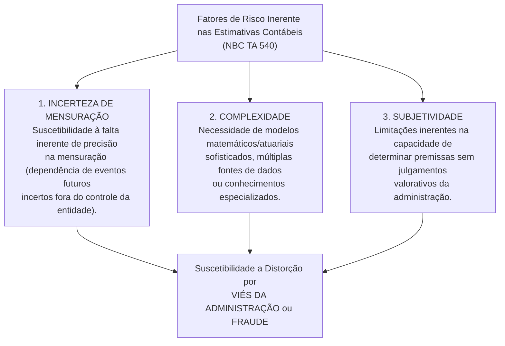
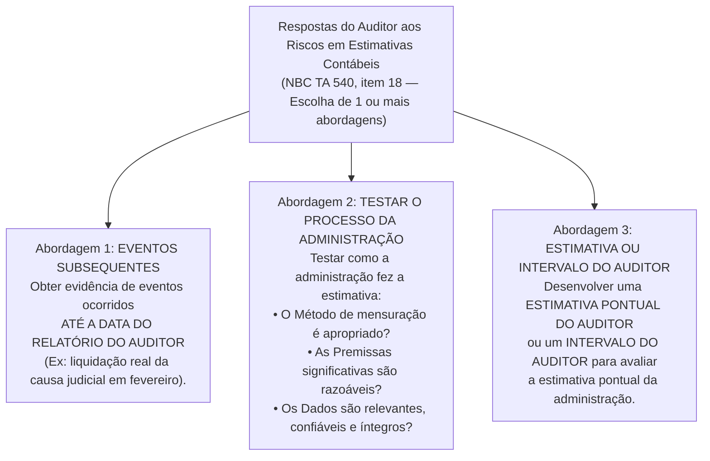
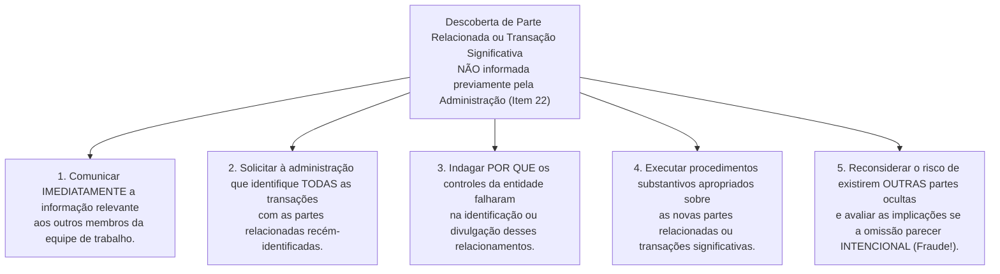

# Estimativas Contábeis (NBC TA 540), Partes Relacionadas (NBC TA 550) e Uso do Trabalho de Outros (NBC TA 600, 610 e 620)

> [!IMPORTANT]
> **BLUF (Bottom Line Up Front — Síntese Executiva):**
> As áreas de maior subjetividade e risco de manipulação nas demonstrações contábeis são as **Estimativas Contábeis (NBC TA 540)** e as transações com **Partes Relacionadas (NBC TA 550)**. Na **NBC TA 540**, o auditor avalia separadamente o risco inerente com base na **incerteza de mensuração**, na **complexidade** e na **subjetividade**, realiza obrigatoriamente a **revisão retrospectiva** dos desfechos de estimativas do período anterior e responde aos riscos por meio de três abordagens (eventos até a data do relatório, teste de como a administração fez a estimativa ou desenvolvimento de estimativa pontual/intervalo do auditor), mantendo vigilância constante sobre o **viés da administração**. Na **NBC TA 550**, o auditor deve tratar **todas as transações significativas com partes relacionadas fora do curso normal dos negócios como Riscos Significativos**. Por fim, nas normas **NBC TA 600, 610 e 620**, vigora o dogma da **responsabilidade única e indivisível do auditor independente**, sendo **proibido** fazer referência ao trabalho de auditores de componentes, auditores internos ou especialistas do auditor em um relatório com opinião não modificada (salvo rara imposição legal).

---

## 1. Auditoria de Estimativas Contábeis e Divulgações Relacionadas (NBC TA 540)

### 1.1. Natureza das Estimativas Contábeis e Incerteza de Mensuração

Diferentemente de itens contábeis baseados em transações históricas perfeitamente consumadas e documentadas por notas fiscais (como o valor nominal de uma compra à vista), diversos itens das demonstrações contábeis **não podem ser mensurados com exatidão matemática**, podendo apenas ser **estimados**.

Nos termos da **NBC TA 540**, uma **estimativa contábil** é um valor monetário para o qual a mensuração, de acordo com a estrutura de relatório financeiro aplicável, está sujeita à **incerteza de mensuração** (*estimation uncertainty*).

**Exemplos clássicos de Estimativas Contábeis (NBC TA 540):**
* Perdas Estimadas em Créditos de Liquidação Duvidosa (PECLD / PCLD);
* Obsolescência de estoques e ajuste ao Valor Realizável Líquido (CPC 16);
* Provisões para garantias de produtos e provisões para litígios judiciais trabalhistas, cíveis e tributários (CPC 25);
* Método de depreciação, vida útil econômica e valor residual de ativos imobilizados (CPC 27);
* Teste de recuperabilidade de ativos (*Impairment* — valor em uso baseado em fluxos de caixa futuros descontados, CPC 01);
* Valor justo de instrumentos financeiros complexos ou propriedades para investimento sem mercado ativo (Níveis 2 e 3 da hierarquia de valor justo, CPC 46);
* Passivos atuariais de planos de benefícios pós-emprego (CPC 33) e receitas reconhecidas ao longo do tempo por medição de progresso (*Percentage of Completion* — POC, CPC 47).

### 1.2. Os Três Fatores de Risco Inerente nas Estimativas Contábeis

A NBC TA 540 (Revisada) exige que, ao avaliar os riscos de distorção relevante para estimativas contábeis, o auditor avalie **separadamente** o **Risco Inerente** e o **Risco de Controle** (item 16). Na avaliação do Risco Inerente (situando-o no *espectro de risco inerente*), o auditor deve levar em consideração o grau em que a estimativa contábil está sujeita a:

1. **Incerteza de Mensuração (*Estimation Uncertainty*):** É a suscetibilidade de uma estimativa contábil e divulgações relacionadas à **falta inerente de precisão em sua mensuração**. Decorre da impossibilidade de prever com certeza o desfecho de eventos futuros (ex.: quando e por qual valor um processo judicial complexo no STF será julgado daqui a 8 anos).
2. **Complexidade (*Complexity*):** Decorre de fatores inerentes ao método de cálculo ou aos dados, tais como a necessidade de modelos estatísticos, financeiros ou atuariais sofisticados (ex.: modelo *Black-Scholes* ou simulação de *Monte Carlo* para precificar opções exóticas), múltiplos atributos de avaliação inter-relacionados ou necessidade de dados de difícil obtenção.
3. **Subjetividade (*Subjectivity*):** Decorre de limitações inerentes na capacidade de estabelecer o valor usando apenas dados objetivos de mercado, exigindo **julgamentos da administração** sobre a seleção do método, a escolha das premissas (taxa de desconto, projeção de crescimento de vendas no longo prazo) e a determinação do ponto dentro de um intervalo de desfechos possíveis.

> [!IMPORTANT]
> **Estimativa com Baixa vs. Alta Incerteza de Mensuração:**
> Nem toda estimativa contábil possui alto risco inerente ou alta incerteza de mensuração!
> * **Baixa Incerteza:** Ações negociadas diariamente em bolsa de valores líquida (Valor Justo Nível 1, com preços cotados publicamente) ou PECLD de varejo pulverizado com histórico estatístico altamente estável e previsível.
> * **Alta Incerteza (frequentemente Risco Significativo):** Avaliação de *impairment* de ágio por expectativa de rentabilidade futura (*goodwill*), provisões para litígios sem jurisprudência consolidada ou instrumentos financeiros derivativos de balcão sem dados observáveis de mercado (Nível 3).

---

### 1.3. A Revisão Retrospectiva Obrigatória (Item 14 da NBC TA 540)

Como procedimento obrigatório de avaliação de risco, o auditor **deve realizar uma revisão retrospectiva** do desfecho das estimativas contábeis anteriores ou, quando aplicável, de sua subsequente remensuração para a finalidade das demonstrações contábeis do período corrente.

**Para que serve a Revisão Retrospectiva?**
1. Obter informações sobre a **eficácia do processo de elaboração de estimativas** anterior da administração;
2. Obter evidência de auditoria pertinente para a remensuração, no período corrente, de estimativas anteriores;
3. Obter evidência de assuntos, tais como a incerteza de mensuração, que pode ser exigido que sejam divulgados nas notas explicativas;
4. Identificar indícios de possível **viés da administração** (*management bias*) — por exemplo, perceber que nos últimos 4 anos as estimativas da diretoria sempre foram sistematicamente otimistas para inflar o lucro e pagar bônus aos executivos!

> [!CAUTION]
> **A Grande Pegadinha de Prova sobre Revisão Retrospectiva (Item A61 da NBC TA 540):**
> A revisão retrospectiva realizada pelo auditor **NÃO se destina a colocar em dúvida (questionar) os julgamentos feitos no período anterior** que se basearam em informações disponíveis naquela época!
> **Por quê?** Porque uma diferença entre o desfecho real ocorrido neste ano e o valor estimado no balanço do ano passado **não representa necessariamente uma distorção** das demonstrações contábeis do período anterior! O desfecho real pode ter sido diferente simplesmente porque novas circunstâncias econômicas ou fatos supervenientes mudaram o cenário após a emissão do balanço anterior.

---

### 1.4. As Três Abordagens de Resposta aos Riscos Avaliados (Item 18 da NBC TA 540)

Em resposta aos riscos avaliados de distorção relevante, os procedimentos adicionais de auditoria do auditor **devem incluir uma ou mais** das seguintes três abordagens:

#### Detalhamento Técnico das 3 Abordagens:

1. **Abordagem 1 — Eventos ocorridos até a data do relatório do auditor (Itens 21):*
   * Muitas vezes, o próprio decurso do tempo entre 31 de dezembro (data do balanço) e março (data do relatório do auditor) resolve a incerteza! Por exemplo, se a empresa estimou em 31/12 que um lote de estoque obsoleto valia R\$ 400 mil e, em 15 de fevereiro, vendeu esse exato lote para um terceiro independente por R\$ 395 mil, a venda subsequente fornece evidência de auditoria direta e conclusiva sobre a estimativa, podendo tornar desnecessários outros procedimentos complexos!

2. **Abordagem 2 — Testar como a administração fez a estimativa contábil (Itens 22 a 27):**
   * O auditor examina a "cozinha" do cálculo da administração sobre três pilares:
     - **Método de mensuração:** É apropriado em face da norma contábil (CPC)? Houve mudança injustificada de método em relação ao período anterior?
     - **Premissas significativas:** São consistentes entre si, com os planos estratégicos da empresa e com dados macroeconômicos de mercado? A administração tem intenção e capacidade de executar os cursos de ação pressupostos?
     - **Dados subjacentes:** São relevantes, confiáveis, precisos e completos? Os cálculos matemáticos no modelo estão corretos?

3. **Abordagem 3 — Desenvolver uma Estimativa Pontual ou um Intervalo do Auditor (Itens 28 e 29):**
   * O próprio auditor (ou seu especialista contratado nos termos da NBC TA 620) constrói de forma independente uma **estimativa pontual** (um valor único calculado pelo auditor) ou um **intervalo do auditor** (uma faixa de valores mínimo e máximo).
   * **Regras Obrigatórias quando o Auditor desenvolve um Intervalo (Item 29):**
     - O intervalo deve incluir **apenas valores que sejam suportados por evidência de auditoria apropriada e suficiente** e que tenham sido avaliados pelo auditor como **razoáveis**;
     - Se a estimativa pontual da administração cair **dentro** do intervalo válido do auditor, a estimativa está suportada (não há distorção);
     - Se a estimativa pontual da administração cair **fora** do intervalo do auditor, a **distorção não é menor do que a diferença entre a estimativa pontual da administração e o ponto mais próximo do intervalo do auditor** (NBC TA 450 / NBC TA 540, item A139)!

| Situação Encontrada pelo Auditor | Valor da Distorção Contábil Apurada |
| :--- | :--- |
| O auditor desenvolve uma **Estimativa Pontual do Auditor** ($E_A$) que difere da Estimativa da Administração ($E_{Adm}$). | $\text{Distorção} = |E_{Adm} - E_A|$ (a diferença exata entre as duas estimativas pontuais). |
| O auditor desenvolve um **Intervalo do Auditor** $[L_{\text{mín}}, L_{\text{máx}}]$ e a Estimativa da Administração ($E_{Adm}$) está **DENTRO** do intervalo. | $\text{Distorção} = \text{R\$ } 0,00$ (nenhuma distorção numérica identificada). |
| O auditor desenvolve um **Intervalo do Auditor** $[L_{\text{mín}}, L_{\text{máx}}]$ (ex.: de $\text{R\$ } 100\text{ mil}$ a $\text{R\$ } 140\text{ mil}$) e a Estimativa da Administração ($E_{Adm} = \text{R\$ } 175\text{ mil}$) está **FORA** do intervalo. | **No mínimo** a diferença até o **ponto mais próximo** do intervalo do auditor ($\text{R\$ } 175\text{ mil} - \text{R\$ } 140\text{ mil} = \text{R\$ } 35\text{ mil}$). |

---

### 1.5. Avaliação de Indicadores de Possível Viés da Administração (Item 32)

O **Viés da Administração (*Management Bias*)** é a **falta de neutralidade da administração** na elaboração de informações contábeis.
* **Requisito (Item 32):** O auditor **deve avaliar** se os julgamentos e as decisões da administração na realização das estimativas contábeis incluídas nas demonstrações contábeis, **mesmo se forem individualmente razoáveis**, indicam um possível **viés por parte da administração** da entidade. Quando são identificados indicadores de possível viés, o auditor deve avaliar as implicações para a auditoria. Quando há **intenção de enganar**, o viés da administração é **fraudulento** por natureza.
* **Exemplos de Indicadores de Viés da Administração (Item A134):**
  - Mudanças em estimativa contábil, ou no método para elaborá-la, quando a administração fez uma avaliação subjetiva de que houve mudança de circunstâncias sem base real;
  - Uso de premissas da própria entidade para estimar valor justo quando elas são inconsistentes com premissas observáveis no mercado;
  - Seleção ou construção de premissas significativas que geram uma estimativa pontual sempre favorável aos objetivos da administração (ex.: escolher sistematicamente o limite superior do intervalo para ativos/receitas e o limite inferior para passivos/provisões).

---

## 2. Partes Relacionadas em Auditoria (NBC TA 550)

### 2.1. Conceito e Natureza dos Riscos em Partes Relacionadas

Muitas transações com **partes relacionadas** (controladoras, controladas, coligadas, *joint ventures*, acionistas controladores, administradores-chave e seus familiares próximos, nos termos do **CPC 05**) ocorrem no curso normal dos negócios e não embutem risco maior do que transações com terceiros independentes.

Contudo, a **NBC TA 550 (item 2)** alerta que a natureza dos relacionamentos e transações com partes relacionadas pode, em algumas circunstâncias, dar origem a **riscos de distorção relevante mais altos** do que transações com partes não relacionadas, porque:
1. As partes relacionadas podem operar por meio de uma extensa e complexa rede de relacionamentos e estruturas societárias (*offshores*, SPEs, fundos exclusivos);
2. Os sistemas de informação podem ser ineficazes para identificar ou resumir transações e saldos entre a entidade e suas partes relacionadas;
3. As transações com partes relacionadas **podem não ser conduzidas nos termos e condições normais de mercado** (*arm's length*) — por exemplo, podem ser realizadas sem contraprestação financeira (empréstimos sem juros, cessão gratuita de imóveis, perdão de dívidas) ou com preços artificialmente inflados/deprimidos para transferir lucros;
4. **Vulnerabilidade extrema à Fraude (NBC TA 240):** A fraude pode ser muito mais facilmente cometida por meio de partes relacionadas, visto que a inexistência de independência entre as partes facilita o **conluio**, a criação de transações fictícias ("notas frias" emitidas por empresa de fachada de um diretor) e a ocultação deliberada de passivos.

### 2.2. Procedimentos Obrigatórios de Avaliação de Risco (Itens 11 a 17 da NBC TA 550)

Para identificar os riscos associados a partes relacionadas, o auditor **deve obrigatoriamente**:
1. **Discutir na equipe de trabalho** a suscetibilidade das demonstrações contábeis a distorção relevante (por erro ou fraude) resultante de partes relacionadas (item 12);
2. **Indagar da administração** sobre: (a) a identidade das partes relacionadas da entidade, incluindo mudanças em relação ao período anterior; (b) a natureza dos relacionamentos; e (c) se a entidade realizou quaisquer transações com essas partes durante o período e, em caso positivo, o tipo e a finalidade das transações (item 13);
3. **Inspecionar obrigatoriamente os seguintes documentos** em busca de indícios de partes relacionadas não reveladas (item 15):
   - **Confirmações bancárias e confirmações de advogados/consultores jurídicos** obtidas como parte dos procedimentos de auditoria;
   - **Atas de assembleias de acionistas e de reuniões dos responsáveis pela governança** (Conselho de Administração, Diretoria, Conselho Fiscal);
   - Quaisquer outros registros ou documentos que o auditor considerar necessários nas circunstâncias (ex.: declarações de imposto de renda, contratos de *joint venture*, registros de participação societária de diretores, relatórios da auditoria interna e denúncias de *compliance*).

---

### 2.3. A Regra de Ouro das Transações Fora do Curso Normal dos Negócios (Itens 16, 18 e 23)

> [!WARNING]
> **Cláusula Pétrea da NBC TA 550 (Item 18):**
> *"O auditor **DEVE tratar** as transações significativas identificadas com partes relacionadas e **fora do curso normal dos negócios** da entidade como dando origem a **RISCOS SIGNIFICATIVOS**."*

Quando o auditor identifica acordos ou informações que sugerem a existência de transações com partes relacionadas **fora do curso normal dos negócios** (ex.: compra/venda de imóveis, reestruturações societárias complexas, concessão de avais/garantias sem cobrança de comissão, contratos com cláusulas circulares de recompra), ele **deve**:
1. **Indagar da administração** sobre a natureza dessas transações e se partes relacionadas estariam envolvidas (item 16);
2. **Inspecionar os contratos ou acordos subjacentes**, se existirem, e avaliar se (item 23):
   - **A lógica comercial (*business rationale*) das transações (ou a ausência dela)** sugere que elas podem ter sido realizadas para gerar **informações financeiras fraudulentas** ou para **ocultar a apropriação indébita de ativos**;
   - Os termos das transações são consistentes com as explicações da administração; e
   - As transações foram apropriadamente contabilizadas e divulgadas de acordo com a estrutura de relatório financeiro aplicável;
3. **Obter evidência de auditoria** de que as transações foram **apropriadamente autorizadas e aprovadas** pelas instâncias superiores (Conselho de Administração ou Assembleia de Acionistas).

---

### 2.4. Descoberta de Partes Relacionadas NÃO Identificadas ou NÃO Divulgadas pela Administração (Item 22)

E se, durante os exames de auditoria, o auditor identificar acordos ou informações que sugiram a existência de relacionamentos ou transações com partes relacionadas que a administração **não identificou ou não divulgou previamente ao auditor**? O item 22 da NBC TA 550 impõe **cinco providências obrigatórias**:

### 2.5. Afirmação de Condições Equivalentes às de Mercado (*Arm's Length* — Item 24)

Muitas vezes, a administração faz constar nas notas explicativas uma afirmação de que *"todas as transações com partes relacionadas foram realizadas em condições equivalentes àquelas que prevalecem nas transações com partes independentes (condições de mercado)"*.
* **Posição da NBC TA 550 (Item 24):** Se a administração fizer tal afirmação nas demonstrações contábeis, o auditor **deve obter evidência de auditoria apropriada e suficiente sobre a afirmação**.
* A administração é quem tem a responsabilidade de comprovar sua afirmação (comparando os preços e prazos de pagamento praticados com a coligada com os preços e prazos praticados com clientes/fornecedores independentes na mesma época). Se a administração não puder comprovar que a transação foi em condições estritas de mercado, a nota explicativa contém uma **distorção**!

---

## 3. Utilização do Trabalho de Outros: NBC TA 600, NBC TA 610 e NBC TA 620

Nas auditorias de médio e grande porte, o auditor independente frequentemente interage com três figuras técnicas: (1) **Auditores de Componentes** de um grupo econômico (**NBC TA 600**); (2) **Auditores Internos** da própria entidade auditada (**NBC TA 610**); e (3) **Especialistas do Auditor** em áreas não contábeis (**NBC TA 620**).

> [!IMPORTANT]
> **O Dogma da Responsabilidade Indivisível (Comum às NBC TA 600, 610 e 620):**
> O auditor independente (ou o sócio do trabalho do grupo) detém a **responsabilidade ÚNICA e INDIVISÍVEL** pela opinião de auditoria expressa, e essa responsabilidade **JAMAIS é reduzida** pelo uso do trabalho de auditores de componentes, da função de auditoria interna ou de especialistas contratados pelo auditor!

### 3.1. NBC TA 600 — Auditoria de Demonstrações Contábeis de Grupos (Auditores de Componentes)

* **Componente Significativo:** É o componente identificado pela equipe de trabalho do grupo que: (i) seja **individualmente significativo do ponto de vista financeiro** para o grupo; ou (ii) devido à sua natureza ou circunstâncias específicas, provavelmente inclua **riscos significativos de distorção relevante** das demonstrações contábeis do grupo.
* **Envolvimento Obrigatório:** A equipe de trabalho do grupo deve determinar a materialidade do grupo como um todo e a **materialidade dos componentes** (que deve ser **menor** do que a materialidade para as demonstrações do grupo como um todo!) e envolver-se na avaliação de riscos dos componentes significativos.
* **Vedação de Divisão de Responsabilidade no Relatório (Item 11):** O relatório do auditor sobre as demonstrações contábeis do grupo **NÃO deve fazer referência ao auditor de componente**, a menos que isso seja exigido por lei ou regulamento. Se a referência for exigida por lei, o relatório deve indicar expressamente que **a referência não diminui a responsabilidade do sócio do trabalho do grupo** ou da sua firma pela opinião de auditoria do grupo.

---

### 3.2. NBC TA 610 — Utilização do Trabalho de Auditoria Interna

A **NBC TA 610** trata de duas modalidades distintas de uso dos auditores internos pelo auditor independente:
1. **Usar o trabalho da função de auditoria interna** (aproveitar trabalhos e relatórios que a auditoria interna já realizou ou realizará no seu plano anual);
2. **Usar auditores internos para prestar assistência direta** (colocar auditores internos para executar procedimentos sob a direção, supervisão e revisão direta do auditor independente).

#### Os 3 Critérios Cumulativos para Avaliar a Função de Auditoria Interna (Item 15):
O auditor externo **não deve** usar o trabalho da função de auditoria interna se concluir que falha **qualquer um** dos três pilares abaixo:
1. **Objetividade:** O grau em que o status organizacional da função de auditoria interna e as políticas e procedimentos relevantes apoiam a objetividade dos auditores internos (ex.: a quem eles se reportam? Reportam-se ao Comitê de Auditoria/Conselho de Administração ou são subordinados ao Diretor Financeiro que eles deveriam fiscalizar?);
2. **Nível de Competência** da função de auditoria interna (formação técnica, recursos, treinamento);
3. Aplicação de uma **Abordagem Sistemática e Disciplinada**, incluindo controle de qualidade (se a auditoria interna não planeja, não documenta papéis de trabalho e não revisa suas conclusões, seu trabalho **não pode** ser utilizado pelo auditor externo!).

#### Quando é PROIBIDO usar Auditores Internos para Assistência Direta (Itens 29 e 30):
Mesmo quando a lei não proíbe a assistência direta e os auditores internos são competentes e objetivos, a NBC TA 610 **proíbe** que o auditor externo utilize auditores internos em assistência direta para realizar procedimentos que:
* Envolvam **julgamentos significativos** na auditoria (ex.: avaliar riscos de distorção relevante, avaliar a suficiência de testes, avaliar a continuidade operacional, avaliar estimativas contábeis subjetivas);
* Refiram-se a **riscos mais altos de distorção relevante** avaliados, nos quais o julgamento exigido na execução ou na avaliação das evidências seja mais que limitado;
* Relacionem-se com **trabalho com o qual os auditores internos estiveram envolvidos** e que já foi ou será reportado pela função de auditoria interna à administração (não podem auditar o próprio trabalho!);
* Relacionem-se com decisões que o auditor externo toma de acordo com a própria NBC TA 610 sobre a função de auditoria interna.

---

### 3.3. NBC TA 620 — Utilização do Trabalho de Especialista do Auditor

* **Quem é o Especialista do Auditor? (Item 6, "a"):** É uma pessoa ou organização com especialização em **área que NÃO seja contabilidade ou auditoria**, cujo trabalho nessa área é utilizado pelo auditor para ajudá-lo a obter evidência de auditoria apropriada e suficiente. Pode ser um **especialista interno** (sócio ou funcionário da própria firma de auditoria ou de firma da rede) ou um **especialista externo** contratado pelo auditor.
* **Exemplos de Especialistas do Auditor:** Atuários (cálculos previdenciários e reservas de seguradoras), engenheiros de minas/geólogos (cubagem de reservas minerais e de petróleo), avaliadores imobiliários, especialistas em avaliação de instrumentos financeiros complexos, advogados tributaristas ou ambientais.

> [!CAUTION]
> **Distinções Fundamentais que Caem em Todas as Provas (NBC TA 620 vs. NBC TA 220 vs. NBC TA 500):**
> 1. **Perito em Contabilidade ou Auditoria NÃO é Especialista da NBC TA 620!** Se a firma de auditoria consulta um especialista em normas internacionais de contabilidade (IFRS) ou em auditoria de sistemas contábeis, esse profissional **faz parte da equipe de trabalho** e rege-se pela **NBC TA 220** (Controle de Qualidade), e **não** pela NBC TA 620!
> 2. **Especialista da Administração vs. Especialista do Auditor:** Se o engenheiro ou atuário foi contratado **pela própria empresa auditada** para ajudar a administração a elaborar o balanço, ele é um **Especialista da Administração** (regido pela **NBC TA 500**, item 8), e **não** pela NBC TA 620!

#### Regra de Referência ao Especialista do Auditor no Relatório (Itens 14 e 15 da NBC TA 620):
* **Em Relatório com Opinião NÃO Modificada ("Limpa"):** O auditor **NÃO deve fazer referência ao trabalho de especialista do auditor** em seu relatório que contenha opinião não modificada, a menos que exigido por lei ou regulamento. Se a referência for exigida por lei ou regulamento, o auditor deve indicar no relatório que **a referência não reduz a sua responsabilidade pela opinião** (item 14).
* **Em Relatório com Opinião MODIFICADA (Ressalva, Adversa ou Abstenção):** Se o auditor faz referência ao trabalho de especialista do auditor no seu relatório porque essa referência é **relevante para o entendimento de modificação na sua opinião**, o auditor **deve indicar no relatório que essa referência não reduz a sua responsabilidade por essa opinião** (item 15).

#### Avaliação da Adequação do Trabalho do Especialista do Auditor (Itens 12 e 13 da NBC TA 620):
Antes de aceitar as conclusões do seu próprio especialista, o auditor **deve avaliar a adequação do trabalho do especialista** para as finalidades do auditor, verificando:
1. A **relevância e a razoabilidade das constatações ou conclusões** do especialista, e sua **consistência com outras evidências de auditoria** obtidas durante o trabalho;
2. Se o trabalho envolve o uso de **premissas e métodos significativos**, a relevância e a razoabilidade dessas premissas e métodos nas circunstâncias; e
3. Se o trabalho envolve o uso de **dados-fonte** significativos, a relevância, a integridade e a precisão desses dados-fonte.
* **E se o trabalho do especialista NÃO for adequado? (Item 13):** Se o auditor determinar que o trabalho do especialista do auditor não é adequado para as finalidades do auditor, ele deve: (a) **acordar com esse especialista** a natureza e a extensão de trabalho adicional a ser executado pelo especialista; ou (b) **executar procedimentos adicionais de auditoria** apropriados para as circunstâncias (inclusive contratar outro especialista).

---

### 3.4. Matriz de Resposta aos Riscos em Auditoria de Grupos (NBC TA 600, Itens 26 a 29)

Na auditoria de grupos econômicos (controladoras, controladas e coligadas consolidadas), a extensão do trabalho exigido pela **NBC TA 600** varia conforme a classificação de cada componente:

| Classificação do Componente (NBC TA 600) | Tipo de Trabalho Obrigatório a ser Executado no Componente |
| :--- | :--- |
| **1. Componente Significativo devido à sua Importância Financeira Individual** (Item 26) *(Ex.: controlada que detém 25% da receita ou do ativo do grupo)* | O auditor do grupo, ou o auditor do componente em seu nome, deve executar **AUDITORIA COMPLETA** da informação contábil do componente utilizando a **materialidade do componente**. |
| **2. Componente Significativo devido a Riscos Significativos de Distorção Relevante** (Item 27) *(Ex.: controlada pequena, mas que opera com derivativos complexos ou litígios bilionários)* | Deve-se executar **um ou mais** dos seguintes procedimentos: **(a)** **Auditoria** da informação contábil do componente usando a materialidade do componente; **(b)** **Auditoria de um ou mais saldos de contas, classes de transações ou divulgações** relacionadas com os prováveis riscos significativos; ou **(c)** **Procedimentos de auditoria específicos** relacionados com os prováveis riscos significativos. |
| **3. Componentes NÃO Significativos** (Itens 28 e 29) *(Ex.: pequenas filiais ou subsidiárias sem relevância individual e sem risco significativo)* | A equipe de trabalho do grupo deve executar **PROCEDIMENTOS ANALÍTICOS em nível de grupo**. *(Se considerar que isso não fornece evidência suficiente, seleciona alguns componentes não significativos para auditoria, revisão ou procedimentos específicos, variando a seleção ao longo do tempo para introduzir **imprevisibilidade**!)* |

| Norma e Figura Técnica | Definição e Papel | Pode ser citado em Relatório com Opinião Não Modificada ("Limpa")? |
| :--- | :--- | :--- |
| **NBC TA 600** (*Auditor de Componente*) | Auditor que executa trabalho na informação financeira de controlada/coligada para a auditoria do grupo. | **NÃO** (salvo se exigido por lei/regulamento, declarando que não diminui a responsabilidade do sócio do grupo). |
| **NBC TA 610** (*Auditor Interno*) | Função da própria entidade auditada que realiza atividades de avaliação e consultoria de governança e controle. | **NUNCA.** O relatório de auditoria independente jamais divide ou transfere responsabilidade para a auditoria interna. |
| **NBC TA 620** (*Especialista do Auditor*) | Pessoa/organização com perícia em **área diferente de contabilidade ou auditoria**, usada pelo auditor externo. | **NÃO** (salvo se exigido por lei; pode ser citado em **opinião modificada** se relevante para entender a ressalva, declarando que não reduz a responsabilidade do auditor). |
| **NBC TA 500 (Item 8)** (*Especialista da Administração*) | Pessoa/organização com perícia em área diferente de contabilidade/auditoria, usada **pela entidade** para fazer as demonstrações. | Avaliado como fonte de evidência pela NBC TA 500 (competência, habilidade, objetividade e entendimento do trabalho). |

---

### 3.5. Estudos de Caso Práticos Integrados (NBC TA 540, 550 e 620)

#### Caso Prático 1: Viés Sistemático da Administração em Estimativas (NBC TA 540)
* **Cenário:** A Cia. Alfa possui três grandes estimativas contábeis no balanço: (1) Provisão para Créditos de Liquidação Duvidosa (PECLD); (2) Provisão para Contingências Trabalhistas; e (3) Vida útil do parque fabril para fins de depreciação. Ao desenvolver intervalos próprios suportados por evidências, o auditor apurou:
  - Para a PECLD, o intervalo razoável do auditor era de $\text{R\$ } 10\text{ milhões}$ a $\text{R\$ } 15\text{ milhões}$ (a administração contabilizou exatamente $\text{R\$ } 10\text{ milhões}$ — a menor despesa possível);
  - Para as Contingências Trabalhistas, o intervalo do auditor era de $\text{R\$ } 20\text{ milhões}$ a $\text{R\$ } 30\text{ milhões}$ (a administração contabilizou exatamente $\text{R\$ } 20\text{ milhões}$ — o menor passivo possível);
  - Para a vida útil das máquinas, o intervalo técnico do engenheiro era de $8$ a $12$ anos (a administração escolheu exatamente $12$ anos — a menor despesa anual de depreciação possível).
* **Diagnóstico Técnico (NBC TA 540, item 32):** Individualmente, **nenhuma** das três estimativas caiu fora do intervalo do auditor (portanto, isoladamente, cada uma parece aceitável). Contudo, em todas as três, a administração escolheu sistematicamente o extremo que **maximiza o lucro líquido do exercício** em $\text{R\$ } 18\text{ milhões}$ no agregado, justamente para atingir a meta de pagamento de bônus da diretoria! Isso configura um **claro indicador de Viés da Administração (*Management Bias*)**, obrigando o auditor a discutir o assunto com a administração e com a governança e a avaliar se o efeito cumulativo distorce a apresentação adequada das demonstrações contábeis!

#### Caso Prático 2: Transação Circular (*Round-Tripping*) com Parte Relacionada Oculta (NBC TA 550)
* **Cenário:** Durante a inspeção de atas do Conselho de Administração e contratos de venda no último dia do trimestre, o auditor descobre que a companhia vendeu um terreno não operacional com lucro contábil de $\text{R\$ } 50\text{ milhões}$ para uma Sociedade de Propósito Específico (SPE Horizonte Ltda.), cujo capital social de $\text{R\$ } 1.000,00$ pertence a um ex-assessor direto do acionista controlador. O pagamento do terreno foi financiado em 10 anos pela própria companhia vendedora, sem garantias reais, e com cláusula aditiva secreta permitindo a devolução do terreno sem multa após 18 meses.
* **Diagnóstico Técnico (NBC TA 550, itens 18, 22 e 23):** Trata-se de **transação significativa fora do curso normal dos negócios** com provável **parte relacionada não divulgada**. O auditor deve tratá-la como **Risco Significativo**, comunicar imediatamente a toda a equipe de auditoria, avaliar a **ausência de lógica comercial (*business rationale*)** — que evidencia simulação para inflar artificialmente o lucro contábil mediante operação circular (*round-tripping*) — e aplicar os protocolos de resposta a **fraude** da NBC TA 240!

---

## 4. Armadilhas de Banca ("Cascas de Banana")

| Armadilha Clássica de Prova | Por que é Falsa / Como a Banca Engana | Regra Correta das Normas (NBC TA 540, 550, 600, 610, 620) |
| :--- | :--- | :--- |
| *"A revisão retrospectiva das estimativas do ano anterior tem por objetivo questionar os julgamentos passados e exigir a republicação do balanço se o desfecho real divergir da estimativa."* | Confunde mudança natural de eventos futuros com erro contábil passado. | A revisão retrospectiva **não se destina a colocar em dúvida julgamentos feitos no período anterior** baseados nas informações disponíveis à época (NBC TA 540, item A61). |
| *"Se a estimativa pontual da administração estiver fora do intervalo desenvolvido pelo auditor, a distorção será calculada pela diferença até o ponto médio (ou até o limite mais distante) do intervalo."* | Tenta inflar a distorção contábil cobrando o ponto médio ou o ponto mais distante. | Quando a estimativa da administração cai fora do intervalo do auditor, a distorção não é menor que a diferença até o **ponto mais próximo** do intervalo do auditor! |
| *"Toda e qualquer transação da entidade com partes relacionadas deve ser classificada pelo auditor como um risco significativo."* | Generaliza indevidamente a regra do item 18 da NBC TA 550. | Apenas as **transações significativas com partes relacionadas FORA DO CURSO NORMAL DOS NEGÓCIOS** são obrigatoriamente tratadas como **Riscos Significativos**! |
| *"Um contador especialista em tributação de IRPJ e CSLL ou em normas contábeis de derivativos (IFRS 9), consultado pela equipe de auditoria, enquadra-se como Especialista do Auditor segundo a NBC TA 620."* | Ignora a cláusula de exclusão expressa do item 6(a) da NBC TA 620. | Especialista da NBC TA 620 é apenas quem atua em área **que NÃO seja contabilidade ou auditoria**. Especialista em contabilidade/auditoria é membro/consultor da equipe (NBC TA 220). |
| *"Para dar maior transparência e credibilidade ao relatório com opinião não modificada, o auditor deve mencionar no parágrafo de opinião que se baseou no laudo de seu atuário independente."* | Apela ao senso comum de "transparência" para violar a vedação do item 14 da NBC TA 620. | É **expressamente proibido** fazer referência ao especialista do auditor em relatório com **opinião não modificada** (salvo exigência legal), para não sugerir divisão de responsabilidade! |

---

## 5. Mnemônicos & Âncoras de Memória

> [!TIP]
> ### 1. Mnemônico dos 3 Fatores de Risco Inerente da NBC TA 540: **"I-C-S"**
> Nas Estimativas Contábeis, o Risco Inerente depende da tríade **I-C-S**:
> * **I**ncerteza de mensuração (falta inerente de precisão quanto ao futuro);
> * **C**omplexidade (modelos matemáticos/atuariais e dados difíceis);
> * **S**ubjetividade (julgamento discricionário nas premissas).

> [!TIP]
> ### 2. Mnemônico das 3 Abordagens do Auditor na NBC TA 540: **"E-T-D"**
> Como o auditor testa uma estimativa contábil? **E-T-D**:
> * **E**ventos ocorridos até a data do relatório do auditor (desfecho real subsequente);
> * **T**estar como a administração fez a estimativa (método + premissas + dados);
> * **D**esenvolver uma estimativa pontual ou um intervalo do próprio auditor.

> [!TIP]
> ### 3. Mnemônico da Avaliação da Auditoria Interna (NBC TA 610): **"O-C-A"**
> O auditor externo só pode usar o trabalho da Auditoria Interna se ela tiver **O-C-A**:
> * **O**bjetividade (status organizacional e reporte à governança);
> * **C**ompetência técnica da equipe;
> * **A**bordagem sistemática e disciplinada (incluindo controle de qualidade).

---

## 6. Bateria de Questões Oficiais Comentadas Alternativa por Alternativa

### Questão 01 — [FGV — Receita Federal / Auditor-Fiscal — 2023]
**Identificador QC:** [Q2118990](https://www.qconcursos.com/questoes-de-concursos/questoes/e5211899-0a)

De acordo com a NBC TA 540 (Auditoria de Estimativas Contábeis e Divulgações Relacionadas), ao realizar procedimentos de avaliação de risco, o auditor deve executar uma revisão retrospectiva do desfecho das estimativas contábeis anteriores ou de sua subsequente remensuração. A respeito dessa revisão retrospectiva e da avaliação de estimativas pelo auditor, assinale a afirmativa correta:
* **A)** A revisão retrospectiva tem como finalidade primordial questionar os julgamentos feitos pela administração no período anterior e determinar a retificação das demonstrações contábeis passadas sempre que o desfecho real divergir do valor estimado.
* **B)** Caso o auditor desenvolva um intervalo de valores razoáveis suportados por evidência de auditoria e a estimativa pontual da administração situe-se fora desse intervalo, a distorção será equivalente à diferença entre a estimativa da administração e o limite mais distante do intervalo do auditor.
* **C)** A revisão retrospectiva auxilia o auditor a identificar a eficácia do processo de elaboração de estimativas anterior da administração e a existência de indicadores de possível viés da administração, sem ter por objetivo colocar em dúvida os julgamentos passados baseados nas informações disponíveis naquela época.
* **D)** Na avaliação dos riscos de distorção relevante de uma estimativa contábil, a NBC TA 540 determina que o risco inerente e o risco de controle sejam avaliados exclusivamente de forma conjunta e indissociável.
* **E)** O auditor é proibido de utilizar eventos ocorridos após a data do balanço até a data do seu relatório como evidência de auditoria para validar estimativas contábeis do encerramento do exercício.

**Gabarito Oficial:** **C**

**Comentários Analíticos Alternativa por Alternativa:**
* **(A) Incorreta:** Conforme o item A61 da NBC TA 540, a revisão retrospectiva **não se destina a colocar em dúvida os julgamentos feitos no período anterior** que se basearam em informações disponíveis naquela época, pois diferenças entre o desfecho real e a estimativa passada decorrem da própria incerteza de mensuração e não necessariamente de erro.
* **(B) Incorreta:** Quando a estimativa da administração cai fora do intervalo do auditor, a distorção não é menor do que a diferença entre a estimativa pontual da administração e o **ponto mais próximo** (e não o limite mais distante!) do intervalo do auditor (item A139).
* **(C) Correta:** Sintetiza com perfeição o item 14 e os itens A57 a A61 da NBC TA 540: a revisão retrospectiva fornece informações sobre a eficácia do processo anterior da administração e possíveis indicadores de viés da administração (*management bias*), sem questionar retroativamente julgamentos baseados nas informações disponíveis à época.
* **(D) Incorreta:** O item 16 da NBC TA 540 (Revisada) exige expressamente que o auditor avalie **separadamente** o risco inerente e o risco de controle para as estimativas contábeis.
* **(E) Incorreta:** Obter evidência de auditoria de eventos ocorridos até a data do relatório do auditor é justamente a **primeira das três abordagens** previstas no item 18(a) e no item 21 da NBC TA 540!

---

> **🛡️ Regra de Ouro Inviolável:** Estimativas Contábeis (NBC TA 540): a revisão retrospectiva de estimativas do ano anterior é obrigatória para avaliar a eficácia do processo de estimativa da administração e identificar indícios de viés.

### Questão 02 — [FGV — SEFAZ-BA / Agente de Tributos Estaduais — 2022]
**Identificador QC:** [Q2089490](https://www.qconcursos.com/questoes-de-concursos/questoes/9f208949-0b)

Em relação às responsabilidades do auditor independente no tocante às partes relacionadas, segundo a NBC TA 550, analise as afirmativas a seguir:
I. O auditor deve tratar as transações significativas identificadas com partes relacionadas e fora do curso normal dos negócios da entidade como dando origem a riscos significativos.
II. Durante a fase de avaliação de riscos, o auditor deve inspecionar confirmações bancárias e jurídicas, bem como atas de assembleias de acionistas e de reuniões dos responsáveis pela governança, em busca de indícios de relacionamentos ou transações com partes relacionadas não revelados pela administração.
III. Se a administração afirmar nas notas explicativas que uma transação com parte relacionada foi realizada em condições equivalentes às de mercado (*arm's length*), o auditor deve aceitar tal declaração mediante simples representação formal na carta de responsabilidade, dispensando comprovação documental adicional.
Está correto o que se afirma em:
* **A)** I, apenas.
* **B)** I e II, apenas.
* **C)** I e III, apenas.
* **D)** II e III, apenas.
* **E)** I, II e III.

**Gabarito Oficial:** **B**

**Comentários Analíticos Alternativa por Alternativa:**
* **Análise do Item I (Correto):** Transcrição literal do item 18 da NBC TA 550: transações significativas com partes relacionadas e fora do curso normal dos negócios devem obrigatoriamente ser tratadas como **riscos significativos**.
* **Análise do Item II (Correto):** Reproduz fielmente o item 15 da NBC TA 550 sobre os registros e documentos de inspeção obrigatória pelo auditor (confirmações bancárias e jurídicas obtidas e atas de assembleias de acionistas e de reuniões da governança).
* **Análise do Item III (Incorreto):** Conforme o item 24 da NBC TA 550, se a administração fizer a afirmação de que a transação foi realizada em condições equivalentes às de mercado, o auditor **deve obter evidência de auditoria apropriada e suficiente** sobre essa afirmação (e a NBC TA 580 veda que representações formais substituam evidências que devem estar disponíveis).
* **Conclusão:** Apenas os itens **I e II** estão corretos. Gabarito: **(B)**.

---

> **🛡️ Regra de Ouro Inviolável:** Partes Relacionadas (NBC TA 550): transações fora do curso normal de negócios representam risco significativo de fraude; o auditor deve inspecionar contratos subjacentes e avaliar a lógica comercial.

### Questão 03 — [Cebraspe — CGU / Auditor Federal de Finanças e Controle — 2022]
**Identificador QC:** [Q1889450](https://www.qconcursos.com/questoes-de-concursos/questoes/7a188945-0c)

Durante a auditoria das demonstrações contábeis de uma companhia aberta, o auditor independente contratou um engenheiro de minas externo para avaliar a cubagem de reservas minerais e um especialista em normas internacionais de contabilidade (IFRS) para dirimir dúvidas sobre a contabilização de combinação de negócios. Com base na NBC TA 620 (Utilização do Trabalho de Especialista do Auditor), assinale a opção correta:
* **A)** Ambos os profissionais enquadram-se no conceito de Especialista do Auditor regido pela NBC TA 620, devendo ter seus nomes citados na seção de opinião não modificada do relatório.
* **B)** Apenas o especialista em IFRS enquadra-se na NBC TA 620, visto que o engenheiro de minas atua em área alheia à ciência contábil.
* **C)** Apenas o engenheiro de minas enquadra-se no conceito de Especialista do Auditor da NBC TA 620, sendo vedado ao auditor fazer referência ao trabalho desse especialista em um relatório que contenha opinião não modificada, salvo se exigido por lei ou regulamento.
* **D)** A contratação do engenheiro de minas transfere a responsabilidade técnica sobre a parcela do ativo referente às reservas minerais, eximindo o auditor independente de avaliar a adequação das premissas utilizadas no laudo.
* **E)** Caso o laudo do engenheiro de minas fundamente a emissão de uma opinião com ressalva, o auditor ainda assim está terminantemente proibido de fazer qualquer menção ao especialista no relatório.

**Gabarito Oficial:** **C**

**Comentários Analíticos Alternativa por Alternativa:**
* **(A) Incorreta:** O especialista em contabilidade (IFRS) não é regido pela NBC TA 620 (mas sim pela NBC TA 220), e é proibido citar especialistas em relatório com opinião não modificada.
* **(B) Incorreta:** Inverte completamente a definição do item 6(a) da NBC TA 620.
* **(C) Correta:** Segundo o item 6(a) da NBC TA 620, *Especialista do Auditor* é uma pessoa ou organização com especialização em **área que não seja contabilidade ou auditoria** (portanto, apenas o engenheiro de minas). Além disso, conforme o item 14 da NBC TA 620, o auditor **não deve fazer referência** ao trabalho de especialista do auditor em relatório que contenha **opinião não modificada**, a menos que exigido por lei ou regulamento.
* **(D) Incorreta:** Conforme os itens 3 e 12 da NBC TA 620, o auditor é o **único responsável** pela opinião expressa (sua responsabilidade não é reduzida pelo uso do especialista) e deve avaliar a adequação do trabalho do especialista, incluindo a relevância e a razoabilidade das premissas e métodos utilizados.
* **(E) Incorreta:** Nos termos do item 15 da NBC TA 620, em um relatório com **opinião modificada**, o auditor **pode** fazer referência ao trabalho do especialista se essa referência for relevante para o entendimento da modificação na sua opinião, devendo indicar no relatório que a referência não reduz a sua responsabilidade por essa opinião.

---

> **🛡️ Regra de Ouro Inviolável:** Especialista do Auditor (NBC TA 620): a responsabilidade do auditor pela opinião é exclusiva e não é reduzida pela utilização do especialista; em relatório sem modificação é VEDADO citar o especialista.

### Questão 04 — [FCC — SEFAZ-AP / Auditor da Receita Estadual — 2022]
**Identificador QC:** [Q1945660](https://www.qconcursos.com/questoes-de-concursos/questoes/c4194566-0a)

De acordo com a NBC TA 550, caso o auditor identifique, durante a realização dos procedimentos de auditoria, acordos ou informações que sugiram a existência de relacionamentos ou transações com partes relacionadas que a administração não identificou ou não divulgou previamente ao auditor, uma das providências obrigatórias imediatas do auditor é:
* **A)** comunicar imediatamente a informação relevante aos outros membros da equipe de trabalho e indagar por que os controles da entidade sobre relacionamentos e transações com partes relacionadas falharam na identificação ou divulgação.
* **B)** emitir imediatamente uma opinião adversa sobre as demonstrações contábeis, independentemente da materialidade das transações envolvidas.
* **C)** renunciar imediatamente ao trabalho de auditoria sem comunicar o fato aos responsáveis pela governança da entidade.
* **D)** aceitar as transações pelo valor contábil registrado, desde que sejam realizadas dentro do território nacional.
* **E)** substituir a amostra de testes substantivos para excluir as transações com a parte relacionada recém-identificada.

**Gabarito Oficial:** **A**

**Comentários Analíticos Alternativa por Alternativa:**
* **(A) Correta:** Reflete exatamente os comandos obrigatórios do item 22, alíneas (a) e (b)(ii), da NBC TA 550: ao identificar partes relacionadas ou transações significativas não reveladas previamente pela administração, o auditor deve **comunicar imediatamente** a informação relevante aos outros membros da equipe de trabalho, solicitar à administração que identifique todas as transações com as novas partes, **indagar por que os controles da entidade falharam**, executar procedimentos substantivos apropriados, reconsiderar o risco de haver outras partes ocultas e avaliar as implicações se a não divulgação parecer intencional (fraude).
* **(B) Incorreta:** A descoberta de uma parte relacionada não informada exige investigação aprofundada e avaliação de risco de fraude (item 22), e não a emissão automática de opinião adversa sem antes verificar os ajustes e divulgações.
* **(C) Incorreta:** O auditor não renuncia sumariamente sem investigar; além disso, o item 27 da NBC TA 550 exige comunicar aos responsáveis pela governança assuntos significativos referentes a partes relacionadas.
* **(D) Incorreta:** O auditor deve executar procedimentos substantivos apropriados nas partes recém-identificadas (item 22, "c").
* **(E) Incorreta:** Jamais se exclui um indício de risco ou fraude da análise do auditor!

---

> **🛡️ Regra de Ouro Inviolável:** Se o auditor identificar partes relacionadas não identificadas ou não divulgadas anteriormente pela gestão, deve comunicar imediatamente aos demais membros da equipe e requerer explicações da administração.

### Questão 05 — [FGV — TCU / Auditor Federal de Controle Externo — 2024]
**Identificador QC:** [Q2456790](https://www.qconcursos.com/questoes-de-concursos/questoes/0b245679-0c)

No âmbito da NBC TA 610 (Utilização do Trabalho de Auditoria Interna), o auditor independente pode planejar utilizar o trabalho já realizado pela função de auditoria interna ou utilizar auditores internos para a prestação de assistência direta. Sobre os requisitos e vedações estabelecidos nessa norma, assinale a afirmativa correta:
* **A)** O auditor independente pode utilizar o trabalho da função de auditoria interna mesmo que esta não aplique uma abordagem sistemática e disciplinada, desde que os auditores internos possuam certificação profissional.
* **B)** Na modalidade de assistência direta, os auditores internos podem ser designados para realizar procedimentos que envolvam julgamentos significativos na auditoria e avaliação de riscos mais altos de distorção relevante.
* **C)** O auditor externo deve avaliar se o status organizacional da função de auditoria interna e as políticas relevantes sustentam a objetividade dos auditores internos, o nível de competência da função e a aplicação de uma abordagem sistemática e disciplinada, incluindo controle de qualidade.
* **D)** A utilização do trabalho da auditoria interna reduz proporcionalmente a responsabilidade legal e técnica do auditor independente pela opinião de auditoria emitida, devendo tal divisão constar na seção "Base para a Opinião".
* **E)** Os auditores internos podem prestar assistência direta ao auditor independente revisando exatamente os mesmos processos operacionais nos quais estiveram diretamente envolvidos durante o exercício social.

**Gabarito Oficial:** **C**

**Comentários Analíticos Alternativa por Alternativa:**
* **(A) Incorreta:** O item 16 da NBC TA 610 é taxativo: o auditor externo **não deve** utilizar o trabalho da função de auditoria interna se determinar que **qualquer um** dos três fatores do item 15 (objetividade, competência ou abordagem sistemática e disciplinada) não for atendido.
* **(B) Incorreta:** O item 30, alíneas (a) e (b), da NBC TA 610 **proíbe expressamente** o uso de auditores internos em assistência direta para procedimentos que envolvam **julgamentos significativos na auditoria** ou que se refiram a **riscos mais altos de distorção relevante**.
* **(C) Correta:** Reproduz literalmente os três pilares obrigatórios de avaliação da função de auditoria interna previstos no item 15, alíneas (a), (b) e (c), da NBC TA 610: (1) Objetividade apoiada pelo status organizacional e políticas; (2) Nível de competência; e (3) Aplicação de abordagem sistemática e disciplinada, incluindo controle de qualidade.
* **(D) Incorreta:** Conforme o item 11 da NBC TA 610, o auditor externo tem **responsabilidade única** pela opinião de auditoria expressa, e essa responsabilidade **não é reduzida** pela utilização do trabalho da função de auditoria interna ou de assistência direta, sendo vedado mencioná-los no relatório para dividir responsabilidade.
* **(E) Incorreta:** O item 30(c) da NBC TA 610 **proíbe** designar auditores internos em assistência direta para procedimentos que se relacionem com trabalho com o qual os auditores internos estiveram envolvidos (violação da objetividade / autoavaliação).

---

> **🛡️ Regra de Ouro Inviolável:** O auditor independente jamais pode delegar a responsabilidade pela opinião ou a condução de julgamentos significativos à auditoria interna (NBC TA 610).

### Questão 06 — [FCC — CGE-SP / Auditor Estadual de Controle — 2023]
**Identificador QC:** [Q2214570](https://www.qconcursos.com/questoes-de-concursos/questoes/5e221457-0b)

Ao auditar uma provisão para contingências ambientais de alta complexidade (NBC TA 540), o auditor independente decidiu desenvolver um intervalo do auditor para avaliar a estimativa pontual contabilizada pela administração no valor de R\$ 12.000.000,00. Com base nas evidências de auditoria apropriadas e suficientes obtidas com o auxílio de peritos ambientais, o auditor estabeleceu que o intervalo razoável de desfechos situa-se entre o limite mínimo de R\$ 15.000.000,00 e o limite máximo de R\$ 21.000.000,00. Nessa situação, segundo a NBC TA 540 e a NBC TA 450, o valor da distorção contábil identificada pelo auditor é de, no mínimo:
* **A)** R\$ 0,00, pois ambas as estimativas tratam de eventos futuros incertos.
* **B)** R\$ 3.000.000,00.
* **C)** R\$ 6.000.000,00.
* **D)** R\$ 9.000.000,00.
* **E)** R\$ 12.000.000,00.

**Gabarito Oficial:** **B**

**Comentários Analíticos Alternativa por Alternativa:**
* **(A) Incorreta:** Como a estimativa pontual da administração ($\text{R\$ } 12\text{ milhões}$) está **fora** do intervalo suportado por evidências do auditor ($[\text{R\$ } 15\text{ milhões}, \text{R\$ } 21\text{ milhões}]$), existe uma distorção (subavaliação do passivo).
* **(B) Correta:** Nos termos do item A139 da NBC TA 540 (e da NBC TA 450), quando o auditor desenvolve um intervalo do auditor e a estimativa pontual da administração está fora desse intervalo, **a distorção não é menor do que a diferença entre a estimativa pontual da administração e o ponto mais próximo do intervalo do auditor**:
  $$\text{Distorção Mínima} = \text{R\$ } 15.000.000,00 \text{ (ponto mais próximo)} - \text{R\$ } 12.000.000,00 \text{ (estimativa da administração)} = \text{R\$ } 3.000.000,00$$
* **(C) Incorreta:** Calculou a diferença até o ponto médio do intervalo ($\text{R\$ } 18\text{ milhões} - \text{R\$ } 12\text{ milhões} = \text{R\$ } 6\text{ milhões}$), o que contraria a norma.
* **(D) Incorreta:** Calculou a diferença até o ponto mais distante do intervalo ($\text{R\$ } 21\text{ milhões} - \text{R\$ } 12\text{ milhões} = \text{R\$ } 9\text{ milhões}$).
* **(E) Incorreta:** Repetiu o próprio valor contábil registrado pela administração.

---

> **🛡️ Regra de Ouro Inviolável:** Para responder ao risco de estimativas complexas, o auditor pode testar como a administração fez a estimativa, desenvolver estimativa pontual independente ou testar a eficácia dos controles.

### Questão 07 — [FGV — SEFAZ-AM / Auditor Fiscal de Tributos Estaduais — 2022]
**Identificador QC:** [Q1901260](https://www.qconcursos.com/questoes-de-concursos/questoes/4d190126-0c)

Na auditoria das demonstrações contábeis consolidadas de uma *holding* industrial (NBC TA 600), a equipe de trabalho do grupo identificou que determinada controlada localizada no exterior representa 28% do ativo total consolidado e 35% do lucro antes dos impostos do grupo, sendo auditada por outra firma de auditoria local (auditor de componente). Acerca das regras da NBC TA 600 aplicáveis a esse trabalho, assinale a afirmativa correta:
* **A)** O sócio do trabalho do grupo deve obrigatoriamente mencionar o nome da firma auditora da controlada no parágrafo de opinião das demonstrações consolidadas para eximir-se de responsabilidade pelos 28% dos ativos auditados por terceiros.
* **B)** A materialidade do componente deve ser fixada em valor superior à materialidade para as demonstrações contábeis do grupo como um todo, a fim de reduzir o custo dos testes na controlada.
* **C)** A controlada configura um componente significativo devido à sua importância financeira individual para o grupo, devendo a equipe do grupo determinar uma materialidade do componente menor que a materialidade do grupo e abster-se de fazer referência ao auditor de componente no relatório do grupo (salvo exigência legal).
* **D)** Caso o auditor do componente não atenda aos requisitos de independência ou a equipe do grupo tenha sérias reservas quanto à sua competência profissional, a equipe do grupo ainda assim pode basear sua opinião exclusivamente no relatório emitido por aquele auditor de componente.
* **E)** Um componente que represente menos de 5% do ativo e da receita do grupo jamais pode ser classificado como componente significativo, mesmo que concentre operações de derivativos especulativos com altíssimo risco de fraude.

**Gabarito Oficial:** **C**

**Comentários Analíticos Alternativa por Alternativa:**
* **(A) Incorreta:** O item 11 da NBC TA 600 **proíbe** fazer referência ao auditor de componente no relatório sobre as demonstrações do grupo (a menos que exigido por lei ou regulamento), sendo indivisível a responsabilidade do sócio do trabalho do grupo.
* **(B) Incorreta:** Conforme o item 21(c) da NBC TA 600, a fim de reduzir a um nível adequadamente baixo a probabilidade de que o conjunto de distorções não corrigidas e não detectadas nas demonstrações do grupo ultrapasse a materialidade do grupo como um todo, **a materialidade do componente deve ser MENOR que a materialidade para as demonstrações contábeis do grupo como um todo**.
* **(C) Correta:** Reúne com perfeição os conceitos dos itens 9(m), 11 e 21(c) da NBC TA 600: o componente é financeiramente significativo, sua materialidade deve ser inferior à materialidade global do grupo e o relatório do grupo não deve fazer menção ao auditor do componente.
* **(D) Incorreta:** Conforme o item 20 da NBC TA 600, se o auditor do componente não cumpre as exigências de independência ou se a equipe do grupo tem reservas significativas quanto à sua competência ou ética, a equipe do grupo **deve obter evidência apropriada e suficiente sobre o componente sem utilizar o trabalho daquele auditor de componente**!
* **(E) Incorreta:** Conforme o item 9(m) da NBC TA 600, um componente é significativo **ou** por sua importância financeira individual **ou** porque, devido à sua natureza ou circunstâncias específicas, provavelmente inclua **riscos significativos de distorção relevante** das demonstrações do grupo (como uma SPE pequena que concentra derivativos tóxicos).

---

> **🛡️ Regra de Ouro Inviolável:** Auditoria de Grupo (NBC TA 600): o sócio do trabalho do grupo é o único responsável pela opinião; não divide responsabilidade com os auditores dos componentes.

### Questão 08 — [Cebraspe — TCE-RJ / Analista de Controle Externo — 2021]
**Identificador QC:** [Q1756800](https://www.qconcursos.com/questoes-de-concursos/questoes/5e175680-0f)

Julgue os itens a seguir com base nas disposições da NBC TA 540 (Auditoria de Estimativas Contábeis) acerca dos fatores de risco inerente e do viés da administração, e assinale a opção correta:
* **A)** O viés da administração (*management bias*) é definido como a falta de neutralidade da administração na elaboração de informações contábeis e configura, em todos os casos e sem exceção, fraude intencional.
* **B)** A avaliação dos julgamentos e decisões da administração em relação a um possível viés deve ser realizada pelo auditor mesmo quando as estimativas contábeis pareçam ser individualmente razoáveis.
* **C)** A incerteza de mensuração de uma estimativa contábil é sempre eliminada pela existência de controles internos eficazes implementados pela diretoria financeira.
* **D)** Estimativas contábeis baseadas em preços cotados e não ajustados em mercado ativo e líquido para ativos idênticos (Valor Justo Nível 1) apresentam o mais alto grau de incerteza de mensuração e subjetividade.
* **E)** Quando a incerteza de mensuração associada a uma estimativa contábil é muito elevada, o auditor está dispensado de avaliar a adequação das divulgações em notas explicativas sobre tal incerteza.

**Gabarito Oficial:** **B**

**Comentários Analíticos Alternativa por Alternativa:**
* **(A) Incorreta:** Conforme a NBC TA 540 (item 32 e A133), o viés da administração pode ser **não intencional** (otimismo inconsciente ou erro de julgamento) ou **intencional**; ele somente é fraudulento quando há **intenção de enganar**.
* **(B) Correta:** Nos exatos termos do item 32 da NBC TA 540: *"O auditor deve avaliar se os julgamentos e as decisões da administração na realização das estimativas contábeis incluídas nas demonstrações contábeis, **mesmo se forem individualmente razoáveis**, indicam um possível viés por parte da administração da entidade"*. (Por exemplo, cada uma das 10 estimativas da empresa está dentro do respectivo intervalo aceitável, mas todas as 10 foram cravadas exatamente no milímetro superior do intervalo para maximizar o lucro!).
* **(C) Incorreta:** A incerteza de mensuração é um fator de **risco inerente** (decorre da falta inerente de precisão sobre o futuro) e não pode ser eliminada por controles internos da empresa.
* **(D) Incorreta:** Preços cotados publicamente em mercado ativo (Nível 1) possuem **baixa** incerteza de mensuração, baixa complexidade e baixa subjetividade.
* **(E) Incorreta:** Quanto maior a incerteza de mensuração, **mais crítica e rigorosa** deve ser a avaliação do auditor sobre a adequação das divulgações em notas explicativas (análise de sensibilidade, premissas-chave e fontes de incerteza — itens 30 e 31 da NBC TA 540).

---

> **🛡️ Regra de Ouro Inviolável:** Fatores de incerteza da estimativa: sensibilidade das premissas a mudanças, complexidade do modelo de cálculo e subjetividade na mensuração do valor justo.

### Questão 09 — [FGV — SEFAZ-ES / Auditor Fiscal da Receita Estadual — 2021]
**Identificador QC:** [Q1789050](https://www.qconcursos.com/questoes-de-concursos/questoes/3c178905-0e)

Ao examinar um contrato de venda de um complexo industrial celebrado pela companhia auditada com uma empresa controlada pelo irmão do Diretor Presidente, o auditor constatou que a operação foi realizada fora do curso normal dos negócios. De acordo com o item 23 da NBC TA 550 (Partes Relacionadas), ao inspecionar o contrato subjacente a essa transação significativa fora do curso normal dos negócios, o auditor deve avaliar se:
* **A)** a operação gerou recolhimento imediato de tributos federais, único requisito necessário para afastar o risco de fraude.
* **B)** a lógica comercial (*business rationale*) da transação, ou a ausência dela, sugere que ela pode ter sido realizada para gerar informações financeiras fraudulentas ou para ocultar a apropriação indébita de ativos.
* **C)** o contrato foi assinado por pelo menos duas testemunhas, o que dispensa a aprovação pela governança e a divulgação em notas explicativas.
* **D)** o valor da transação foi inferior a 50% do patrimônio líquido, hipótese em que a operação deixa de ser considerada transação com parte relacionada.
* **E)** o irmão do Diretor Presidente reside no mesmo município da sede da companhia auditada.

**Gabarito Oficial:** **B**

**Comentários Analíticos Alternativa por Alternativa:**
* **(A) Incorreta:** O recolhimento de tributos não afasta o risco de manipulação contábil ou desvio patrimonial; aliás, fraudadores muitas vezes pagam tributos sobre receitas fictícias para dar aparência de legitimidade à fraude.
* **(B) Correta:** Reproduz literalmente o item 23(a)(i) da NBC TA 550: para transações significativas com partes relacionadas fora do curso normal dos negócios, o auditor deve inspecionar os contratos ou acordos subjacentes e avaliar se: *(i) a lógica comercial das transações (ou a ausência dela) sugere que elas podem ter sido realizadas para gerar informações financeiras fraudulentas ou para ocultar a apropriação indébita de ativos; (ii) os termos são consistentes com as explicações da administração; e (iii) foram apropriadamente contabilizadas e divulgadas*, além de obter evidência de autorização e aprovação apropriadas.
* **(C) Incorreta:** Assinatura de testemunhas formais jamais substitui a aprovação pelos responsáveis pela governança (item 23, "b") nem a divulgação obrigatória em notas explicativas (CPC 05).
* **(D) Incorreta:** O enquadramento como parte relacionada independe de um teto de 50% do patrimônio líquido; familiares próximos do pessoal-chave da administração e empresas por eles controladas são partes relacionadas por definição legal e contábil (CPC 05).
* **(E) Incorreta:** O domicílio geográfico do familiar é irrelevante para a configuração de parte relacionada.

---

> **🛡️ Regra de Ouro Inviolável:** Transações entre partes relacionadas em condições que não seriam aceitas entre partes independentes indicam tentativa de ocultação de desvios patrimoniais ou manipulação tributária.

### Questão 10 — [FCC — SEFAZ-SC / Auditor Fiscal da Receita Estadual — 2021]
**Identificador QC:** [Q1765430](https://www.qconcursos.com/questoes-de-concursos/questoes/6b176543-0d)

Considere as distinções normativas entre o Especialista da Administração (NBC TA 500) e o Especialista do Auditor (NBC TA 620). A esse respeito, é correto afirmar que:
* **A)** o especialista da administração é contratado pela firma de auditoria independente para auditar os cálculos atuariais elaborados pela própria administração.
* **B)** quando a informação a ser utilizada como evidência de auditoria foi elaborada utilizando-se o trabalho de um especialista da administração, o auditor está dispensado de avaliar a competência, a habilidade e a objetividade desse especialista, pois ele já foi validado pela diretoria da entidade.
* **C)** tanto o especialista da administração quanto o especialista do auditor são pessoas ou organizações com especialização em área que não seja contabilidade ou auditoria, diferenciando-se pelo fato de o primeiro ser utilizado pela entidade para auxiliá-la na elaboração das demonstrações contábeis, enquanto o segundo é utilizado pelo auditor para auxiliá-lo na obtenção de evidência de auditoria.
* **D)** o especialista do auditor nunca pode ser um sócio ou funcionário integrante do quadro de pessoal da própria firma de auditoria independente.
* **E)** o acordo entre o auditor e o especialista externo do auditor deve ser exclusivamente verbal para preservar o sigilo das informações estratégicas do cliente.

**Gabarito Oficial:** **C**

**Comentários Analíticos Alternativa por Alternativa:**
* **(A) Incorreta:** Quem é contratado pela firma de auditoria para ajudar na obtenção de evidência é o **Especialista do Auditor** (NBC TA 620). O Especialista da Administração é contratado/empregado pela própria entidade auditada.
* **(B) Incorreta:** Conforme o item 8 da NBC TA 500, quando informações a serem utilizadas como evidência de auditoria foram elaboradas utilizando-se o trabalho de um especialista da administração, o auditor **deve obrigatoriamente** avaliar a competência, a habilidade e a objetividade desse especialista, obter entendimento do seu trabalho e avaliar a adequação desse trabalho como evidência de auditoria.
* **(C) Correta:** Reproduz com exatidão cirúrgica as definições do item 6(a) e 6(b) da NBC TA 620 (e do item 5, "d", da NBC TA 500): ambos detêm perícia em área diferente de contabilidade ou auditoria, mas o **Especialista da Administração** auxilia a entidade a elaborar as demonstrações contábeis, ao passo que o **Especialista do Auditor** auxilia o auditor a obter evidência de auditoria apropriada e suficiente.
* **(D) Incorreta:** Segundo o item 6(a) da NBC TA 620, o especialista do auditor pode ser tanto um **especialista interno** do auditor (que é sócio ou faz parte do quadro de pessoal, inclusive temporário, da firma do auditor ou de firma da rede) quanto um **especialista externo** do auditor.
* **(E) Incorreta:** O item 11 da NBC TA 620 determina que o auditor deve estabelecer acordo, **por escrito** quando apropriado, com o especialista do auditor sobre a natureza, o alcance e os objetivos do trabalho, os respectivos papéis e a necessidade de observar requisitos de confidencialidade.

---

> **🛡️ Regra de Ouro Inviolável:** Especialista da administração (fonte de evidência - NBC TA 500) vs Especialista do auditor (assistência técnica ao auditor - NBC TA 620).

---

### Questão 11 — [FGV — CFC / Exame de Qualificação Técnica Geral (QTG) — 2026]
**Identificador QC:** [Q4368160](https://www.qconcursos.com/questoes-de-concursos/questoes/1d99cb60-e5)

A NBC TA 540 (R2) estabelece os requisitos para a auditoria de estimativas contábeis e respectivas divulgações. No tocante à avaliação da incerteza de estimativa e à existência de distorções nas estimativas contábeis da administração, assinale a afirmativa CORRETA:

* **A)** Uma diferença entre o resultado de uma estimativa contábil no final do exercício e o valor originalmente reconhecido nas demonstrações contábeis de períodos anteriores representa necessariamente uma fraude contábil praticada pelo contador.
* **B)** A existência de incerteza de estimativa elevada em uma provisão ambiental complexa exime a administração da entidade de mensurar e divulgar o passivo correspondente no balanço patrimonial.
* **C)** Quando o auditor desenvolve uma estimativa pontual ou um intervalo para avaliar a razoabilidade da estimativa da administração, caso a estimativa pontual da administração esteja fora do intervalo do auditor, a distorção mínima corresponde à diferença entre a estimativa da administração e o ponto mais próximo do intervalo do auditor.
* **D)** O auditor independente está dispensado de avaliar se as estimativas contábeis da administração apresentam indícios de viés quando os controles internos forem julgados eficazes.
* **E)** O viés da administração nas estimativas contábeis é irrelevante para a auditoria desde que o valor total do ativo seja positivo.

#### Gabarito e Dissecação Técnica: **Alternativa C**

**Comentário Analítico Alternativa por Alternativa:**
* **(A) INCORRETA:** O item A44 da NBC TA 540 esclarece categoricamente que a diferença entre o resultado de uma estimativa e o valor reconhecido nas demonstrações anteriores representa o desfecho da **incerteza inerente à estimativa**, e **NÃO** necessariamente uma distorção ou fraude contábil.
* **(B) INCORRETA:** A alta incerteza de estimativa exige maior rigor na determinação de premissas e notas explicativas detalhadas sobre a sensibilidade do valor, não eximindo a entidade do reconhecimento do passivo quando os critérios do CPC 25 / NBC TG 25 forem preenchidos.
* **(C) CORRETA:** Reflete com precisão técnica a NBC TA 540 e NBC TA 450 (item A7): quando o auditor utiliza um intervalo razoável de estimativa, a distorção identificada não é necessariamente a diferença para a sua estimativa pontual média, mas sim a diferença entre a estimativa da administração e o **limite mais próximo do intervalo aceitável** estabelecido pelo auditor!
* **(D) INCORRETA:** A avaliação de **indícios de viés da administração** (ex: otimismo sistemático em ativos ou pessimismo seletivo em provisões tributárias) é um requisito compulsório e universal na auditoria de estimativas (NBC TA 540, item 32).
* **(E) INCORRETA:** O viés da administração é fator crítico de risco de fraude corporativa e distorção cumulativa relevante.

> **🛡️ Regra de Ouro Inviolável:** A diferença entre o desfecho real e a estimativa contábil anterior decorre da incerteza inerente, não sendo necessariamente erro ou fraude. Quando a estimativa da gestão fica fora do intervalo do auditor, a distorção mínima é a distância até a fronteira mais próxima desse intervalo.

---

### Questão 12 — [Cebraspe — SEFAZ-CE / Auditor Fiscal da Receita Estadual — 2021]
**Identificador QC:** [Q1789060](https://www.qconcursos.com/questoes-de-concursos/questoes/4d178906-0f)

A respeito da utilização do trabalho de Especialistas do Auditor (NBC TA 620) e da forma de apresentação do relatório de auditoria independente, assinale a opção CORRETA:

* **A)** O auditor independente deve obrigatoriamente mencionar no parágrafo de opinião do seu relatório o nome de todos os especialistas contratados, dividindo com eles a responsabilidade civil pelo trabalho perante terceiros.
* **B)** O auditor independente não deve fazer referência ao trabalho do especialista do auditor em seu relatório que contenha opinião não modificada, a menos que seja exigido por lei ou regulamento.
* **C)** Caso o auditor faça referência ao trabalho do especialista para explicar uma ressalva no seu relatório, essa menção transfere a responsabilidade técnica do trabalho diretamente ao conselho profissional do especialista.
* **D)** A contratação de especialista pelo auditor dispensa a avaliação prévia sobre a competência, habilidades e objetividade do profissional caso este possua registro no CRC.
* **E)** O auditor está proibido de utilizar especialistas em áreas como atuária, geologia ou engenharia de petróleo por serem profissões regulamentadas fora do âmbito do CFC.

#### Gabarito e Dissecação Técnica: **Alternativa B**

**Comentário Analítico Alternativa por Alternativa:**
* **(A) INCORRETA:** A responsabilidade do auditor é **exclusiva e indivisível** (item 3 da NBC TA 620); é terminantemente proibido dividir responsabilidades ou citar o especialista em relatório sem modificação.
* **(B) CORRETA:** Literalidade exata do item 14 da NBC TA 620: *"O auditor não deve fazer referência ao trabalho do especialista do auditor no relatório do auditor que contenha opinião não modificada, a menos que seja exigido por lei ou regulamento."*
* **(C) INCORRETA:** Se a referência for feita para explicar os motivos de uma opinião modificada (item 15 da NBC TA 620), o auditor deve obrigatoriamente **indicar no relatório que tal referência não diminui a responsabilidade do auditor** pela sua opinião!
* **(D) INCORRETA:** O auditor deve obrigatoriamente avaliar a competência, habilidades e objetividade do especialista antes da contratação (item 9 da NBC TA 620).
* **(E) INCORRETA:** O especialista do auditor atua justamente em áreas do conhecimento alheias à contabilidade e auditoria (como engenharia, atuária, avaliação imobiliária ou direito).

> **🛡️ Regra de Ouro Inviolável:** Relatório SEM modificação (limpo) = PROIBIDO mencionar o especialista do auditor! Relatório COM modificação (ressalva/adversa/abstenção) = pode mencionar apenas se relevante para explicar a modificação, declarando expressamente que isso NÃO reduz a responsabilidade exclusiva do auditor.

## 7. Requisitos Específicos de Documentação e Comunicação com a Governança

Para fechar o domínio integral sobre as normas **NBC TA 540, 550, 600, 610 e 620**, é essencial conhecer o que o auditor **deve obrigatoriamente documentar** nos papéis de trabalho (NBC TA 230) e **comunicar aos responsáveis pela governança** (NBC TA 260):

### 7.1. Documentação e Comunicação na NBC TA 540 (Estimativas Contábeis)
* **Comunicação com os Responsáveis pela Governança (Item 38):** O auditor deve comunicar aos responsáveis pela governança os **aspectos qualitativos significativos** das práticas contábeis da entidade relacionadas com as estimativas contábeis e respectivas divulgações (Apêndice 2 da NBC TA 540), incluindo:
  1. Como a administração identifica transações, eventos e condições que dão origem à necessidade de estimativas contábeis;
  2. Riscos significativos de distorção relevante associados a estimativas de alta incerteza de mensuração;
  3. Indicadores de possível **viés da administração** (*management bias*).
* **Documentação Obrigatória (Item 39):** O auditor deve incluir na documentação de auditoria:
  1. Os principais elementos do seu entendimento da entidade e de seu ambiente, inclusive dos controles internos relacionados às estimativas contábeis;
  2. A vinculação entre os procedimentos adicionais de auditoria e os riscos avaliados de distorção relevante no nível de afirmações;
  3. As respostas do auditor quando a administração não tomou medidas apropriadas para entender e abordar a incerteza de mensuração;
  4. **Indicadores de possível viés da administração** relacionados com estimativas contábeis, se houver, e a avaliação do auditor das implicações para a auditoria; e
  5. Os julgamentos significativos relativos à determinação do auditor de se as estimativas contábeis e respectivas divulgações são **razoáveis** no contexto da estrutura de relatório financeiro aplicável ou se estão distorcidas.

### 7.2. Documentação e Comunicação na NBC TA 550 (Partes Relacionadas)
* **Representações Formais Obrigatórias (Item 26):** Caso a estrutura de relatório financeiro aplicável estabeleça exigências para partes relacionadas, o auditor **deve obter representações formais** da administração (e, quando apropriado, dos responsáveis pela governança) de que:
  1. Eles **divulgaram ao auditor a identidade das partes relacionadas** da entidade e todos os relacionamentos e transações com partes relacionadas dos quais estão cientes; e
  2. Eles **contabilizaram e divulgaram apropriadamente** esses relacionamentos e transações de acordo com as exigências da estrutura.
* **Comunicação com os Responsáveis pela Governança (Item 27):** A menos que todos os responsáveis pela governança estejam envolvidos na administração da entidade, o auditor deve comunicar os assuntos significativos surgidos durante a auditoria referentes às partes relacionadas (ex.: omissão não intencional ou intencional pela administração de partes relacionadas, transações fora do curso normal dos negócios que não foram devidamente autorizadas, ou desacordo sobre divulgações em notas explicativas).
* **Documentação Obrigatória nos Papéis de Trabalho (Item 28):** O auditor **deve incluir na documentação de auditoria os nomes das partes relacionadas identificadas e a natureza dos relacionamentos com as partes relacionadas**!

### 7.3. Síntese Comparativa de Documentação e Comunicação nas NBC TA 600, 610 e 620

| Norma Técnica | O que Deve Ser Documentado nos Papéis de Trabalho | O que Deve Ser Comunicado aos Responsáveis pela Governança |
| :--- | :--- | :--- |
| **NBC TA 600** (*Auditoria de Grupos*) | • Análise dos componentes com indicação dos que são **significativos** e o tipo de trabalho executado em cada um; • Natureza, época e extensão do envolvimento da equipe do grupo no trabalho dos auditores dos componentes significativos; • Comunicações escritas entre a equipe do grupo e os auditores dos componentes. | • Visão geral do tipo de trabalho a ser executado sobre as informações dos componentes; • Visão geral da natureza do envolvimento planejado da equipe do grupo no trabalho dos auditores de componentes significativos; • Casos em que a avaliação da equipe do grupo do trabalho de um auditor de componente deu origem a preocupação com a qualidade desse trabalho; • Quaisquer limitações na auditoria do grupo (ex.: falta de acesso a informações de controlada no exterior) e suspeitas de fraude envolvendo administração do grupo ou de componente. |
| **NBC TA 610** (*Auditoria Interna*) | • Avaliação da objetividade, competência e abordagem sistemática e disciplinada da função; • Natureza e extensão do trabalho utilizado e procedimentos de reexecução aplicados pelo auditor externo; • Na **assistência direta**: acordo escrito da entidade (de que não haverá intervenção) e dos auditores internos (confidencialidade e ausência de conflito de interesses), além da revisão dos papéis de trabalho. | • Planejamento do auditor externo de utilizar o trabalho da função de auditoria interna e/ou de utilizar auditores internos para prestar assistência direta (comunicação dentro da visão geral do alcance e época planejados da auditoria — NBC TA 260). |
| **NBC TA 620** (*Especialista do Auditor*) | • Avaliação da competência, habilidades e objetividade do especialista; • Acordo com o especialista sobre natureza, alcance, objetivos e confidencialidade; • Avaliação da adequação das conclusões, premissas, métodos e dados-fonte do especialista. | • Eventual necessidade de contratação de especialista externo em áreas de risco significativo e impacto de suas conclusões caso impliquem modificação na opinião do auditor. |
