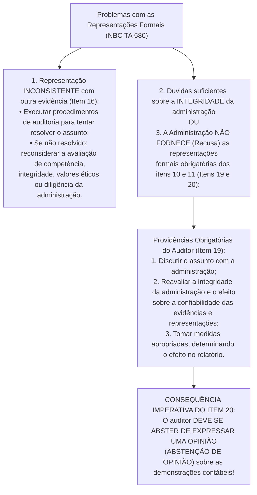

# Eventos Subsequentes (NBC TA 560), Continuidade Operacional (NBC TA 570) e Representações Formais (NBC TA 580)

> [!IMPORTANT]
> **BLUF (Bottom Line Up Front — Síntese Executiva):**
> Na reta final do ciclo de auditoria, antes de assinar seu relatório, o auditor deve cumprir três normas vitais: **NBC TA 560**, **NBC TA 570** e **NBC TA 580**. Na **NBC TA 560 (Eventos Subsequentes)**, a responsabilidade do auditor divide-se em **três fases temporais**: (1) até a data do seu relatório, ele tem **dever ativo** de executar procedimentos para identificar eventos subsequentes; (2) após a data do relatório e antes da divulgação, e (3) após a divulgação das demonstrações, ele **não tem dever ativo** de busca, mas se tomar conhecimento de fato relevante deve agir (podendo utilizar a **dupla datação** ou emitir novo relatório com parágrafo de Ênfase/Outros Assuntos). Na **NBC TA 570 (Continuidade Operacional)**, se o pressuposto de continuidade for **inapropriado**, o auditor emite **Opinião Adversa**; se o pressuposto for apropriado mas existir **incerteza relevante**: com divulgação adequada emite **Opinião Não Modificada + seção separada *"Incerteza Relevante Relacionada com a Continuidade Operacional"***, e com divulgação inadequada/omissa emite **Opinião com Ressalva ou Adversa**. Por fim, na **NBC TA 580 (Representações Formais)**, a carta da administração **não substitui** evidência de auditoria disponível, sua data **nunca pode ser posterior** à data do relatório do auditor, e a **recusa da administração** em fornecê-la (ou dúvida grave sobre sua integridade) impõe obrigatoriamente a **Abstenção de Opinião**.

---

## 1. Eventos Subsequentes em Auditoria (NBC TA 560 e CPC 24)

### 1.1. A Base Contábil: Eventos que Originam Ajuste vs. Eventos que NÃO Originam Ajuste (CPC 24)

As demonstrações contábeis podem ser afetadas por determinados eventos que ocorrem **após a data das demonstrações contábeis** (usualmente 31 de dezembro). Conforme a **NBC TA 560 (item 2)** e o **Pronunciamento Técnico CPC 24 (IAS 10 — Evento Subsequente)**, as estruturas de relatório financeiro identificam **dois tipos** de eventos subsequentes:

1. **Eventos Subsequentes Tipo 1 — Eventos que originam AJUSTE (*Adjusting Events*):**
   * **Conceito:** São aqueles que fornecem **evidência de condições que JÁ EXISTIAM na data das demonstrações contábeis** (em 31/12).
   * **Efeito Contábil Obrigatório:** A entidade **deve ajustar os valores reconhecidos** nas suas demonstrações contábeis de 31/12 (alterando saldos de ativos, passivos, receitas ou despesas e refazendo o balanço).
   * **Exemplos Clássicos do CPC 24:**
     - Decisão judicial definitiva proferida em fevereiro que confirma que a entidade já tinha uma obrigação presente na data do balanço (31/12) -> exige ajustar a provisão (CPC 25) ou reconhecer o passivo;
     - Recebimento de informação após 31/12 (como a decretação de **falência de um cliente** em janeiro) indicando que um ativo já estava com valor recuperável reduzido em 31/12, ou que o valor da perda estimada (PECLD) precisa ser ajustado;
     - Venda de estoques após 31/12 por valor inferior ao custo, fornecendo evidência de qual era o seu Valor Realizável Líquido em 31/12;
     - Determinação, após 31/12, do valor referente ao pagamento de participação nos lucros ou bônus a empregados, se a entidade tinha obrigação legal ou construtiva presente em 31/12;
     - Descoberta de **fraude ou erros** que demonstrem que as demonstrações contábeis estavam incorretas.

2. **Eventos Subsequentes Tipo 2 — Eventos que NÃO originam ajuste (*Non-Adjusting Events*):**
   * **Conceito:** São aqueles que são indicativos de **condições que SURGIRAM APÓS a data das demonstrações contábeis** (fatos inteiramente novos ocorridos no ano seguinte).
   * **Efeito Contábil Obrigatório:** A entidade **NÃO deve ajustar** os valores reconhecidos no balanço de 31/12! Contudo, se esses eventos que não originam ajuste forem **relevantes** (de tal porte que a não divulgação influenciaria as decisões econômicas dos usuários), a entidade **deve divulgar em notas explicativas**: (a) a natureza do evento; e (b) a estimativa de seu efeito financeiro, ou uma declaração de que tal estimativa não pode ser feita.
   * **Exemplos Clássicos do CPC 24:**
     - **Destruição de importante instalação de produção por incêndio** ou catástrofe natural ocorrida **após** 31/12 (ex.: em 15 de janeiro);
     - Declínio do valor justo de investimentos (queda da bolsa de valores ou variação cambial abrupta) ocorrido entre 31/12 e a data de autorização de emissão;
     - Importante combinação de negócios (aquisição de empresa) ou alienação de controlada ocorrida após 31/12;
     - Anúncio ou início de implementação de grande reestruturação, emissão de ações/debêntures ou anúncio de dividendos após 31/12;
     - Início de litígio importante proveniente **exclusivamente** de eventos que aconteceram **após** a data do balanço.

> [!WARNING]
> **Exceção Absoluta no CPC 24 (Destruição da Continuidade Operacional):**
> Se um evento ocorrido **após** a data do balanço (que normalmente seria Tipo 2, como um incêndio devastador em janeiro que destrói a única fábrica da empresa não segurada) for tão catastrófico que **inviabilize a continuidade operacional (*going concern*)** da entidade como um todo, a empresa **NÃO deve elaborar as demonstrações contábeis de 31/12 no pressuposto de continuidade operacional**, devendo refazê-las inteiramente em base de liquidação/descontinuidade!

---

### 1.2. Os Quatro Marcos Temporais da NBC TA 560 (Item 5)

Para compreender exatamente até onde vai a obrigação do auditor em cada fase, a NBC TA 560 define quatro marcos cronológicos distintos:

```mermaid
flowchart TD
    D1["<b>1. Data das Demonstrações Contábeis</b><br/><i>(Ex.: 31/12/20X1)</i><br/>Encerramento do período contábil auditado"]
    
    D2["<b>2. Data de Aprovação das Demonstrações</b><br/><i>(Ex.: 20/02/20X2)</i><br/>Administração declara responsabilidade pelas demonstrações"]
    
    D3["<b>3. Data do Relatório do Auditor</b><br/><i>(Ex.: 25/02/20X2)</i><br/>Emissão formal da opinião (nunca anterior a D2)"]
    
    D4["<b>4. Data de Divulgação das Demonstrações</b><br/><i>(Ex.: 05/03/20X2)</i><br/>Publicação oficial ao mercado e reguladores"]

    D1 -->|FASE 1: Obrigação ATIVA de executar procedimentos| D3
    D2 -.->|Requisito Prévio| D3
    D3 -->|FASE 2: Sem obrigação ativa (Antes da divulgação)| D4
    D4 -->|FASE 3: Sem obrigação ativa (Após a divulgação)| POS["Fatos supervenientes com impacto societário"]
```

* **DefiniçãoEstrita de "Eventos Subsequentes" na NBC TA 560 (Item 5, "e"):** Na terminologia estrita da NBC TA 560, a expressão *"eventos subsequentes"* refere-se aos eventos ocorridos **entre a data das demonstrações contábeis (D1) e a data do relatório do auditor (D3)**, enquanto os eventos descobertos depois de D3 são chamados pela norma de *"fatos que chegaram ao conhecimento do auditor após a data do seu relatório"*.

---

### 1.3. As Três Fases Temporais da NBC TA 560 Dissecadas

#### FASE 1: Eventos Ocorridos entre a Data das Demonstrações Contábeis e a Data do Relatório do Auditor (Itens 6 a 9)

* **Regra de Responsabilidade (Item 6):** Nesta primeira fase, o auditor possui **OBRIGAÇÃO ATIVA (Dever de Busca)**! O auditor **deve executar procedimentos de auditoria** desenhados para obter evidência de auditoria apropriada e suficiente de que **todos os eventos ocorridos entre a data das demonstrações contábeis e a data do relatório do auditor** que precisam ser ajustados ou divulgados nas demonstrações contábeis foram identificados.
* **Observação Importante:** O auditor não é obrigado a repetir todos os testes em contas que já foram testadas satisfatoriamente, mas deve cobrir todo o período entre a data das demonstrações contábeis e a data do relatório do auditor (ou a data mais próxima possível desta).
* **Os 4 Procedimentos Obrigatórios da Fase 1 (Item 7 da NBC TA 560):**
  1. **Obter entendimento de quaisquer procedimentos estabelecidos pela administração** para garantir que os eventos subsequentes sejam identificados;
  2. **Indagar da administração e, quando apropriado, dos responsáveis pela governança** sobre a ocorrência de eventos subsequentes que poderiam afetar as demonstrações contábeis (novos compromissos, empréstimos, garantias, vendas de ativos, litígios, emissão de ações, eventos que afetem a continuidade operacional ou estimativas);
  3. **Ler as atas, se houver, das reuniões dos proprietários, da administração e dos responsáveis pela governança**, realizadas **após** a data das demonstrações contábeis e **indagar sobre os assuntos discutidos nas reuniões para as quais as atas ainda não estão disponíveis**;
  4. **Ler as últimas demonstrações contábeis intermediárias (balancetes mensais/trimestrais) da entidade** posteriores ao encerramento, se houver;
  5. Além disso, o auditor **deve solicitar representação formal** (NBC TA 580) de que todos os eventos subsequentes que exigem ajuste ou divulgação foram ajustados ou divulgados (item 9).

---

#### FASE 2: Fatos que Chegam ao Conhecimento do Auditor APÓS a Data do Relatório, mas ANTES da Data de Divulgação das Demonstrações Contábeis (Itens 10 a 13)

* **Regra Matriz de Ausência de Dever Ativo (Item 10):** O auditor **NÃO tem obrigação de executar nenhum procedimento de auditoria** em relação às demonstrações contábeis após a data do seu relatório!
* **Gatilho de Ação Obrigatória:** Entretanto, se, após a data do seu relatório, mas antes da data de divulgação das demonstrações contábeis, **o auditor tomar conhecimento de fato que, se fosse do seu conhecimento na data do relatório, poderia tê-lo levado a alterar seu relatório**, o auditor **DEVE**:
  1. **Discutir o assunto** com a administração e, quando apropriado, com os responsáveis pela governança;
  2. **Determinar se as demonstrações contábeis precisam ser alteradas**; e, em caso afirmativo,
  3. **Indagar como a administração pretende tratar o assunto** nas demonstrações contábeis.

```mermaid
flowchart TD
    F2["FASE 2: Fato descoberto APÓS a data do relatório<br/>e ANTES da divulgação das demonstrações (Item 10)"]
    
    F2 --> DEC{"A Administração ALTEROU<br/>as demonstrações contábeis?"}
    
    DEC -->|SIM, alterou!| REST{"A lei/estrutura permite restringir<br/>a alteração apenas ao evento?"}
    
    REST -->|NÃO permite restringir| EST["Estender procedimentos de eventos<br/>subsequentes até a data do NOVO relatório<br/>e emitir novo relatório com nova data global."]
    
    REST -->|SIM, permite restringir<br/>(Item 12 da NBC TA 560)| OP["Duas Opções ao Auditor:<br/>1. DUPLA DATAÇÃO (Dual Dating):<br/>Alterar relatório incluindo data adicional<br/>restrita àquela alteração específica;<br/>OU<br/>2. NOVO RELATÓRIO com Parágrafo de<br/>ÊNFASE ou OUTROS ASSUNTOS informando<br/>a restrição dos procedimentos à alteração."]
    
    DEC -->|NÃO alterou!<br/>(Recusa da Administração - Item 13)| ENT{"O relatório do auditor JÁ FOI<br/>entregue à entidade?"}
    
    ENT -->|NÃO foi entregue ainda| MOD["Modificar a Opinião (NBC TA 705):<br/>Emitir Opinião com RESSALVA ou ADVERSA!"]
    
    ENT -->|SIM, já foi entregue à entidade| NOT["1. Notificar Administração e Governança para<br/>NÃO DIVULGAREM as demonstrações a terceiros;<br/>2. Se divulgarem mesmo assim: tomar medidas<br/>apropriadas para EVITAR QUE TERCEIROS<br/>CONFIEM no relatório do auditor!"]
```

> [!IMPORTANT]
> **O Mecanismo da Dupla Datação (*Dual Dating* — Item 12 e A13 da NBC TA 560):**
> Quando a administração altera as demonstrações contábeis na Fase 2 (ou Fase 3) e a estrutura não proíbe restringir a aprovação apenas àquela alteração específica, o auditor não precisa refazer os procedimentos de eventos subsequentes sobre o balanço inteiro! Ele pode auditar apenas a alteração daquela nota explicativa específica e escolher uma de duas vias para o seu relatório:
> 1. **Dupla Datação (Item 12, "a"):** Mantém a data original do relatório para todo o conjunto das demonstrações contábeis e acrescenta uma segunda data restrita especificamente à alteração (ex.: *"25 de fevereiro de 20X2, exceto quanto à Nota Explicativa 28, cuja data é 4 de março de 20X2"*); **OU**
> 2. **Novo Relatório com Ênfase ou Outros Assuntos (Item 12, "b"):** Emite um relatório novo ou alterado contendo um **Parágrafo de Ênfase** ou um **Parágrafo de Outros Assuntos** que transmite a informação de que os procedimentos do auditor sobre eventos subsequentes se restringiram exclusivamente à alteração das demonstrações contábeis descrita na respectiva nota explicativa.

---

#### FASE 3: Fatos que Chegam ao Conhecimento do Auditor APÓS a Divulgação das Demonstrações Contábeis (Itens 14 a 17)

* **Regra Matriz (Item 14):** Após a divulgação das demonstrações contábeis ao mercado, o auditor **não tem obrigação de executar nenhum procedimento de auditoria**. Porém, se chegar ao seu conhecimento fato que, se conhecido na data do relatório, poderia tê-lo levado a alterar seu relatório, ele deve aplicar exatamente o mesmo protocolo inicial: (a) discutir com a administração e a governança; (b) determinar se as demonstrações precisam ser alteradas; e (c) indagar como a administração pretende tratar o assunto.
* **Se a Administração ALTERAR as demonstrações já divulgadas (Itens 15 e 16):**
  1. O auditor executa os procedimentos de auditoria necessários nas circunstâncias sobre a alteração;
  2. O auditor **deve rever as medidas tomadas pela administração para garantir que todas as pessoas que receberam as demonstrações contábeis e o relatório anteriormente divulgados sejam informadas da situação** (ex.: Fato Relevante na CVM, aviso aos bancos credores e acionistas);
  3. O auditor estende os procedimentos de eventos subsequentes até a data do novo relatório (ou usa a restrição de escopo / dupla datação se permitido pelo item 12); e
  4. **EXIGÊNCIA ESPECÍFICA DA FASE 3 (Item 16):** O auditor deve incluir no relatório de auditoria novo ou alterado um **Parágrafo de Ênfase** ou um **Parágrafo de Outros Assuntos**, fazendo referência à **nota explicativa** que descreve mais detalhadamente a **razão da alteração das demonstrações contábeis anteriormente divulgadas** e ao **relatório anterior fornecido pelo auditor**!
* **Se a Administração NÃO tomar medidas para informar os usuários nem alterar as demonstrações (Item 17):**
  - O auditor deve notificar a administração e os responsáveis pela governança de que o auditor procurará **evitar que os usuários confiem no futuro no relatório de auditoria**. Se, apesar dessa notificação, a administração ou os responsáveis pela governança não tomarem as medidas necessárias, o auditor **deve tomar medidas apropriadas para tentar evitar que o usuário confie no relatório do auditor** (normalmente buscando assessoria jurídica e comunicando diretamente órgãos reguladores como CVM/BACEN ou bolsas de valores).

### 1.4. Quadro Sinóptico Comparativo das 3 Fases da NBC TA 560

| Critério | Fase 1 (Entre a Data do Balanço e a Data do Relatório) | Fase 2 (Após a Data do Relatório e Antes da Divulgação) | Fase 3 (Após a Divulgação das Demonstrações a Terceiros) |
| :--- | :--- | :--- | :--- |
| **Dever do Auditor de Buscar Eventos** | **DEVER ATIVO!** Obrigação de executar os procedimentos dos itens 6 a 9. | **SEM dever ativo.** Só age se o fato chegar ao seu conhecimento. | **SEM dever ativo.** Só age se o fato chegar ao seu conhecimento. |
| **Se a Administração Alterar o Balanço** | O balanço ainda está aberto; ajusta-se normalmente antes do relatório original. | Estende testes até nova data **ou** usa **Dupla Datação** / Novo Relatório com Ênfase ou Outros Assuntos (se restrito). | Revisa aviso aos usuários que receberam o antigo + emite Novo Relatório com **Ênfase ou Outros Assuntos** explicando a reapresentação (item 16). |
| **Se a Administração Recusar a Alteração Necessária** | Emite relatório com **Opinião Modificada** (Ressalva ou Adversa — NBC TA 705). | • Se relatório **não entregue**: modifica opinião (Ressalva/Adversa).<br/>• Se **já entregue**: notifica para não divulgar; se divulgar, age para impedir confiança de terceiros. | Notifica administração/governança e toma medidas legais/regulatórias para **impedir que usuários confiem no relatório**. |

---

## 2. Continuidade Operacional em Auditoria (NBC TA 570 — *Going Concern*)

### 2.1. O Pressuposto Contábil de Continuidade Operacional

De acordo com o regime contábil de continuidade operacional (CPC 00 e CPC 26), as demonstrações contábeis são elaboradas no pressuposto de que a entidade está em atividade e **continuará em operação no futuro previsível**. Ativos e passivos são registrados com base no fato de que a entidade será capaz de realizar seus ativos e liquidar seus passivos no **curso normal de seus negócios** (e não a preços de liquidação forçada).

* **Período Mínimo da Avaliação da Administração (Item 13):** A avaliação da administração sobre a capacidade de a entidade manter sua continuidade operacional deve abranger pelo menos **12 meses a partir da data das demonstrações contábeis** (como definido no CPC 26). Caso a avaliação da administração abranja menos de 12 meses, o auditor **deve solicitar que a administração estenda seu período de avaliação para pelo menos 12 meses** a partir daquela data!
* **Período Posteriores aos 12 Meses (Item 15):** Além disso, o auditor **deve indagar da administração sobre seu conhecimento de eventos ou condições posteriores ao período de avaliação da administração** que possam levantar dúvida significativa quanto à capacidade da entidade de manter sua continuidade operacional.

---

### 2.2. Exemplos de Eventos ou Condições que Levantam Dúvida Significativa (Item A3 da NBC TA 570)

A NBC TA 570 agrupa no item A3 os indicadores clássicos que individual ou coletivamente podem levantar dúvida significativa quanto à continuidade operacional em três categorias (**Financeiros**, **Operacionais** e **Outros**):

| Categoria | Indicadores Clássicos (Item A3 da NBC TA 570) |
| :--- | :--- |
| **1. Indicadores FINANCEIROS** | • **Passivo a descoberto** (patrimônio líquido negativo) ou **passivo circulante líquido** (capital circulante líquido negativo);<br/>• Empréstimos com **prazo fixo próximo do vencimento sem perspectivas realistas de renovação ou liquidação**; ou dependência excessiva de empréstimos de curto prazo para financiar ativos de longo prazo;<br/>• Indícios de retirada de suporte financeiro por credores;<br/>• **Fluxos de caixa operacionais negativos** indicados por demonstrações históricas ou prospectivas;<br/>• Índices financeiros-chave adversos; prejuízos operacionais substanciais ou deterioração significativa no valor de ativos geradores de caixa;<br/>• Atrasos ou suspensão de dividendos; incapacidade de pagar credores nas datas de vencimento;<br/>• Incapacidade de cumprir termos contratuais de empréstimos (*covenants*);<br/>• Mudança de transações a prazo para pagamento à vista junto a fornecedores; incapacidade de obter financiamentos para desenvolvimento de novos produtos essenciais. |
| **2. Indicadores OPERACIONAIS** | • Intenções da administração de liquidar a entidade ou interromper as operações;<br/>• **Perda de pessoal-chave da administração sem reposição**;<br/>• **Perda de mercado importante, cliente(s) principal(is), franquia, licença ou fornecedor(es) principal(is)**;<br/>• Dificuldades com mão de obra (greves prolongadas);<br/>• **Escassez de suprimentos/insumos importantes**;<br/>• Surgimento de concorrente altamente bem-sucedido que torne obsoleto o produto da entidade. |
| **3. OUTROS Indicadores** | • **Descumprimento de exigências de capital** ou de outras exigências estatutárias ou regulatórias (ex.: índice de Basileia em bancos ou margem de solvência em seguradoras e planos de saúde);<br/>• **Processos judiciais ou regulatórios pendentes** contra a entidade que, se bem-sucedidos, podem resultar em reivindicações que a entidade provavelmente não terá capacidade de saldar;<br/>• Mudanças em leis, regulamentos ou políticas governamentais que possam afetar adversamente a entidade;<br/>• **Catástrofes não seguradas ou subseguradas** quando de sua ocorrência. |

---

### 2.3. Procedimentos Adicionais quando Eventos ou Condições são Identificados (Item 16)

Se forem identificados eventos ou condições que possam levantar dúvida significativa quanto à continuidade operacional, o auditor **deve obter evidência de auditoria apropriada e suficiente** para determinar se existe ou não uma **incerteza relevante**, executando procedimentos adicionais que incluem:
1. Solicitar à administração que faça a sua avaliação (caso ainda não a tenha feito);
2. **Avaliar os planos da administração para ações futuras** em relação à sua avaliação de continuidade operacional (ex.: planos para liquidar ativos, tomar dinheiro emprestado ou reestruturar dívidas, reduzir ou postergar gastos, ou aumentar capital), analisando se o resultado desses planos provavelmente melhorará a situação e se os planos são **factíveis nas circunstâncias**;
3. Quando a entidade tiver elaborado **previsão de fluxo de caixa**, avaliar a **confiabilidade dos dados subjacentes** gerados para elaborar a previsão e determinar se há **suporte adequado para as premissas** subjacentes;
4. Considerar se quaisquer fatos ou informações adicionais se tornaram disponíveis desde a data em que a administração fez sua avaliação; e
5. Solicitar **representações formais** da administração (e da governança, quando apropriado) com relação a seus planos para ações futuras e a **viabilidade** desses planos.
* **E quando há suporte financeiro de terceiros ou partes relacionadas (Carta-Conforto / *Support Letter*)?** Se os planos da administração dependem de suporte financeiro de controladores ou bancos para manter a liquidez da empresa, o auditor deve obter evidência tanto da **intenção** (compromisso escrito/vinculante) quanto da **capacidade financeira real** desse terceiro de fornecer os recursos necessários!

---

### 2.4. A Matriz Decisória Completa de Impacto no Relatório do Auditor (Itens 18 a 24 da NBC TA 570)

Esta matriz resume a totalidade das decisões de relatório exigidas pela NBC TA 570 e é uma das mais cobradas pela FGV, FCC e Cebraspe:

```mermaid
flowchart TD
    INI{"O uso do pressuposto de<br/>Continuidade Operacional nas<br/>demonstrações é APROPRIADO?"}
    
    INI -->|NÃO! É INAPROPRIADO!<br/>(A empresa vai fechar e fez balanço<br/>normal em vez de base de liquidação)| ADV1["OPINIÃO ADVERSA (Item 21)<br/>⚠️ Mesmo que a administração tenha<br/>divulgado a situação em nota explicativa!"]
    
    INI -->|SIM, é apropriado!| INC{"Existe uma INCERTEZA RELEVANTE<br/>sobre a continuidade operacional?"}
    
    INC -->|NÃO há incerteza relevante<br/>(Mitigada pelos planos — Close Call)| LIMPA1["OPINIÃO NÃO MODIFICADA (Item 20)<br/>• Avaliar se as notas divulgam os eventos mitigadores;<br/>• Pode ser comunicado como PAA (NBC TA 701)."]
    
    INC -->|SIM, existe Incerteza Relevante!| DIV{"A divulgação nas Notas Explicativas<br/>é ADEQUADA?"}
    
    DIV -->|SIM, divulgação adequada!<br/>(Item 22 da NBC TA 570)| LIMPA2["OPINIÃO NÃO MODIFICADA ('Limpa')<br/>➕ SEÇÃO SEPARADA OBRIGATÓRIA:<br/>'Incerteza Relevante Relacionada com<br/>a Continuidade Operacional'"]
    
    DIV -->|NÃO! Divulgação inadequada<br/>ou OMISSA! (Item 23)| MOD["OPINIÃO MODIFICADA (NBC TA 705):<br/>• Opinião com RESSALVA (não generalizada)<br/>OU<br/>• Opinião ADVERSA (generalizada)<br/>➕ Explicar a incerteza relevante na<br/>seção 'Base para Opinião com Ressalva/Adversa'."]
```

#### Quadro Analítico Definitivo da NBC TA 570 no Relatório do Auditor:

| Cenário Técnico Constatado pelo Auditor | Tipo de Opinião a Emitir | Impacto Estrutural no Relatório do Auditor |
| :--- | :---: | :--- |
| **1. Uso Apropriado do pressuposto e SEM Incerteza Relevante** (Item 20) | **Opinião Não Modificada ("Limpa")** | Relatório padrão sem seção de incerteza relevante (se houve eventos mitigados por planos robustos, pode gerar um **PAA** conforme NBC TA 701). |
| **2. Uso Apropriado do pressuposto, COM Incerteza Relevante, e Divulgação ADEQUADA nas notas** (Item 22) | **Opinião Não Modificada ("Limpa")** | Inclui seção separada obrigatória intitulada **"Incerteza Relevante Relacionada com a Continuidade Operacional"**, chamando atenção para a nota explicativa e declarando que **a opinião do auditor não está modificada** em relação a esse assunto. |
| **3. Uso Apropriado do pressuposto, COM Incerteza Relevante, mas Divulgação INADEQUADA ou OMISSA nas notas** (Item 23) | **Opinião com Ressalva** ou **Opinião Adversa** | Não cria a seção de incerteza relevante; descreve na seção **"Base para a Opinião com Ressalva (ou Adversa)"** que existe incerteza relevante e que as demonstrações contábeis não divulgam adequadamente esse assunto. |
| **4. Uso INAPROPRIADO do pressuposto de continuidade operacional** (Item 21 — balanço elaborado em base de continuidade quando a descontinuidade é inevitável) | **Opinião Adversa** (Sempre!) | Emite **Opinião Adversa**, independentemente de as demonstrações contábeis incluírem ou não divulgação sobre a inadequação do uso do pressuposto pela administração! *(Se o balanço for elaborado em **base alternativa de liquidação** e o auditor concordar com essa base, pode emitir opinião não modificada + Parágrafo de Ênfase — item A27).* |
| **5. A Administração se RECUSA a fazer ou estender sua avaliação sobre a continuidade quando solicitada pelo auditor** (Item 24) | **Opinião com Ressalva** ou **Abstenção de Opinião** | Configura **limitação de escopo** (impossibilidade de obter evidência apropriada e suficiente sobre o uso do pressuposto pela administração). |

> [!CAUTION]
> **Atualização Normativa Pós-2016 que Derruba Candidatos Desatualizados!**
> Na versão antiga da NBC TA 570 (anterior a 2016), quando havia incerteza relevante adequadamente divulgada, o auditor incluía um *Parágrafo de Ênfase*. Na **NBC TA 570 vigente**, isso mudou: o auditor **NÃO usa mais Parágrafo de Ênfase** para incerteza relevante de continuidade operacional; ele é obrigado a criar uma **seção separada com título próprio**: **"Incerteza Relevante Relacionada com a Continuidade Operacional"**!
> Além disso, nos termos da **NBC TA 701 (item 15)**, embora uma incerteza relevante relacionada com a continuidade operacional seja, **por sua natureza, um Principal Assunto de Auditoria (PAA)**, ela **NÃO deve ser descrita na seção de Principais Assuntos de Auditoria**, devendo ser reportada exclusivamente na sua seção própria da NBC TA 570!

---

## 3. Representações Formais — Carta de Responsabilidade da Administração (NBC TA 580)

### 3.1. Conceito, Natureza e Limites Probatórios das Representações Formais

De acordo com o item 7 da **NBC TA 580**, **Representação Formal** é uma **declaração escrita pela administração, fornecida ao auditor, para confirmar certos assuntos ou para suportar outra evidência de auditoria**. As representações formais nesse contexto **não incluem** as demonstrações contábeis, as afirmações nelas contidas, ou os livros e registros de suporte. Na prática profissional brasileira, esse documento é consagrado como **Carta de Responsabilidade da Administração**.

> [!WARNING]
> **As Duas Regras de Ouro sobre o Valor Probatório da Representação Formal (Itens 3 e 4 da NBC TA 580):**
> 1. **Não fornece evidência suficiente sozinha:** Embora as representações formais forneçam evidência de auditoria necessária, elas **NÃO fornecem, por si sós, evidência de auditoria apropriada e suficiente** sobre qualquer um dos assuntos a que se referem!
> 2. **Não afasta limitação de escopo:** O fato de a administração ter fornecido representações formais confiáveis **NÃO afeta a natureza ou a extensão de outras evidências de auditoria** que o auditor obtenha! Se o auditor não conseguir obter evidência apropriada e suficiente que se esperava estar disponível (ex.: extratos bancários, contagem de estoques, notas fiscais), isso continuará sendo uma **limitação de escopo**, mesmo que o presidente da empresa assine uma representação formal jurando que o saldo está correto!

### 3.2. Conteúdo Obrigatório das Representações Formais (Itens 10, 11 e 13)

O auditor **deve solicitar** à administração que forneça representações formais sobre três blocos fundamentais:
1. **Elaboração das Demonstrações Contábeis (Item 10):** Que a administração cumpriu com sua responsabilidade pela elaboração das demonstrações contábeis de acordo com a estrutura de relatório financeiro aplicável, incluindo, quando relevante, sua apresentação adequada, conforme estabelecido nos termos do trabalho de auditoria (NBC TA 210);
2. **Informações Fornecidas e Integridade das Transações (Item 11):**
   - Que a administração forneceu ao auditor **todas as informações relevantes e o acesso**, conforme acordado nos termos do trabalho de auditoria; e
   - Que **todas as transações foram registradas e estão refletidas** nas demonstrações contábeis;
3. **Outras Representações Exigidas por Normas Específicas:** Tais como resumo de distorções não corrigidas consideradas imateriais (NBC TA 450), avaliação de risco e conhecimento de fraudes (NBC TA 240), leis e regulamentos (NBC TA 250), estimativas contábeis (NBC TA 540), partes relacionadas (NBC TA 550), eventos subsequentes (NBC TA 560), planos de continuidade operacional (NBC TA 570) e litígios e reivindicações (NBC TA 501).

---

### 3.3. Data das Representações Formais e Períodos Cobertos (Item 14 da NBC TA 580)

Esta regra temporal cai em praticamente todas as provas de auditoria:

> [!IMPORTANT]
> **Regra Temporal Estrita da Data da Carta de Representação (Item 14):**
> *"A data das representações formais deve ser **tão próxima quanto praticável, mas NÃO POSTERIOR**, à data do relatório do auditor sobre as demonstrações contábeis. As representações formais devem ser para **todas as demonstrações contábeis e períodos** referidos no relatório do auditor."*

* **Por que a data das representações formais NUNCA pode ser posterior à data do relatório do auditor?**
  Porque as representações formais são **evidências de auditoria necessárias**, e a NBC TA 700 proíbe que o auditor date o seu relatório antes de ter obtido todas as evidências necessárias! Na prática, a carta de representação e o relatório do auditor costumam ostentar **exatamente a mesma data**.
* **E se os atuais administradores NÃO estavam presentes nos períodos anteriores cobertos pelo relatório? (Item A17):**
  Mesmo que os atuais membros da administração tenham tomado posse apenas no exercício corrente e não estivessem presentes nos períodos anteriores, **a responsabilidade da administração pelas demonstrações contábeis continua integral**, e eles **NÃO se eximem** de fornecer as representações formais cobrindo **todos os períodos** referidos no relatório do auditor!

---

### 3.4. Dúvidas quanto à Confiabilidade das Representações ou Recusa da Administração (Itens 16 a 20)

O que acontece quando as representações formais são inconsistentes com outras evidências, quando o auditor duvida da integridade/ética da administração ou quando a diretoria se recusa a assinar a Carta de Responsabilidade?



> [!CAUTION]
> **Atenção Máxima ao Item 20 da NBC TA 580 (Sempre Cai!):**
> O auditor **DEVE SE ABSTER DE EXPRESSAR UMA OPINIÃO (Abstenção de Opinião)** sobre as demonstrações contábeis nos termos da NBC TA 705 se:
> **(a)** concluir que **há dúvidas suficientes sobre a integridade da administração**, de tal modo que as representações formais exigidas pelos itens 10 e 11 **não são confiáveis**; **OU**
> **(b)** **a administração não fornecer as representações formais exigidas pelos itens 10 e 11**!
> *(Pegadinha de prova: as bancas adoram dizer que a recusa da administração em fornecer a carta de representação gera "Opinião Adversa" ou "Opinião com Ressalva". **ERRADO!** Para as representações fundamentais dos itens 10 e 11, a norma impõe taxativamente a **ABSTENÇÃO DE OPINIÃO**!)*

---

## 4. Armadilhas de Banca ("Cascas de Banana")

| Armadilha Clássica de Prova | Por que é Falsa / Como a Banca Engana | Regra Correta das Normas (NBC TA 560, 570 e 580) |
| :--- | :--- | :--- |
| *"O incêndio ocorrido em 10 de janeiro de 20X2 que destruiu 30% do estoque da filial (sem afetar a continuidade operacional) é um evento subsequente que exige o ajuste contábil do saldo de estoques em 31/12/20X1."* | Confunde Evento Subsequente Tipo 1 (que origina ajuste) com Evento Subsequente Tipo 2 (que não origina ajuste). | O incêndio ocorreu **após** 31/12 (condição surgida após a data do balanço — Tipo 2). **NÃO origina ajuste** nos saldos de 31/12, exigindo apenas divulgação em nota explicativa se relevante. |
| *"O auditor tem obrigação ativa de executar procedimentos de auditoria continuamente até a data da assembleia geral ordinária e da publicação das demonstrações na imprensa."* | Estende indevidamente o dever ativo da Fase 1 para as Fases 2 e 3 da NBC TA 560. | O dever ativo de busca de eventos subsequentes vai **apenas até a data do relatório do auditor** (Fase 1). Após a data do relatório, o auditor **não tem obrigação ativa** de executar procedimentos (itens 10 e 14). |
| *"Quando existe incerteza relevante relacionada com a continuidade operacional e as notas explicativas divulgam adequadamente o fato, o auditor deve emitir opinião com ressalva (ou incluir um Parágrafo de Ênfase)."* | Dupla casca de banana: cobra modificação de opinião ou a regra antiga pré-2016 de Parágrafo de Ênfase. | Com divulgação adequada, o auditor emite **Opinião Não Modificada ("Limpa")** e inclui uma **seção separada** intitulada *"Incerteza Relevante Relacionada com a Continuidade Operacional"* (NBC TA 570, item 22). |
| *"Se a administração elaborou as demonstrações na base de continuidade operacional sendo esta inapropriada, mas divulgou amplamente em nota explicativa que a empresa entrará em liquidação, o auditor deve emitir opinião não modificada com seção de incerteza relevante."* | Induz o candidato a achar que uma "boa nota explicativa" salva o uso de um pressuposto contábil errado. | Se o uso do pressuposto de continuidade operacional é **inapropriado**, o auditor **DEVE expressar uma OPINIÃO ADVERSA**, **independentemente** de as demonstrações incluírem ou não divulgação sobre o fato (item 21)! |
| *"A carta de representação formal da administração pode ser datada até 5 dias úteis após a data do relatório do auditor, e sua recusa pela diretoria enseja opinião com ressalva."* | Viola os itens 14 e 20 da NBC TA 580. | A data das representações formais **nunca pode ser posterior** à data do relatório do auditor (item 14), e a recusa das representações dos itens 10 e 11 exige **Abstenção de Opinião** (item 20). |

---

## 5. Mnemônicos & Âncoras de Memória

> [!TIP]
> ### 1. Mnemônico dos Eventos Subsequentes (CPC 24 / NBC TA 560): **"JÁ EXISTIA = AJUSTA | SURGIU DEPOIS = NOTA"**
> * **Condição JÁ EXISTIA em 31/12** (Tipo 1 — ex.: sentença de processo antigo, falência de cliente devedor em 31/12) $\rightarrow$ **AJUSTA** o balanço!
> * **Condição SURGIU DEPOIS de 31/12** (Tipo 2 — ex.: incêndio em janeiro, queda de ações em fevereiro) $\rightarrow$ **NÃO AJUSTA** (apenas **NOTA** explicativa se relevante, salvo se destruir a continuidade operacional!).

> [!TIP]
> ### 2. Mnemônico da Matriz da Continuidade Operacional (NBC TA 570): **"INAPROPRIADO = ADVERSA | INCERTO + DIVULGADO = LIMPA + SEÇÃO | INCERTO + OMISSO = RESSALVA/ADVERSA"**
> * Pressuposto **Inapropriado** $\rightarrow$ **Opinião ADVERSA** (sem choro, mesmo com nota explicativa!).
> * Pressuposto **Apropriado + Incerteza Relevante + Divulgação Adequada** $\rightarrow$ **Opinião NÃO MODIFICADA (Limpa)** + Seção *"Incerteza Relevante Relacionada com a Continuidade Operacional"*.
> * Pressuposto **Apropriado + Incerteza Relevante + Divulgação Inadequada/Omissa** $\rightarrow$ **Opinião com RESSALVA ou ADVERSA**.

> [!TIP]
> ### 3. Mnemônico da Representação Formal (NBC TA 580): **"A-N-A"**
> * **A**ntes ou no mesmo dia do relatório (**nunca posterior** à data do relatório do auditor!);
> * **N**ão substitui evidência de auditoria que deveria estar disponível;
> * **A**bstenção de Opinião obrigatória se a administração recusar fornecer ou se houver dúvida grave sobre sua integridade!

---

## 6. Bateria de Questões Oficiais Comentadas Alternativa por Alternativa

### Questão 01 — [FGV — Receita Federal / Auditor-Fiscal — 2023]
**Identificador QC:** [Q2119000](https://www.qconcursos.com/questoes-de-concursos/questoes/f6211900-0b)

Em relação ao tratamento contábil e de auditoria dos eventos subsequentes nos termos da NBC TA 560 e do CPC 24, considere que o exercício social de uma companhia encerrou-se em 31/12/20X1 e que o relatório do auditor independente foi emitido em 28/02/20X2. Assinale a opção que apresenta um evento ocorrido em janeiro de 20X2 que **exige ajuste** nos valores reconhecidos nas demonstrações contábeis de 31/12/20X1:
* **A)** Um incêndio ocorrido em 18/01/20X2 em um galpão logístico secundário da companhia, sem comprometer a sua continuidade operacional.
* **B)** A decretação de falência, em 20/01/20X2, de um importante cliente da companhia, confirmando que o saldo de duplicatas a receber existente em 31/12/20X1 já era irrecuperável.
* **C)** Uma queda abrupta nas cotações da bolsa de valores em 25/01/20X2, que reduziu o valor de mercado da carteira de ações mantida pela companhia.
* **D)** O anúncio oficial, em 12/01/20X2, de um plano de descontinuação de uma unidade operacional e início de programa de demissão voluntária.
* **E)** A emissão de debêntures conversíveis em ações realizada pela companhia em 30/01/20X2 para financiar a expansão de suas plantas industriais.

**Gabarito Oficial:** **B**

**Comentários Analíticos Alternativa por Alternativa:**
* **(A) Incorreta:** O incêndio ocorrido em 18/01/20X2 é indicativo de condição que surgiu **após** 31/12/20X1 (Evento Subsequente Tipo 2 — não origina ajuste, apenas divulgação em nota explicativa se relevante, visto que não destruiu a continuidade operacional).
* **(B) Correta:** Conforme o item 9(b)(i) do CPC 24 e a NBC TA 560, a falência de um cliente ocorrida após o período contábil a que se referem as demonstrações normalmente confirma que o cliente já estava com problemas financeiros e que a perda já existia no final daquele período, constituindo um **evento subsequente que origina ajuste** nas demonstrações contábeis de 31/12/20X1.
* **(C) Incorreta:** O declínio do valor justo de investimentos entre o final do período contábil e a data de autorização de emissão das demonstrações reflete circunstâncias surgidas no período seguinte (CPC 24, item 11), não originando ajuste nos saldos de 31/12/20X1.
* **(D) Incorreta:** O anúncio de plano para descontinuar unidade operacional após 31/12/20X1 é exemplo expresso de evento subsequente que **não** origina ajuste (CPC 24, item 22, "b"), exigindo apenas divulgação se relevante.
* **(E) Incorreta:** Emissão significativa de títulos de dívida (debêntures) ou ações após a data do balanço é evento que **não** origina ajuste (CPC 24, item 22, "f").

---

> **🛡️ Regra de Ouro Inviolável:** Eventos Subsequentes (NBC TA 560 / CPC 24): Tipo 1 (condições existentes na data do balanço = exige AJUSTE); Tipo 2 (condições surgidas após a data do balanço = exige apenas DIVULGAÇÃO em notas).

### Questão 02 — [FGV — SEFAZ-MG / Auditor Fiscal da Receita Estadual — 2023]
**Identificador QC:** [Q2089500](https://www.qconcursos.com/questoes-de-concursos/questoes/0a208950-0c)

De acordo com a NBC TA 570 (Continuidade Operacional), quando o auditor conclui que o uso do pressuposto de continuidade operacional na elaboração das demonstrações contábeis é apropriado nas circunstâncias, mas existe uma incerteza relevante sobre a capacidade de a entidade manter sua continuidade operacional, e as demonstrações contábeis divulgam adequadamente os principais eventos, condições e planos da administração em nota explicativa, o auditor deve:
* **A)** expressar uma opinião com ressalva devido à magnitude do risco financeiro envolvido.
* **B)** abster-se de expressar uma opinião até que os planos de reestruturação financeira da administração sejam integralmente executados.
* **C)** expressar uma opinião não modificada e incluir no relatório do auditor uma seção separada sob o título *"Incerteza Relevante Relacionada com a Continuidade Operacional"*.
* **D)** expressar uma opinião não modificada e descrever a incerteza exclusivamente dentro da seção de *"Principais Assuntos de Auditoria (PAA)"*, sem criar seção específica de continuidade operacional.
* **E)** expressar uma opinião adversa, uma vez que a existência de incerteza relevante invalida automaticamente o pressuposto de continuidade operacional.

**Gabarito Oficial:** **C**

**Comentários Analíticos Alternativa por Alternativa:**
* **(A) Incorreta:** A opinião com ressalva só seria emitida se a divulgação nas notas explicativas fosse **inadequada ou omissa** (item 23) ou se a administração se recusasse a fazer a avaliação (item 24).
* **(B) Incorreta:** A existência de uma incerteza relevante devidamente auditada e adequadamente divulgada nas notas explicativas não configura limitação de escopo para abstenção de opinião.
* **(C) Correta:** Reproduz com exatidão o item 22 da NBC TA 570: se for feita divulgação adequada sobre a incerteza relevante nas demonstrações contábeis, o auditor **deve expressar uma opinião não modificada** e o relatório do auditor **deve incluir uma seção separada sob o título *"Incerteza Relevante Relacionada com a Continuidade Operacional"*** para chamar a atenção para a nota explicativa que divulga esses assuntos e declarar que a opinião do auditor não está modificada em relação a esse assunto.
* **(D) Incorreta:** Conforme a NBC TA 701 (item 15) e a NBC TA 570, embora a incerteza relevante relacionada com a continuidade operacional seja, por natureza, um Principal Assunto de Auditoria, ela **não deve ser descrita na seção de PAA**, mas sim na seção separada exigida pelo item 22 da NBC TA 570!
* **(E) Incorreta:** A opinião adversa só é aplicável se o pressuposto de continuidade operacional for **inapropriado** (item 21) ou se a omissão de divulgação da incerteza relevante nas notas explicativas tiver efeito generalizado (item 23).

---

> **🛡️ Regra de Ouro Inviolável:** Continuidade com incerteza relevante: se adequadamente divulgada nas notas explicativas, emite-se opinião NÃO modificada com parágrafo específico de "Incerteza Relevante Relacionada com a Continuidade Operacional".

### Questão 03 — [Cebraspe — TCU / Auditor Federal de Controle Externo — 2022]
**Identificador QC:** [Q1889460](https://www.qconcursos.com/questoes-de-concursos/questoes/8b188946-0d)

Acerca das disposições da NBC TA 560 (Eventos Subsequentes) sobre fatos que chegam ao conhecimento do auditor após a data do seu relatório, mas antes da data de divulgação das demonstrações contábeis, assinale a opção correta:
* **A)** O auditor tem a obrigação de manter procedimentos ativos de inspeção documental diária na entidade até a data da efetiva publicação das demonstrações contábeis no Diário Oficial.
* **B)** Caso a administração altere as demonstrações contábeis e a lei ou a estrutura de relatório financeiro não proíba que a administração restrinja a alteração aos efeitos do evento subsequente, o auditor está autorizado a limitar a extensão dos procedimentos de eventos subsequentes a essa alteração e optar pela dupla datação do relatório ou pela emissão de novo relatório com parágrafo de ênfase ou de outros assuntos.
* **C)** Se o auditor considerar que as demonstrações contábeis precisam ser alteradas, mas a administração não as alterar, sendo que o relatório do auditor ainda não foi entregue à entidade, o auditor deve entregá-lo com opinião não modificada acompanhada de um parágrafo de outros assuntos.
* **D)** É terminantemente vedado ao auditor alterar a data do seu relatório ou incluir data adicional após a assinatura original dos papéis de trabalho.
* **E)** O auditor somente deve discutir o fato com a administração caso o evento subsequente tenha sido provocado por fraude dolosa dos próprios diretores.

**Gabarito Oficial:** **B**

**Comentários Analíticos Alternativa por Alternativa:**
* **(A) Incorreta:** O item 10 da NBC TA 560 estabelece expressamente que o auditor **não tem obrigação de executar nenhum procedimento de auditoria** em relação às demonstrações contábeis após a data do seu relatório.
* **(B) Correta:** Reflete exatamente o disposto no item 12, alíneas (a) e (b), da NBC TA 560: quando a legislação ou a estrutura não proíbe restringir a alteração das demonstrações aos efeitos do evento subsequente, o auditor está autorizado a limitar a extensão dos procedimentos de eventos subsequentes a essa alteração e pode **ou** alterar o relatório para incluir uma **data adicional restrita a essa alteração** (*dupla datação*) **ou** fornecer um **relatório novo ou alterado** que inclua declaração em **Parágrafo de Ênfase** ou em **Parágrafo de Outros Assuntos** informando que os procedimentos sobre eventos subsequentes se restringiram exclusivamente à alteração descrita na nota explicativa.
* **(C) Incorreta:** Conforme o item 13(a) da NBC TA 560, se a administração não alterar as demonstrações quando o auditor considera que precisam ser alteradas e o relatório ainda não tiver sido entregue à entidade, o auditor **deve modificar a opinião (Ressalva ou Adversa)** de acordo com a NBC TA 705!
* **(D) Incorreta:** O item 11 e o item 12 preveem expressamente a extensão da data para um novo relatório ou a inclusão de data adicional (dupla datação).
* **(E) Incorreta:** Qualquer fato relevante (decorrente de erro, fraude ou evento externo) que, se conhecido na data do relatório, poderia ter levado o auditor a alterar seu relatório obriga a discussão imediata com a administração e a governança (item 10).

---

> **🛡️ Regra de Ouro Inviolável:** Fatos conhecidos após o relatório mas antes da divulgação (Fase 2): o auditor discute com a gestão, determina a necessidade de alteração e indaga como a administração pretende tratar o assunto.

### Questão 04 — [FCC — SEFAZ-PE / Auditor Fiscal do Tesouro Estadual — 2022]
**Identificador QC:** [Q1945670](https://www.qconcursos.com/questoes-de-concursos/questoes/d5194567-0b)

De acordo com a NBC TA 580 (Representações Formais), na fase de conclusão dos trabalhos de auditoria das demonstrações contábeis, o auditor independente solicita à administração a emissão da Carta de Responsabilidade. Sobre esse instrumento, é correto afirmar que:
* **A)** a data das representações formais deve ser tão próxima quanto praticável, mas não posterior, à data do relatório do auditor sobre as demonstrações contábeis.
* **B)** as representações formais fornecem, por si sós, evidência de auditoria apropriada e suficiente para comprovar a existência física de estoques que não puderam ser contados nem testados por procedimentos alternativos.
* **C)** caso os atuais membros da diretoria tenham assumido seus cargos apenas no último mês do exercício corrente, estão dispensados de fornecer representações formais relativas ao início do exercício e aos períodos comparativos referidos no relatório do auditor.
* **D)** se a administração se recusar a fornecer as representações formais obrigatórias sobre o cumprimento de suas responsabilidades na elaboração das demonstrações contábeis, o auditor deve emitir uma opinião com ressalva.
* **E)** as representações formais incluem os livros contábeis diário e razão, bem como os quadros demonstrativos do balanço patrimonial e da demonstração do resultado.

**Gabarito Oficial:** **A**

**Comentários Analíticos Alternativa por Alternativa:**
* **(A) Correta:** Transcrição literal do item 14 da NBC TA 580: *"A data das representações formais deve ser tão próxima quanto praticável, mas não posterior, à data do relatório do auditor sobre as demonstrações contábeis"*.
* **(B) Incorreta:** Conforme os itens 3 e 4 da NBC TA 580, as representações formais **não fornecem, por si sós, evidência de auditoria apropriada e suficiente** sobre qualquer um dos assuntos a que se referem e não substituem outras evidências que se espera estarem disponíveis.
* **(C) Incorreta:** Segundo o item 14 e o item A17 da NBC TA 580, as representações formais devem cobrir **todas as demonstrações contábeis e períodos referidos no relatório do auditor**, mesmo que os atuais administradores não estivessem presentes em todos os períodos, pois essa circunstância não diminui a responsabilidade da administração pelas demonstrações contábeis como um todo.
* **(D) Incorreta:** Nos termos taxativos do item 20 da NBC TA 580, se a administração **não fornecer** as representações formais exigidas pelos itens 10 e 11 (ou se houver dúvidas suficientes sobre a integridade da administração que as tornem não confiáveis), o auditor **deve se abster de expressar uma opinião (Abstenção de Opinião)**!
* **(E) Incorreta:** O item 7 da NBC TA 580 explicita que as representações formais **não incluem** as demonstrações contábeis, as afirmações nelas contidas, ou os livros e registros de suporte.

---

> **🛡️ Regra de Ouro Inviolável:** Representações Formais (NBC TA 580): a data da carta deve ser tão próxima quanto praticável da data do relatório do auditor (mas NUNCA posterior a esta). A carta é necessária, mas não substitui outras evidências.

### Questão 05 — [FGV — CGU / Auditor Federal de Finanças e Controle — 2022]
**Identificador QC:** [Q2123490](https://www.qconcursos.com/questoes-de-concursos/questoes/5d212349-0f)

Durante a auditoria das demonstrações contábeis de uma sociedade empresária que atravessa severa crise econômico-financeira, o auditor constatou que a administração elaborou as demonstrações contábeis utilizando o pressuposto de continuidade operacional. Todavia, com base nas evidências de auditoria obtidas, o auditor concluiu que a entidade não tem alternativa realista senão a sua liquidação imediata, sendo o uso do pressuposto de continuidade operacional na elaboração das demonstrações contábeis **inapropriado**. Sabendo que a administração incluiu uma nota explicativa detalhada relatando a crise e a provável liquidação, o auditor, nos termos da NBC TA 570, deve expressar:
* **A)** opinião não modificada, acrescentando um parágrafo de ênfase que remeta à nota explicativa.
* **B)** opinião não modificada, acrescentando a seção *"Incerteza Relevante Relacionada com a Continuidade Operacional"*.
* **C)** opinião com ressalva, visto que a divulgação em nota explicativa atenua a distorção do balanço.
* **D)** abstenção de opinião, por impossibilidade de mensurar os valores de liquidação forçada dos ativos.
* **E)** opinião adversa, independentemente de as demonstrações contábeis incluírem ou não divulgação sobre a inadequação do uso do pressuposto de continuidade operacional pela administração.

**Gabarito Oficial:** **E**

**Comentários Analíticos Alternativa por Alternativa:**
* **(A) e (B) Incorretas:** A opinião não modificada com seção de incerteza relevante só se aplica quando o uso do pressuposto de continuidade operacional é **apropriado** (item 22). Quando o uso do pressuposto é **inapropriado**, jamais cabe opinião não modificada.
* **(C) Incorreta:** Elaborar o balanço inteiro sob um pressuposto contábil inapropriado gera distorção relevante e **generalizada** em todas as demonstrações contábeis, não cabendo simples ressalva.
* **(D) Incorreta:** O auditor obteve evidência apropriada e suficiente de que o pressuposto é inapropriado; logo, não há limitação de escopo para abstenção, mas sim distorção relevante e generalizada.
* **(E) Correta:** Reproduz literalmente o item 21 e o item A26 da NBC TA 570: *"Se as demonstrações contábeis foram elaboradas utilizando o pressuposto de continuidade operacional, mas, no julgamento do auditor, a utilização do pressuposto de continuidade operacional nas demonstrações contábeis pela administração é inapropriada, **o auditor deve expressar uma opinião adversa**"* — e o item A26 complementa que essa regra aplica-se **independentemente de as demonstrações contábeis incluírem ou não divulgação** sobre a inadequação do uso do pressuposto pela administração!

---

> **🛡️ Regra de Ouro Inviolável:** Se as demonstrações foram elaboradas no pressuposto da continuidade, mas o auditor conclui que esse pressuposto é INAPROPRIADO, o auditor DEVE emitir Opinião Adversa (NBC TA 570, item 21).

### Questão 06 — [FCC — TCE-GO / Analista de Controle Externo — 2024]
**Identificador QC:** [Q2214580](https://www.qconcursos.com/questoes-de-concursos/questoes/6f221458-0c)

Após a divulgação das demonstrações contábeis e do respectivo relatório do auditor independente ao mercado (Fase 3 da NBC TA 560), chegou ao conhecimento do auditor que uma fraude contábil relevante havia inflado o saldo de receitas do exercício auditado. Após discussão com o auditor, a administração decidiu alterar as demonstrações contábeis anteriormente divulgadas, informar os usuários e emitir novas demonstrações contábeis retificadas. Nesse caso, segundo o item 16 da NBC TA 560, o novo relatório do auditor independente deve obrigatoriamente:
* **A)** omitir qualquer menção ao relatório anteriormente emitido para evitar danos reputacionais à companhia auditada.
* **B)** incluir um Parágrafo de Ênfase ou um Parágrafo de Outros Assuntos fazendo referência à nota explicativa que descreve mais detalhadamente a razão da alteração das demonstrações contábeis anteriormente divulgadas e ao relatório anterior fornecido pelo auditor.
* **C)** manter exatamente a mesma data do relatório original, sendo vedada qualquer alteração de data ou dupla datação.
* **D)** expressar obrigatoriamente uma opinião adversa, ainda que a administração tenha corrigido integralmente a distorção nas novas demonstrações contábeis.
* **E)** ser assinado exclusivamente pelo Conselho de Administração em conjunto com o auditor interno da companhia.

**Gabarito Oficial:** **B**

**Comentários Analíticos Alternativa por Alternativa:**
* **(A) Incorreta:** É estritamente obrigatório alertar os usuários sobre a substituição das demonstrações anteriormente divulgadas e do relatório anterior.
* **(B) Correta:** Transcreve literalmente o comando do item 16 da NBC TA 560: quando as demonstrações contábeis são alteradas após a sua divulgação, o auditor deve incluir no relatório de auditoria novo ou alterado um **Parágrafo de Ênfase** ou um **Parágrafo de Outros Assuntos**, fazendo referência à **nota explicativa** que descreve mais detalhadamente a razão da alteração das demonstrações contábeis anteriormente divulgadas e ao **relatório anterior fornecido pelo auditor**.
* **(C) Incorreta:** O novo relatório nunca pode ter data anterior à aprovação das demonstrações alteradas (item 15, "c"), devendo receber nova data global ou dupla datação (conforme o item 12).
* **(D) Incorreta:** Se a administração alterou e corrigiu adequadamente as demonstrações contábeis e divulgou a razão da reapresentação em nota explicativa, a nova opinião será não modificada (acompanhada do parágrafo de Ênfase/Outros Assuntos do item 16).
* **(E) Incorreta:** O relatório do auditor independente é de assinatura privativa do auditor independente (contador/firma registrada).

---

> **🛡️ Regra de Ouro Inviolável:** Fase 3 (após a publicação ao mercado): o auditor não tem obrigação de executar procedimentos adicionais, mas se tomar conhecimento de fato grave que existia na data do relatório, deve agir para evitar o uso indevido.

### Questão 07 — [FGV — CGE-SC / Auditor do Estado — 2023]
**Identificador QC:** [Q1890150](https://www.qconcursos.com/questoes-de-concursos/questoes/5a189015-0b)

A respeito dos procedimentos de auditoria obrigatórios para identificação de eventos ocorridos entre a data das demonstrações contábeis e a data do relatório do auditor (Fase 1 da NBC TA 560), analise as afirmativas a seguir:
I. O auditor deve ler as atas, se houver, das reuniões dos proprietários, da administração e dos responsáveis pela governança, realizadas após a data das demonstrações contábeis, e indagar sobre os assuntos discutidos nas reuniões para as quais as atas ainda não estão disponíveis.
II. O auditor deve ler as últimas demonstrações contábeis intermediárias da entidade posteriores ao encerramento do exercício, se houver.
III. O auditor deve obter entendimento de quaisquer procedimentos estabelecidos pela administração para garantir que os eventos subsequentes sejam identificados.
Está correto o que se afirma em:
* **A)** I, apenas.
* **B)** I e II, apenas.
* **C)** I e III, apenas.
* **D)** II e III, apenas.
* **E)** I, II e III.

**Gabarito Oficial:** **E**

**Comentários Analíticos Alternativa por Alternativa:**
* **Análise do Item I (Correto):** Corresponde literalmente ao item 7(c) da NBC TA 560.
* **Análise do Item II (Correto):** Corresponde literalmente ao item 7(d) da NBC TA 560.
* **Análise do Item III (Correto):** Corresponde literalmente ao item 7(a) da NBC TA 560 (além do item 7, "b", que exige indagar da administração e dos responsáveis pela governança sobre a ocorrência de eventos subsequentes).
* **Conclusão:** Todos os itens **I, II e III** estão perfeitamente corretos. Gabarito: **(E)**.

---

> **🛡️ Regra de Ouro Inviolável:** Procedimentos na Fase 1: leitura de atas de reuniões, exame de balancetes intermediários mais recentes, indagações aos advogados sobre litígios e indagações à administração sobre garantias ou contingências.

### Questão 08 — [Cebraspe — SEFAZ-CE / Auditor Fiscal da Receita Estadual — 2021]
**Identificador QC:** [Q1789070](https://www.qconcursos.com/questoes-de-concursos/questoes/5e178907-0a)

De acordo com a NBC TA 570 (Continuidade Operacional), na avaliação da avaliação feita pela administração sobre a capacidade de a entidade manter sua continuidade operacional, caso a avaliação realizada pela administração abranja um período inferior a doze meses a partir da data das demonstrações contábeis, o auditor independente deve:
* **A)** aceitar o período menor utilizado pela administração, desde que seja superior a seis meses.
* **B)** elaborar pessoalmente as projeções financeiras dos meses faltantes para substituir a avaliação da administração.
* **C)** solicitar que a administração estenda seu período de avaliação para pelo menos doze meses a partir daquela data e, caso a administração se recuse a fazê-lo ou a estendê-lo, considerar as implicações para o relatório do auditor (opinião com ressalva ou abstenção de opinião).
* **D)** emitir imediatamente uma opinião adversa por descumprimento da estrutura conceitual de contabilidade.
* **E)** reportar o fato em parágrafo de outros assuntos sem solicitar qualquer complementação à diretoria da entidade.

**Gabarito Oficial:** **C**

**Comentários Analíticos Alternativa por Alternativa:**
* **(A) Incorreta:** O período mínimo normativo é de **12 meses** a partir da data das demonstrações contábeis (item 13 da NBC TA 570 e CPC 26).
* **(B) Incorreta:** Conforme o item A35 da NBC TA 570, não é responsabilidade do auditor retificar a falta de análise da administração elaborando ele mesmo a avaliação que compete à administração.
* **(C) Correta:** Combina com exatidão os itens 13 e 24 (e item A35) da NBC TA 570: se a avaliação da administração abranger menos de 12 meses a partir da data das demonstrações contábeis, o auditor **deve solicitar que a administração estenda seu período de avaliação para pelo menos 12 meses** a partir daquela data. Se a administração **não quiser fazer ou estender sua avaliação** quando solicitada pelo auditor, o auditor deve considerar as implicações para o seu relatório (item 24), sendo apropriada uma **opinião com ressalva** ou uma **abstenção de opinião** devido à impossibilidade de obter evidência apropriada e suficiente (item A35).
* **(D) Incorreta:** A recusa em fazer ou estender a avaliação configura **limitação de escopo** (Ressalva ou Abstenção), e não comprovação de uso inapropriado do pressuposto (Adversa).
* **(E) Incorreta:** O item 13 obriga o auditor a solicitar formalmente a extensão da avaliação para no mínimo 12 meses.

---

> **🛡️ Regra de Ouro Inviolável:** Horizonte de Continuidade (NBC TA 570): a avaliação da capacidade de continuidade da entidade deve abranger um período mínimo de 12 (doze) meses a contar da data das demonstrações contábeis.

### Questão 09 — [FGV — SEFAZ-MT / Fiscal de Tributos Estaduais — 2023]
**Identificador QC:** [Q2145690](https://www.qconcursos.com/questoes-de-concursos/questoes/9a214569-0f)

A respeito do tratamento de inconsistências ou dúvidas quanto à confiabilidade das representações formais previstas na NBC TA 580, assinale a afirmativa correta:
* **A)** Se as representações formais forem inconsistentes com outra evidência de auditoria obtida, o auditor deve descartar a outra evidência e prevalecer a palavra escrita da diretoria.
* **B)** Caso o auditor conclua que há dúvidas suficientes sobre a integridade da administração, de tal modo que as representações formais exigidas sobre a elaboração das demonstrações contábeis e a integridade das informações não sejam confiáveis, o auditor deve se abster de expressar uma opinião sobre as demonstrações contábeis.
* **C)** Quando a administração modifica os termos da representação formal exigida pela norma para eximir-se de responsabilidade por controles internos, o auditor deve aceitar a carta modificada e emitir opinião limpa.
* **D)** As representações formais podem ser prestadas exclusivamente de forma verbal em reunião gravada com o Conselho Fiscal, dispensando-se a forma escrita.
* **E)** O auditor independente deve redigir e assinar sozinho a carta de representação formal caso o Diretor Financeiro esteja em viagem internacional na data do relatório.

**Gabarito Oficial:** **B**

**Comentários Analíticos Alternativa por Alternativa:**
* **(A) Incorreta:** Conforme o item 16 da NBC TA 580, se as representações formais forem inconsistentes com outra evidência de auditoria, o auditor **deve executar procedimentos de auditoria para tentar resolver o assunto** e, se o assunto permanecer não resolvido, reconsiderar a avaliação da competência, integridade, valores éticos ou diligência da administração.
* **(B) Correta:** Reproduz literalmente o item 20(a) da NBC TA 580: o auditor **deve se abster de expressar uma opinião** sobre as demonstrações contábeis de acordo com a NBC TA 705 se concluir que há dúvidas suficientes sobre a integridade da administração, de tal modo que as representações formais exigidas pelos itens 10 e 11 não são confiáveis.
* **(C) Incorreta:** Se a administração amputar ou alterar substancialmente as declarações obrigatórias dos itens 10 e 11, equivale à não entrega das representações formais exigidas, levando à abstenção de opinião (item 20, "b").
* **(D) Incorreta:** Como o próprio nome e o item 7 da NBC TA 580 determinam, a representação formal é obrigatoriamente uma **declaração escrita** fornecida pela administração ao auditor.
* **(E) Incorreta:** A carta de representação formal emana obrigatoriamente da **administração da entidade** (CEO, CFO ou equivalentes), jamais podendo ser assinada pelo próprio auditor para si mesmo.

---

> **🛡️ Regra de Ouro Inviolável:** Se a administração se recusa a fornecer representações formais essenciais sobre suas responsabilidades, o auditor deve abster-se de emitir opinião sobre as demonstrações contábeis (NBC TA 580, item 20).

### Questão 10 — [FCC — TRT-4 / Analista Judiciário — Área Contábil — 2022]
**Identificador QC:** [Q1912380](https://www.qconcursos.com/questoes-de-concursos/questoes/0a191238-0d)

Na auditoria de uma instituição, o auditor identificou incerteza relevante relacionada com a continuidade operacional decorrente do vencimento iminente de debêntures equivalentes a 80% do ativo total, sem caixa disponível para pagamento. O pressuposto de continuidade operacional ainda é considerado apropriado caso a renegociação em curso seja concluída, mas a administração **omitiu completamente** qualquer menção a essa incerteza relevante nas notas explicativas das demonstrações contábeis. Nessa hipótese, segundo o item 23 da NBC TA 570, o auditor deve:
* **A)** expressar uma opinião não modificada e suprir a omissão da administração explicando todo o endividamento em um Parágrafo de Outros Assuntos.
* **B)** expressar uma opinião com ressalva ou uma opinião adversa, conforme apropriado de acordo com a NBC TA 705, e declarar na seção *"Base para a Opinião com Ressalva (ou Adversa)"* que existe uma incerteza relevante que pode levantar dúvida significativa quanto à continuidade operacional e que as demonstrações contábeis não divulgam adequadamente esse assunto.
* **C)** abster-se de expressar opinião sobre as demonstrações contábeis e renunciar imediatamente ao contrato de auditoria.
* **D)** expressar uma opinião não modificada e incluir a seção *"Incerteza Relevante Relacionada com a Continuidade Operacional"*.
* **E)** aguardar pelo prazo de até um ano após o encerramento do exercício para verificar o desfecho da renegociação antes de emitir seu relatório.

**Gabarito Oficial:** **B**

**Comentários Analíticos Alternativa por Alternativa:**
* **(A) e (D) Incorretas:** O auditor jamais pode emitir opinião não modificada nem usar Parágrafo de Ênfase/Outros Assuntos ou a seção do item 22 para "consertar" uma omissão relevante de nota explicativa que era obrigação da administração divulgar!
* **(B) Correta:** Transcreve com fidelidade absoluta o item 23, alíneas (a) e (b), da NBC TA 570: se não for feita divulgação adequada sobre a incerteza relevante nas demonstrações contábeis, o auditor **deve expressar uma opinião com ressalva ou uma opinião adversa**, conforme apropriado de acordo com a NBC TA 705, e declarar na seção *"Base para a Opinião com Ressalva (ou Adversa)"* que existe uma incerteza relevante que pode levantar dúvida significativa quanto à capacidade da entidade de manter sua continuidade operacional e que as demonstrações contábeis não divulgam adequadamente esse assunto.
* **(C) Incorreta:** Omissão de divulgação obrigatória em nota explicativa é uma **distorção relevante nas demonstrações contábeis** (que gera Ressalva ou Adversa), e não uma limitação de escopo (Abstenção).
* **(E) Incorreta:** O auditor deve formar sua opinião e emitir o relatório dentro do cronograma contratual e legal com base nas evidências e divulgações existentes.

> **🛡️ Regra de Ouro Inviolável:** Se a incerteza relevante de continuidade NÃO estiver adequadamente divulgada nas notas explicativas, o auditor deve expressar opinião com RESSALVA ou ADVERSA, conforme aplicável (NBC TA 570, item 23).


---

### Questão 11 — [FGV — Receita Federal / Analista-Tributário — 2023]
**Identificador QC:** [Q2119880](https://www.qconcursos.com/questoes-de-concursos/questoes/d4211988-0e)

Na hipótese de a administração de uma entidade alterar as demonstrações contábeis após a emissão do relatório do auditor independente para refletir um evento subsequente específico (Fase 2 da NBC TA 560), o auditor pode limitar os seus procedimentos de auditoria a essa alteração. Nessa circunstância, a respeito da datação do relatório do auditor, é CORRETO afirmar que:

* **A)** O auditor deve retroagir a data do relatório para o primeiro dia útil do exercício seguinte, anulando todos os efeitos dos procedimentos executados anteriormente.
* **B)** O auditor pode emitir um novo relatório com data dupla (por exemplo, mantendo a data original para o trabalho geral e incluindo uma data posterior restrita à nota explicativa alterada).
* **C)** O auditor está proibido de utilizar data dupla, sendo compulsória a reexecução integral de todos os procedimentos de auditoria sobre todas as contas do balanço.
* **D)** A aposição de nova data no relatório dispensa a obtenção de nova carta de representação formal da administração.
* **E)** O auditor deve emitir parecer com abstenção de opinião sempre que houver alteração de notas explicativas após o encerramento do trabalho de campo.

#### Gabarito e Dissecação Técnica: **Alternativa B**

**Comentário Analítico Alternativa por Alternativa:**
* **(A) INCORRETA:** É terminantemente proibido retroagir a data do relatório (antidatar); a data do relatório deve refletir a data em que o auditor obteve evidência suficiente e apropriada para fundamentar sua opinião.
* **(B) CORRETA:** Reflete com fidelidade o item 12 da NBC TA 560: quando a lei ou as normas permitem que a administração limite a alteração das demonstrações contábeis aos efeitos do evento subsequente que causou a alteração, o auditor pode limitar os procedimentos a essa alteração e: (a) alterar o relatório para incluir uma **data adicional restrita à alteração (data dupla / *dual dating*)**, indicando que os procedimentos sobre eventos subsequentes estão restritos à alteração descrita na respectiva nota explicativa; ou (b) emitir um relatório novo ou reemitido com nova data integral.
* **(C) INCORRETA:** O uso de data dupla é expressamente facultado pela NBC TA 560, item 12(a), exatamente para evitar o custo e o tempo de reabertura integral dos testes em áreas que não foram afetadas pelo evento subsequente.
* **(D) INCORRETA:** O auditor deve estender os procedimentos de representação formal até a data do novo relatório ou obter representações específicas sobre o evento alterado (item 13 da NBC TA 560).
* **(E) INCORRETA:** A modificação da nota explicativa decorrente de evento subsequente devidamente ajustado não enseja abstenção de opinião se for adequadamente refletida nas demonstrações.

> **🛡️ Regra de Ouro Inviolável:** Se as demonstrações forem alteradas após o relatório por um evento subsequente pontual, o auditor pode aplicar **Data Dupla (*Dual Dating*)**: mantém a data original do relatório e adiciona uma data posterior restrita à nota explicativa alterada (NBC TA 560, item 12).

---

### Questão 12 — [Cebraspe — TCU / Auditor Federal de Controle Externo — 2022]
**Identificador QC:** [Q1889780](https://www.qconcursos.com/questoes-de-concursos/questoes/6a188978-0a)

De acordo com a NBC TA 580 (Representações Formais), se a administração da entidade auditada se recusar formalmente a assinar e entregar a carta de representação requerida pelo auditor independente a respeito de suas responsabilidades fundamentais pela elaboração das demonstrações contábeis e pelo fornecimento de todas as informações relevantes, o auditor DEVE:

* **A)** Emitir um relatório com opinião sem ressalva e incluir uma ressalva verbal na assembleia geral de acionistas.
* **B)** Emitir um relatório com abstenção de opinião sobre as demonstrações contábeis, em virtude de limitação grave no escopo do trabalho.
* **C)** Substituir a carta de representação por uma declaração juramentada assinada pelos advogados externos da companhia.
* **D)** Concluir que a recusa da administração é um erro não intencional e aceitar relatórios preliminares de gestão em substituição.
* **E)** Presumir que o controle interno opera com eficácia máxima e emitir relatório com opinião favorável plena.

#### Gabarito e Dissecação Técnica: **Alternativa B**

**Comentário Analítico Alternativa por Alternativa:**
* **(A) INCORRETA:** O relatório de auditoria é documento formal e público; não existe "ressalva verbal em assembleia" que substitua a modificação escrita do relatório.
* **(B) CORRETA:** Literalidade categórica dos itens 19 e 20 da NBC TA 580: se a administração não fornecer uma ou mais das representações formais requeridas sobre o cumprimento de sua responsabilidade pela elaboração das demonstrações e integridade dos dados fornecidos, o auditor deve: (a) discutir o assunto com a administração; (b) reavaliar a integridade da administração e o impacto na confiabilidade das representações em geral; e (c) **abster-se de emitir opinião sobre as demonstrações contábeis** de acordo com a NBC TA 705!
* **(C) INCORRETA:** As representações formais sobre as demonstrações contábeis constituem dever privativo e indelegável da administração (gestores da entidade), não podendo ser substituídas por terceiros ou advogados.
* **(D) INCORRETA:** A recusa constitui limitação gravíssima de escopo que coloca em xeque a própria integridade da administração.
* **(E) INCORRETA:** A recusa é indicativo grave de falta de cooperação e potencial ocultação de informações relevantes, ensejando abstenção de opinião.

> **🛡️ Regra de Ouro Inviolável:** Recusa da administração em fornecer a Carta de Representação Formal sobre suas responsabilidades básicas (NBC TA 580, item 20) = **ABSTENÇÃO DE OPINIÃO** obrigatória (limitação de escopo imposta pela gestão).
