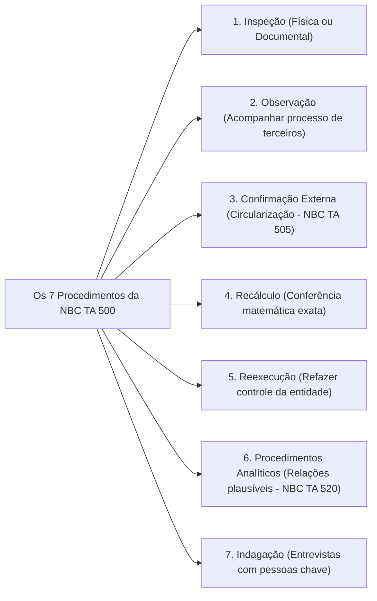
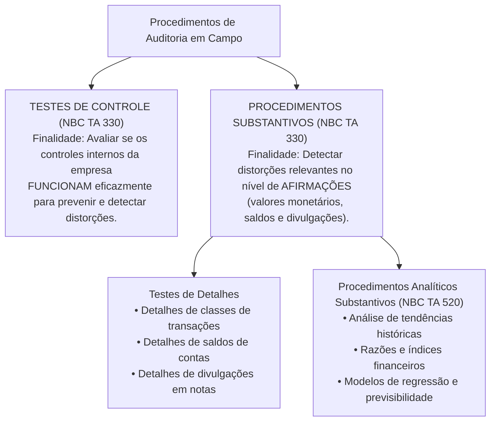
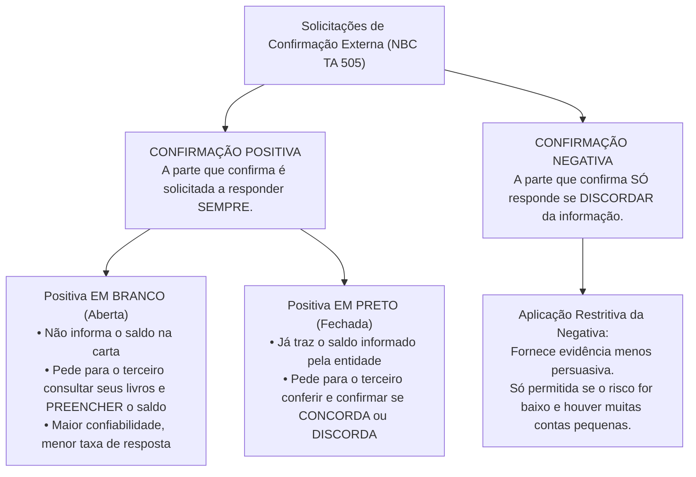

# Módulo 03: Evidências, Procedimentos de Auditoria e Confirmações Externas (NBC TA 500, 505 e 520)

> **BLUF (Bottom Line Up Front):**  
> A evidência de auditoria é a matéria-prima sobre a qual o auditor alicerça sua opinião técnica. Conforme a **NBC TA 500**, o auditor deve planejar e executar procedimentos para obter **evidência apropriada (qualitativa: relevância e confiabilidade)** e **suficiente (quantitativa: volume)**. Os procedimentos são classificados funcionalmente em **Testes de Controles** (que avaliam a eficácia operacional das travas internas) e **Procedimentos Substantivos** (que detectam distorções materiais em saldos e transações, dividindo-se em **Testes de Detalhes** e **Procedimentos Analíticos Substantivos - NBC TA 520**). Dentre as técnicas de obtenção, destacam-se a **Inspeção, Observação, Recálculo, Reexecução, Indagação e Confirmação Externa (Circularização - NBC TA 505)**, sendo que a confirmação externa **positiva** (que exige resposta em qualquer caso) possui força probante infinitamente superior à **negativa** (que só gera resposta em caso de discordância).

---

## 1. A Teoria da Evidência de Auditoria (NBC TA 500)

A auditoria não se baseia em suposições, mas em fatos e documentos comprovados. O auditor não pode expressar opinião com base naquilo que *presume*, mas tão somente naquilo que é capaz de **provar perante as normas técnicas**.

```mermaid
flowchart TD
    OBJ["Opinião do Auditor no Relatório"] <-- EVID["Evidência de Auditoria Suficiente e Apropriada"]
    
    EVID --> QNT["SUFICIÊNCIA (Aspecto Quantitativo)<br/>• Volume de amostras e documentos coletados<br/>• Influenciado pelo Risco de Distorção (RDR)"]
    EVID --> QLT["ADEQUAÇÃO / APROPRIAÇÃO (Aspecto Qualitativo)<br/>• Relevância (relação lógica com o teste)<br/>• Confiabilidade (origem e natureza do dado)"]
    
    QNT -.->|Relação de Compensação Parcial| QLT
```

### 1.1. O Princípio da Interdependência Qualidade vs. Quantidade
* **Quanto maior o risco avaliado, mais evidência quantitativa será exigida.**
* **Quanto maior a qualidade (adequação) da evidência obtida, menor pode ser a quantidade exigida.**
* **ATENÇÃO:** A obtenção de grande quantidade de evidências de má qualidade **NÃO compensa** a sua falta de adequação. Não adianta juntar 10.000 cópias de relatórios internos impressos pela empresa se o controle interno dela for inconfiável.

---

### 1.2. Regras Universais sobre a Confiabilidade da Evidência (Item A31)

A confiabilidade das evidências é influenciada pela sua fonte e natureza, dependendo das circunstâncias em que é obtida:

| Regra Geral de Confiabilidade | Evidência Mais Confiável (Padrão Ouro) | Evidência Menos Confiável (Padrão Frágil) |
| :--- | :--- | :--- |
| **1. Origem da Fonte** | **Fonte Externa e Independente:** Documentos obtidos de terceiros alheios à empresa (ex: bancos, fornecedores, cartórios). | **Fonte Interna:** Documentos gerados e processados pelos próprios funcionários da entidade auditada. |
| **2. Eficácia dos Controles** | **Ambiente com Controles Eficazes:** Relatórios internos gerados quando o sistema possui travas rígidas de aprovação e segregação de funções. | **Ambiente com Controles Débeis:** Dados gerados em setores onde qualquer operador pode alterar planilhas sem autorização. |
| **3. Modo de Obtenção** | **Obtido Diretamente pelo Auditor:** O próprio auditor conta o dinheiro no cofre, inspeciona o maquinário ou recalcula o juro. | **Obtido Indiretamente ou por Inferência:** Informação relatada oralmente por um gerente ou funcionário da tesouraria. |
| **4. Forma Documental** | **Forma Documental (Física ou Eletrônica):** Contratos assinados digitalmente com certificado, notas fiscais registradas no SPED, ofícios. | **Forma Oral / Verbal:** Declarações meramente verbais fornecidas pela gerência durante uma reunião. |
| **5. Originalidade** | **Documentos Originais:** Escrituras públicas e contratos físicos rubricados ou arquivos XML originais com chave do Fisco. | **Fotocópias ou Fax:** Cópias simples ou digitalizações passíveis de montagem, corte e adulteração. |

---

## 2. Os 7 Procedimentos Específicos para Obtenção de Evidências

A NBC TA 500 (itens A14 a A25) elenca as **sete ferramentas práticas** de trabalho do auditor em campo:



### 2.1. Inspeção (Exame de Registros ou Ativos)
* **Inspeção de Registros ou Documentos:** Exame de registros ou documentos, internos ou externos, em papel, em formato eletrônico ou em outras mídias. Fornece evidência com diferentes graus de confiabilidade, dependendo da fonte e da eficácia dos controles internos.
* **Inspeção de Ativos Físicos:** Consiste no exame físico de um ativo tangível (ex: inspecionar o estoque de matéria-prima, prédios, veículos). Fornece evidência de altíssima confiabilidade quanto à sua **existência física**, mas **não necessariamente quanto à sua propriedade ou avaliação** (o maquinário pode existir fisicamente, mas pertencer a terceiros em regime de leasing operacional não contabilizado).

### 2.2. Observação
* Consiste no **acompanhamento de processo ou procedimento sendo executado por outros** (ex: o auditor observa a contagem física do estoque realizada pelos funcionários da entidade no final do ano, ou observa a execução de rotinas de controle de acesso a servidores de dados).
* **Limitação Crítica da Observação:** A observação fornece evidência restrita ao **momento exato em que o procedimento está sendo observado**, e o fato de as pessoas estarem sendo observadas pode alterar o seu comportamento normal (*Efeito Hawthorne*).

### 2.3. Confirmação Externa (Circularização)
* É a evidência de auditoria obtida pelo auditor como uma **resposta direta por escrito de um terceiro** (a parte que confirma) ao auditor, em papel ou por meio eletrônico. É tratada com profundidade própria na **NBC TA 505**.

### 2.4. Recálculo
* Consiste na **verificação da exatidão matemática** de documentos ou registros contábeis. Pode ser realizado manual ou eletronicamente (ex: recalcular a depreciação acumulada, apurar o cálculo de provisões trabalhistas ou conferir a soma de uma fatura de serviços).

### 2.5. Reexecução
* Envolve a **execução independente pelo auditor de procedimentos ou controles** que foram originalmente realizados como parte do controle interno da entidade (ex: o auditor reexecuta a rotina de conciliação bancária entre o razão contábil e o extrato bancário para verificar se chega ao mesmo resultado apurado pelo tesoureiro).

### 2.6. Procedimentos Analíticos (NBC TA 520)
* Consistem em avaliações de informações financeiras por meio de **análise das relações plausíveis entre dados financeiros e não financeiros** (ex: calcular a margem bruta ao longo de 5 anos, comparar consumo de combustível com a quilometragem da frota, cruzar faturamento com impostos recolhidos).

### 2.7. Indagação
* Consiste na busca de informações junto a pessoas conhecedoras, dentro ou fora da entidade. É utilizada extensamente ao longo de toda a auditoria.
* **Regra Fundamental de Prova:** A indagação, **por si só, NÃO fornece evidência de auditoria suficiente** para comprovar a inexistência de distorção relevante ou a eficácia operacional de um controle. Deve sempre ser complementada por procedimentos documentais ou físicos.

---

## 3. Classificação Funcional dos Procedimentos de Auditoria

Conforme a finalidade a que se destinam, os procedimentos dividem-se em duas categorias complementares:



---

## 4. Confirmações Externas em Detalhes (Circularização - NBC TA 505)

A circularização é um dos procedimentos mais persuasivos do auditor, sendo padrão obrigatório para contas bancárias, contas a receber de clientes e passivos com fornecedores e empréstimos.

### 4.1. Tipos de Solicitação de Confirmação Externa



### Comparativo Cirúrgico entre as Modalidades de Confirmação:

| Modalidade de Pedido | O Terceiro Deve Responder Quando? | Confiabilidade da Evidência | Risco / Vulnerabilidade |
| :--- | :--- | :---: | :--- |
| **Positiva em Branco (Aberta)** | **Sempre.** Deve pesquisar em seus sistemas e preencher o saldo que possui com a empresa. | **Máxima (Nível Ouro)** | Risco de não resposta (o terceiro acha trabalhoso pesquisar e não devolve a carta). |
| **Positiva em Preto (Fechada)** | **Sempre.** Deve assinar concordando ou apontando as divergências em relação ao valor expresso. | **Elevada** | Risco de o terceiro assinar de forma desatenta sem realmente conferir seus registros contábeis. |
| **Negativa** | **Apenas se discordar** do saldo informado na solicitação. Se concordar, ele simplesmente descarta a carta. | **Baixa (Nível Frágil)** | O auditor não sabe se o terceiro não respondeu porque concordou com o saldo ou porque a carta foi extraviada/ignorada. |

---

### 4.2. Condições Cumulativas Obrigatórias para Uso da Confirmação Negativa
Conforme a NBC TA 505 (item 15), o auditor **NÃO deve utilizar solicitações de confirmação negativa como o único procedimento substantivo**, a menos que **todas as 4 condições a seguir estejam presentes simultaneamente**:

1. O auditor avaliou o risco de distorção relevante como **baixo** e obteve evidência suficiente quanto à eficácia operacional dos controles relevantes;
2. A população de itens sujeitos ao procedimento consiste em um grande número de contas ou saldos homogêneos e de **pequeno valor individual**;
3. É esperada uma **taxa de erro muito baixa**; e
4. O auditor não tem conhecimento de circunstâncias ou condições que façam com que os destinatários negligenciem as solicitações.

---

### 4.3. Recusa da Administração em Permitir a Confirmação Externa (Item 8)
Se a administração se recusar a permitir que o auditor envie uma solicitação de confirmação externa, o auditor deve:
1. **Indagar sobre as razões** da administração para a recusa e procurar evidência de auditoria sobre sua validade e razoabilidade;
2. **Avaliar as implicações da recusa** sobre a avaliação dos riscos de distorção relevante (inclusive o risco de fraude) e sobre a natureza, época e extensão de outros procedimentos; e
3. Executar **procedimentos alternativos** desenhados para obter evidência relevante e confiável.

> [!CAUTION]
> **Consequência da Recusa Injustificada da Administração:**  
> Se o auditor concluir que a recusa da administração **não é razoável**, ou se o auditor não conseguir obter evidência de auditoria relevante e confiável por meio de procedimentos alternativos, o auditor deve comunicar aos responsáveis pela governança e **determinar as implicações para o relatório de auditoria (Opinião com Ressalva ou Abstenção de Opinião)** por limitação de escopo imposta pela administração (NBC TA 705).

---

## 5. Procedimentos Analíticos Substantivos (NBC TA 520)

Os procedimentos analíticos envolvem comparações de valores registrados com **expectativas desenvolvidas pelo próprio auditor**.

### 5.1. Etapas Obrigatórias de Execução
Ao projetar procedimentos analíticos substantivos, o auditor deve:
1. Determinar a adequação dos procedimentos analíticos para as afirmações sob análise;
2. Avaliar a **confiabilidade dos dados** a partir dos quais a expectativa do auditor é desenvolvida (considerando a fonte, comparabilidade, controles sobre a preparação dos dados);
3. **Desenvolver uma expectativa** a respeito dos valores registrados ou índices e avaliar se a expectativa é precisa o suficiente para identificar distorções; e
4. Determinar o valor de qualquer diferença aceitável entre os valores registrados e os valores esperados sem que seja necessária investigação adicional.

### 5.2. O que Fazer Diante de Variações ou Relações Inconsistentes?
Se os procedimentos analíticos identificarem flutuações ou relações inconsistentes com outras informações relevantes, o auditor deve investigar essas diferenças:
* **Indagando à administração** e obtendo evidência de auditoria apropriada e relevante para as respostas da administração; e
* Executando **outros procedimentos de auditoria necessários** conforme as circunstâncias.

---

## 6. Matriz Anti-Pegadinha de Bancas (FGV, Cebraspe, FCC)

| Afirmação Típica de Concurso | Julgamento | Fundamentação Técnica e Pegadinha Desmontada |
| :--- | :---: | :--- |
| *"A inspeção física de estoques comprova a existência física, a avaliação de mercado e a propriedade dos bens."* | **ERRADO** | A inspeção física comprova **apenas a existência física**. Não prova propriedade (os bens podem ser de terceiros em consignação) nem valor de realização líquida. |
| *"A indagação verbal à diretoria constitui evidência suficiente e conclusiva para atestar a inexistência de passivos contingentes."* | **ERRADO** | A indagação, **por si só, jamais fornece evidência suficiente**. Deve ser corroborada com circularização a advogados e análise documental. |
| *"Na confirmação externa negativa, o silêncio do fornecedor circularizado comprova de forma incontestável a exatidão do saldo."* | **ERRADO** | O silêncio não comprova concordância; a carta pode ter sido extraviada, ignorada pelo departamento ou o destinatário não ter interesse em responder. |
| *"Se a administração proibir o envio de circularização a um banco, o auditor deve acatar a ordem sem questionar a governança."* | **ERRADO** | O auditor deve avaliar a razoabilidade da recusa; sendo injustificada, configura limitação de escopo que pode levar a **Ressalva ou Abstenção de Opinião**. |
| *"Evidências geradas internamente pela empresa são sempre inconfiáveis e devem ser descartadas pelo auditor."* | **ERRADO** | Evidências internas são plenamente válidas, desde que o auditor avalie que os controles internos da entidade sobre a geração dessas informações são eficazes. |
| *"O auditor independente é proibido de utilizar procedimentos analíticos substantivos na fase de testes em campo."* | **ERRADO** | Conforme a NBC TA 520, procedimentos analíticos substantivos são amplamente encorajados e utilizados para testar saldos com comportamento previsível. |

---

## 7. Mnemônicos & Âncoras de Memória

> [!TIP]
> **Mnemônico: Os 7 Procedimentos de Auditoria (NBC TA 500)**  
> **`I-O-C-R-R-P-I`**  
> - **I** - **I**nspeção (registros e ativos físicos)  
> - **O** - **O**bservação (olhar processos de terceiros)  
> - **C** - **C**onfirmação Externa (circularização direta)  
> - **R** - **R**ecálculo (conferência matemática)  
> - **R** - **R**eexecução (refazer o controle do zero)  
> - **P** - **P**rocedimentos Analíticos (índices e relações plausíveis)  
> - **I** - **I**ndagação (entrevistas com pessoal interno/externo)

> [!TIP]
> **Mnemônico: Confirmação Positiva vs. Negativa**  
> - **Positiva:** Exige resposta **SEMPRE** (Positivo = presença de resposta).  
> - **Negativa:** Exige resposta **NUNCA** (a não ser que haja discordância; silêncio = aceitação tácita frágil).

---

## 8. Questões Paradigmáticas de Prova Comentadas

### Questão 01 (FGV - SEFAZ-MT - Auditor Fiscal de Tributos Estaduais - 2023)
**Enunciado:**  
O auditor independente de uma grande rede de varejo pretendia enviar cartas de confirmação externa aos 20 maiores fornecedores da entidade para atestar a exatidão dos saldos de contas a pagar registrados no balanço. No entanto, o Diretor Financeiro da empresa solicitou formally que o auditor não enviasse a circularização para o maior fornecedor da rede, sob a alegação de que a empresa se encontrava em litígio confidencial para renegociação de preços.  
À luz da NBC TA 505 (Confirmações Externas), o auditor deve:
- (A) Acatar imediatamente a solicitação da diretoria e retirar a conta do escopo de testes.
- (B) Indagar sobre as razões da recusa, buscar evidências que comprovem a alegação e, sendo a recusa justificada, executar procedimentos alternativos para validar o saldo.
- (C) Emitir imediatamente um relatório com abstenção de opinião sem realizar procedimentos adicionais.
- (D) Enviar a solicitação diretamente ao fornecedor à revelia da administração, pois o auditor possui poder de polícia sobre os fornecedores.
- (E) Presumir a existência de fraude dolosa e comunicar o Ministério Público.

**Gabarito Oficial:** **B**  
**Comentário Analítico:**  
A NBC TA 505 (item 8) determina o rito formal: diante da recusa da administração, o auditor deve primeiro indagar os motivos da recusa e buscar evidências sobre sua validade e razoabilidade. Se concluir que a justificativa é legítima (ex: negociação jurídica delicada onde a carta poderia gerar ruído), o auditor deve aplicar **procedimentos alternativos** (ex: examinar notas fiscais, conferir ordens de compra e pagamentos subsequentes no extrato bancário pós-balanço). Somente se a recusa for injustificada ou os procedimentos alternativos inviáveis é que haverá impacto no relatório. Gabarito: B.

---

### Questão 02 (Cebraspe - Auditor Federal de Controle Externo - TCU)
**Enunciado:**  
Acerca das evidências e procedimentos de auditoria disciplinados pelas normas técnicas brasileiras, julgue o item subsequente:  
*A inspeção física de bens do ativo imobilizado assegura ao auditor a existência física do bem, a sua correta valoração a valor justo e a titularidade dos direitos reais da entidade sobre o ativo examinado.*

**Gabarito Oficial:** **ERRADO**  
**Comentário Analítico:**  
A inspeção física de um ativo tangível fornece evidência de auditoria altamente confiável **exclusivamente quanto à sua existência física**. Ela **não assegura a propriedade** (o maquinário inspecionado pode estar cedido em comodato, pertencer a terceiro ou ter sido dado em garantia com perda de domínio) nem garante sua **avaliação/valoração** (a máquina inspecionada pode estar totalmente obsoleta, com necessidade de teste de recuperabilidade/*impairment*). Portanto, o item generalizou indevidamente os efeitos da inspeção física. Gabarito: ERRADO.

---

### Questão 03 (FCC - SEFAZ-SC - Auditor Fiscal da Receita Estadual)
**Enunciado:**  
Em relação às solicitações de confirmação externa negativa, a NBC TA 505 estabelece que:
- (A) Elas proporcionam evidência de auditoria mais persuasiva do que as solicitações de confirmação externa positiva.
- (B) O não recebimento de resposta a uma solicitação de confirmação negativa indica conclusivamente que a parte confirmante recebeu a solicitação e concordou com a informação.
- (C) Devem ser utilizadas como único procedimento substantivo quando a população for composta por saldos de grande valor individual e risco elevado.
- (D) Podem ser utilizadas como procedimento substantivo único se o risco de distorção relevante for avaliado como baixo, os controles forem eficazes e a população contiver grande número de saldos homogêneos de pequeno valor.
- (E) São terminantemente proibidas no Brasil pelo Conselho Federal de Contabilidade.

**Gabarito Oficial:** **D**  
**Comentário Analítico:**  
A alternativa D reproduz com perfeição as condições cumulativas do **item 15 da NBC TA 505**. A confirmação negativa fornece evidência menos persuasiva e só pode ser utilizada de forma isolada quando o risco de distorção for avaliado como baixo, os controles operacionais forem eficazes e a população for pulverizada em muitos saldos pequenos com expectativa de baixíssimo índice de erros. Gabarito: alternativa D.

---

## 9. Links e Conexões Temáticas

- 🔗 [Módulo 00: Teoria Geral e NBC TA 200](00-conceitos-iniciais-nbc-ta-200.md)
- 🔗 [Módulo 02: Planejamento e Documentação (NBC TA 300 e 230)](02-planejamento-documentacao-nbc-ta-300-230.md)
- 🔗 [Módulo 04: Amostragem em Auditoria (NBC TA 530)](04-amostragem-controle-qualidade-nbc-ta-530-220.md)
- 🔗 [Módulo 05: Materialidade e Fraude (NBC TA 320 e 240)](05-materialidade-risco-fraude-nbc-ta-320-240.md)
