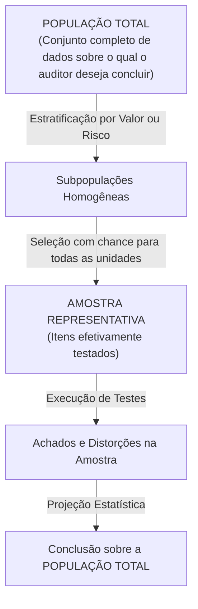
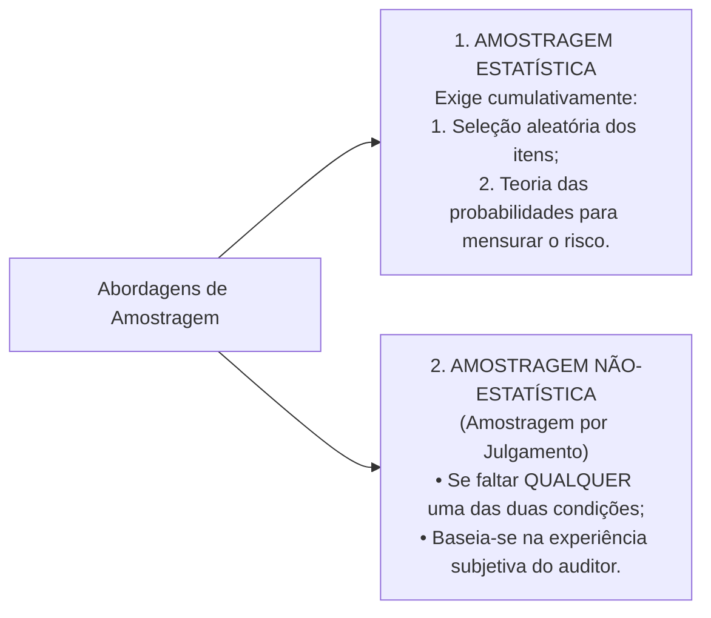
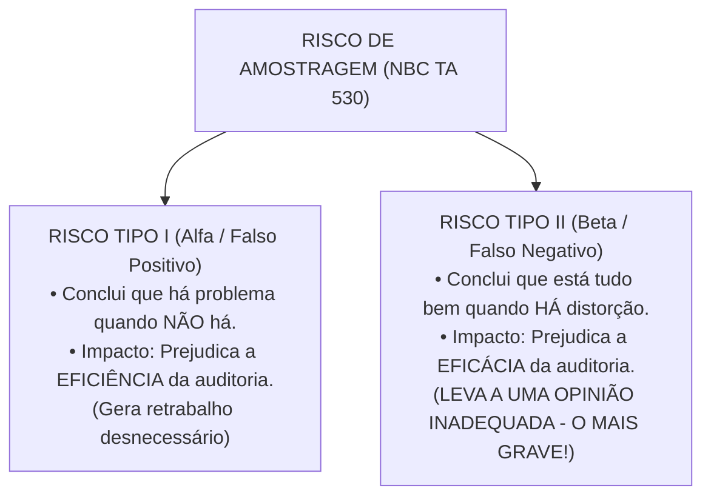
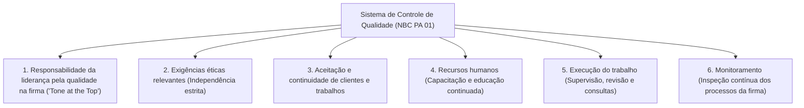

# Módulo 04: Amostragem em Auditoria (NBC TA 530) e Controle de Qualidade (NBC TA 220 e NBC PA 01)

> **BLUF (Bottom Line Up Front):**  
> A **Amostragem em Auditoria (NBC TA 530)** consiste na aplicação de procedimentos em **menos de 100% dos itens de uma população**, garantindo que todas as unidades de amostragem tenham a mesma chance de seleção, para proporcionar base razoável para a conclusão sobre a população inteira. Classifica-se em **Estatística** (que conjuga seleção aleatória com a teoria das probabilidades para mensurar numericamente o risco) e **Não-Estatística** (baseada no julgamento profissional), sendo ambas plenamente aceitas pelas normas. O **Risco de Amostragem** divide-se no **Risco Tipo I (Alfa - afeta a eficiência)** e no perigosíssimo **Risco Tipo II (Beta - afeta a eficácia)**, que leva o auditor a emitir uma opinião inadequada. Paralelamente, o **Controle de Qualidade (NBC PA 01 / NBC TA 220)** estabelece que a responsabilidade final pela qualidade é do **Sócio do Trabalho**, exigindo revisão periódica e a **Revisão de Controle de Qualidade do Trabalho (EQCR)** para todas as entidades listadas em bolsa antes da emissão do relatório.

---

## 1. Conceito e Escopo da Amostragem (NBC TA 530)

O auditor raramente examina 100% dos registros de uma entidade. O exame integral é reservado para populações muito pequenas de altíssimo valor unitário ou quando o risco de distorção relevante for extremo. Na imensa maioria dos casos, aplica-se a técnica da amostragem.

### 1.1. Definições Oficiais da NBC TA 530 (Item 5)
* **Amostragem em Auditoria:** Aplicação de procedimento de auditoria em menos de 100% dos itens de uma população relevante para fins de auditoria, de maneira que todas as unidades de amostragem tenham a mesma oportunidade de serem selecionadas para proporcionar ao auditor uma base razoável para concluir sobre toda a população.
* **População:** O conjunto completo de dados sobre o qual a amostra é selecionada e sobre o qual o auditor deseja concluir. Deve ser **apropriada e completa** em relação ao objetivo específico da auditoria.
* **Unidade de Amostragem:** Os itens individuais que constituem a população (ex: notas fiscais emitidas, cheques compensados, clientes cadastrados, lançamentos contábeis).
* **Estratificação:** Divisão de uma população em subpopulações, cada uma constituindo um grupo de unidades de amostragem com características semelhantes (geralmente estratifica-se por faixas de valor monetário).

---

## 2. Amostragem Estatística vs. Não-Estatística

Uma das questões conceituais mais recorrentes em concursos públicos é a distinção técnica entre a amostragem estatística e a não-estatística:

### Matriz Comparativa: Estatística vs. Não-Estatística

| Atributo Avaliado | Amostragem Estatística | Amostragem Não-Estatística (Por Julgamento) |
| :--- | :--- | :--- |
| **Requisitos Cumulativos da Norma** | **1.** Seleção aleatória dos itens da amostra; **E** **2.** Uso da teoria das probabilidades para avaliar os resultados e mensurar o risco amostral. | Não atende a uma ou a ambas as características da amostragem estatística. |
| **Mensuração do Risco de Amostragem** | Permite **mensurar e quantificar matematicamente** o risco da amostra (ex: intervalo com 95% de confiança). | O risco amostral não é mensurável matematicamente, dependendo do julgamento subjetivo do auditor. |
| **Validade Perante as Normas** | **Totalmente válida e aceita.** | **Totalmente válida e aceita.** A norma não impõe preferência absoluta pela estatística. |
| **Custo e Complexidade** | Maior custo de treinamento, softwares estatísticos especializados e rigor metodológico. | Menor custo de implementação e maior agilidade em populações pequenas. |

> [!IMPORTANT]
> **Pegadinha Clássica de Banca:**  
> A banca afirma que a amostragem não-estatística é proibida pela NBC TA 530 ou que suas conclusões não têm validade técnica. **ERRADO.** A NBC TA 530 aceita ambas as abordagens, afirmando que a decisão entre estatística e não-estatística é uma questão de julgamento profissional do auditor.

---

## 3. A Dinâmica dos Riscos de Amostragem: Risco Tipo I vs. Risco Tipo II

O **Risco de Amostragem** é o risco de que a conclusão do auditor, com base em uma amostra, possa ser diferente da conclusão que seria alcançada se toda a população fosse submetida ao mesmo procedimento de auditoria.

Ele divide-se em duas naturezas de erro decisório:

### O Quadro Definitivo dos Riscos de Amostragem

| Tipo de Procedimento | Risco Tipo I (Alfa / Risco de Eficiência) | Risco Tipo II (Beta / Risco de Eficácia) - **O MAIS GRAVE** |
| :--- | :--- | :--- |
| **Nos Testes de Controles** | **Risco de Subavaliação da Confiabilidade:** Conclui que os controles internos são **menos eficazes** do que realmente são. | **Risco de Superavaliação da Confiabilidade:** Conclui que os controles internos são **mais eficazes** do que realmente são. |
| **Nos Testes Substantivos** | **Risco de Rejeição Incorreta:** Conclui que existe distorção relevante no saldo contábil quando, na verdade, **não existe**. | **Risco de Aceitação Incorreta:** Conclui que o saldo está correto e livre de distorção quando, na verdade, **existe distorção relevante**. |
| **Impacto Operacional** | O auditor não confia nos números e amplia a amostra, fazendo mais trabalho do que precisava. **Causa perda de tempo e ineficiência de custos.** | O auditor confia nos números e relaxa os testes, emitindo uma opinião sem ressalvas para contas viciadas. **Causa falha grave de auditoria e risco legal.** |

> [!WARNING]
> **Atenção ao Risco Tipo II (Beta):**  
> Para os órgãos reguladores e para os concursos, o **Risco Tipo II é o mais temido**, pois compromete a própria razão de ser da auditoria, permitindo que demonstrações financeiras distorcidas ou fraudulentas sejam aprovadas pelo auditor.

---

## 4. Risco de Amostragem vs. Risco Não-Amostral

É fundamental distinguir o risco amostral do risco não relacionado à amostragem:

* **Risco de Amostragem:** Decorre do fato puro e simples de testar uma **amostra** em vez do todo (probabilidade matemática).
* **Risco Não-Amostral:** É o risco de que o auditor chegue a uma conclusão errônea por **qualquer razão que não seja relacionada ao risco de amostragem**.  
  *Exemplos de Risco Não-Amostral:*
  - O auditor aplica um procedimento de auditoria inadequado para o objetivo pretendido;
  - O auditor interpreta erroneamente uma evidência documental clara;
  - O auditor deixa de reconhecer uma fraude evidente devido ao cansaço ou falta de experiência.

---

## 5. Métodos de Seleção de Amostra (NBC TA 530, Apêndice 4)

A norma reconhece cinco métodos principais de seleção de amostras:

1. **Seleção Aleatória (Randômica):** Aplicada por meio de geradores de números aleatórios computadorizados ou tabelas de números randômicos. Garante que cada unidade tenha estritamente a mesma probabilidade matemática de seleção.
2. **Seleção Sistemática:** O número de unidades de amostragem na população é dividido pelo tamanho da amostra para dar um intervalo de amostragem fixo (ex: $10.000 / 200 = 50$). Seleciona-se um ponto de partida aleatório entre 1 e 50, e a partir daí seleciona-se a cada 50º item (5, 55, 105, 155...).
3. **Amostragem por Unidade Monetária (MUS - *Monetary Unit Sampling*):** É uma seleção com probabilidade proporcional ao tamanho monetário. A unidade de amostragem é cada real (\$ 1,00) individual que compõe a conta. Itens com valores monetários maiores têm probabilidade automaticamente proporcionalmente maior de serem selecionados, direcionando o teste para contas de maior valor.
4. **Seleção Casual (Haphazard):** O auditor seleciona a amostra sem seguir uma técnica estruturada, mas procurando evitar qualquer viés ou tendenciosidade consciente (ex: não escolher apenas os primeiros da gaveta, nem apenas os mais fáceis). Não é amostragem estatística porque não permite mensurar probabilidades.
5. **Seleção em Bloco:** Consiste na seleção de um ou mais blocos de itens contíguos da população (ex: todas as notas fiscais emitidas na primeira semana de março). **Regra da Norma:** Geralmente **não pode ser usada em amostragem de auditoria**, porque itens em sequência tendem a compartilhar as mesmas características, violando a representatividade da população.

---

## 6. Fatores que Afetam o Tamanho da Amostra

As tabelas a seguir sintetizam como diferentes variáveis impactam o dimensionamento da amostra necessária:

### 6.1. Nos Testes de Controles

| Fator / Variável | Efeito no Tamanho da Amostra | Racionalidade Técnica |
| :--- | :---: | :--- |
| **Aumento da extensão em que o risco é avaliado considerando os controles** | **Aumenta** | Quanto mais o auditor planeja confiar nos controles internos, maior deve ser a amostra para provar sua eficácia. |
| **Aumento da taxa tolerável de desvio** | **Diminui** | Se o auditor aceita um percentual maior de falhas no controle, precisa de uma amostra menor. |
| **Aumento na taxa esperada de desvio da população** | **Aumenta** | Se o auditor espera encontrar muitos desvios, precisa de amostra maior para fazer uma estimativa razoável. |
| **Aumento no nível de confiança desejado (menor risco amostral aceito)** | **Aumenta** | Quanto maior a segurança exigida pelo auditor, maior deve ser o volume amostral. |
| **Aumento no número de unidades de amostragem (tamanho da população)** | **Efeito Insignificante** | Em populações grandes (acima de alguns milhares de itens), o tamanho absoluto da população quase não afeta o tamanho da amostra. |

---

### 6.2. Nos Testes Substantivos (Testes de Detalhes)

| Fator / Variável | Efeito no Tamanho da Amostra | Racionalidade Técnica |
| :--- | :---: | :--- |
| **Aumento na avaliação do risco de distorção relevante (RDR)** | **Aumenta** | Maior risco da empresa exige testes substantivos mais amplos. |
| **Aumento no uso de outros procedimentos substantivos para a mesma afirmação** | **Diminui** | Se o auditor já obteve evidências com procedimentos analíticos, precisa de menos testes de detalhes. |
| **Aumento no nível de confiança desejado** | **Aumenta** | Menor risco de aceitação incorreta aceito exige maior amostra. |
| **Aumento da distorção tolerável** | **Diminui** | Quanto maior o valor do erro que o auditor tolera no balanço, menor precisa ser a amostra. |
| **Aumento no valor da distorção esperada na população** | **Aumenta** | Se já se sabe que a população tem muitos erros, exige-se amostra maior para projetá-los. |
| **Estratificação da população** | **Diminui** | Ao agrupar os itens por estratos homogêneos, reduz-se a variabilidade e o tamanho total da amostra. |

---

## 7. Controle de Qualidade na Auditoria (NBC PA 01 e NBC TA 220)

O controle de qualidade assegura que a firma de auditoria e seus profissionais cumpram as normas técnicas e legais vigentes, emitindo relatórios apropriados.

### 7.1. Responsabilidade do Sócio do Trabalho (NBC TA 220)
* O **Sócio do Trabalho (*Engagement Partner*)** assume a responsabilidade geral pela qualidade em cada trabalho de auditoria para o qual foi designado.
* Ele deve liderar pelo exemplo, orientar a equipe, supervisionar a execução e revisar os papéis de trabalho antes da assinatura do relatório final.

### 7.2. Revisão de Controle de Qualidade do Trabalho (EQCR - Item 19)
* **Conceito:** É uma avaliação objetiva dos julgamentos significativos feitos pela equipe e das conclusões alcançadas para a emissão do relatório, realizada por um profissional independente da equipe (Revisor de Controle de Qualidade).
* **Obrigatoriedade:** É **obrigatória para auditorias de demonstrações contábeis de companhias abertas (listadas em bolsa)** e para outros trabalhos que atendam a critérios de risco fixados pela firma.
* **Regra Temporal Crítica:** O relatório de auditoria **NÃO pode ser emitido antes da conclusão formal da Revisão de Controle de Qualidade do Trabalho (EQCR)**.

---

## 8. Matriz Anti-Pegadinha de Bancas (FGV, Cebraspe, FCC)

| Afirmação Típica de Concurso | Julgamento | Fundamentação Técnica e Pegadinha Desmontada |
| :--- | :---: | :--- |
| *"A amostragem não-estatística é vedada pela NBC TA 530 por não permitir o cálculo probabilístico do risco."* | **ERRADO** | A amostragem não-estatística é **plenamente aceita e válida**, baseando-se no julgamento profissional do auditor. |
| *"O risco de que o auditor conclua que os controles internos são ineficazes quando na verdade são eficazes afeta a eficácia da auditoria."* | **ERRADO** | Esse é o Risco Tipo I (Alfa); ele afeta a **eficiência** da auditoria (leva a retrabalho), não a eficácia. O que afeta a eficácia é o Risco Tipo II. |
| *"Dobrar o tamanho de uma população de 50.000 para 100.000 itens exige dobrar o tamanho da amostra de auditoria."* | **ERRADO** | Em populações grandes, o tamanho da população tem um **efeito insignificante** sobre o dimensionamento da amostra. |
| *"A seleção por blocos é o método mais recomendado pela NBC TA 530 para testar contas a receber."* | **ERRADO** | A seleção em bloco **geralmente não é recomendada**, pois itens contíguos tendem a ter vícios ou características correlacionadas. |
| *"A revisão de controle de qualidade (EQCR) pode ser concluída até 30 dias após a publicação do relatório de auditoria."* | **ERRADO** | A EQCR deve ser **concluída ANTES da emissão e datação do relatório do auditor** (NBC TA 220, item 19). |

---

## 9. Mnemônicos & Âncoras de Memória

> [!TIP]
> **Mnemônico: O Risco Alfa vs. Risco Beta**  
> - **Risco ALFA (Tipo I):** Afeta a **ALF**acete (o auditor come folha, perde tempo trabalhando à toa - afeta a **EFICIÊNCIA**).  
> - **Risco BETA (Tipo II):** Afeta a **B**anca e a **E**ntidade (o auditor aprova coisa errada - compromete a **EFICÁCIA**).

> [!TIP]
> **Mnemônico: População Grande Não Engorda Amostra**  
> Em populações grandes, o tamanho da população tem efeito **NEUTRO / INSIGNIFICANTE** no cálculo da amostra. O que manda é o risco, a variabilidade e a taxa tolerável!

---

## 10. Questões Paradigmáticas de Prova Comentadas

### Questão 01 (FGV - Câmara dos Deputados - Analista Legislativo)
**Enunciado:**  
De acordo com a NBC TA 530 (Amostragem em Auditoria), o risco de amostragem pode levar a dois tipos de conclusões errôneas:  
1. No caso de teste de controle, em que os controles são considerados mais eficazes do que realmente são ou, no caso de teste de detalhes, em que não há distorção relevante quando na verdade há.  
2. No caso de teste de controle, em que os controles são considerados menos eficazes do que realmente são ou, no caso de teste de detalhes, em que há distorção relevante quando na verdade não há.  
Em relação a esses dois tipos de risco, é correto afirmar que:
- (A) O tipo 1 afeta a eficiência da auditoria e leva a trabalho adicional.
- (B) O tipo 1 afeta a eficácia da auditoria e é mais provável que leve a uma opinião inadequada.
- (C) O tipo 2 afeta a eficácia da auditoria e compromete a integridade do trabalho do auditor.
- (D) Ambos os tipos afetam exclusivamente a tempestividade da entrega dos relatórios.
- (E) O auditor deve se preocupar apenas com o tipo 2, pois o tipo 1 não tem qualquer relevância prática.

**Gabarito Oficial:** **B**  
**Comentário Analítico:**  
A questão trata dos riscos Tipo II (descrito no item 1) e Tipo I (descrito no item 2):
- O item 1 descreve o **Risco Tipo II (Beta)**: considerar o controle mais eficaz do que é ou aceitar um saldo com erro relevante. Este risco afeta a **eficácia** da auditoria e é o mais grave, pois conduz à emissão de uma **opinião inadequada** de auditoria.
- O item 2 descreve o **Risco Tipo I (Alfa)**: considerar o controle pior do que é ou rejeitar um saldo correto. Este risco afeta a **eficiência** da auditoria, pois acarreta trabalho e horas adicionais para provar que a primeira conclusão estava errada.  
Portanto, a alternativa B reflete fielmente o item 1 da norma. Gabarito: B.

---

### Questão 02 (Cebraspe - SEFAZ-AL - Auditor Fiscal da Receita Estadual)
**Enunciado:**  
Com base na NBC TA 530, julgue o item subsequente:  
*A estratificação da população de auditoria consiste em dividir a população em subpopulações com características semelhantes. A aplicação dessa técnica permite ao auditor reduzir a variabilidade dos itens de cada estrato e, consequentemente, reduzir o tamanho total da amostra sem aumentar proporcionalmente o risco de amostragem.*

**Gabarito Oficial:** **CERTO**  
**Comentário Analítico:**  
A afirmação é a transcrição do conceito e da utilidade da estratificação (NBC TA 530, item A8). Ao dividir a população em estratos homogêneos (ex: fatiar contas a receber por faixas de valor), o auditor reduz a dispersão dos dados dentro de cada estrato, o que viabiliza matematicamente o uso de amostras menores sem comprometer o nível de segurança exigido. Item perfeitamente correto.

---

### Questão 03 (FCC - SEFAZ-BA - Auditor Fiscal)
**Enunciado:**  
De acordo com a NBC TA 220 e com a NBC PA 01, a realização da Revisão de Controle de Qualidade do Trabalho (EQCR) é:
- (A) Facultativa para todas as entidades, dependendo exclusivamente da decisão do sócio do trabalho.
- (B) Obrigatória para a auditoria de demonstrações contábeis de companhias abertas, devendo ser concluída antes da data do relatório do auditor.
- (C) Obrigatória para todas as auditorias de empresas limitadas de médio porte.
- (D) Realizada exclusivamente pelo Conselho Federal de Contabilidade após a publicação das demonstrações.
- (E) Dispensada caso o auditor responsável comprove mais de 10 anos de experiência ininterrupta.

**Gabarito Oficial:** **B**  
**Comentário Analítico:**  
Conforme a NBC TA 220 (itens 19 e 20) e NBC PA 01, a Revisão de Controle de Qualidade do Trabalho (EQCR) é **obrigatória para todas as auditorias de demonstrações contábeis de companhias abertas (entidades listadas)** e o relatório de auditoria **não deve ser emitido antes da conclusão formal da revisão de controle de qualidade**. Gabarito: alternativa B.

---

## 11. Links e Conexões Temáticas

- 🔗 [Módulo 00: Teoria Geral e NBC TA 200](00-conceitos-iniciais-nbc-ta-200.md)
- 🔗 [Módulo 03: Evidências e Procedimentos de Auditoria (NBC TA 500)](03-procedimentos-testes-evidencias-nbc-ta-500-505-520.md)
- 🔗 [Módulo 05: Materialidade, Risco de Auditoria e Fraude (NBC TA 320 e 240)](05-materialidade-risco-fraude-nbc-ta-320-240.md)
- 🔗 [Módulo 06: Relatório e Opinião de Auditoria (NBC TA 700, 705 e 706)](06-relatorio-opiniao-auditor-nbc-ta-700-705-706.md)
