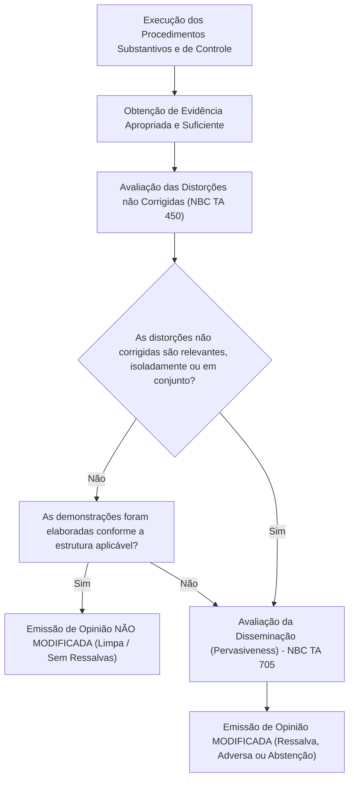
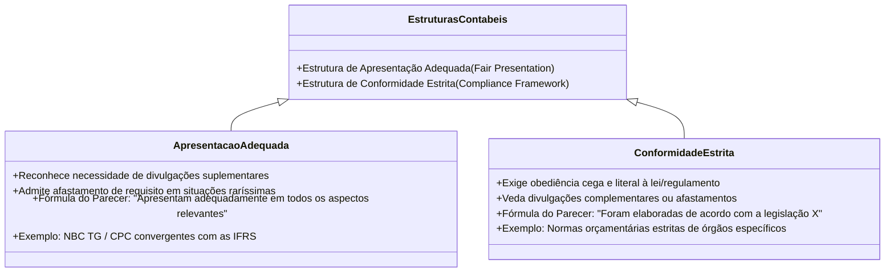
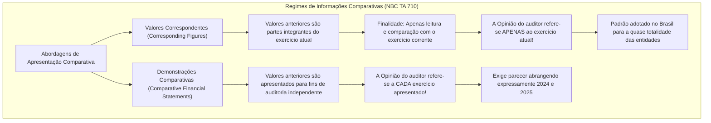
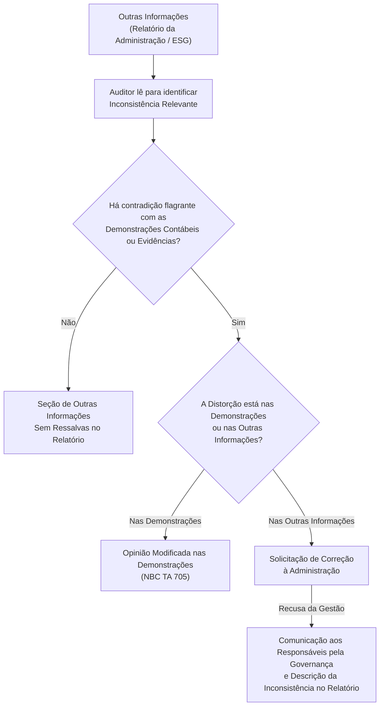

# Formação da Opinião e Estrutura do Relatório do Auditor Independente (NBC TA 700, NBC TA 710 e NBC TA 720)

---

## 1. Fundamentos e Princípios da Formação da Opinião de Auditoria

O relatório do auditor independente constitui o produto final, solene e público de todo o processo de auditoria externa de demonstrações contábeis. É por intermédio deste documento técnico que o auditor comunica ao mercado financeiro, acionistas, credores e órgãos reguladores a sua conclusão independente sobre a fidedignidade das informações patrimoniais e financeiras apresentadas pela entidade.

A **NBC TA 700 (R1)** disciplina a formação da opinião e a estrutura padronizada do relatório, sendo complementada pela **NBC TA 710** (informações comparativas) e pela **NBC TA 720** (outras informações que acompanham as demonstrações contábeis).



### 1.1. O Processo Cognitivo de Formação da Opinião

Para formar sua opinião, o auditor deve concluir se obteve **segurança razoável** de que as demonstrações contábeis tomadas em conjunto estão livres de distorções relevantes, sejam decorrentes de fraude ou de erro. Essa conclusão requer a avaliação expressa de que:
1. As demonstrações contábeis divulgam de forma adequada as principais políticas e práticas contábeis selecionadas e aplicadas;
2. As práticas contábeis selecionadas e aplicadas são condizentes com a estrutura de relatório financeiro aplicável e são apropriadas às circunstâncias da entidade;
3. As estimativas contábeis elaboradas pela administração são razoáveis e devidamente fundamentadas (NBC TA 540);
4. As informações apresentadas nas demonstrações contábeis são relevantes, confiáveis, comparáveis e compreensíveis;
5. As demonstrações contábeis contêm as divulgações exigidas para permitir que os usuários previstos compreendam o efeito de transações materiais sobre a posição patrimonial, desempenho e fluxos de caixa da companhia.

---

## 2. Estrutura de Apresentação Adequada (*Fair Presentation*) vs. Estrutura de Conformidade (*Compliance Framework*)

A redação do parágrafo de opinião do auditor varia de forma estrita conforme a natureza da estrutura conceitual contábil adotada pela entidade auditada:



| Critério de Diferenciação | Estrutura de Apresentação Adequada (*Fair Presentation*) | Estrutura de Conformidade (*Compliance Framework*) |
| :--- | :--- | :--- |
| **Definição Normativa** | Estrutura que exige a observância de preceitos contábeis, mas reconhece expressamente que pode ser necessário prestar divulgações adicionais ou afastar-se de um requisito para alcançar a fidedignidade da imagem patrimonial. | Estrutura que impõe obediência irrestrita aos termos literais previstos na lei ou regulamento, sem admitir divulgações suplementares ou afastamentos. |
| **Redação Obrigatória da Opinião** | *"Em nossa opinião, as demonstrações contábeis **apresentam adequadamente, em todos os aspectos relevantes**, a posição patrimonial e financeira..."* | *"Em nossa opinião, as demonstrações contábeis **foram elaboradas, em todos os aspectos relevantes, de acordo com** a Lei/Regulamento X..."* |
| **Exemplo no Brasil** | Pronunciamentos Técnicos do CPC e Normas Brasileiras de Contabilidade (NBC TG / IFRS) aplicáveis a companhias abertas e fechadas. | Regramentos específicos emitidos por certos órgãos governamentais voltados a prestação de contas vinculadas puramente à legalidade formal. |

---

## 3. Anatomia Sequencial do Relatório Pós-Reforma 2016 (NBC TA 700)

Em 2016, as normas internacionais do IAASB/IFAC (adotadas no Brasil pelo Conselho Federal de Contabilidade - CFC) promoveram uma **revolução estrutural** no relatório de auditoria independente, buscando conferir maior transparência e foco imediato na conclusão do auditor.

A ordem dos parágrafos do relatório padrão sem modificação tornou-se rígida e padronizada:

```mermaid
flowchart TD
    subgraph "Ordem Obrigatória do Relatório de Auditoria (NBC TA 700 R1)"
        P1["1. Título: Relatório do Auditor Independente sobre as Demonstrações Contábeis"]
        P2["2. Destinatário: Acionistas, Cotistas ou Responsáveis pela Governança"]
        P3["3. Seção da OPINIÃO (Primeiro Parágrafo Técnico do Relatório!)"]
        P4["4. Seção da BASE PARA OPINIÃO (Imediatamente após a Opinião)"]
        P5["5. Continuidade Operacional (Going Concern - NBC TA 570 - se aplicável)"]
        P6["6. Principais Assuntos de Auditoria (PAA / KAM - NBC TA 701 - Obrigatório para Companhias Abertas)"]
        P7["7. Outras Informações que Acompanham as Demonstrações (NBC TA 720)"]
        P8["8. Responsabilidades da Administração e da Governança pelas Demonstrações"]
        P9["9. Responsabilidades do Auditor Independente pela Auditoria"]
        P10["10. Relatório sobre Outras Exigências Legais e Regulatórias (se aplicável)"]
        P11["11. Assinatura do Auditor, Nome do Sócio, Registro no CRC/CNAI e Data"]
    end
    
    P1 --> P2 --> P3 --> P4 --> P5 --> P6 --> P7 --> P8 --> P9 --> P10 --> P11
```



> [!IMPORTANT]
> **A Mudança Histórica Mais Cobrada em Provas:**
> Antes de 2016, a opinião do auditor ficava alocada no final do relatório (no último parágrafo). Desde a reforma, a **Opinião do Auditor é apresentada como a PRIMEIRA seção substantiva**, logo no topo do documento, sendo sucedida imediatamente pela **Base para Opinião**.

### 3.1. Detalhamento de Cada Seção do Relatório

#### 1. Seção da Opinião:
- Identifica a entidade cujas demonstrações contábeis foram auditadas;
- Afirma categoricamente que as demonstrações contábeis foram auditadas;
- Especifica o título de cada demonstração individual que compõe o conjunto (Balanço Patrimonial, DRE, DRA, DMPL, DFC, DVA se exigida e Notas Explicativas);
- Menciona expressamente as datas e períodos abrangidos pelas demonstrações;
- Expressa a conclusão técnica sem modificações.

#### 2. Seção da Base para Opinião:
- Afirma que a auditoria foi conduzida em conformidade com as Normas Brasileiras e Internacionais de Auditoria (NBC TAs);
- Faz remissão expressa à seção que detalha as responsabilidades do auditor;
- Contém a declaração explícita de **independência** do auditor em relação à entidade auditada, em conformidade com o Código de Ética Profissional (NBC PG 100 e NBC PA 400);
- Afirma que a evidência de auditoria obtida é **apropriada e suficiente** para fundamentar a opinião emitida.

#### 3. Responsabilidade da Administração e da Governança:
- Descreve a responsabilidade da administração pela elaboração e adequada apresentação das demonstrações contábeis de acordo com a estrutura contábil aplicável;
- Afirma a responsabilidade pelos controles internos necessários para permitir a elaboração de demonstrações livres de distorção relevante;
- Destaca o dever da administração de avaliar a capacidade da entidade de manter-se em **continuidade operacional** (*going concern*).

#### 4. Responsabilidade do Auditor:
- Declara que o objetivo do auditor é obter segurança razoável e emitir o relatório contendo sua opinião;
- Explica que segurança razoável é um alto nível de segurança, mas não garantia absoluta contra fraudes e erros;
- Descreve os procedimentos executados: avaliação de riscos, compreensão de controles internos (sem emitir opinião sobre a eficácia dos controles, salvo exigência regulatória específica), adequação das políticas contábeis e razoabilidade de estimativas.

---

## 4. Informações Comparativas: Valores Correspondentes vs. Demonstrações Comparativas (NBC TA 710)

As demonstrações contábeis frequentemente trazem colunas com valores do exercício anterior. A **NBC TA 710** estabelece dois regimes distintos de reporte dessas informações:



| Critério de Análise | Valores Correspondentes (*Corresponding Figures*) | Demonstrações Comparativas (*Comparative FS*) |
| :--- | :--- | :--- |
| **Escopo da Opinião do Auditor** | A opinião do auditor refere-se **apenas ao período corrente** auditado. Não alcança formalmente os períodos anteriores. | A opinião do auditor refere-se **expressamente a cada um dos períodos apresentados** no conjunto das demonstrações. |
| **Menção no Relatório** | O auditor não faz referência aos períodos anteriores no parágrafo de opinião, salvo se o parecer anterior foi modificado e o problema persistir. | O relatório do auditor emite opiniões individualizadas sobre cada ano (ex.: 2024 e 2025). |
| **Auditor Antecessor** | Se as demonstrações do exercício anterior foram auditadas por outro auditor independente, o auditor atual insere um **Parágrafo de Outros Assuntos** (NBC TA 706) informando: (i) que foram auditadas por outro auditor; (ii) o tipo de opinião emitida; e (iii) a data do relatório anterior. | Exige reemissão do relatório pelo auditor antecessor ou manifestação específica sobre as demonstrações comparativas. |

---

## 5. Outras Informações que Acompanham as Demonstrações Contábeis (NBC TA 720)

As empresas divulgam relatórios anuais que contêm, além das demonstrações contábeis e do relatório de auditoria, outras peças informativas (ex.: **Relatório da Administração**, Relatório de Sustentabilidade / ESG, Mensagem do Diretor-Presidente).

A **NBC TA 720 (R1)** disciplina a responsabilidade do auditor sobre essas "Outras Informações":



> [!CAUTION]
> **O Auditor Não Audita o Relatório da Administração:**
> A opinião de auditoria **não cobre** as outras informações e o auditor não expressa qualquer forma de conclusão ou asseguração sobre elas. Seu dever limita-se a **ler e considerar** as outras informações para verificar se há **inconsistência relevante** com as demonstrações contábeis auditadas ou com o conhecimento obtido durante a auditoria.

---

## 6. Modelo Completo Comentado do Relatório Padrão Não Modificado (NBC TA 700 R1)

Para fixação definitiva, apresenta-se a estrutura textual exata do relatório padrão com opinião não modificada para uma companhia aberta:

```markdown
RELATÓRIO DO AUDITOR INDEPENDENTE SOBRE AS DEMONSTRAÇÕES CONTÁBEIS

Aos Acionistas e Administradores da 
Companhia Alfa S.A.

Opinião
Examinamos as demonstrações contábeis da Companhia Alfa S.A. ("Companhia"), que compreendem o balanço patrimonial em 31 de dezembro de 2025 e as respectivas demonstrações do resultado, do resultado abrangente, das mutações do patrimônio líquido e dos fluxos de caixa para o exercício findo nessa data, bem como as notas explicativas, incluindo o resumo das políticas contábeis materiais.

Em nossa opinião, as demonstrações contábeis acima referidas apresentam adequadamente, em todos os aspectos relevantes, a posição patrimonial e financeira da Companhia Alfa S.A. em 31 de dezembro de 2025, o desempenho de suas operações e os seus fluxos de caixa para o exercício findo nessa data, de acordo com as práticas contábeis adotadas no Brasil e com as normas internacionais de relatório financeiro (IFRS) emitidas pelo International Accounting Standards Board (IASB).

Base para Opinião
Nossa auditoria foi conduzida de acordo com as normas brasileiras e internacionais de auditoria. Nossas responsabilidades, em conformidade com tais normas, estão descritas na seção a seguir, intitulada "Responsabilidades do auditor pela auditoria das demonstrações contábeis". Somos independentes em relação à Companhia, de acordo com os princípios éticos relevantes estabelecidos no Código de Ética Profissional do Contador e nas normas profissionais emitidas pelo Conselho Federal de Contabilidade (CFC), e cumprimos com as demais responsabilidades éticas de acordo com essas normas. Acreditamos que a evidência de auditoria obtida é suficiente e apropriada para fundamentar nossa opinião.

Principais Assuntos de Auditoria (PAA)
Principais assuntos de auditoria são aqueles que, em nosso julgamento profissional, foram os mais significativos em nossa auditoria do exercício corrente. Esses assuntos foram tratados no contexto de nossa auditoria das demonstrações contábeis tomadas em conjunto e na formação de nossa opinião sobre essas demonstrações contábeis e, portanto, não expressamos uma opinião separada sobre esses assuntos.
[Descrição de cada PAA: o que foi o assunto, por que foi considerado PAA e como foi tratado na auditoria].

Outras Informações que Acompanham as Demonstrações Contábeis e o Relatório do Auditor
A administração da Companhia é responsável por essas outras informações que compreendem o Relatório da Administração.
Nossa opinião sobre as demonstrações contábeis não abrange o Relatório da Administração e não expressamos qualquer forma de conclusão de auditoria sobre esse relatório.
Em conexão com a auditoria das demonstrações contábeis, nossa responsabilidade é a de ler o Relatório da Administração e, ao fazê-lo, considerar se esse relatório está, de forma relevante, inconsistente com as demonstrações contábeis ou com nosso conhecimento obtido na auditoria ou, de outra forma, aparenta estar distorcido de forma relevante. Se, com base no trabalho realizado, concluirmos que há distorção relevante no Relatório da Administração, somos obrigados a comunicar esse fato. Não temos nada a relatar a esse respeito.

Responsabilidades da Administração e da Governança pelas Demonstrações Contábeis
A administração é responsável pela elaboração e adequada apresentação das demonstrações contábeis de acordo com as práticas contábeis adotadas no Brasil e com as IFRS, e pelos controles internos que ela determinou como necessários para permitir a elaboração de demonstrações contábeis livres de distorção relevante, independentemente se causada por fraude ou erro.
Na elaboração das demonstrações contábeis, a administração é responsável pela avaliação da capacidade de a Companhia continuar operando, divulgando, quando aplicável, os assuntos relacionados com a sua continuidade operacional e o uso dessa base contábil na elaboração das demonstrações contábeis, a não ser que a administração pretenda liquidar a Companhia ou cessar suas operações, ou não tenha nenhuma alternativa realista senão a descontinuidade das operações.
Os responsáveis pela governança são aqueles com responsabilidade pela supervisão do processo de elaboração das demonstrações contábeis.

Responsabilidades do Auditor pela Auditoria das Demonstrações Contábeis
Nossos objetivos são obter segurança razoável de que as demonstrações contábeis, tomadas em conjunto, estão livres de distorção relevante, independentemente se causada por fraude ou erro, e emitir relatório de auditoria contendo nossa opinião. Segurança razoável é um alto nível de segurança, mas não uma garantia de que a auditoria conduzida de acordo com as normas brasileiras e internacionais de auditoria sempre detecta uma distorção relevante quando ela existir. As distorções podem ser decorrentes de fraude ou erro e são consideradas relevantes quando, individualmente ou em conjunto, possam influenciar, dentro de uma perspectiva razoável, as decisões econômicas dos usuários tomadas com base nas referidas demonstrações contábeis.
[Detalhamento dos procedimentos e exercício do ceticismo profissional].

[Localidade (cidade) e Data do Relatório]
[Nome da Firma de Auditoria Independente]
[Assinatura do Sócio Encarregado da Auditoria]
[Registro Profissional no CRC e no CNAI]
```

---

## 7. Informações Suplementares Não Auditadas Apresentadas com as Demonstrações

Frequentemente, entidades anexam informações suplementares às demonstrações financeiras (ex.: demonstrativos analíticos de despesas por departamento, indicadores operacionais de produtividade industrial).

A NBC TA 700 (itens 53 e 54) dita a conduta do auditor:
1. Se as informações suplementares **não puderem ser claramente diferenciadas** das demonstrações contábeis auditadas, o auditor deve solicitar à administração que modifique a apresentação para identificar inequivocamente quais peças não foram auditadas.
2. Caso a administração se recuse a fazê-lo, o auditor deve explicar no relatório de auditoria (na seção de Outros Assuntos) que as referidas informações suplementares **não foram submetidas aos procedimentos de auditoria** e que sobre elas o auditor não emite qualquer opinião ou asseguração.

---

## 8. Mnemônicos & Âncoras Cognitivas

> [!TIP]
> **Mnemônico da Estrutura do Relatório: `O-B-C-P-R`**
> Memorize a sequência das seções principais do relatório pós-2016:
> - **O** $\rightarrow$ **O**pinião (em primeiríssimo lugar!)
> - **B** $\rightarrow$ **B**ase para Opinião (logo após a opinião)
> - **C** $\rightarrow$ **C**ontinuidade Operacional (*Going Concern*)
> - **P** $\rightarrow$ **P**rincipais Assuntos de Auditoria (PAA / KAM)
> - **R** $\rightarrow$ **R**esponsabilidades (Administração e Auditor)

> [!TIP]
> **Mnemônico: `Correspondente é Corrente`**
> - Quando a prova falar em **Valores Correspondentes**, lembre-se: a opinião abrange apenas o exercício **CORRENTE**!
> - Se falar em **Demonstrações Comparativas**, a opinião abrange **CADA** período apresentado.

---

## 9. Bateria de Questões Oficiais Comentadas (QConcursos)

### [Questão 01](https://www.qconcursos.com/questoes-de-concursos/questoes/0b97cb23-c3) — [FGV — CFC / Exame de Suficiência Bacharelado — 2026]

Uma firma de auditoria independente responsável pela auditoria das demonstrações contábeis de uma companhia aberta concluiu todos os seus testes substantivos e constatou que as demonstrações contábeis foram elaboradas, em todos os aspectos relevantes, de acordo com as normas contábeis aplicáveis (NBC TG / CPC). De acordo com a NBC TA 700, no relatório a ser emitido:
* **A)** A opinião do auditor deve ser posicionada no último parágrafo do relatório, antecedida pela descrição detalhada dos testes substantivos aplicados.
* **B)** A seção contendo a Opinião do auditor deve ser a primeira seção substantiva do relatório, devendo ser seguida imediatamente pela seção denominada "Base para Opinião".
* **C)** O auditor fica dispensado de declarar a sua independência na seção "Base para Opinião" se a empresa contratante for do setor privado.
* **D)** A identificação dos Principais Assuntos de Auditoria (PAA) é facultativa para companhias de capital aberto cotadas em bolsa de valores.
* **E)** O relatório deve emitir asseguração absoluta quanto à inexistência de fraudes corporativas praticadas pela diretoria.

#### Gabarito: **B**

* **B (Certa):** A NBC TA 700 (itens 23 e 28) determina que a seção contendo a Opinião do auditor deve ser colocada em primeiro lugar no relatório, intitulada "Opinião", devendo ser sucedida imediatamente pela seção "Base para Opinião".
* **A (Errada):** Esse era o modelo revogado pré-2016; atualmente a opinião vem no início.
* **C (Errada):** A declaração de independência é obrigatória em 100% dos relatórios (item 28).
* **D (Errada):** A comunicação de PAA é compulsória para companhias abertas (NBC TA 701).
* **E (Errada):** A auditoria fornece asseguração razoável, e jamais absoluta.

> **Fique Ligado:** A NBC TA 700  determina que a seção contendo a Opinião do auditor deve ser colocada em primeiro lugar no relatório, intitulada "Opinião", devendo ser sucedida imediatamente pela seção "Base para Opinião".

---

### [Questão 02](https://www.qconcursos.com/questoes-de-concursos/questoes/0c910e2c-af) — [CESPE / CEBRASPE — SEFAZ-CE / Auditor Fiscal da Receita Estadual — 2021]

A respeito dos tipos de opinião de auditoria e dos critérios que determinam a estrutura do relatório do auditor independente segundo a NBC TA 700:
* **A)** Quando as demonstrações contábeis forem elaboradas de acordo com uma estrutura de apresentação adequada (*fair presentation*), a opinião do auditor deve utilizar a fórmula de que as demonstrações "apresentam adequadamente, em todos os aspectos relevantes, a posição patrimonial e financeira".
* **B)** A estrutura de conformidade autoriza o auditor a declarar que as demonstrações contábeis são fidedignas e completas, mesmo que divirjam das disposições literais da lei de regência.
* **C)** A emissão de opinião sem modificação exime o auditor de manter seus papéis de trabalho em arquivo pelo prazo legal de cinco anos.
* **D)** O auditor deve omitir a identificação das demonstrações contábeis auditadas para resguardar o sigilo de mercado da entidade.
* **E)** O parágrafo de opinião deve ser emitido obrigatoriamente na forma negativa para trabalhos de auditoria externa de demonstrações completas.

#### Gabarito: **A**

* **A (Certa):** A NBC TA 700 estabelece que, em estruturas de apresentação adequada, a opinião deve registrar que as demonstrações "apresentam adequadamente, em todos os aspectos relevantes" (ou "apresentam uma visão verdadeira e justa").
* **B (Errada):** A estrutura de conformidade vincula-se à estrita legalidade formal, sem admitir flexibilizações para alcance de "apresentação adequada".
* **C (Errada):** O prazo de custódia da documentação de auditoria é de 5 anos em qualquer circunstância (NBC TA 230).
* **D (Errada):** A identificação completa de cada demonstração auditada é requisito obrigatório da seção de Opinião.
* **E (Errada):** Forma negativa aplica-se a revisões limitadas (NBC TR 2410), enquanto a auditoria (NBC TA 700) expressa conclusão afirmativa/positiva.

> **Fique Ligado:** A NBC TA 700 estabelece que, em estruturas de apresentação adequada, a opinião deve registrar que as demonstrações "apresentam adequadamente, em todos os aspectos relevantes" (ou "apresentam uma visão verdadeira e justa").

---

### [Questão 03](https://www.qconcursos.com/questoes-de-concursos/questoes/ab78b0bb-c4) — [FGV — CFC / Qualificação Técnica Geral (QTG) — 2026]

De acordo com as disposições da NBC TA 700 e normas aplicáveis à emissão do relatório do auditor independente:
* **A)** A seção "Base para Opinião" deve conter expressamente a afirmação de que a evidência de auditoria obtida pelo auditor é suficiente e apropriada para fundamentar sua opinião.
* **B)** A assinatura do relatório deve ser anônima, proibindo-se a indicação do nome civil do sócio responsável e o número de registro profissional no CRC.
* **C)** A data do relatório de auditoria deve coincidir obrigatoriamente com a data do encerramento do exercício social auditado (31 de dezembro).
* **D)** As notas explicativas às demonstrações contábeis são consideradas peças extraoficiais, não integrando o conjunto das demonstrações auditadas pelo auditor independente.
* **E)** Caso a companhia auditada não possua comitê de governança corporativa formalizado, o relatório não deve indicar qualquer destinatário.

#### Gabarito: **A**

* **A (Certa):** O item 28, alínea "d", da NBC TA 700 exige que a seção "Base para Opinião" contenha a declaração de que o auditor acredita que a evidência obtida é suficiente e apropriada para fundamentar a opinião.
* **B (Errada):** O relatório deve ser assinado em nome da firma de auditoria, constando o nome do auditor responsável e seu registro no CRC e CNAI.
* **C (Errada):** A data do relatório deve ser a data em que o auditor completou a obtenção de evidências suficientes (data contemporânea à conclusão dos trabalhos de campo), e não a data de encerramento do balanço (NBC TA 700, item 49).
* **D (Errada):** As notas explicativas integram indivisivelmente as demonstrações contábeis.
* **E (Errada):** O relatório deve ser endereçado àqueles a quem se destina (geralmente aos acionistas ou cotistas da entidade).

> **Fique Ligado:** O item 28, alínea "d", da NBC TA 700 exige que a seção "Base para Opinião" contenha a declaração de que o auditor acredita que a evidência obtida é suficiente e apropriada para fundamentar a opinião.

---

### [Questão 04](https://www.qconcursos.com/questoes-de-concursos/questoes/98a723e4-c2) — [FGV — TCE-BA / Auditor Estadual de Controle Externo — 2022]

Em relação às informações comparativas apresentadas nas demonstrações contábeis auditadas sob a sistemática da NBC TA 710:
* **A)** Quando forem adotados "valores correspondentes", a opinião do auditor deve referir-se expressamente a cada exercício apresentado no balanço.
* **B)** Na abordagem de "valores correspondentes", a opinião do auditor restringe-se ao período corrente auditado, não se estendendo aos valores correspondentes anteriores.
* **C)** A abordagem de "demonstrações comparativas" veda que o auditor emita opiniões distintas sobre exercícios diferentes apresentados conjuntamente.
* **D)** Se as demonstrações do ano anterior não tiverem sido auditadas, o auditor atual está impedido de emitir opinião sobre o exercício corrente.
* **E)** As informações comparativas exigem a recontratação obrigatória da firma que auditou o exercício anterior para subscrever conjuntamente o parecer.

#### Gabarito: **B**

* **B (Certa):** Conforme a NBC TA 710, na sistemática de valores correspondentes (*corresponding figures*), os valores do período anterior são apresentados apenas como contexto para leitura do período atual. Portanto, a opinião do auditor refere-se unicamente ao período corrente.
* **A (Errada):** Essa é a regra das demonstrações comparativas, e não dos valores correspondentes.
* **C (Errada):** Em demonstrações comparativas, o auditor pode emitir opinião sem ressalva para um ano e com ressalva para outro.
* **D (Errada):** Se o ano anterior não foi auditado, o auditor informa esse fato em Parágrafo de Outros Assuntos e audita o exercício corrente normalmente.
* **E (Errada):** Inexiste exigência de contratação conjunta.

> **Fique Ligado:** Conforme a NBC TA 710, na sistemática de valores correspondentes (*corresponding figures*), os valores do período anterior são apresentados apenas como contexto para leitura do período atual.

---

### [Questão 05](https://www.qconcursos.com/questoes-de-concursos/questoes/f82aa610-8b) — [FCC — SEFAZ-SC / Auditor Fiscal da Receita Estadual — 2018]

A respeito das "Outras Informações" que acompanham as demonstrações contábeis tratadas pela NBC TA 720:
* **A)** O auditor independente deve emitir parecer formal de asseguração razoável sobre as metas estratégicas e projeções de vendas contidas no Relatório da Administração.
* **B)** A responsabilidade do auditor limita-se a ler e considerar as outras informações para verificar se há inconsistência relevante com as demonstrações contábeis auditadas ou com o conhecimento obtido na auditoria.
* **C)** A identificação de inconsistência relevante não corrigida no Relatório da Administração autoriza o auditor a alterar o balanço patrimonial por conta própria.
* **D)** O auditor deve abster-se de emitir opinião sobre o balanço se o Relatório da Administração contiver gráficos ou tabelas ilustrativas.
* **E)** As outras informações são auditadas mediante os mesmos procedimentos substantivos de inventário físico e circularização bancária aplicados ao ativo da companhia.

#### Gabarito: **B**

* **B (Certa):** Literalidade da NBC TA 720 (R1): o auditor tem a obrigação de ler as outras informações para identificar eventuais incongruências manifestas em relação às demonstrações auditadas, sem emitir parecer de asseguração sobre tais relatórios corporativos.
* **A, C, D e E (Erradas):** O auditor não emite asseguração sobre o Relatório da Administração; jamais altera demonstrações por conta própria; gráficos ilustrativos são praxe; e procedimentos substantivos de inventário aplicam-se às demonstrações contábeis, não a relatórios de gestão.

> **Fique Ligado:** Literalidade da NBC TA 720 (R1): o auditor tem a obrigação de ler as outras informações para identificar eventuais incongruências manifestas em relação às demonstrações auditadas, sem emitir parecer de asseguração sobre tais relatórios corporativos.

---

### [Questão 06](https://www.qconcursos.com/questoes-de-concursos/questoes/89c44561-c1) — [VUNESP — SEFAZ-SP / Julgador Tributário — 2014]

O relatório do auditor independente com opinião não modificada (sem ressalvas) sobre as demonstrações contábeis de uma sociedade por ações:
* **A)** Certifica a inexistência absoluta de qualquer desvio ou irregularidade administrativa na entidade.
* **B)** Expressa que as demonstrações contábeis foram apresentadas de forma apropriada, em todos os aspectos relevantes, de acordo com a estrutura contábil aplicável.
* **C)** Garante a viabilidade futura do negócio e a solvência integral das obrigações da companhia nos próximos dez anos.
* **D)** Transfere a responsabilidade civil pela elaboração dos registros contábeis da administração para o auditor independente.
* **E)** É nulo se não contiver a chancela de aprovação do Ministério da Fazenda.

#### Gabarito: **B**

* **B (Certa):** A opinião sem modificação significa exclusivamente que o auditor obteve evidência apropriada e suficiente para concluir que as demonstrações contábeis estão livres de distorções relevantes e foram elaboradas conforme a estrutura de relatório financeiro aplicável.
* **A e C (Erradas):** Não há segurança absoluta nem atestado de viabilidade ou eficácia futura da administração.
* **D (Errada):** A responsabilidade pelas demonstrações contábeis é indelegável da administração (NBC TA 200).
* **E (Errada):** A auditoria independente não depende de homologação governamental ministerial para ter validade jurídica.

> **Fique Ligado:** A opinião sem modificação significa exclusivamente que o auditor obteve evidência apropriada e suficiente para concluir que as demonstrações contábeis estão livres de distorções relevantes e foram elaboradas conforme a estrutura de relatório financeiro aplicável.

---

### [Questão 07](https://www.qconcursos.com/questoes-de-concursos/questoes/1f4f7fb8-c3) — [ESAF — Receita Federal do Brasil / Auditor-Fiscal da Receita Federal — 2014]

Em uma auditoria de demonstrações contábeis em que as informações do exercício anterior foram auditadas por outro auditor independente, o auditor atual, ao emitir seu relatório sobre o período corrente:
* **A)** É obrigado a emitir opinião com ressalva em virtude da ausência de continuidade de firma auditora.
* **B)** Pode incluir um Parágrafo de Outros Assuntos em seu relatório, mencionando que as demonstrações do exercício anterior foram auditadas por auditor antecessor, o tipo de opinião emitida e a data do relatório anterior.
* **C)** Deve auditar integralmente os livros Diário e Razão dos últimos cinco exercícios antes de emitir qualquer opinião sobre o ano corrente.
* **D)** Fica dispensado de obter evidência sobre os saldos iniciais do balanço atual.
* **E)** Deve assinar o relatório conjuntamente com o auditor antecessor sob pena de inidoneidade do documento.

#### Gabarito: **B**

* **B (Certa):** A NBC TA 710 (item 13) e a NBC TA 706 autorizam expressamente o auditor sucessor a referenciar o trabalho do auditor antecessor em um **Parágrafo de Outros Assuntos**, consignando que as demonstrações do exercício antecedente foram auditadas por terceiros, a modalidade de opinião emitida e a data do respectivo relatório.
* **A (Errada):** A troca de auditores é legítima e incentivada pelas regras de rodízio da CVM, não gerando ressalva.
* **C (Errada):** Não há dever de auditoria retrospectiva de 5 anos; o auditor apenas verifica saldos iniciais (NBC TA 510).
* **D (Errada):** O auditor deve obter evidência sobre saldos iniciais (NBC TA 510).
* **E (Errada):** O auditor sucessor assina seu próprio relatório individualmente.

> **Fique Ligado:** A NBC TA 710 (item 13) e a NBC TA 706 autorizam expressamente o auditor sucessor a referenciar o trabalho do auditor antecessor em um **Parágrafo de Outros Assuntos**, consignando que as demonstrações do exercício antecedente foram auditadas por terceiros, a modalidade de opinião emitida e a data do respectivo relatório.

---

### [Questão 08](https://www.qconcursos.com/questoes-de-concursos/questoes/1f3afe2d-c3) — [CESPE / CEBRASPE — TCU / Auditor Federal de Controle Externo — 2022]

No relatório do auditor independente emitido nos moldes da NBC TA 700 (R1), a respeito da responsabilidade da administração pelas demonstrações contábeis, deve constar obrigatoriamente a declaração de que:
* **A)** A administração é responsável pela determinação de que a auditoria deve se restringir exclusivamente a procedimentos amostrais sem confirmação bancária.
* **B)** A administração é responsável pela avaliação da capacidade de a entidade continuar em operação (*going concern*) e, quando aplicável, pela divulgação dos assuntos relacionados à continuidade operacional.
* **C)** A governança da entidade responde solidariamente pelos crimes de lavagem de capitais cometidos por clientes anônimos da instituição.
* **D)** A responsabilidade pela integridade dos controles internos operacionais transfere-se para a equipe de auditoria independente após o encerramento do exercício social.
* **E)** A administração está dispensada de fornecer representações formais escritas ao auditor independente.

#### Gabarito: **B**

* **B (Certa):** A NBC TA 700 (item 34) e a NBC TA 570 impõem que a seção de Responsabilidade da Administração registre expressamente que compete aos gestores avaliar se a companhia possui capacidade de manter sua continuidade operacional, bem como divulgar as incertezas relevantes pertinentes em notas explicativas.
* **A, C, D e E (Erradas):** A administração não dita procedimentos do auditor; a governança não transfere responsabilidades de controles para o auditor; e a obtenção de representações formais da administração é dever compulsório do auditor (NBC TA 580).

> **Fique Ligado:** A NBC TA 700 (item 34) e a NBC TA 570 impõem que a seção de Responsabilidade da Administração registre expressamente que compete aos gestores avaliar se a companhia possui capacidade de manter sua continuidade operacional, bem como divulgar as incertezas relevantes pertinentes em notas explicativas.

---

### [Questão 09](https://www.qconcursos.com/questoes-de-concursos/questoes/1f5b7033-c3) — [FGV — Receita Federal do Brasil / Auditor-Fiscal da Receita Federal — 2023]

Em relação à data do relatório do auditor independente emitido conforme a NBC TA 700:
* **A)** A data do relatório não pode ser anterior à data em que o auditor obteve evidência de auditoria apropriada e suficiente para fundamentar a sua opinião sobre as demonstrações contábeis.
* **B)** A data do relatório deve coincidir compulsoriamente com o último dia do exercício social a que se referem as contas da empresa.
* **C)** O auditor pode assinar o relatório com data futura em caso de feriado bancário no município sede da firma de auditoria.
* **D)** A data do relatório marca o encerramento definitivo e irreversível da responsabilidade do auditor, mesmo perante fatos supervenientes relevantes que cheguem ao seu conhecimento antes da publicação.
* **E)** O relatório do auditor independente de companhias abertas não possui data, bastando o carimbo de recebimento da CVM.

#### Gabarito: **A**

* **A (Certa):** A NBC TA 700 (item 49) determina categoricamente que a data do relatório não pode ser anterior à data em que o auditor obteve evidência de auditoria apropriada e suficiente sobre a qual fundamentar a sua opinião sobre as demonstrações contábeis (incluindo a evidência de que todas as demonstrações e notas foram elaboradas e aprovadas por quem de direito).
* **B, C, D e E (Erradas):** A data do relatório é posterior ao fechamento do balanço (geralmente nos meses de fevereiro ou março do ano seguinte); data futura é vedada; o auditor responde por eventos subsequentes nos termos da NBC TA 560; e a data é elemento formal obrigatório do relatório.

> **Fique Ligado:** A NBC TA 700 (item 49) determina categoricamente que a data do relatório não pode ser anterior à data em que o auditor obteve evidência de auditoria apropriada e suficiente sobre a qual fundamentar a sua opinião sobre as demonstrações contábeis (incluindo a evidência de que todas as demonstrações e notas foram elaboradas e aprovadas por quem de direito).

---

### [Questão 10](https://www.qconcursos.com/questoes-de-concursos/questoes/1f625ea5-c3) — [FCC — SEFAZ-BA / Auditor Fiscal — 2019]

Um auditor independente emitiu relatório sem modificação sobre as demonstrações contábeis de uma sociedade empresária. Posteriormente, acionistas minoritários ingressaram com ação judicial contra a firma de auditoria alegando que o relatório sem modificação equivalia a uma garantia de higidez financeira e solvência da companhia. À luz da NBC TA 700 e da teoria geral da auditoria:
* **A)** Os acionistas têm razão, visto que o parecer sem ressalvas do auditor opera como fiança e seguro de solvência empresarial perante o mercado.
* **B)** A auditoria fornece asseguração razoável de que as demonstrações estão livres de distorções relevantes, não operando como garantia de viabilidade futura da entidade nem como atestado de eficiência da administração.
* **C)** A firma de auditoria responde com seu próprio patrimônio pelas perdas operacionais decorrentes de oscilações normais do mercado econômico.
* **D)** A emissão de opinião sem modificação exonera os administradores de qualquer processo civil ou penal por atos de gestão fraudulenta.
* **E)** O auditor independente deve ser condenado a restituir os dividendos pagos aos acionistas majoritários.

#### Gabarito: **B**

* **B (Certa):** É mandamento basilar expresso no relatório de auditoria (NBC TA 700, item A38) que a opinião do auditor não representa uma garantia quanto à viabilidade futura da entidade nem quanto à eficácia ou efetividade da gestão conduzida pelos administradores. O auditor atesta a conformidade das demonstrações contábeis, não o sucesso comercial da empresa.
* **A, C, D e E (Erradas):** A auditoria não é apólice de seguro; o risco do negócio é dos investidores e da empresa; a responsabilidade dos administradores não se transfere ao auditor; e não cabe restituição de dividendos legítimos.

> **Fique Ligado:** É mandamento basilar expresso no relatório de auditoria (NBC TA 700, item A38) que a opinião do auditor não representa uma garantia quanto à viabilidade futura da entidade nem quanto à eficácia ou efetividade da gestão conduzida pelos administradores.

---

### [Questão 11](https://www.qconcursos.com/questoes-de-concursos/questoes/0b87fc6b-c3) — [CESPE / CEBRASPE — Auditor Federal de Controle Externo / TCU — 2022]

No que se refere à comunicação das responsabilidades do auditor no relatório de auditoria independente, a NBC TA 700 faculta que a descrição detalhada dessas responsabilidades:
* **A)** Seja suprimida integralmente do relatório se o cliente for classificado como entidade de pequeno porte.
* **B)** Conste no próprio corpo do relatório do auditor, em apêndice ao relatório do auditor ou por meio de referência específica no relatório à localização de tal descrição em website de órgão regulador competente (como o CFC ou CVM), quando expressamente permitido por lei ou norma.
* **C)** Seja redigida em língua estrangeira em companhias que emitam American Depositary Receipts (ADRs).
* **D)** Seja substituída por link de vídeo explicativo produzido pela governança da empresa auditada.
* **E)** Conste exclusivamente nas notas explicativas elaboradas pela diretoria da companhia.

#### Gabarito: **B**

* **B (Certa):** A NBC TA 700 (itens 40 e 41) prevê expressamente três alternativas de localização para a longa descrição das responsabilidades do auditor: (1) no próprio corpo do relatório de auditoria; (2) em apêndice ao relatório de auditoria, referenciado no corpo do texto; ou (3) por referência à localização dessa descrição em página eletrônica de órgão regulador competente, quando permitido pela legislação aplicável.
* **A, C, D e E (Erradas):** Não há supressão da seção; a língua oficial no Brasil é o português; links de vídeo não têm previsão normativa; e as notas explicativas são de responsabilidade da administração, não do auditor.

> **Fique Ligado:** A NBC TA 700  prevê expressamente três alternativas de localização para a longa descrição das responsabilidades do auditor: (1) no próprio corpo do relatório de auditoria; (2) em apêndice ao relatório de auditoria, referenciado no corpo do texto; ou (3) por referência à localização dessa descrição em página eletrônica de órgão regulador competente, quando permitido pela legislação aplicável.

---

### [Questão 12](https://www.qconcursos.com/questoes-de-concursos/questoes/78999538-91) — [FGV — SEFAZ-MG / Auditor Fiscal da Receita Estadual — 2023]

Quando as demonstrações contábeis da entidade contiverem a Demonstração do Valor Adicionado (DVA), cuja elaboração é obrigatória para companhias abertas brasileiras nos termos da Lei nº 11.638/2007 (art. 176, V, da Lei nº 6.404/76), o relatório do auditor independente:
* **A)** Deve omitir a DVA de seu escopo, pois as normas internacionais IFRS não exigem a DVA como demonstração básica obrigatória.
* **B)** Deve incluir a DVA expressamente no rol das demonstrações contábeis auditadas identificadas no parágrafo de Opinião, submetendo-a aos mesmos procedimentos substantivos e emitindo opinião sobre a sua adequada apresentação.
* **C)** Deve emitir opinião com ressalva pela inclusão de demonstração contábil não prevista nas normas do IASB.
* **D)** Deve classificar a DVA compulsoriamente na seção de "Outras Informações", limitando-se a uma leitura superficial para checar inconsistências.
* **E)** Deve encaminhar a DVA diretamente ao Ministério do Trabalho e Emprego antes de assinar o relatório.

#### Gabarito: **B**

* **B (Certa):** No Brasil, a DVA é demonstração contábil obrigatória para companhias abertas por força de lei federal (Lei 6.404/76, com redação da Lei 11.638/07) e da NBC TG 09 / CPC 09. Por conseguinte, ela integra formalmente o conjunto de demonstrações auditadas, devendo ser expressamente nominada no parágrafo de Opinião do relatório do auditor (NBC TA 700 e Comunicado Técnico do CFC/IBRACON).
* **A, C, D e E (Erradas):** A DVA não é omitida nem gera ressalva; integra o núcleo das demonstrações auditadas (não é mera "outra informação"); e seu destino é o mercado de capitais e os acionistas.
> **Fique Ligado:** No Brasil, a DVA é demonstração contábil obrigatória para companhias abertas por força de lei federal (Lei 6.
