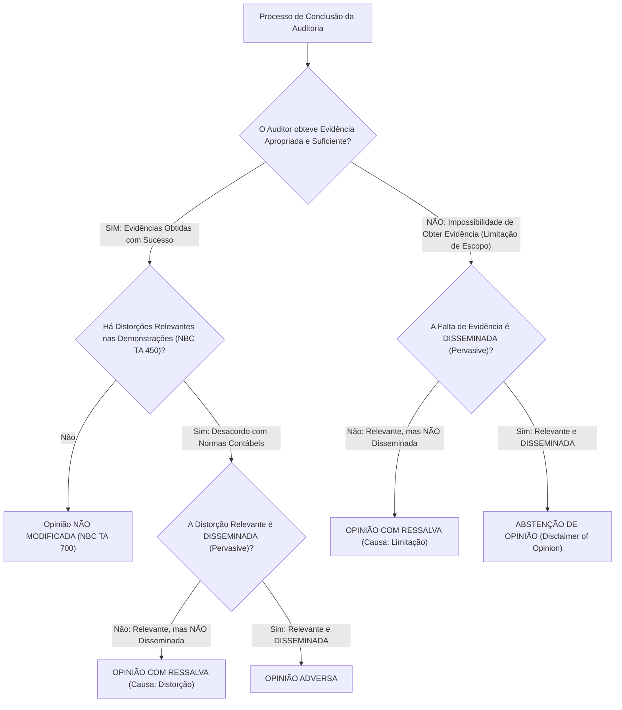
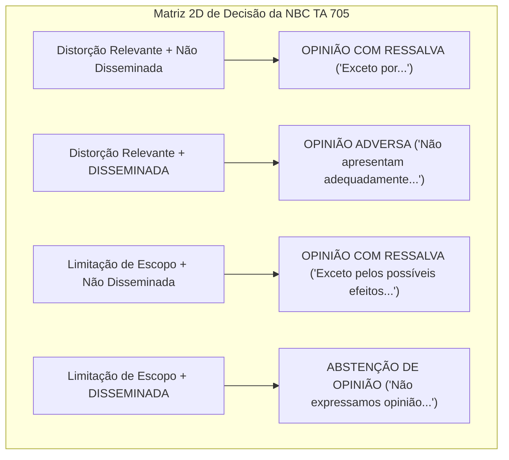
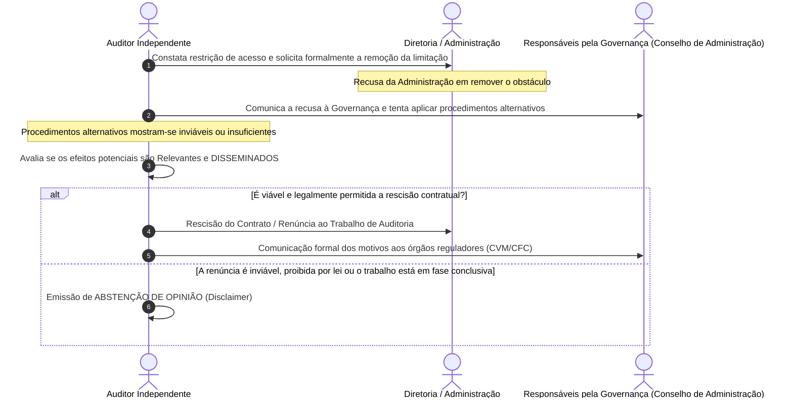
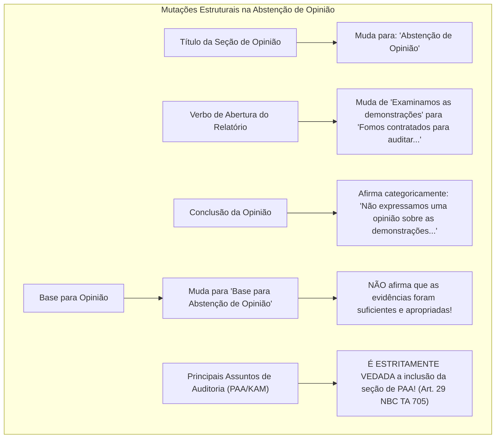

# Modificações de Opinião: Opinião com Ressalva, Opinião Adversa e Abstenção de Opinião (NBC TA 705)

---

## 1. Fundamentos e Causas Primárias de Modificação da Opinião

A emissão de um relatório de auditoria com opinião modificada ocorre quando o auditor independente não consegue emitir uma opinião limpa (não modificada) sobre as demonstrações contábeis tomadas em conjunto.

A **NBC TA 705 (R1)** disciplina as circunstâncias em que uma modificação é compulsória, estabelecendo que ela decorre estritamente de **duas causas primárias**:

$$
\text{Modificação da Opinião} = f(\text{Distorção Relevante}) \lor f(\text{Limitação de Escopo})
$$



### 1.1. As Duas Causas Fundamentais:

1. **Existência de Distorções Relevantes (Desacordo Contábil):** O auditor obteve evidência apropriada e suficiente, mas concluiu que as demonstrações contábeis contêm distorções relevantes não corrigidas decorrentes de:
   - Inadequação das políticas contábeis adotadas (ex.: contabilização de ativos pelo custo histórico sem teste de recuperabilidade / *impairment* exigido pelo CPC 01);
   - Aplicação incorreta das políticas contábeis selecionadas (ex.: taxa de depreciação inconsistente com a vida útil econômica do bem);
   - Inadequação ou insuficiência de divulgações em notas explicativas (ex.: omissão deliberada de contingências passivas prováveis decorrentes de autuações tributárias bilionárias).
2. **Impossibilidade de Obter Evidência Apropriada e Suficiente (Limitação de Escopo):** O auditor não conseguiu aplicar os procedimentos de auditoria necessários para embasar sua opinião, em decorrência de:
   - Circunstâncias alheias à vontade da entidade (ex.: destruição física de arquivos contábeis por inundação ou incêndio);
   - Circunstâncias ligadas à natureza ou época do trabalho (ex.: contratação do auditor após a data do inventário físico de estoques, sendo inviável a aplicação de procedimentos alternativos satisfatórios);
   - Limitações impostas deliberadamente pela administração da entidade (ex.: recusa da diretoria em permitir a circularização externa de advogados ou recusa em franquear acesso a livros de subsidiárias integrais no exterior).

---

## 2. A Teoria da Disseminação (*Pervasiveness*) e os 3 Critérios Taxativos

O elemento divisor de águas entre a aplicação de uma **Ressalva** ou de uma medida extrema (**Opinião Adversa** ou **Abstenção de Opinião**) é o conceito normativo de **efeito disseminado** (*pervasive*).

A NBC TA 705 (item 5, alínea "a") estabelece que efeitos disseminados sobre as demonstrações contábeis são aqueles que, no julgamento profissional do auditor:


### Análise dos 3 Critérios Legais da NBC TA 705:

1. **Não confinamento a elementos específicos:** As distorções ou a ausência de evidências não se restringem a uma conta, rubrica ou saldo contábil específico, mas contaminam a estrutura financeira de forma generalizada (ex.: fraude generalizada no sistema de faturamento que impacta simultaneamente Contas a Receber, Receita Bruta, Tributos sobre Vendas, CMV, Estoques e Lucro Líquido);
2. **Representação de parcela substancial:** Mesmo que a distorção ou limitação esteja confinada a um único elemento, conta ou rubrica patrimonial, esse elemento isolado representa ou poderia representar **parcela substancial** de todo o balanço da entidade (ex.: uma empresa industrial cujo único ativo relevante seja uma fábrica avaliada em R\$ 100 milhões, correspondente a 90% de todo o seu Ativo Total, e cujo registro contábil esteja comprovadamente superavaliado);
3. **Divulgações fundamentais para os usuários:** No caso de distorções em notas explicativas, as informações omitidas ou distorcidas são tão críticas e estruturantes que sua ausência impede que os investidores e credores compreendam a real situação financeira e a capacidade de continuidade da companhia (ex.: omissão em nota explicativa de que a companhia perdeu sua principal concessão pública operacional).

---

## 3. A Matriz de Decisão Bidimensional da Opinião Modificada

A escolha do tipo de opinião modificada opera-se mediante o cruzamento objetivo de duas dimensões: a **natureza da causa** e o **grau de disseminação**:

| Natureza do Problema Encontrado | Relevante, mas NÃO Disseminado (*Not Pervasive*) | Relevante E DISSEMINADO (*Pervasive*) |
| :--- | :---: | :---: |
| **As demonstrações contábeis contêm Distorções Relevantes** (Desacordo com as Normas / Fraude ou Erro) | **OPINIÃO COM RESSALVA** (*Qualified Opinion*) | **OPINIÃO ADVERSA** (*Adverse Opinion*) |
| **Impossibilidade de obter Evidência Apropriada e Suficiente** (Limitação de Escopo na Auditoria) | **OPINIÃO COM RESSALVA** (*Qualified Opinion*) | **ABSTENÇÃO DE OPINIÃO** (*Disclaimer of Opinion*) |



---

## 4. Limitação de Escopo Imposta pela Administração após a Aceitação do Trabalho

Uma das situações mais delicadas e severas na prática profissional e em provas de concursos fiscais ocorre quando a administração do cliente impõe limitações aos trabalhos após a assinatura da carta de contratação.

A NBC TA 705 (itens 11 a 14) dita o rito procedimental obrigatório que o auditor deve seguir:



> [!WARNING]
> **A Regra de Ouro da Limitação pela Gestão:**
> Se a limitação for imposta pela administração e seus efeitos forem relevantes e disseminados, a primeira alternativa do auditor deve ser a **rescisão/renúncia ao trabalho**. Somente se a renúncia não for viável juridicamente (ex.: em auditorias de órgãos públicos onde há dever legal de conclusão) ou quando o relatório tiver que ser emitido compulsoriamente por prazo legal é que o auditor emitirá a **Abstenção de Opinião**.

---

## 5. Estrutura Textual e Alterações Profundas na Abstenção de Opinião

Quando o auditor se abstém de emitir opinião sobre as demonstrações contábeis, a estrutura formal do relatório sofre mutações drásticas disciplinadas pela NBC TA 705 (itens 27 a 29):



### Comparativo Estrutural: Relatório Normal vs. Abstenção de Opinião

| Elemento do Relatório | Relatório Padrão (Sem Modificação) | Relatório com Abstenção de Opinião |
| :--- | :--- | :--- |
| **Título da Seção Inicial** | "Opinião" | **"Abstenção de Opinião"** |
| **Declaração de Exame** | *"Examinamos as demonstrações contábeis..."* | *"**Fomos contratados para auditar** as demonstrações contábeis..."* |
| **Texto da Conclusão** | *"Em nossa opinião, as demonstrações apresentam adequadamente..."* | *"Em decorrência da relevância dos assuntos descritos na Base..., **não expressamos uma opinião** sobre as demonstrações contábeis."* |
| **Declaração de Evidência Suficiente** | *"Acreditamos que a evidência obtida é suficiente e apropriada para fundamentar nossa opinião."* | **SUPRIMIDA**. O auditor não conseguiu obter evidência apropriada e suficiente. |
| **Seção de PAA (NBC TA 701)** | **Obrigatória** para companhias abertas. | **TERMINANTEMENTE PROIBIDA**. A comunicação de PAA poderia passar a falsa impressão de que partes do balanço foram auditadas com sucesso. |

---

## 6. Fórmulas Textuais das Opiniões Modificadas

### 6.1. Opinião com Ressalva (*Qualified Opinion*)
- **Por Distorção Relevante:**
  > *"Em nossa opinião, **exceto pelos efeitos do assunto** descrito na seção Base para Opinião com Ressalva, as demonstrações contábeis apresentam adequadamente, em todos os aspectos relevantes..."*
- **Por Limitação de Escopo:**
  > *"Em nossa opinião, **exceto pelos possíveis efeitos do assunto** descrito na seção Base para Opinião com Ressalva, as demonstrações contábeis apresentam adequadamente, em todos os aspectos relevantes..."*

### 6.2. Opinião Adversa (*Adverse Opinion*)
- **Fórmula de Rejeição Total:**
  > *"Em nossa opinião, em decorrência da relevância e da disseminação do assunto descrito na seção Base para Opinião Adversa, as demonstrações contábeis **não apresentam adequadamente** a posição patrimonial e financeira da Companhia..."*

### 6.3. Abstenção de Opinião (*Disclaimer of Opinion*)
- **Fórmula de Não Pronunciamento:**
  > *"Em decorrência da relevância e da disseminação dos assuntos descritos na seção Base para Abstenção de Opinião, não nos foi possível obter evidência de auditoria apropriada e suficiente para fundamentar nossa opinião de auditoria e, por conseguinte, **não expressamos uma opinião** sobre essas demonstrações contábeis."*

---

## 7. Modelos Textuais Oficiais Comentados das 3 Opiniões Modificadas

A NBC TA 705 apresenta em seu Apêndice as minutas obrigatórias que devem ser rigorosamente observadas pelo auditor:

### 7.1. Minuta: Opinião com Ressalva por Distorção Relevante (Superavaliação de Estoques)

```markdown
OPINIÃO COM RESSALVA
Examinamos as demonstrações contábeis da Companhia Beta S.A., que compreendem o balanço patrimonial em 31 de dezembro de 2025...
Em nossa opinião, exceto pelos efeitos do assunto descrito na seção "Base para Opinião com Ressalva", as demonstrações contábeis apresentam adequadamente, em todos os aspectos relevantes, a posição patrimonial e financeira da Companhia Beta S.A. em 31 de dezembro de 2025...

BASE PARA OPINIÃO COM RESSALVA
Os estoques da Companhia estão registrados no balanço patrimonial pelo valor de R$ 30.000.000,00. A administração não registrou os estoques pelo menor valor entre o custo e o valor realizável líquido, mas apenas pelo custo, o que representa um desvio em relação às práticas contábeis adotadas no Brasil (NBC TG 16). Os registros da Companhia indicam que, se a administração tivesse registrado os estoques pelo menor valor entre o custo e o valor realizável líquido, o montante dos estoques teria sido reduzido em R$ 8.000.000,00, o custo dos produtos vendidos teria sido aumentado em R$ 8.000.000,00 e o lucro líquido e o patrimônio líquido teriam sido reduzidos em R$ 8.000.000,00.
Nossa auditoria foi conduzida de acordo com as normas brasileiras e internacionais de auditoria... Acreditamos que a evidência de auditoria obtida é suficiente e apropriada para fundamentar nossa opinião com ressalva.
```

### 7.2. Minuta: Opinião Adversa por Não Consolidação de Subsidiárias Integrais

```markdown
OPINIÃO ADVERSA
Examinamos as demonstrações contábeis da Companhia Gama S.A., que compreendem o balanço patrimonial em 31 de dezembro de 2025...
Em nossa opinião, em decorrência da relevância e da disseminação do assunto descrito na seção "Base para Opinião Adversa", as demonstrações contábeis consolidadas NÃO apresentam adequadamente a posição patrimonial e financeira da Companhia Gama S.A. e suas subsidiárias em 31 de dezembro de 2025...

BASE PARA OPINIÃO ADVERSA
Conforme explicado na Nota X, a Companhia não consolidou as demonstrações contábeis da sua subsidiária integral Delta Indústria Ltda., adquirida durante o exercício de 2025, em virtude de não ter conseguido obter informações contábeis preparadas de acordo com as práticas contábeis da controladora. Esse procedimento está em desacordo com a NBC TG 36 (R3) - Demonstrações Consolidadas. Se a subsidiária Delta tivesse sido devidamente consolidada, muitos elementos das demonstrações contábeis seriam materialmente afetados. Os efeitos sobre as demonstrações consolidadas não foram determinados porque não foi praticável fazê-lo.
Nossa auditoria foi conduzida de acordo com as normas brasileiras e internacionais de auditoria... Acreditamos que a evidência de auditoria obtida é suficiente e apropriada para fundamentar nossa opinião adversa.
```

### 7.3. Minuta: Abstenção de Opinião por Falta Generalizada de Livros Contábeis (Incêndio)

```markdown
ABSTENÇÃO DE OPINIÃO
Fomos contratados para auditar as demonstrações contábeis da Companhia Ômega S.A., que compreendem o balanço patrimonial em 31 de dezembro de 2025...
Não expressamos uma opinião sobre as demonstrações contábeis da Companhia Ômega S.A. Em decorrência da relevância e da disseminação do assunto descrito na seção "Base para Abstenção de Opinião", não nos foi possível obter evidência de auditoria apropriada e suficiente para fundamentar nossa opinião de auditoria sobre essas demonstrações contábeis.

BASE PARA ABSTENÇÃO DE OPINIÃO
Fomos contratados como auditores da Companhia após a ocorrência de um incêndio de grandes proporções em suas instalações centrais em janeiro de 2026, que destruiu a quase totalidade dos livros e registros contábeis societários, bem como os arquivos eletrônicos de suporte e os servidores de backup. Não nos foi possível aplicar procedimentos de auditoria por meios alternativos relativamente aos ativos, passivos, receitas e custos da Companhia referentes ao exercício de 2025. Como consequência, não nos foi possível determinar se quaisquer ajustes seriam necessários em relação aos elementos integrantes do balanço patrimonial e demonstrações de resultado.
```

---

## 8. Mnemônicos & Âncoras Cognitivas

> [!TIP]
> **Mnemônico da Disseminação: `G-S-D` (Os 3 Gatilhos da NBC TA 705)**
> A distorção ou limitação é disseminada (*pervasive*) quando:
> - **G** $\rightarrow$ **G**eneralizada (não confinada a contas específicas);
> - **S** $\rightarrow$ **S**ubstancial (se confinada, representa parcela gigantesca do balanço);
> - **D** $\rightarrow$ **D**ivulgação Fundamental (se em nota explicativa, é indispensável ao leitor).

> [!TIP]
> **Mnemônico das Fórmulas de Parecer: `EXCETO - NÃO - ABSTÉM`**
> - Ressalva: *"Exceto por..."*
> - Adversa: *"Não apresentam adequadamente..."*
> - Abstenção: *"Não expressamos opinião..."*

---

## 9. Bateria de Questões Oficiais Comentadas (QConcursos)

### Questão 01 — [FGV — CFC / Qualificação Técnica Geral (QTG) — 2026]
**Identificador QC:** [Q4368118](https://www.qconcursos.com/questoes-de-concursos/questoes/0b8f1589-c3)  
**Enunciado:** Uma firma de auditoria independente foi contratada para auditar as demonstrações contábeis da Companhia Delta S.A. Durante os exames, o auditor identificou que a companhia deixou de constituir provisão para perdas prováveis em processos judiciais trabalhistas no montante de R\$ 50.000.000,00, em desacordo frontal com o CPC 25. O Patrimônio Líquido da companhia era de R\$ 60.000.000,00 e o Lucro Líquido apurado foi de R\$ 10.000.000,00. O auditor concluiu que a distorção é relevante e que seus efeitos são disseminados nas demonstrações contábeis. De acordo com a NBC TA 705, o auditor deve emitir:
* **A)** Opinião com Ressalva.
* **B)** Opinião Adversa.
* **C)** Abstenção de Opinião.
* **D)** Opinião Não Modificada com Parágrafo de Ênfase.
* **E)** Relatório de Revisão Limitada com conclusão negativa.

#### Gabarito e Dissecação Técnica: **Alternativa B**

* **Alternativa B (CORRETA):** Pela matriz de decisão da NBC TA 705, quando o auditor obtém evidência apropriada e suficiente comprovando que há distorção relevante (desacordo com as normas contábeis) e que tal distorção é **disseminada** nas demonstrações contábeis (uma provisão de 50 mi que reduz o PL de 60 mi em mais de 80% e transforma o lucro em prejuízo vultoso representa parcela substancial de todo o balanço), a opinião a ser emitida é compulsoriamente a **Opinião Adversa**.
* **Alternativa A (INCORRETA):** A ressalva é cabível se a distorção for relevante, mas NÃO disseminada.
* **Alternativa C (INCORRETA):** A abstenção decorre de impossibilidade de obter evidência (limitação de escopo), e não de desacordo comprovado.
* **Alternativa D (INCORRETA):** Ênfase não corrige nem substitui distorção relevante.
* **Alternativa E (INCORRETA):** Trata-se de auditoria completa (NBC TA), e não de revisão (NBC TR).

---
> **🛡️ Regra de Ouro Inviolável:** Pela matriz de decisão da NBC TA 705, quando o auditor obtém evidência apropriada e suficiente comprovando que há distorção relevante (desacordo com as normas contábeis) e que tal distorção é **disseminada** nas demonstrações contábeis (uma provisão de 50 mi que reduz o PL de 60 mi em mais de 80% e transforma o lucro em prejuízo vultoso representa parcela substancial de todo o balanço), a opinião a ser emitida é compulsoriamente a **Opinião Adversa**.

### Questão 02 — [FGV — CFC / Exame de Suficiência Bacharelado — 2026]
**Identificador QC:** [Q4368151](https://www.qconcursos.com/questoes-de-concursos/questoes/1f625ea5-c3)  
**Enunciado:** Um auditor independente foi contratado após o término do exercício social para auditar as demonstrações contábeis de uma empresa comercial. Em virtude da data tardia de sua contratação, o auditor não pôde acompanhar a contagem física do inventário de estoques e não foi possível obter evidência de auditoria por meios alternativos. Os estoques representavam 4% do Ativo Total e a auditoria de todas as demais contas do balanço transcorreu com regularidade estrita. De acordo com a NBC TA 705, o tipo de opinião a ser emitida pelo auditor é:
* **A)** Opinião Não Modificada.
* **B)** Opinião com Ressalva decorrente de limitação de escopo.
* **C)** Opinião Adversa por erro de inventário.
* **D)** Abstenção de Opinião.
* **E)** Opinião Modificada com recusa de assinatura.

#### Gabarito e Dissecação Técnica: **Alternativa B**

* **Alternativa B (CORRETA):** O auditor deparou-se com uma limitação de escopo (impossibilidade de obter evidência sobre os estoques físicos). Como os estoques representam apenas 4% do Ativo Total, o efeito potencial é relevante, mas **NÃO disseminado** (está confinado a uma rubrica menor e não compromete a totalidade do balanço). Portanto, a conclusão técnica é a **Opinião com Ressalva** (*"exceto pelos possíveis efeitos..."*).
* **Alternativa A (INCORRETA):** A limitação em conta relevante impede a opinião limpa.
* **Alternativa C (INCORRETA):** Opinião adversa exige desacordo comprovado com distorção disseminada.
* **Alternativa D (INCORRETA):** A abstenção de opinião exige que a limitação de escopo seja relevante E disseminada.
* **Alternativa E (INCORRETA):** Não existe recusa de assinatura em normas de auditoria.

---
> **🛡️ Regra de Ouro Inviolável:** O auditor deparou-se com uma limitação de escopo (impossibilidade de obter evidência sobre os estoques físicos).

### Questão 03 — [FGV — CFC / Qualificação Técnica Geral (QTG) — 2026]
**Identificador QC:** [Q4369898](https://www.qconcursos.com/questoes-de-concursos/questoes/ab90c346-c4)  
**Enunciado:** Em uma auditoria de demonstrações contábeis na qual o auditor emite um relatório com **Abstenção de Opinião** em decorrência de múltiplas limitações de escopo impostas pela administração que afetam de forma disseminada as contas da entidade, é correto afirmar quanto à estrutura do relatório:
* **A)** O relatório deve obrigatoriamente incluir a seção de Principais Assuntos de Auditoria (PAA/KAM) para listar os itens que não puderam ser auditados.
* **B)** É expressamente vedada a inclusão da seção de Principais Assuntos de Auditoria (PAA/KAM) no relatório do auditor quando houver abstenção de opinião, salvo se exigido por lei ou regulamento específico.
* **C)** A seção "Base para Opinião" deve declarar expressamente que o auditor obteve evidência suficiente e apropriada para emitir a abstenção.
* **D)** O título do relatório deve ser alterado para "Certificado de Descumprimento Contábil".
* **E)** A responsabilidade do auditor pela auditoria das demonstrações contábeis deve ser totalmente suprimida do texto do relatório.

#### Gabarito e Dissecação Técnica: **Alternativa B**

* **Alternativa B (CORRETA):** A NBC TA 705 (item 29) determina que, a menos que exigido por lei ou regulamento, quando o auditor se abstém de emitir opinião sobre as demonstrações contábeis, seu relatório **não deve incluir a seção de Principais Assuntos de Auditoria (PAA)** de acordo com a NBC TA 701. Isso decorre do fato de que a comunicação de PAA poderia sugerir que certas partes do balanço são fidedignas ou auditadas, contrariando a premissa da abstenção integral.
- **Alternativas A e C (INCORRETAS):** PAA é proibido e a base não pode atestar evidência suficiente.
- **Alternativas D e E (INCORRETAS):** O título mantém o padrão e as responsabilidades gerais permanecem descritas.

---
> **🛡️ Regra de Ouro Inviolável:** A NBC TA 705 (item 29) determina que, a menos que exigido por lei ou regulamento, quando o auditor se abstém de emitir opinião sobre as demonstrações contábeis, seu relatório **não deve incluir a seção de Principais Assuntos de Auditoria (PAA)** de acordo com a NBC TA 701.

### Questão 04 — [CESPE / CEBRASPE — SEFAZ-AL / Auditor Fiscal da Receita Estadual — 2020]
**Identificador QC:** [Q4368134](https://www.qconcursos.com/questoes-de-concursos/questoes/1f3afe2d-c3)  
**Enunciado:** A companhia aberta Gama S.A., supervisionada pela CVM, recusou-se a fornecer à equipe de auditoria independente os livros contábeis e os registros financeiros de suas duas principais subsidiárias operacionais, as quais respondem conjuntamente por 75% da receita e do ativo consolidado do grupo econômico. A equipe de auditoria esgotou todos os procedimentos alternativos sem sucesso e a governança da entidade ratificou a proibição de acesso. Diante da impossibilidade de renunciar ao trabalho em razão de restrição contratual e do prazo regulatório de entrega, o auditor independente deve emitir relatório contendo:
* **A)** Opinião Não Modificada com parágrafo de ênfase sobre as subsidiárias.
* **B)** Opinião com Ressalva apenas sobre a Demonstração dos Fluxos de Caixa.
* **C)** Opinião Adversa por fraude tributária comprovada.
* **D)** Abstenção de Opinião (*Disclaimer of Opinion*).
* **E)** Relatório especial de consultoria pericial.

#### Gabarito e Dissecação Técnica: **Alternativa D**

* **Alternativa D (CORRETA):** A recusa de acesso a componentes que respondem por 75% do ativo e faturamento do grupo configura evidente limitação de escopo relevante e **disseminada** (*pervasive*). Inviabilizada a renúncia contratual, a NBC TA 705 (item 13, "b", "ii") impõe compulsoriamente a **Abstenção de Opinião**.
* **Alternativa A (INCORRETA):** Ênfase aplica-se a assuntos devidamente divulgados em notas explicativas sem distorção.
* **Alternativa B (INCORRETA):** Ressalva não se aplica a limitações que atinjam três quartos de todo o patrimônio consolidado.
* **Alternativa C (INCORRETA):** Opinião adversa exige que o auditor tenha auditado e comprovado a distorção; a limitação de escopo impede saber se há distorção ou não, ensejando a abstenção.
* **Alternativa E (INCORRETA):** Auditor independente emite relatório de auditoria, e não consultoria.

---
> **🛡️ Regra de Ouro Inviolável:** A recusa de acesso a componentes que respondem por 75% do ativo e faturamento do grupo configura evidente limitação de escopo relevante e **disseminada** (*pervasive*).

### Questão 05 — [FCC — SEFAZ-PE / Auditor Fiscal do Tesouro Estadual — 2014]
**Identificador QC:** [Q4299532](https://www.qconcursos.com/questoes-de-concursos/questoes/0c910e2c-af)  
**Enunciado:** Nos termos da NBC TA 705, a expressão *"exceto pelos efeitos do assunto descrito na seção Base para Opinião com Ressalva"* é a redação técnica padronizada a ser utilizada no parágrafo de opinião quando a modificação decorre de:
* **A)** Limitação de escopo imposta por caso fortuito ou força maior.
* **B)** Distorção relevante identificada nas demonstrações contábeis que não seja disseminada.
* **C)** Incerteza relevante quanto à continuidade operacional divulgada adequadamente pela entidade.
* **D)** Discordância irrelevante sobre políticas contábeis de baixa materialidade.
* **E)** Limitação de escopo que afete de forma disseminada todos os elementos do ativo circulante.

#### Gabarito e Dissecação Técnica: **Alternativa B**

* **Alternativa B (CORRETA):** A expressão *"exceto pelos efeitos..."* aplica-se quando o auditor obteve evidência comprovando a existência de distorção relevante não disseminada. Se a ressalva decorresse de limitação de escopo (falta de evidência), a redação normativa obrigatória seria *"exceto pelos **possíveis** efeitos..."* (NBC TA 705, item 16).
* **Alternativa A (INCORRETA):** Limitação de escopo exige a fórmula "possíveis efeitos".
* **Alternativa C (INCORRETA):** Incerteza sobre continuidade com divulgação adequada enseja seção específica de continuidade ou parágrafo de ênfase (NBC TA 570).
* **Alternativa D (INCORRETA):** Discordância irrelevante gera opinião limpa (não modificada).
* **Alternativa E (INCORRETA):** Limitação disseminada gera abstenção de opinião.

---
> **🛡️ Regra de Ouro Inviolável:** A expressão *"exceto pelos efeitos.

### Questão 06 — [CESPE / CEBRASPE — TCU / Auditor Federal de Controle Externo — 2022]
**Identificador QC:** [Q4368143](https://www.qconcursos.com/questoes-de-concursos/questoes/1f4f7fb8-c3)  
**Enunciado:** Em relação à seção "Base para Opinião" quando o auditor emite um relatório com **Opinião Adversa**, de acordo com a NBC TA 705:
* **A)** O auditor deve suprimir a seção "Base para Opinião" para não expor a reputação corporativa da entidade.
* **B)** A seção deve ser intitulada "Base para Opinião Adversa", devendo conter a descrição substantiva da distorção e, sendo praticável, a quantificação dos efeitos financeiros nas demonstrações contábeis.
* **C)** O auditor deve declarar que a emissão da opinião adversa anula os efeitos jurídicos das demonstrações perante o Código Civil.
* **D)** O auditor fica dispensado de declarar a sua independência e o cumprimento do código de ética profissional.
* **E)** O auditor deve indicar que a responsabilidade civil pelo balanço passou a ser integralmente da equipe de auditoria independente.

#### Gabarito e Dissecação Técnica: **Alternativa B**

* **Alternativa B (CORRETA):** A NBC TA 705 (itens 20 a 23) determina que a seção deve intitular-se "Base para Opinião Adversa", fornecendo a descrição clara da matéria objeto de distorção relevante e disseminada e, a menos que impraticável, a mensuração quantitativa de seu impacto nos tributos, resultado e patrimônio líquido.
- **Alternativas A, C, D e E (INCORRETAS):** A base é obrigatória; o auditor não tem poder jurisdicional de anulação societária; a independência deve ser sempre ratificada; e a responsabilidade da administração jamais é transferida.

---
> **🛡️ Regra de Ouro Inviolável:** A NBC TA 705  determina que a seção deve intitular-se "Base para Opinião Adversa", fornecendo a descrição clara da matéria objeto de distorção relevante e disseminada e, a menos que impraticável, a mensuração quantitativa de seu impacto nos tributos, resultado e patrimônio líquido.

### Questão 07 — [FGV — SEFAZ-MG / Auditor Fiscal da Receita Estadual — 2023]
**Identificador QC:** [Q4368126](https://www.qconcursos.com/questoes-de-concursos/questoes/0b9e2ca4-c3)  
**Enunciado:** O auditor independente de uma empresa de logística constatou que a companhia registrou indevidamente como ativo imobilizado R\$ 40.000.000,00 relativos a despesas de manutenção de rotina de caminhões (que deveriam ter sido lançadas diretamente no resultado do período como despesa operacional). O Ativo Total da companhia é de R\$ 500.000.000,00 e o Patrimônio Líquido é de R\$ 200.000.000,00. O auditor concluiu que a distorção é relevante, mas não disseminada nas demonstrações como um todo. Nesse cenário, o relatório deve conter:
* **A)** Opinião Não Modificada com Parágrafo de Ênfase.
* **B)** Opinião com Ressalva por distorção relevante.
* **C)** Opinião Adversa.
* **D)** Abstenção de Opinião.
* **E)** Parecer de irregularidade contábil fiscal.

#### Gabarito e Dissecação Técnica: **Alternativa B**

* **Alternativa B (CORRETA):** O erro está quantificado e comprovado (despesa de manutenção lançada indevidamente no imobilizado fere o regime de competência e o CPC 27). Como representa R\$ 40 mi em um Ativo de R\$ 500 mi (8%) e PL de R\$ 200 mi (20%), a distorção é relevante, porém confinada à conta de Imobilizado e Despesas Operacionais, **não sendo disseminada** a ponto de invalidar o conjunto das demonstrações. A opinião adequada é a **Opinião com Ressalva**.
- **Alternativas A, C, D e E (INCORRETAS):** Distorção relevante comprovada não permite opinião limpa com ênfase; não é disseminada para opinião adversa; não decorre de limitação para abstenção; e não existe "parecer de irregularidade".

---
> **🛡️ Regra de Ouro Inviolável:** O erro está quantificado e comprovado (despesa de manutenção lançada indevidamente no imobilizado fere o regime de competência e o CPC 27).

### Questão 08 — [FGV — Receita Federal do Brasil / Auditor-Fiscal da Receita Federal — 2023]
**Identificador QC:** [Q4368105](https://www.qconcursos.com/questoes-de-concursos/questoes/0b7523a1-c3)  
**Enunciado:** A respeito do conceito de "efeito disseminado" (*pervasive*) previsto na NBC TA 705 para fundamentar a escolha entre Ressalva e Opinião Adversa/Abstenção de Opinião, assinale a opção correta:
* **A)** O efeito é disseminado apenas quando atingir 100% de todas as contas do livro Razão da entidade.
* **B)** Considera-se disseminado o efeito que, mesmo confinado a uma única conta ou elemento do balanço, represente ou possa representar parcela substancial das demonstrações contábeis tomadas em conjunto.
* **C)** A avaliação da disseminação é ato meramente aritmético, devendo o auditor aplicar compulsoriamente a alíquota fixa de 5% sobre a receita bruta.
* **D)** Distorções em notas explicativas nunca podem ser consideradas disseminadas pelo auditor independente.
* **E)** O efeito disseminado afasta a obrigatoriedade de emissão de relatório formal de auditoria.

#### Gabarito e Dissecação Técnica: **Alternativa B**

* **Alternativa B (CORRETA):** A NBC TA 705 (item 5, "a", "ii") estabelece literalmente que é disseminado o efeito que, embora possa estar restrito a um elemento, conta ou item específico das demonstrações contábeis, represente ou possa representar uma **parcela substancial** dessas demonstrações.
* **Alternativa A (INCORRETA):** Não se exige atingimento de 100% das contas.
* **Alternativa C (INCORRETA):** A disseminação decorre de julgamento profissional complexo e qualitativo, não de fórmula matemática cega.
* **Alternativa D (INCORRETA):** Omissões críticas em notas explicativas que sejam fundamentais para o entendimento dos usuários caracterizam efeito disseminado (item 5, "a", "iii").
* **Alternativa E (INCORRETA):** A constatação impõe a emissão de relatório com opinião modificada (adversa ou abstenção).

---
> **🛡️ Regra de Ouro Inviolável:** A NBC TA 705 (item 5, "a", "ii") estabelece literalmente que é disseminado o efeito que, embora possa estar restrito a um elemento, conta ou item específico das demonstrações contábeis, represente ou possa representar uma **parcela substancial** dessas demonstrações.

### Questão 09 — [FGV — CFC / Exame de Suficiência Bacharelado — 2026]
**Identificador QC:** [Q4374188](https://www.qconcursos.com/questoes-de-concursos/questoes/82aad190-c7)  
**Enunciado:** Um auditor independente identificou que a empresa auditada não reconheceu receitas auferidas de contratos de longo prazo pelo método da porcentagem de completude (NBC TG 47), postergando indevidamente o reconhecimento de R\$ 12.000.000,00 para exercícios futuros com o intuito de reduzir o IRPJ e a CSLL no exercício corrente. O auditor obteve toda a documentação comprobatória e calculou o impacto exato sobre os tributos e sobre o patrimônio. Considerando que a distorção é relevante, mas não disseminada nas demonstrações, o tipo de opinião e a fórmula a ser utilizada no relatório são:
* **A)** Opinião com Ressalva, utilizando a fórmula *"exceto pelos possíveis efeitos..."*.
* **B)** Opinião com Ressalva, utilizando a fórmula *"exceto pelos efeitos..."*.
* **C)** Opinião Adversa, utilizando a fórmula *"não representam fidedignamente..."*.
* **D)** Abstenção de Opinião, com supressão da seção de responsabilidades do auditor.
* **E)** Opinião Não Modificada com inclusão de Principais Assuntos de Auditoria.

#### Gabarito e Dissecação Técnica: **Alternativa B**

* **Alternativa B (CORRETA):** Havendo distorção relevante comprovada por evidência documental (desacordo com a NBC TG 47) e não sendo ela disseminada, emite-se **Opinião com Ressalva**. Como a causa é distorção (e não falta de evidência/limitação), a fórmula exata exigida pelo item 16 da NBC TA 705 é *"exceto pelos efeitos do assunto..."*, sem a palavra "possíveis".
* **Alternativa A (INCORRETA):** "Possíveis efeitos" aplica-se apenas a limitações de escopo.
- **Alternativas C, D e E (INCORRETAS):** A distorção não é disseminada para opinião adversa; não é limitação para abstenção; e distorção relevante impede opinião limpa com PAA.

---
> **🛡️ Regra de Ouro Inviolável:** Havendo distorção relevante comprovada por evidência documental (desacordo com a NBC TG 47) e não sendo ela disseminada, emite-se **Opinião com Ressalva**.

### Questão 10 — [FCC — SEFAZ-SC / Auditor Fiscal da Receita Estadual — 2018]
**Identificador QC:** [Q4097279](https://www.qconcursos.com/questoes-de-concursos/questoes/f82aa610-8b)  
**Enunciado:** Em uma auditoria de demonstrações contábeis na qual a administração do cliente impõe limitações aos procedimentos de auditoria, proibindo que os auditores confirmem os saldos bancários com instituições financeiras e impeçam o exame de faturas de compras, o auditor deve:
* **A)** Concordar com a limitação imposta pela administração desde que receba uma carta de conforto assinada pelo conselho fiscal.
* **B)** Solicitar que a administração remova a limitação; persistindo a recusa, comunicar à governança e avaliar se deve renunciar ao trabalho ou, caso inviável a renúncia, abster-se de opinar.
* **C)** Emitir imediatamente opinião adversa por crime de desobediência mercantil.
* **D)** Lavrar auto de infração tributária diretamente no livro Diário da companhia.
* **E)** Contratar peritos policiais para apreender à força os extratos bancários na agência bancária.

#### Gabarito e Dissecação Técnica: **Alternativa B**

* **Alternativa B (CORRETA):** Trata-se do rito procedimental cogente dos itens 11 e 12 da NBC TA 705: solicitação formal de remoção do obstáculo à diretoria; comunicação formal aos responsáveis pela governança; tentativa de procedimentos alternativos; e, em caso de impacto relevante e disseminado, rescisão/renúncia do contrato ou abstenção de opinião.
- **Alternativas A, C, D e E (INCORRETAS):** Auditor independente não aceita restrição arbitrária de escopo; opinião adversa exige distorção comprovada (não limitação); auditor independente não tem poder de polícia fiscalizatória tributária estatal; e não há contratação de força policial pelo auditor privado.

---
> **🛡️ Regra de Ouro Inviolável:** Trata-se do rito procedimental cogente dos itens 11 e 12 da NBC TA 705: solicitação formal de remoção do obstáculo à diretoria; comunicação formal aos responsáveis pela governança; tentativa de procedimentos alternativos; e, em caso de impacto relevante e disseminado, rescisão/renúncia do contrato ou abstenção de opinião.

### Questão 11 — [CESPE / CEBRASPE — SEFAZ-CE / Auditor Fiscal da Receita Estadual — 2021]
**Identificador QC:** [Q4221422](https://www.qconcursos.com/questoes-de-concursos/questoes/78999538-91)  
**Enunciado:** O auditor independente concluiu que as demonstrações contábeis de uma sociedade aberta omitem em notas explicativas o fato de que a companhia é ré em processo de desapropriação de sua sede industrial, cuja perda é iminente e impedirá a continuidade de suas operações fabris nos próximos seis meses. A administração recusou-se a divulgar a informação alegando sigilo de negócios. Diante da essencialidade dessa divulgação para o entendimento da solvência e continuidade da companhia pelos investidores, o auditor deve emitir:
* **A)** Opinião Não Modificada com parágrafo de outros assuntos.
* **B)** Opinião Adversa, pois a omissão de nota explicativa fundamental para os usuários enquadra-se no conceito de efeito disseminado.
* **C)** Abstenção de Opinião em decorrência de sigilo judicial.
* **D)** Opinião com Ressalva por erro formal irrelevante.
* **E)** Relatório especial de liquidação judicial antecipada.

#### Gabarito e Dissecação Técnica: **Alternativa B**

* **Alternativa B (CORRETA):** A NBC TA 705 (item 5, "a", "iii") estabelece que, em relação a notas explicativas e divulgações, o efeito é considerado **disseminado** (*pervasive*) quando a informação omitida ou distorcida for **fundamental para o entendimento dos usuários** sobre as demonstrações contábeis tomadas em conjunto. Como a perda da sede fabril inviabiliza a continuidade operacional, a omissão dolosa da divulgação contamina a totalidade da tomada de decisão dos investidores, ensejando a **Opinião Adversa**.
* **Alternativa A (INCORRETA):** Outros assuntos não supre erro material nas demonstrações.
* **Alternativa C (INCORRETA):** O auditor possui as evidências da perda iminente; a causa é desacordo sobre divulgação (distorção), não falta de prova.
- **Alternativas D e E (INCORRETAS):** A omissão não é irrelevante e auditor não decreta liquidação.

---
> **🛡️ Regra de Ouro Inviolável:** A NBC TA 705 (item 5, "a", "iii") estabelece que, em relação a notas explicativas e divulgações, o efeito é considerado **disseminado** (*pervasive*) quando a informação omitida ou distorcida for **fundamental para o entendimento dos usuários** sobre as demonstrações contábeis tomadas em conjunto.

### Questão 12 — [FGV — Receita Federal do Brasil / Auditor-Fiscal da Receita Federal — 2023]
**Identificador QC:** [Q4368148](https://www.qconcursos.com/questoes-de-concursos/questoes/1f5b7033-c3)  
**Enunciado:** Assinale a opção que apresenta a correta correlação entre a situação encontrada pelo auditor independente e o tipo de modificação de opinião aplicável:
* **A)** Distorção relevante e disseminada decorrente de fraude em contas a receber $\rightarrow$ Opinião com Ressalva.
* **B)** Impossibilidade de obter evidência sobre um saldo relevante de investimentos em coligada que não é disseminado $\rightarrow$ Opinião com Ressalva.
* **C)** Impossibilidade de obter evidência apropriada e suficiente que afeta de forma generalizada e profunda todas as operações da companhia $\rightarrow$ Opinião Adversa.
* **D)** Distorção irrelevante e pontual em despesas antecipadas $\rightarrow$ Abstenção de Opinião.
* **E)** Falta de inventário físico de estoques que representam 95% do patrimônio líquido da entidade $\rightarrow$ Opinião Não Modificada com Ênfase.

#### Gabarito e Dissecação Técnica: **Alternativa B**

* **Alternativa B (CORRETA):** Aplicação cristalina da matriz da NBC TA 705: limitação de escopo (falta de evidência) que seja relevante, mas NÃO disseminada, resulta em **Opinião com Ressalva**.
* **Alternativa A (INCORRETA):** Distorção relevante e disseminada enseja Opinião Adversa.
* **Alternativa C (INCORRETA):** Limitação de escopo disseminada enseja Abstenção de Opinião.
* **Alternativa D (INCORRETA):** Distorção irrelevante enseja Opinião Não Modificada (limpa).
* **Alternativa E (INCORRETA):** Falta de evidência sobre 95% do patrimônio representa parcela substancial e disseminada, ensejando Abstenção de Opinião.
> **🛡️ Regra de Ouro Inviolável:** Aplicação cristalina da matriz da NBC TA 705: limitação de escopo (falta de evidência) que seja relevante, mas NÃO disseminada, resulta em **Opinião com Ressalva**.
