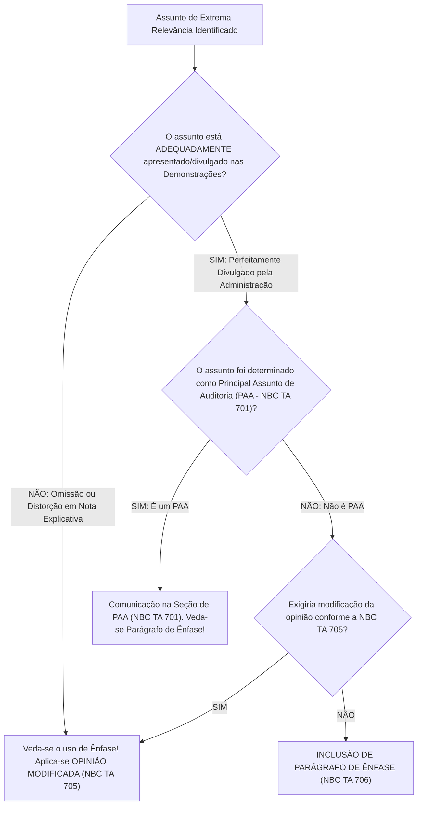
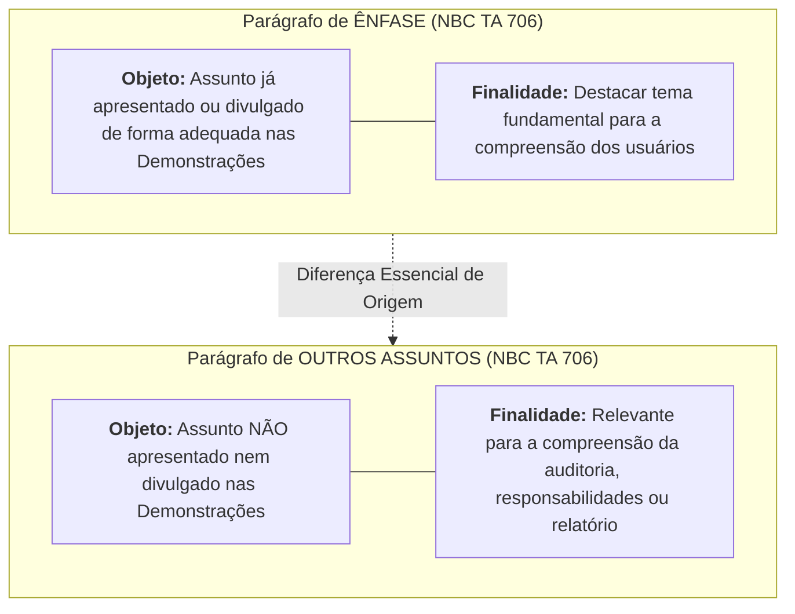
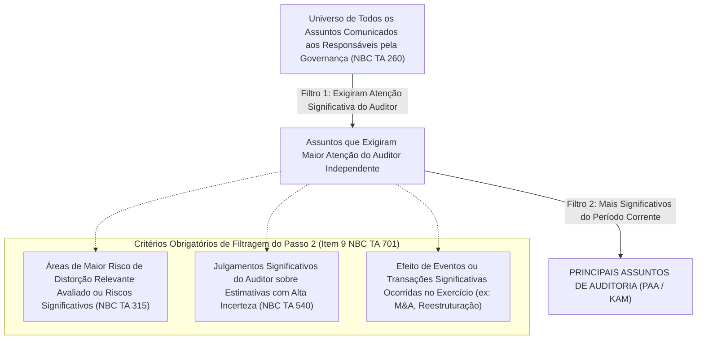
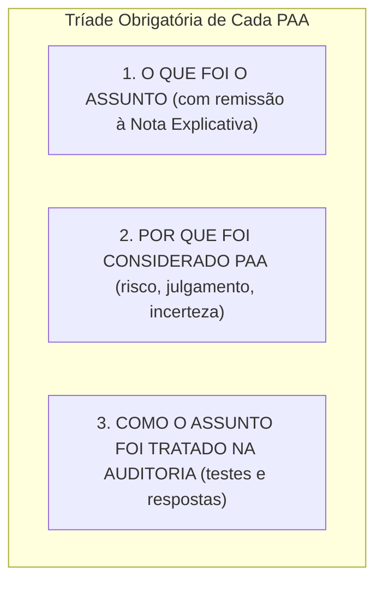

# Parágrafos de Ênfase, Outros Assuntos e Principais Assuntos de Auditoria (PAA / KAM) — NBC TA 706 e NBC TA 701

---

## 1. O Parágrafo de Ênfase (*Emphasis of Matter Paragraph* — NBC TA 706)

O parágrafo de ênfase é o mecanismo formal pelo qual o auditor independente destaca um assunto de fundamental importância já divulgado pela administração nas demonstrações contábeis, sem que isso represente qualquer modificação em sua opinião.

A **NBC TA 706 (R1)** conceitua o Parágrafo de Ênfase como o parágrafo incluído no relatório de auditoria que:

> *"Refere-se a um assunto apropriadamente apresentado ou divulgado nas demonstrações contábeis que, de acordo com o julgamento do auditor, é de tal importância que é fundamental para o entendimento das demonstrações contábeis pelos usuários."*



### 1.1. As Duas Condições Negativas Cumulativas para Inclusão de Ênfase

O auditor somente pode incluir um parágrafo de ênfase quando cumpridas cumulativamente as seguintes condições estritas (NBC TA 706, item 6):
1. O assunto **NÃO exigiria que o auditor modificasse a sua opinião** de acordo com a NBC TA 705 (ou seja, não há distorção relevante nem limitação de escopo);
2. O assunto **NÃO tenha sido determinado como um Principal Assunto de Auditoria (PAA)** a ser comunicado no relatório de auditoria nos termos da NBC TA 701.

> [!CAUTION]
> **A Regra de Ouro da Ênfase:**
> - O parágrafo de ênfase **NÃO substitui** uma opinião com ressalva ou adversa quando a demonstração contiver erro;
> - O parágrafo de ênfase **NÃO substitui** notas explicativas que a administração deixou de divulgar;
> - O parágrafo de ênfase **NÃO modifica a opinião do auditor**, devendo constar obrigatoriamente a declaração: *"Nossa opinião não está modificada em relação a esse assunto."*

### 1.2. Exemplos Clássicos de Aplicação do Parágrafo de Ênfase:
- Incerteza relevante quanto ao desfecho futuro de litígio excepcional ou ação regulatória extraordinária;
- Evento subsequente relevante ocorrido entre a data das demonstrações e a data do relatório (ex.: desastre natural após o balanço);
- Aplicação antecipada de uma nova norma contábil antes de sua data de vigência obrigatória;
- Catástrofe de grandes proporções que tenha afetado de forma contundente a posição financeira da entidade.

---

## 2. O Parágrafo de Outros Assuntos (*Other Matter Paragraph* — NBC TA 706)

Enquanto o parágrafo de ênfase trata de assunto já divulgado nas demonstrações contábeis, o **Parágrafo de Outros Assuntos** trata de matéria **estranha** às demonstrações contábeis:

> *"Parágrafo incluído no relatório de auditoria que se refere a um assunto **não apresentado nem divulgado nas demonstrações contábeis** e que, de acordo com o julgamento do auditor, é relevante para os usuários entenderem a auditoria, as responsabilidades do auditor ou o relatório de auditoria."*



### 2.1. Hipóteses Típicas de Inclusão de Outros Assuntos:
1. **Auditoria das Demonstrações Anteriores por Auditor Antecessor (NBC TA 710):** Informação de que as contas do ano anterior foram examinadas por outra firma, mencionando a data do relatório e o tipo de opinião emitida;
2. **Demonstrações Anteriores Não Auditadas:** Declaração explícita de que os saldos comparativos do exercício antecedente não foram submetidos à auditoria independente;
3. **Restrição de Distribuição ou Uso do Relatório:** Quando o trabalho de auditoria for contratado para atender a finalidade específica ou a regulador determinado, restringindo a circulação do parecer;
4. **Demonstrações Preparadas sob Mais de uma Estrutura:** Quando a entidade elabora um conjunto sob as normas brasileiras e outro sob as IFRS para fins de consolidação no exterior.

---

## 3. Principais Assuntos de Auditoria — PAA / KAM (*Key Audit Matters* — NBC TA 701)

A criação da seção de **Principais Assuntos de Auditoria (PAA)** representou a inovação mais marcante da reforma de 2016, conferindo aos usuários uma visão detalhada dos bastidores da auditoria independente.

### 3.1. Conceito e Obrigatoriedade

Conforme a **NBC TA 701**, Principais Assuntos de Auditoria são:

> *"Aqueles assuntos que, no julgamento profissional do auditor, foram os **mais significativos** na auditoria das demonstrações contábeis do período corrente. Os principais assuntos de auditoria são selecionados a partir dos assuntos comunicados aos responsáveis pela governança."*

> [!IMPORTANT]
> **Campo de Aplicação Obrigatória:**
> - A inclusão da seção de PAA é **compulsória para a auditoria de companhias abertas** (entidades listadas em bolsa de valores no Brasil, supervisionadas pela CVM);
> - É aplicável a outras entidades quando exigido por lei ou regulador específico (ex.: instituições financeiras pelo BACEN, seguradoras pela SUSEP);
> - Pode ser adotada voluntariamente pelo auditor em companhias fechadas.

### 3.2. O Funil Decisório dos PAAs em 3 Etapas

A seleção dos PAAs opera-se mediante um processo sucessivo de filtragem concebido pela NBC TA 701:



---

## 4. Estrutura de Descrição de Cada PAA no Relatório

Para cada assunto classificado como PAA, o auditor deve redigir uma subseção individualizada contendo obrigatoriamente 3 elementos (NBC TA 701, item 13):

1. **Descrição do Assunto e Referência:** Explicação do fato econômico e indicação precisa da **nota explicativa** correlata nas demonstrações contábeis;
2. **Motivo da Classificação como PAA:** Exposição das razões pelas quais o assunto foi considerado um dos mais significativos na auditoria (ex.: alta subjetividade na mensuração do ágio por expectativa de rentabilidade futura / *goodwill*, complexidade do modelo matemático de precificação de derivativos);
3. **Resposta do Auditor:** Como o assunto foi tratado e endereçado nos procedimentos de auditoria (ex.: envolvimento de especialistas em avaliação, teste substantivo detalhado de fluxos de caixa descontados, recálculo independente e checagem de dados de mercado).



---

## 5. Vedações e Limites Normativos Absolutos na NBC TA 701

Para evitar o uso distorcido da ferramenta, a NBC TA 701 impõe vedações categóricas:

1. **PAA Não Substitui Modificação de Opinião:** O auditor está terminantemente proibido de utilizar a seção de PAA para reportar um assunto que exija uma opinião com ressalva, adversa ou abstenção conforme a NBC TA 705;
2. **PAA Não Fornece Opinião Separada:** A descrição do PAA é feita no contexto das demonstrações contábeis tomadas em conjunto; o auditor não emite uma opinião isolada sobre o PAA ("o ágio está correto");
3. **PAA Não Substitui Divulgações da Administração:** O auditor não pode criar fatos novos na seção de PAA que a administração tinha o dever legal de divulgar em notas explicativas;
4. **Proibição Absoluta em Abstenção de Opinião:** Conforme a NBC TA 705 (item 29), quando o auditor se abstém de opinar, é **vedada a inclusão de seção de PAA**, salvo imposição legal expressa.

---

## 6. Quadro Comparativo Tridimensional: Ênfase vs. Outros Assuntos vs. PAA

| Dimensão de Análise | Parágrafo de Ênfase (NBC TA 706) | Parágrafo de Outros Assuntos (NBC TA 706) | Principais Assuntos de Auditoria - PAA (NBC TA 701) |
| :--- | :--- | :--- | :--- |
| **Origem da Informação** | Assunto **já apresentado ou divulgado** nas Demonstrações Contábeis (em Nota Explicativa). | Assunto **NÃO apresentado nem divulgado** nas Demonstrações Contábeis. | Assunto selecionado a partir das comunicações com a Governança. |
| **Finalidade Central** | Chamar atenção para assunto de importância fundamental para o leitor compreender as demonstrações. | Chamar atenção para assuntos relevantes para compreender a auditoria ou responsabilidades do auditor. | Aumentar o valor comunicativo do relatório, detalhando os assuntos mais complexos tratados na auditoria. |
| **Obrigatoriedade** | Condicional (quando houver matéria relevante a enfatizar). | Condicional (ex.: auditor antecessor na NBC TA 710). | **Compulsório para companhias abertas** cotadas em bolsa (CVM). |
| **Localização no Relatório** | Seção separada intitulada *"Ênfase"* (ou *"Ênfase - Incerteza..."*). | Seção separada intitulada *"Outros Assuntos"*, ao final do relatório. | Seção própria destacada intitulada *"Principais Assuntos de Auditoria"*. |
| **Impacto na Opinião** | **Não modifica a opinião** (*"Nossa opinião não está modificada..."*). | **Não modifica a opinião** do auditor. | **Não expressa opinião separada** sobre os assuntos. |
| **Relação com PAA** | Se o assunto for determinado como PAA, **prevalece o PAA** (veda-se a ênfase). | Não concorre com PAA (trata de assuntos externos às demonstrações). | Prevalece sobre o Parágrafo de Ênfase. |

---

## 7. Modelos Textuais Comentados de Redação Prática

Para conferir máxima fixação, examinam-se as minutas textuais padronizadas pela NBC TA 706 e NBC TA 701:

### 7.1. Minuta de Parágrafo de Ênfase: Litígio Regulatório Excepcional

```markdown
ÊNFASE
Chamamos a atenção para a Nota Explicativa nº 18 às demonstrações contábeis, que descreve a incerteza relacionada com o desfecho de processo administrativo instaurado pelo Conselho Administrativo de Defesa Econômica (CADE) em face da Companhia, decorrente de suposta infração à ordem econômica. Nossa opinião não está modificada em relação a esse assunto.
```

### 7.2. Minuta de Parágrafo de Outros Assuntos: Demonstrações Anteriores Auditadas por Auditor Antecessor

```markdown
OUTROS ASSUNTOS - Demonstrações Contábeis do Exercício Anterior Auditadas por Outro Auditor
As demonstrações contábeis da Companhia para o exercício findo em 31 de dezembro de 2024 foram auditadas por outro auditor independente, que emitiu relatório sem modificação (com parágrafo de ênfase sobre reestruturação societária) sobre essas demonstrações em 15 de março de 2025.
```

### 7.3. Minuta de PAA: Teste de Recuperabilidade de Ágio por Expectativa de Rentabilidade Futura (*Impairment* do *Goodwill*)

```markdown
PRINCIPAIS ASSUNTOS DE AUDITORIA

Recuperabilidade do ágio pago por expectativa de rentabilidade futura (Goodwill)
- Por que o assunto foi considerado um PAA: Em 31 de dezembro de 2025, o saldo consolidado de ágio decorrente de aquisições totalizava R$ 250.000.000,00 (Nota Explicativa nº 12). A administração realiza anualmente o teste de recuperabilidade desse ativo com base no valor em uso, calculado pelo método do fluxo de caixa descontado. Consideramos esse assunto um dos mais significativos em nossa auditoria devido à relevância do saldo e ao elevado grau de julgamento e subjetividade envolvidos nas premissas de projeção de receitas, taxas de crescimento de longo prazo e taxas de desconto aplicadas.
- Como o assunto foi tratado na auditoria: Nossos procedimentos incluíram, com o suporte de nossos especialistas internos em avaliação financeira: (i) avaliação do desenho e teste da eficácia dos controles internos chave sobre o processo de elaboração do orçamento e premissas de fluxo de caixa; (ii) avaliação da razoabilidade das premissas macroeconômicas e taxas de desconto utilizadas, comparando-as com dados de mercado e do setor de atuação; (iii) execução de análise de sensibilidade independente sobre as principais variáveis; e (iv) avaliação da adequação das divulgações contidas na Nota Explicativa nº 12.
```

---

## 8. Mnemônicos & Âncoras Cognitivas

> [!TIP]
> **Mnemônico da Diferenciação Rápida: `DENTRO vs FORA`**
> - **Ênfase** $\rightarrow$ Olha para **DENTRO** das Demonstrações (já está em Nota Explicativa).
> - **Outros Assuntos** $\rightarrow$ Olha para **FORA** das Demonstrações (responsabilidades do auditor, outro auditor no ano passado).
> - **PAA** $\rightarrow$ Olha para os **BASTIDORES** da Auditoria (risco alto, trabalho duro do auditor em companhias abertas).

> [!TIP]
> **Mnemônico da Hierarquia PAA vs Ênfase: `PAA Engole a Ênfase`**
> - Se um assunto qualifica-se como PAA e também como ênfase, ele **vai obrigatoriamente para a seção de PAA**. É proibido duplicar o mesmo assunto como Ênfase e PAA no mesmo relatório!

---

## 9. Bateria de Questões Oficiais Comentadas (QConcursos)

### [Questão 01](https://www.qconcursos.com/questoes-de-concursos/questoes/1f56860b-c3) — [FGV — CFC / Qualificação Técnica Geral (QTG) — 2026]

Em relação à comunicação de Principais Assuntos de Auditoria (PAA) no relatório do auditor independente, nos termos da NBC TA 701, assinale a afirmativa correta:
* **A)** A comunicação de PAA substitui a necessidade de emissão de opinião com ressalva quando a administração discordar do auditor sobre uma distorção relevante.
* **B)** A comunicação de PAA fornece uma opinião individualizada e autônoma sobre cada rubrica contábil descrita na respectiva subseção.
* **C)** Os principais assuntos de auditoria são selecionados a partir dos assuntos comunicados aos responsáveis pela governança que exigiram atenção significativa do auditor.
* **D)** A inclusão de PAA é vedada em auditorias de companhias abertas que atuem no setor financeiro.
* **E)** O auditor deve se abster de emitir opinião sobre as demonstrações contábeis sempre que identificar mais de cinco PAAs no mesmo exercício.

#### Gabarito e Dissecação Técnica: **Alternativa C**

* **Alternativa C (CORRETA):** O item 8 da NBC TA 701 preconiza que os PAAs são selecionados entre os assuntos comunicados à governança corporativa que exigiram maior atenção do auditor independente durante a execução dos trabalhos.
* **Alternativa A (INCORRETA):** PAA não substitui modificação de opinião (item 11).
* **Alternativa B (INCORRETA):** O auditor não fornece opinião separada sobre os PAAs.
* **Alternativa D (INCORRETA):** Companhias abertas são o público-alvo obrigatório da NBC TA 701.
* **Alternativa E (INCORRETA):** A quantidade de PAAs varia conforme a complexidade do negócio, não gerando abstenção.

> **Fique Ligado:** O item 8 da NBC TA 701 preconiza que os PAAs são selecionados entre os assuntos comunicados à governança corporativa que exigiram maior atenção do auditor independente durante a execução dos trabalhos.

---

### [Questão 02](https://www.qconcursos.com/questoes-de-concursos/questoes/1f524a80-c3) — [FGV — CFC / Qualificação Técnica Geral (QTG) — 2026]

Um auditor independente incluiu em seu relatório um Parágrafo de Ênfase chamando a atenção para a Nota Explicativa nº 28, que relata a ocorrência de um incêndio devastador na principal fábrica da entidade após o encerramento do exercício, com perda parcial de maquinários e cobertura securitária em fase de liquidação. A respeito do Parágrafo de Ênfase regulado pela NBC TA 706:
* **A)** A inclusão do parágrafo de ênfase transforma a opinião do auditor em uma opinião com ressalva por incerteza de sinistro.
* **B)** O parágrafo de ênfase deve referir-se a um assunto apropriadamente apresentado ou divulgado nas demonstrações contábeis e indicar que a opinião do auditor não está modificada em relação ao assunto enfatizado.
* **C)** O auditor está proibido de incluir parágrafos de ênfase sobre eventos subsequentes devidamente divulgados pela administração.
* **D)** O parágrafo de ênfase dispensa a empresa de prestar qualquer esclarecimento adicional em notas explicativas.
* **E)** O parágrafo de ênfase substitui a necessidade de manter o relatório arquivado pelo prazo decadencial.

#### Gabarito e Dissecação Técnica: **Alternativa B**

* **Alternativa B (CORRETA):** A NBC TA 706 (itens 6 e 7) determina que o parágrafo de ênfase deve remeter à nota explicativa correspondente onde o assunto está adequadamente divulgado e deve expressar formalmente que a opinião do auditor não foi modificada com relação à matéria enfatizada.
* **Alternativa A (INCORRETA):** Ênfase não é ressalva e não modifica a opinião.
* **Alternativa C (INCORRETA):** Eventos subsequentes divulgados em nota explicativa são hipótese clássica de ênfase (item A5).
- **Alternativas D e E (INCORRETAS):** A ênfase pressupõe a existência prévia da nota explicativa e não altera deveres de guarda de arquivos.

> **Fique Ligado:** A NBC TA 706  determina que o parágrafo de ênfase deve remeter à nota explicativa correspondente onde o assunto está adequadamente divulgado e deve expressar formalmente que a opinião do auditor não foi modificada com relação à matéria enfatizada.

---

### [Questão 03](https://www.qconcursos.com/questoes-de-concursos/questoes/22c83ba9-c4) — [FGV — CFC / Qualificação Técnica Geral (QTG) — 2026]

De acordo com a NBC TA 706, a inclusão de um **Parágrafo de Outros Assuntos** no relatório do auditor independente é apropriada quando:
* **A)** O auditor constata que a companhia omitiu uma contingência passiva provável de cem milhões de reais nas demonstrações contábeis.
* **B)** O auditor deseja chamar a atenção dos usuários para um assunto não apresentado nem divulgado nas demonstrações contábeis que seja relevante para o entendimento da auditoria, das responsabilidades do auditor ou do relatório.
* **C)** A governança solicita ao auditor que divulgue informações sigilosas sobre a concorrência mercantil que não constam do balanço.
* **D)** O auditor decide emitir uma opinião adversa com dispensa da seção de base para opinião.
* **E)** A empresa é autuada pela Receita Federal e decide quitar o tributo no dia da assembleia geral.

#### Gabarito e Dissecação Técnica: **Alternativa B**

* **Alternativa B (CORRETA):** Reproduz a definição literal da NBC TA 706 (item 5, "b"): o parágrafo de outros assuntos trata de matéria não apresentada nem divulgada nas demonstrações contábeis que seja relevante para o entendimento da auditoria ou do relatório (ex.: informe sobre auditor antecessor).
* **Alternativa A (INCORRETA):** Omissão de passivo provável é distorção relevante que enseja modificação de opinião (ressalva ou adversa), não outros assuntos.
* **Alternativa C (INCORRETA):** O auditor não pode quebrar sigilo concorrencial.
* **Alternativa D (INCORRETA):** Opinião adversa exige base para opinião e rege-se pela NBC TA 705.
* **Alternativa E (INCORRETA):** Quitação de autuação é evento ordinário das demonstrações.

> **Fique Ligado:** Reproduz a definição literal da NBC TA 706 (item 5, "b"): o parágrafo de outros assuntos trata de matéria não apresentada nem divulgada nas demonstrações contábeis que seja relevante para o entendimento da auditoria ou do relatório (ex.

---

### [Questão 04](https://www.qconcursos.com/questoes-de-concursos/questoes/0c910e2c-af) — [CESPE / CEBRASPE — SEFAZ-CE / Auditor Fiscal da Receita Estadual — 2021]

Caso determinado assunto tenha sido avaliado como de alta relevância durante a auditoria de uma companhia aberta, tendo sido selecionado como um Principal Assunto de Auditoria (PAA) e incluído na respectiva seção do relatório de acordo com a NBC TA 701, é correto afirmar que o auditor:
* **A)** Não deve incluir um Parágrafo de Ênfase no relatório sobre esse mesmo assunto.
* **B)** Deve obrigatoriamente duplicar a informação em um Parágrafo de Ênfase e em um Parágrafo de Outros Assuntos.
* **C)** Fica dispensado de fazer qualquer remissão à nota explicativa correspondente.
* **D)** Deve classificar a companhia como inapta para manter ações negociadas na bolsa de valores.
* **E)** Deve emitir uma conclusão de asseguração limitada negativa sobre o PAA específico.

#### Gabarito e Dissecação Técnica: **Alternativa A**

* **Alternativa A (CORRETA):** A NBC TA 706 (item 6, "b") estabelece que o parágrafo de ênfase somente pode ser utilizado se o assunto não tiver sido determinado como um PAA a ser comunicado no relatório segundo a NBC TA 701. Sendo o assunto tratado como PAA, veda-se a sua repetição como Parágrafo de Ênfase.
* **Alternativa B (INCORRETA):** A duplicação é terminantemente proibida pelas normas.
* **Alternativa C (INCORRETA):** A remissão à nota explicativa correspondente é requisito obrigatório da descrição do PAA (NBC TA 701, item 13).
- **Alternativas D e E (INCORRETAS):** PAA não atesta inaptidão societária e não emite asseguração limitada.

> **Fique Ligado:** A NBC TA 706 (item 6, "b") estabelece que o parágrafo de ênfase somente pode ser utilizado se o assunto não tiver sido determinado como um PAA a ser comunicado no relatório segundo a NBC TA 701.

---

### [Questão 05](https://www.qconcursos.com/questoes-de-concursos/questoes/1f4f7fb8-c3) — [FCC — SEFAZ-PE / Auditor Fiscal do Tesouro Estadual — 2014]

Em relação às responsabilidades da auditoria de demonstrações contábeis comparativas, se as demonstrações contábeis do período anterior tiverem sido auditadas por auditor antecessor e o auditor atual decidir referenciar o trabalho anterior, conforme a NBC TA 710 e a NBC TA 706, ele deve incluir em seu relatório:
* **A)** Um Parágrafo de Ênfase destacando que o auditor antecessor cometeu fraudes na emissão do relatório anterior.
* **B)** Um Parágrafo de Outros Assuntos informando que as demonstrações contábeis do período anterior foram auditadas por auditor antecessor, o tipo de opinião emitida e a data do relatório anterior.
* **C)** Uma seção de Principais Assuntos de Auditoria detalhando os honorários cobrados pela firma anterior.
* **D)** Uma declaração expressa de que não assume nenhuma responsabilidade sobre o balanço patrimonial do exercício corrente.
* **E)** Uma ordem de cancelamento das demonstrações contábeis anteriores arquivadas na Junta Comercial.

#### Gabarito e Dissecação Técnica: **Alternativa B**

* **Alternativa B (CORRETA):** Aplicação estrita da NBC TA 710 (item 13) e da NBC TA 706: a referência ao trabalho do auditor antecessor em demonstrações com valores correspondentes é feita por meio de um **Parágrafo de Outros Assuntos**, contendo o tipo de opinião, eventuais ênfases/ressalvas anteriores e a data do relatório antecedente.
* **Alternativa A (INCORRETA):** Não cabe acusação sem devido processo e o parágrafo correto é Outros Assuntos, não Ênfase.
* **Alternativa C (INCORRETA):** Honorários de terceiros não são PAA.
- **Alternativas D e E (INCORRETAS):** O auditor responde pelo ano corrente e não tem poder de cancelamento de arquivamento público.

> **Fique Ligado:** Aplicação estrita da NBC TA 710 (item 13) e da NBC TA 706: a referência ao trabalho do auditor antecessor em demonstrações com valores correspondentes é feita por meio de um **Parágrafo de Outros Assuntos**, contendo o tipo de opinião, eventuais ênfases/ressalvas anteriores e a data do relatório antecedente.

---

### [Questão 06](https://www.qconcursos.com/questoes-de-concursos/questoes/78999538-91) — [FGV — SEFAZ-MG / Auditor Fiscal da Receita Estadual — 2023]

A respeito da comunicação de Principais Assuntos de Auditoria (PAA) e de sua relação com a opinião do auditor, assinale a opção correta:
* **A)** A existência de múltiplos PAAs no relatório de uma instituição financeira implica automaticamente a emissão de opinião com ressalva.
* **B)** Os PAAs são comunicados no contexto da auditoria das demonstrações contábeis tomadas em conjunto e na formação da opinião sobre essas demonstrações, não expressando o auditor uma opinião separada sobre esses assuntos.
* **C)** O auditor deve omitir os procedimentos aplicados para responder aos riscos de cada PAA para preservar o segredo metodológico da firma.
* **D)** Os PAAs aplicam-se com exclusividade a entidades de previdência complementar fechada sob intervenção governamental.
* **E)** A descrição de um PAA pode ser redigida em formulário padronizado emitido pelo Ministério do Planejamento e Orçamento.

#### Gabarito e Dissecação Técnica: **Alternativa B**

* **Alternativa B (CORRETA):** Literalidade do item 10 da NBC TA 701: o auditor contextualiza os PAAs na formação da opinião sobre as demonstrações tomadas em seu conjunto, esclarecendo que não emite uma opinião isolada ou separada sobre os assuntos relatados.
* **Alternativa A (INCORRETA):** O relatório pode conter vários PAAs com opinião não modificada (sem ressalvas).
* **Alternativa C (INCORRETA):** O auditor deve detalhar como o assunto foi endereçado nos testes (item 13, "c").
- **Alternativas D e E (INCORRETAS):** PAA aplica-se a todas as companhias abertas e a redação é técnica e autoral do auditor independente.

> **Fique Ligado:** Literalidade do item 10 da NBC TA 701: o auditor contextualiza os PAAs na formação da opinião sobre as demonstrações tomadas em seu conjunto, esclarecendo que não emite uma opinião isolada ou separada sobre os assuntos relatados.

---

### [Questão 07](https://www.qconcursos.com/questoes-de-concursos/questoes/1f3afe2d-c3) — [CESPE / CEBRASPE — TCU / Auditor Federal de Controle Externo — 2022]

Uma companhia aberta do setor aéreo adotou pela primeira vez uma nova norma contábil sobre reconhecimento de ativos de direito de uso e passivos de arrendamento (NBC TG 06 / IFRS 16). A adoção teve impacto bilionário no balanço patrimonial, tendo sido objeto de intensos testes de auditoria para recálculo das taxas de desconto financeiro e prazos contratuais. O assunto exigiu atenção extrema da equipe e foi amplamente debatido com o comitê de auditoria da governança. Nas demonstrações contábeis, a administração forneceu divulgações perfeitas e completas em notas explicativas. Diante disso, no relatório de auditoria, o auditor deve:
* **A)** Emitir opinião com ressalva pelo aumento vertiginoso do passivo exigível da companhia.
* **B)** Comunicar a matéria como um Principal Assunto de Auditoria (PAA), descrevendo as razões pelas quais exigiu maior atenção e como o assunto foi tratado nos procedimentos de auditoria.
* **C)** Omitir a matéria de seu relatório por se tratar de mera adaptação normativa sem fraude.
* **D)** Emitir uma abstenção de opinião por complexidade de cálculo matemático.
* **E)** Incluir compulsoriamente um parágrafo de outros assuntos censurando a norma contábil emitida pelo CPC.

#### Gabarito e Dissecação Técnica: **Alternativa B**

* **Alternativa B (CORRETA):** A adoção de nova norma com impacto bilionário e alta complexidade de estimativas (taxas de desconto e prazos) enquadra-se com perfeição nos critérios da NBC TA 701 (itens 9 e A13) para classificação como **Principal Assunto de Auditoria (PAA)**. O auditor descreve a matéria, os riscos avaliados e os testes executados.
* **Alternativa A (INCORRETA):** O reconhecimento correto segundo a norma não gera ressalva.
- **Alternativas C, D e E (INCORRETAS):** Assuntos dessa magnitude em companhias abertas devem ser comunicados como PAA; complexidade matemática não gera abstenção; e o auditor não censura normas técnicas.

> **Fique Ligado:** A adoção de nova norma com impacto bilionário e alta complexidade de estimativas (taxas de desconto e prazos) enquadra-se com perfeição nos critérios da NBC TA 701  para classificação como **Principal Assunto de Auditoria (PAA)**.

---

### [Questão 08](https://www.qconcursos.com/questoes-de-concursos/questoes/1f5b7033-c3) — [FGV — Receita Federal do Brasil / Auditor-Fiscal da Receita Federal — 2023]

Sobre a inclusão de Parágrafo de Ênfase e Parágrafo de Outros Assuntos no relatório do auditor independente, assinale a afirmativa correta:
* **A)** O parágrafo de ênfase é posicionado obrigatoriamente antes do parágrafo de opinião para garantir destaque prioritário aos investidores.
* **B)** O parágrafo de ênfase deve conter uma clara indicação do assunto que está sendo enfatizado e a remissão direta à nota explicativa correspondente onde as informações se encontram descritas nas demonstrações contábeis.
* **C)** A emissão de opinião adversa autoriza o auditor a transferir a responsabilidade pelas distorções contábeis para o parágrafo de outros assuntos.
* **D)** O parágrafo de outros assuntos pode ser utilizado pelo auditor para emitir opinião sobre a regularidade fiscal das contas pessoais dos sócios da empresa.
* **E)** É nulo o relatório de auditoria que contiver parágrafo de ênfase sem a aprovação unânime da assembleia de acionistas.

#### Gabarito e Dissecação Técnica: **Alternativa B**

* **Alternativa B (CORRETA):** A NBC TA 706 (item 7) prescreve que o parágrafo de ênfase deve trazer o título "Ênfase", descrever o fato enfatizado e fazer a remissão expressa à nota explicativa pertinente nas demonstrações financeiras.
* **Alternativa A (INCORRETA):** A opinião vem sempre em primeiro lugar (NBC TA 700); o parágrafo de ênfase vem posicionado após a Base para Opinião ou após os PAAs.
* **Alternativa C (INCORRETA):** A fundamentação da opinião adversa deve constar na seção "Base para Opinião Adversa", e não em outros assuntos.
* **Alternativa D (INCORRETA):** O auditor não audita bens particulares de sócios em auditoria da pessoa jurídica.
* **Alternativa E (INCORRETA):** A decisão técnica de incluir ênfase é de julgamento exclusivo e independente do auditor, sem ingerência de assembleia.

> **Fique Ligado:** A NBC TA 706 (item 7) prescreve que o parágrafo de ênfase deve trazer o título "Ênfase", descrever o fato enfatizado e fazer a remissão expressa à nota explicativa pertinente nas demonstrações financeiras.

---

### [Questão 09](https://www.qconcursos.com/questoes-de-concursos/questoes/82aad190-c7) — [FGV — CFC / Exame de Suficiência Bacharelado — 2026]

O auditor independente de uma companhia aberta identificou uma incerteza relevante relacionada a eventos ou condições que podem lançar dúvida significativa sobre a capacidade de a entidade continuar em operação (*going concern*). A administração da companhia divulgou adequadamente essa incerteza em nota explicativa específica nas demonstrações contábeis. De acordo com as normas NBC TA 570 e NBC TA 706, o auditor deve:
* **A)** Emitir uma Opinião Adversa por insolvência eminente.
* **B)** Emitir uma Opinião Não Modificada e incluir uma seção separada no relatório intitulada "Incerteza Relevante Relacionada com a Continuidade Operacional", com remissão à nota explicativa correspondente.
* **C)** Incluir compulsoriamente um Parágrafo de Outros Assuntos e rescindir o contrato imediatamente.
* **D)** Emitir uma Opinião com Ressalva por erro de continuidade.
* **E)** Omitir a informação do relatório de auditoria para não acelerar a falência da sociedade.

#### Gabarito e Dissecação Técnica: **Alternativa B**

* **Alternativa B (CORRETA):** A NBC TA 570 (item 22) e a NBC TA 706 preveem que, quando a incerteza relevante sobre a continuidade operacional for **adequadamente divulgada** nas notas explicativas, a opinião do auditor permanece **NÃO MODIFICADA**, devendo o auditor incluir uma seção específica e destacada com o título padronizado **"Incerteza Relevante Relacionada com a Continuidade Operacional"**, chamando a atenção para a referida nota explicativa e atestando que sua opinião não está modificada quanto ao assunto.
- **Alternativas A e D (INCORRETAS):** Opinião com ressalva ou adversa somente seria cabível se a administração se recusasse a divulgar a incerteza de continuidade de forma adequada (NBC TA 570, item 23).
- **Alternativas C e E (INCORRETAS):** A seção é específica de continuidade (não outros assuntos) e a omissão deliberada geraria responsabilidade civil/disciplinar grave do auditor.

> **Fique Ligado:** A NBC TA 570 (item 22) e a NBC TA 706 preveem que, quando a incerteza relevante sobre a continuidade operacional for **adequadamente divulgada** nas notas explicativas, a opinião do auditor permanece **NÃO MODIFICADA**, devendo o auditor incluir uma seção específica e destacada com o título padronizado **"Incerteza Relevante Relacionada com a Continuidade Operacional"**, chamando a atenção para a referida nota explicativa e atestando que sua opinião não está modificada quanto ao assunto.

---

### [Questão 10](https://www.qconcursos.com/questoes-de-concursos/questoes/f82aa610-8b) — [FCC — SEFAZ-SC / Auditor Fiscal da Receita Estadual — 2018]

A respeito do momento e dos requisitos procedimentais para inclusão de Parágrafos de Ênfase e de Outros Assuntos no relatório de auditoria, a NBC TA 706 estabelece que o auditor:
* **A)** Deve obter prévia autorização da Comissão de Valores Mobiliários (CVM) antes de redigir qualquer parágrafo de ênfase.
* **B)** Deve comunicar aos responsáveis pela governança da entidade a sua intenção de incluir o parágrafo e a proposta de redação do texto a ser inserido no relatório.
* **C)** Está dispensado de qualquer comunicação aos órgãos de governança corporativa da auditada.
* **D)** Deve exigir que o presidente do Conselho de Administração assine o parágrafo de ênfase conjuntamente com a equipe de auditoria.
* **E)** Deve condicionar a inclusão do parágrafo de outros assuntos ao pagamento tempestivo de honorários contratuais extras.

#### Gabarito e Dissecação Técnica: **Alternativa B**

* **Alternativa B (CORRETA):** O item 12 da NBC TA 706 estipula que, se o auditor espera incluir um parágrafo de ênfase ou de outros assuntos em seu relatório, ele **deve comunicar essa expectativa aos responsáveis pela governança** da entidade, bem como a minuta da redação pretendida, permitindo que a governança tome ciência tempestiva dos pontos destacados.
- **Alternativas A, C, D e E (INCORRETAS):** O auditor não depende de crivo da CVM; a comunicação à governança é compulsória; o conselho não assina o relatório de auditoria independente; e a conduta ética veda qualquer barganha sobre honorários.

> **Fique Ligado:** O item 12 da NBC TA 706 estipula que, se o auditor espera incluir um parágrafo de ênfase ou de outros assuntos em seu relatório, ele **deve comunicar essa expectativa aos responsáveis pela governança** da entidade, bem como a minuta da redação pretendida, permitindo que a governança tome ciência tempestiva dos pontos destacados.

---

### [Questão 11](https://www.qconcursos.com/questoes-de-concursos/questoes/78999538-91) — [CESPE / CEBRASPE — TCU / Auditor Federal de Controle Externo — 2022]

Em uma auditoria de demonstrações contábeis de uma sociedade anônima fechada que não atua no mercado de capitais e cujas ações não são negociadas em bolsa de valores, a inclusão da seção de Principais Assuntos de Auditoria (PAA):
* **A)** É vedada expressamente pelas normas do CFC, por se tratar de ferramenta privativa de companhias abertas.
* **B)** É permitida caso o auditor decida comunicar os principais assuntos de auditoria no seu relatório ou quando exigida por lei ou regulamento setorial.
* **C)** Converte automaticamente a companhia fechada em companhia aberta perante a Junta Comercial.
* **D)** Exige parecer favorável do Ministério Público do Trabalho.
* **E)** É obrigatória apenas para microempresas optantes pelo regime tributário simplificado.

#### Gabarito e Dissecação Técnica: **Alternativa B**

* **Alternativa B (CORRETA):** A NBC TA 701 (itens 4 e 5) esclarece que, embora obrigatória para companhias abertas, a aplicação da norma sobre PAA também é permitida quando o auditor, no exercício de seu julgamento profissional, decide comunicar os principais assuntos no relatório de entidades não cotadas em bolsa, ou quando exigida por legislação ou autoridade reguladora setorial específica.
- **Alternativas A, C, D e E (INCORRETAS):** Não é vedada; não altera regime societário na Junta; inexiste intervenção do MPT; e não é voltada a microempresas.

> **Fique Ligado:** A NBC TA 701  esclarece que, embora obrigatória para companhias abertas, a aplicação da norma sobre PAA também é permitida quando o auditor, no exercício de seu julgamento profissional, decide comunicar os principais assuntos no relatório de entidades não cotadas em bolsa, ou quando exigida por legislação ou autoridade reguladora setorial específica.

---

### [Questão 12](https://www.qconcursos.com/questoes-de-concursos/questoes/1f4f7fb8-c3) — [FGV — CFC / Qualificação Técnica Geral (QTG) — 2026]

O auditor independente concluiu a auditoria das demonstrações contábeis de uma companhia aberta e se deparou com um assunto complexo envolvendo o teste de *impairment* de ativos intangíveis de tecnologia, o qual foi classificado como Principal Assunto de Auditoria (PAA). A respeito da forma como esse assunto deve ser estruturado e comunicado no relatório, o auditor:
* **A)** Deve expressar uma conclusão de opinião separada afiançando que o valor do ativo intangível está perfeitamente avaliado.
* **B)** Deve obrigatoriamente descrever o motivo pelo qual o assunto foi considerado um dos mais significativos na auditoria, como o assunto foi tratado nos procedimentos aplicados e fazer referência à respectiva nota explicativa nas demonstrações.
* **C)** Pode omitir os procedimentos de auditoria executados para não expor as deficiências de testes da equipe.
* **D)** Deve classificar a tecnologia da empresa como segredo militar e excluir a menção da CVM.
* **E)** Deve emitir uma opinião adversa exclusivamente sobre a conta de intangíveis.

#### Gabarito e Dissecação Técnica: **Alternativa B**

* **Alternativa B (CORRETA):** O item 13 da NBC TA 701 discrimina a tríade obrigatória da descrição de cada PAA: (1) referência à nota explicativa correspondente; (2) explicação das razões pelas quais o tema foi considerado mais significativo; e (3) descrição substantiva de como o assunto foi endereçado na auditoria.
* **Alternativa A (INCORRETA):** O auditor não emite opinião separada sobre o PAA (item 10).
* **Alternativa C (INCORRETA):** A descrição de como o assunto foi tratado é requisito irrenunciável.
- **Alternativas D e E (INCORRETAS):** Não há segredo militar comercial ordinário e o auditor não divide a opinião em partes adversas isoladas.
> **Fique Ligado:** O item 13 da NBC TA 701 discrimina a tríade obrigatória da descrição de cada PAA: (1) referência à nota explicativa correspondente; (2) explicação das razões pelas quais o tema foi considerado mais significativo; e (3) descrição substantiva de como o assunto foi endereçado na auditoria.
