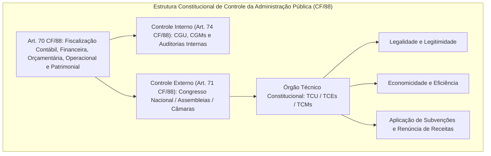
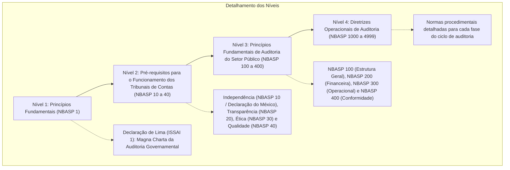
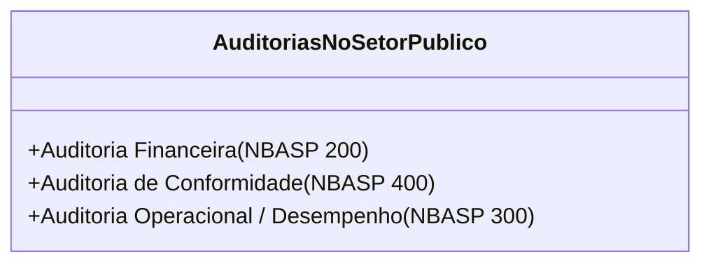
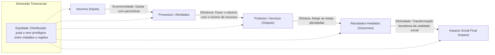
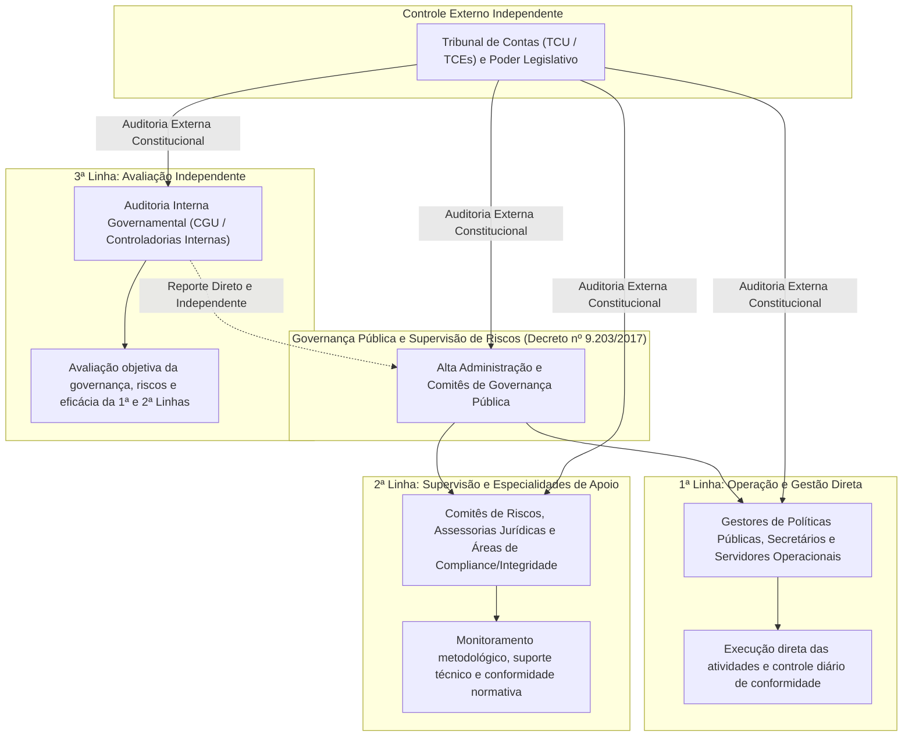
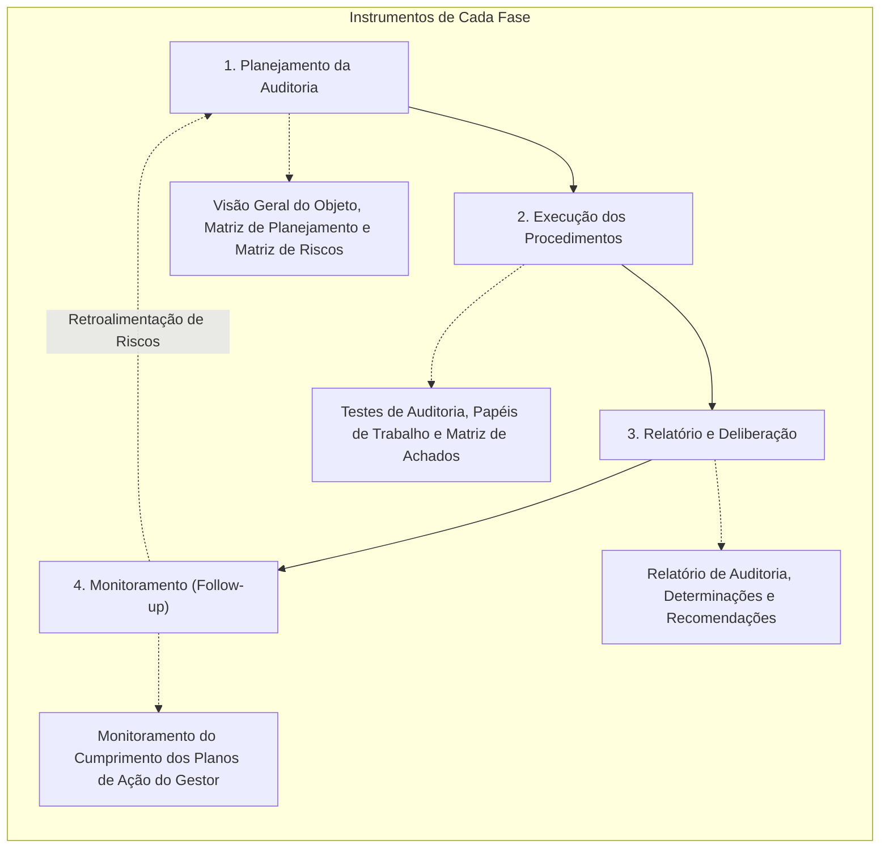

# Normas NBASP / ISSAI e Auditoria no Setor Público (Tribunais de Contas e Controladorias)

---

## 1. Fundamentos Constitucionais do Controle Externo no Brasil

No ordenamento jurídico brasileiro, a fiscalização contábil, financeira, orçamentária, operacional e patrimonial da Administração Pública direta e indireta fundamenta-se nos **artigos 70 a 75 da Constituição Federal de 1988**.

O modelo republicano consagra o sistema de **duplo controle**: o controle interno (mantido por cada um dos Poderes em seus respectivos âmbitos) e o controle externo (exercido pelo Poder Legislativo com o auxílio técnico e autônomo do Tribunal de Contas):

> **Art. 70 da CF/88**: A fiscalização contábil, financeira, orçamentária, operacional e patrimonial da União e das entidades da administração direta e indireta, quanto à legalidade, legitimidade, economicidade, aplicação das subvenções e renúncia de receitas, será exercida pelo Congresso Nacional, mediante controle externo, e pelo sistema de controle interno de cada Poder.  
> **Parágrafo único**: Prestará contas qualquer pessoa física ou jurídica, pública ou privada, que utilize, arrecade, guarde, gerencie ou administre dinheiros, bens e valores públicos ou pelos quais a União responda, ou que, em nome desta, assuma obrigações de natureza pecuniária.

### 1.1. Natureza Jurídica e Prerrogativas dos Tribunais de Contas

Os Tribunais de Contas no Brasil são órgãos constitucionais autônomos, dotados de jurisdição própria em todo o território de seus respectivos entes federados (União, Estados, DF e Municípios aplicáveis):
1. **Autonomia Funcional, Administrativa e Financeira:** Não se subordinam ao Poder Legislativo nem integram o Poder Judiciário. Possuem orçamento próprio, quadro de pessoal privativo e iniciativa reservada de lei para organização de suas secretarias (art. 73 c/c art. 96 da CF/88);
2. **Eficácia de Título Executivo das Decisões (Art. 71, § 3º, da CF/88):** As decisões do Tribunal de Contas de que resulte imputação de débito ou aplicação de multa têm eficácia de **título executivo extrajudicial**. A cobrança judicial independe de ação de conhecimento prévia, sendo promovida pelos órgãos de advocacia pública (AGU, PGE ou PGM);
3. **Julgamento de Contas de Gestores vs. Parecer Prévio de Contas de Chefes do Executivo:**
   - *Contas dos Administradores Públicos e Ordenadores de Despesas:* São **julgadas de forma definitiva** pelo Tribunal de Contas (art. 71, II, CF/88), gerando inelegibilidade (Lei Complementar nº 64/1990) e débito imediato;
   - *Contas Prestadas Anualmente pelo Chefe do Poder Executivo (Presidente, Governador, Prefeito):* O Tribunal de Contas emite apenas um **Parecer Prévio** opinativo (art. 71, I, CF/88), cabendo o julgamento político-constitucional exclusivo ao respectivo parlamento (Congresso Nacional, Assembleia Legislativa ou Câmara de Vereadores).

---

## 2. A Estrutura Hierárquica das Normas NBASP (Normas Brasileiras de Auditoria do Setor Público)

As **NBASP** são as normas profissionais emitidas pelo Instituto Rui Barbosa (IRB) e pela Associação dos Membros dos Tribunais de Contas do Brasil (ATRICON), internalizando e alinhando o sistema de controle externo brasileiro às normas internacionais da **INTOSAI** (*International Organization of Supreme Audit Institutions* — ISSAI).

A arquitetura das NBASP organiza-se em **4 Níveis Hierárquicos**:

### Quadro Detalhado dos 4 Níveis das NBASP:

| Nível Hierárquico | Correspondência ISSAI | Escopo Normativo e Conteúdo Central |
| :---: | :---: | :--- |
| **Nível 1** | **ISSAI 1** (Declaração de Lima de 1977) | **A "Constituição" da Auditoria Governamental.** Estabelece as premissas universais da independência das Instituições Superiores de Controle (ISC), competência fiscalizatória e imunidade dos auditores. |
| **Nível 2** | **ISSAI 10 a 40** (Declaração do México) | **Pré-requisitos Institucionais dos Tribunais de Contas:** • *NBASP 10:* Independência dos Tribunais e de seus membros; • *NBASP 20:* Princípios de Transparência e Prestação de Contas das próprias Cortes; • *NBASP 30:* Código de Ética Profissional dos Auditores Públicos; • *NBASP 40:* Controle e Gestão da Qualidade das Auditorias. |
| **Nível 3** | **ISSAI 100 a 400** (Princípios Fundamentais) | **O Núcleo Doutrinário da Auditoria Pública:** • *NBASP 100:* Princípios Fundamentais de Auditoria do Setor Público; • *NBASP 200:* Princípios de Auditoria Financeira; • *NBASP 300:* Princípios de Auditoria Operacional (Desempenho); • *NBASP 400:* Princípios de Auditoria de Conformidade. |
| **Nível 4** | **ISSAI 1000 a 4999** (Diretrizes Gerais) | **Diretrizes e Manuais Procedimentais Detalhados:** Regras operacionais para aplicação prática dos testes, amostragem, achados e elaboração de relatórios pelos auditores de controle externo. |

---

## 3. As Três Vertentes Canônicas da Auditoria no Setor Público (NBASP 100)

A NBASP 100 estabelece que as auditorias no setor público desdobram-se em **três modalidades essenciais**, que podem ser executadas isoladamente ou de forma combinada (*auditoria integrada*):

### Quadro Comparativo Tridimensional das 3 Modalidades:

| Critério de Análise | Auditoria Financeira (NBASP 200) | Auditoria de Conformidade (NBASP 400) | Auditoria Operacional (NBASP 300) |
| :--- | :--- | :--- | :--- |
| **Objetivo Central** | Avaliar se as demonstrações contábeis e orçamentárias foram preparadas, em todos os aspectos relevantes, de acordo com a estrutura de relatório financeiro aplicável (PCASP / IPSAS / NBC TSP). | Avaliar se as atividades, transações orçamentárias, financeiras e patrimoniais estão em conformidade com as leis, normas, editais e regulamentos de regência. | Avaliar se intervenções, programas governamentais, políticas públicas ou órgãos operam de acordo com os princípios da economicidade, eficiência, eficácia e efetividade. |
| **Objeto de Exame** | Balanço Orçamentário, Balanço Financeiro, Balanço Patrimonial, DVP, DFC, DMPL e Notas Explicativas do ente público. | Processos de licitação, contratos administrativos, atos de pessoal, concessão de diárias, convênios e renúncias fiscais. | Políticas públicas setoriais (Saúde, Educação, Segurança, Transporte), programas de governo, processos de trabalho e governança. |
| **Critério de Auditoria** | Normas de Contabilidade Aplicadas ao Setor Público (NBC TSP / MCASP / IPSAS). | A legislação estrita: CF/88, Lei 4.320/64, LRF (LC 101/00), Nova Lei de Licitações (Lei 14.133/21), decretos e editais. | Metas do PPA, indicadores de desempenho, boas práticas administrativas nacionais e internacionais (*benchmarks*). |
| **Forma da Conclusão / Relatório** | Emissão de **Parecer / Opinião de Asseguração** padronizada (sem modificação, com ressalva, adversa ou abstenção), nos moldes das NBC TAs. | Emissão de conclusão (asseguração razoável ou limitada) atestando se os atos obedecem à legalidade e legitimidade. | Emissão de **Relatório de Desempenho** estruturado em achados, causas, efeitos, boas práticas e **recomendações de melhoria gerencial**. |

---

## 4. Auditoria Operacional e a Teoria dos 5 E's (NBASP 300)

A auditoria operacional (ou de desempenho) não busca punir irregularidades formais simples, mas sim diagnosticar falhas de gestão e propor soluções estruturais para aprimorar o serviço público oferecido ao cidadão.

A avaliação do desempenho público ancora-se no modelo dos **5 E's**:

### Análise Conceitual Aprofundada dos 5 E's:

1. **Economicidade:** Reflete a minimização dos custos dos recursos empregados na aquisição de insumos (bens, serviços e pessoal) para uma atividade ou órgão, tendo em consideração a qualidade apropriada. Significa *gastar menos*, garantindo a qualidade técnica requerida (*gastar com sabedoria*);
2. **Eficiência:** Reflete a melhor relação possível entre os recursos empregados (insumos/custos) e os produtos gerados (bens ou serviços entregues). Mede a produtividade: *fazer mais com o mesmo volume de recursos* ou *fazer o mesmo volume com menos recursos*;
3. **Eficácia:** É o grau de atingimento dos objetivos e metas previstos para a política ou programa governamental no período de planejamento. Compara o planejado com o executado: se a meta do programa de vacinação era imunizar 95% do público-alvo e atingiu-se 96%, a ação foi plenamente eficaz;
4. **Efetividade:** Representa o impacto real, duradouro e qualitativo gerado pela ação pública sobre a sociedade ou público-alvo beneficiário. Não mede apenas a entrega do serviço (output), mas a transformação da realidade: a construção de um hospital moderno foi eficiente e eficaz, mas a política só será *efetiva* se houver redução real da mortalidade e melhoria dos índices de saúde pública da comunidade;
5. **Equidade:** Reflete o grau de justiça social, proporcionalidade e igualdade na distribuição dos serviços e benefícios públicos entre os diversos grupos sociais, etnias e regiões geográficas do país, assegurando atendimento prioritário às camadas mais vulneráveis e sem favorecimentos espúrios.

---

## 5. Gestão de Riscos e Controles Internos no Setor Público (COSO ERM 2017 e Modelo das Três Linhas)

Os órgãos de controle externo e as controladorias governamentais adotam o arcabouço metodológico do **COSO ERM 2017** (*Enterprise Risk Management*) e do **Modelo das Três Linhas do IIA (2020)** para avaliar a maturidade institucional do Estado:

---

## 6. Jurisprudência Vinculante do Supremo Tribunal Federal sobre Tribunais de Contas

A atuação dos Tribunais de Contas é delimitada por marcos jurisprudenciais vinculantes fixados pelo Supremo Tribunal Federal:

### 6.1. Súmula Vinculante nº 3 do STF (Aposentadorias e Pensões)

> **Súmula Vinculante nº 3**: Nos processos perante o Tribunal de Contas da União asseguram-se o contraditório e a ampla defesa quando da decisão puder resultar anulação ou revogação de ato administrativo que beneficie o interessado, **excetuada a apreciação da legalidade do ato de concessão inicial de aposentadoria, reforma e pensão**.

- **Regra Geral:** O ato de concessão inicial de aposentadoria é ato administrativo complexo que somente se aperfeiçoa após o registro pelo Tribunal de Contas. Portanto, no exame inicial da legalidade (art. 71, III, CF/88), não é obrigatório assegurar o contraditório prévio ao servidor aposentado.
- **Mitigação do Prazo Quinquenal (Tema 445 do STF):** Os Tribunais de Contas têm o prazo decadencial de **5 anos** para apreciar a legalidade do ato de concessão inicial de aposentadoria, contado da data de chegada do processo ao Tribunal. Transcorrido esse prazo sem decisão, o ato considera-se tacitamente registrado, passando a exigir contraditório e ampla defesa plenos para qualquer revisão posterior.

### 6.2. Prescritibilidade da Pretensão de Ressarcimento ao Erário (Tema 899 do STF — RE 636.886)

> **Tese do Tema 899 do STF**: É prescritível a pretensão de ressarcimento ao erário fundada em decisão de Tribunal de Contas.

- O STF fixou que a imprescritibilidade prevista no art. 37, § 5º, da CF/88 restringe-se exclusivamente a ações judiciais decorrentes de **atos dolosos de improbidade administrativa** tipificados na Lei nº 8.429/1992 e julgados pelo Poder Judiciário;
- A execução judicial dos títulos executivos emitidos pelos Tribunais de Contas (imputação de débito e multa) submete-se ao **prazo prescricional quinquenal (5 anos)**, disciplinado pela Lei nº 9.873/1999 e Decreto nº 20.910/1932.

### 6.3. Vedação de Criação de Novos Tribunais de Contas Municipais (Art. 31, § 4º, CF/88)

A Constituição de 1988 vedou taxativamente a criação de novos Tribunais, Conselhos ou órgãos de Contas Municipais:
- Foram mantidos apenas os órgãos municipais preexistentes à promulgação da Carta de 1988 (os Tribunais de Contas do Município de São Paulo - TCM/SP e do Rio de Janeiro - TCM/RJ);
- Os Tribunais de Contas dos Municípios (TCMs de natureza estadual que fiscalizam os municípios de determinado Estado, como na Bahia, Goiás e Pará) podem ser mantidos ou extintos pelo constituinte derivado estadual, sendo vedada a criação de novas cortes municipais.

---

## 7. O Ciclo Metodológico da Auditoria no Setor Público

A auditoria governamental desenvolve-se ao longo de um ciclo estruturado em **4 Fases Interdependentes**:

---

## 8. Mnemônicos & Âncoras Cognitivas

> [!TIP]
> **Mnemônico dos 5 E's da Auditoria Operacional: `E-E-E-E-Q`**
> - **Economicidade:** *Custo dos insumos* (gastar menos com qualidade).
> - **Eficiência:** *Relação Insumo vs Produto* (produtividade: fazer mais com menos).
> - **Eficácia:** *Alcance das Metas* (meta atingida = eficaz).
> - **Efetividade:** *Impacto Social Real* (mudança concreta de vida do cidadão).
> - **Equidade:** *Justiça Distributiva* (tratar os desiguais conforme suas necessidades).

> [!TIP]
> **Mnemônico das Normas NBASP: `1-10-100-1000`**
> - **Nível 1 (1):** Declaração de Lima (Princípios Matrizes Universais).
> - **Nível 2 (10-40):** Instituições (Independência, Ética e Qualidade do Tribunal).
> - **Nível 3 (100-400):** Tipos de Auditoria (100 Geral, 200 Financeira, 300 Operacional, 400 Conformidade).
> - **Nível 4 (1000+):** Manuais e Guias Procedimentais de Execução.

---

## 9. Bateria de Questões Oficiais Comentadas (QConcursos)

### Questão 01 — [CESPE / CEBRASPE — Auditor Federal de Controle Externo / TCU — 2022]
**Identificador QC:** [Q4232833](https://www.qconcursos.com/questoes-de-concursos/questoes/5cf3d9ca-92)  
**Enunciado:** A respeito dos tipos de auditoria no setor público disciplinados pelas Normas Brasileiras de Auditoria do Setor Público (NBASP 100), assinale a opção correta:
- (A) A auditoria de conformidade tem como objetivo principal verificar se as políticas públicas atingiram seus impactos sociais finais perante o público-alvo.
- (B) A auditoria financeira concentra-se em determinar se as informações financeiras de uma entidade foram apresentadas em conformidade com a estrutura de relatório financeiro aplicável, emitindo uma opinião de asseguração.
- (C) A auditoria operacional restringe-se à verificação da estrita legalidade formal dos processos licitatórios e contratos de obras públicas.
- (D) Os relatórios de auditoria operacional devem obrigatoriamente emitir uma opinião padronizada com ou sem ressalvas sobre os balanços contábeis do órgão.
- (E) As auditorias no setor público são sempre realizadas isoladamente, sendo vedada a execução de auditorias combinadas ou integradas.

> **Gabarito Comentado: Alternativa B**
> - **Alternativa B (CORRETA):** A NBASP 100 e a NBASP 200 definem que o objetivo da auditoria financeira é obter segurança razoável de que as demonstrações contábeis e orçamentárias estão livres de distorções relevantes, expressando uma opinião de auditoria formal na forma positiva.
> - **Alternativa A (INCORRETA):** Avaliação de impactos sociais finais é atribuição da auditoria operacional (efetividade).
> - **Alternativa C (INCORRETA):** Verificação de legalidade de licitações é escopo da auditoria de conformidade.
> - **Alternativa D (INCORRETA):** Auditorias operacionais emitem relatórios descritivos com achados e recomendações, e não opinião padronizada sobre balanços.
> - **Alternativa E (INCORRETA):** A NBASP 100 expressamente autoriza e incentiva a realização de auditorias integradas.

---

### Questão 02 — [CESPE / CEBRASPE — Auditor Federal de Controle Externo / TCU — 2022]
**Identificador QC:** [Q4232834](https://www.qconcursos.com/questoes-de-concursos/questoes/5cf5d761-92)  
**Enunciado:** No âmbito da auditoria operacional do setor público (NBASP 300), a dimensão que avalia o grau em que os objetivos e metas planejados foram alcançados em determinado programa governamental é denominada:
- (A) economicidade.
- (B) eficiência.
- (C) conformidade.
- (D) eficácia.
- (E) equidade.

> **Gabarito Comentado: Alternativa D**
> - **Alternativa D (CORRETA):** A NBASP 300 conceitua a **Eficácia** como o grau em que os objetivos estabelecidos foram alcançados e a relação entre o impacto pretendido e o impacto real de uma atividade ou política pública. Compara metas planejadas com resultados alcançados.
> - **Alternativa A (INCORRETA):** Economicidade trata da minimização de custos dos insumos mantida a qualidade.
> - **Alternativa B (INCORRETA):** Eficiência é a relação insumo/produto (produtividade).
> - **Alternativa C (INCORRETA):** Conformidade é a observância de leis e regulamentos.
> - **Alternativa E (INCORRETA):** Equidade é a justa distribuição de recursos e benefícios.

---

### Questão 03 — [FGV — Auditor Federal de Finanças e Controle / CGU — 2022]
**Identificador QC:** [Q4382269](https://www.qconcursos.com/questoes-de-concursos/questoes/0c2f82ba-c8)  
**Enunciado:** A Declaração de Lima (ISSAI 1), considerada a "Magna Charta" da auditoria governamental e adotada no Nível 1 das NBASP, consagra princípios fundamentais sobre o funcionamento e prerrogativas das Instituições Superiores de Controle (ISC). De acordo com a Declaração de Lima:
- (A) A independência dos Tribunais de Contas é facultativa, devendo os auditores subordinar-se hierarquicamente às ordens do Chefe do Poder Executivo fiscalizado.
- (B) As auditorias financeiras e de legalidade são as únicas permitidas no setor público, sendo expressamente proibida a realização de auditorias operacionais de desempenho.
- (C) A independência das Instituições Superiores de Controle é inseparável da independência de seus membros, devendo ser garantida pela Constituição e por lei.
- (D) Os relatórios de auditoria dos Tribunais de Contas devem ser mantidos em segredo de Estado perpétuo para resguardar a imagem dos governantes.
- (E) O controle posterior é desnecessário na administração pública quando houver controle prévio preventivo executado pelo Ministério Público.

> **Gabarito Comentado: Alternativa C**
> - **Alternativa C (CORRETA):** A Declaração de Lima (Seção 5 da ISSAI 1) preceitua que as Instituições Superiores de Controle somente podem cumprir eficazmente suas atribuições se forem independentes da instituição fiscalizada e protegidas contra influências externas, sendo essa independência institucional umbilicalmente ligada à independência e inamovibilidade de seus membros garantida pela Constituição.
> - **Alternativa A (INCORRETA):** Subordinação ao Executivo fere a própria razão de ser do controle externo.
> - **Alternativa B (INCORRETA):** A Declaração de Lima consagrou expressamente a auditoria operacional e de gestão.
> - **Alternativa D (INCORRETA):** A publicidade dos relatórios é princípio cardeal do controle democrático.
> - **Alternativa E (INCORRETA):** O controle a posteriori é o momento central do exame de contas públicas.

---

### Questão 04 — [FCC — TCE-GO / Analista de Controle Externo — 2022]
**Identificador QC:** [Q4335619](https://www.qconcursos.com/questoes-de-concursos/questoes/9e8b62ba-c2)  
**Enunciado:** Em relação à eficácia das decisões proferidas pelos Tribunais de Contas segundo o art. 71, § 3º, da Constituição Federal de 1988:
- (A) As decisões condenatórias do Tribunal de Contas de que resulte imputação de débito ou multa têm eficácia de título executivo extrajudicial.
- (B) Para executar o débito imputado pelo Tribunal de Contas, a Fazenda Pública deve ajuizar previamente ação civil de conhecimento perante o Poder Judiciário para rediscutir a culpa do gestor.
- (C) O Tribunal de Contas detém competência para ajuizar diretamente a ação de execução fiscal por intermédio de seus auditores sem atuação dos procuradores do Estado.
- (D) As multas aplicadas pelo Tribunal de Contas da União têm natureza de receitas tributárias municipais decorrentes do ISS.
- (E) O cancelamento judicial de decisões do Tribunal de Contas é vedado em face do princípio da separação dos poderes.

> **Gabarito Comentado: Alternativa A**
> - **Alternativa A (CORRETA):** Conforme art. 71, § 3º, da CF/88: *"As decisões do Tribunal de que resulte imputação de débito ou multa terão eficácia de título executivo"*. Trata-se de título executivo extrajudicial líquido, certo e exigível.
> - **Alternativa B (INCORRETA):** Prescinde de ação ordinária de conhecimento; vai-se diretamente à ação de execução de título.
> - **Alternativa C (INCORRETA):** A jurisprudência vinculante do STF e Súmula 648 do STJ fixam que a legitimidade ativa para a execução pertence ao ente público beneficiário (representado pela AGU, PGE ou PGM), e não ao Tribunal de Contas.
> - **Alternativa D (INCORRETA):** São receitas patrimoniais/indiretas do ente credor, não tributárias.
> - **Alternativa E (INCORRETA):** Decisões do Tribunal de Contas submetem-se ao controle jurisdicional de legalidade pelo Poder Judiciário (art. 5º, XXXV, CF/88).

---

### Questão 05 — [CESPE / CEBRASPE — Auditor Federal de Finanças e Controle / CGU — 2022]
**Identificador QC:** [Q4221420](https://www.qconcursos.com/questoes-de-concursos/questoes/78946ee9-91)  
**Enunciado:** No modelo das Três Linhas do IIA adotado na gestão pública federal, o papel da Auditoria Interna Governamental (como a exercida pela Controladoria-Geral da União - CGU) enquadra-se:
- (A) Na 1ª Linha, pois os auditores executam diretamente o pagamento dos contratos administrativos dos ministérios.
- (B) Na 2ª Linha, pois estabelecem as diretrizes operacionais de marketing institucional dos ministérios.
- (C) Na 3ª Linha, atuando na prestação de avaliação e consultoria abrangentes e independentes sobre a eficácia da governança, do gerenciamento de riscos e dos controles internos da entidade.
- (D) Exclusivamente no âmbito do Poder Legislativo como auxiliar parlamentar.
- (E) Como órgão colegiado submisso à diretoria das empresas estatais fiscalizadas.

> **Gabarito Comentado: Alternativa C**
> - **Alternativa C (CORRETA):** A auditoria interna governamental posiciona-se formalmente na **3ª Linha**, prestando serviços de avaliação e consultoria com independência em relação à gestão executiva (1ª Linha) e às instâncias de conformidade/risco (2ª Linha), prestando contas diretamente à alta administração e à sociedade.
> - **Alternativas A e B (INCORRETAS):** A auditoria interna não executa despesas nem faz marketing; manter-se afastada da gestão direta é indispensável para preservar sua objetividade.
> - **Alternativas D e E (INCORRETAS):** A CGU é órgão do Poder Executivo federal e possui independência técnica em relação às estatais auditadas.

---

### Questão 06 — [FGV — TCE-BA / Auditor Estadual de Controle Externo — 2022]
**Identificador QC:** [Q4221422](https://www.qconcursos.com/questoes-de-concursos/questoes/78999538-91)  
**Enunciado:** Em uma auditoria de conformidade realizada por um Tribunal de Contas Estadual sobre um contrato de pavimentação asfáltica, o auditor apurou que os serviços foram faturados e pagos com preços 40% superiores aos constantes da tabela SINAPI/SICRO sem justificativa técnica, caracterizando sobrepreço e superfaturamento com dano ao erário. À luz das normas NBASP 400 e da legislação federal:
- (A) O Tribunal de Contas deve aprovar o contrato em razão da discricionariedade administrativa do prefeito municipal.
- (B) O auditor deve elaborar achado de auditoria apontando o superfaturamento e propondo a notificação dos responsáveis para devolução dos valores e aplicação de multas proporcionais ao dano.
- (C) O Tribunal de Contas fica impedido de fiscalizar o contrato por se tratar de obra de infraestrutura física.
- (D) O superfaturamento é irrelevante se a espessura do asfalto for satisfatória.
- (E) O auditor deve aguardar a sentença criminal transitada em julgado para lavrar o relatório técnico.

> **Gabarito Comentado: Alternativa B**
> - **Alternativa B (CORRETA):** A constatação de superfaturamento em auditoria de conformidade impõe a formação do achado de auditoria com indicação da conduta, nexo causal, critério legal violado e quantificação do débito, com proposta de instauração de Tomada de Contas Especial (TCE) para ressarcimento ao erário e cominação de penalidades legais.
> - **Alternativas A, C, D e E (INCORRETAS):** Sobrepreço não é discricionariedade; obras são objeto típico de fiscalização; a espessura não convalida preço abusivo; e as esferas administrativa e penal são independentes.

---

### Questão 07 — [FCC — SEFAZ-PE / Auditor Fiscal do Tesouro Estadual — 2014]
**Identificador QC:** [Q4368143](https://www.qconcursos.com/questoes-de-concursos/questoes/1f4f7fb8-c3)  
**Enunciado:** A respeito do controle externo exercido pelos Tribunais de Contas e de suas atribuições sancionatórias e cautelares pacificadas pelo Supremo Tribunal Federal:
- (A) Os Tribunais de Contas possuem competência constitucional para decretar a quebra do sigilo telefônico de investigados por suspeita de corrupção.
- (B) O Tribunal de Contas pode, no exercício do controle externo, determinar cautelarmente a indisponibilidade de bens de gestores e empresas investigadas para garantir o ressarcimento de dano ao erário.
- (C) É vedada a realização de auditorias por iniciativa própria do Tribunal de Contas sem prévia solicitação do parlamento.
- (D) As decisões dos Tribunais de Contas não admitem recurso administrativo de reexame.
- (E) Os ministros e conselheiros dos Tribunais de Contas não gozam de garantias de inamovibilidade e vitaliciedade.

> **Gabarito Comentado: Alternativa B**
> - **Alternativa B (CORRETA):** O Supremo Tribunal Federal (no MS 24.510/DF e precedentes) reconheceu que os Tribunais de Contas detêm competência cautelar implícita fundamentada no art. 71 da CF/88 para decretar a **indisponibilidade cautelar de bens** de responsáveis por desvios e danos ao erário pelo prazo legal de até um ano.
> - **Alternativa A (INCORRETA):** Quebra de sigilo telefônico submete-se à estrita reserva de jurisdição do Poder Judiciário (art. 5º, XII, CF/88).
> - **Alternativa C (INCORRETA):** O art. 71, IV, da CF/88 autoriza inspeções e auditorias por iniciativa própria do Tribunal de Contas.
> - **Alternativas D e E (INCORRETAS):** Há ampla previsão recursal e os membros dos TCs gozam das mesmas garantias da magistratura (art. 73, § 3º, CF/88).

---

### Questão 08 — [CESPE / CEBRASPE — TCE-RO / Auditor de Controle Externo — 2019]
**Identificador QC:** [Q4368148](https://www.qconcursos.com/questoes-de-concursos/questoes/1f5b7033-c3)  
**Enunciado:** O Código de Ética Profissional dos Auditores do Setor Público (NBASP 30 / ISSAI 30) estabelece princípios fundamentais que regem o comportamento e a atuação funcional dos auditores de controle externo. Assinale a opção que apresenta um dos princípios nucleares da NBASP 30:
- (A) Lucratividade e remuneração variável por multas aplicadas.
- (B) Fidelidade partidária e alinhamento político com a bancada governista majoritária.
- (C) Integridade, independência e objetividade, competência profissional e confidencialidade.
- (D) Subordinação técnica aos sindicatos de classe de servidores.
- (E) Dispensa de fundamentação legal em caso de repercussão na mídia.

> **Gabarito Comentado: Alternativa C**
> - **Alternativa C (CORRETA):** A NBASP 30 fundamenta-se nos 5 valores e princípios éticos cardeais da INTOSAI: (1) **Integridade**; (2) **Independência e Objetividade**; (3) **Competência Profissional**; (4) **Comportamento Profissional**; e (5) **Confidencialidade e Transparência**.
> - **Alternativas A, B, D e E (INCORRETAS):** A auditoria pública é incompatível com fins lucrativos pessoais, alinhamento partidário, subordinação a sindicatos ou julgamentos midiáticos sem prova documental.

---

### Questão 09 — [CESPE / CEBRASPE — Auditor Federal de Controle Externo / TCU — 2022]
**Identificador QC:** [Q4368143](https://www.qconcursos.com/questoes-de-concursos/questoes/1f4f7fb8-c3)  
**Enunciado:** A respeito da prescritibilidade da pretensão de ressarcimento ao erário fundada em decisões do Tribunal de Contas da União, à luz da jurisprudência firmada pelo Supremo Tribunal Federal no julgamento do Tema 899 de Repercussão Geral (RE 636.886):
- (A) As decisões condenatórias do TCU são imprescritíveis sob qualquer modalidade, podendo ser executadas judicialmente a qualquer tempo, mesmo após cinquenta anos do trânsito em julgado.
- (B) É prescritível a pretensão de ressarcimento ao erário fundada em decisão de Tribunal de Contas, aplicando-se o prazo prescricional de 5 anos para a cobrança judicial do título executivo.
- (C) A prescrição somente corre em favor de empresas estatais que explorem atividade econômica em regime concorrencial.
- (D) A imprescritibilidade aplica-se exclusivamente a débitos decorrentes de contratos administrativos de obras rodoviárias.
- (E) O prazo prescricional das decisões dos Tribunais de Contas é decenal (10 anos), conforme regra geral do Código Civil.

> **Gabarito Comentado: Alternativa B**
> - **Alternativa B (CORRETA):** A tese vinculante fixada pelo STF no Tema 899 é taxativa: *"É prescritível a pretensão de ressarcimento ao erário fundada em decisão de Tribunal de Contas"*. O STF esclareceu que a imprescritibilidade prevista no art. 37, § 5º, da CF/88 restringe-se a ações de improbidade administrativa dolosa ajuizadas perante o Poder Judiciário, submetendo-se a execução do título do TC ao prazo prescricional quinquenal (5 anos) do Decreto 20.910/32 e Lei 9.873/99.
> - **Alternativas A, C, D e E (INCORRETAS):** Contrariam expressamente a tese vinculante do STF e os prazos aplicáveis às execuções da Fazenda Pública.

---

### Questão 10 — [FGV — Auditor Federal de Finanças e Controle / CGU — 2022]
**Identificador QC:** [Q4221422](https://www.qconcursos.com/questoes-de-concursos/questoes/78999538-91)  
**Enunciado:** Nos termos da Súmula Vinculante nº 3 do Supremo Tribunal Federal, o contraditório e a ampla defesa nos processos perante o Tribunal de Contas da União:
- (A) Devem ser assegurados previamente até mesmo na apreciação da legalidade do ato de concessão inicial de aposentadoria, reforma e pensão.
- (B) São dispensáveis em qualquer processo administrativo que tramite perante o TCU por se tratar de corte meramente opinativa.
- (C) Devem ser assegurados quando da decisão puder resultar anulação ou revogação de ato administrativo que beneficie o interessado, excetuada a apreciação da legalidade do ato de concessão inicial de aposentadoria, reforma e pensão.
- (D) Dependem de autorização prévia e expressa do Ministro de Estado da pasta a que pertencer o servidor.
- (E) Aplicam-se exclusivamente a processos que envolvam servidores do Poder Legislativo.

> **Gabarito Comentado: Alternativa C**
> - **Alternativa C (CORRETA):** Literalidade da Súmula Vinculante nº 3 do STF. O ato inicial de concessão de aposentadoria é ato complexo que só se perfectibiliza com o registro no Tribunal de Contas, dispensando o contraditório inicial (ressalvada a tese do Tema 445 do STF que fixa o prazo de 5 anos para essa apreciação).
> - **Alternativas A, B, D e E (INCORRETAS):** A SV 3 excetua expressamente a concessão inicial; o TCU não é mero órgão opinativo em processos sancionatórios; inexiste tutela ministerial; e aplica-se a todos os jurisdicionados.

---

### Questão 11 — [FCC — TCE-GO / Analista de Controle Externo — 2022]
**Identificador QC:** [Q4368148](https://www.qconcursos.com/questoes-de-concursos/questoes/1f5b7033-c3)  
**Enunciado:** Em relação à criação de Tribunais de Contas no Brasil sob a égide da Constituição Federal de 1988, é correto afirmar:
- (A) É permitida a criação de Tribunais de Contas Municipais por lei ordinária da Câmara de Vereadores em municípios com mais de um milhão de habitantes.
- (B) É vedada a criação de novos Tribunais, Conselhos ou órgãos de Contas Municipais, mantendo-se apenas aqueles que já existiam na data da promulgação da Carta de 1988.
- (C) Todos os municípios brasileiros são obrigados a criar seus próprios Tribunais de Contas autônomos.
- (D) Os Tribunais de Contas dos Estados fiscalizam apenas a administração estadual, ficando a fiscalização de todos os municípios a cargo da CGU.
- (E) O Distrito Federal possui dois Tribunais de Contas distintos: um distrital e outro federal.

> **Gabarito Comentado: Alternativa B**
> - **Alternativa B (CORRETA):** O art. 31, § 4º, da CF/88 estabelece de forma categórica: *"É vedada a criação de Tribunais, Conselhos ou órgãos de Contas Municipais"*. Os únicos órgãos municipais preservados foram o TCM/SP e o TCM/RJ, recepcionados por terem sido criados antes de 1988.
> - **Alternativas A e C (INCORRETAS):** É proibida a criação mesmo em capitais gigantescas.
> - **Alternativa D (INCORRETA):** Onde não houver TCM específico, o Tribunal de Contas do respectivo Estado (TCE) fiscaliza os municípios.
> - **Alternativa E (INCORRETA):** O DF possui um único Tribunal: o Tribunal de Contas do Distrito Federal (TCDF).

---

### Questão 12 — [FGV — CFC / Qualificação Técnica Geral (QTG) — 2026]
**Identificador QC:** [Q4368105](https://www.qconcursos.com/questoes-de-concursos/questoes/0b7523a1-c3)  
**Enunciado:** O princípio da economicidade na auditoria governamental (NBASP 300) diferencia-se do princípio da eficiência porque:
- (A) A economicidade avalia exclusivamente a pontualidade na entrega de obras de construção civil.
- (B) A economicidade foca na minimização dos custos na aquisição dos insumos mantendo a qualidade requerida, enquanto a eficiência foca na melhor relação de produtividade entre insumos utilizados e produtos entregues.
- (C) A economicidade exige que a administração compre sempre o produto mais barato do mercado, mesmo que inutilizável para o serviço público.
- (D) A eficiência preocupa-se exclusivamente com a justiça distributiva entre classes sociais.
- (E) Não há qualquer distinção técnica ou conceitual entre economicidade e eficiência nas normas da INTOSAI.

> **Gabarito Comentado: Alternativa B**
> - **Alternativa B (CORRETA):** A NBASP 300 define claramente: **Economicidade** é a minimização dos custos dos recursos empregados na aquisição de insumos (comprar bem pelo menor custo e com padrão de qualidade adequado); **Eficiência** é a maximização da relação produto/insumo (produzir mais com os recursos disponíveis, evitando desperdício de insumos).
> - **Alternativa A (INCORRETA):** Pontualidade está ligada à eficácia do cronograma.
> - **Alternativa C (INCORRETA):** Economicidade não é comprar sucata inútil; exige expressamente a preservação do padrão de qualidade.
> - **Alternativa D (INCORRETA):** Justiça distributiva é a dimensão da equidade.
> - **Alternativa E (INCORRETA):** São dimensões distintas e consagradas no art. 70 da CF/88.

