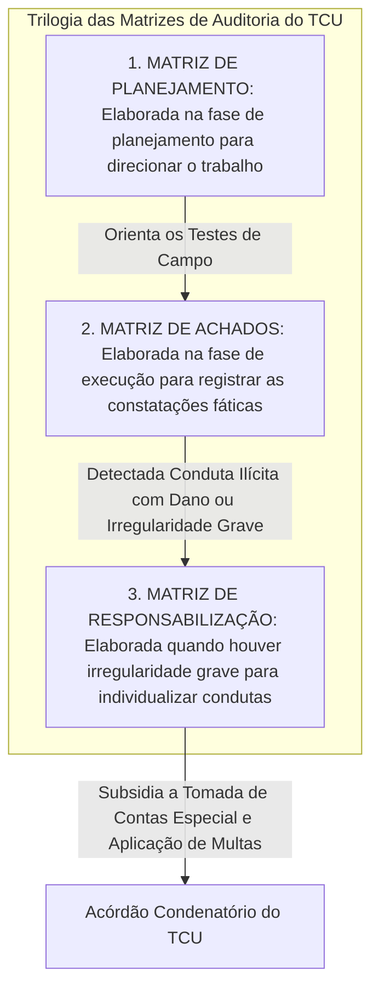
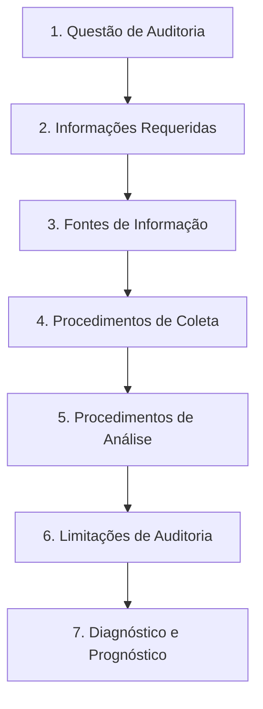
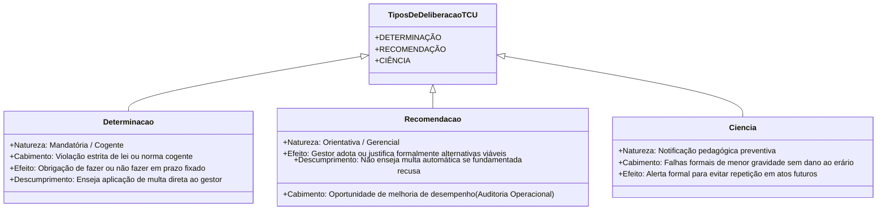
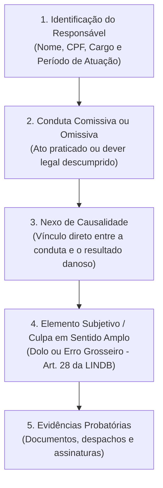

# Matrizes de Auditoria Governamental: Planejamento, Achados e Responsabilização sob a LINDB (Padrões do TCU e NBASP)

---

## 1. Instrumentos Metodológicos da Auditoria no Tribunal de Contas da União (NAT)

As **Normas de Auditoria do Tribunal de Contas da União (NAT)**, aprovadas pela Portaria TCU nº 280/2010 e consolidadas nos Manuais de Auditoria de Conformidade e Operacional, disciplinam os instrumentos padronizados utilizados pelos auditores federais de controle externo.

O ciclo prático de auditoria do TCU assenta-se na articulação de **três matrizes estruturais interconectadas**:



---

## 2. A Matriz de Planejamento do TCU

A Matriz de Planejamento é a ferramenta de engenharia metodológica concebida para delimitar o escopo da fiscalização e orientar a coleta de evidências pela equipe de auditoria durante o trabalho de campo.

### 2.1. Anatomia das Colunas da Matriz de Planejamento

A Matriz de Planejamento compõe-se de colunas estruturadas:

| Campo / Coluna | Função Metodológica no Planejamento | Pergunta Orientadora |
| :--- | :--- | :--- |
| **Questão de Auditoria (QA)** | Formulação do problema que se pretende responder. É a espinha dorsal da fiscalização. | *"O que se pretende saber?"* |
| **Informações Requeridas** | Especificação dos dados, documentos e variáveis necessários para responder à QA. | *"De quais informações o auditor precisa?"* |
| **Fontes de Informação** | Local físico ou digital de custódia dos dados (SIAFI, Comprasnet, processos físicos, sistemas). | *"Onde estão as informações?"* |
| **Procedimentos de Auditoria** | Ações de campo a serem executadas (exame documental, inspeção física, circularização). | *"Como as informações serão obtidas?"* |
| **Métodos de Análise** | Técnicas quantitativas ou qualitativas de tratamento (análise de regressão, SQL, benchmarking). | *"Como os dados serão processados?"* |
| **Limitações do Trabalho** | Restrições de tempo, carência de dados ou barreiras geográficas identificadas. | *"Quais obstáculos podem surgir?"* |
| **O que a análise permitirá dizer** | Resposta potencial que o procedimento trará para a questão formulada. | *"Qual conclusão poderá ser afirmada?"* |
| **Critérios de Auditoria** | Parâmetro legal, contratual ou regulamentar com o qual a situação será confrontada. | *"O que deveria ser segundo a norma?"* |



---

## 3. O Achado de Auditoria e Seus Quatro Atributos Cardeais (`CCCE`)

O **Achado de Auditoria** é a constatação fática resultante do cotejamento entre a situação real encontrada in loco pelo auditor e o critério normativo de regência.

A doutrina do TCU e a NBASP 100 estabelecem que todo achado de auditoria completo é estruturado sobre **quatro atributos cardeais obrigatórios**:

$$
\text{Achado de Auditoria} = \text{Condição} + \text{Critério} + \text{Causa} + \text{Efeito}
$$

```mermaid
flowchart TD
    A["Condição (Situação Fática Encontrada: 'O que é')"] vs B["Critério (Parâmetro Legal/Normativo: 'O que deveria ser')"]
    
    A & B --> C{"Há Discrepância Material?"}
    C -- Sim --> D["ACHADO DE AUDITORIA FORMADO"]
    
    D --> E["Causa: A raiz geradora ('Por que ocorreu a discrepância?')"]
    D --> F["Efeito: A consequência ou risco gerado ('Qual o impacto real ou potencial?')"]
```

### Análise Pormenorizada dos 4 Atributos:

1. **Condição ("O que é"):** É a descrição fática, objetiva e comprovada documentalmente da situação encontrada pela equipe durante a auditoria (ex.: *verificou-se que a obra de construção da ponte encontra-se paralisada há 14 meses, com 35% de execução física e 90% de desembolso financeiro*);
2. **Critério ("O que deveria ser"):** É o padrão de legalidade, economicidade, eficiência ou boas práticas utilizado para avaliar a condição (ex.: *art. 7º, § 2º, e art. 143 da Lei nº 14.133/2021 c/c cronograma físico-financeiro do Edital nº 05/2024*);
3. **Causa ("Por que aconteceu"):** É a vulnerabilidade de gestão, omissão de controle interno ou conduta voluntária que propiciou a ocorrência da discrepância entre a condição e o critério (ex.: *ausência de sondagem geológica preliminar no projeto básico e negligência da fiscalização do contrato na liberação de medições sem contraprestação*);
4. **Efeito ("Qual o impacto"):** É a consequência real ou o risco potencial decorrente da desconformidade apurada (ex.: *dano efetivo ao erário no montante de R\$ 4.200.000,00 por pagamentos sem cobertura contratual e isolamento geográfico de 15.000 moradores*).

---

## 4. A Matriz de Achados do TCU e as Propostas de Deliberação

A Matriz de Achados organiza todas as irregularidades e oportunidades de melhoria identificadas, consolidando os elementos que fundamentarão o Relatório de Auditoria:

### 4.1. Estrutura da Matriz de Achados:
- Identificação do Achado (Título conciso e claro);
- Situação Encontrada (Condição) e Evidências de Suporte (Papéis de Trabalho vinculados);
- Critério Legal e Normativo violado;
- Análise das Causas e dos Efeitos materiais;
- Manifestação Preliminar dos Gestores (contraditório prévio da equipe de auditoria);
- Conclusão da Equipe de Fiscalização;
- **Proposta de Encaminhamento (Deliberação sugerida ao Plenário do Tribunal)**.

### 4.2. A Tríade de Propostas de Deliberação do TCU: Determinações vs. Recomendações vs. Ciência



---

## 5. A Matriz de Responsabilização sob a Ótica da LINDB (Arts. 22 e 28 do Decreto-Lei nº 4.657/1942)

Com o advento da **Lei nº 13.655/2018**, que introduziu os arts. 20 a 30 na Lei de Introdução às Normas do Direito Brasileiro (LINDB), o padrão probatório para punição de gestores públicos perante os Tribunais de Contas foi substancialmente elevado.

### 5.1. O Padrão do Dolo ou Erro Grosseiro (Art. 28 da LINDB)

> **Art. 28 da LINDB**: O agente público responderá pessoalmente por suas decisões ou opiniões técnicas em caso de **dolo ou erro grosseiro**.

Conforme o **Decreto Federal nº 9.830/2019** (art. 12) e jurisprudência vinculante do TCU:
- **Dolo:** Vontade livre e consciente de praticar o ato ilícito ou assunção voluntária do risco de produzir o resultado lesivo ao erário;
- **Erro Grosseiro:** É a culpa grave inescusável, caracterizada pela **violação manifesta do dever de cuidado elementar** que um administrador público medianamente prudente e diligente teria adotado nas mesmas circunstâncias de fato.

> [!IMPORTANT]
> **As Circunstâncias Práticas do Artigo 22 da LINDB:**
> Na elaboração da Matriz de Responsabilização, o auditor do Tribunal de Contas **não pode avaliar a conduta em abstrato**. Deve levar em consideração as **circunstâncias práticas** que houverem imposto, limitado ou condicionado a ação do gestor (escassez de recursos orçamentários, carência de pessoal, estado de calamidade pública ou urgência comprovada).

### 5.2. Os Quatro Elementos da Matriz de Responsabilização do TCU

A Matriz de Responsabilização deve preencher de forma cumulativa e individualizada 4 campos fundamentais:



1. **Responsável:** Identificação completa da pessoa física (nome, CPF, cargo, função formal e período exato de competência funcional);
2. **Conduta:** Descrição específica e analítica da ação ou omissão praticada pelo responsável (é vedada a responsabilização genérica ou coletiva por "culpa do órgão");
3. **Nexo de Causalidade:** Demonstração lógica de que a conduta do agente foi causa direta, eficiente ou concorrente para a consumação do dano ao erário ou da irregularidade grave;
4. **Culpabilidade:** Exame detalhado da reprovabilidade da conduta, demonstrando por que era razoável exigir do responsável conduta diversa (*exigibilidade de conduta diversa*) e comprovando a existência de dolo ou culpa grave inescusável (erro grosseiro).

---

## 6. Exemplos Práticos Preenchidos dos 3 Instrumentos Metodológicos do TCU

Para visualização concreta da metodologia aplicada nas secretarias de controle externo dos Tribunais de Contas, apresentam-se exemplos estruturados:

### 6.1. Exemplo de Matriz de Planejamento (Objeto: Aquisição de Medicamentos de Alto Custo)

| Questão de Auditoria | Informações Requeridas | Fontes de Informação | Procedimentos de Auditoria | Métodos de Análise | O que a análise permitirá dizer | Critérios |
| :--- | :--- | :--- | :--- | :--- | :--- | :--- |
| **QA 1:** Os preços contratados pelo Ministério da Saúde estão compatíveis com os parâmetros de mercado? | Planilhas de preços praticados, atas de registro de preços, cotações internacionais e compras estaduais. | Sistema Comprasnet, Banco de Preços em Saúde (BPS) e faturas de fornecedores. | Confronto eletrônico de valores unitários contratados com a mediana do BPS e tabela CMED. | Análise estatística de dispersão e cruzamento automatizado em SQL. | Se houve sobrepreço na contratação e a estimativa do valor potencial do dano. | Art. 23 da Lei nº 14.133/2021 e jurisprudência do TCU (Súmula 259). |

### 6.2. Exemplo de Matriz de Achados (Achado de Superfaturamento em Obras de Edificação)

```markdown
ACHADO DE AUDITORIA: Superfaturamento por Pagamento de Serviços com Quantitativos Superiores aos Executados

1. Condição (Situação Encontrada):
Na fiscalização das obras de reforma do Hospital Regional, constatou-se que a 4ª medição atestou e pagou 12.000 m² de revestimento cerâmico (valor pago de R$ 1.800.000,00). A inspeção física in loco realizada com trena eletrônica e medição a laser apurou que a área efetivamente assentada totalizava apenas 7.200 m², resultando em pagamento indevido por 4.800 m² de serviços fictícios.

2. Critério:
Art. 62 e 63 da Lei nº 4.320/1964 (regras de liquidação da despesa pública); Cláusula 8ª do Contrato nº 12/2024; e Acórdão TCU nº 2.622/2013-Plenário.

3. Evidências:
Memória de cálculo da 4ª medição; Ordem de Pagamento nº 405/2025; Levantamento fotográfico georreferenciado; e Laudo de Perícia Técnica da equipe de engenharia do Tribunal.

4. Causa:
Ausência de controle e fiscalização presencial das medições pela Secretaria de Obras e conluio entre o fiscal designado e o engenheiro preposto da empreiteira.

5. Efeito:
Dano material efetivo e direto aos cofres públicos no montante histórico de R$ 720.000,00.

6. Proposta de Encaminhamento:
Determinação para instauração imediata de Tomada de Contas Especial (TCE); citação solidária dos responsáveis; e notificação ao Ministério Público Federal para apuração penal.
```

### 6.3. Exemplo de Matriz de Responsabilização sob a LINDB

| Responsável | Conduta Comprovada | Nexo de Causalidade | Culpabilidade (Dolo / Erro Grosseiro sob a LINDB) |
| :--- | :--- | :--- | :--- |
| **Carlos Alberto de Souza**<br>CPF: 000.111.222-33<br>Cargo: Fiscal do Contrato nº 12/2024 | Atestou formalmente na folha de medição nº 04 a execução de 12.000 m² de revestimento cerâmico, ciente de que apenas 7.200 m² haviam sido realizados pela empresa. | A assinatura inidônea do ateste de medição pelo fiscal foi condição sine qua non para que a tesouraria efetuasse a liquidação e o pagamento da despesa. | **Dolo e Erro Grosseiro:** Conduta comissiva com violação direta do dever legal de fiscalização física (art. 67 da Lei 8.666/93 e art. 117 da Lei 14.133/21). Era perfeitamente exigível do servidor que conferisse a metragem antes de atestar o pagamento de quase dois milhões de reais. Inexistência de dificuldades extraordinárias no local da obra (art. 22 e 28 da LINDB). |

---

## 7. Mnemônicos & Âncoras Cognitivas

> [!TIP]
> **Mnemônico dos Atributos do Achado: `C-C-C-E`**
> - **C** $\rightarrow$ **C**ondição (*O que É* - a realidade encontrada).
> - **C** $\rightarrow$ **C**ritério (*O que Deveria Ser* - a norma/lei).
> - **C** $\rightarrow$ **C**ausa (*Por que aconteceu* - a raiz do problema).
> - **E** $\rightarrow$ **E**feito (*O Impacto* - o prejuízo ou risco).

> [!TIP]
> **Mnemônico das Deliberações: `D-R-C`**
> - **D**eterminação: Ordem mandatória (lei violada, prazo fixo, gera multa se descumprida).
> - **R**ecomendação: Sugestão de gestão (melhoria de desempenho, não gera multa automática).
> - **C**iência: Alerta pedagógico (erro leve formal, aviso para não repetir).

---

## 9. Bateria de Questões Oficiais Comentadas (QConcursos)

### Questão 01 — [CESPE / CEBRASPE — Auditor Federal de Controle Externo / TCU — 2022]
**Identificador QC:** [Q4375829](https://www.qconcursos.com/questoes-de-concursos/questoes/5cf3d9ca-92)  
**Enunciado:** No processo de auditoria governamental executado sob os padrões das Normas de Auditoria do TCU (NAT), a ferramenta metodológica elaborada na fase de planejamento que sintetiza as questões de auditoria, as informações requeridas, as fontes de dados, os procedimentos de campo e o que a análise permitirá dizer denomina-se:
- (A) Matriz de Responsabilização.
- (B) Matriz de Planejamento.
- (C) Matriz de Achados.
- (D) Termo de Ajustamento de Gestão.
- (E) Relatório Preliminar de Fiscalização.

> **Gabarito Comentado: Alternativa B**
> - **Alternativa B (CORRETA):** A **Matriz de Planejamento** é o instrumento estruturador elaborado na fase preliminar da fiscalização pelo TCU, organizando o trabalho em torno das Questões de Auditoria (QA), procedimentos e critérios.
> - **Alternativa A (INCORRETA):** A Matriz de Responsabilização destina-se a individualizar condutas e culpabilidade de agentes sob a LINDB na fase final da auditoria.
> - **Alternativa C (INCORRETA):** A Matriz de Achados registra as irregularidades e constatações fáticas apuradas durante a execução.
> - **Alternativas D e E (INCORRETAS):** TAG é instrumento consensual e o Relatório Preliminar é documento de conclusão de equipe.

---

### Questão 02 — [CESPE / CEBRASPE — Auditor Federal de Controle Externo / TCU — 2022]
**Identificador QC:** [Q4283080](https://www.qconcursos.com/questoes-de-concursos/questoes/5cf5d761-92)  
**Enunciado:** Os achados de auditoria constituem a essência dos relatórios de controle externo. De acordo com os padrões internacionais da INTOSAI e as normas do TCU, o atributo do achado de auditoria que descreve o que o auditor constatou in loco, refletindo a situação fática real existente no órgão auditado, é denominado:
- (A) Critério.
- (B) Causa.
- (C) Condição.
- (D) Efeito.
- (E) Recomedação.

> **Gabarito Comentado: Alternativa C**
> - **Alternativa C (CORRETA):** A **Condição** é a situação fática encontrada ("o que é"), apurada e comprovada documentalmente pelo auditor de controle externo.
> - **Alternativa A (INCORRETA):** O Critério é o padrão de comparação ("o que deveria ser").
> - **Alternativa B (INCORRETA):** A Causa é a razão ou motivo gerador da discrepância ("por que ocorreu").
> - **Alternativa D (INCORRETA):** O Efeito é a consequência material ou risco produzido ("qual o impacto").
> - **Alternativa E (INCORRETA):** Recomendação é a proposta de encaminhamento corretivo.

---

### Questão 03 — [FGV — Auditor Federal de Finanças e Controle / CGU — 2022]
**Identificador QC:** [Q4202926](https://www.qconcursos.com/questoes-de-concursos/questoes/0c2f82ba-c8)  
**Enunciado:** Nos termos do art. 28 da Lei de Introdução às Normas do Direito Brasileiro (LINDB — Decreto-Lei nº 4.657/1942), o agente público responderá pessoalmente por suas decisões ou opiniões técnicas perante os órgãos de controle em caso de:
- (A) culpa levíssima ou mero erro material de cálculo.
- (B) dolo ou erro grosseiro.
- (C) qualquer prejuízo financeiro causado ao erário, independentemente da verificação de culpa do agente.
- (D) divergência doutrinária ou jurisprudencial não pacificada.
- (E) adoção de orientação jurídica fundamentada da procuradoria do órgão.

> **Gabarito Comentado: Alternativa B**
> - **Alternativa B (CORRETA):** O art. 28 da LINDB veda a punição do gestor público por culpa simples ou erro leve, fixando expressamente que o agente responde pessoalmente apenas em caso de **dolo** ou **erro grosseiro** (culpa grave com manifesta inobservância do dever elementar de cuidado).
> - **Alternativas A e C (INCORRETAS):** Culpa leve e responsabilidade objetiva sem culpa são rechaçadas na esfera pessoal punitiva sancionadora do direito administrativo.
> - **Alternativas D e E (INCORRETAS):** O art. 24 da LINDB e jurisprudência vinculante vedam punição quando a decisão baseou-se em jurisprudência ou parecer jurídico fundamentado da advocacia pública.

---

### Questão 04 — [FCC — TCE-GO / Analista de Controle Externo — 2022]
**Identificador QC:** [Q4335619](https://www.qconcursos.com/questoes-de-concursos/questoes/9e8b62ba-c2)  
**Enunciado:** Em relação às propostas de deliberação a serem formuladas pelas equipes de auditoria do Tribunal de Contas, assinale a opção que diferencia corretamente uma determinação de uma recomendação:
- (A) A determinação é de adoção discricionária pelo gestor, enquanto a recomendação é de cumprimento compulsório e coercitivo sob pena de demissão do servidor.
- (B) A determinação consubstancia ordem cogente para cumprimento em prazo fixado quando houver descumprimento de lei ou norma imperativa, enquanto a recomendação constitui proposta orientativa de melhoria gerencial que faculta ao gestor demonstrar a inviabilidade de sua adoção.
- (C) A determinação aplica-se exclusivamente a empresas privadas contratadas, enquanto a recomendação é privativa de órgãos da administração direta.
- (D) O descumprimento injustificado de uma recomendação autoriza a prisão administrativa do ordenador de despesas.
- (E) As determinações e recomendações possuem efeitos idênticos no ordenamento jurídico, sendo sinônimos processuais.

> **Gabarito Comentado: Alternativa B**
> - **Alternativa B (CORRETA):** A distinção doutrinária e normativa é clássica no regimento interno do TCU: **Determinação** possui caráter mandamental e vinculante para sanar ilegalidade constatada em prazo estrito (seu descumprimento enseja multa do art. 58 da Lei 8.443/92); **Recomendação** tem natureza colaborativa e propositiva, permitindo ao gestor justificar alternativas viáveis.
> - **Alternativas A, C, D e E (INCORRETAS):** Invertem os conceitos, inexiste prisão administrativa por recomendação e não são instrumentos sinônimos.

---

### Questão 05 — [CESPE / CEBRASPE — TCE-RO / Auditor de Controle Externo — 2019]
**Identificador QC:** [Q4232833](https://www.qconcursos.com/questoes-de-concursos/questoes/5cf3d9ca-92)  
**Enunciado:** Ao estruturar a Matriz de Responsabilização em uma auditoria de obras públicas que constatou pagamento antecipado sem a execução do serviço, a equipe de auditoria deve analisar a culpabilidade do agente público. À luz da LINDB (art. 22), essa análise exige:
- (A) Desconsiderar as dificuldades reais do gestor e presumir o dolo em qualquer situação de dano ao erário.
- (B) Considerar os obstáculos e as dificuldades reais do gestor e as exigências das políticas públicas a seu cargo, avaliando se era razoável exigir do agente conduta diversa da praticada.
- (C) Condicionar a análise de culpabilidade ao depoimento de testemunhas oculares juramentadas.
- (D) Isentar automaticamente de responsabilidade o secretário municipal se ele pertencer ao mesmo partido político do presidente do Tribunal de Contas.
- (E) Transferir a responsabilidade civil do gestor público para a associação de moradores da localidade.

> **Gabarito Comentado: Alternativa B**
> - **Alternativa B (CORRETA):** O art. 22 da LINDB impõe que na interpretação de normas sobre gestão pública sejam considerados os obstáculos e as dificuldades reais do gestor, avaliando a culpabilidade sob a ótica da **exigibilidade de conduta diversa** nas circunstâncias fáticas reais em que o agente atuou.
> - **Alternativas A, C, D e E (INCORRETAS):** A LINDB veda presunção cega de dolo sem considerar as circunstâncias práticas; não há prova tarifada testemunhal; afiliação partidária é juridicamente irrelevante; e a responsabilidade funcional é personalíssima.

---

### Questão 06 — [FGV — TCE-BA / Auditor Estadual de Controle Externo — 2022]
**Identificador QC:** [Q4382269](https://www.qconcursos.com/questoes-de-concursos/questoes/0c2f82ba-c8)  
**Enunciado:** Em uma auditoria de conformidade sobre a execução de um convênio federal, o auditor do Tribunal de Contas constatou que o fiscal do contrato atestou fraudulentamente medições de serviços de terraplenagem que jamais foram executados pela empreiteira, gerando desvio de recursos públicos. Na elaboração da Matriz de Responsabilização:
- (A) A conduta do fiscal deve ser descrita de forma genérica como "má gestão do convênio".
- (B) O auditor deve individualizar a conduta comissiva do fiscal (ateste ideologicamente falso de medições sem execução), o nexo causal com o pagamento indevido e demonstrar a existência de dolo ou culpa grave inescusável (erro grosseiro).
- (C) O fiscal do contrato fica imune à fiscalização do Tribunal de Contas por ser mero servidor de nível médio.
- (D) O nexo de causalidade é dispensável quando houver lesão aos cofres da União.
- (E) A responsabilidade deve ser imputada exclusivamente ao Presidente da República que sancionou o orçamento federal.

> **Gabarito Comentado: Alternativa B**
> - **Alternativa B (CORRETA):** A Matriz de Responsabilização exige o preenchimento rigoroso dos 4 atributos: individualização da conduta específica, demonstração do nexo de causalidade direto com a liberação dos recursos públicos e demonstração inequívoca de dolo ou erro grosseiro sob o art. 28 da LINDB.
> - **Alternativas A, C, D e E (INCORRETAS):** Condutas genéricas violam a ampla defesa e o devido processo legal; fiscais de contrato respondem pessoalmente pelo ateste falso; o nexo causal é pressuposto obrigatório; e o Presidente não responde por desvios pontuais de fiscais de campo.

---

### Questão 07 — [FCC — SEFAZ-PE / Auditor Fiscal do Tesouro Estadual — 2014]
**Identificador QC:** [Q4368143](https://www.qconcursos.com/questoes-de-concursos/questoes/1f4f7fb8-c3)  
**Enunciado:** No âmbito do controle externo exercido pelos Tribunais de Contas, a comunicação formal de deliberação expedida aos jurisdicionados que tem por finalidade dar ciência sobre falhas formais ou descumprimento de menor gravidade de normas legais, com efeito pedagógico para evitar a reincidência futura em atos análogos, denomina-se:
- (A) Determinação mandamental.
- (B) Imputação de débito solidário.
- (C) Ciência (ou Dar Ciência).
- (D) Declaração de inidoneidade mercantil.
- (E) Decretação de intervenção federal.

> **Gabarito Comentado: Alternativa C**
> - **Alternativa C (CORRETA):** A **Ciência** é a deliberação utilizada pelo Tribunal de Contas para comunicar ao órgão jurisdicionado a ocorrência de impropriedade formal de menor potencial ofensivo, alertando sobre a desconformidade para que o gestor adote providências preventivas e não reincida na falha em exercícios futuros.
> - **Alternativa A (INCORRETA):** Determinação impõe obrigação de fazer/não fazer sob pena de multa.
> - **Alternativa B (INCORRETA):** Imputação de débito exige dano material comprovado ao erário.
> - **Alternativas D e E (INCORRETAS):** Inidoneidade é sanção a licitantes e intervenção federal é ato privativo do Presidente da República.

---

### Questão 08 — [CESPE / CEBRASPE — Auditor Federal de Finanças e Controle / CGU — 2022]
**Identificador QC:** [Q4232834](https://www.qconcursos.com/questoes-de-concursos/questoes/5cf5d761-92)  
**Enunciado:** O Decreto nº 9.830/2019, que regulamentou as alterações da LINDB na esfera administrativa federal, estabelece que se considera **erro grosseiro** aquele:
- (A) Decorrente de divergência hermenêutica razoável na interpretação de lei nova.
- (B) Praticado com culpa grave, caracterizado por ação ou omissão com elevado grau de negligência, imprudência ou imperícia.
- (C) Resultante de erro de digitação de centavos na nota de empenho.
- (D) Praticado em estrita conformidade com manual de procedimentos padronizado do órgão.
- (E) Cometido por servidor público em estágio probatório no primeiro mês de exercício.

> **Gabarito Comentado: Alternativa B**
> - **Alternativa B (CORRETA):** O art. 12 do Decreto nº 9.830/2019 e a jurisprudência pacificada do TCU (Acórdãos 2.391/2018 e 1.628/2020 do Plenário) definem o erro grosseiro do art. 28 da LINDB como a **culpa grave**, consubstanciada na conduta praticada com manifesto e elevado grau de negligência, imprudência ou imperícia, distanciando-se substancialmente do padrão médio de diligência exigível do administrador público.
> - **Alternativas A, C, D e E (INCORRETAS):** Divergência plausível e erro material leve não são erro grosseiro; e estrita observância de manuais oficiais exclui a culpabilidade.

---

### Questão 09 — [CESPE / CEBRASPE — Auditor Federal de Controle Externo / TCU — 2022]
**Identificador QC:** [Q4221422](https://www.qconcursos.com/questoes-de-concursos/questoes/78999538-91)  
**Enunciado:** Em relação à elaboração da Matriz de Achados de auditoria e à definição do atributo "Critério", é correto afirmar que:
- (A) O critério pode ser fundamentado exclusivamente no sentimento pessoal de justiça ou intuição do auditor independente.
- (B) O critério deve ser razoável, confiável e relevante para o assunto auditado, correspondendo ao padrão legal, regulamentar, contratual ou de boas práticas com base no qual a situação fática é avaliada.
- (C) Os critérios de auditoria são imutáveis e devem ser extraídos unicamente da Constituição Federal de 1988, sendo vedado o uso de normas infralegais.
- (D) O critério é dispensável quando o auditor constatar prejuízo financeiro evidente.
- (E) O critério de auditoria é definido privativamente pelo Ministério Público junto ao Tribunal de Contas após o término da fase de execução.

> **Gabarito Comentado: Alternativa B**
> - **Alternativa B (CORRETA):** A NBASP 100 e os Manuais de Auditoria do TCU estabelecem que o **Critério** é o padrão contra o qual a condição é comparada, devendo decorrer de normas jurídicas (leis, decretos), termos de contratos, metas de planos governamentais ou parâmetros técnicos e de boas práticas reconhecidas.
> - **Alternativas A, C, D e E (INCORRETAS):** A auditoria é estritamente técnica e veda subjetivismos; critérios podem advir de normas infralegais e manuais técnicos; todo achado exige critério obrigatório; e o critério é definido pela equipe técnica desde a fase de planejamento.

---

### Questão 10 — [FGV — Auditor Federal de Finanças e Controle / CGU — 2022]
**Identificador QC:** [Q4368148](https://www.qconcursos.com/questoes-de-concursos/questoes/1f5b7033-c3)  
**Enunciado:** A respeito da relação entre a Matriz de Achados e a Matriz de Responsabilização no processo de auditoria de controle externo, assinale a opção correta:
- (A) Toda e qualquer constatação registrada na Matriz de Achados gera obrigatoriamente uma linha correspondente na Matriz de Responsabilização para aplicação de multa.
- (B) A Matriz de Responsabilização é elaborada apenas quando os achados de auditoria apontarem irregularidades graves, fraudes ou atos de gestão ilegítimos com dano ao erário que ensejem a responsabilização pessoal de agentes públicos ou privados.
- (C) As duas matrizes são idênticas e intercambiáveis, diferenciando-se apenas quanto ao software em que são processadas.
- (D) A Matriz de Responsabilização dispensa a demonstração do nexo de causalidade quando o gestor for ocupante de cargo em comissão.
- (E) A Matriz de Responsabilização é assinada exclusivamente pelo juiz federal de plantão.

> **Gabarito Comentado: Alternativa B**
> - **Alternativa B (CORRETA):** A Matriz de Responsabilização não é gerada para simples oportunidades de melhoria ou recomendações; sua elaboração é acionada especificamente quando o achado de auditoria envolve conduta reprovável (comissiva ou omissiva) passível de cominação de penalidades legais (multas, inabilitação) ou instauração de Tomada de Contas Especial (TCE) para reparação de dano ao erário.
> - **Alternativas A e C (INCORRETAS):** Achados com propostas de recomendação não geram responsabilização pessoal punitiva; e os dois instrumentos possuem finalidades totalmente distintas.
> - **Alternativas D e E (INCORRETAS):** O nexo causal é pressuposto irrenunciável da responsabilidade pessoal e a matriz é instrumento interno da equipe de auditoria do Tribunal.

---

### Questão 11 — [FCC — TCE-GO / Analista de Controle Externo — 2022]
**Identificador QC:** [Q4368105](https://www.qconcursos.com/questoes-de-concursos/questoes/0b7523a1-c3)  
**Enunciado:** Ao concluir a auditoria sobre um programa de erradicação do analfabetismo infantil, a equipe de auditoria do Tribunal de Contas constatou que o programa atingiu plenamente a meta de matricular 100.000 crianças, mas verificou que 40% das escolas rurais não possuíam energia elétrica nem material didático apropriado, comprometendo o aprendizado. A proposta de deliberação adequada para determinar que a Secretaria de Educação apresente um plano de ação estruturado para equipar as escolas rurais no prazo de 90 dias classifica-se como:
- (A) Imputação de débito ao secretário por crime de responsabilidade.
- (B) Determinação mandatória com fixação de prazo para cumprimento.
- (C) Declaração de inidoneidade do Fundo Nacional de Desenvolvimento da Educação.
- (D) Recomendação não vinculante facultando à secretaria arquivar o relatório.
- (E) Concessão de anistia administrativa tácita.

> **Gabarito Comentado: Alternativa B**
> - **Alternativa B (CORRETA):** Para sanar falhas estruturais com prazo fixado e obrigatoriedade de apresentação de plano corretivo, o Tribunal de Contas utiliza a **Determinação**, fixando o prazo regulamentar (ex.: 90 ou 180 dias) para que o órgão comprove o cumprimento da deliberação.
> - **Alternativa A (INCORRETA):** Débito exige comprovação de prejuízo financeiro efetivo.
> - **Alternativa C (INCORRETA):** Inidoneidade sanciona licitantes privados que fraudam licitações.
> - **Alternativa D (INCORRETA):** Quando o Tribunal fixa prazo cogente de cumprimento, trata-se de determinação, e não mera recomendação.
> - **Alternativa E (INCORRETA):** Inexiste anistia administrativa sumária em controle externo.

---

### Questão 12 — [FGV — CFC / Qualificação Técnica Geral (QTG) — 2026]
**Identificador QC:** [Q4368143](https://www.qconcursos.com/questoes-de-concursos/questoes/1f4f7fb8-c3)  
**Enunciado:** Em relação à análise da "Causa" em um achado de auditoria governamental:
- (A) A causa limita-se à identificação do nome civil e número de matrícula do servidor público envolvido no processo.
- (B) A identificação correta da causa raiz é fundamental porque é sobre a causa que incidem as recomendações e determinações da auditoria, visando impedir a repetição do problema.
- (C) A causa é elemento facultativo do achado, devendo ser descrita apenas em auditorias de privatização de empresas estatais.
- (D) A causa do achado de auditoria confunde-se com o valor monetário do superfaturamento apurado na obra.
- (E) O auditor deve atribuir a causa de todos os achados sempre à escassez de recursos orçamentários do ente federado.

> **Gabarito Comentado: Alternativa B**
> - **Alternativa B (CORRETA):** Na metodologia dos Manuais do TCU e da INTOSAI, a **Causa** representa a raiz do problema (falha de supervisão, ausência de normativo interno, sistema de TI inadequado, conluio fraudulento). Atuar sobre a causa é a única forma de formular deliberações estruturantes e preventivas que impeçam a reincidência da desconformidade.
> - **Alternativa A (INCORRETA):** Identificação de pessoas é atributo da Matriz de Responsabilização.
> - **Alternativa C (INCORRETA):** A causa é atributo cardeal e obrigatório em todo achado de auditoria.
> - **Alternativa D (INCORRETA):** Valor do superfaturamento é dimensão do Efeito (dano ao erário).
> - **Alternativa E (INCORRETA):** A causa deve ser investigada com rigor técnico e evidência empírica, sem presunções simplistas.

