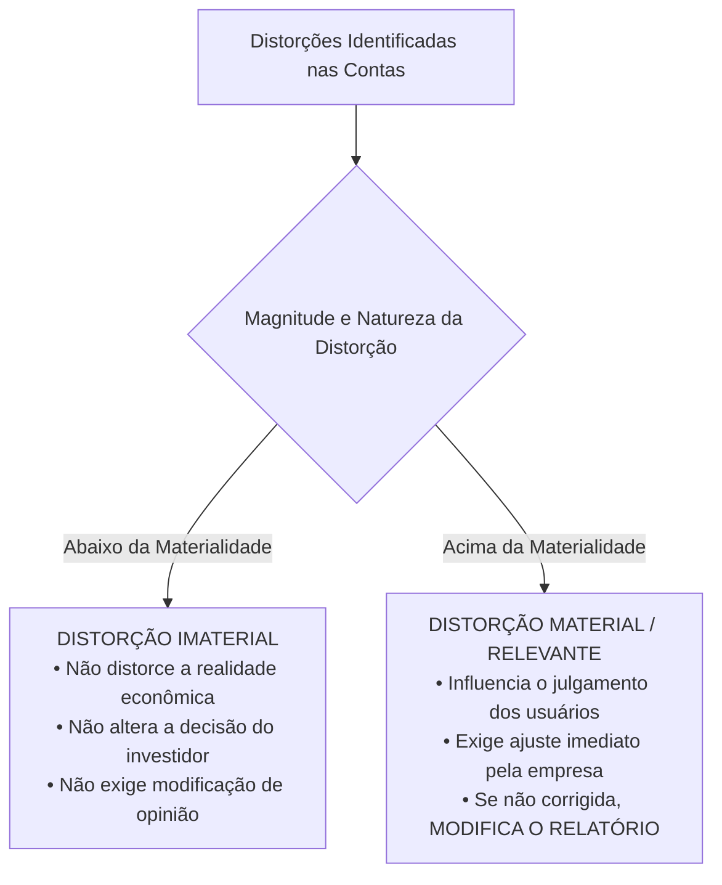
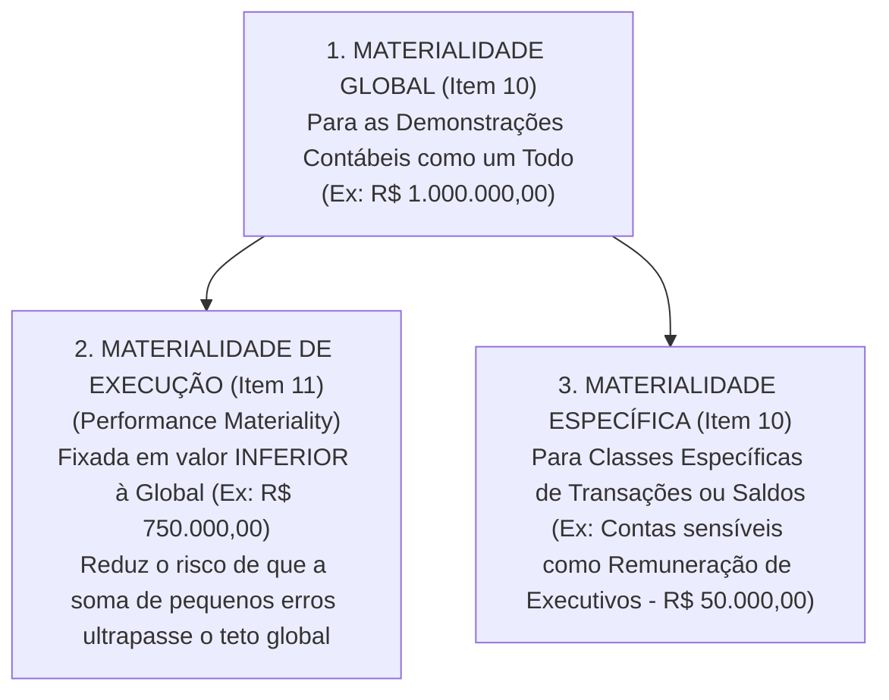
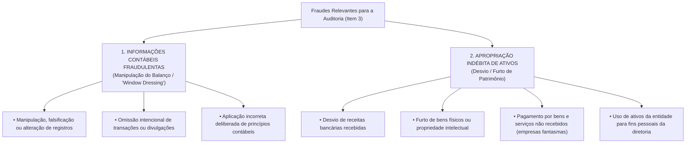
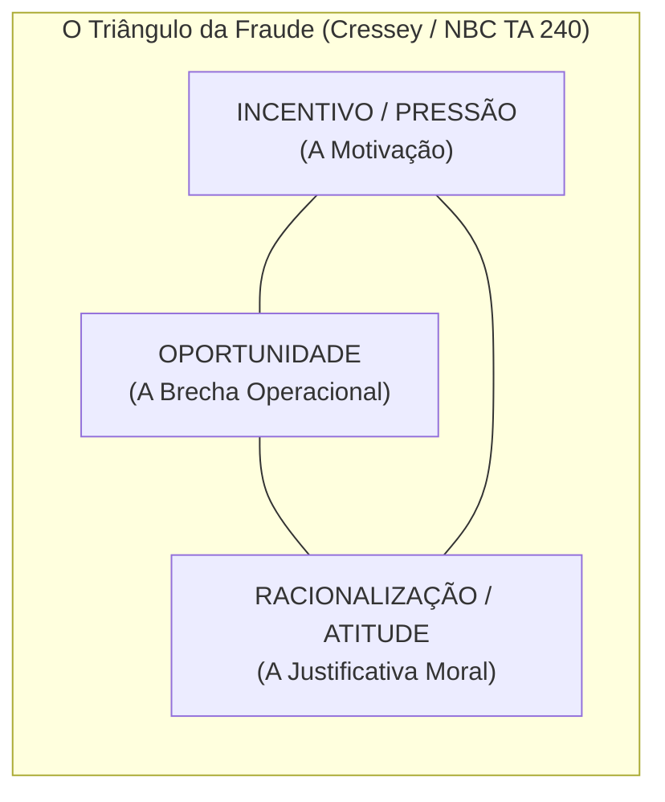
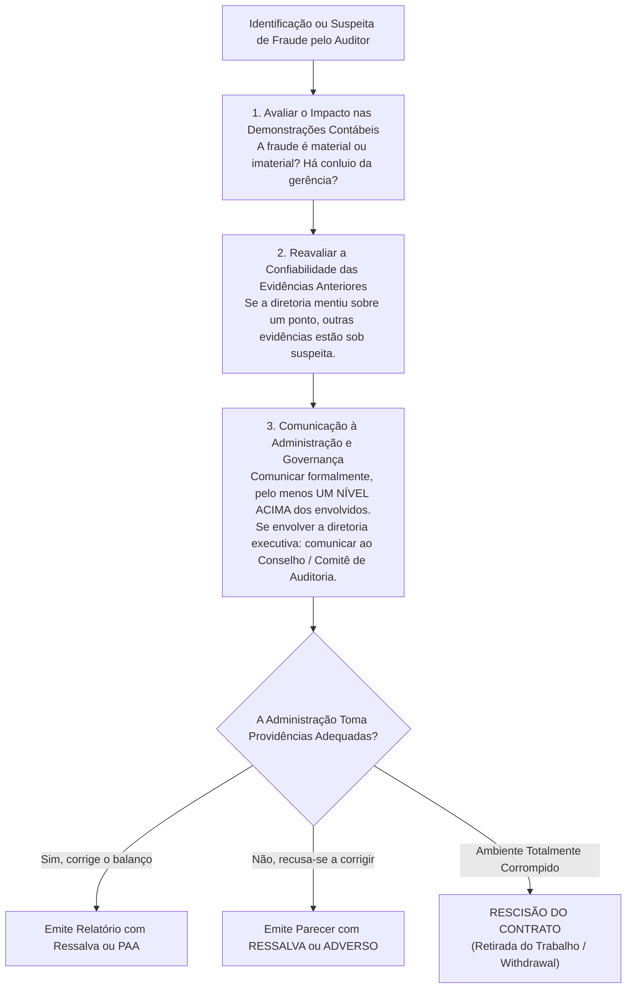

# Módulo 05: Materialidade, Risco de Auditoria e Fraude (NBC TA 320 e NBC TA 240)

> **BLUF (Bottom Line Up Front):**  
> A **Materialidade (NBC TA 320)** é o limiar de tolerância a partir do qual as distorções (omissões ou incorreções), isoladas ou em conjunto, **influenciam as decisões econômicas dos usuários das demonstrações contábeis**. O auditor determina a **Materialidade Global** (para as demonstrações como um todo) e a **Materialidade de Execução (*Performance Materiality*)**, que é obrigatoriamente fixada em valor **inferior** à global para criar uma margem de segurança contra o acúmulo de distorções não detectadas. No tocante a **Fraude e Erro (NBC TA 240)**, o elemento diferenciador é a **intenção (dolo vs. culpa)**. A responsabilidade primária pela integridade e prevenção de fraudes é da **Administração e dos Responsáveis pela Governança**. O auditor busca asseguração razoável, ciente de que o risco de **NÃO detectar fraude é muito maior do que o de não detectar erro**, e que a **burla de controles pela administração (*management override*)** é um risco significativo presumido em todas as auditorias.

---

## 1. O Conceito Doutrinário e Normativo de Materialidade (NBC TA 320)

Na auditoria, a perfeição absoluta é inviável e desnecessária. O auditor não busca garantir que as demonstrações contábeis estejam exatas até o último centavo, mas sim que estejam **livres de distorções relevantes**.



### 1.1. Aspecto Quantitativo vs. Aspecto Qualitativo da Materialidade
A determinação da materialidade não é um cálculo puramente mecânico; envolve **julgamento profissional**:
1. **Aspecto Quantitativo (Magnitude / Valor Financeiro):** Refere-se ao montante numérico da distorção em relação a um referencial (*benchmark*) contábil (ex: 1% a 2% do Ativo Total, 5% do Lucro antes dos Tributos, ou 0,5% a 1% da Receita Bruta).
2. **Aspecto Qualitativo (Natureza da Distorção):** Determinadas distorções são consideradas **materiais por sua própria natureza**, mesmo que envolvam quantias monetárias irrisórias.  
   *Exemplos de Materialidade Qualitativa:*
   - Uma distorção de R\$ 10.000,00 que faz uma empresa sair de prejuízo líquido e apresentar lucro fictício;
   - Uma distorção que faz a entidade cumprir artificialmente uma cláusula restritiva de dívida (*covenant* bancário);
   - Pagamentos ilegais de propina ou remuneração disfarçada a diretores sem autorização estatutária.

---

## 2. A Estrutura dos Níveis de Materialidade

A NBC TA 320 estabelece uma arquitetura hierárquica para a fixação dos limites de materialidade:



### 2.1. Materialidade de Execução (*Performance Materiality*)
> *"É o valor ou valores fixados pelo auditor, em nível **inferior ao da materialidade para as demonstrações contábeis como um todo**, para reduzir a um nível apropriadamente baixo a probabilidade de que as distorções não corrigidas e não detectadas em conjunto excedam a materialidade para as demonstrações contábeis como um todo."*

**Por que ela é necessária?**  
Se o auditor usasse apenas o teto global de R\$ 1.000.000,00 para testar cada saldo individual, ele ignoraria um erro de R\$ 300.000,00 em Estoques, outro de R\$ 400.000,00 em Contas a Receber e outro de R\$ 400.000,00 em Fornecedores. Somados, esses erros totalizariam R\$ 1.100.000,00, estourando a materialidade global sem que nenhuma conta individualmente tivesse sido apontada. A materialidade de execução atua como uma **margem de segurança operacional**.

---

### 2.2. Revisão da Materialidade durante o Curso da Auditoria (Item 12)
O auditor **deve revisar a materialidade** se tomar conhecimento de informações durante a auditoria que teriam levado o auditor a determinar um valor diferente inicialmente.  
*Exemplo:* A empresa projetava faturamento de R\$ 100 milhões no planejamento, mas sofreu uma queda abrupta de vendas no último trimestre, fechando o ano com R\$ 60 milhões. O auditor é obrigado a **recalcular a materialidade para baixo** e reavaliar se a extensão dos testes já realizados ainda é suficiente.

---

## 3. Fraude vs. Erro na Auditoria (NBC TA 240)

O elemento distintivo nuclear entre fraude e erro é a **intenção**.

```mermaid
flowchart LR
    DIST["Distorção nas Demonstrações Contábeis"]
    
    DIST -->|Ato NÃO-INTENCIONAL<br/>(Culpa: negligência, imperícia, desatenção)| ERRO["ERRO CONTÁBIL<br/>• Erro aritmético de cálculo<br/>• Erro de digitação de saldo<br/>• Má interpretação involuntária de norma"]
    
    DIST -->|Ato INTENCIONAL<br/>(Dolo, má-fé, ardil, conluio)| FRAUDE["FRAUDE CONTÁBIL<br/>• Informações contábeis fraudulentas<br/>• Apropriação indébita de ativos<br/>• Ocultação deliberada de passivos"]
```

### 3.1. Por que o Risco de Não Detectar Fraude é Maior que o de Não Detectar Erro?
A NBC TA 240 (item 5) estabelece categoricamente:

> [!IMPORTANT]
> O risco de o auditor **não detectar uma distorção relevante decorrente de fraude é significativamente MAIOR** do que o risco de não detectar uma distorção relevante decorrente de erro.  
> **Razão Técnica:** A fraude é acompanhada por esquemas deliberadamente concebidos para ocultá-la, tais como **falsificação de documentos, conluio entre funcionários e diretores, ou declarações falsas deliberadas** fornecidas ao auditor.

Além disso, o risco de o auditor **não detectar fraude cometida pela ADMINISTRAÇÃO é maior do que o risco decorrente de fraude cometida por EMPREGADOS**. Isso porque a alta gerência ocupa uma posição privilegiada de poder, sendo capaz de manipular registros contábeis e **burlar controles internos** que funcionam perfeitamente para os demais funcionários.

---

## 4. As Duas Modalidades de Fraude Relevantes para o Auditor

A NBC TA 240 delimita o trabalho do auditor a fraudes que resultam em distorção relevante nas demonstrações contábeis:



---

## 5. A Teoria do Triângulo da Fraude (Donald Cressey)

A NBC TA 240 incorpora formalmente a teoria criminológica do **Triângulo da Fraude**, determinando que o auditor deve pesquisar a existência de **Fatores de Risco de Fraude**:



| Vértice do Triângulo | Significado Teórico | Exemplos de Fatores de Risco no Ambiente da Entidade |
| :--- | :--- | :--- |
| **1. Incentivo / Pressão** | A administração ou funcionários sofrem pressão ou incentivo financeiro/psicológico para cometer o ilícito. | • Metas de faturamento agressivas atreladas a bônus de diretores;<br/>• Ameaça iminente de falência ou perda de contratos vitais;<br/>• Dívidas pessoais elevadas de operadores de caixa. |
| **2. Oportunidade** | Circunstâncias que conferem uma brecha para a fraude ser executada sem que seja prontamente detectada. | • Ausência de segregação de funções (mesma pessoa compra e paga);<br/>• Controles internos precários ou inoperantes;<br/>• Transações complexas com empresas coligadas em paraísos fiscais;<br/>• Poder autocrático concentrado em um único executivo. |
| **3. Racionalização / Atitude** | Disposição ética, mentalidade ou justificativa moral que permite ao indivíduo praticar o ato sem culpa. | • *"A empresa lucra bilhões e me paga pouco, eu mereço isso"*;<br/>• *"É só um empréstimo temporário, vou devolver antes do balanço"*;<br/>• Desrespeito ostensivo da diretoria às autoridades fiscais e regulatórias. |

---

## 6. A Burla de Controles pela Administração (*Management Override of Controls*)

A NBC TA 240 (item 31) estabelece uma das regras mais rígidas da auditoria moderna:

> [!CAUTION]
> **Risco Significativo Presumido:**  
> Devido ao poder intrínseco que a administração possui de manipular registros, a **burla de controles internos pela administração é classificada como um RISCO SIGNIFICATIVO em TODAS as auditorias sem exceção**.

Para combater esse risco específico, o auditor é obrigado a planejar e executar três procedimentos mandatórios:
1. **Testar a adequação dos lançamentos contábeis no Diário e Razão:** Examinar lançamentos manuais atípicos efetuados no final do período, lançamentos feitos em fins de semana, ou feitos por pessoas que não costumam realizar lançamentos;
2. **Revisar as estimativas contábeis em busca de viés tendencioso:** Verificar se a administração foi conservadora ou agressiva de modo tendencioso para forçar o resultado (ex: reversão injustificada de provisões);
3. **Avaliar a lógica e justificativa comercial de transações significativas atípicas:** Transações fora do curso normal dos negócios ou com partes relacionadas que pareçam carecer de propósito econômico razoável.

---

## 7. Procedimentos Diante da Identificação ou Suspeita de Fraude

Quando o auditor se depara com indícios de fraude, a norma traça um plano de ação estrito:



### 7.1. Quebra do Sigilo Profissional perante Terceiros
* **Regra Geral:** O auditor deve manter o sigilo profissional (NBC PA 01 / Código de Ética do CFC).
* **Exceção Legal:** O dever de confidencialidade pode ser superado quando houver **imposição legal ou dever regulatório de comunicação a autoridades externas** (ex: Lei nº 9.613/98 de Lavagem de Dinheiro perante o COAF, comunicação ao Banco Central ou à CVM em setores regulados, ou ordem judicial expressa).

---

## 8. Matriz Anti-Pegadinha de Bancas (FGV, Cebraspe, FCC)

| Afirmação Típica de Concurso | Julgamento | Fundamentação Técnica e Pegadinha Desmontada |
| :--- | :---: | :--- |
| *"A materialidade de execução é sempre fixada em valor superior à materialidade global para dar folga ao auditor."* | **ERRADO** | A materialidade de execução é obrigatoriamente fixada em valor **INFERIOR à materialidade global** para atuar como margem de segurança. |
| *"A responsabilidade primária pela detecção de fraudes na empresa recai sobre os auditores independentes contratados."* | **ERRADO** | A responsabilidade primária pela prevenção e detecção de fraudes pertence à **Administração e aos Responsáveis pela Governança** da entidade. |
| *"O auditor tem a mesma probabilidade de não detectar uma fraude do que de não detectar um erro de valor idêntico."* | **ERRADO** | O risco de **não detectar fraude é significativamente MAIOR**, devido à presença de conluio, ardil e esquemas deliberados de ocultação. |
| *"Distorções que estejam abaixo do valor da materialidade monetária jamais podem ser consideradas relevantes pelo auditor."* | **ERRADO** | Distorções pequenas podem ser **materiais por sua natureza (aspecto qualitativo)**, como as que transformam prejuízo em lucro ou pagamentos ilícitos. |
| *"Ao descobrir indício de fraude envolvendo diretores, o auditor deve comunicar o fato primeiramente a esses mesmos diretores."* | **ERRADO** | A comunicação deve ser feita a pessoas com nível de autoridade apropriado, **pelo menos um nível acima** dos envolvidos, ou diretamente ao **Conselho/Comitê de Auditoria**. |

---

## 9. Mnemônicos & Âncoras de Memória

> [!TIP]
> **Mnemônico: O Triângulo da Fraude**  
> **`P-O-R`**  
> - **P** - **P**ressão / Incentivo (o motivo financeiro ou meta corporativa)  
> - **O** - **O**portunidade (a falha de controle interno que abre a brecha)  
> - **R** - **R**acionalização (a desculpa moral do perpetrador para justificar o ato)

> [!TIP]
> **Mnemônico: Materialidade de Execução**  
> **`M.E. é MENOR`**  
> A Materialidade de Execução (**M.E.**) é sempre **M**enor que a global, para engolir os erros somados que tentam passar despercebidos!

---

## 10. Questões Paradigmáticas de Prova Comentadas

### Questão 01 (FGV - Câmara dos Deputados - Consultor Legislativo)
**Enunciado:**  
De acordo com a NBC TA 320, o auditor deve determinar a materialidade de execução para fins de avaliação dos riscos de distorção relevante e determinação da natureza, época e extensão dos procedimentos adicionais de auditoria.  
A respeito da materialidade de execução, assinale a opção correta:
- (A) É fixada em montante superior à materialidade para as demonstrações contábeis como um todo, permitindo que distorções imateriais sejam toleradas.
- (B) É determinada para reduzir a um nível apropriadamente baixo a probabilidade de que as distorções não corrigidas e não detectadas em conjunto excedam a materialidade para as demonstrações contábeis como um todo.
- (C) É um cálculo puramente matemático padronizado pelo CFC em 10% do patrimônio líquido da entidade.
- (D) Aplica-se exclusivamente aos trabalhos de auditoria interna, sendo vedada na auditoria independente de companhias abertas.
- (E) Uma vez estabelecida na fase de planejamento, a materialidade de execução jamais pode ser alterada no decorrer da auditoria.

**Gabarito Oficial:** **B**  
**Comentário Analítico:**  
A alternativa B é a transcrição literal do **item 9 da NBC TA 320**: a materialidade de execução é o valor fixado pelo auditor em nível inferior ao da materialidade global para reduzir a um nível apropriadamente baixo a probabilidade de que o conjunto das distorções exceda a materialidade global. Gabarito: B.

---

### Questão 02 (Cebraspe - Auditor Federal de Controle Externo - TCU)
**Enunciado:**  
No que concerne à responsabilidade do auditor em relação a fraudes, conforme a NBC TA 240, julgue o item a seguir:  
*A distinção entre fraude e erro reside no fato de a ação subjacente que resulta em distorção nas demonstrações contábeis ser intencional ou não intencional. Em função dos esquemas de ocultação inerentes à fraude, o risco de o auditor não detectar uma distorção relevante decorrente de fraude cometida pela administração é maior do que o risco de não detectar aquela praticada por empregados.*

**Gabarito Oficial:** **CERTO**  
**Comentário Analítico:**  
O item aborda com precisão cirúrgica os dois fundamentos da NBC TA 240:
1. O elemento diferenciador entre fraude e erro é a intenção (item 2);
2. O risco de não detectar fraude é maior que erro, e o risco de não detectar fraude da administração é ainda maior do que fraude de empregados, porque a administração tem o poder de manipular registros contábeis e burlar os controles internos (itens 5 a 8). Item irrepreensível e CERTO.

---

### Questão 03 (FCC - SEFAZ-PE - Auditor Fiscal do Tesouro Estadual)
**Enunciado:**  
Durante os exames de auditoria nas demonstrações contábeis de uma sociedade anônima, os auditores detectaram que um diretor executivo recebeu pagamentos indevidos de bônus mediante lançamentos manuais forjados nas contas de despesas operacionais.  
Diante dessa situação, segundo a NBC TA 240, o auditor deve comunicar a suspeita de fraude imediatamente:
- (A) Aos próprios diretores executivos que praticaram os lançamentos manuais.
- (B) Aos responsáveis pela governança (Conselho de Administração ou Comitê de Auditoria).
- (C) À imprensa e aos órgãos de comunicação social.
- (D) Aos acionistas minoritários individualmente em correspondência com aviso de recebimento.
- (E) Exclusivamente à Polícia Federal, renunciando ao dever de comunicação interna.

**Gabarito Oficial:** **B**  
**Comentário Analítico:**  
Conforme a NBC TA 240 (itens 40 a 42), quando a fraude ou suspeita de fraude envolve a **administração (diretoria)**, o auditor deve comunicar o assunto tempestivamente aos **responsáveis pela governança** (Conselho de Administração, Conselho Fiscal ou Comitê de Auditoria). Comunicar aos próprios perpetradores violaria a eficácia da investigação, e comunicar à imprensa violaria o sigilo profissional. Portanto, alternativa B.

---

## 11. Links e Conexões Temáticas

- 🔗 [Módulo 00: Teoria Geral e NBC TA 200](00-conceitos-iniciais-nbc-ta-200.md)
- 🔗 [Módulo 02: Planejamento e Documentação (NBC TA 300 e 230)](02-planejamento-documentacao-nbc-ta-300-230.md)
- 🔗 [Módulo 06: Relatório do Auditor e Tipos de Opinião (NBC TA 700, 705 e 706)](06-relatorio-opiniao-auditor-nbc-ta-700-705-706.md)
- 🔗 [Módulo 07: Controle Interno e Avaliação de Riscos (NBC TA 315 e 265)](07-controle-interno-paa-kam-nbc-ta-315-265-701.md)
